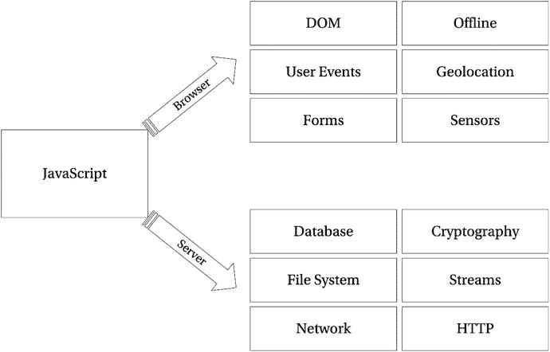
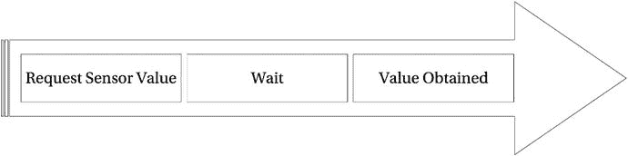
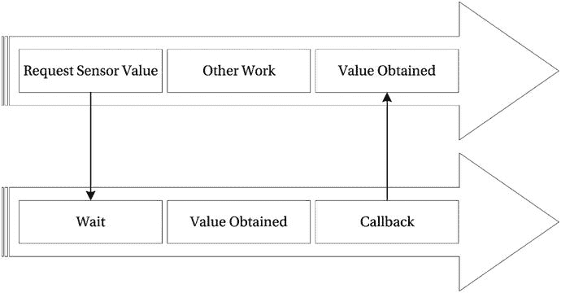
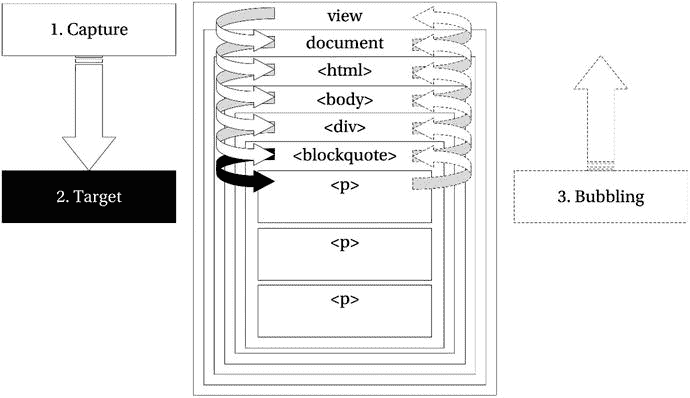

# 5. 理解运行时

> 糟糕程序员与优秀程序员之间的区别在于理解。也就是说，糟糕的程序员不理解自己在做什么，而优秀的程序员理解。——马克斯·卡纳特-亚历山大

一旦你的 TypeScript 程序被编译成纯 JavaScript，你就可以在任何地方运行它。JavaScript 可以轻松地在浏览器或服务器上运行；你只需注意，可用的特性会根据代码运行环境的不同而有所差异。本章将解释你在浏览器运行时和服务器运行时之间会遇到的一些差异，并解释所有运行时都共通的一些重要概念，例如事件循环、作用域和事件。

# 运行时特性

即使是老旧的浏览器也能让你访问文档对象模型（`DOM`）、鼠标和键盘事件、表单和导航功能。而现代浏览器则会增加离线存储、索引数据库、HTTP 请求、地理位置定位，以及用于光线、加速计和距离传感器等设备传感器的一系列应用程序编程接口（`API`）。JavaScript 不仅仅是网络浏览器中最常见的语言；自 20 世纪 90 年代初以来，它就已经在服务器上运行。JavaScript 作为服务器端语言的突出地位实际上是通过`NodeJS`得以实现的，这是一项构建在`V8` JavaScript 引擎之上的服务器技术。在服务器上运行使得你可以访问数据库、文件系统、加密技术、域名解析、流以及无数其他模块和工具。图 5-1 展示了 JavaScript 这门语言是如何通过浏览器或服务器提供的 API 而变得强大的。

除非你明确使用允许创建线程的 API（例如 `Web Worker` 或子进程），否则程序中的语句将排队在单个线程上执行。在单个线程上运行程序消除了多线程试图操作同一状态所导致的许多棘手问题，但这确实意味着你需要记住你的代码可能会被排队。一个长时间运行的事件处理器可能会阻止其他事件及时触发，并且队列的执行顺序在细微之处可能有所不同。队列通常按照先进先出的顺序处理，但不同的运行时环境可能会在不同的时间点重新访问队列。例如，一个运行环境可能只在某个函数执行完毕后才会返回队列，但另一个运行环境可能在任何函数移交控制权时（例如通过调用另一个函数）就重新访问队列。在后一种情况下，在调用第二个函数之前，可能会执行另一条语句。尽管这些潜在差异看似令人担忧，但在实践中很少会发现它们会引起任何问题。

除了处理包含所有事件的队列之外，运行时可能还有其他任务需要在同一个线程上处理；例如，浏览器可能需要重绘屏幕。如果你有一个运行时间过长的函数，就可能影响浏览器的重绘速度。为了让浏览器能够每秒绘制 60 帧，你需要将任何函数的执行时间控制在 17 毫秒以内。在实践中让函数保持快速运行非常容易，除非你处理的是具有阻塞调用的 API（例如 `localStorage`），或者执行一个长时间运行的循环。



图 5-1. 浏览器环境与服务器环境中的 JavaScript 特性

运行时单线程方法最常见的副作用之一是，间隔计时器和定时器的执行时间可能看起来比指定的时间更长。这是因为它们必须在队列中等待执行。代码清单 5-1 展示了一个测试函数，用于计算延迟日志语句的执行时间。调用 `test` 函数会设置一个 50 毫秒的定时器，并测量其触发所需的时间。多次运行这段代码，你会发现得到的结果在 50 到 52 毫秒之间，这符合预期。

```
function test() {
const testStart = performance.now();
window.setTimeout(function () {
console.log(performance.now() - testStart);
}, 50);
}
test();
```

代码清单 5-1. 排队的定时器

为了模拟一个长时间运行的进程，在代码清单 5-2 的 `test` 函数中添加了一个运行 100 毫秒的循环。该循环在设置定时器之后开始，但由于在原始 `test` 函数完成之前没有任何任务出队，定时器执行的时间比之前晚了很多。此示例中记录的时间通常在 118 到 130 毫秒的范围内。

```
function test() {
const testStart = performance.now();
window.setTimeout(function () {
console.log(performance.now() - testStart);
}, 50);
// 模拟长时间运行的进程
const start = +new Date();
while (+new Date() - start < 100) {
// 延迟 100 毫秒
}
}
test();
```

代码清单 5-2. 排队的定时器，延迟执行，等待 `test` 方法结束

注意

所有主流浏览器的最新版本都支持 `performance.now` 高分辨率定时器。这种测量执行时间的方法比使用 `Date` 对象更准确。日期基于系统时钟，系统时钟可能每 15 分钟就会同步一次。如果在计时操作期间发生同步，将会影响你的结果。`performance.now` 值来自一个高分辨率定时器，它可以测量亚毫秒级的时间间隔，在页面开始加载时从 `0` 开始，并且在同步期间不会被调整。

## 作用域

术语“作用域”指的是一组在给定上下文中可解析的可用标识符。在大多数类 C 语言中，标识符是块级作用域的，这意味着它们只能在定义它们的同一组花括号内使用。在一组花括号内声明的变量在该花括号外部不可用，但花括号内的语句可以访问在花括号外部声明的变量。清单 5-3 展示了这种常见的类 C 语言作用域的工作方式。

当你在 JavaScript（以及 TypeScript）中使用 `var` 关键字时，情况并非如此。如果清单 5-3 中的代码在 JavaScript 运行时中执行，那么两个语句中记录的值将是相同的；具体来说，你会看到“Outer: 2”，而不是“Outer: 1”。这是因为使用 `var` 关键字创建的变量的作用域是由函数定义的，而不是由块定义的。

```
var scope = 1;
{
var scope = 2;
// Inner: 2
console.log('Inner: ' + scope);
}
// Outer: 1
console.log('Outer: ' + scope);
清单 5-3.
类 C 语言作用域
```

清单 5-4 展示了相同的示例，但使用一个函数来为内部变量提供作用域。该函数创建了一个新的上下文，使得内部作用域变量独立于外部作用域变量。在这个示例中，日志语句的工作方式与其他类 C 语言相同。

```
var scope = 1;
(function () {
var scope = 2;
// Inner: 2
console.log('Inner: ' + scope);
}());
// Outer: 1
console.log('Outer: ' + scope);
清单 5-4.
函数作用域
```

ECMAScript 规范中有两种新的变量声明：`let` 和 `const`。`let` 和 `const` 都是块级作用域的，这将使你避免函数作用域变量的许多陷阱。`const` 关键字还有一个额外的好处，即防止重新赋值，这意味着变量不能被覆盖（尽管其值可以改变）。

你可以在 TypeScript 代码中使用 `let` 和 `const`。如果你的目标是旧版本的 JavaScript，编译器将使用降级编译来重命名你的变量，以防止它们受到上下文变化的影响。清单 5-5 重新审视了原始示例，使用 `const` 关键字代替 `var` 关键字，从而正确地记录了“Inner: 2”和“Outer: 1”。

```
const scope = 1;
{
const scope = 2;
// Inner: 2
console.log('Inner: ' + scope);
}
// Outer: 1
console.log('Outer: ' + scope);
清单 5-5.
块级作用域
```

清单 5-5 的降级编译将 `const` 关键字替换为 `var` 关键字，但将第二个变量重命名为 `scope_1`，如清单 5-6 所示；这可以防止内部变量覆盖外部变量。编译器足够智能，能够避免命名冲突，因此如果你已经有一个名为 `scope_1` 的变量，编译器会选择另一个名称。

```
var scope = 1;
{
var scope_1 = 2;
// Inner: 2
console.log('Inner: ' + scope_1);
}
// Outer: 1
console.log('Outer: ' + scope);
清单 5-6.
块级作用域变量的降级编译
```

由于无论目标运行时是什么，你都可以在 TypeScript 中使用块级作用域变量，因此在 TypeScript 程序中没有理由使用 `var` 关键字。

注意

正如第 1 章所述，推荐的编码风格是对所有变量使用 `const` 关键字，并且仅在你决定允许重新赋值时才使用 `let` 关键字打开变量。

使用块级作用域变量还可以防止变量提升，变量提升会将所有变量视为在其作用域的最顶部声明。这在技术上允许变量在使用之前（即声明它们的代码行之前）被使用，尽管它们的值会是 `undefined`。清单 5-7 显示了一个变量提升的示例。

```
function lemur() {
// undefined, but technically allowable
console.log(kind);
var kind = 'Ruffed Lemur';
}
lemur();
清单 5-7.
变量提升
```

如果你在声明块级变量之前访问它，TypeScript 编译器会发出警告，从而防止此类细微的错误，以及清单 5-8 中更令人困惑的错误，在该错误中，你可能会期望日志语句中使用全局变量。在使用 `var` 关键字时，偶然重用了更广泛作用域中的名称，这导致了我职业生涯中调查过的一些最著名的棘手错误。

```javascript
var kind = 'Ring Tailed Lemur';
function lemur() {
  // undefined, not 'Ring Tailed Lemur'
  console.log(kind);
  var kind = 'Ruffed Lemur';
}
lemur();
```

**清单 5-8. 变量提升与全局作用域混淆**

> **注意**
> 在你的程序中，避免混淆的最佳方法是尽可能避免向全局作用域添加内容。全局变量的缺失意味着 TypeScript 编译器可以警告你在变量声明之前使用它们，以及意外省略 `var` 或 `let` 关键字的情况。

### 回调函数

几乎所有现代 JavaScript API，包括那些提供访问设备传感器读数的新浏览器 API，都通过接受一个在操作完成时执行的回调函数来避免阻塞。回调函数就是你作为参数传入的一个函数，当某个操作完成后，它会被调用。

为了说明回调函数的好处，图 5-2 展示了程序在等待一个阻塞型传感器响应请求时的执行流程。由于请求在整个持续期间阻塞了主线程，因此无法执行任何其他语句。将事件队列阻塞超过几毫秒是不可取的，对于长时间运行的操作必须避免这种情况。涉及文件系统调用、硬件设备调用或跨网络连接调用的操作都可能将程序阻塞过长时间，这是不可接受的。



**图 5-2. 阻塞式调用**

回调函数对于避免这些阻塞请求非常有用。图 5-3 展示了如何使用这种模式来避免在长时间运行过程中阻塞主线程。当发出请求时，一个函数会连同请求一起被传入。随后，主线程能够像往常一样处理事件队列。当长时间运行的过程结束时，回调函数被调用，并传入任何相关的参数。这将回调函数添加到事件队列中，然后依次执行。



**图 5-3. 使用回调函数**

尽管回调函数通常用于在长时间运行过程中避免阻塞程序，但你可以在程序中的任何位置自由地将函数作为参数传递。清单 5-9 演示了这一点。`go` 函数接受一个函数参数。`callback` 参数有一个类型注解，限制只能传递那些接受 `string` 参数的函数。`callbackFunction` 满足这个类型注解。

在 `go` 函数体内，使用 `call` 方法执行回调函数，该方法在 JavaScript 中的所有函数上都可用。

```typescript
function go(callback: (arg: string) => void) {
  callback.call(this, 'Example Argument');
}

function callbackFunction(arg: string) {
  alert(arg);
}

go(callbackFunction);
```

**清单 5-9. 将函数作为参数传递**

在 `go` 函数内部执行回调函数有三种常见方式。在清单 5-9 中，使用了 `call` 方法。当使用 `call` 时，你必须提供一个变量来设置回调函数中 `this` 关键字的上下文。你可以在上下文参数之后跟随任意数量的额外参数；这些参数将被传入回调函数。你也可以使用 `apply` 方法，它与 `call` 几乎相同，区别在于你以数组形式传递参数，如清单 5-10 所示。如果你的结果已经是一个数组，那么这些值会被展开成独立的参数。

```typescript
function go(callback: (arg: string) => void) {
  callback.apply(this, ['Example Argument']);
}

function callbackFunction(arg: string) {
  alert(arg);
}

go(callbackFunction);
```

**清单 5-10. 使用 `apply`**

第三种执行回调函数的方法是直接用圆括号调用该函数，如清单 5-11 所示。这种方式不允许设置上下文，因此根据上下文的不同，作用域可能与你的预期有所不同。

```typescript
function go(callback: (arg: string) => void) {
  callback('Example Argument');
}

function callbackFunction(arg: string) {
  alert(arg);
}

go(callbackFunction);
```

**清单 5-11. 简单的函数调用**

在回调函数上下文之外，`apply` 方法还有一个额外的用途。由于它接受一个包含参数的数组，你可以使用 `apply` 从数组中提取参数。这在清单 5-12 中进行了演示。要找出 `numbers` 数组中的最大值，你要么编写一个循环来逐一测试，要么使用每个索引将每个值单独传入 `Math.max` 函数。使用 `apply` 方法意味着你可以直接传入 `numbers` 数组，并让 `apply` 方法将数组转换为参数列表。因为你没有使用 `apply` 来修改作用域，所以可以将 `null` 作为第一个参数传入。

```typescript
const numbers = [3, 11, 5, 7, 2];
// 查找最大值的一种脆弱方式
// const max = Math.max(numbers[0], numbers[1], numbers[2], numbers[3], numbers[4]);
// 查找最大值的稳健方式
const max = Math.max.apply(null, numbers);
// 11
console.log(max);
```

**清单 5-12. 使用 `apply` 将数组转换为参数**

使用回调函数的模式是将函数作为参数传递的一个例子。下一节将描述这种语言特性的强大之处，以及如何以其他方式使用它。

### 将函数作为参数传递

函数在 JavaScript 中是**一等公民**，这意味着它们可以作为参数传递，作为返回值从另一个函数返回，赋值给变量，并作为对象的属性存储。将函数作为参数传递是提供回调函数的机制。

你可以利用将函数作为参数传递的能力，创建一个简单的观察者模式实现：存储一组订阅者，并从单个类向所有订阅者发布事件。这个简单的观察者模式设计如清单 5-13 所示。可以添加任意数量的订阅者，当发布者接收到消息时，它会将消息分发给所有订阅者。

```typescript
interface Subscriber {
  (message: string): void;
}

class Publisher {
  private subscribers: Subscriber[] = [];

  addSubscriber(subscriber: Subscriber) {
    this.subscribers.push(subscriber);
  }

  notify(message: string) {
    for (let subscriber of this.subscribers) {
      subscriber(message);
    }
  }
}

const publisher = new Publisher();
// 使用箭头函数
publisher.addSubscriber((message) => console.log('A: ' + message));
// 使用内联函数
publisher.addSubscriber(function (message) {
  console.log('B: ' + message);
});
// A: Test message
// B: Test message
publisher.notify('Test message');
```

**清单 5-13. 简单的观察者**

> **注意**
> 当你将函数作为参数传递时，必须省略圆括号；例如，使用 `go(callbackFunction)` 而不是 `go(callbackFunction())`；否则函数会被执行，而传递的是其返回值。

一等函数是任何语言中最强大的特性之一。你可以创建**高阶函数**，它们接受函数作为参数，并返回函数作为结果；这提供了更大的灵活性，以及程序中更细粒度的代码可重用性。你也可以参考第 1 章，了解更多关于函数柯里化和箭头函数的内容。

## Promise

引入 Promise 是为了减少回调函数带来的若干问题。当使用一连串的回调时，代码会变得深度嵌套且难以追踪。当考虑错误处理时，回调函数往往会重复编写错误处理代码，进一步增加了理解程序的认知负荷。

原生 `Promise` 对象仅在 ECMAScript 5 之后的版本中可用。如果你的目标对象是这些较新的规范版本，你可以直接使用纯粹的 Promise 原生版本。否则，你需要应用一个 polyfill 来添加所需的功能。

为了全面探讨 Promise，我们需要处理一个相当有代表性的示例。通过完成本练习，你将会理解如何使用 Promise，以及如何创建它们。即使本节中的示例非常简单（它们只是在控制台输出了一些数据），你也能看到回调链导致的问题，以及 Promise 是如何解决嵌套和可读性问题的。

### 简单的回调

第一个示例涉及简单的回调。这个示例允许使用回调，在异步操作完成后将控制权返回给调用代码。我们稍后将对这个程序进行演进，以解决各种问题。

列表 5-14 是我们虚构 API 的起点，它用于异步获取一些数据。`getData` 方法接受一个 `id` 和一个回调函数，当数据可用时会执行这个回调。依赖数据的代码必须放在这个回调函数内部。

```typescript
interface FictitiousData {
    id: number;
    name: string;
}
class FictitiousAPI {
    static data: { [index: number]: FictitiousData } = {
        1: { id: 1, name: 'Aramis' },
        2: { id: 2, name: 'Athos' },
        3: { id: 3, name: 'Porthos' },
        4: { id: 4, name: 'D\'Artagnan' }
    };
    static getData(id: number, callback: (data: FictitiousData) => void) {
        // 使用超时模拟异步数据访问
        window.setTimeout(() => {
            const result = this.data[id];
            if (typeof result == 'undefined') {
                throw new Error('No matching record');
            }
            callback(result);
        }, 200);
    }
}
```

该 API 的一个简单用法如列表 5-15 所示。一旦异步的 `getData` 函数就绪，它就会执行回调函数，将数据记录到控制台。

```javascript
// 单次调用：'Aramis'
FictitiousAPI.getData(1, function (data) {
    console.log(data.name);
});
```

与回调模式相关的一个问题是，它无法处理异步代码中发生的任何异常。无论你在哪里插入 `try/catch` 语句，你都无法在此版本的 API 中处理该错误。

```javascript
// 错误处理（不起作用）
try {
    FictitiousAPI.getData(5, function (data) {
        console.log(data.name);
    })
} catch (ex) {
    console.log('This statement is not reached, the error is not caught!');
}
```

当你需要使用回调来链式调用多个操作时，代码会迅速变得嵌套且难以阅读。列表 5-17 展示了对类似数据获取调用的嵌套，但当你需要使用多个不同的异步 API 时，也会出现嵌套回调的情况。

```javascript
FictitiousAPI.getData(1, (data) => {
    console.log(data.name);
    FictitiousAPI.getData(2, (data) => {
        if (data.name == 'Athos') {
            console.log(data.id + ' ' + data.name);
        } else {
            console.log(data.name);
        }
        FictitiousAPI.getData(3, (data) => {
            console.log(data.name);
            FictitiousAPI.getData(4, (data) => {
                console.log(data.name);
                FictitiousAPI.getData(5, (data) => {
                    console.log(data.name);
                })
            });
        });
    });
});
```

该程序的输出如下所示：

```
==== OUTPUT ====
Aramis
2 Athos
Porthos
D'Artagnan
Error: No matching record
```

演进这段代码的第一步是使其能够处理 API 内部发生的错误。之后，我们可以考虑使用 Promise 来改进它。

### 回调与错误处理

为了解决错误处理的问题，我们将向回调函数引入一个额外的参数。这是广泛使用回调的程序中的常见模式。通过将错误参数放在第一位，成功情况可以拥有可变数量的参数，而不会影响调用代码期望在哪里找到问题信息。

列表 5-18 展示了 API 的完整第二版，现在它将错误字符串作为第一个参数。在出现问题时，不是抛出错误，而是将错误消息作为第一个参数传递。在成功的情况下，则不传递错误字符串。

```typescript
interface FictitiousData {
    id: number;
    name: string;
}
class FictitiousAPI {
    static data: { [index: number]: FictitiousData } = {
        1: { id: 1, name: 'Aramis' },
        2: { id: 2, name: 'Athos' },
        3: { id: 3, name: 'Porthos' },
        4: { id: 4, name: 'D\'Artagnan' }
    };
    static getData(id: number, callback: (error: string, data: FictitiousData) => void) {
        // 使用超时模拟异步数据访问
        window.setTimeout(() => {
            const result = this.data[id];
            if (typeof result == 'undefined') {
                callback('No matching record', null);
                return;
            }
            callback(null, result);
        }, 200);
    }
}
```

为了在实际中应用这种新的错误处理模式，列表 5-19 中的简单调用现在需要在访问 `data` 参数之前检查错误。

```javascript
// 单次调用：'Aramis'
FictitiousAPI.getData(1, function (error, data) {
    if (error) {
        console.log('Caught ' + error);
        return;
    }
    console.log(data.name);
});
```

同样的检查出现在列表 5-20 中，并且成功地处理了以前无法处理的错误。我们现在可以在成功和出错时执行不同的操作。

```javascript
// 错误处理
FictitiousAPI.getData(5, function (error, data) {
    if (error) {
        console.log('Caught ' + error);
        return;
    }
    console.log(data.name);
});
```

这种模式的缺点在于错误处理代码的激增，这使得我们的嵌套回调情况变得更加冗长，如列表 5-21 所示。尽管这段代码示例仍然只满足一个非常基本的功能，但现在它成了一个难以理解的复杂列表。

该程序的输出与之前基本相同，如下所示，唯一的区别是错误现在已被处理：

```
==== OUTPUT ====
Aramis
2 Athos
Porthos
D'Artagnan
Caught No matching record
```

演进这段代码的下一步是使用 `Promise` 大幅提高其可读性。

# Promise 对象

将 Promise 引入 API 是件相当简单的任务。在代码清单 5-22 中，`getData` 方法的签名被清理了，移除了所有为回调函数引入的参数。这使得签名更好地描述了执行操作所需的内容：在本例中，只需要 `id`。

该方法的主体被包裹在一个新的 Promise 对象中，该对象始终具有包含两个函数参数的签名。第一个函数将在请求成功时用于兑现（fulfill）该 Promise。第二个函数用于在发生错误时拒绝（reject）该 Promise。所有 Promise 都有这个签名，但在 TypeScript 中，你可以使用更具体的类型信息来进一步增强这些函数。

在代码清单 5-22 中，`fulfil` 函数有一个带类型的参数 `data`，它将包含 `FictitiousData` 类型的数据，而 `reject` 函数有一个字符串类型的 `reason` 参数。这里的类型注解将确保在使用此 Promise 的代码中，自动补全的成员是正确的。你还可以在创建 Promise 时使用类型参数来添加此类型信息。

```typescript
interface FictitiousData {
  id: number;
  name: string;
}

class FictitiousAPI {
  static data: { [index: number]: FictitiousData } = {
    1: { id: 1, name: 'Aramis' },
    2: { id: 2, name: 'Athos' },
    3: { id: 3, name: 'Porthos' },
    4: { id: 4, name: 'D\'Artagnan' }
  };

  static getData(id: number) {
    return new Promise((fulfil: (data: FictitiousData) => void, reject: (reason: string) => void) => {
      // 使用超时模拟异步数据访问
      window.setTimeout(() => {
        const result = this.data[id];
        if (typeof result == 'undefined') {
          reject('没有匹配的记录');
        }
        fulfil(result);
      }, 200);
    });
  }
}
```

当我们调用 `getData` 方法时，我们现在会返回一个 Promise，如代码清单 5-23 所示。取代回调函数的是，Promise 对象有一个 `then` 方法，它接受一个函数。在这个简单的例子中，Promise 的主要好处是它将 `getData` 签名和 `then` 签名的职责分离开来。还有更多实质性的好处即将呈现。

```javascript
// 单次调用：'Aramis'
FictitiousAPI.getData(1)
  .then(function (data) {
    console.log(data.name);
  });
```

为了处理在满足 Promise 时发生的错误，可以使用 `catch` 方法，如代码清单 5-24 所示。我们现在有了三个各自处理独立职责的项，而不是之前那种所有职责混杂在一起的回调设计。

```javascript
// 错误处理（起效）
FictitiousAPI.getData(5)
  .then(function (data) {
    console.log(data.name);
  })
  .catch(function (error) {
    console.log('捕获到 ' + error);
  });
```

为了更好地展示这些好处，完整的 Promise 链如代码清单 5-25 所示。这段代码的嵌套最少（最多两层，而之前使用带错误处理的回调版本有五层嵌套）。每个 `then` 函数都相对容易理解，并且所有异常处理都包含在单个 `catch` 中。

```javascript
FictitiousAPI.getData(1)
  .then((data) => {
    console.log(data.name);
    return FictitiousAPI.getData(2);
  })
  .then((data) => {
    if (data.name == 'Athos') {
      console.log(data.id + ' ' + data.name);
    } else {
      console.log(data.name);
    }
    return FictitiousAPI.getData(3);
  })
  .then((data) => {
    console.log(data.name);
    return FictitiousAPI.getData(4);
  })
  .then((data) => {
    console.log(data.name);
    return FictitiousAPI.getData(5);
  })
  .catch((error) => {
    console.log('捕获到 ' + error);
  });
```

更新后程序的输出与之前相同，但程序更易于阅读。

```
==== 输出 ====
Aramis
2 Athos
Porthos
D'Artagnan
捕获到 没有匹配的记录
```

虽然这个例子使用了单个 `catch`，但为了重现原始回调示例的行为，如果你希望在链的后续处理中继续执行，可以在链中更早的位置插入额外的 `catch` 块来提前处理错误。Promise 在这方面非常灵活。

即使在嵌套和错误处理方面，Promise 也完全胜过回调，但 Promise 还有一些其他回调根本无法实现的好处。

### 多个 Promise

链式调用多个 Promise 的另一种方式是，使用一个负责从各个子 Promise 获取值的包装 Promise 来聚合它们的结果。Promise 内建了一种机制，可以通过简单调用 `Promise.all` 来实现这一点。

代码清单 5-26 展示了将代码清单 5-25 中的 Promise 链折叠成对 `Promise.all` 的调用。一旦所有 Promise 都被敲定（settled），`then` 块就会接收结果并执行。如果有任何错误，会立即调用 `catch` 块；这是一种快速失败（fail-fast）机制。这是表达你的代码需要兑现所有 Promise 才能继续执行的好方法。

```javascript
Promise.all([
  FictitiousAPI.getData(1),
  FictitiousAPI.getData(2),
  FictitiousAPI.getData(3),
  FictitiousAPI.getData(4)
]).then((values) => {
  for (let val of values) {
    console.log(val.name);
  }
}).catch((error) => {
  console.log('捕获到 ' + error);
});
```

无论每个单独的 Promise 需要多长时间才能兑现，传递给 `then` 块的值将按照传入的 Promise 顺序排序。就代码清单 5-26 而言，结果将始终按 Aramis、Athos、Porthos、D’Artagnan 的顺序排列，即使异步操作以不同的顺序成功完成也是如此。

#### 最快的 Promise

如果你在调用多个异步操作，并且只关心获取最快的那个结果，可以使用 `Promise.race` 方法。

清单 5-27 展示了在 Promise 竞赛中使用到的清单 5-25 的 Promise 链。第一个落定的 Promise 会导致整个竞赛也落定，其结果要么是那个最快 Promise 的兑现值，要么是其拒绝原因。即使第一个结果立即可用，但在后台，其他操作仍会继续，这意味着，即使你的竞赛已有胜者，这些操作依然会消耗资源。

```javascript
Promise.race([
  FictitiousAPI.getData(1),
  FictitiousAPI.getData(2),
  FictitiousAPI.getData(3),
  FictitiousAPI.getData(4)
]).then((data) => {
  console.log(data.name);
}).catch((error) => {
  console.log('Caught ' + error);
});
```

Promise 提供了一种优越的机制来处理异步链、减少嵌套，并简化且标准化错误处理。还有一些有用的标准 Promise 组合方法，允许你同时发起多个异步操作，并在所有 Promise 都兑现后，收敛到一个单一的 `then` 块中。

Promise 正逐渐成为处理异步 API 的事实标准机制，浏览器也将基于 Promise 实现特性的改进。例如，清单 5-28 中展示的 `XMLHttpRequest` 机制，很可能会被一个用于执行相同操作的、基于 Promise 的 `fetch` API 所取代。

```
const request = new XMLHttpRequest();
request.onload = function() {
if (request.status !== 200) {
// 状态码不太可能被使用，例如重定向
console.log('Status Code:', request.status);
return;
}
const data = JSON.parse(request.responseText);
console.log(data);
};
request.onerror = (error) => {
// 网络故障或状态码是错误
console.log('Error making request: ', error);
};
request.open('get', './api/musketeers.json', true);
request.send();
清单 5-28.
XMLHttpRequest
```

与之等价的 `fetch` API 如清单 5-29 所示。尽管在撰写本文时此特性仍处于实验阶段，但其引入已迫在眉睫。请注意，最终的规范可能与这个示例有所不同。

```
fetch('./api/musketeers.json')
.then((response) => {
if (response.status !== 200) {
// 状态码不太可能被使用，例如重定向或错误
console.log('Status Code:', response.status);
return;
}
return response.json();
}).then((data) => {
console.log(data);
})
.catch((error) => {
// 例如网络故障
console.log('Error making request', error);
});
清单 5-29.
Fetch API
```

随着 Promise 模式越来越为人熟知，像 `Fetch` API 这样的变化将使交互变得更加熟悉和可预测。与几乎总是让程序员需要再次查阅文档的 `XMLHttpRequest` 不同，你可以通过 `Fetch` API 直接遵循模式来操作，因为它仅仅是一个 Promise 链。你可以期待任何提供异步操作的 API 都会有类似的改进。

### 事件

事件是 JavaScript 运行时的一个基本概念，因此它也是所有 TypeScript 程序员非常感兴趣的部分。事件监听器通常被附加到用户发起的事件上，例如网页中的触摸、点击、按键以及其它交互，但事件也可以作为一种机制，用于解耦需要触发处理的代码与执行实际工作的代码。

事件在两个不同的阶段处理——捕获阶段和冒泡阶段。

1.  在捕获阶段，事件首先被发送到文档层次结构中最顶层的元素，然后发送到嵌套更深的元素。

2.  在冒泡阶段，事件首先被发送到目标元素，然后发送到其祖先元素。

事件阶段作为事件参数的一个属性提供，可以通过 `e.eventPhase` 来访问，其中你的事件参数名为 `e`。

即使冒着过度强调在单线程事件循环中运行这一观点的风险，也值得牢记，附加到同一事件的多个事件监听器将会顺序执行，而非并行执行，并且一个长时间运行的监听器可能会延迟附加到同一事件的后续监听器的执行。当一个事件被触发时，每个事件监听器都会按照其被附加的顺序进入队列；如果第一个监听器需要 2 秒才能运行完毕，第二个监听器至少会被阻塞 2 秒，并且只有在其到达事件队列顶端时才会执行。

```
class ClickLogger {
constructor() {
document.addEventListener('click', this.eventListener);
}
eventListener(e: Event) {
// 3（冒泡阶段）
const phase = e.eventPhase;
const tag = (e.target).tagName;
console.log(`Click event in phase ${phase} detected on element ${tag} by ClickLogger.`);
}
}
const clickLogger = new ClickLogger();
清单 5-30.
事件监听器
```

清单 5-30 展示了一个类，它将其方法之一 `eventListener` 附加到文档的 `click` 事件上。当与清单 5-31 中的 HTML 页面结合使用时，这个 `ClickLogger` 类将根据被点击的元素输出消息，例如：

-   `Click event detected on element DIV by ClickLogger.`

-   `Click event detected on element P by ClickLogger.`

-   `Click event detected on element BLOCKQUOTE by ClickLogger.`

-   `Click event detected on element FOOTER by ClickLogger.`

```
Event Demo

Clicking on different parts of this document logs appropriate messages.

Any fool can write code that a computer can understand.
Good programmers write code that humans can understand.

-Martin Fowler

清单 5-31.
示例文档
```

注意

添加事件监听器的正确方式是调用 `addEventListener`。版本 9 之前的 Internet Explorer 使用另一种 `attachEvent` 方法。你可以使用清单 5-32 中展示的自定义 `addEventCrossBrowser` 函数来针对这两种附加事件的方法。该函数的改进版本将在第 5 章中出现。

```
function addEventCrossBrowser(element, eventName, listener) {
if (element.addEventListener) {
element.addEventListener(eventName, listener, false);
} else if (element.attachEvent) {
element.attachEvent('on' + eventName, listener);
}
}
class ClickLogger {
constructor() {
addEventCrossBrowser(document, 'click', this.eventListener);
}
eventListener(e: Event) {
// 3（冒泡阶段）
const phase = e.eventPhase;
const tag = (e.target).tagName;
console.log('Click event detected on element ' + tag + ' by ClickLogger.');
}
}
const clickLogger = new ClickLogger();
清单 5-32.
跨浏览器事件
```

你不必局限于任何给定运行时中有限的支持事件列表；你也可以监听并派发自己的自定义事件。

### TypeScript 的自定义事件机制

清单 5-33 展示了自定义事件机制。在某些环境中，只需使用`addEventListener`和`dispatchEvent`即可实现。你可以将自定义数据作为事件的一部分传递，供监听器使用。

```markdown
## 自定义事件

```javascript
// Polyfill for CustomEvent:
// https://developer.mozilla.org/en/docs/Web/API/CustomEvent
(function () {
function CustomEvent(event, params) {
params = params || { bubbles: false, cancelable: false, detail: undefined };
const evt = document.createEvent('CustomEvent');
evt.initCustomEvent(event, params.bubbles, params.cancelable, params.detail);
return evt;
};
CustomEvent.prototype = (window).Event.prototype;
(window).CustomEvent = CustomEvent;
})();
// Fix for lib.d.ts
interface StandardEvent {
new(name: string, obj: {}): CustomEvent;
}
var StandardEvent = CustomEvent;
// Code for custom events is below:
enum EventType {
MyCustomEvent
}
class Trigger {
static customEvent(name: string, detail: {}) {
const event = new StandardEvent(name, detail);
document.dispatchEvent(event);
}
}
class ListeningClass {
constructor() {
document.addEventListener(
EventType[EventType.MyCustomEvent],
this.eventListener,
false);
}
eventListener(e: Event) {
console.log(EventType[EventType.MyCustomEvent] + ' detected by ClickLogger.');
console.log('Information passed: ' + (e).detail.example);
}
}
var customLogger = new ListeningClass();
Trigger.customEvent(
EventType[EventType.MyCustomEvent],
{
"detail": {
"example": "Example Value"
}
}
);
```

**清单 5-33. 自定义事件**

你可以选择使用事件，或编写事件代码（例如清单 `5-13` 中的简单观察者模式），以便在程序中分发工作负载。

### 事件阶段

事件会沿着一条从文档根节点到目标元素的传播路径被派发到事件目标。沿着这条路径从根节点到目标元素的每一次推进，都属于事件的捕获阶段，该阶段编号为 1。接着，事件到达事件目标，阶段变为目标阶段，编号为 2。最后，事件在冒泡阶段从事件目标沿反向路径流回根节点，该阶段编号为 3。

这些事件阶段如图 `5-4` 所示。引用块中的其他元素不属于根节点与事件目标之间的层级结构，因此它们不在传播路径中。



**图 5-4. 事件阶段**

事件为解耦程序中的代码提供了强大的机制。如果你通过触发事件来执行操作，而不是直接调用代码，那么将操作分解为多个单一职责的小型事件监听器就会变得很简单。此外，后续添加更多监听器也是一件轻而易举的事。

## 扩展对象

在 JavaScript 中，几乎所有东西都是对象，这些对象由一组属性组成。每个属性都是一个键值对，键为字符串，值可以是任意类型，包括基本类型、对象和函数。如果值是函数，通常被称为方法。在 TypeScript 中创建类时，它由 JavaScript 对象表示，但还有许多内置对象可供使用。

所有原生对象都是开放的，这意味着你可以像扩展自己的对象一样轻松地扩展它们。在扩展原生对象时需要谨慎，原因如下：

- 如果每个人都扩展原生对象，这些扩展很可能会相互覆盖，或以不兼容的方式组合。

- 原生对象的定义将来有可能与你定义的冲突，并且你的实现会隐藏原生实现。

因此，虽然扩展原生对象是可行的，但通常只建议将其作为一种 polyfill 技术来使用，这是一种为较旧的运行时环境添加当前功能的方法。尽管你可能决定遵循不那么严格的规则，但最好还是以 polyfill 的风格来编写原生对象扩展，这样至少能检测到以下情况之一的发生：

- 原生的功能被添加时，其名称与你的扩展冲突。

- 其他程序员添加了同名的另一个扩展。

- 第三方库或框架添加了同名的扩展。

尤其是第三点说明，如果你的程序要作为库供其他程序员使用，那么就不应该编写原生对象扩展。如果库作者经常扩展原生对象，发生冲突的可能性会很高，而获胜者将只是最后加载的那个扩展，因为它会覆盖所有之前的扩展。

**注意**

术语 polyfill（源自一种名为 Polyfilla 的墙面抹平与裂缝填充水泥）由 Remy Sharp（Remy Sharp 的博客，[`http://remysharp.com/2010/10/08/what-is-a-polyfill/`](http://remysharp.com/2010/10/08/what-is-a-polyfill/)，2010 年）创造，用于描述一种在原生实现可用时优先使用原生实现，否则便添加缺失原生行为的技术。例如，你会尝试在浏览器中检测某个特性，如果缺失则仅补充该特性。

### 扩展原型

在清单 `5-34` 中，原生 `NodeList`（它包含一个 HTML 元素列表）被扩展，增加了一个 `each` 方法，用于为列表中的每个元素执行一个回调函数。该扩展被添加到 `NodeList.prototype` 上，这意味着所有 `NodeList` 实例都可以使用它。调用 `document.querySelectorAll` 会返回一个包含匹配元素的 `NodeList`，现在可以使用 `each` 方法，通过 `getParagraphText` 函数来显示每个元素的内容。使用 `each` 方法意味着 `for` 循环只需在一个地方定义。

`call` 方法并非将每个元素作为参数传入回调函数，而是将元素绑定到函数的上下文，这意味着 `getParagraphText` 函数可以使用 `this` 关键字来引用该元素。

```javascript
NodeList.prototype.each = function (callback) {
for (let node of this) {
callback.call(node);
}};
const getParagraphText = function () {
console.log(this.innerHTML);
};
const paragraphs = document.querySelectorAll('p');
paragraphs.each(getParagraphText);
```

**清单 5-34. 在 JavaScript 中扩展对象**

当你将此代码添加到 TypeScript 程序中时，会产生错误，警告你 `each` 方法在 `NodeList` 接口上不存在。你可以在程序中为该接口添加声明来消除这些错误并获得智能的自动补全功能，如清单 `5-35` 所示。这样做还有一个额外的好处：如果原生对象的更新与你的扩展发生冲突，TypeScript 编译器会警告你存在重复的声明。

```typescript
interface NodeList {
each(callback: () => any): void;
}
NodeList.prototype.each = function (callback) {
for (let node of this) {
callback.call(node);
}
};
const getParagraphText = function () {
console.log(this.innerHTML);
};
const paragraphs = document.querySelectorAll('p');
paragraphs.each(getParagraphText);
```

**清单 5-35. 在 TypeScript 中扩展对象**

在这个例子中，`each` 方法内的 `this` 关键字没有类型信息，因为它无法被推断出来。这个问题可以按照清单 `5-36` 所示进行改进。通过将元素从上下文 `this` 关键字移到参数中，程序中的自动补全和类型检查得到了改进。这也意味着该函数可以更容易地被复用。`NodeList` 和通用的 `NodeListOf` 接口都被扩展了，以提供尽可能严密的类型检查。
```

# 对象扩展与封装

## 密封对象

如果你担心自己的代码被扩展，可以使用 `Object.seal` 来防止你的实例被扩展。清单 5-38 展示了其他人可能对你的代码进行的典型扩展，清单 5-39 展示了如何防止这种情况。`Object.seal` 阻止添加新属性，并将所有现有属性标记为不可配置。但仍然可以修改现有属性的值。

```typescript
class Lemur {
    constructor(public name: string) {
    }
}
const lemur = new Lemur('Sloth Lemur');
// 新属性
lemur.isExtinct = true;
// true
console.log(lemur.isExtinct);
```
清单 5-38. 扩展后的实例

```typescript
class Lemur {
    constructor(public name: string) {
    }
}
const lemur = new Lemur('Sloth Lemur');
Object.seal(lemur);
// 新属性
lemur.isExtinct = true;
// undefined
console.log(lemur.isExtinct);
```
清单 5-39. 密封实例

你可以使用 `Object.isSealed` 方法来检查一个对象是否被密封，传入要检查的对象即可。还有一系列有用的类似操作 —— 每个操作都可以用在清单 5-38 中替换 `Object.seal` 调用，以获得以下示例中描述的结果：

*   `Object.preventExtensions` / `Object.isExtensible` 是比 `Object.seal` 更宽松的版本，允许删除属性以及向原型添加属性。
*   `Object.freeze` / `Object.isFrozen` 是比 `Object.seal` 限制性更强的替代方案，它阻止添加或删除属性，并且也阻止更改值。

Mark Daggett 所著的 *Expert JavaScript* (Apress, 2013) 一书中，对创建、扩展和密封 JavaScript 对象有极好的概述。

## 扩展的替代方案

如果只是建议不要扩展原生对象，却不提供解决问题的替代方案，那是不负责任的。本节展示了一个在现代浏览器中 HTML 元素可用的 `classList` 属性示例。首先展示了 polyfill，然后提供了一个使用外观模式（façade）来在原生 `classList` 或替代版本之间调用的替代方案。

清单 5-40 展示了一个从元素中检索类列表的调用，该调用在旧版浏览器中会失败。`classList` API 实际上提供了添加、移除和切换类的方法——但本例仅演示了检索类名数组的功能。

```typescript
const elem = document.getElementById('example');
console.log(elem.classList);
```
清单 5-40. 使用原生 classList

针对此功能可能缺失的一种常见解决方案是使用 polyfill。清单 5-41 展示了一个简单的 polyfill，它检测 `classList` API 是否存在，然后将其添加到 `HTMLElement` 或 `Element` 的原型上。替换函数将类名字符串拆分成一个数组，或者在没有类名时返回一个空数组。

```typescript
if (typeof document !== "undefined" && !("classList" in document.documentElement)) {
    const elementPrototype = (HTMLElement || Element).prototype;
    if (elementPrototype) {
        Object.defineProperty(elementPrototype, 'classList', {
            get: function () {
                const list = this.className ? this.className.split(/\s+/) : [];
                console.log('Polyfill: ' + list);
            }
        });
    }
}
const elem = document.getElementById('example');
console.log(elem.classList);
```
清单 5-41. ClassList Polyfill

尽管在这个特定场景下使用 polyfill 是正确的解决方案（因为它与原生行为高度匹配，并且通过安全检查确保不会覆盖已存在的原生实现），但审视替代设计也很有价值。在许多情况下，清单 5-42 中的解决方案是更稳定的选择，因为它永远不会与原生或库代码冲突。这种方法的缺点是必须修改调用代码以引用外观模式。

```typescript
class Elements {
    static getClassList(elem: HTMLElement) {
        if ('classList' in elem) {
            return elem.classList;
        }
        return elem.className ? elem.className.split(/\s+/) : [];
    }
}
const elem = document.getElementById('example');
console.log(Elements.getClassList(elem));
```
清单 5-42. ClassList 外观模式

除了比 polyfill 隔离性更好之外，外观模式还有一个主要优点。这段代码的意图非常清晰。在维护代码时，`Elements` 类中更简洁、更直接的方法始终比 polyfill 更胜一筹。清晰且可维护的代码总是比巧妙但复杂的解决方案更可取。

# 总结

JavaScript 运行时以其古怪和出人意料的行为而闻名，但总体而言，TypeScript 编译器会帮您避开大多数常见错误。使用块级变量声明并保持全局作用域清晰，将有助于编译器为您提供帮助，因此值得使用 TypeScript 的结构化特性（例如类）以及模块或命名空间来封装函数和变量。

您的多数代码将在单个线程上执行，而回调和 Promise 都有助于在长时间运行的操作期间避免阻塞该线程。Promise 比回调更具可读性，并有助于分离不同的关注点。保持函数简短不仅使您的程序更易于维护，还可以使您的程序响应更迅速，因为每次调用函数时，它都会被添加到事件队列的末尾，运行时就有机会在处理队列中最旧的条目之前处理它，避免其等待过久。

您可以监听原生事件并创建自定义事件，也可以使用观察者模式在程序中分发和监听自定义事件。

您可以扩展对象，包括原生对象，但使用中介代码（mediating code）来编排调用通常更为合适，以避免与其他库或原生代码的未来扩展发生冲突。您可以通过密封、冻结或阻止扩展来防止对您自己的对象进行扩展。

# 要点

*   避免使用函数作用域的 `var` 关键字，因为 TypeScript 即使对于旧版本的 JavaScript 也能提供块级变量。
*   回调可以帮助避免阻塞主线程。
*   无论是使用原生事件还是您自己的发布者，事件都可以防止紧耦合。
*   您可以扩展所有 JavaScript 对象，而且 JavaScript 中几乎一切都是对象。
*   您可以密封或冻结对象以防止进一步更改。
*   您可以通过 `polyfill` 缺失的行为，在旧平台上使用新功能。
