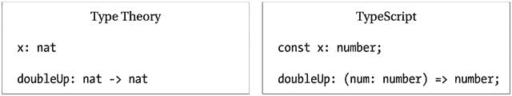
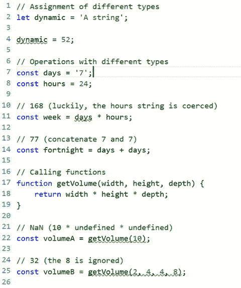
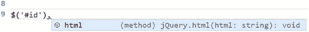

# 类型系统

类型系统源于类型论，该理论由伯特兰·罗素于 20 世纪初创立，并收录于其三卷本著作《数学原理》（怀特海与罗素合著，剑桥大学出版社，1910 年）中。类型论是一种为每个术语分配类型、并根据类型限制操作的系统。TypeScript 的类型注解与类型论构建块的风格惊人相似，如图 3-1 所示。

在类型论中，符号会像 TypeScript 类型注解一样被标注类型。两者在这方面唯一的区别是：类型论省略了 `const` 关键字，并使用 `nat` 类型（自然数）而非 TypeScript 中的数字类型。函数注解也颇具辨识度——类型论去掉了括号，而括号无疑增强了 TypeScript 示例的可读性。



图 3-1. 类型论与 TypeScript 的相似之处

通常，类型系统会为系统中的每个变量、表达式、对象、函数、类或模块分配类型。这些类型与一组旨在暴露程序错误的规则配合使用。这些检查可在编译时（静态检查）或运行时（动态检查）执行。典型规则包括：确保赋值中使用的值与目标变量类型一致，或确保函数调用根据函数签名提供正确类型的参数。

类型系统中使用的所有类型均充当契约，规定了系统内各个组件之间可接受的交互方式。基于这些类型检测出的错误种类，取决于类型系统中的规则以及检查的复杂程度。

## 可选静态类型

JavaScript 是动态类型的；变量没有固定类型，因此操作无法施加类型限制。你可以为变量赋予一个类型的值，之后再为同一变量赋予完全不同的类型值。你可以对两个不兼容的值执行操作，并获得不可预测的结果。调用函数时，没有机制强制你传递正确类型的参数，甚至参数过多或过少都不会报错。代码清单 3-1 演示了这些情况。

正因如此，JavaScript 类型系统极其灵活，但有时这种灵活性也会引发问题。

```
// 不同类型赋值
let dynamic = 'A string';
dynamic = 52;
// 不同类型间的操作
const days = '7';
const hours = 24;
// 168（幸运的是，hours 字符串被强制转换）
const week = days * hours;
// 77（7 与 7 拼接）
const fortnight = days + days;
// 调用函数
function getVolume(width, height, depth) {
return width * height * depth;
}
// NaN（10 * undefined * undefined）
const volumeA = getVolume(10);
// 32（8 被忽略）
const volumeB = getVolume(2, 4, 4, 8);
代码清单 3-1.
JavaScript 动态类型
```

TypeScript 提供了一套推断和指定类型的系统，但允许类型是可选的。可选性至关重要，因为它意味着你可以选择何时强制执行类型限制，何时允许动态类型。除非你使用 `any` 类型退出类型检查，否则编译器会尝试确定程序中的类型，并检查推断出的类型以及你通过类型注解显式指定的类型。类型注解在第 1 章中有详细描述。

所有检查均在编译时执行，这正是 TypeScript 成为静态类型语言的原因。编译器负责构建所有类型的清单，根据这些类型检查表达式，并在将代码转换为有效 JavaScript 时移除所有类型信息。

如果你将代码清单 3-1 中的 JavaScript 代码粘贴到 TypeScript 文件中，示例中所有类型错误都会收到报错信息。你可以在下图 3-2 的 TypeScript 代码中看到被标记的错误。



图 3-2. TypeScript 编译器错误

TypeScript 类型系统的关键点之一在于类型的可选性。这实际上意味着你不受静态类型的限制，可以在需要时选择使用动态行为。

## 结构类型系统

TypeScript 采用结构类型系统，这与大多数类 C 语言基于名称的类型系统形成对比。基于名称（或称名义化）的类型系统依赖显式命名的注解来确定类型。在名义化系统中，只有当类显式声明实现了某个接口（即必须明确标注"实现该接口"）时，它才会被视为该接口的实现。而在结构类型系统中，无需显式声明，只要值的结构符合所需类型的规格，即可被接受。

名义化类型系统旨在防止意外的类型等价——仅仅拥有相同属性并不意味着有效——但由于 TypeScript 采用结构类型系统，意外等价既是可能的，也是可取的。

在名义化类型系统中，你可以使用命名类型来确保传递正确的参数，例如可以创建 `CustomerId` 类型来包装标识符的值，并防止直接赋值普通的 `number`、`ProductId`、`CustomerTypeId` 或其他类型。属性相同但名称不同的类型不会被接受。在结构类型系统中，如果 `CustomerId` 包装了一个名为 `value` 的公共属性来存储 ID 数值，那么任何具有相同类型 `value` 属性的其他类型都会被接受。

如果你希望在 TypeScript 中通过自定义类型实现这种类型安全，就需要通过结构上的唯一性来确保类型不会意外等价。一种可行的方法是利用类中的私有成员使其在结构上无法匹配。在关于名义类型支持的讨论仍在继续的同时，清单 3-2 展示了一种创建名义类型的最易读技术。

在清单 3-2 的示例类中，第一个方法通过避免意外等价，只接受 `CustomerId`；而第二个方法则在一定程度上允许等价性，接受任何 `number`。调用第二个方法时，必须传入标识符的 `value` 属性。

`DomainId` 类型可以用于包装当前形式的任何数字标识符。`CustomerId` 和 `ProductId` 通过类型定义和工厂方法创建新实例。尝试将 `productId` 实例传递给接受 `CustomerId` 的方法会导致错误。

```
// DomainId 类型定义
type DomainId = {
  type: T,
  value: number,
}
// CustomerId
type CustomerId = DomainId;
const createCustomerId = (value: number): CustomerId => ({ type: 'CustomerId', value });
// ProductId
type ProductId = DomainId;
const createProductId = (value: number): ProductId => ({ type: 'ProductId', value });
// 示例类
class Example {
  static avoidAccidentalEquivalence(id: CustomerId) {
    // 实现
  }
  static useEquivalence(id: number) {
    // 实现
  }
}
var customerId = createCustomerId(1);
var productId = createProductId(5);
// 允许
Example.avoidAccidentalEquivalence(customerId);
// 错误：'提供的参数与调用目标的签名不匹配'
Example.avoidAccidentalEquivalence(productId);
// 允许
Example.useEquivalence(customerId.value);
// 允许
Example.useEquivalence(productId.value);
```

*清单 3-2. 使用与避免等价性*

虽然结构类型系统在少数特定场景下可能带来困难，但它拥有诸多优势。例如，引入兼容类型时无需修改现有代码，而且可以创建能传递给外部代码的类型而不必继承外部类。此外，在引入新超类型时无需修改新降级的子类型或与之交互的代码，这一点也优于名义化类型系统。

结构类型系统最显著的优势之一是省去了大量显式的类型名称声明。无需添加特定类型注解即可实现接口，还可以创建匹配接口和类的匿名对象而无需添加类型注解。只要属性方法的类型与所需类型相同或兼容（兼容类型可以是子类型、更窄的类型或结构相似的类型），就可以使用这些对象。

在 TypeScript 这类结构类型语言中，应避免使用空结构。空接口或空类本质上是可以替代程序中几乎所有内容的有效超类型，这意味着在编译时任何对象都可以替换该空结构，因为类型检查时没有需要满足的契约。

结构类型系统与 TypeScript 的类型推断相辅相成。借助这些特性，你可以将大量工作交给编译器和语言服务处理，而无需在程序中显式添加类型信息和类继承关系。

> **注意**

> 在 TypeScript 程序中，不能依赖命名类型来创建限制条件，只能依赖唯一结构。对于接口，这意味着需要通过唯一命名的属性或方法来创建唯一性。对于类，任何私有成员都会使结构变得唯一。

## 类型擦除

当你将 TypeScript 程序编译成普通 JavaScript 时，生成的代码在两个方面有所不同：`代码转换`和`类型擦除`。代码转换会将目标 JavaScript 版本中不支持的语言特性转换为有效的表示形式。例如，如果你的目标是 ECMAScript 5（该版本不支持类），那么你所有的类都将被转换为立即调用的函数表达式，这些表达式利用 ECMAScript 5 中的原型继承来创建适当的表示。类型擦除是指从代码中移除所有类型注解的过程，因为 JavaScript 无法理解它们。

类型擦除会移除类型注解、自定义类型和接口。这些元素仅在设计时和编译时用于静态检查。在运行时，不会进行类型检查，因此不需要类型信息。除非你使用 `any` 类型选择退出检查，否则由于类型的逻辑使用已经过检查，你不应该在运行时遇到问题。

```
class OrderedArray {
private items: T[] = [];
constructor(private comparer?: (a: T, b: T) => number) {
}
add(item: T): void {
this.items.push(item);
this.items.sort(this.comparer);
}
getItem(index: number): T {
if (this.items.length > index) {
return this.items[index];
}
return null;
}
}
var orderedArray: OrderedArray = new OrderedArray();
orderedArray.add(5);
orderedArray.add(1);
orderedArray.add(3);
var firstItem: number = orderedArray.getItem(0);
alert(firstItem); // 1
清单 3-3.
TypeScript 有序数组类
```

清单 3-3 展示了一个 `OrderedArray` 类的 TypeScript 示例代码。该类是泛型的，因此数组中的元素类型可以被替换。对于复杂类型，可以提供可选的 `comparer` 自定义比较器来评估数组中的元素以进行排序，但对于简单类型则可以省略。在类定义之后是一个简单的类使用演示。这段代码被编译成清单 3-4 中所示的 JavaScript 代码。在编译后的输出中，所有类型信息都已消失，并且该类已被转换为一种常见的 JavaScript 模式，称为`自执行匿名函数`。

```
var OrderedArray = (function () {
function OrderedArray(comparer) {
this.comparer = comparer;
this.items = [];
}
OrderedArray.prototype.add = function (item) {
this.items.push(item);
this.items.sort(this.comparer);
};
OrderedArray.prototype.getItem = function (index) {
if (this.items.length > index) {
return this.items[index];
}
return null;
};
return OrderedArray;
}());
var orderedArray = new OrderedArray();
orderedArray.add(5);
orderedArray.add(1);
orderedArray.add(3);
var firstItem = orderedArray.getItem(0);
alert(firstItem); // 1
清单 3-4.
编译后的 JavaScript 代码
```

尽管在编译过程中进行了类型擦除和转换，但生成的 JavaScript 代码与原始的 TypeScript 程序非常相似。从 TypeScript 到 JavaScript 的几乎全部转换都会同样尊重你的原始代码。根据你目标的 ECMAScript 版本，转换的多少可能会有所不同。例如，TypeScript 向下编译到 ECMAScript 3 和 5 的最新特性，如果你在编译时以 `ESNext` 为目标，则无需转换。

## 类型推断

类型推断与类型擦除正好相反。类型推断是在没有显式类型注解的情况下，在编译时确定类型的过程。

大多数类型推断的基本示例（包括本书早期的示例）都展示了一个简单的赋值，并解释了赋值左侧变量的类型如何能够自动设置为右侧字面量值的类型。这种类型推断对于 TypeScript 来说实际上是“一级”的，TypeScript 能够对正在使用的类型进行更复杂的确定。

TypeScript 会执行深入检查以创建程序中类型的计划表，并使用此类型计划表比较赋值、表达式和操作。在此过程中，当无法直接获取类型时，会采用一些巧妙的方法来间接找到类型。其中一个技巧是`上下文类型`，即 TypeScript 使用表达式的上下文来确定类型。

清单 3-5 展示了如何以逐渐间接的方式推断类型。`add` 函数的返回值是通过从 return 语句反向推导确定的。return 语句的类型是通过评估表达式 `a + b` 的类型找到的，而评估该表达式又需要检查各个参数的类型。

在清单 3-5 的最后一个表达式中，匿名函数中的 `result` 参数类型可以通过声明该函数的上下文来推断。由于它被声明为将由 `callsFunction` 的执行所使用，编译器可以看到它将被作为 `string` 类型传递；因此 `result` 参数将始终是 `string` 类型。第三个例子来自 `CallsFunction` 的声明；因为该变量已使用 `CallsFunction` 接口进行类型化，编译器会根据该接口推断 `cb` 参数的类型。

```
function add(a: number, b: number) {
/* 返回值用于确定
函数的返回类型 */
return a + b;
}
interface CallsFunction {
(cb: (result: string) => any): void;
}
// cb 参数被推断为一个接受字符串的函数
var callsFunction: CallsFunction = function (cb) {
cb('Done');
// 错误：类型 '1' 的参数不能赋给类型 'string' 的参数
cb(1);
};
// result 参数被推断为字符串类型
callsFunction(function (result) {
return result;
});
清单 3-5.
自下而上和自上而下的推断
```

### 最佳通用类型

当推断类型信息时，在少数情况下必须确定最佳通用类型。清单 3-6 展示了如何考虑数组字面量中的值，以在所有数组值之间生成最佳通用类型。

```
// number[]
let x = [0, 1, null];
// (string | number)[]
let y = [0, 1, null, 'a'];
清单 3-6.
最佳通用类型
```

确定最佳通用类型的过程不仅用于数组字面量表达式；它也用于确定任何包含多个不同类型值的情况，例如包含多个 return 语句的函数或方法的返回类型。

### 上下文类型

上下文类型是高级类型推断能力的一个好例子。当编译器根据表达式的位置来确定其类型时，就发生了上下文类型化。在清单 3-7 中，`event` 参数的类型由 `window.onclick` 定义的已知签名确定。推断不仅限于参数；由于对 `window.onclick` 签名的已知信息，整个签名（包括返回值）都可以被推断出来。

```
window.onclick = function(event) {
var button = event.button;
};
清单 3-7.
上下文类型
```

如果你检查清单 3-7 的类型信息，你会发现 `event` 参数是 `MouseEvent` 类型，`this` 的作用域是 `Window` 类型，返回类型是 `any`。

#### 宽泛类型

“宽泛类型”一词指的是 TypeScript 中函数调用、表达式或赋值的类型为 `null` 或 `undefined` 的情况。在这种情况下，编译器推断出的类型将是宽泛的 `any` 类型。在清单 3-8 中，`widened` 变量的类型将为 `any`。

```
function example() {
return null;
}
var widened = example ();
清单 3-8.
宽泛类型
```

### 何时使用类型注解

由于类型推断从一开始就是 TypeScript 的一个关键特性，因此关于何时使用类型注解显式指定类型的讨论可以毫无争议地进行。对于后来决定添加一定程度的类型推断支持的静态类型语言来说，这一直是一个棘手的话题。

关于在你的程序中添加多少类型注解的最终决定应由所有团队成员共同做出，但你可以将以下建议作为讨论的起点。

# 类型注解的最佳实践

*   首先，不添加任何类型注解（完全推断）。

*   在推断类型为 `any` 的地方添加类型注解。

*   为公共方法的返回类型添加类型注解。

*   为公共方法的参数添加类型注解。

与类型保持健康关系的关键在于尽可能少地使用类型注解。如果类型可以被推断出来，就让它被推断。尽可能相信编译器，你很快就会发现可以信任它把事情做好。你可以使用一个特殊标志（`--noImplicitAny`）让编译器在无法找到类型时发出警告，该标志能防止推断出 `any` 类型。你可以在附录 2 中了解更多关于代码质量标志的信息。

关于类型注解的最终建议是：要求尽可能少。如果你只需要一个对象拥有一个 `name` 成员，就不要用更严格的类型（比如 `Customer`）来注解它。对你的返回类型要具体，但要接受最通用的参数。

## 重复标识符

总的来说，你应该尽量避免程序中的名称冲突。TypeScript 提供了将程序从全局作用域移至模块的工具，使得名称冲突变得不必要。然而，TypeScript 中标识符有一些有趣的特性，包括在许多情况下允许你在同一作用域内使用相同的名称。

在大多数情况下，在同一作用域内使用已有的类或变量名会导致“重复标识符”错误。任何特定的结构都不会得到特殊对待；两个标识符中后出现的那个将是错误的源头。如果你在程序中多次重复使用一个命名空间，这不会导致重复标识符错误，因为所有独立的代码块在逻辑上会被合并成一个单一的命名空间。

另一种重复标识符的有效使用场景是与接口相关。同样，编译器知道在运行时不会有重复标识符，因为接口在编译期间会被删除；它的标识符永远不会出现在 JavaScript 输出中。接口和变量使用重复标识符是 TypeScript 库中的常见模式，在这种模式中，标准类型通过接口定义，然后通过类型注解分配给一个变量声明。清单 3-9 展示了 `DeviceMotionEvent` 的 TypeScript 库定义。`DeviceMotionEvent` 的接口之后紧跟着一个使用相同 `DeviceMotionEvent` 标识符的变量声明。

```
interface DeviceMotionEvent extends Event {
readonly acceleration: DeviceAcceleration | null;
readonly accelerationIncludingGravity: DeviceAcceleration | null;
readonly interval: number | null;
readonly rotationRate: DeviceRotationRate | null;
initDeviceMotionEvent(type: string, bubbles: boolean, cancelable: boolean, acceleration: DeviceAccelerationDict | null, accelerationIncludingGravity: DeviceAccelerationDict | null, rotationRate: DeviceRotationRateDict | null, interval: number | null): void;
}
declare var DeviceMotionEvent: {
prototype: DeviceMotionEvent;
new(typeArg: string, eventInitDict?: DeviceMotionEventInit): DeviceMotionEvent;
};
清单 3-9.
TypeScript DeviceMotionEvent
```

环境声明将在本章后面详细解释，但即使变量声明前没有 `declare` 关键字，这种技术也同样有效。在标准库中使用接口是一个刻意的选择。接口是开放的，因此可以在额外的接口块中扩展这些定义。如果一个新发布的 Web 标准为 `DeviceMotionEvent` 对象添加了一个 `motionDescription` 属性，你不必等待它被添加到 TypeScript 标准库中；你只需将清单 3-10 中的代码添加到你的程序中，即可扩展该接口的定义。

所有来自相同公共根的接口定义块会被合并成一个单一类型，因此 `DeviceMotionEvent` 仍然拥有标准库中的所有原始属性，同时也拥有来自额外接口块的 `motionDescription` 属性。

```
interface DeviceMotionEvent {
motionDescription: string;
}
// 现有的 DeviceMotionEvent 拥有其所有现有属性
// 再加上我们额外的 motionDescription 属性
function handleMotionEvent(e: DeviceMotionEvent) {
var acceleration = e.acceleration;
var description = e.motionDescription;
}
清单 3-10.
扩展 DeviceMotionEvent
```

## 类型检查

一旦从程序中收集到类型清单，TypeScript 编译器就能利用这份清单执行类型检查。简单来说，编译器会检查：当一个函数接受类型为 `number` 的参数时，所有调用代码传递的参数是否与 `number` 类型兼容。

清单 3-11 展示了一系列对名为 `input`、类型为 `number` 的参数的函数的有效调用。如果参数的类型为 `number`、`enum`、`null`、`undefined` 或 `any`，则会被接受。请记住，`any` 类型允许在 TypeScript 中实现动态行为，因此它代表了你向编译器做出的承诺，即这些值在运行时是可接受的。

```
function acceptNumber(input: number) {
    return input;
}
// number
acceptNumber(1);
// enum
acceptNumber(Size.XL);
// null
acceptNumber(null);
```

随着类型变得愈发复杂，类型检查需要对对象进行更深入的检查。当检查一个对象时，会测试该对象的每个成员。公开属性必须具有相同的名称和类型；公开方法必须具有相同的签名。在检查对象的成员时，如果某个属性指向一个嵌套对象，则会继续向下检查该对象以验证兼容性。

清单 3-12 展示了三个名称不同的类和一个字面量对象，它们都表明，就编译器而言，所有这些都是兼容的。

```
class C1 {
    name: string;
    show(hint?: string) {
        return 1;
    }
}
class C2 {
    constructor(public name: string) {
    }
    show(hint: string = 'default') {
        return Math.floor(Math.random() * 10);
    }
}
class C3 {
    name: string;
    show() {
        return 'Dynamic';
    }
}
var T4 = {
    name: '',
    show() {
        return 1;
    }
};
var c1 = new C1();
var c2 = new C2('A name');
var c3 = new C3();
// c1, c2, c3 和 T4 是等价的
var arr: C1[] = [c1, c2, c3, T4];
for (var i = 0; i < arr.length; i++) {
    arr[i].show();
}
```

本示例中值得注意的部分包括 `name` 属性和 `show` 方法。`name` 属性必须存在于对象上，必须是公开的，并且必须是字符串类型。该属性是否为构造器属性则无关紧要。`show` 方法的返回类型必须与 `number` 兼容。参数也必须兼容——在这种情况下，可选的 `hint` 参数可以通过使用默认参数或完全省略参数来匹配。如果某个类有一个必需的 `hint` 参数，那么它与清单 3-12 中的类型将不兼容。如第四种类型所示，只要字面量对象能通过类型比较，就编译器而言，它可以与类兼容。

类型检查并不限于正向匹配（即提供的类型必须具有所需类型的结构）。编译器逐渐增加了越来越多的负面检查，使其能够检测到另一类错误。例如，多余属性警告会高亮显示对象中未预期的属性，这是捕捉属性名称拼写错误情况的好方法。随着你在项目中升级所使用的 TypeScript 版本，这种检查可能会引入额外的错误，但如果你坚持下去并仔细审查编译器向你发送的消息，你最终会发现编译器成功为你捕捉到的细微缺陷。

## 环境声明

环境声明可用于向现有的 JavaScript 代码添加类型信息。通常，这用于为你自己已有的代码，或者你想要在 TypeScript 程序中使用的第三方库添加类型信息。

环境声明可以通过从简单、不精确的声明开始，随着时间的推移逐步增加细节来构建。清单 3-13 展示了一个你可以为 jQuery 框架编写的最不精确的环境声明的示例。该声明只是告知编译器一个外部变量将在运行时存在，而不提供该外部变量结构的更多细节。这将抑制 `$` 变量的错误，但不会提供深度的类型检查或有用的自动补全。

```
declare var $: any;
$('#id').html('Hello World');
```

所有环境声明都以 `declare` 关键字开头。这告诉编译器，以下代码块仅包含类型信息，不包含实现。使用 `declare` 关键字创建的代码块将在编译期间被擦除，并且不会生成 JavaScript 输出。在运行时，你负责确保代码存在并且与你的声明匹配。

为了获得编译时检查的全部好处，你可以创建更详细的环境声明，涵盖你所使用的外部 JavaScript 的更多特性。如果你正在构建环境声明，你可以选择涵盖你最常使用的特性，或者你认为最可能成为类型错误来源的高风险特性。这使你可以将精力投入到定义能带来最高时间投资回报率的类型信息上。

在清单 3-14 中，jQuery 定义已扩展以涵盖第一个示例中使用的两个元素：使用包含元素 id 的字符串查询来选择元素，以及使用 `html` 方法设置内部 HTML。在此示例中，声明了一个名为 `jQuery` 的类，该类具有接受字符串的 `html` 方法。`$` 函数接受一个字符串查询并返回 `jQuery` 类的一个实例。

```
declare class jQuery {
    html(html: string): void;
}
declare function $(query: string): jQuery;
$('#id').html('Hello World');
```

当使用此更新后的环境声明时，自动补全会提供类型提示，如图 3-3 所示。任何尝试使用未声明的变量、函数、方法或属性都将导致编译器错误，并且所有参数和赋值也将被检查。



可以为变量、函数、类、枚举以及内部和外部模块创建环境声明。接口似乎不在这个列表中，但接口已经类似于环境声明，因为它们描述了一种类型，而不会生成任何编译后的代码。这意味着你可以使用接口编写环境声明，但不需要为接口使用 `declare` 关键字。

**注意**

实际上，将 jQuery 声明为接口而不是类更有意义，因为你不能使用 `var jq = new jQuery();` 来实例化 jQuery 的实例。你只需要将 `declare class` 关键字更改为 `interface` 关键字，因为环境类和接口都不需要任何实现。

## 声明文件

虽然你可以在任何 TypeScript 文件中放置环境声明，但对于仅包含环境声明的文件，存在一种特殊的命名约定。该约定是使用 `.d.ts` 文件扩展名。文件中的每个模块、变量、函数、类和枚举都必须以 `declare` 关键字开头，TypeScript 编译器会强制实施此规则。

要在程序中使用声明文件，你可以像引用其他任何 TypeScript 文件一样引用它。你可以使用引用注释，或者将该文件作为 `import` 语句的目标。当使用 `import` 语句指向某个文件时，声明文件应与 JavaScript 文件放在同一文件夹中并具有相同的名称，如图 3-4 所示。


**图 3-4.** 声明文件

## Definitely Typed

如果你计划为任何常见的 JavaScript 库或框架编写环境声明，你应首先访问环境声明的在线库 Definitely Typed，查看是否已经有人完成了这项艰巨的工作：

[`http://definitelytyped.org/`](http://definitelytyped.org/)

由 Boris Yankov 发起的 Definitely Typed 项目，包含了众多流行 JavaScript 项目的无数定义，包括 Angular、Backbone、Bootstrap、Breeze、D3、Ember、jQuery、Knockout、Node、Underscore 等等。甚至还有针对单元测试框架（如 Jasmine、Mocha 和 qUnit）的声明。其中一些外部资源极其复杂，因此使用现有的声明可以节省大量时间。该仓库现在由微软支持。你可以在以下网址搜索正确的定义名称和安装说明：

[`https://aka.ms/types`](https://aka.ms/types)

将现有类型定义引入项目的最简单方法是使用 NPM，如清单 3-15 所示。

```
npm install --save @types/jquery
```

**清单 3-15.** 安装类型定义

## 总结

在 TypeScript 类型系统中工作，至少需要了解名义类型与结构类型之间的区别。结构类型可能使某些设计有些棘手，但它并不妨碍你使用可能希望从名义类型系统中迁移过来的任何模式。类型推断允许你省略类型注解，转而让类型在整个程序中被推断出来。

当你编译程序时，会根据显式和隐式类型检查类型，从而能够及早检测到大量错误。你可以使用 `any` 类型选择性地对程序的特定部分进行类型检查。

你可以通过为 JavaScript 代码创建或获取环境声明，来为其添加类型信息。通常，这些环境声明会存放在与 JavaScript 文件并行的声明文件中。

## 关键点

-   静态类型检查是可选的。

-   TypeScript 是结构类型化的。

-   所有类型信息在编译期间都会被移除。

-   你可以让编译器使用类型推断为你推断出类型。

-   环境声明为现有的 JavaScript 代码添加类型信息。