# 7. 在服务器上运行 TypeScript

> 如果你觉得 Node 通过一次只运行一段代码来实现并行性很奇怪，那确实如此。这是我称之为“逆向思维”的一个例子。——Jim R. Wilson

在服务器上运行 JavaScript 并不是一个新概念——Netscape Enterprise Server 早在 1994 年就提供了此功能。目前有大量在六种以上不同脚本引擎上运行的服务器端 JavaScript 实现。除了这些纯 JavaScript 实现之外，JavaScript 还可以在任何具有脚本主机的平台内运行。

虽然 JavaScript 语言是所有这些实现的共同点，但每个实现都会提供不同的 API、框架、模块或基类库，用于执行通常在基于浏览器的 JavaScript 程序中不可用的操作。服务器端实现中可用模块的范围至关重要，这也是 Node 取得巨大成功的原因（也是本章选择它的原因）。

Node 不仅拥有超过 475,000 个可用模块，从简单的助手工具到整个数据库服务器，而且只需一个简单命令就能将它们添加到你的程序中，这要归功于 Node 包管理器（NPM）。这意味着你只需在命令窗口中输入 `npm install MongoDB`，就可以添加诸如 MongoDB 之类的数据库模块。Node 是跨平台的，并为 Windows、Mac OSX、Linux、Docker 和 SunOS 提供安装程序。

为了演示在 TypeScript 中使用 Node，本章将一个简单的应用程序逐步演变为使用多个模块的应用程序。这既演示了代码本身，也展示了添加包和类型定义的过程。虽然示例展示了 Visual Studio 和 Windows 命令提示符的屏幕截图，但你可以轻松地将学到的所有内容转移到其他开发工具和操作系统中，例如 OSX 上的 Sublime Text 2 和 Terminal，或 Linux 上的 WebStorm 和终端。组合方式多种多样，如果你希望在不同机器上获得类似体验，有几个集成开发环境是跨平台的（Visual Studio Code、Cloud9、Eclipse、Sublime Text 2、Vim 和 WebStorm 都可在 Windows、OSX 和 Linux 上运行）。

## 安装 Node

你可以从 NodeJS 网站下载适用于所选平台的安装程序：

[`nodejs.org/en/download/`](https://nodejs.org/en/download/)

## 创建新项目

示例程序将从完全空的项目开始。图 7-1 显示了示例项目和解决方案的起始状态，其中包含一个空的 `server.ts` 文件。

如果你使用的是 Visual Studio 2017，可以通过创建一个新的空白 Node.js 应用程序（使用 TypeScript 语言）来复制此设置。如果你使用不同的开发环境，可以简单地启动一个新项目或文件夹，并添加一个空的 `server.ts` 文件。

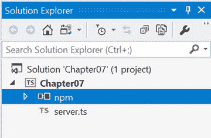

图 7-1. 空的 TypeScript 项目

为了获得 Node 的自动补全和类型检查，你需要一个描述标准 Node API 的类型定义。最快的方法是使用 NPM。

## NPM

您可以使用 `NPM` 来管理生产环境依赖和开发环境依赖。生产环境依赖是应用程序运行时必须存在的模块。开发环境依赖则包含您在编码时才需要、而运行应用程序时不需要的工具和类型定义。

在添加包之前，您需要一个名为 `package.json` 的特殊文件，如清单 7-1 所示。该文件描述了您的程序，包括它所有的依赖项。每当您添加一个生产或开发环境依赖时，此文件都会更新。

```
{
"name": "NodeApp"
}
清单 7-1。
空的 package.json 文件
```

> 注意：这还不是一个有效的 `package.json` 文件，有效的版本将在本章稍后部分展示。这个极其精简的版本将使 NPM 示例更容易理解。

一旦您有了 `package.json` 文件，添加依赖项只需知道其名称。在下面的所有示例中，我们将使用 Express，这是一个用于 Node 的轻量级 Web 框架。

安装包的第一种机制是 Visual Studio 的包搜索功能，可以通过右键单击解决方案资源管理器中的 "npm" 分支来使用。包管理器 UI 的左侧允许您搜索包，您可以使用右侧底部的表单安装所选包。标准选项会将包的最新版本添加到项目中。

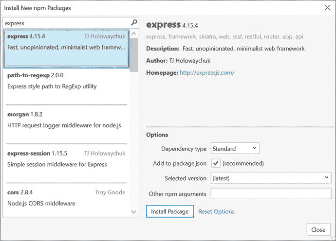

*图 7-2. 通过 Visual Studio 安装 NPM 包*

通过运行清单 7-2 中所示的命令，您也可以获得完全相同的结果。这恰好是 UI 发起的原始命令。从您喜欢的命令行窗口使用 `NPM` 和 `NodeJS` 都很简单。

```
npm install express --save
清单 7-2。
通过命令安装 NPM 包
```

无论您使用 UI 还是直接键入命令，安装命令中的 `--save` 标志都会导致 `package.json` 文件被更新以显示该依赖项，如清单 7-3 所示。

```
{
"name": "NodeApp",
"dependencies": {
"express": "⁴.15.4"
}
}
清单 7-3。
更新后的 package.json
```

这自然而然地引出了添加包的第三种方法，即直接更新 `package.json` 文件。如果您在 Visual Studio 中执行此操作，您将获得包名称和版本号的自动补全功能；如图 7-3 所示。

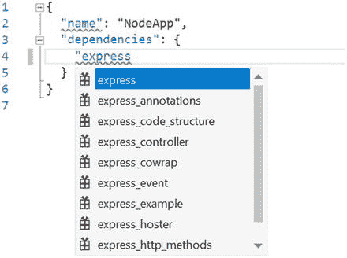

*图 7-3. 通过 package.json 安装 NPM 包*

对于类型定义，该依赖项仅在开发时需要，在生产中不需要。您可以通过在包管理器 UI 中选择 "Development" 依赖项类型，或者在运行安装命令时使用 `--save-dev` 标志（save 标志的变体）来将包标记为开发环境依赖。当通过 `package.json` 文件添加开发环境依赖时，它应该放在单独的 `devDependencies` 字典中。

```
{
"name": "NodeApp",
"dependencies": {
"express": "⁴.15.4"
},
"devDependencies": {
"@types/node": "⁸.0.26"
}
}
清单 7-4。
包含节点类型定义的更新后 package.json
```

现在您已经成为 NPM 专家，您将能够添加创建可工作的 NodeJS Web 应用程序所需的任何依赖项，这正是本章的主题。

## 简单的 Node 程序

现在项目已经设置好，可以通过一个简单的程序来演示 Node，该程序运行一个 Web 服务器并响应请求。HTTP 服务器只是将所有请求传递给您提供的回调函数。它没有内置的功能来处理不同的请求或路由，或帮助格式化响应（如果您需要这些功能，它们可以在中间件中获得，例如 Express，这将在本章后面介绍）。

清单 7-5 展示了完整的程序，它创建了一个监听 8080 端口的 http 服务器。所有请求都被传递给 `requestListener` 函数，该函数对所有请求给出一个标准的文本响应。`requestListener` 函数被传入两个参数，分别代表 `request` 和 `response`。可以从 `request` 参数获取信息，例如请求的方法、头部和正文。您可以向 `response` 参数的头部和正文添加内容。您必须通过调用 `response.end()` 来表明操作已完成；否则 HTTP 服务器不会向客户端发送任何响应，导致客户端一直等待响应直至超时。

一个引用注释用于指示 Node 类型定义的位置。这允许 `import` 语句引用 `http` 模块，该模块在项目中不是作为外部模块存在的——`http` 模块将在运行时由 Node 提供。

# 清单 7-5。一个简单的 Node 服务器

```typescript
/// <reference path="./node_modules/@types/node/index.d.ts" />
import * as http from 'http';
const portNumber = 8080;
function requestListener(request: http.ServerRequest, response: http.ServerResponse) {
    response.writeHead(200, { 'Content-Type': 'text/plain' });
    response.write('Response Text Here');
    response.end();
}
http.createServer(requestListener).listen(portNumber);
console.log('Listening on localhost:' + portNumber);
```

如果您将此示例代码放在名为 `app.ts` 的文件中，您可以从包含源代码的文件夹中运行命令 `node app.js` 来运行此清单中的 http 服务器（注意，此命令中传递的是编译后的 JavaScript 文件，而不是 TypeScript 文件）。您应该会在命令窗口中看到消息 "`Listening on localhost:8080`"，如图 7-4 所示。只要命令窗口保持打开状态，服务器就会一直运行。

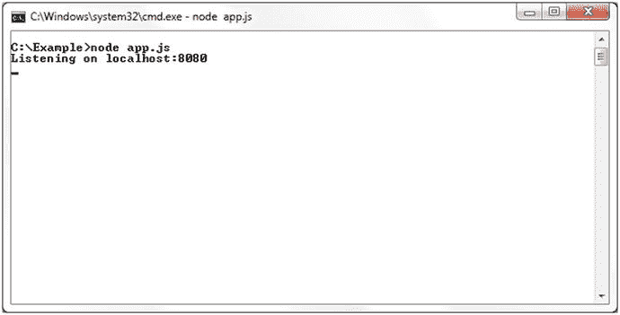

*图 7-4. 运行程序*

要向服务器发出请求，请打开 Web 浏览器并在地址栏中输入 `localhost:8080`。您应该会收到 "`Response Text Here`" 消息，如图 7-5 所示。因为所有对服务器的请求都被发送到同一个 `requestListener` 方法，所以您可以在 `localhost:8080` 输入任何地址并收到相同的消息，例如 `localhost:8080/Some/Path/Here/` 或 `localhost:8080/?some=query&string=here`。

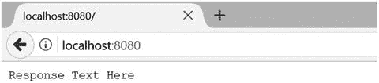

*图 7-5. 从浏览器调用程序*

## 请求信息

能够如此轻松地启动一个网络服务器固然很好，但几乎可以肯定，你会希望从请求中获取信息，以便提供与所请求内容相匹配的响应。清单 7-6 展示了如何获取请求方法和所请求 URL 的信息，这些信息可用于路由请求或获取数据以查找匹配请求的数据。

```typescript
/// 
import * as http from 'http';
const portNumber = 8080;
function requestListener(request: http.ServerRequest, response: http.ServerResponse) {
    response.writeHead(200, { 'Content-Type': 'text/plain' });
    response.write('Method: ' + request.method + '\n');
    response.write('Url: ' + request.url + '\n');
    response.write('Response Text Here');
    response.end();
}
http.createServer(requestListener).listen(portNumber);
console.log('Listening on localhost:' + portNumber);
```

在这个例子中，从请求中获取的信息被简单地附加到响应中，以便在发出请求时在浏览器中向你展示这些信息。在地址栏中输入 `http://localhost:8080/Customers/Smith/John` 后，响应如图 7-6 所示。你可以使用请求的属性来决定如何处理该请求。

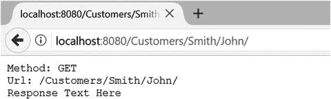

虽然你可以利用这些信息编写自己的框架来处理发送到 Node 服务器的请求，但路由请求和从请求中获取信息的工作已经优雅地完成，并且可以作为模块通过 NPM 安装使用。除非你想利用请求信息做一些不寻常的事情，否则你会发现，使用一个为你的程序提供框架的现有模块可以节省时间和精力，同时还能涵盖你未曾计划到的场景。

下一节将介绍如何使用 Express 模块构建应用程序，这是一个轻量级的 Node 网络框架，它不会规定授权、持久化或模板化的具体细节。

## 使用 Express 编写应用程序

在 Node 中处理原始的请求和响应可以让你接触到 HTTP 通信的底层细节；但在大多数情况下，你并不想亲自处理所有细节。Express 模块提供了一个轻量级框架，让你可以专注于应用程序本身，而不是路由和 HTTP 通信。Express 既是一种快速入门的方法，也是一个将你的程序整合在一起的稳健框架。

要使用 Express，你需要同时拥有 Express 依赖项和 Express 类型定义开发依赖项。清单 7-7 展示了该应用程序更完整的 `package.json` 文件版本，其中包含了这两个依赖项。

```json
{
    "name": "node-app",
    "version": "0.0.1",
    "description": "NodeApp",
    "main": "server.js",
    "author": {
        "name": "Steve Fenton"
    },
    "dependencies": {
        "express": "4.15.4"
    },
    "devDependencies": {
        "@types/node": "8.0.26",
        "@types/express": "4.0.37"
    }
}
```

`package.json` 文件指出程序的入口点将是名为 `server.js` 的文件，并包含了 Express 依赖项以及来自 `@types` 组织的 node 和 express 类型定义。

### 简单的 Express 程序

清单 7-8 是基于 Express（而非 `http` 模块）的简单 Node 程序的更新版本。虽然大体模式相似，但 `requestListener` 是专门添加到应用程序根地址的 HTTP GET 方法上的。

这意味着 `requestListener` 函数只会针对发送到 `http://localhost:8080/` 的请求被调用。与之前的例子不同，不匹配该路由的请求将会失败，例如，对 `http://localhost:8080/Customers` 的请求将收到一个 404 响应，并显示消息 "`Cannot GET /Customers/Smith/John`"。

```typescript
import * as express from 'express';
const portNumber = 8080;
const app = express();
app.get('/', (request, response) => {
    response.send('You requested ' + request.query.firstname + ' ' + request.query.lastname);
})
app.listen(portNumber, 'localhost', () => {
    console.log('Listening on localhost:' + portNumber);
});
```

对此示例的正确请求应包含 `firstName` 和 `lastName` 查询字符串参数。Express 将查询字符串映射到 `request.query` 属性。完整的示例请求地址为 `http://localhost:8080/?firstname=John&lastname=Smith`，这将导致响应中返回消息 "`You requested John Smith`"，如图 7-7 所示。

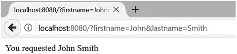

### 多路由

你可以为程序中的不同路由提供不同的处理器，例如，清单 7-9 中的代码为 `http://localhost:8080/One/` 提供了一个处理器，为 `http://localhost:8080/Two/` 提供了另一个处理器。Express 为你处理所有路由，并确保正确的函数处理每个请求。

# Express 应用程序基础与错误处理

你可以像之前一样在浏览器中测试这些路由，并获得相应的响应：

- `http://localhost:8080/One/` -> "You got handler One"
- `http://localhost:8080/Two/` -> "You got handler Two"

对未注册的路由发出的请求将导致 404 未找到响应。

## 处理错误

您可以为应用提供一个通用的错误处理器，只需向`app.use`方法传入一个接受四个参数的函数。在清单 7-10 中，`handler`函数已被修改为故意抛出一个错误。该错误处理器通过`app.use`方法设置，在返回 500 响应码之前将错误记录到控制台。

```typescript
import * as express from 'express';
const portNumber = 8080;
const app = express();
app.get('/', (request, response) => {
    throw new Error('故意抛出的错误！');
})
app.listen(portNumber, 'localhost', () => {
    console.log('正在监听 localhost:' + portNumber);
});
app.use(function (error, request, response, next) {
    console.error(error.message);
    response.status(500).send('发生了一个错误。');
});
```

清单 7-10. 通用错误处理器

当您向此版本的应用程序发起请求时，命令窗口将显示完整的错误堆栈，但 Web 浏览器将显示通用错误信息，如图 7-8 所示。这种方式巧妙地让您能够利用完整的错误信息执行日志记录操作，同时不对外公开任何细节。

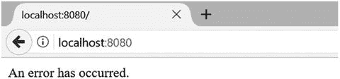

图 7-8. 浏览器中的通用错误

此示例中的错误处理器很好地演示了 Express 中的中间件概念，这是一组组织成责任链的函数。每个中间件都可以对请求和响应进行操作，使您能够分离横切关注点。在实践中，这意味着您可以避免一个同时负责日志记录、授权和错误处理的处理器，而是为这些职责分别提供独立的中间件。

您可以通过调用`app.use`来添加中间件，其中`app`是您的 Express 应用程序名称。您作为中间件传入的函数必须遵循以下两种签名之一：

*   请求处理器: `(request: Request, response: Response, next: NextFunction) => void`;
*   错误请求处理器: `(error: any, request: Request, response: Response, next: NextFunction) => void;`

每个中间件会依次被调用，并且必须使用`next()`函数调用下一个中间件，或者结束响应。如果没有中间件结束响应，结果将是 404 错误。

## Express 书籍项目

现在我们已经介绍了 Node 和 Express 的基本概念，我们将通过一个小型示例应用程序将所有内容整合起来。要跟随操作，您需要安装一些免费软件和一些 NPM 包。该应用程序将包含多个路由，收集用户输入的数据，并将信息存储在数据库中。

*   来自[`www.mongodb.com/download-center`](http://www.mongodb.com/download-center)的 MongoDB 社区服务器；
*   清单 7-11 中所示的 NPM 包。

为了创建应用程序，您将使用 NPM 中的几个额外包，这将使开发更快更简单。安装清单 7-11 中`package.json`文件所列的依赖项。这些额外的包有助于解析回传到服务器的表单、与 MongoDB 数据库通信，以及解析我们使用 Pug（一种简单的 HTML 模板语言）编写的视图。

```json
{
  "name": "pro-typescript-book-app",
  "version": "0.0.1",
  "description": "一个示例书籍应用程序",
  "main": "server.js",
  "types": "server.d.ts",
  "author": {
    "name": "Steve.Fenton"
  },
  "dependencies": {
    "body-parser": "1.17.2",
    "express": "4.15.4",
    "method-override": "2.3.9",
    "mongoose": "4.11.9",
    "pug": "2.0.0-rc.3"
  },
  "devDependencies": {
    "@types/body-parser": "1.16.5",
    "@types/express": "4.0.37",
    "@types/method-override": "0.0.30",
    "@types/mongoose": "4.7.21",
    "@types/node": "8.0.26",
    "@types/pug": "2.0.4"
  }
}
```

清单 7-11. 额外依赖项

应用程序的主入口点将是服务器文件，如清单 7-12 所示。此文件包含运行整个应用程序所需的所有依赖项，并有一个根路由用于处理对首页的请求。视图引擎也设置为使用 Pug，模板位于`"views"`文件夹中。

```typescript
import * as express from 'express';
import * as http from 'http';
import * as path from 'path';
import * as bodyParser from 'body-parser';
import * as methodOverride from 'method-override';
import * as routes from './routes/index';
const portNumber = 8080;
const app = express();
app.set('port', portNumber);
// 配置视图模板
app.set('views', path.join(__dirname, 'views'));
app.set('view engine', 'pug');
http.createServer(app).listen(app.get('port'), () => {
    console.log('Express 服务器正在监听端口 ' + app.get('port'));
});
app.use(bodyParser.json());
app.use(bodyParser.urlencoded({ extended: true }));
app.use(methodOverride());
// 路由
app.get('/', routes.index);
// 静态文件，例如 .css 文件
app.use(express.static('.'));
```

清单 7-12. Server.ts

处理首页的函数未直接放置在服务器文件中，而是被放在了一个模块中，该模块位于一个包含所有路由处理器的文件夹内。随着应用程序的增长，以这种方式组织代码将使每个文件保持小巧且易于维护。首页路由处理器的内容如清单 7-13 所示，它有一个导出函数，该函数使用一个小的数据模型来渲染响应。

```typescript
import * as express from 'express';
/* GET 首页. */
export function index(request: express.Request, response: express.Response) {
    response.render('index', { title: 'Express' });
};
```

清单 7-13. `/routes/index.ts`

由于我们将 Pug 设置为视图引擎，因此需要提供一个用于首页的模板文件。文件名应与清单 7-13 中调用 `response.render` 时使用的名称一致。首页的 Pug 视图如清单 7-14 所示。该模板继承了一个共享布局，这个共享布局可用于为所有页面或页面组提供一致的 HTML 布局。首页模板在共享布局的 `"content"` 区域中插入了一个标题、一个段落和一个锚点标签。

```pug
extends layout

block content

h1= title

p Welcome to #{title}

a(href='/book') Books
```

代码清单 7-14. 首页的 Pug 模板

共享布局模板如代码清单 7-15 所示，这是一个简单的 HTML 文档，包含标题、样式表以及一个可供子模板填充的内容块。

```pug
doctype html

html

head

title= title

link(rel='stylesheet', href='/style.css')

body

block content
```

代码清单 7-15. Pug 模板的共享布局

简易样式表的 CSS 代码如代码清单 7-16 所示。可将其放置在根目录下名为 `style.css` 的文件中。由于我们通过 `app.use(express.static('.'));` 配置 Express 服务器处理静态文件，对样式表的请求将由静态文件中间件处理。如果没有这个中间件，即使服务器上确实存在该文件，对样式表的请求也会导致 404 错误。

```css
body {

padding: 50px;

font: 14px "Lucida Grande", Helvetica, Arial, sans-serif;

}

a {

color: #00B7FF;

}
```

代码清单 7-16. 样式表

您可以使用代码清单 7-17 所示的命令来运行 Express 服务器。服务器启动后，在浏览器中访问 `localhost:8080` 即可查看页面。

```bash
node server.js
```

代码清单 7-17. 运行 Express 服务器

您应该会看到如图 7-9 所示的输出，这意味着路由、路由处理器、视图模板和样式表均已成功加载。如果点击书籍链接，您将收到一个错误，因为该路由尚未设置处理器。

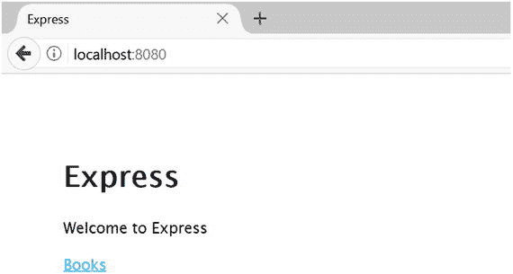

图 7-9. 首页

目前这个示例演示了如何将路由处理器分离到独立模块中，如何使用 Pug 模板创建视图，以及如何通过中间件启用静态文件。接下来我们将探讨如何连接数据库以存储和检索数据。

### 添加书籍路由

为了管理书籍列表，应用程序需要支持 `/book` 路由。要支持一个典型的路由，您需要添加路由处理器模块、Pug 模板，并在 Express 应用程序中引用该路由处理器。

代码清单 7-18 展示了处理 `/book` 地址请求的 `book.ts` 文件的起始版本。与所有请求处理器一样，`list` 函数包含 `request` 和 `response` 参数。该处理器对结果调用 `response.render` 方法，并传入视图名称以及表示待显示数据的模型对象。

```typescript
import * as express from 'express';

declare var next: (error: any) => void;

/* GET /book */

export function list(request: express.Request, response: express.Response) {

response.render('book', { 'title': 'Books', 'books': [] });

};
```

代码清单 7-18. `routes/book.ts` 文件

为使该处理器正常工作，`views` 文件夹中必须存在指定名称的视图。代码清单 7-19 展示了 `book.pug` 模板，它将渲染由请求处理器提供的数据。该模板复用了 `layout.pug` 文件（这是应用程序的默认布局），并从模型对象中渲染 `title`。

```pug
extends layout

block content

h1= title

p Welcome to the #{title} page.

p #{message}
```

代码清单 7-19. `views/book.pug` 文件

要在应用程序中注册此路由，您需要修改 `server.ts` 文件：添加引用 `book.ts` 文件的导入语句，并添加路由注册代码。代码清单 7-20 展示了将 `/book` 地址链接到包含请求处理器的 `book.ts` 文件所需添加的两行代码。

```typescript
import * as book from './routes/book';

// ...

// routes

app.get('/', routes.index);

app.get('/book', book.list);
```

代码清单 7-20. 对 `server.ts` 文件的补充

当您运行应用程序并在 Web 浏览器中访问 `/book` 地址时，应该会看到一个显示“Welcome to the Books page.”消息的页面。如果无法访问新页面，请检查命令窗口以查看错误信息。最常见的错误是拼写错误，例如意外地将视图名称输入为 `'books'`，而正确的名称应为 `'book'`。

### 收集数据

存储数据的第一步是提供一个允许用户输入信息的表单。列表 7-21 展示了更新后的 `book.pug` 模板，该模板现在包含一个表单，用于接收书名、作者以及可选的图书 ISBN 标识符。

HTML 属性通过在元素名称后的括号中附加相应内容来添加到元素中。每个输入框的 `type` 和 `name` 属性都通过这种方式添加。列表中值得注意的属性是 ISBN 输入框上的 `pattern` 属性。ISBN 不是必填项，但如果填写了，则必须匹配该属性中提供的模式。

```pug
extends layout
block content
h1= title
p Welcome to the #{title} page.
p #{message}
form(method='post')
fieldset
legend Add a Book
div
label Title *
br
input(type='text', name='book_title', required)
div
label Author *
br
input(type='text', name='author', required)
div
label ISBN
br
input(type='text', name='book_isbn', pattern='(?:(?=.{17}$)97[89] -{2}[0-9]+[ -][0-9]|97[89][0-9]{10}|(?=.{13}$)(?:[0-9]+[ -]){2}[0-9]+[ -][0-9Xx]|[0-9]{9}[0-9Xx])')
div
button Save
```

列表 7-21. 向 Pug 视图添加表单

如果您担心需要编写像上面那个能接受各种 ISBN 格式的复杂模式，别担心，这个模式以及许多其他模式都可以在 HTML5 模式库 [`http://html5pattern.com/`](http://html5pattern.com/) 中找到。当您向输入元素添加 `pattern` 属性时，输入的文本将会被验证是否与表达式匹配。

为了在表单提交时对其进行处理，必须在 `routes` 目录下的 `book.ts` 文件中添加一个处理表单 POST 请求的函数。列表 7-22 展示了包含 `submit` 函数的更新后文件。在此阶段，该函数仅向视图提供一条消息，确认由于尚未建立数据库，因此没有保存任何数据。数据库将在下一节中添加。

# Express Book 应用程序开发

## 路由配置与表单验证

要将表单 POST 请求发送到 `submit` 函数，必须在 `app.ts` 文件中注册路由。列表 7-23 展示了更新后的路由，其中包含新的 POST 路由，该路由会将匹配的请求转发给 `book.submit` 函数处理。

```typescript
// routes
app.get('/', routes.index);
app.get('/book', book.list);
app.post('/book', book.submit);
```

列表 7-23. `app.ts` 文件中更新后的路由

如果您编译并运行更新后的应用程序，并访问 `/book` 地址，您应该会看到允许添加图书的表单。您只有在同时提供书名和作者时才能提交表单。如果您在可选的 ISBN 输入框中输入任何值，则该值必须是有效的格式，例如 10 位的 `0-932633-42-0` 或 13 位的 `9780932633422`。

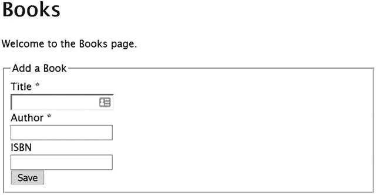

图 7-10. 图书页面

当您成功提交表单后，结果尚未保存到数据库中。开发此应用程序的下一步是持久化数据，以便将来能够可靠地检索数据。

## 安装 Mongoose

在 Node 应用程序中存储数据有多种选择。您可以使用文件系统、关系型数据库（如 MySQL）或 NoSQL 数据库（如 MongoDB）。在此示例中，MongoDB 将与 Mongoose 配合使用，为应用程序提供数据访问。Mongoose 可以简化验证、查询和类型转换等处理过程。

在您按照本节代码操作之前，需要先设置好数据库。要为您选择的平台下载 MongoDB，请访问 [`https://www.mongodb.com/download-center`](https://www.mongodb.com/download-center)。下载内容只是一个针对您所选平台的简单安装程序。

MongoDB 将您的数据存储在文件系统上，因此您需要设置一个用于存储的文件夹。默认情况下，MongoDB 会查找 `c:\data\db` 目录，因此您应该在进行下一步之前添加此目录。如果您不添加此文件夹，尝试启动 MongoDB 服务器时会立即停止。如果您愿意，也可以将数据放在不同的目录中。在启动数据库服务器时，您还需要提供 MongoDB 的路径。现在，只需添加默认目录即可。

要启动 MongoDB 数据库服务器，请在命令窗口中运行列表 7-24 中显示的代码。此命令是针对 MongoDB 3.4 版本编写的，因此如果您使用的是不同版本，则需要更改路径。

```
C:\Program Files\MongoDB\Server\3.4\bin\mongod.exe
```

列表 7-24. 运行数据库服务器

您应该会收到一条消息，提示服务器正在“等待端口 [number] 上的连接”。此消息中显示的数字（通常为 27017）在您从应用程序连接数据库时需要用到。如果遇到任何错误，请仔细检查您是否已设置好 `c:\data\db` 目录。

Mongoose 模块和类型定义应该已经可用，因为在本章开头已将其添加到 `package.json` 中。现在，您应该已准备好开始保存数据所需的一切。下一节将逐步介绍对 Express Book 项目所做的更改，以存储和检索用户输入的图书。

## 存储数据

为了存储用户提交新书时接收到的数据，必须修改 `routes` 目录中的 `book.ts` 文件，以调用新安装的数据库。

清单 7-25 展示了更新后的处理器：`list` 处理器，用于显示数据库中的书籍；以及 `submit` 处理器，用于保存新的提交。连接数据库的代码位于函数外部，并在两者之间共享。下文详细介绍了所有更改。

```typescript
import * as express from 'express';
import * as mongoose from 'mongoose';
declare var next: (error: any) => void;
// MongoDB 通常运行在 27017 端口
mongoose.connect('mongodb://localhost:27017/books', { useMongoClient: true });
// 定义一本图书
interface Book extends mongoose.Document {
title: string;
author: string;
isbn: string;
}
// 定义图书数据库的模式
const bookSchema = new mongoose.Schema({
title: String, author: String, isbn: String
});
const Book = mongoose.model('Book', bookSchema);
/* GET /book */
export function list(request: express.Request, response: express.Response) {
Book.find({})
.then((res) => {
response.render('book', { 'title': 'Books', 'books': res });
})
.catch((err) => {
return next(err);
});
};
/* POST /book */
export function submit(request: express.Request, response: express.Response) {
const newBook = new Book({
title: request.body.book_title,
author: request.body.author,
isbn: request.body.book_isbn
});
newBook.save()
.then((res) => {
response.redirect('/book');
})
.catch((err) => {
return next(err);
});
}
```

清单 7-25. 更新后的 `routes/book.ts` 文件

数据库连接是通过 `mongoose.connect` 调用建立的。示例中的连接字符串使用端口 27017；你应该使用启动 `MongoDB` 服务器时显示的端口号。当你的应用程序连接到数据库时，每次连接都会记录在 `MongoDB` 命令窗口中。

`bookSchema` 变量被分配了一个新的 Mongoose 模式。此模式定义了要存储在集合中的文档形状。Mongoose 会为你设置 MongoDB 集合，并可以处理默认值和验证。图书模式使用 `title`、`author` 和 `isbn` 属性设置，这些属性都被分配了 `String` 类型。模式的定义与 TypeScript 类型注解惊人地相似。由于语句的上下文，TypeScript 编译器足够智能，能够识别出它们不是类型注解；因此，它不会使用类型擦除将其从编译输出中移除。这里的 `String` 类型并不是 TypeScript 中支持 `string` 类型注解的 `String` 接口，而是 `mongoose.Schema.Types.String`。如果你不小心使用了小写的 `string` 类型，编译器会给出关于此错误的警告。

`Book` 变量被分配了 Mongoose 创建的模型对象。这让你不必自己实现 `Book` 类。你可以使用此模型在需要时创建新的图书实例，就像编写了自己的类一样。

虽然这花了几段文字来解释，但值得重新审视代码清单，以确认仅用三行代码就可以连接到数据库并为图书数据设置模式。此设置用于处理请求的两个函数中。

`list` 函数调用 Mongoose 提供的 `Book.find` 方法来检索记录。你可以向 `find` 方法提供一个对象来过滤结果。该对象可以是图书模式的部分匹配。例如，你可以使用 `{ author: 'Robert C. Martin' }` 来检索鲍勃大叔的所有书籍。在示例中，空对象表示你想要集合中的所有文档。

由于查询是异步执行的，依赖于结果的代码应放在相应的 `then` 块中。如果你忘记将代码放在 `then` 块内，响应会在查询完成之前发送。错误使用 `catch` 块处理。`books` 集合被添加到传递给视图的模型对象中。

> **注：** 虽然示例使用空对象查询集合并检索所有书籍，但随着数据库中书籍数量的增加，此查询会变得越来越慢。你可以使用 `skip` 和 `limit` 查询方法对结果进行分页。

`submit` 函数使用用户提交的数据实例化一个新的 `Book` 对象，然后调用 Mongoose 提供的 `save` 方法。再次强调，数据库调用是异步的，并使用 Promise 在查询完成后继续执行。在代码清单中，当记录成功保存后，响应仅仅是重定向到 `list` 操作。在提交后重定向请求可以防止用户通过刷新浏览器意外地重新提交相同的数据。成功提交后重定向的模式称为“提交后重定向获取”模式。

现在路由处理器已将图书数据传递给视图，可以更新视图以显示数据。添加表格所需的额外标记如清单 7-26 所示。

```pug
table
thead
tr
th 标题
th 作者
th ISBN
tbody
if books
each book in books
tr
td= book.title
td= book.author
td= book.isbn
```

*清单 7-26. Pug 表格模板*

Pug 模板中的 `each` 循环会为 `books` 集合中的每一项重复输出嵌套内容。表格单元格使用速记语法（元素名称后跟 `=`）声明。这意味着数据变量无需像标题那样用通常的 `#{}` 分隔符括起来。

Pug 的 `each` 循环可以处理空数组，但无法处理未定义的值。示例中 `each` 循环前的 `if` 语句可防止未定义的值传入 `each` 循环。

现在你拥有了一个功能完备的应用程序，可以保存和显示书籍。你可以在表单中输入一本书，如图 7-11 所示。

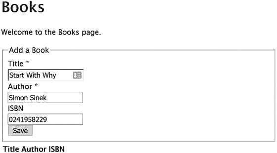

*图 7-11. 完成的图书表单*

当你点击保存按钮时，你的书籍将被存储，并且你将看到图 7-12 中的页面。你可以随时返回应用程序，已存储的书籍仍然可用。

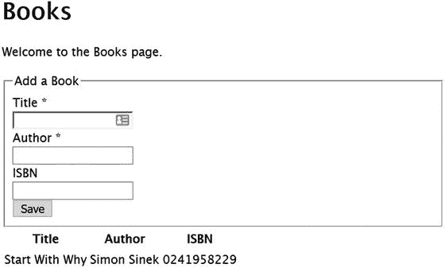

*图 7-12. 已存储的书籍*

存储在 MongoDB 中的数据是持久化的，这意味着你可以重启机器，数据仍然会被保存。这为你提供了一个永久存储，除非发生彻底的机器故障，在这种情况下，你可能需要考虑合适的数据备份策略。你可以在 [`https://docs.mongodb.com/manual/core/backups/`](https://docs.mongodb.com/manual/core/backups/) 找到更多关于 MongoDB 备份方法的信息。

## 摘要

JavaScript 对于 Web 服务器而言并不陌生，并且得益于 Node 以及通过 Node 包管理器（NPM）提供的成千上万个模块，它已经获得了极大的关注。随着在 Node 上运行的程序规模越来越大，TypeScript 所提供的语言特性和工具的价值也迅速提升。大量的时间可能会浪费在简单的错误上，例如将依赖于异步调用的代码放置在回调函数之外，或者在使用 `String` 的地方错误地使用了 `string`，而 TypeScript 可以帮助你避免这些常见错误。

Express 框架是快速上手 Node 的一种方式，并且能为那些使用过 Sinatra（或 .NET 中的 Nancy）的程序员提供一些熟悉感。即使对于那些不熟悉这种特定实现风格的开发者来说，路由处理器和视图的分离也大概率是能够识别的。与在 Node 中处理底层 HTTP 请求和响应相比，使用 Express 将提升你的生产力。

`Mongoose` 对数据库扮演着类似的角色，它提供了许多能提升生产力的快捷方式。如果你想降低一个层级，通过直接调用 MongoDB 来存储和检索数据以自行处理模型和验证，MongoDB 也并非特别复杂。

尽管本章愉快的沿用了许多 Express 自带的默认设置，但你并不局限于使用这些默认值。只需一行代码即可轻松替换模板引擎和中间件。

## 要点

- JavaScript 在 Web 服务器上运行已有超过 20 年的历史。

- Node 可以在任何平台上顺利运行。

- 你可以从 NPM 中的 `@types` 组织获取 Node 及许多 Node 模块的类型信息。

- Express 提供了一个轻量级且灵活的应用程序框架，比使用底层 Node HTTP 请求和响应更容易。

- Mongoose 和 MongoDB 通过异步 API 提供了简单的持久化功能。
