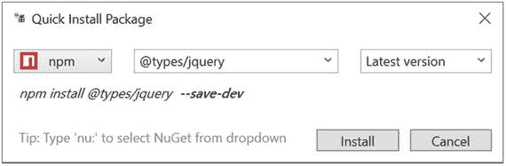
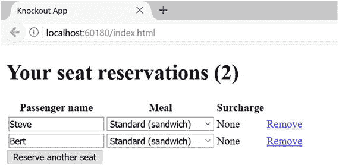
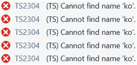
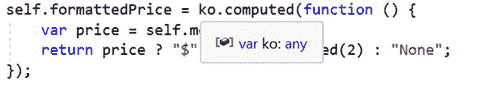
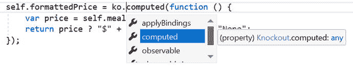
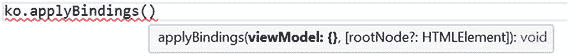

# 9. 使用 JavaScript 库

> 我并不是说使用现有的软件或库不好。我的意思是，在最小化一方的努力和最小化另一方的冗余代码之间总是需要权衡。我的意思是，当你从现有库中需要的功能比例非常小（比如说低于 20%）时，你应该考虑编写自己的代码。长期背负额外的 80% 可能并不值得。 — Lea Verou

在编写框架、工具包、辅助函数和有用的代码片段方面，JavaScript 社区是最活跃的社区之一。如果你搜索任何类型的框架或工具包，你很可能会找到大量的选择。事实上，选择的数量既是祝福也是诅咒，尽管你找到行为驱动测试框架、单元测试框架、模型-视图-控制器（MVC）框架、模型-视图-视图模型（MVVM）框架、网络工具包、浏览器 polyfill 等都不会有问题。从众多选项中选出一个来使用并非易事。

一旦你权衡了你的选择，你就可以立即开始在 TypeScript 程序中使用该框架。在运行时，你的程序和框架都将是纯 JavaScript，但在设计时和编译时，你将把 TypeScript 代码与纯 JavaScript 库混合在一起。由于 TypeScript 编译器不知道 JavaScript 文件中提供的操作，你需要以类型定义的形式提供提示，以获得与 TypeScript 库相同级别的工具支持。

编译器使用类型定义来检查你的程序，语言服务则使用它们在你的开发工具中提供自动补全。所有类型定义都会被编译器擦除，这意味着它们不会给你的生产代码增加任何负担。本章包含一个示例应用程序，演示了当你需要在 TypeScript 程序中包含第三方 JavaScript 代码时，如何为其创建类型定义。

为了说明类型定义对现有代码的好处，让我们了解一下在纯 JavaScript 中使用 jQuery 的典型开发工作流程。

*   输入一个选择器和方法，例如 `$('#elem').on(`
*   搜索 jQuery 文档中 `on` 方法的签名
*   在你的代码和文档之间来回切换以完成你的代码行

这是除了 jQuery 中最常见的操作之外所有操作的典型描述，我还没有提及任何复制和粘贴示例的情况（我们都做过）。如果即使对于最通用的库，我们的开发工作流程也涉及在文档和代码之间来回切换，那么一定有更好的方法。类型定义就是这样一种更好的方法。

通过包含 jQuery 的类型定义，你将获得针对 jQuery 成员的智能自动补全，从而省去在编辑器和文档之间来回切换的麻烦。GitHub 上有一个官方的类型定义仓库（Definitely Typed）。所有这些定义都可以从 NPM 上的 Types 组织安装，如图 9-1 所示，或者通过运行清单 9-1 中的命令进行安装。



图 9-1. 添加 jQuery 类型定义

请注意，在这两种情况下，类型定义都作为开发依赖项保存，因为它们在运行时不是必需的。

```bash
npm install @types/jquery --save-dev
```

清单 9-1. 类型定义的 NPM 安装命令

但是，在我们通过获取现有类型定义而走得太远之前，让我们从头开始，并涵盖那些可能没有可用定义的场景。这将意味着你可以像处理流行的框架一样，轻松地处理你自己的 JavaScript 代码，或者一个尚未有社区贡献的冷门库。

## 创建类型定义

为了说明类型定义的创建过程，本章使用 Knockout 作为 JavaScript 库的示例。Knockout 是一个 MVVM 框架，它通过将模型映射到视图并在发生变化时保持两者同步来简化动态用户界面。虽然使用 Knockout 来说明从头开始创建类型定义的过程，但该技术可用于以 TypeScript 能够理解的方式描述任何 JavaScript 代码——甚至是你自己的遗留库。

当然，如果你要向程序中添加像 Knockout 这样的流行库，很可能已经有人完成了创建类型定义的工作。因此，在花时间自己创建之前，请检查 Definitely Typed 项目或通过 NPM 的列表（你会找到 `@types/knockout`）。

[`http://definitelytyped.org/`](http://definitelytyped.org/)

如果你使用的开源库未列在列表中，那么在创建了类型定义之后，你可以将其提交给 Definitely Typed 项目，以帮助未来的其他程序员。

正在运行的应用程序示例如图 9-2 所示。该应用程序允许你预订座位并从一系列食物选项中进行选择。



图 9-2. Knockout 应用程序

### 使用 Knockout 创建 TypeScript 应用程序

本章中的应用程序允许乘客在航班上预订座位并选择机上餐食。该应用程序由一个 HTML 页面和一个 `app.ts` 文件组成，后者包含将数据绑定到视图的 Knockout 代码。清单 9-2 展示了该应用程序的视图的 HTML 页面，该页面来源于 Knockout 教程网站： [`http://learn.knockoutjs.com/`](http://learn.knockoutjs.com/)

本示例中值得关注的部分是 Knockout 用于将视图模型绑定到 HTML 页面的 `data-bind` 属性。每个 `data-bind` 属性都接收一个表达式，该表达式描述了数据应绑定到元素的哪个位置（例如 `value` 属性或内部的 `text`），以及应显示哪些数据。

```
Knockout App

您的座位预订 ()

乘客姓名
餐食
附加费

移除

预订另一个座位
 0">
总附加费: $

清单 9-2.
HTML 页面
```

`app.ts` 文件包含使用 Knockout 将数据绑定到视图的代码，如清单 9-3 所示。本节不会更改此文件，而是用它来驱动出所需的类型定义，以便消除编译器错误，并为 Knockout 提供高质量的自动补全和类型检查。

```
// 表示座位预订网格中一行的类
function SeatReservation(name, initialMeal) {
var self = this;
self.name = name;
self.meal = ko.observable(initialMeal);
self.formattedPrice = ko.computed(function () {
var price = self.meal().price;
return price ? "$" + price.toFixed(2) : "无";
});
}
// 此屏幕的总体视图模型及初始状态
function ReservationsViewModel() {
var self = this;
// 不可编辑的目录数据——将从服务器获取
self.availableMeals = [
{ mealName: "标准（三明治）", price: 0 },
{ mealName: "高级（龙虾）", price: 34.95 },
{ mealName: "至尊（整只斑马）", price: 290 }
];
// 可编辑数据
self.seats = ko.observableArray([
new SeatReservation("史蒂夫", self.availableMeals[0]),
new SeatReservation("伯特", self.availableMeals[0])
]);
// 计算数据
self.totalSurcharge = ko.computed(function () {
var total = 0;
for (var i = 0; i < self.seats().length; i++)
total += self.seats()[i].meal().price;
return total;
});
// 操作
self.addSeat = function () {
self.seats.push(new SeatReservation("", self.availableMeals[0]));
}
self.removeSeat = function (seat) { self.seats.remove(seat) }
}
ko.applyBindings(new ReservationsViewModel(), document.body);
清单 9-3.
app.ts 中的程序
```

如果你将这些文件放入开发环境中，由于 Knockout 的 `ko` 变量未知，你会收到 TypeScript 编译器的许多错误。这些错误的示例如图 9-3 所示。



图 9-3. 编译器错误

### 消除编译器错误

如果你只对消除编译器错误感兴趣，那么只需提供一个快速提示，告知编译器你将负责所有使用 `ko` 变量并导致错误的代码。提供此提示的类型定义如清单 9-4 所示。

# Knockout 类型定义与 JavaScript 迁移

该类型定义通常放在名为 `knockout.d.ts` 的文件中，并通过引用注释或 `import` 语句在 `app.ts` 中引用它。

```
declare var ko: any;
清单 9-4.
快速的类型定义修复
```

当你使用这类类型定义时，你放弃了编译器对你的程序的检查，并且你将无法获得自动补全功能。虽然这是一个简单的快速修复方法，但你很可能希望编写更全面的类型定义。



图 9-4. 第一次迭代

图 9-4 显示编辑器中的类型信息尚无用，但所有错误都已消失。

## 迭代改进类型定义

编写类型定义的一大优点在于可以增量式地进行。这意味着你可以根据每次增量提供的类型检查和自动补全带来的好处，来决定在类型定义上投入多少精力。

清单 9-5 展示了对 Knockout 类型定义的一次小的增量改进。`Knockout` 接口为应用中使用的所有第一级属性提供了类型信息：`applyBindings`、`computed`、`observable` 和 `observableArray`。这四个属性的具体细节没有给出；它们只是被简单地赋值为 `any` 类型。

声明的 `ko` 变量被更新为使用新的 `Knockout` 接口，而不是之前用来让编译器静默的 `any` 类型。

```
interface Knockout {
applyBindings: any;
computed: any;
observable: any;
observableArray: any;
}
declare var ko: Knockout;
Listing 9-5.
第一级类型定义
```

尽管这个更新后的定义很简单，但它可以防止许多常见的错误，否则这些错误只有在应用中观察到不正确行为时才会被发现。清单 9-6 展示了两个示例错误，基于这个第一级类型定义，编译器会捕获它们。

```
// 拼写错误被编译器捕获
self.meal = ko.observabel(initialMeal);
// 不存在的方法被编译器捕获
ko.apply(new ReservationsViewModel(), document.body);
Listing 9-6.
错误代码的编译器报错
```

本应使用 `observable` 却误拼为 `observabel`，以及本应使用 `applyBindings` 却调用了不存在的 `apply` 方法，这两者都会导致编译器报错。这是编译器所能达到的极限，因为接口中只指定了名称，而没有指定方法签名。

图 9-5 展示了使用更新后的定义所改进的自动补全。虽然成员被列出，但其类型信息尚未提供。



图 9-5. 第二次迭代

为了增加类型定义的细节，有必要参考该库的官方文档。在创建定义时参考一次文档，就能省去每次编写代码时都要查阅的麻烦。以 `applyBindings` 为例，文档指出该方法可以接受以下一个或两个参数：

*   `viewModel`—你想要与它所激活的声明式绑定一起使用的视图模型对象。
*   `rootNode`（可选）—你想要在其中搜索 `data-bind` 属性的文档部分。

换句话说，`viewModel` 是一个对象且必须提供，而 `rootNode` 是一个 `HTMLElement` 且是可选的。更新后的 `Knockout` 接口及其附加类型信息如清单 9-7 所示。

```
interface Knockout {
applyBindings(viewModel: {}, rootNode?: HTMLElement): void;
computed: any;
observable: any;
observableArray: any;
}
declare var ko: Knockout;
Listing 9-7.
'applyBindings' 定义
```

**注意**

即使你尚不清楚库中某个函数或对象的确切签名，将类型限制为通用的 `Function` 或 `Object` 类型也能防止许多可能的错误，例如传递简单类型。

这个更新后的类型定义提供了更全面的类型检查，确保至少向 `applyBindings` 传递一个参数，并且所有传递的参数都是正确的类型。它还允许开发工具提供有用的类型提示和自动补全，如图 9-6 所示。



图 9-6. `applyBindings` 方法的自动补全

另一种扩展类型信息的技术是提供你根据自己对该库的使用情况推断出的签名。应用中 `ko.computed` 的两个实例都传入了一个执行计算的函数。你可以更新类型定义，以表明 `computed` 方法期望提供一个函数，如清单 9-8 所示。

如果求值器的返回类型是固定的，你可以在括号内的类型定义中指定它。同样，如果你需要使用 `computed` 方法返回的值，你可以更新括号外的返回类型以提供返回类型的详细信息。

```
interface Knockout {
applyBindings(viewModel: any, rootNode?: any): void;
computed: (evaluator: () => any) => any;
observable: any;
observableArray: any;
}
declare var ko: Knockout;
Listing 9-8.
'computed' 定义
```

你可以继续使用官方文档或基于示例推断类型来扩展定义，从而创建清单 9-9 中所示的 `Knockout` 接口。该接口现在包含第一级和第二级类型信息。

```
interface Knockout {
applyBindings(viewModel: {}, rootNode?: HTMLElement): void;
computed: (evaluator: () => any) => any;
observable: (value: any) => any;
observableArray: (value: any[]) => any;
}
declare var ko: Knockout;
Listing 9-9.
完整的第二级定义
```

为了完成类型定义，你需要重复这个过程，将每个 `any` 的用法转化为更详细的类型，直到你不再依赖用动态类型来隐藏细节。每当某个定义扩展到难以管理的规模时，你可以使用额外的接口来拆分它，以帮助限制定义中任何特定部分的复杂性。

清单 9-10 演示了"分而治之"技术，将 `applyBindings` 方法的细节移到一个单独的 `KnockoutApplyBindings` 接口中。然后在 `Knockout` 接口中使用这个接口将类型信息绑定到该方法。

```
interface KnockoutApplyBindings {
(viewModel: {}, rootNode?: HTMLElement): void;
}
interface Knockout {
applyBindings: KnockoutApplyBindings;
computed: (evaluator: () => any) => any;
observable: (value: any) => any;
observableArray: (value: any[]) => any;
}
declare var ko: Knockout;
Listing 9-10.
将类型定义拆分为接口
```

尽管这个 Knockout 的类型定义远未完成，但它涵盖了运行示例应用程序所需的所有 Knockout 功能。你可以根据需要添加更多类型信息，只在获得合理回报时才投入精力。

## 转换 JavaScript 应用程序

如果你有一个现有的 JavaScript 应用程序，并打算切换到 TypeScript，处理旧代码有三种可行的策略：

- 编写类型定义
- 将 JavaScript 文件加入编译
- 将 JavaScript 代码迁移到 TypeScript 文件中

为自己编写的 JavaScript 代码编写类型定义是最不理想的方案，因为这会带来大量重复或徒劳的工作。允许编译器包含你的 JavaScript 代码，可以让你开启向 TypeScript 迁移的进程；而将其移入 TypeScript 文件则标志着迁移完成。

为了演示 JavaScript 代码的迁移过程，我们将使用清单 9-11 中展示的一个非常基础的 JavaScript 文件。该文件包含一些任意的旧处理代码，我们希望在新 TypeScript 程序中使用它们。

```
function old_process(name) {
return name + ' processed';
}
```

调用旧 JavaScript 的新代码如清单 9-12 所示。

class NewProcessor {
    process(name: string) {
        return old_process(name);
    }
}
```

当你尝试编译 TypeScript 文件时，会看到错误信息 `mynewlib.ts(3,16): error TS2304: Cannot find name 'old_process'`。这是因为编译器无法识别旧代码。

```
tsc mynewlib.ts --outDir ./dist
```

在编写类型定义或尝试将旧库升级为 TypeScript 之前，你可以先启用包含 JavaScript 文件的编译选项。当在编译中包含 JavaScript 文件时，最好将输出重定向到单独的文件夹，因为 JavaScript 输入文件不能被覆盖。清单 9-14 展示了允许在编译中包含 JavaScript 文件的编译器命令，并将旧 JavaScript 文件和新 TypeScript 文件一同加入编译。

```
tsc myoldlib.js mynewlib.ts --allowJs --outDir ./dist
```

通过将 JavaScript 文件包含在编译中，编译器通常能推断出类型信息，之前的编译错误现在也消失了。

你可以进一步改进代码，如清单 9-15 所示，在 TypeScript 文件中显式声明 JavaScript 依赖关系。

```
///
class NewProcessor {
    process(name: string) {
        return old_process(name);
    }
}
```

添加了引用注释后，编译时就不再需要指定 JavaScript 文件了。此外，你的编辑器现在将提供推断出的类型信息作为自动完成提示。

```
tsc mynewlib.ts --allowJs --outDir ./dist
```

为了进一步改善开发体验，你可以开始将 JavaScript 文件迁移为 TypeScript 文件，这样可以添加类型注解来完善类型信息，并在编译器无法理解类型时提供帮助。如果 JavaScript 代码特别晦涩，编译器可能无法推断出很多类型。

如果你有大量 JavaScript 文件需要升级，可以先将底层依赖升级为 TypeScript，而其他依赖于这些底层代码的 JavaScript 文件继续引用 TypeScript 文件的编译输出。在运行时，只要只添加类型注解而不重构程序结构，文件最初是用 TypeScript 还是 JavaScript 编写的并无区别。

最好将任何重构工作留到整个程序都改用 TypeScript 编写之后再进行，因为 TypeScript 的重构支持更加智能。

## 本章小结

几乎所有流行的 JavaScript 库都已经在 Definitely Typed 上列出了类型定义，并通过 NPM 上的 Types 组织发布；但如果你遇到一个比较小众的库，或者一个全新的、尚未收录的库，你可以自己创建类型定义。采用迭代/增量式的方法来编写类型定义，可以让你在投入的时间和精力上获得最大回报，并且你可以利用库的文档来查找类型信息，或者通过阅读示例来推断类型。

你也可以使用相同的类型定义技术来重用自己编写的 JavaScript 代码，但更省时的方法是直接将 JavaScript 代码移入 TypeScript 文件，并添加编译器无法为你推断的所有类型注解。

无论你是在编写类型定义，还是将 JavaScript 升级为 TypeScript，编译器都有可能发现你从未意识到的错误——你可能会惊讶于之前遗漏了多少问题。

## 关键要点

- 类型定义通常放在扩展名为 `.d.ts` 的文件中。
- 你可以增量地创建新的类型定义——无需一次性投入时间为整个库生成类型信息。
- 你可以在 TypeScript 编译中包含 JavaScript 文件。
- 通常，将文件从 JavaScript 升级为 TypeScript，比创建类型定义文件更容易。
- 由于 JavaScript 是完全动态的，在升级到 TypeScript 时，你很可能会发现并修复一些你从未意识到的错误。
