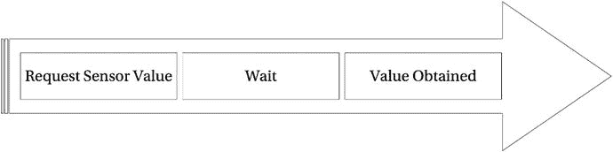
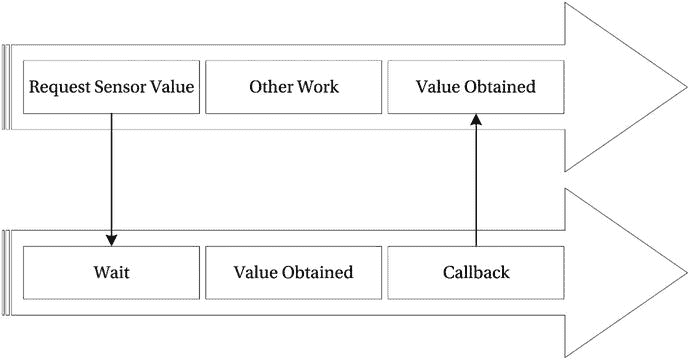

# 运行时特性

即使是老旧的浏览器也能让你访问文档对象模型（`DOM`）、鼠标和键盘事件、表单和导航功能。而现代浏览器则会增加离线存储、索引数据库、HTTP 请求、地理位置定位，以及用于光线、加速计和距离传感器等设备传感器的一系列应用程序编程接口（`API`）。JavaScript 不仅仅是网络浏览器中最常见的语言；自 20 世纪 90 年代初以来，它就已经在服务器上运行。JavaScript 作为服务器端语言的突出地位实际上是通过`NodeJS`得以实现的，这是一项构建在`V8` JavaScript 引擎之上的服务器技术。在服务器上运行使得你可以访问数据库、文件系统、加密技术、域名解析、流以及无数其他模块和工具。图 5-1 展示了 JavaScript 这门语言是如何通过浏览器或服务器提供的 API 而变得强大的。

除非你明确使用允许创建线程的 API（例如 Web Worker 或子进程），否则程序中的语句将排队在单个线程上执行。在单个线程上运行程序消除了多线程试图操作同一状态所导致的许多棘手问题，但这确实意味着你需要记住你的代码可能会被排队。一个长时间运行的事件处理器可能会阻止其他事件及时触发，并且队列的执行顺序在细微之处可能有所不同。队列通常按照先进先出的顺序处理，但不同的运行时环境可能会在不同的时间点重新访问队列。例如，一个运行环境可能只在某个函数执行完毕后才会返回队列，但另一个运行环境可能在任何函数移交控制权时（例如通过调用另一个函数）就重新访问队列。在后一种情况下，在调用第二个函数之前，可能会执行另一条语句。尽管这些潜在差异看似令人担忧，但在实践中很少会发现它们会引起任何问题。

除了处理包含所有事件的队列之外，运行时可能还有其他任务需要在同一个线程上处理；例如，浏览器可能需要重绘屏幕。如果你有一个运行时间过长的函数，就可能影响浏览器的重绘速度。为了让浏览器能够每秒绘制 60 帧，你需要将任何函数的执行时间控制在 17 毫秒以内。在实践中让函数保持快速运行非常容易，除非你处理的是具有阻塞调用的 API（例如 `localStorage`），或者执行一个长时间运行的循环。


**图 5-1.** 浏览器环境与服务器环境中的 JavaScript 特性

运行时单线程方法最常见的副作用之一是，间隔计时器和定时器的执行时间可能看起来比指定的时间更长。这是因为它们必须在队列中等待执行。代码清单 5-1 展示了一个测试函数，用于计算延迟日志语句的执行时间。调用 `test` 函数会设置一个 50 毫秒的定时器，并测量其触发所需的时间。多次运行这段代码，你会发现得到的结果在 50 到 52 毫秒之间，这符合预期。

```
function test() {
const testStart = performance.now();
window.setTimeout(function () {
console.log(performance.now() - testStart);
}, 50);
}
test();
```

**代码清单 5-1.** 排队的定时器

为了模拟一个长时间运行的进程，在代码清单 5-2 的 `test` 函数中添加了一个运行 100 毫秒的循环。该循环在设置定时器之后开始，但由于在原始 `test` 函数完成之前没有任何任务出队，定时器执行的时间比之前晚了很多。此示例中记录的时间通常在 118 到 130 毫秒的范围内。

```
function test() {
const testStart = performance.now();
window.setTimeout(function () {
console.log(performance.now() - testStart);
}, 50);
// 模拟长时间运行的进程
const start = +new Date();
while (+new Date() - start < 100) {
// 延迟 100 毫秒
}
}
test();
```

**代码清单 5-2.** 排队的定时器，延迟执行，等待 `test` 方法结束

**注意**

所有主流浏览器的最新版本都支持 `performance.now` 高分辨率定时器。这种测量执行时间的方法比使用 `Date` 对象更准确。日期基于系统时钟，系统时钟可能每 15 分钟就会同步一次。如果在计时操作期间发生同步，将会影响你的结果。`performance.now` 值来自一个高分辨率定时器，它可以测量亚毫秒级的时间间隔，在页面开始加载时从 `0` 开始，并且在同步期间不会被调整。


## 作用域

术语“作用域”指的是一组在给定上下文中可解析的可用标识符。在大多数类 C 语言中，标识符是块级作用域的，这意味着它们只能在定义它们的同一组花括号内使用。在一组花括号内声明的变量在该花括号外部不可用，但花括号内的语句可以访问在花括号外部声明的变量。清单 5-3 展示了这种常见的类 C 语言作用域的工作方式。

当你在 JavaScript（以及 TypeScript）中使用 `var` 关键字时，情况并非如此。如果清单 5-3 中的代码在 JavaScript 运行时中执行，那么两个语句中记录的值将是相同的；具体来说，你会看到“Outer: 2”，而不是“Outer: 1”。这是因为使用 `var` 关键字创建的变量的作用域是由函数定义的，而不是由块定义的。

```
var scope = 1;
{
var scope = 2;
// Inner: 2
console.log('Inner: ' + scope);
}
// Outer: 1
console.log('Outer: ' + scope);
清单 5-3.
类 C 语言作用域
```

清单 5-4 展示了相同的示例，但使用一个函数来为内部变量提供作用域。该函数创建了一个新的上下文，使得内部作用域变量独立于外部作用域变量。在这个示例中，日志语句的工作方式与其他类 C 语言相同。

```
var scope = 1;
(function () {
var scope = 2;
// Inner: 2
console.log('Inner: ' + scope);
}());
// Outer: 1
console.log('Outer: ' + scope);
清单 5-4.
函数作用域
```

ECMAScript 规范中有两种新的变量声明：`let` 和 `const`。`let` 和 `const` 都是块级作用域的，这将使你避免函数作用域变量的许多陷阱。`const` 关键字还有一个额外的好处，即防止重新赋值，这意味着变量不能被覆盖（尽管其值可以改变）。

你可以在 TypeScript 代码中使用 `let` 和 `const`。如果你的目标是旧版本的 JavaScript，编译器将使用降级编译来重命名你的变量，以防止它们受到上下文变化的影响。清单 5-5 重新审视了原始示例，使用 `const` 关键字代替 `var` 关键字，从而正确地记录了“Inner: 2”和“Outer: 1”。

```
const scope = 1;
{
const scope = 2;
// Inner: 2
console.log('Inner: ' + scope);
}
// Outer: 1
console.log('Outer: ' + scope);
清单 5-5.
块级作用域
```

清单 5-5 的降级编译将 `const` 关键字替换为 `var` 关键字，但将第二个变量重命名为 `scope_1`，如清单 5-6 所示；这可以防止内部变量覆盖外部变量。编译器足够智能，能够避免命名冲突，因此如果你已经有一个名为 `scope_1` 的变量，编译器会选择另一个名称。

```
var scope = 1;
{
var scope_1 = 2;
// Inner: 2
console.log('Inner: ' + scope_1);
}
// Outer: 1
console.log('Outer: ' + scope);
清单 5-6.
块级作用域变量的降级编译
```

由于无论目标运行时是什么，你都可以在 TypeScript 中使用块级作用域变量，因此在 TypeScript 程序中没有理由使用 `var` 关键字。

注意

正如第 1 章所述，推荐的编码风格是对所有变量使用 `const` 关键字，并且仅在你决定允许重新赋值时才使用 `let` 关键字打开变量。

使用块级作用域变量还可以防止变量提升，变量提升会将所有变量视为在其作用域的最顶部声明。这在技术上允许变量在使用之前（即声明它们的代码行之前）被使用，尽管它们的值会是 `undefined`。清单 5-7 显示了一个变量提升的示例。

```
function lemur() {
// undefined, but technically allowable
console.log(kind);
var kind = 'Ruffed Lemur';
}
lemur();
清单 5-7.
变量提升
```

如果你在声明块级变量之前访问它，TypeScript 编译器会发出警告，从而防止此类细微的错误，以及清单 5-8 中更令人困惑的错误，在该错误中，你可能会期望日志语句中使用全局变量。在使用 `var` 关键字时，偶然重用了更广泛作用域中的名称，这导致了我职业生涯中调查过的一些最著名的棘手错误。

```
var kind = 'Ring Tailed Lemur';
function lemur() {
// undefined, not 'Ring Tailed Lemur'
console.log(kind);
var kind = 'Ruffed Lemur';
}
lemur();
清单 5-8.
变量提升与全局作用域混淆
```

注意

在你的程序中，避免混淆的最佳方法是尽可能避免向全局作用域添加内容。全局变量的缺失意味着 TypeScript 编译器可以警告你在变量声明之前使用它们，以及意外省略 `var` 或 `let` 关键字的情况。


### 回调函数

几乎所有现代 JavaScript API，包括那些提供访问设备传感器读数的新浏览器 API，都通过接受一个在操作完成时执行的回调函数来避免阻塞。回调函数就是你作为参数传入的一个函数，当某个操作完成后，它会被调用。

为了说明回调函数的好处，图 5-2 展示了程序在等待一个阻塞型传感器响应请求时的执行流程。由于请求在整个持续期间阻塞了主线程，因此无法执行任何其他语句。将事件队列阻塞超过几毫秒是不可取的，对于长时间运行的操作必须避免这种情况。涉及文件系统调用、硬件设备调用或跨网络连接调用的操作都可能将程序阻塞过长时间，这是不可接受的。



图 5-2. 阻塞式调用

回调函数对于避免这些阻塞请求非常有用。图 5-3 展示了如何使用这种模式来避免在长时间运行过程中阻塞主线程。当发出请求时，一个函数会连同请求一起被传入。随后，主线程能够像往常一样处理事件队列。当长时间运行的过程结束时，回调函数被调用，并传入任何相关的参数。这将回调函数添加到事件队列中，然后依次执行。



图 5-3. 使用回调函数

尽管回调函数通常用于在长时间运行过程中避免阻塞程序，但你可以在程序中的任何位置自由地将函数作为参数传递。清单 5-9 演示了这一点。`go` 函数接受一个函数参数。`callback` 参数有一个类型注解，限制只能传递那些接受 `string` 参数的函数。`callbackFunction` 满足这个类型注解。

在 `go` 函数体内，使用 `call` 方法执行回调函数，该方法在 JavaScript 中的所有函数上都可用。

```
function go(callback: (arg: string) => void) {
  callback.call(this, 'Example Argument');
}

function callbackFunction(arg: string) {
  alert(arg);
}

go(callbackFunction);
```

清单 5-9. 将函数作为参数传递

在 `go` 函数内部执行回调函数有三种常见方式。在清单 5-9 中，使用了 `call` 方法。当使用 `call` 时，你必须提供一个变量来设置回调函数中 `this` 关键字的上下文。你可以在上下文参数之后跟随任意数量的额外参数；这些参数将被传入回调函数。你也可以使用 `apply` 方法，它与 `call` 几乎相同，区别在于你以数组形式传递参数，如清单 5-10 所示。如果你的结果已经是一个数组，那么这些值会被展开成独立的参数。

```
function go(callback: (arg: string) => void) {
  callback.apply(this, ['Example Argument']);
}

function callbackFunction(arg: string) {
  alert(arg);
}

go(callbackFunction);
```

清单 5-10. 使用 `apply`

第三种执行回调函数的方法是直接用圆括号调用该函数，如清单 5-11 所示。这种方式不允许设置上下文，因此根据上下文的不同，作用域可能与你的预期有所不同。

```
function go(callback: (arg: string) => void) {
  callback('Example Argument');
}

function callbackFunction(arg: string) {
  alert(arg);
}

go(callbackFunction);
```

清单 5-11. 简单的函数调用

在回调函数上下文之外，`apply` 方法还有一个额外的用途。由于它接受一个包含参数的数组，你可以使用 `apply` 从数组中提取参数。这在清单 5-12 中进行了演示。要找出 `numbers` 数组中的最大值，你要么编写一个循环来逐一测试，要么使用每个索引将每个值单独传入 `Math.max` 函数。使用 `apply` 方法意味着你可以直接传入 `numbers` 数组，并让 `apply` 方法将数组转换为参数列表。因为你没有使用 `apply` 来修改作用域，所以可以将 `null` 作为第一个参数传入。

```
const numbers = [3, 11, 5, 7, 2];
// 查找最大值的一种脆弱方式
// const max = Math.max(numbers[0], numbers[1], numbers[2], numbers[3], numbers[4]);
// 查找最大值的稳健方式
const max = Math.max.apply(null, numbers);
// 11
console.log(max);
```

清单 5-12. 使用 `apply` 将数组转换为参数

使用回调函数的模式是将函数作为参数传递的一个例子。下一节将描述这种语言特性的强大之处，以及如何以其他方式使用它。

### 将函数作为参数传递

函数在 JavaScript 中是**一等公民**，这意味着它们可以作为参数传递，作为返回值从另一个函数返回，赋值给变量，并作为对象的属性存储。将函数作为参数传递是提供回调函数的机制。

你可以利用将函数作为参数传递的能力，创建一个简单的观察者模式实现：存储一组订阅者，并从单个类向所有订阅者发布事件。这个简单的观察者模式设计如清单 5-13 所示。可以添加任意数量的订阅者，当发布者接收到消息时，它会将消息分发给所有订阅者。

```
interface Subscriber {
  (message: string): void;
}

class Publisher {
  private subscribers: Subscriber[] = [];

  addSubscriber(subscriber: Subscriber) {
    this.subscribers.push(subscriber);
  }

  notify(message: string) {
    for (let subscriber of this.subscribers) {
      subscriber(message);
    }
  }
}

const publisher = new Publisher();
// 使用箭头函数
publisher.addSubscriber((message) => console.log('A: ' + message));
// 使用内联函数
publisher.addSubscriber(function (message) {
  console.log('B: ' + message);
});
// A: Test message
// B: Test message
publisher.notify('Test message');
```

清单 5-13. 简单的观察者

注意

当你将函数作为参数传递时，必须省略圆括号；例如，使用 `go(callbackFunction)` 而不是 `go(callbackFunction())`；否则函数会被执行，而传递的是其返回值。

一等函数是任何语言中最强大的特性之一。你可以创建**高阶函数**，它们接受函数作为参数，并返回函数作为结果；这提供了更大的灵活性，以及程序中更细粒度的代码可重用性。你也可以参考第 1 章，了解更多关于函数柯里化和箭头函数的内容。


## Promise

引入 Promise 是为了减少回调函数带来的若干问题。当使用一连串的回调时，代码会变得深度嵌套且难以追踪。当考虑错误处理时，回调函数往往会重复编写错误处理代码，进一步增加了理解程序的认知负荷。

原生 `Promise` 对象仅在 ECMAScript 5 之后的版本中可用。如果你的目标对象是这些较新的规范版本，你可以直接使用纯粹的 Promise 原生版本。否则，你需要应用一个 polyfill 来添加所需的功能。

为了全面探讨 Promise，我们需要处理一个相当有代表性的示例。通过完成本练习，你将会理解如何使用 Promise，以及如何创建它们。即使本节中的示例非常简单（它们只是在控制台输出了一些数据），你也能看到回调链导致的问题，以及 Promise 是如何解决嵌套和可读性问题的。

### 简单的回调

第一个示例涉及简单的回调。这个示例允许使用回调，在异步操作完成后将控制权返回给调用代码。我们稍后将对这个程序进行演进，以解决各种问题。

列表 5-14 是我们虚构 API 的起点，它用于异步获取一些数据。`getData` 方法接受一个 id 和一个回调函数，当数据可用时会执行这个回调。依赖数据的代码必须放在这个回调函数内部。

```typescript
interface FictitiousData {
    id: number;
    name: string;
}
class FictitiousAPI {
    static data: { [index: number]: FictitiousData } = {
        1: { id: 1, name: 'Aramis' },
        2: { id: 2, name: 'Athos' },
        3: { id: 3, name: 'Porthos' },
        4: { id: 4, name: 'D\'Artagnan' }
    };
    static getData(id: number, callback: (data: FictitiousData) => void) {
        // 使用超时模拟异步数据访问
        window.setTimeout(() => {
            const result = this.data[id];
            if (typeof result == 'undefined') {
                throw new Error('No matching record');
            }
            callback(result);
        }, 200);
    }
}
```

该 API 的一个简单用法如列表 5-15 所示。一旦异步的 `getData` 函数就绪，它就会执行回调函数，将数据记录到控制台。

```javascript
// 单次调用：'Aramis'
FictitiousAPI.getData(1, function (data) {
    console.log(data.name);
});
```

与回调模式相关的一个问题是，它无法处理异步代码中发生的任何异常。无论你在哪里插入 `try/catch` 语句，你都无法在此版本的 API 中处理该错误。

```javascript
// 错误处理（不起作用）
try {
    FictitiousAPI.getData(5, function (data) {
        console.log(data.name);
    })
} catch (ex) {
    console.log('This statement is not reached, the error is not caught!');
}
```

当你需要使用回调来链式调用多个操作时，代码会迅速变得嵌套且难以阅读。列表 5-17 展示了对类似数据获取调用的嵌套，但当你需要使用多个不同的异步 API 时，也会出现嵌套回调的情况。

```javascript
FictitiousAPI.getData(1, (data) => {
    console.log(data.name);
    FictitiousAPI.getData(2, (data) => {
        if (data.name == 'Athos') {
            console.log(data.id + ' ' + data.name);
        } else {
            console.log(data.name);
        }
        FictitiousAPI.getData(3, (data) => {
            console.log(data.name);
            FictitiousAPI.getData(4, (data) => {
                console.log(data.name);
                FictitiousAPI.getData(5, (data) => {
                    console.log(data.name);
                })
            });
        });
    });
});
```

该程序的输出如下所示：

```
==== OUTPUT ====
Aramis
2 Athos
Porthos
D'Artagnan
Error: No matching record
```

演进这段代码的第一步是使其能够处理 API 内部发生的错误。之后，我们可以考虑使用 Promise 来改进它。

### 回调与错误处理

为了解决错误处理的问题，我们将向回调函数引入一个额外的参数。这是广泛使用回调的程序中的常见模式。通过将错误参数放在第一位，成功情况可以拥有可变数量的参数，而不会影响调用代码期望在哪里找到问题信息。

列表 5-18 展示了 API 的完整第二版，现在它将错误字符串作为第一个参数。在出现问题时，不是抛出错误，而是将错误消息作为第一个参数传递。在成功的情况下，则不传递错误字符串。

```typescript
interface FictitiousData {
    id: number;
    name: string;
}
class FictitiousAPI {
    static data: { [index: number]: FictitiousData } = {
        1: { id: 1, name: 'Aramis' },
        2: { id: 2, name: 'Athos' },
        3: { id: 3, name: 'Porthos' },
        4: { id: 4, name: 'D\'Artagnan' }
    };
    static getData(id: number, callback: (error: string, data: FictitiousData) => void) {
        // 使用超时模拟异步数据访问
        window.setTimeout(() => {
            const result = this.data[id];
            if (typeof result == 'undefined') {
                callback('No matching record', null);
                return;
            }
            callback(null, result);
        }, 200);
    }
}
```

为了在实际中应用这种新的错误处理模式，列表 5-19 中的简单调用现在需要在访问 `data` 参数之前检查错误。

```javascript
// 单次调用：'Aramis'
FictitiousAPI.getData(1, function (error, data) {
    if (error) {
        console.log('Caught ' + error);
        return;
    }
    console.log(data.name);
});
```

同样的检查出现在列表 5-20 中，并且成功地处理了以前无法处理的错误。我们现在可以在成功和出错时执行不同的操作。

```javascript
// 错误处理
FictitiousAPI.getData(5, function (error, data) {
    if (error) {
        console.log('Caught ' + error);
        return;
    }
    console.log(data.name);
});
```

这种模式的缺点在于错误处理代码的激增，这使得我们的嵌套回调情况变得更加冗长，如列表 5-21 所示。尽管这段代码示例仍然只满足一个非常基本的功能，但现在它成了一个难以理解的复杂列表。

```javascript
FictitiousAPI.getData(1, (error, data) => {
    if (error) {
        console.log('Caught ' + error);
        return;
    }
    console.log(data.name);
    FictitiousAPI.getData(2, (error, data) => {
        if (error) {
            console.log('Caught ' + error);
            return;
        }
        if (data.name == 'Athos') {
            console.log(data.id + ' ' + data.name);
        } else {
            console.log(data.name);
        }
        FictitiousAPI.getData(3, (error, data) => {
            if (error) {
                console.log('Caught ' + error);
                return;
            }
            console.log(data.name);
            FictitiousAPI.getData(4, (error, data) => {
                if (error) {
                    console.log('Caught ' + error);
                    return;
                }
                console.log(data.name);
                FictitiousAPI.getData(5, (error, data) => {
                    if (error) {
                        console.log('Caught ' + error);
                        return;
                    }
                    console.log(data.name);
                })
            });
        });
    });
});
```

该程序的输出与之前基本相同，如下所示，唯一的区别是错误现在已被处理：

```
==== OUTPUT ====
Aramis
2 Athos
Porthos
D'Artagnan
Caught No matching record
```

演进这段代码的下一步是使用 Promise 大幅提高其可读性。


