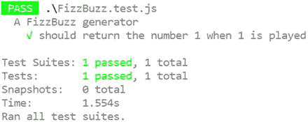
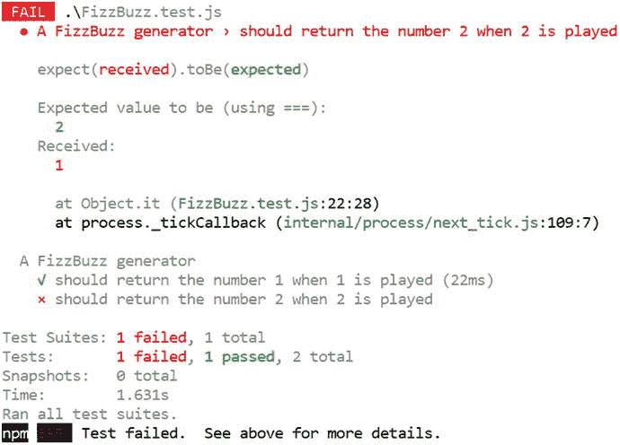
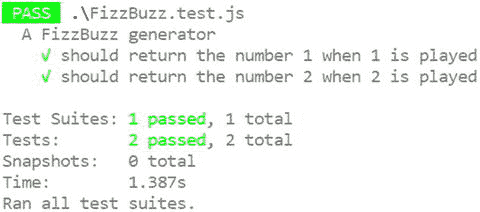
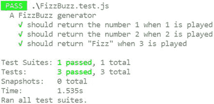
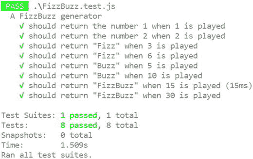

# 10. 自动化测试

> 我对任何领域专家的定义是：一个对事情真相了解得足够多，以至于感到害怕的人。——P. J. Plauger

对于任何编写 TypeScript 所设计的那种大型应用程序的人来说，自动化测试都是一个至关重要的主题。通过自动化程序测试，开发者可以将更多时间用于开发新功能，减少修复缺陷的时间。自动化测试对于重构也至关重要。没有任何一种单一的测试方法能够独立提供足够高的缺陷检测率。这意味着需要结合多种测试方法，才能在软件发布前检测出合理数量的缺陷。

这可能会令人惊讶，但实证证据表明，对于不同类型的测试，你将达到以下缺陷检测率，正如 Steve McConnell 在《代码大全》（Microsoft Press，2004 年）中所记载的：

- 单元测试最多可检测出 50% 的缺陷。
- 集成测试最多可检测出 40% 的缺陷。
- 回归测试最多可检测出 30% 的缺陷。

这些数字表明，随着测试在软件开发生命周期中进行得越晚，就会有更多的缺陷漏网。同时，众所周知，缺陷发现得越晚，修复成本就越高。考虑到这一点，也许测试优先编程是减少缺陷最有效的方法之一（与结对编程并列，因为协作工作方法已被发现能比任何类型的测试检测出更多的缺陷）。测试驱动设计（TDD）的支持者也会很快指出，测试是额外收获，而非 TDD 的主要目的——TDD 是一种辅助设计内聚代码单元的工具。他们可能是对的，但测试本身也很不错！

本章的目的并非说服你采用测试驱动设计。无论你选择在编码之前编写测试，还是在编写完部分程序后编写测试，或者希望自动化测试而不是手动执行，本章的信息都将对你有用。

> 注意：缩写 TDD 最初是为测试驱动开发（test-driven development）创造的，但后来修订为测试驱动设计（test-driven design），以强调这种方法在帮助塑造程序设计方面所起的作用。

## 框架选择

有许多用 JavaScript 编写的高质量测试框架可用于测试程序。这里列出了三个最流行的框架，但还有更多未列出的框架，你甚至不需要使用框架，因为直接使用 TypeScript 代码也可以进行测试。

*   Jasmine
*   Mocha
*   Jest

本章中的示例均使用 Jest 编写，Jest 是一个易于设置的测试框架，因其与 React 框架的紧密联系而逐渐受到欢迎。

示例中展示的代码涵盖了 FizzBuzz 编程练习的前几个步骤。编程练习是一种通过解决简单问题来逐步挑战设计能力的实践方法。附录 4 对编程练习进行了说明。FizzBuzz 练习基于一个儿童游戏，该游戏包含一系列计数规则。在执行练习时，你的目标应该是仅通过游戏中的下一个规则；避免提前思考的诱惑。随着你编写更多代码，设计会逐渐显现，你可以重构程序（只要测试通过，你就没有意外改变行为，这一点可以放心）。

## 使用 Jest 进行测试

Jest 是为了补充 React 框架而编写的，但它也可以用于测试任何 TypeScript 或 JavaScript 程序。运行 Jest 最常见的方式是通过 Node。其语法简洁易学，对于过去使用过 Jasmine 的人来说会非常熟悉。

### 安装 Jest

将 Jest 添加到项目中最简单的方法是从 NPM 获取包和类型定义。你可以通过将这些包添加到开发依赖项中来实现，如代码清单 10-1 所示。你还会注意到，我们使用 `package.json` 文件来告诉 Node 哪个框架将处理我们的测试运行。

```json
{
  "name": "fizzbuzz",
  "version": "1.0.0",
  "devDependencies": {
    "@types/jest": "²¹.1.0",
    "jest": "²¹.1.0"
  },
  "scripts": {
    "test": "jest"
  }
}
```

代码清单 10-1. 包依赖

下载完这些包后，你就可以开始编写代码了。

### 第一个规范

代码清单 10-2 展示了一个待测试的 `FizzBuzz` 类的简单实现。该类的目的是当给定 FizzBuzz 游戏中报出的一个数字时，提供正确的答案。完整的实现应返回报出的数字，或者根据该数字是否能被三、五或三和五同时整除，用诸如 "Fizz"、"Buzz" 或 "FizzBuzz" 等游戏词汇替换该数字。

> **注意**
> FizzBuzz 游戏通常是在一个群体中进行的。每个人轮流说出从 1 开始的序列中的下一个数字。如果数字能被三整除，玩家应该说 "Fizz" 而不是数字。如果数字能被五整除，玩家应该说 "Buzz"，如果数字能被三和五同时整除，他们应该说 "FizzBuzz"。

与其一次性实现所有这些逻辑，我们使用规范来驱动编程任务。因此，在实现任何超出初始实现（总是返回数字 1）的行为之前，该类需要等待 Jest 规范。

```typescript
export class FizzBuzz {
    generate(input: number) {
        return 1;
    }
}
```

代码清单 10-2. `FizzBuzz.ts` 中的 `FizzBuzz` 代码

# 测试驱动开发

匹配此行为的 Jest 测试如代码清单 10-3 所示。这个测试代表了你向某人首次解释 FizzBuzz 规则时对话中的第一句话。例如，“当报出数字 1 时，你应该说 '1'。”

```typescript
import { FizzBuzz } from './FizzBuzz';

describe('一个 FizzBuzz 生成器', () => {
  it('当报出 1 时，应返回数字 1', () => {
    const fizzBuzz = new FizzBuzz();
    const result = fizzBuzz.generate(1);
    expect(result).toBe(1);
  });
});
```

代码清单 10-3. `FizzBuzz.test.ts` 中的 Jest 测试

`describe` 方法接受一组规范的名称和一个测试每个规范的函数。`it` 方法表示单个规范。规范集和规范中使用的语言旨在具有人类可读性。在这种情况下，将规范集描述与规范文本结合起来读作：

> 当报出 1 时，一个 FizzBuzz 生成器应返回数字 1。

通过仔细选择规范中的语言，你可以从测试套件中获得免费的文档。你甚至可能会想到一种更好的措辞方式，用更人性化的术语来描述这种行为。如果是这样，你应该更改描述以匹配你改进后的措辞。在这些细节上多花些心思是值得的，因为这从长远来看会使规范更有价值。

传递给规范的函数通过实例化 `FizzBuzz` 类、报出数字 1 并检查结果是否为 1 来验证这一声明。

Jest 会在文件名包含 `*.test.js` 的文件中查找测试，但排除 `node_modules` 文件夹中的文件，因此命名很重要。如果你忘记了这一点，运行 Jest 时将找不到任何测试。

要运行 Jest，只需在你的项目文件夹中运行代码清单 10-4 所示的命令。

```bash
npm test
```

代码清单 10-4. 运行 Jest

此命令的输出如图 10-1 所示。



图 10-1. Jest 测试结果

现在一切设置完毕，可以开始测试了。接下来，你将使用更多的测试来驱动 FizzBuzz 程序的实现。

## 驱动实现

现在测试自动化已就位，便可以通过新的规格说明来驱动实现过程。清单 10-5 展示了在 FizzBuzz 游戏中输入数字 2 时的预期行为规格说明。

```typescript
import { FizzBuzz } from './FizzBuzz';

describe('一个 FizzBuzz 生成器', () => {
  it('输入 1 时应返回数字 1', () => {
    const fizzBuzz = new FizzBuzz();
    const result = fizzBuzz.generate(1);
    expect(result).toBe(1);
  });

  it('输入 2 时应返回数字 2', () => {
    const fizzBuzz = new FizzBuzz();
    const result = fizzBuzz.generate(2);
    expect(result).toBe(2);
  });
});
```

第二个规格说明将会失败，因为 `FizzBuzz` 类被硬编码为无论输入什么值都返回 `1`。运行测试的结果如图 10-2 所示。



失败消息显示测试“`期望值为：2，实际接收：1`”，这意味着 Jest 测试失败，因为当预期返回 `2` 时，实际返回了 `1`。

为了通过测试，必须按照清单 10-6 所示更新 `FizzBuzz` 类。返回输入的任何数字将使现有两个规格说明均通过。尽管你可能知道很快会增加该实现无法覆盖的更多规格说明，但在编写代码前等待测试失败，可以确保每一种变化的测试都在你编写让其通过的代码之前编写并失败。知晓测试会在行为不正确时失败，这将让你在后续重构程序时充满信心。

```typescript
export class FizzBuzz {
  generate(input: number) {
    return input;
  }
}
```

此次更改后重新运行规格说明，所有规格说明都将通过。结果如图 10-3 所示。



清单 10-7 展示了驱动 `FizzBuzz` 类实现的下一项规格说明。该规格说明要求输入数字 3 时，应将其替换为单词“Fizz”。

```typescript
it('输入 3 时应返回"Fizz"', () => {
  const fizzBuzz = new FizzBuzz();
  const result = fizzBuzz.generate(3);
  expect(result).toBe('Fizz');
});
```

在确认该规格说明失败后，你可以更新清单 10-8 所示的实现。此次更新同样是能通过测试的最简代码。

```typescript
class FizzBuzz {
  generate(input: number) : string | number {
    if (input === 3) {
      return 'Fizz';
    }
    return input;
  }
}
```

此阶段运行规格说明的结果如图 10-4 所示。阅读测试输出有助于理解测试如何以业务领域的语言描述程序。



## 重构

既然已经编写了若干规格说明并实现了使其通过的代码，那么对程序进行重构是值得的。代码重构涉及在不改变行为的前提下改变程序的结构和设计。确认你确实是在重构（而非无意中改变程序实际功能）的最简单方法，就是拥有能够突出显示任何意外变更的自动化测试。

同样值得注意的是，你的测试代码应当像生产代码一样编写精良且易于维护，但抽象程度可以更低。因此，清单 10-9 展示了重构后的规格说明，其中重复的 `FizzBuzz` 类实例化被移至 `beforeEach` 方法中，Jest 会在每条规格说明之前自动运行该方法。

```typescript
import { FizzBuzz } from './FizzBuzz';

describe('一个 FizzBuzz 生成器', () => {
  let fizzBuzz: FizzBuzz;

  beforeEach(() => {
    fizzBuzz = new FizzBuzz();
  });

  it('输入 1 时应返回数字 1', () => {
    const result = fizzBuzz.generate(1);
    expect(result).toBe(1);
  });

  it('输入 2 时应返回数字 2', () => {
    const result = fizzBuzz.generate(2);
    expect(result).toBe(2);
  });

  it('输入 3 时应返回"Fizz"', () => {
    const result = fizzBuzz.generate(3);
    expect(result).toBe('Fizz');
  });
});
```

每当你重构代码时，都应重新运行所有测试，以确保没有改变程序的行为。如果测试套件失败，你可以轻松撤销更改并再次尝试，而非调试程序。每次测试运行之间的迭代应当足够小，以便可以放弃。

```typescript
export class FizzBuzz {
  generate(input: number): string | number {
    let output = '';
    if (input % 3 === 0) {
      output += 'Fizz';
    }
    if (input % 5 === 0) {
      output += 'Buzz';
    }
    return output === '' ? input : output;
  }
}
```

清单 10-10 中的代码展示了 `FizzBuzz` 类的一个可用版本，它涵盖了返回数字的默认规则以及 `Fizz`、`Buzz` 和 `FizzBuzz` 三种变体。此时，尽管 `generate` 方法仍然相当简短，但已能从代码中看出替代设计的雏形。特别是，随着新规则的加入（例如能被 7 整除的数字应返回'Bazz'），你可能会决定引入并适配一种设计模式来捕获特定规则。

**注意：** FizzBuzz 编程练习通常使用称为责任链的设计模式来解决，尽管也存在其他可能的解决方案。

为驱动此实现而创建的规格说明如清单 10-11 所示。目前共有八条规格说明，用于覆盖四种可能的响应类型。

```typescript
import { FizzBuzz } from './FizzBuzz';

describe('A FizzBuzz generator', () => {
```


let `fizzBuzz`: `FizzBuzz`;

const `FIZZ` = 'Fizz';

const `BUZZ` = 'Buzz'

const `FIZZ_BUZZ` = 'FizzBuzz';

beforeEach(() => {

`fizzBuzz` = new `FizzBuzz`();

});

it('should return the number 1 when 1 is played', () => {

const result = `fizzBuzz`.generate(1);

expect(result).toBe(1);

});

it('should return the number 2 when 2 is played', () => {

const result = `fizzBuzz`.generate(2);

expect(result).toBe(2);

});

it('should return "Fizz" when 3 is played', () => {

const result = `fizzBuzz`.generate(3);

expect(result).toBe(`FIZZ`);

});

it('should return "Fizz" when 6 is played', () => {

const result = `fizzBuzz`.generate(6);

expect(result).toBe(`FIZZ`);

});

it('should return "Buzz" when 5 is played', () => {

const result = `fizzBuzz`.generate(5);

expect(result).toBe(`BUZZ`);

});

it('should return "Buzz" when 10 is played', () => {

const result = `fizzBuzz`.generate(10);

expect(result).toBe(`BUZZ`);

});

it('should return "FizzBuzz" when 15 is played', () => {

const result = `fizzBuzz`.generate(15);

expect(result).toBe(`FIZZ_BUZZ`);

});

it('should return "FizzBuzz" when 30 is played', () => {

const result = `fizzBuzz`.generate(30);

expect(result).toBe(`FIZZ_BUZZ`);

});

});

清单 10-11. 可正常工作的 `FizzBuzz` 类的规范

除了测试 `FizzBuzz` 类之外，这些规范还为程序提供了准确的文档。输出结果如图 10-5 所示。你可能会注意到 Jest 标记了其中一个测试的执行时间（15 ms），这有助于你识别那些拖慢测试套件的测试。



**图 10-5.** 包含三个测试且全部通过的测试套件

这些测试是一种可执行的规范——一种活的文档形式，同时也证明了你的程序执行了文档中描述的行为。

### 隔离依赖项

有时你可能需要测试代码中依赖于某个资源的部分，而这会使你的测试变得脆弱。例如，它可能依赖于第三方 API 或特定状态的数据库。如果你需要在测试时不依赖这些依赖项，可以使用本节介绍的技术在测试时对它们进行隔离。

在许多编程语言中，当你需要提供测试替身时，自然而然地会想到使用模拟框架。然而，在 TypeScript 中，创建测试替身非常容易，以至于你可能永远不需要去寻找框架。

清单 10-12 展示了 `FizzBuzz` 类的一个修改版本，它依赖于 `localStorage`（在 TypeScript 中实现了 `Storage` 接口）。`constructor` 接收存储对象，`generate` 函数使用它来获取在“Fizz”情况下要显示的显示消息。

```typescript
class FizzBuzz {
  constructor(private storage: Storage) {
  }

  generate(input: number): string | number {
    if (input === 3) {
      return this.storage.getItem('FizzText');
    }
    return input;
  }
}
```

清单 10-12. 一个依赖于存储的 `FizzBuzz` 类

你可以使用一个简单的对象来满足这个依赖，如清单 10-13 所示。`storage` 变量恰好匹配了 `Storage` 接口中足够通过测试的部分。与其他编程语言不同，解决测试替身问题的这个方案如此简单；你几乎不需要考虑使用框架来解决这个问题。

```typescript
describe('A FizzBuzz generator', () => {
  it('should return "FakeFizz" when 3 is played', () => {
    // 为存储创建一个测试替身
    var storage: any = {
      getItem: () => 'FakeFizz'
    };
    const fizzBuzz = new FizzBuzz(storage);
    const result = fizzBuzz.generate(3);
    expect(result).toBe('FakeFizz');
  });
});
```

清单 10-13. 使用一个对象

总的来说，你应该坚持使用简单的对象作为测试替身，并且你的测试应该检查结果，而不是具体的实现细节。知道当输入为 3 时得到“Fizz”是一个强有力的行为测试，但检查某个 `storage` 对象是否被调用以提供一个匹配特定键的值，则根本不是一个好测试，因为当你更改实现细节时，这个测试会失败。

## 总结

希望本章已经证明了自动化测试的价值。然而，如果你仍然持怀疑态度，可以尝试在有测试和没有测试的情况下运行编程练习，看看是否能帮助你下定决心。你可以在附录 4 中阅读更多内容。

尽管本章所有示例都使用了 Jest，但使用 Mocha 或 Jasmine 也同样简单，并且两者都提供了同样简洁的语法。无论你使用什么工具来运行测试，都尽量精心设计输出，使其呈现为人类可读的文档形式。这样，如果有人要求提供文档，你只需直接给出测试套件的输出结果即可。

我创建了一个基于 Gherkin 语言的 TypeScript 行为驱动框架，名为 TypeSpec，你可以用它来结合业务规范和测试自动化。但在本章中我使用了 Jest，因为我更希望程序员从更常用的工具开始。你可以在 GitHub 上找到更多关于 TypeSpec 的信息：

[`https://github.com/Steve-Fenton/TypeSpec`](https://github.com/Steve-Fenton/TypeSpec)

## 要点

*   自动化单元测试比集成测试或回归测试更有效（尽管好的策略是使用多种类型的测试，以获得尽可能最佳的缺陷检测率）。
*   JavaScript 和 TypeScript 有很多框架，但如果你想缩小范围，可以参考 Jest、Jasmine 和 Mocha。
*   你可以使用 Jest 来编写兼具测试和文档功能的规范。
*   用规范驱动实现，可以确保当行为不正确时测试会失败。在实现之后编写测试，并不能保证测试一定会失败。
*   你应该重构生产代码和测试代码。
*   你可以使用简单的对象来隔离依赖项，这比那些可能将测试与实现过度绑定的精巧工具更可取。
