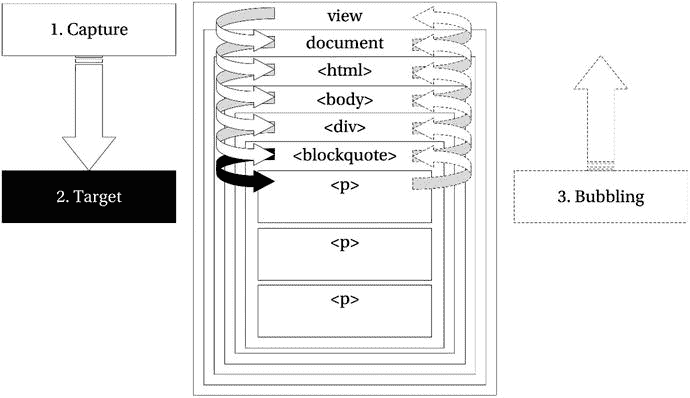

# Promise 对象

将 Promise 引入 API 是件相当简单的任务。在代码清单 5-22 中，`getData` 方法的签名被清理了，移除了所有为回调函数引入的参数。这使得签名更好地描述了执行操作所需的内容：在本例中，只需要 `id`。

该方法的主体被包裹在一个新的 Promise 对象中，该对象始终具有包含两个函数参数的签名。第一个函数将在请求成功时用于兑现（fulfill）该 Promise。第二个函数用于在发生错误时拒绝（reject）该 Promise。所有 Promise 都有这个签名，但在 TypeScript 中，你可以使用更具体的类型信息来进一步增强这些函数。

在代码清单 5-22 中，`fulfil` 函数有一个带类型的参数 `data`，它将包含 `FictitiousData` 类型的数据，而 `reject` 函数有一个字符串类型的 `reason` 参数。这里的类型注解将确保在使用此 Promise 的代码中，自动补全的成员是正确的。你还可以在创建 Promise 时使用类型参数来添加此类型信息。

```typescript
interface FictitiousData {
  id: number;
  name: string;
}

class FictitiousAPI {
  static data: { [index: number]: FictitiousData } = {
    1: { id: 1, name: 'Aramis' },
    2: { id: 2, name: 'Athos' },
    3: { id: 3, name: 'Porthos' },
    4: { id: 4, name: 'D\'Artagnan' }
  };

  static getData(id: number) {
    return new Promise((fulfil: (data: FictitiousData) => void, reject: (reason: string) => void) => {
      // 使用超时模拟异步数据访问
      window.setTimeout(() => {
        const result = this.data[id];
        if (typeof result == 'undefined') {
          reject('没有匹配的记录');
        }
        fulfil(result);
      }, 200);
    });
  }
}
```

当我们调用 `getData` 方法时，我们现在会返回一个 Promise，如代码清单 5-23 所示。取代回调函数的是，Promise 对象有一个 `then` 方法，它接受一个函数。在这个简单的例子中，Promise 的主要好处是它将 `getData` 签名和 `then` 签名的职责分离开来。还有更多实质性的好处即将呈现。

```javascript
// 单次调用：'Aramis'
FictitiousAPI.getData(1)
  .then(function (data) {
    console.log(data.name);
  });
```

为了处理在满足 Promise 时发生的错误，可以使用 `catch` 方法，如代码清单 5-24 所示。我们现在有了三个各自处理独立职责的项，而不是之前那种所有职责混杂在一起的回调设计。

```javascript
// 错误处理（起效）
FictitiousAPI.getData(5)
  .then(function (data) {
    console.log(data.name);
  })
  .catch(function (error) {
    console.log('捕获到 ' + error);
  });
```

为了更好地展示这些好处，完整的 Promise 链如代码清单 5-25 所示。这段代码的嵌套最少（最多两层，而之前使用带错误处理的回调版本有五层嵌套）。每个 `then` 函数都相对容易理解，并且所有异常处理都包含在单个 `catch` 中。

```javascript
FictitiousAPI.getData(1)
  .then((data) => {
    console.log(data.name);
    return FictitiousAPI.getData(2);
  })
  .then((data) => {
    if (data.name == 'Athos') {
      console.log(data.id + ' ' + data.name);
    } else {
      console.log(data.name);
    }
    return FictitiousAPI.getData(3);
  })
  .then((data) => {
    console.log(data.name);
    return FictitiousAPI.getData(4);
  })
  .then((data) => {
    console.log(data.name);
    return FictitiousAPI.getData(5);
  })
  .catch((error) => {
    console.log('捕获到 ' + error);
  });
```

更新后程序的输出与之前相同，但程序更易于阅读。

```
==== 输出 ====
Aramis
2 Athos
Porthos
D'Artagnan
捕获到 没有匹配的记录
```

虽然这个例子使用了单个 `catch`，但为了重现原始回调示例的行为，如果你希望在链的后续处理中继续执行，可以在链中更早的位置插入额外的 `catch` 块来提前处理错误。Promise 在这方面非常灵活。

即使在嵌套和错误处理方面，Promise 也完全胜过回调，但 Promise 还有一些其他回调根本无法实现的好处。

### 多个 Promise

链式调用多个 Promise 的另一种方式是，使用一个负责从各个子 Promise 获取值的包装 Promise 来聚合它们的结果。Promise 内建了一种机制，可以通过简单调用 `Promise.all` 来实现这一点。

代码清单 5-26 展示了将代码清单 5-25 中的 Promise 链折叠成对 `Promise.all` 的调用。一旦所有 Promise 都被敲定（settled），`then` 块就会接收结果并执行。如果有任何错误，会立即调用 `catch` 块；这是一种快速失败（fail-fast）机制。这是表达你的代码需要兑现所有 Promise 才能继续执行的好方法。

```javascript
Promise.all([
  FictitiousAPI.getData(1),
  FictitiousAPI.getData(2),
  FictitiousAPI.getData(3),
  FictitiousAPI.getData(4)
]).then((values) => {
  for (let val of values) {
    console.log(val.name);
  }
}).catch((error) => {
  console.log('捕获到 ' + error);
});
```

无论每个单独的 Promise 需要多长时间才能兑现，传递给 `then` 块的值将按照传入的 Promise 顺序排序。就代码清单 5-26 而言，结果将始终按 Aramis、Athos、Porthos、D’Artagnan 的顺序排列，即使异步操作以不同的顺序成功完成也是如此。

#### 最快的 Promise

如果你在调用多个异步操作，并且只关心获取最快的那个结果，可以使用 `Promise.race` 方法。

清单 5-27 展示了在 Promise 竞赛中使用到的清单 5-25 的 Promise 链。第一个落定的 Promise 会导致整个竞赛也落定，其结果要么是那个最快 Promise 的兑现值，要么是其拒绝原因。即使第一个结果立即可用，但在后台，其他操作仍会继续，这意味着，即使你的竞赛已有胜者，这些操作依然会消耗资源。

```javascript
Promise.race([
  FictitiousAPI.getData(1),
  FictitiousAPI.getData(2),
  FictitiousAPI.getData(3),
  FictitiousAPI.getData(4)
]).then((data) => {
  console.log(data.name);
}).catch((error) => {
  console.log('Caught ' + error);
});
```

Promise 提供了一种优越的机制来处理异步链、减少嵌套，并简化且标准化错误处理。还有一些有用的标准 Promise 组合方法，允许你同时发起多个异步操作，并在所有 Promise 都兑现后，收敛到一个单一的 `then` 块中。

Promise 正逐渐成为处理异步 API 的事实标准机制，浏览器也将基于 Promise 实现特性的改进。例如，清单 5-28 中展示的 `XMLHttpRequest` 机制，很可能会被一个用于执行相同操作的、基于 Promise 的 `fetch` API 所取代。

```
const request = new XMLHttpRequest();
request.onload = function() {
if (request.status !== 200) {
// 状态码不太可能被使用，例如重定向
console.log('Status Code:', request.status);
return;
}
const data = JSON.parse(request.responseText);
console.log(data);
};
request.onerror = (error) => {
// 网络故障或状态码是错误
console.log('Error making request: ', error);
};
request.open('get', './api/musketeers.json', true);
request.send();
清单 5-28.
XMLHttpRequest
```

与之等价的 `fetch` API 如清单 5-29 所示。尽管在撰写本文时此特性仍处于实验阶段，但其引入已迫在眉睫。请注意，最终的规范可能与这个示例有所不同。

```
fetch('./api/musketeers.json')
.then((response) => {
if (response.status !== 200) {
// 状态码不太可能被使用，例如重定向或错误
console.log('Status Code:', response.status);
return;
}
return response.json();
}).then((data) => {
console.log(data);
})
.catch((error) => {
// 例如网络故障
console.log('Error making request', error);
});
清单 5-29.
Fetch API
```

随着 Promise 模式越来越为人熟知，像 `Fetch` API 这样的变化将使交互变得更加熟悉和可预测。与几乎总是让程序员需要再次查阅文档的 `XMLHttpRequest` 不同，你可以通过 `Fetch` API 直接遵循模式来操作，因为它仅仅是一个 Promise 链。你可以期待任何提供异步操作的 API 都会有类似的改进。

### 事件

事件是 JavaScript 运行时的一个基本概念，因此它也是所有 TypeScript 程序员非常感兴趣的部分。事件监听器通常被附加到用户发起的事件上，例如网页中的触摸、点击、按键以及其它交互，但事件也可以作为一种机制，用于解耦需要触发处理的代码与执行实际工作的代码。

事件在两个不同的阶段处理——捕获阶段和冒泡阶段。

1.  在捕获阶段，事件首先被发送到文档层次结构中最顶层的元素，然后发送到嵌套更深的元素。

2.  在冒泡阶段，事件首先被发送到目标元素，然后发送到其祖先元素。

事件阶段作为事件参数的一个属性提供，可以通过 `e.eventPhase` 来访问，其中你的事件参数名为 `e`。

即使冒着过度强调在单线程事件循环中运行这一观点的风险，也值得牢记，附加到同一事件的多个事件监听器将会顺序执行，而非并行执行，并且一个长时间运行的监听器可能会延迟附加到同一事件的后续监听器的执行。当一个事件被触发时，每个事件监听器都会按照其被附加的顺序进入队列；如果第一个监听器需要 2 秒才能运行完毕，第二个监听器至少会被阻塞 2 秒，并且只有在其到达事件队列顶端时才会执行。

```
class ClickLogger {
constructor() {
document.addEventListener('click', this.eventListener);
}
eventListener(e: Event) {
// 3（冒泡阶段）
const phase = e.eventPhase;
const tag = (e.target).tagName;
console.log(`Click event in phase ${phase} detected on element ${tag} by ClickLogger.`);
}
}
const clickLogger = new ClickLogger();
清单 5-30.
事件监听器
```

清单 5-30 展示了一个类，它将其方法之一 `eventListener` 附加到文档的 `click` 事件上。当与清单 5-31 中的 HTML 页面结合使用时，这个 `ClickLogger` 类将根据被点击的元素输出消息，例如：

-   `Click event detected on element DIV by ClickLogger.`

-   `Click event detected on element P by ClickLogger.`

-   `Click event detected on element BLOCKQUOTE by ClickLogger.`

-   `Click event detected on element FOOTER by ClickLogger.`

```
Event Demo

Clicking on different parts of this document logs appropriate messages.

Any fool can write code that a computer can understand.
Good programmers write code that humans can understand.

-Martin Fowler

清单 5-31.
示例文档
```

注意

添加事件监听器的正确方式是调用 `addEventListener`。版本 9 之前的 Internet Explorer 使用另一种 `attachEvent` 方法。你可以使用清单 5-32 中展示的自定义 `addEventCrossBrowser` 函数来针对这两种附加事件的方法。该函数的改进版本将在第 5 章中出现。

```
function addEventCrossBrowser(element, eventName, listener) {
if (element.addEventListener) {
element.addEventListener(eventName, listener, false);
} else if (element.attachEvent) {
element.attachEvent('on' + eventName, listener);
}
}
class ClickLogger {
constructor() {
addEventCrossBrowser(document, 'click', this.eventListener);
}
eventListener(e: Event) {
// 3（冒泡阶段）
const phase = e.eventPhase;
const tag = (e.target).tagName;
console.log('Click event detected on element ' + tag + ' by ClickLogger.');
}
}
const clickLogger = new ClickLogger();
清单 5-32.
跨浏览器事件
```

你不必局限于任何给定运行时中有限的支持事件列表；你也可以监听并派发自己的自定义事件。

### TypeScript 的自定义事件机制

清单 5-33 展示了自定义事件机制。在某些环境中，只需使用`addEventListener`和`dispatchEvent`即可实现。你可以将自定义数据作为事件的一部分传递，供监听器使用。

```markdown
## 自定义事件

```javascript
// Polyfill for CustomEvent:
// https://developer.mozilla.org/en/docs/Web/API/CustomEvent
(function () {
function CustomEvent(event, params) {
params = params || { bubbles: false, cancelable: false, detail: undefined };
const evt = document.createEvent('CustomEvent');
evt.initCustomEvent(event, params.bubbles, params.cancelable, params.detail);
return evt;
};
CustomEvent.prototype = (window).Event.prototype;
(window).CustomEvent = CustomEvent;
})();
// Fix for lib.d.ts
interface StandardEvent {
new(name: string, obj: {}): CustomEvent;
}
var StandardEvent = CustomEvent;
// Code for custom events is below:
enum EventType {
MyCustomEvent
}
class Trigger {
static customEvent(name: string, detail: {}) {
const event = new StandardEvent(name, detail);
document.dispatchEvent(event);
}
}
class ListeningClass {
constructor() {
document.addEventListener(
EventType[EventType.MyCustomEvent],
this.eventListener,
false);
}
eventListener(e: Event) {
console.log(EventType[EventType.MyCustomEvent] + ' detected by ClickLogger.');
console.log('Information passed: ' + (e).detail.example);
}
}
var customLogger = new ListeningClass();
Trigger.customEvent(
EventType[EventType.MyCustomEvent],
{
"detail": {
"example": "Example Value"
}
}
);
```

**清单 5-33. 自定义事件**

你可以选择使用事件，或编写事件代码（例如清单 `5-13` 中的简单观察者模式），以便在程序中分发工作负载。

### 事件阶段

事件会沿着一条从文档根节点到目标元素的传播路径被派发到事件目标。沿着这条路径从根节点到目标元素的每一次推进，都属于事件的捕获阶段，该阶段编号为 1。接着，事件到达事件目标，阶段变为目标阶段，编号为 2。最后，事件在冒泡阶段从事件目标沿反向路径流回根节点，该阶段编号为 3。

这些事件阶段如图 `5-4` 所示。引用块中的其他元素不属于根节点与事件目标之间的层级结构，因此它们不在传播路径中。



**图 5-4. 事件阶段**

事件为解耦程序中的代码提供了强大的机制。如果你通过触发事件来执行操作，而不是直接调用代码，那么将操作分解为多个单一职责的小型事件监听器就会变得很简单。此外，后续添加更多监听器也是一件轻而易举的事。

## 扩展对象

在 JavaScript 中，几乎所有东西都是对象，这些对象由一组属性组成。每个属性都是一个键值对，键为字符串，值可以是任意类型，包括基本类型、对象和函数。如果值是函数，通常被称为方法。在 TypeScript 中创建类时，它由 JavaScript 对象表示，但还有许多内置对象可供使用。

所有原生对象都是开放的，这意味着你可以像扩展自己的对象一样轻松地扩展它们。在扩展原生对象时需要谨慎，原因如下：

- 如果每个人都扩展原生对象，这些扩展很可能会相互覆盖，或以不兼容的方式组合。

- 原生对象的定义将来有可能与你定义的冲突，并且你的实现会隐藏原生实现。

因此，虽然扩展原生对象是可行的，但通常只建议将其作为一种 polyfill 技术来使用，这是一种为较旧的运行时环境添加当前功能的方法。尽管你可能决定遵循不那么严格的规则，但最好还是以 polyfill 的风格来编写原生对象扩展，这样至少能检测到以下情况之一的发生：

- 原生的功能被添加时，其名称与你的扩展冲突。

- 其他程序员添加了同名的另一个扩展。

- 第三方库或框架添加了同名的扩展。

尤其是第三点说明，如果你的程序要作为库供其他程序员使用，那么就不应该编写原生对象扩展。如果库作者经常扩展原生对象，发生冲突的可能性会很高，而获胜者将只是最后加载的那个扩展，因为它会覆盖所有之前的扩展。

**注意**

术语 polyfill（源自一种名为 Polyfilla 的墙面抹平与裂缝填充水泥）由 Remy Sharp（Remy Sharp 的博客，[`http://remysharp.com/2010/10/08/what-is-a-polyfill/`](http://remysharp.com/2010/10/08/what-is-a-polyfill/)，2010 年）创造，用于描述一种在原生实现可用时优先使用原生实现，否则便添加缺失原生行为的技术。例如，你会尝试在浏览器中检测某个特性，如果缺失则仅补充该特性。

### 扩展原型

在清单 `5-34` 中，原生 `NodeList`（它包含一个 HTML 元素列表）被扩展，增加了一个 `each` 方法，用于为列表中的每个元素执行一个回调函数。该扩展被添加到 `NodeList.prototype` 上，这意味着所有 `NodeList` 实例都可以使用它。调用 `document.querySelectorAll` 会返回一个包含匹配元素的 `NodeList`，现在可以使用 `each` 方法，通过 `getParagraphText` 函数来显示每个元素的内容。使用 `each` 方法意味着 `for` 循环只需在一个地方定义。

`call` 方法并非将每个元素作为参数传入回调函数，而是将元素绑定到函数的上下文，这意味着 `getParagraphText` 函数可以使用 `this` 关键字来引用该元素。

```javascript
NodeList.prototype.each = function (callback) {
for (let node of this) {
callback.call(node);
}};
const getParagraphText = function () {
console.log(this.innerHTML);
};
const paragraphs = document.querySelectorAll('p');
paragraphs.each(getParagraphText);
```

**清单 5-34. 在 JavaScript 中扩展对象**

当你将此代码添加到 TypeScript 程序中时，会产生错误，警告你 `each` 方法在 `NodeList` 接口上不存在。你可以在程序中为该接口添加声明来消除这些错误并获得智能的自动补全功能，如清单 `5-35` 所示。这样做还有一个额外的好处：如果原生对象的更新与你的扩展发生冲突，TypeScript 编译器会警告你存在重复的声明。

```typescript
interface NodeList {
each(callback: () => any): void;
}
NodeList.prototype.each = function (callback) {
for (let node of this) {
callback.call(node);
}
};
const getParagraphText = function () {
console.log(this.innerHTML);
};
const paragraphs = document.querySelectorAll('p');
paragraphs.each(getParagraphText);
```

**清单 5-35. 在 TypeScript 中扩展对象**

在这个例子中，`each` 方法内的 `this` 关键字没有类型信息，因为它无法被推断出来。这个问题可以按照清单 `5-36` 所示进行改进。通过将元素从上下文 `this` 关键字移到参数中，程序中的自动补全和类型检查得到了改进。这也意味着该函数可以更容易地被复用。`NodeList` 和通用的 `NodeListOf` 接口都被扩展了，以提供尽可能严密的类型检查。
```

# 对象扩展与封装

## 密封对象

如果你担心自己的代码被扩展，可以使用 `Object.seal` 来防止你的实例被扩展。清单 5-38 展示了其他人可能对你的代码进行的典型扩展，清单 5-39 展示了如何防止这种情况。`Object.seal` 阻止添加新属性，并将所有现有属性标记为不可配置。但仍然可以修改现有属性的值。

```typescript
class Lemur {
    constructor(public name: string) {
    }
}
const lemur = new Lemur('Sloth Lemur');
// 新属性
lemur.isExtinct = true;
// true
console.log(lemur.isExtinct);
```
清单 5-38. 扩展后的实例

```typescript
class Lemur {
    constructor(public name: string) {
    }
}
const lemur = new Lemur('Sloth Lemur');
Object.seal(lemur);
// 新属性
lemur.isExtinct = true;
// undefined
console.log(lemur.isExtinct);
```
清单 5-39. 密封实例

你可以使用 `Object.isSealed` 方法来检查一个对象是否被密封，传入要检查的对象即可。还有一系列有用的类似操作 —— 每个操作都可以用在清单 5-38 中替换 `Object.seal` 调用，以获得以下示例中描述的结果：

*   `Object.preventExtensions` / `Object.isExtensible` 是比 `Object.seal` 更宽松的版本，允许删除属性以及向原型添加属性。
*   `Object.freeze` / `Object.isFrozen` 是比 `Object.seal` 限制性更强的替代方案，它阻止添加或删除属性，并且也阻止更改值。

Mark Daggett 所著的 *Expert JavaScript* (Apress, 2013) 一书中，对创建、扩展和密封 JavaScript 对象有极好的概述。

## 扩展的替代方案

如果只是建议不要扩展原生对象，却不提供解决问题的替代方案，那是不负责任的。本节展示了一个在现代浏览器中 HTML 元素可用的 `classList` 属性示例。首先展示了 polyfill，然后提供了一个使用外观模式（façade）来在原生 `classList` 或替代版本之间调用的替代方案。

清单 5-40 展示了一个从元素中检索类列表的调用，该调用在旧版浏览器中会失败。`classList` API 实际上提供了添加、移除和切换类的方法——但本例仅演示了检索类名数组的功能。

```typescript
const elem = document.getElementById('example');
console.log(elem.classList);
```
清单 5-40. 使用原生 classList

针对此功能可能缺失的一种常见解决方案是使用 polyfill。清单 5-41 展示了一个简单的 polyfill，它检测 `classList` API 是否存在，然后将其添加到 `HTMLElement` 或 `Element` 的原型上。替换函数将类名字符串拆分成一个数组，或者在没有类名时返回一个空数组。

```typescript
if (typeof document !== "undefined" && !("classList" in document.documentElement)) {
    const elementPrototype = (HTMLElement || Element).prototype;
    if (elementPrototype) {
        Object.defineProperty(elementPrototype, 'classList', {
            get: function () {
                const list = this.className ? this.className.split(/\s+/) : [];
                console.log('Polyfill: ' + list);
            }
        });
    }
}
const elem = document.getElementById('example');
console.log(elem.classList);
```
清单 5-41. ClassList Polyfill

尽管在这个特定场景下使用 polyfill 是正确的解决方案（因为它与原生行为高度匹配，并且通过安全检查确保不会覆盖已存在的原生实现），但审视替代设计也很有价值。在许多情况下，清单 5-42 中的解决方案是更稳定的选择，因为它永远不会与原生或库代码冲突。这种方法的缺点是必须修改调用代码以引用外观模式。

```typescript
class Elements {
    static getClassList(elem: HTMLElement) {
        if ('classList' in elem) {
            return elem.classList;
        }
        return elem.className ? elem.className.split(/\s+/) : [];
    }
}
const elem = document.getElementById('example');
console.log(Elements.getClassList(elem));
```
清单 5-42. ClassList 外观模式

除了比 polyfill 隔离性更好之外，外观模式还有一个主要优点。这段代码的意图非常清晰。在维护代码时，`Elements` 类中更简洁、更直接的方法始终比 polyfill 更胜一筹。清晰且可维护的代码总是比巧妙但复杂的解决方案更可取。

# 总结

JavaScript 运行时以其古怪和出人意料的行为而闻名，但总体而言，TypeScript 编译器会帮您避开大多数常见错误。使用块级变量声明并保持全局作用域清晰，将有助于编译器为您提供帮助，因此值得使用 TypeScript 的结构化特性（例如类）以及模块或命名空间来封装函数和变量。

您的多数代码将在单个线程上执行，而回调和 Promise 都有助于在长时间运行的操作期间避免阻塞该线程。Promise 比回调更具可读性，并有助于分离不同的关注点。保持函数简短不仅使您的程序更易于维护，还可以使您的程序响应更迅速，因为每次调用函数时，它都会被添加到事件队列的末尾，运行时就有机会在处理队列中最旧的条目之前处理它，避免其等待过久。

您可以监听原生事件并创建自定义事件，也可以使用观察者模式在程序中分发和监听自定义事件。

您可以扩展对象，包括原生对象，但使用中介代码（mediating code）来编排调用通常更为合适，以避免与其他库或原生代码的未来扩展发生冲突。您可以通过密封、冻结或阻止扩展来防止对您自己的对象进行扩展。

# 要点

*   避免使用函数作用域的 `var` 关键字，因为 TypeScript 即使对于旧版本的 JavaScript 也能提供块级变量。
*   回调可以帮助避免阻塞主线程。
*   无论是使用原生事件还是您自己的发布者，事件都可以防止紧耦合。
*   您可以扩展所有 JavaScript 对象，而且 JavaScript 中几乎一切都是对象。
*   您可以密封或冻结对象以防止进一步更改。
*   您可以通过 `polyfill` 缺失的行为，在旧平台上使用新功能。