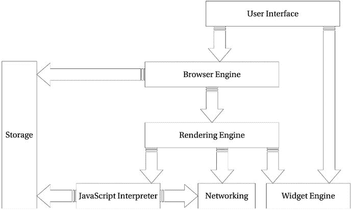
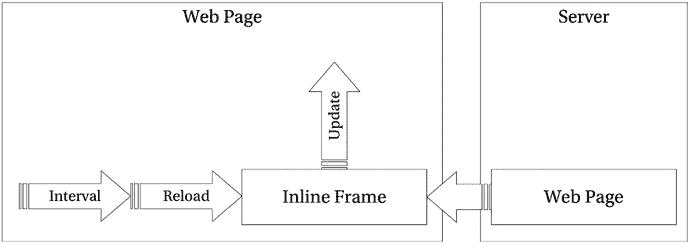
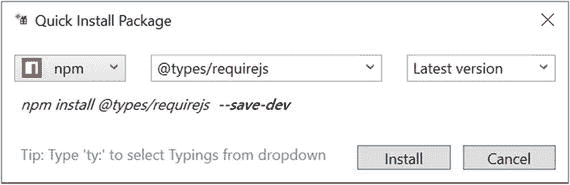
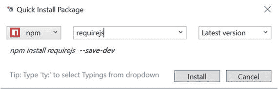

# 6. 在浏览器中运行 TypeScript

> 所有现代 web 浏览器——包括桌面电脑、游戏机、平板电脑和智能手机——都包含 JavaScript 解释器，这使得 JavaScript 成为历史上最普及的编程语言。 ——David Flanagan

尽管 TypeScript 程序可能面向许多不同的运行环境，但其中最广泛的一类运行时无疑是 web 浏览器。本章在介绍与网页交互、向 web 服务器发起异步请求、在用户本地机器上存储数据以及访问硬件传感器的实用示例之前，先介绍 web 浏览器的一般设计。本章末尾提供了关于模块化程序以及按需加载模块的信息。

注意：本章描述的部分功能是实验性的，并且浏览器的支持有限。要了解哪些浏览器支持特定功能，请访问 Alexis Deveria 的 “Can I use” 项目（ [`http://caniuse.com/`](http://caniuse.com/) ，2014）。


## 网页浏览器架构剖析

从 1990 年代简单的文档展示，到今天功能完备的应用环境与 3D 游戏显示，网页浏览器的发展可谓日新月异。随着视频、音频、游戏等内容与文档、图片、应用程序一同融入浏览器中的`HTML`文档，对插件、小程序和下载功能的依赖正在迅速减少。

如果你的程序需要依赖浏览器工作，那么对浏览器有所了解是值得的。但如果浏览器相关细节以及某些重要特性的历史并未让你感到兴奋，或者你已对浏览器了如指掌，可以直接跳转到下一节进行更多实践操作。若想进一步了解浏览器的工作原理，请继续阅读。

网页浏览器通常由如图 6-1 所示的组件构成：

*   用户界面
*   浏览器引擎
*   渲染引擎
*   部件引擎
*   JavaScript 解释器
*   网络
*   存储

用户界面包括所有浏览器窗口上出现的按钮和文本框，例如地址栏、后退和前进按钮以及刷新按钮。浏览器引擎和渲染引擎负责处理内容显示，占据了浏览器显示区域的主体部分。部件引擎为用户界面和渲染引擎提供公共用户控件，如文本输入框、下拉列表和按钮。



图 6-1. 网页浏览器组件

要显示网页，浏览器引擎依靠渲染引擎来呈现`HTML`以及层叠样式表（`CSS`）中定义的相应样式，或者用户自定义覆盖的页面样式。渲染引擎通过网络获取网页、样式表、JavaScript 文件和图片等资源。当需要用户交互组件（如文本框）时，会使用部件引擎。JavaScript 解释器运行下载的 JavaScript 代码，进而可能访问存储、网络以及其他可用的应用程序编程接口（`API`）。

总的来说，用户界面、浏览器引擎、渲染引擎和部件引擎工作出色，你无需了解所有细节；但有一个例外是称为“回流”的过程，它可能影响你程序的感知性能。

### 回流与帧率

每次网页布局被 JavaScript 或 `CSS` 修改时，布局会被标记为无效，但不会立即更新。回流会重新计算文档中所有元素的大小和位置，通常发生在页面绘制之前。如果 JavaScript 代码在布局被标记为无效时请求元素的大小或位置，则会触发额外的回流。需要这个额外的回流来确保提供的大小或位置信息是最新的。

列表 6-1 展示了一个典型回流问题的函数，它两次使布局无效并导致两次回流。每次对文档设置可能影响布局的值时，布局都会被标记为无效。每次在布局无效时从文档检索值，都会触发回流。虽然列表中的示例导致了两次回流，但如果重复这种错误，可能会导致更多次回流。回流会拖慢你的程序和需要等待重渲染的页面。

```javascript
const image = document.getElementById('mainImage');
const container = document.getElementById('content');
function updateSizes() {
  // 标记布局为无效
  image.style.width = '50%';
  // 触发一次回流以获取值
  const imageHeight = image.offsetHeight;
  // 标记布局为无效
  container.classList.add('highlight');
  // 触发一次回流以获取值
  const containerHeight = container.offsetHeight;
  return {
    'imageHeight': imageHeight,
    'containerHeight': containerHeight
  };
}
const result = updateSizes();
```

*列表 6-1. 触发多次回流*

通过在从文档检索任何值之前执行使布局无效的操作，可以避免多次回流，如列表 6-2 所示。通过将使布局无效的操作集中在函数开头，且在所有需要回流的操作之前，我们可以减少函数执行过程中所需的总回流次数。

```javascript
const image = document.getElementById('mainImage');
const container = document.getElementById('content');
function updateSizes() {
  // 使布局无效的操作
  image.style.width = '50%';
  container.classList.add('highlight');
  // 需要回流的操作
  const imageHeight = image.offsetHeight;
  const containerHeight = container.offsetHeight;
  return {
    'imageHeight': imageHeight,
    'containerHeight': containerHeight
  };
}
const result = updateSizes();
```

*列表 6-2. 触发单次回流*

通过对这两个示例分别进行循环，每 200 毫秒运行一次，可以进行基本测试。虽然两者几乎没有差异，但具有多次回流的第一个版本将刷新率降低到 53 帧/秒，而第二个版本则保持了 57 帧/秒（在我用来测试此代码的计算机上，静态网页的渲染速度为 59 帧/秒）。

唯一迫使你必须使用多次回流的情况是，在进行更改后需要获取测量值：例如，在更改元素内容后找到其宽度，然后使用该宽度重新定位元素，这在不回流的情况下无法完成。你仍然可以仔细规划操作，将总回流次数减少到尽可能少。

在测量基于浏览器的程序时，帧率指标是衡量 Web 应用程序感知响应能力的一个良好指标。此测量值可在浏览器工具中找到。

### 有趣的组件

在涉及 TypeScript 时，JavaScript 解释器以及网络和存储 `API` 是浏览器中最有趣的组件。以下各节将更详细地描述每个组件。


## JavaScript 解释器

JavaScript 解释器，也被称为 JavaScript 引擎，承担着大量工作。它不仅要解析和执行 JavaScript 程序，还需管理对象和内存、处理事件循环，并与存储、网络、传感器等 API 进行交互。

在浏览器中进行 JavaScript 编程之所以如此有趣（有时也令人沮丧），原因之一在于你会遇到许多不同的 JavaScript 解释器。在极少数情况下，你甚至可能遇到没有解释器的情况，导致程序无法运行。由于需要支持多种解释器，测试工作量随之增加，因为你必须检查程序在每个 Web 浏览器中是否都能正常工作。然而，解释器众多也有其优点。其中一个优点是，浏览器厂商都希望宣称自家实现的 JavaScript 引擎速度最快；因此，当它们为争夺榜首位置而竞争时，解释器的运行速度也在不断提升。

在依赖这些不同的解释器来运行程序时，需要主要关注以下几点：

*   它们可能仅支持较旧版本的 ECMAScript 标准。
*   它们可能会实现一些不属于 ECMAScript 规范的附加功能。
*   它们运行相同代码的速度不同，尤其是在不同的操作系统上。
*   你迟早会遇到完全禁用 JavaScript 的最终用户。

**注：** 所有主流浏览器的当前版本均支持 ECMAScript 5。所有领先浏览器都支持 ECMAScript 6（或 ECMAScript 2015），但 Internet Explorer 和许多小众浏览器除外。在撰写本文时，仅 Firefox 完全支持 ECMAScript 2016，而 Chrome、Opera 和 Edge 对该标准的支持程度在 75% 到 95% 之间。下一组候选推荐标准获得的支持非常有限。请记住：TypeScript 的低版本编译功能允许你使用许多新特性，同时将代码编译为目标 ECMAScript 5 或 6。

## 网络技术简史

Web 浏览器中网络技术的发展经历了多个阶段。最早用于更新部分网页（无需替换整个文档）的机制是使用框架集（frameset）。框架集是 HTML 3.0 规范的一项提议。网站通常采用三分框架集布局，分别用于页眉、导航和内容。当在导航框架中点击一个链接时，内容框架会被替换为一个新的网页，而无需重新加载页眉或导航。框架集的双重目的是：允许部分显示区域独立更新，并允许在无需服务器端处理的情况下包含可重用的组件（如页眉和导航）。

框架集的一个主要问题是，当用户导航时，页面的网址不会更新，因为无论框架集中的框架内显示的是哪个页面，用户看到的仍然是框架集本身。当用户收藏页面或分享页面链接时，无法回到他们导航到的显示状态，而只会显示网站的首页。此外，框架集还会给屏幕阅读器和纯文本浏览器带来各种问题。

替代框架集的是内联框架（`iframe` 元素）。内联框架被放置于另一个文档的 body 中，可以独立更新。虽然仍有可能以类似框架集问题的方式使用 `iframe`，但 `iframe` 确实提供了一个非常有用的新特性。

在 JavaScript 具备网络能力之前，一些富有进取心和创造力的程序员会使用 `iframe` 来模拟实时更新效果。例如，一个指向服务器生成网页的隐藏 `iframe` 会每隔 10 秒通过计时器刷新一次。一旦页面加载完成，就会使用 JavaScript 从该 `iframe` 中抓取新数据，并根据 `iframe` 中的隐藏页面更新可见页面的部分内容。这种机制的架构如图 6-2 所示。



**图 6-2.** 通过在 `iframe` 中刷新第二个页面来更新网页

正是这种创造性地使用内联框架将数据从服务器传输到网页的做法，启发了 `XMLHTTP` 通信（Internet Explorer 5）以及后来标准化的 `XmlHttpRequest` 的发明。这些异步请求具有革命性意义，因为它们在支持基于 Web 的应用程序方面发挥了关键作用。使用异步请求会带来各种复杂问题，本章稍后将详细说明，但其重要性无论如何强调都不为过。

最新进入 Web 浏览器的网络技术是 WebSocket，它提供了浏览器与服务器之间持久的全双工通信。这允许数据同时在两个方向上进行传输。WebSocket 也将在本章后面进行更详细的讨论。

## 在客户端存储数据

在很长一段时间里，JavaScript 程序可用的存储空间仅限于 Cookie 中那微不足道的几千字节，这些数据可能随时毫无征兆地消失。许多浏览器提供一项设置，可以在每次关闭浏览器时清除所有 Cookie。充其量，Cookie 只能用于存储一个令牌来保持用户在一段时间内的登录状态，而这对于 Web 应用程序来说，确实也是其唯一的主要用途。

在现代浏览器中，用户机器上的存储选项有多种，从简单的键值对本地存储到 NoSQL 索引数据库，不一而足。即使是初始限制的几兆字节，也可以在获得用户许可的情况下增加。本章稍后将通过具体例子解释存储选项。

在用户机器上存储合理数量的数据，使得本地缓存数据成为可能。这可以加速程序的运行，并减少与服务器之间的往返通信次数。它还允许你的 Web 应用程序在离线状态下运行，并在下次连接到网络时与服务器同步数据。

## 文档对象模型

文档对象模型，简称 DOM，是一个用于与 HTML 和 XML 文档进行交互的 Web 浏览器接口。该接口允许你查找元素、获取和更新其内容及属性的信息，并监听用户事件。如果你的程序在与网页交互，那么你就是在使用 DOM。

本节中的所有示例均使用清单 6-3 中的 HTML 文档。

```
Running in a Browser

Running in a Browser
```

**清单 6-3.** DOM 示例使用的 HTML 文档

该文档是一个 HTML5 网页，包含一个一级标题和一个 `id` 为“content”的 div。以下示例的目标是获取对该元素的引用，对其进行修改，并监听其内部生成的事件。


### 查找元素

与 DOM 最常见的交互之一就是在文档中查找元素。有多种方法可以获取元素，如代码清单 6-4 所示。长期以来，`document.getElementById` 一直是获取网页元素的标准方法，在 TypeScript 中，该方法返回一个 `HTMLElement` 类型的对象。虽然这是一种常见的查找元素的方式，但它仅能基于元素的 `id` 属性来获取。

传统的替代 `document.getElementById` 的方法是 `document.getElementsByTagName`。基于 `id` 获取元素过于具体；而通过标签名查找元素又通常过于笼统。因此，选择器 API 规范引入了 `document.querySelector` 和 `document.querySelectorAll` 方法，允许使用 CSS 查询选择器来查找元素。当存在多个可能匹配的元素时，`document.querySelector` 返回第一个匹配的元素，而 `document.querySelectorAll` 返回所有匹配的元素。

```
// HTMLElement
const a = document.getElementById('content');
// Element
const b = document.querySelector('#content');
// HTMLDivElement (由于类型断言)
const c = document.querySelector('#content');
代码清单 6-4.
查找 DOM 元素
```

当你使用 `getElementById` 获取元素时，它将返回通用的 `HTMLElement` 类型。使用 `querySelector` 会得到更通用的 `Element` 类型。TypeScript 编译器无法确定返回元素的精确类型。如果你想使用特定元素类型的成员，可以使用类型断言来告诉编译器期望的元素类型。这并不能保证运行时类型正确；它只是为你提供正确的自动补全信息和类型检查。

当你使用 `document.getElementsByTagName` 时，不需要类型断言，因为 TypeScript 使用专门的重载签名，根据你提供的标签名返回正确的类型。如代码清单 6-5 所示，返回的 `NodeList` 自动包含 `HTMLDivElement` 类型的元素。

```
// NodeListOf<HTMLDivElement>
const elements = document.getElementsByTagName('div');
// HTMLDivElement
const a = elements[0];
代码清单 6-5.
按 HTML 标签获取元素
```

你最后会遇到的类型是 `document.querySelectorAll` 方法返回的 `NodeListOf<Element>`，如代码清单 6-6 所示。尽管如此，你仍然可以使用类型断言来处理你选择的特定 HTML 元素。

```
// NodeListOf<Element>
var elements = document.querySelectorAll('#content');
// Element
var a = elements[0];
// HTMLDivElement
var b = elements[0];
代码清单 6-6.
使用 CSS 选择器获取元素
```

**注意**

你可能已经注意到，在 DOM 中查找元素的各种方法返回不同类型的对象和不同的集合。这并非 TypeScript 的特性，而是反映了底层的 DOM 规范。在许多情况下，你比编译器更了解元素，可以使用类型断言使类型更具体。

如果你想避免大量使用类型断言，可以将调用包装在泛型函数中，以编排对 DOM API 的调用。代码清单 6-7 展示了包装函数，允许你以泛型类型参数的形式提供类型提示。

```
function QueryOf<T>(query: string): T {
  return document.querySelector(query) as T;
}
const elem = QueryOf<HTMLDivElement>('div#content');

function QueryAllOf<T>(query: string): NodeListOf<T> {
  return document.querySelectorAll(query) as NodeListOf<T>;
}
const elems = QueryAllOf<HTMLDivElement>('div');
代码清单 6-7.
泛型包装函数
```

使用这些包装函数时，你将收到预期类型的返回值。你可以扩展这些函数以包含元素验证，确保找到的元素是预期的类型。

### 更改元素

一旦你找到了想要更改的一个或多个元素，有几种方法可以更新每个元素的内容。

代码清单 6-8 展示了一个简单的替换，通过提供一个新的 HTML 字符串来替换元素的全部内容。元素现有的内容将被丢弃，取而代之的是你提供的字符串。这种方法有几个缺点：不仅需要在程序中硬编码 HTML 字符串，而且如果使用此方法插入用户生成或第三方内容，可能存在安全风险。从积极的方面看，这是完全替换元素全部内容的最简单方法。

```
const element = document.querySelector('#content');
element.innerHTML = 'Hello World';
代码清单 6-8.
更新元素的 HTML
```

在许多情况下，你更希望在不丢失现有内容的情况下向元素添加内容，而不是替换其全部内容。代码清单 6-9 展示了向内容分区进行多次添加，结果所有新元素都被追加。该清单还展示了使用 `document.createElement` 方法来生成元素，而不是使用字符串。

```
const element = document.querySelector('#content');
// 创建并添加第一个元素
const newElement1 = document.createElement('div');
newElement1.textContent = 'Hello World';
element.appendChild(newElement1);
// 创建并添加第二个元素
const newElement2 = document.createElement('div');
newElement2.textContent = 'Greetings Earth';
element.appendChild(newElement2);
代码清单 6-9.
使用 appendChild
```

当你使用 `element.appendChild` 时，最新的元素出现在最后。要将最新元素添加到元素的顶部，可以使用 `element.insertBefore` 方法，如代码清单 6-10 所示。传递给 `insertBefore` 的第一个参数是新元素，第二个参数是用于定位新元素的参照元素。在示例中，当前的第一个子元素被用作参照，以确保新元素出现在第一位，但你可以使用相同的方法将新元素放置在 DOM 中的任何位置。

```
const element = document.querySelector('#content');
const newElement2 = document.createElement('div');
newElement2.textContent = 'Greetings Earth';
element.insertBefore(newElement2, element.firstChild);
代码清单 6-10.
使用 insertBefore
```

如果你计划创建一组嵌套的元素添加到页面中，更高效的做法是在将其添加到 DOM 之前构建整个层级结构。这将确保你只使布局失效一次，从而意味着页面重绘次数更少，以反映你的更改。


### 事件

添加事件监听器有多种不同的方式，有些浏览器在遵循标准的方法上相对滞后。`addEventListener` 方法是添加 DOM 事件监听器的标准方式，不过一些旧版浏览器仍依赖 `attachEvent` 方法（该方法还要求事件名称以 `'on'` 作为前缀）。

为了解决跨浏览器兼容性问题，Remy Sharp 创建了一个 `addEvent` 方法。该方法不仅简化了浏览器差异，还允许将元素集合（而不仅仅是单个元素）作为参数传递。清单 6-11 是 Remy 原始脚本的改编版本，并为该方法添加了类型信息。

```
export const addEvent: (elem: Window | Document | Element | NodeListOf,
eventName: string, callback: Function) => void = (function () {
if (document.addEventListener) {
// 处理现代浏览器
return function (elem, eventName, callback) {
if (elem && elem.addEventListener) {
// 处理单个元素
elem.addEventListener(eventName, callback, false);
} else if (elem && elem.length) {
// 处理元素集合（递归）
for (let i = 0; i < elem.length; i++) {
addEvent(elem[i], eventName, callback);
}
}
};
} else {
// 处理一些旧版浏览器
return function (elem, eventName, callback) {
if (elem && elem.attachEvent) {
// 处理单个元素
elem.attachEvent('on' + eventName, function () {
return callback.call(elem, window.event);
});
} else if (elem && elem.length) {
// 处理元素集合（递归）
for (let i = 0; i < elem.length; i++) {
addEvent(elem[i], eventName, callback);
}
}
};
}
})();
清单 6-11.
跨浏览器增强事件
```

`addEvent` 方法的两个主要分支处理了浏览器差异，每个分支内部都进行了检查，以处理单个元素或元素集合。当所有浏览器都支持 `addEventListener` 方法时，该方法的后半部分将变得多余。

在本章中，任何需要事件的地方都将使用此 `addEvent` 方法。

### 框架与库

有许多框架和库可以帮助处理所有这些 DOM 交互。以下将简要介绍其中几个，当然还有更多可供选择。Martin Beeby 精彩地总结了这些数量庞大的库。

> 如果你选一个名词，加上 .js 或 .io，你大概就能得到一个库。 — Martin Beeby

尽管库的数量有时令人眼花缭乱，但由于有一个眼光独到且乐于发声的社区，高质量的库往往会脱颖而出。大多数可用的库都可以通过你喜欢的包管理器（如 NPM）添加到程序中；或者你也可以直接下载脚本并手动添加。对于用纯 JavaScript 编写的第三方库，得益于 Definitely Typed 项目，你通常也能找到匹配的类型定义。

[`http://definitelytyped.org/`](http://definitelytyped.org/)

如果你在使用 Visual Studio，Mads Kristensen 开发的 Package Installer 是一个扩展，可以加速你的包管理。图 6-3 显示了 RequireJS 的“快速安装包”对话框，图 6-4 展示了如何通过 NPM 上的 `@types` 作用域获取类型定义。



图 6-4. 在 Visual Studio 中使用包管理器扩展安装类型定义



图 6-3. 在 Visual Studio 中使用包管理器扩展安装库

安装包和类型定义会导致你的 `package.json` 文件自动更新依赖项。你也可以直接编辑 `package.json` 文件，在 dependencies 或 devDependencies 部分添加额外的包名。

如果你没有使用 Visual Studio，也可以在命令行上使用命令 `npm install [library-name] --save` 安装依赖包，或使用 `npm install [library-name] --save-dev` 安装仅用于开发的依赖包。开发依赖是指那些你的代码的下游使用者不会需要的包。

对于所有 TypeScript 项目，推荐使用 NPM 来获取 JavaScript 库及其类型定义。这种方式既能很好地与 Visual Studio 集成，也能很好地与其他流行的编辑器配合。

当你在网页上查找和更改元素的功能与来自服务器的实时数据相结合时，其能力将变得更加强大。下一节将介绍如何向 Web 服务器发送后台请求以保存和检索信息，而无需重新加载整个网页。

## 网络

自 20 世纪 90 年代末问世以来，AJAX 一直主导着 Web 浏览器中 JavaScript 的网络需求。尽管其地位显赫，但网络领域也出现了一些对基于浏览器的应用程序很有用的新成员。本节介绍从浏览器进行通信的三种主要技术，帮助您挑选最适合您程序需求的方法。

### AJAX

AJAX 代表异步 JavaScript 和 XML（Asynchronous JavaScript and XML）。这个名称并不贴切，因为 XML 并非唯一使用的数据格式，甚至可能不是最常见的格式。AJAX 请求是通过浏览器中的 JavaScript 发起的。请求被发送到服务器，服务器随后发送一个 HTTP 响应，其响应体可以是纯文本、JSON、HTML、XML，甚至是自定义格式。

HTTP 请求和响应是异步发生的，这意味着它不会阻塞第 5 章所述的 JavaScript 事件循环。


#### HTTP Get

清单 6-12 展示了一个简单的 `Ajax` 类，其中包含一个用于执行 HTTP GET 请求的公共方法。该方法创建了一个新的 `XMLHttpRequest` 对象，这是发起 AJAX 请求的标准方式。随后，一个回调函数被附加到请求的 `onreadystatechange` 事件上。该回调在请求转换的每个状态都会被调用，但通常你主要关注的是已完成状态。可能的状态包括：

*   `0` — 未初始化
*   `1` — 已设置，但未发送
*   `2` — 已发送
*   `3` — 正在传输
*   `4` — 完成

清单 6-12 中的 `Ajax` 类仅在状态为 `4`（完成）时进行解析，并传递包含响应数据和元数据的 `XMLHttpRequest`。HTTP 状态码可能包含 W3C（1999）维护的 HTTP 规范中描述的任何代码。

`open` 方法接受请求的 HTTP 动词和 URL。第三个参数设置请求是否为异步。最后，在附加了状态变更监听器并使用 HTTP 动词和 URL 设置好请求后，可以使用 `send` 方法来开始请求。

```
export class Ajax {
private readonly READY_STATUS_CODE = 4;
private isCompleted(request: XMLHttpRequest) {
return request.readyState === this.READY_STATUS_CODE;
}
httpGet(url: string) {
return new Promise((resolve, reject) => {
// Create a request
const request = new XMLHttpRequest();
// Attach an event listener
request.onreadystatechange = () => {
if (this.isCompleted(request)) {
resolve(request);
}
};
// Specify the HTTP verb and URL
request.open('GET', url, true);
// Send the request
request.send();
});
}
}
Listing 6-12.
HTTP Get method
```

**注意**

应始终将 AJAX 请求设为异步，并使用回调来执行依赖代码。虽然将请求设为同步看起来很便捷，但这会长时间占用事件循环，导致你的应用程序看起来无响应。这些示例中的 `Ajax` 类将原生的 `XMLHttpRequest` 包装在类似 Promise 的接口中。`Fetch API` 为异步 HTTP 请求引入了一个基于 Promise 的 API，如第 5 章所述。

#### HTTP Post

清单 6-13 中的示例代码是一个 `httpPost` 方法，可以将其添加到清单 6-12 的 `Ajax` 类中。除了将 HTTP 动词改为 `'POST'` 之外，还添加了内容类型请求头，数据在请求体中发送。此示例中的数据必须格式化为键/值对，例如 `'type=5&size=4'`。要发送包含数据的 JSON 字符串，你需要将内容类型设置为 `'application/json'`。

```
httpPost(url: string, data: string) {
return new Promise((resolve, reject) => {
const request = new XMLHttpRequest();
request.onreadystatechange = () => {
if (this.isCompleted(request)) {
resolve(request);
}
};
request.open('POST', url, true);
request.setRequestHeader('Content-type', 'application/x-www-form-urlencoded');
request.send(data);
});
}
Listing 6-13.
HTTP Post method
```

你可以通过指定适当的 `Content-type`（例如 `application/json` 或 `application/xml`）并以相应的序列化格式传递数据，来发送不同的数据格式。你仅受服务器端程序接受内容的限制。

你可以在需要进行 HTTP 请求时调用 `Ajax` 类，清单 6-14 中展示了一个示例调用。你还可以扩展 `Ajax` 类来处理其他 HTTP 请求，例如 `PUT` 和 `DELETE`。

```
import { Ajax } from './Listing-6-013';
var ajax = new Ajax();
// Making a GET request
ajax.httpGet('data.html')
.then((request) => {
document.getElementById('content').innerHTML = request.responseText;
});
Listing 6-14.
Using the Ajax class
```

如果你试图向不同域发起 AJAX 请求，你会发现在现代浏览器中该请求会被跨域安全特性阻止。即使在同一个网站的不同子域之间，或者 HTTP 和 HTTPS 页面之间，你也会遇到这种情况。如果你希望启用跨域请求共享（CORS），并且服务器支持，你可以在 AJAX 请求中添加一个额外的请求头，如清单 6-15 所示。此请求头会导致发送一个预检 `OPTIONS` 请求，询问服务器是否接受实际请求；如果服务器确认接受跨域通信，则后续会发出实际请求。

```
const request = new XMLHttpRequest();
request.setRequestHeader('X-Requested-With', 'XMLHttpRequest');
// ...
Listing 6-15.
Allowing CORS, client side
```

虽然服务器配置超出了本章的范围，但要使服务器支持 CORS，它必须接受并响应在实际跨域请求之前发出的预检 `OPTIONS` 请求，并返回一个 `Access-Control-Allow-Origin` 响应头。此头指示服务器愿意与之通信的域。这充当客户端与服务器之间的握手，以验证跨域通信可以继续进行。

### WebSockets

AJAX 最常见的用途之一就是轮询服务器以检查更新。其一种特定实现是长轮询：发起 AJAX 请求，但服务器延迟响应，直到它有更新要发送。长轮询实现必须处理超时问题和并发请求限制。长轮询在某些服务器上也可能导致问题，因为等待响应的客户端数量可能会占用大量请求线程。

WebSocket 规范通过建立服务器和客户端之间的持久双向通信通道来解决这个问题，该通道可用于向任一方向发送消息。这意味着你可以随时发送消息，而无需重新建立连接，并且可以以相同的方式接收消息。清单 6-16 是一个使用 `ws://` 协议与服务器建立通信、监听消息以及向服务器发送消息的简单示例。

```
const webSocket = new WebSocket('ws://localhost:8080/WS');
webSocket.onmessage = (message: MessageEvent) => {
// Log message from server
console.log(message.data);
}
webSocket.send('Message To Server');
Listing 6-16.
Establishing a WebSocket connection
```

当你使用完 WebSocket 连接后，可以通过调用 `webSocket.close()` 来结束通信。如果你想了解更多关于 WebSocket 的信息，可以阅读 Wang、Salim 和 Moskovits 合著的 *The Definitive Guide to HTML5 WebSockets*（Apress, 2013）。


## 实时通信

网络通信的下一次演进是实时点对点音频和视频流传输。`W3C`（2013 年）正在起草的`WebRTC`规范允许在浏览器之间进行流传输，而无需浏览器插件或额外安装的软件。尽管该规范目前支持有限，但这项技术的潜力令人难以置信。浏览器之间可以实现视频和音频通话，而无需中间通信提供商。

`WebRTC`在多个浏览器中处于实验性支持状态，大多数浏览器使用带有前缀的版本来提供该功能，该版本可能会发生变化。要在 TypeScript 中使用`WebRTC`，你需要扩展库定义以包含这些过渡性的浏览器实现。

`WebRTC`的完整实现超出了本书的范围，但清单 6-17 展示了如何捕获包含视频和音频的媒体流，并将其播放到 HTML 页面上的视频元素中。

```
const constraints = {
audio: true,
video: {
width: 1280,
height: 720
}
};
const videoElement = document.createElement('video');
videoElement.setAttribute('width', Math.floor(constraints.video.width / 2).toString());
videoElement.setAttribute('height', Math.floor(constraints.video.height / 2).toString());
document.body.appendChild(videoElement);
navigator.mediaDevices.getUserMedia(constraints)
.then(function (mediaStream) {
const video = document.querySelector('video');
video.srcObject = mediaStream;
video.onloadedmetadata = function (e) {
video.play();
};
})
.catch(function (error) {
console.log(error.name, error.message);
});
Listing 6-17.
Display a video stream
```

`getUserMedia` 方法接受约束条件，允许你指定要捕获的流特性。这段脚本的结果通常是程序员满意地看到自己被显示在网页上。

获取视频和音频是建立点对点流的第一步，如果你对这项技术感兴趣，有许多专著深入探讨了这个迷人的主题。尽管是`WebRTC`规范的一部分，`getUserMedia` API 在点对点通信之外还有其他潜在用途。你可能希望从视频流中抓取图像用于你的程序，甚至以更传统的方式将流发送到服务器。

网络提供了从本地浏览器与服务器或远程对等端通信所需的工具。下一节将介绍本地存储数据，这可以使你的程序在网络不可用时继续工作。

## 存储

自 Cookie 以来，用户机器上的存储发展迅速，Cookie 有大小限制和糟糕的 API。根据你的需求，有几种可用的存储选项，它们具有不同的生命周期、软限制和 API，可用于在本地保存数据。

会话存储和本地存储具有相同的 API，但它们的生命周期不同。不过，`IndexedDB` 提供了一种更高级的数据存储机制。以下将对这三种存储 API 进行描述。

### 会话存储

会话存储依附于页面会话。页面会话在页面打开时开始，即使页面在浏览器标签内被重新加载或恢复，会话也会持续。在单独的标签或浏览器窗口中打开相同的页面，会生成一个新的页面会话。

清单 6-18 展示了会话存储 API 的简单性，可以使用`setItem`方法存储简单的键/值对。键和值都必须是字符串，因此对象需要序列化为字符串才能存储。

```
const storageKey = 'Example';
// 第一次为 null，之后每次为 'Stored value'
console.log(sessionStorage.getItem(storageKey));
sessionStorage.setItem(storageKey, 'Stored value');
Listing 6-18.
Session storage
```

为了演示该存储机制的生命周期，在设置项之前调用了`getItem`方法；当页面首次加载时，会记录`null`值，但在后续刷新时，会记录存储的值。如果你在新标签中打开页面，将再次记录`null`值。如果你浏览页面，在同一标签中访问一个完全不同的页面，然后再次加载原始页面，你会发现值已被保留。只要标签页保持打开状态，会话就会持续，即使在该标签页中加载了其他页面——浏览器甚至可能支持在重启后恢复会话。

```
// 使用键移除项
sessionStorage.removeItem(storageKey);
// 清除所有项
sessionStorage.clear();
Listing 6-19.
Removing and clearing session storage
```

清单 6-19 展示了根据键移除项以及清除页面会话存储中所有项的方法。这些方法与前面描述的其他会话存储方法遵循相同的作用域和生命周期。

### 本地存储

本地存储 API 与会话存储 API 相同，但其存储会持续存在，直到用户出于隐私原因将其删除或清除。本地存储还可以从同一域下的多个页面以及多个浏览器和标签页中访问。

由于本地存储项在页面、标签页和浏览器之间共享，它可以用于存储数据缓存以减少网络流量。它还可以用于在没有网络连接时存储用户输入的数据，或存储永远不需要传输的数据，例如临时的应用程序状态。

清单 6-20 包含一个脚本，该脚本在本地存储中存储一个包含当前日期和时间的值。在`storage`事件上附加了一个事件监听器，该事件应在另一个标签页或窗口中进行更改时触发。

```
import { addEvent } from './Listing-6-011';
const storageKey = 'Example';
localStorage.setItem(storageKey, 'Stored value ' + Date.now());
addEvent(window, 'storage', (event: StorageEvent) => {
console.log(`${event.key} "${event.oldValue}" changed to "${event.newValue}"`);
});
Listing 6-20.
Local storage and events
```

如果你在多个浏览器标签页中运行此脚本，除发起更改的标签页外，每个标签页都会记录本地存储的更改。这使你可以让所有标签页都保持更新，以反映在任何其他标签页中发生的数据更改。


#### 存储限制

对于会话存储和本地存储，浏览器很可能会遵循 Web 存储规范中描述的一系列限制和配置，该规范同样由 W3C（2014）维护。

浏览器很可能会限制页面初始可用的存储量，以防止恶意耗尽用户磁盘空间的行为。该限制适用于所有子域名，一旦达到限制，将向用户显示提示，请求允许增加分配的存储空间。在提示用户获取权限之前，推荐的存储限制为五兆字节。

为保护用户隐私，浏览器很可能会阻止第三方访问存储。这意味着你只能访问与存储数据同源的存储空间。浏览器可以根据用户偏好清除存储数据（例如，每次关闭浏览器时，或者当数据达到一定留存时间时）。同时，还会为用户提供查看和清除存储的选项，以及将网站加入白名单或黑名单的功能。黑名单网站甚至可能在社区间共享，从而根据大量用户将其列入黑名单的情况来自动阻止对该域名的存储访问。

出于安全原因，你应考虑特定信息是否适合存储，并且应避免在共享域上使用存储，因为共享域上的其他页面也能访问该存储。你无法通过路径限制对存储的访问。例如，以下两个路径都可以访问同一个存储空间：

*   [`www.shared.com/your-site/`](http://www.shared.com/your-site/)
*   [`www.shared.com/third-party-site/`](http://www.shared.com/third-party-site/)

### IndexedDB

虽然会话存储和本地存储是在键/值存储中保存少量数据的简单便捷方式，但 IndexedDB 允许以结构化方式存储更大量的数据，并可通过索引进行快速搜索。

IndexedDB 被设计为异步工作，这意味着你需要为 API 的每个方法提供一个回调，该回调在操作完成时执行。IndexedDB 有一个同步版本的规范，但目前没有浏览器实现该风格的 API。通常更推荐使用异步 API，以避免阻塞主线程上的事件循环，因此学习使用异步版本的 IndexedDB 值得付出额外的努力。

IndexedDB API 通过清单 6-21 中所示的 `Product` 类来演示。`Product` 类有两个公共属性：`productId` 和 `name`。`productId` 将用作数据库中存储项的键。

```
export class Product {
constructor(public productId: number, public name: string) {
}
}
清单 6-21.
Product.ts
```

清单 6-22 显示了一个空的 `ProductDatabase` 类。该类将被扩展以执行数据库操作，例如存储、检索和删除产品。这个类还将减少程序代码对 IndexedDB API 的依赖。

```
import { Product } from './Listing-6-021';
export class ProductDatabase {
constructor(private name: string, private version: number) {
}
}
清单 6-22.
空的 ProductDatabase.ts
```

`ProductDatabase` 构造函数接受数据库 `name` 和 `version` 编号。版本号用于检测本地存储的数据库是否需要升级到新版本。每次更改架构时，都应增加版本号。尽管 JavaScript 或 TypeScript 中没有原生整数类型，但版本号必须是整数。

#### 需要升级

数据库升级是通过比较本地版本号与程序中的版本号来确定的。如果程序版本号大于本地版本号，则会触发 `onupgradeneeded` 事件。如果本地没有数据库，也会触发该事件。你可以指定在升级事件中执行的方法，用于处理架构更改并添加任何所需的数据。

清单 6-23 包含了 `ProductDatabase` 类更新后的构造函数，该构造函数发出打开数据库的请求，并为 `onupgradeneeded` 事件添加监听器。如果需要升级，则会调用 `update` 方法。

```
import { Product } from './Listing-6-021';
export class ProductDatabase {
constructor(private name: string, private version: number) {
const openDatabaseRequest = indexedDB.open(this.name, this.version);
openDatabaseRequest.onupgradeneeded = this.upgrade;
}
upgrade(event: any) {
const db = event.target.result;
// keyPath 指定包含 id 的属性
const objectStore = db.createObjectStore("products", { keyPath: 'productId' });
objectStore.createIndex('name', 'name', { unique: false });
objectStore.transaction.oncomplete = () => {
// 示例静态数据
const products = [
new Product(1, '我的第一个产品'),
new Product(2, '我的第二个产品'),
new Product(3, '我的第三个产品')
];
// 添加记录
const productStore = db.transaction('products', 'readwrite').objectStore('products');
for (let product of products) {
productStore.add(product);
}
}
}
}
清单 6-23.
支持升级的 ProductDatabase
```

此示例中的 `update` 方法使用 `createObjectStore` 创建一个产品表。选项参数指定了一个 `keyPath`，它告诉数据库存储的对象将具有一个 `productId` 属性，该属性将用作唯一键。你也可以通过传递值为 `true` 的 `autoIncrement` 选项（而不是传递 `keyPath` 属性）来选择让系统自动为你创建键。

`createIndex` 方法为 `name` 属性添加索引，以加快按名称搜索的速度。可以将索引设为唯一，不过在此示例中，通过将 `unique` 设置为 `false` 允许了重复项。如果数据库中已包含重复项，尝试创建唯一索引将会失败。

最后，在产品对象存储上创建一个事务，并用它向数据库添加产品。如果需要用静态数据填充数据库，此步骤非常有用。

```
import { ProductDatabase } from './Listing-6-023';
const versionNumber = 1;
const db = new ProductDatabase('ExampleDatabase', versionNumber);
清单 6-24.
实例化 ProductDatabase
```

清单 6-24 显示了实例化 `ProductDatabase` 类的代码。虽然构造函数为 `onupgradeneeded` 事件分配了事件处理程序，但构造函数将在事件触发之前完成。


#### 查询数据库

由于 IndexedDB 被设计为异步工作，某些操作可能看起来比预想的更复杂。尽管如此，利用异步特性是值得的——即使这些操作的同步版本最终被浏览器实现也是如此。如果回调链让你感到不适，你可以使用诸如 Dexie 或 ZangoDB 这样的库，将 IndexedDB 封装成基于 Promise 的接口，这样会清晰得多。你可以在第 5 章了解基于 Promise 接口的优势。本章演示的是完整的回调链版本，因为这是原生的浏览器 API。

代码清单 6-25 展示了 `ProductDatabase` 类的一个 `getProduct` 方法，该方法处理了数据库打开请求、事务和查询。这使得调用代码只需传入 `productId` 和一个用于处理结果的 `callback`。

```
getProduct(productId: number, callback: (result: Product) => void) {
// 打开数据库
const openDatabaseRequest = indexedDB.open(this.name, this.version);
openDatabaseRequest.onsuccess = () => {
// 数据库已打开
const db = openDatabaseRequest.result;
// 在 products 存储对象上启动一个事务
const productStore = db.transaction(['products']).objectStore('products');
// 发起查询请求
const query = productStore.get(productId);
query.onsuccess = () => {
callback(query.result);
};
};
}
代码清单 6-25.
getProduct 方法
```

`getProduct` 方法创建一个用于打开数据库的请求，提供一个创建事务的回调，并在连接成功打开后执行查询。你还可以提供一个在 `on error` 时执行的回调，当数据库无法打开时将会被调用。查询请求也提供了一个回调，该回调会被传入查询结果。

若要使用产品数据库，代码清单 6-26 包含一个简单的 HTML 页面，用户可在此输入产品 ID 并查看从数据库获取的结果。

```
IndexedDB

IndexedDB

产品 ID: 

代码清单 6-26.
HTML 页面
```

用于收集用户输入的数据并调用 `ProductDatabase` 类的代码如代码清单 6-27 所示。通过 `keyup` 事件收集输入框中输入的产品 ID，并将其连同回调一起传递给 `getProduct` 方法，如果在数据库中找到匹配记录，该回调将在网页上显示结果。

```
import { addEvent } from './Listing-6-011';
import { Product } from './Listing-6-021';
import { ProductDatabase } from './Listing-6-025';
const db = new ProductDatabase('ExampleDatabase', 1);
// 等待在 productId 输入框中输入
addEvent(document.getElementById('productId'), 'keyup', function () {
// 获取用户输入的 ID，转换为数字
const productId = +this.value;
// 使用该 ID 在数据库中搜索
db.getProduct(productId, (product) => {
document.getElementById('content').innerHTML = product ?
`产品 ID: ${product.productId} 的结果是: ${product.name}` :
'无结果';
});
});
代码清单 6-27.
调用 getProduct
```

运行此示例将证实，尽管部分代码看起来稍显复杂，但记录的检索速度极快，因为不需要网络往返。数据在离线状态下也可用，这意味着你的程序可以在没有网络连接的情况下继续工作。

#### 添加新记录

向数据库添加新记录比通过查询获取记录（如上一节所示）稍简单一些，因为添加记录少了一个回调。总体模式相同，如代码清单 6-28 所示，在成功回调中请求连接并启动事务。

然后使用 `add` 方法存储产品，该方法接收产品对象，并根据代码清单 6-23 中的数据库配置自动找到 `productId` 属性作为唯一键。

```
addProduct(product: Product) {
// 打开数据库
const openDatabaseRequest = indexedDB.open(this.name, this.version);
openDatabaseRequest.onsuccess = () => {
// 数据库已打开
const db = openDatabaseRequest.result;
// 在 products 存储对象上启动一个事务
const productStore = db.transaction('products', 'readwrite').objectStore('products');
// 添加产品
productStore.add(product);
};
}
代码清单 6-28.
addProduct 方法
```

调用 `addProduct` 方法的代码如代码清单 6-29 所示。由于 `ProductDatabase` 类已经处理了连接请求，所有调用代码需要做的只是提供要存储的新产品。

```
import { Product } from './Listing-6-021';
import { ProductDatabase } from './Listing-6-028';
const db = new ProductDatabase('ExampleDatabase', 1);
const newProduct = new Product(4, '新添加的产品');
db.addProduct(newProduct);
代码清单 6-29.
调用 addProduct
```

由于数据库在离线状态下可用，因此可以在没有网络连接的情况下存储记录，然后在网络可用时再将其与服务器同步。你可以使用一个暂存表来保存待同步的记录，或者标记记录以显示它们是否已同步。

#### 删除记录

从数据库中删除记录的方法如代码清单 6-30 所示。使用唯一键来标识要移除的记录。同样，需要打开数据库并在产品存储对象上启动一个事务。

```
deleteProduct(productId: number) {
// 打开数据库
const openDatabaseRequest = indexedDB.open(this.name, this.version);
openDatabaseRequest.onsuccess = (event: any) => {
// 数据库已打开
const db = openDatabaseRequest.result;
// 在 products 存储对象上启动一个事务
const productStore = db.transaction('products', 'readwrite').objectStore('products');
// 删除产品
const deleteRequest = productStore.delete(productId);
};
}
代码清单 6-30.
deleteProduct 方法
```

调用删除产品的代码如代码清单 6-31 所示，简单到只需用产品的唯一键调用 `deleteProduct` 即可。

```
import { Product } from './Listing-6-021';
import { ProductDatabase } from './Listing-6-030';
const db = new ProductDatabase('ExampleDatabase', 1);
db.deleteProduct(4);
代码清单 6-31.
调用 deleteProduct
```


##### `IDBRequest` 接口

`IDBRequest` 在 IndexedDB 模型中很常见。无论你是通过 `indexedDB.open`、`objectStore.get`、`objectStore.add` 还是 `objectStore.delete` 对数据库发起的任何请求，都支持此接口。

这一约定的巧妙之处在于，你可以为这些操作中的任何一个添加监听器，以处理成功和错误事件。在事件处理程序中，你可以访问原始的请求对象，该对象包含以下信息：

*   `result`——请求的结果（如果可用）。
*   `error`——错误信息（如果可用）。
*   `source`——请求所对应的索引或对象存储（如果适用）。
*   `transaction`——请求的事务（如果请求在事务内）；你可以通过调用 `transaction.abort()` 来撤销该事务中的更改。
*   `readyState`——状态为 `pending` 或 `done`。

在所有这些示例中，事件处理程序都可以像清单 6-32 所示的那样提供。如果你在编写一个使用 IndexedDB 的健壮程序，你应该使用这些事件来确保数据库操作成功，并检测任何错误。

```
deleteProduct(productId: number) {
// 打开数据库
const openDatabaseRequest = indexedDB.open(this.name, this.version);
openDatabaseRequest.onsuccess = (event: any) => {
// 数据库已打开
const db = openDatabaseRequest.result;
// 在 products 存储上启动一个事务
const productStore = db.transaction('products', 'readwrite').objectStore('products');
// 添加产品
const deleteRequest = productStore.delete(productId);
deleteRequest.onsuccess = () => {
console.log('删除成功');
}
deleteRequest.onerror = () => {
console.log('删除失败: ' + deleteRequest.error.name);
}
};
}
清单 6-32.
IDBRequest 约定
```

本节中的示例都使用了 TypeScript 箭头函数语法。这并非为了保留 `this` 关键字的含义，而是为了减少代码中本应出现的许多嵌套函数声明所带来的干扰。

#### 存储机制综述

本节介绍了浏览器中几种可用的存储选择。虽然涉及了大量的示例，但实际上只描述了你可能用到的最常见的存储机制特性。

无论你使用哪种存储机制，都无法保证你存储的数据能够长期持久存在。所有的存储规范都描述了数据可能被删除的情况，包括用户选择手动清除数据时。因此，浏览器提供的任何存储都应被视为具有潜在的不稳定性。

使用浏览器存储时的另一个考虑因素是，许多用户使用不同的设备来访问你的浏览器应用。因此，如果你想让他们在不同设备上获得一致的体验，就需要与你的服务器进行同步。

## 地理位置

地理定位 API 提供了一种单一的机制来获取用户的位置，无论用户的设备是通过全球定位系统还是基于网络的推断来确定实际位置。

只有在用户授权你的应用访问其位置信息时，你才能获取到。因此，你需要提供一个备用机制来处理被拒绝的请求、旧版浏览器以及定位失败的情况。当地理定位失败时，获取位置的常用方法是允许用户输入搜索词来查找他们的位置。

**注意**

大多数网页浏览器只允许在安全上下文中调用地理定位 API，当页面不安全时，甚至不会提示用户授权。

清单 6-33 演示了使用 `getCurrentPosition` 方法进行的一次性位置查询。如果请求被批准并成功，将调用 `success` 回调函数，其参数中包含位置信息。位置对象包含纬度和经度，如果可用，还可以包含海拔、方向和速度等附加数据。清单 6-33 的输出假设用户位于伦敦眼脚下。

```
function success(pos: Position) {
console.log('您的位置: 纬度=' + pos.coords.latitude +
' 经度=' + pos.coords.longitude +
' 海拔=' + pos.coords.altitude +
' (精度=' + pos.coords.altitudeAccuracy + ')' +
' 方向=' + pos.coords.heading +
' 速度=' + pos.coords.speed);
}
navigator.geolocation.getCurrentPosition(success);
// 您的位置: 纬度 = 51.5033 经度 = 0.1197
// 海拔 = 15 (精度 = 0)
// 方向 = 0 速度 = 0
清单 6-33.
Geolocation getCurrentPosition
```

除了获取用户位置的单次读数外，你还可以使用 `watchPosition` 方法来持续监听位置变化。清单 6-34 复用了前面示例中的 `success` 回调函数来监听用户位置的变化。此示例的输出假设用户在一秒钟内迅速从伦敦眼顶部移动到了小黄瓜大厦顶部，从而记录下了每秒 3379 米的速度。方向以度表示，北为 0 度，东为 90 度，南为 180 度，西为 270 度。

```
function success(pos: Position) {
console.log('您的位置: 纬度=' + pos.coords.latitude +
' 经度=' + pos.coords.longitude +
' 海拔=' + pos.coords.altitude +
' (精度=' + pos.coords.altitudeAccuracy + ')' +
' 方向=' + pos.coords.heading +
' 速度=' + pos.coords.speed);
}
const watch = navigator.geolocation.watchPosition(success);
// 您的位置: 纬度 = 51.5033 经度 = 0.1197
// 海拔 = 135 (精度 = 15)
// 方向 = 0 速度 = 0
// 您的位置: 纬度 = 51.5144 经度 = 0.0803
// 海拔 = 180 (精度 = 15)
// 方向 = 60 速度 = 3379
清单 6-34.
Geolocation watchPosition
```

如果你想停止跟踪用户的位置，可以调用 `clearWatch` 方法，并将原始 `watchPosition` 请求的引用传递给它，以结束对位置变化的监听。清单 6-35 中的代码结束了前面示例中的监听。

```
navigator.geolocation.clearWatch(watch);
清单 6-35.
清除监听
```

如果你需要了解用户位置的请求被拒绝或失败的情况，你可以传递一个额外的回调函数，该函数会在请求失败时被调用。清单 6-36 展示了对 `watchPosition` 的更新调用，其中传递了额外的错误处理函数。你也可以为 `getCurrentPosition` 传递一个错误回调。

```
function success() {
console.log('成功');
}
function error() {
console.log('无法获取位置信息。');
}
const watch = navigator.geolocation.watchPosition(success, error);
清单 6-36.
获取位置失败
```

地理定位通常用于根据用户的当前位置定制页面，或者在用户执行某些操作（如发布消息）时将位置作为元数据存储。一旦用户授予了你的网站权限，浏览器可能会存储此授权，以避免用户每次使用网络应用时都弹出提示。大多数浏览器的默认行为是记住安全连接页面的授权，但不记住非安全页面的授权。


## 传感器

目前已有多个已发布的 API 可用于在浏览器内使用传感器。这在一定程度上要归功于 Mozilla 和诺基亚等组织对智能手机功能的推动，以及 HTML、CSS 和 JavaScript 在移动平台上获得的关注度。

尽管受到移动设备的影响，但这些 API 的标准是通过万维网联盟（W3C）发布的，这意味着它们与现有的网络标准并存，并且无论设备是否被视为便携式，都可以在浏览器中实现。未来可能发布的 API 数量会超过本节所介绍的范围，但从给出的示例中你会发现，传感器 API 的实现存在一种明显的模式。

本节介绍的许多 API 最初是 W3C（2014 年）提出的一种通用系统信息 API 的一部分，但编辑们决定针对每个 API 单独制定规范，以加快编写标准的速度。例如，如果振动 API 和电池状态 API 属于同一个规范，那么对于振动 API 的分歧可能会导致电池状态 API 的延迟发布。

**注意：** 你可以在拥有相应传感器且浏览器实现了相关标准的设备上试用设备传感器事件和 API。例如，你可以在运行 Firefox 浏览器的 Google Pixel 手机上尝试运动与方向、光线和接近度传感器。

### 电池状态

为了获得电池状态 API 的自动补全和类型检查功能，你需要提供一个包含两个接口的类型定义。这些接口如清单 6-37 所示。`BatteryManager` 接口包含构成电池状态 API 的属性和事件。`Navigator` 接口扩展了 TypeScript 库中的现有接口，并添加了 `battery` 属性。

```
interface BatteryManager {
    charging: boolean;
    chargingTime: number;
    dischargingTime: number;
    level: number;
    onchargingchange: () => any;
    onchargingtimechange: () => any;
    ondischargingtimechange: () => any;
    onlevelchange: () => any;
}
interface Navigator {
    battery: BatteryManager;
    mozBattery: BatteryManager;
    webkitBattery: BatteryManager;
}
```

*清单 6-37. 电池状态的类型定义*

要从电池 API 获取信息，你首先需要检测该特性的存在，然后调用电池管理器上的属性。清单 6-38 是一个完整的示例，演示了如何使用电池管理器在网页上显示信息。

电池的 `level` 以 0 到 1.0 之间的值提供，因此你可以将此值乘以 100 来获得充电百分比。电池信息中给出的所有时间均以秒为单位，你可以根据需要将其转换为分钟或小时。`charging` 标志指示电池当前是否连接到电源。

```
const battery: BatteryManager = (navigator).battery
    || (navigator).mozBattery
    || (navigator).webkitBattery;

if (battery) {
    const output = document.getElementById('content');

    function updateBatteryStatus() {
        // 获取电池充电水平
        const charge = Math.floor(battery.level * 100) + '%';
        // 检测电池是否正在充电
        const charging = battery.charging ? ' 正在充电' : ' 正在放电';
        // 根据充电或放电状态获取剩余时间
        const timeLeft = battery.charging
            ? `剩余充电时间 (${Math.floor(battery.chargingTime / 60)} 分钟)`
            : `剩余放电时间 (${Math.floor(battery.dischargingTime / 60)} 分钟)`;
        output.innerHTML = charge + timeLeft + charging;
    }

    // 插入或拔出电源时更新显示
    battery.onchargingchange = updateBatteryStatus;
    // 充电时间变化时更新显示
    battery.onchargingtimechange = updateBatteryStatus;
    // 放电时间变化时更新显示
    battery.ondischargingtimechange = updateBatteryStatus;
    // 电池电量变化时更新显示
    battery.onlevelchange = updateBatteryStatus;
}
```

*清单 6-38. 电池状态*

有四个你可以订阅的事件，用于检测电池状态的变化。你可能只对其中一个或某几个感兴趣。例如，尽管使用此 API 最常见的目的是像示例中那样显示获取到的信息，但你也可以利用 `onchargingchange` 事件，在设备断开电源时发出警报，无论是为了警告用户，还是作为一种检测设备被盗的基本安全机制。你还可以利用电池信息来感知低电量情况——例如，在电池电量低于 20% 时限制应用程序的运行。

**注意：** 电池传感器 API 暂时搁置，以待解决一些隐私问题。

### 接近度传感器

接近度传感器是一个非常简单的 API，用于确定用户是否离设备很近。通常，该传感器位于手机的顶部，靠近听筒。当用户将手机举到耳边时，API 会检测到有物体靠近听筒。当手机被移开时，设备检测到用户不再靠近。

该传感器的主要用途是，当用户打电话时隐藏屏幕并禁用触摸功能，当用户将手机从耳边移开时重新显示屏幕。尽管接近度传感器的用途比较简单，但你可以为它在你的程序中找到更具创新性的用途。

接近度 API 支持两种不同类型的事件：一种是用户接近事件，它提供一个属性来声明用户是否靠近；另一种是设备接近事件，它提供一个在特定范围内的测量值。设备接近事件的信息将根据具体的实现而有所不同。

```
import { addEvent } from './Listing-6-011';

interface ProximityEvent {
    min: number;
    max: number;
    value: number;
    near: boolean;
}

const output = document.getElementById('content');

function sensorChange(proximity: ProximityEvent) {
    const distance =
        (proximity.value ? proximity.value + ' ' : '') +
        (proximity.near ? '靠近' : '远离');
    output.innerHTML = distance;
}

// 靠近或远离
addEvent(window, 'userproximity', sensorChange);
// 在特定范围内的测量值
addEvent(window, 'deviceproximity', sensorChange);
```

*清单 6-39. 接近度事件*

与提供管理器并包含可随时测试属性的电池传感器不同，接近度 API 基于 `userproximity` 和 `deviceproximity` 事件，这些事件传递一个包含数据的事件参数。如果传感器不可用或设备不支持此 API，这些事件将永远不会触发；否则，每当接近状态发生变化时，就会调用事件处理程序。

### 光线传感器

环境光线传感器提供单一读数，表示以勒克斯为单位的当前环境光。勒克斯单位表示每平方米流明，这是对人眼所见光强度的一种合理表示。晴朗夜晚的满月最多可提供 1 勒克斯的光线。办公室照明通常在 300 到 500 勒克斯之间，而电视演播室可能使用 1,000 勒克斯。直射阳光的范围可以从 32,000 到 100,000 勒克斯。

光线传感器 API 有一个 `devicelight` 事件，它提供如清单 6-40 所示的单个值。

```
import { addEvent } from './Listing-6-011';

const output = document.getElementById('content');

function sensorChange(data: DeviceLightEvent) {
    output.innerHTML = '环境光线读数: ' + data.value;
}

addEvent(window, 'devicelight', sensorChange);
```

*清单 6-40. 环境光线传感器*

尽管示例中的 `devicelight` 事件提供了最高级别的粒度，但还有一个 `lightlevel` 事件，它返回更抽象的枚举值 `dim`、`normal` 或 `bright`，具体取决于环境光。


#### 运动与方向

运动与方向 API 已包含在 TypeScript 标准库中，因此无需在现有的`DeviceMotionEvent`类型之上额外声明类型。

清单 6-41 中的示例获取了以米/秒²为单位的加速度`motion`和以度为单位的旋转`rotation`。

```
import { addEvent } from './Listing-6-011';
const output = document.getElementById('content');
function sensorChange(event: DeviceMotionEvent) {
var motion = event.acceleration;
var rotation = event.rotationRate;
output.innerHTML = 'Motion :' +
motion.x + '' +
motion.y + '' +
motion.z + '' +
'Rotation:' +
rotation.alpha + '' +
rotation.beta + '' +
rotation.gamma + '';
}
addEvent(window, 'devicemotion', sensorChange);
```

`acceleration`属性经过归一化处理，以消除重力影响。这种归一化仅能在配备陀螺仪的设备上进行。在没有陀螺仪的情况下，可以使用另一个名为`accelerationIncludingGravity`的属性，该属性在当前朝上/朝下的轴线上额外增加了 9.81 的测量值（若设备处于倾斜状态，没有单一轴线直接指向正上方/正下方，则该值会分布在多个轴线上）。例如，如果设备平放且屏幕朝上，您将得到以下值：

* `acceleration: { x: 0, y: 0, z: 0 }`
* `accelerationIncludingGravity: { x: 0, y: 0, z: 9.81 }`

#### 其他设备传感器

正如您在前面的示例中可能注意到的，当传感器提供单一值时，使用 API 的方式存在一种明显的模式。具体来说，您只需更改`sensorApiName`变量，即可更新清单 6-42 中的代码，使其适用于光线、温度、噪音或湿度传感器 API。

```
import { addEvent } from './Listing-6-011';
const sensorApiName = 'devicetemperature';
const output = document.getElementById('content');
addEvent(window, sensorApiName, (data) => {
output.innerHTML = sensorApiName + ' ' + data.value;
});
```

此示例中的`sensorApiName`可以更改为以下任一事件名称，以及未来遵循此实现模式的任何事件名称。

* `devicehumidity` — 值为湿度百分比。
* `devicelight` — 值为以勒克斯为单位的环境光线强度。
* `devicenoise` — 值为以 dBA 为单位的噪音水平。
* `devicetemperature` — 值为以摄氏度为单位的温度。

#### 传感器综述

设备传感器 API 展示了网页、Web 应用程序和原生设备之间的界限正在逐渐模糊。这套设备 API 的实验性质使其进展非常缓慢，尤其是当 Mozilla 放弃其基于原生 HTML 和 JavaScript 操作系统的 Firefox OS 项目之后。

这些 API 中普遍使用的模式——监听在`window`对象上触发的特定事件——意味着您甚至不需要在使用前测试该功能。如果 API 不可用，该事件根本就不会触发。

简而言之，传感器可用于向用户提供测量数据，但稍加创意，它们也可用于提供有趣的用户交互、自适应界面或富有创意的游戏。也许您会选择根据环境光线更改页面主题，使用运动或旋转来控制页面元素，甚至结合使用光线、运动和噪音传感器来记录用户的睡眠质量。

## Web Workers

JavaScript 被设计为在单线程上运行事件循环，这是您通常应该采用的模型。如果您遇到需要额外线程的情况，可以使用 Web Workers。Web Workers 允许脚本在后台线程上运行，该线程拥有独立的全局上下文，并可通过事件与生成该线程的任务进行通信。

要创建一个新的 Worker，需要在后台线程上运行的代码必须包含在一个单独的 JavaScript 文件中。清单 6-43 中的代码展示了`worker.ts`中的代码，该代码将被编译成`worker.js`文件，并在后台线程上运行。

```
declare function postMessage(message: any): void;
let id = 0;
self.setInterval(() => {
id++;
var message = {
'id': id,
'message': 'Message sent at ' + Date.now()
};
postMessage(message);
}, 1000);
```

此示例中的`setInterval`方法不是在`window`上调用的，而是在`self`上调用的。这反映了 Worker 在其自身作用域的独立上下文中运行的事实。`postMessage`事件是将信息从 Worker 发送回主线程的机制，传递给 Worker 或从 Worker 接收的任何对象都是被复制而非共享的。

创建 Worker 并监听消息的代码如清单 6-44 所示。Worker 通过包含 Worker 代码的 JavaScript 文件路径进行实例化。`workerMessageReceived`函数被附加到`message`事件上，每当 Worker 发布消息时都会被调用。

```
const worker = new Worker('/Listing-6-043.js');
function workerMessageReceived(event) {
const response = event.data;
console.log(response.id, response.message);
};
worker.addEventListener('message', workerMessageReceived);
```

如果您多次运行此示例，就会遇到这个实现中的一个缺陷：Worker 会立即在后台开始运行，这意味着它可能在消息事件处理器添加之前就开始发布消息。在 JavaScript 中，这个问题通常不会发生，因为在函数完成之前，主线程无法处理事件循环中的其他项目。

如果您需要避免设置 Worker 时可能出现的竞态条件，可以将 Worker 内部的代码封装在一个函数中，并向 Worker 发送一条消息，告知它您已设置了事件监听器并准备好让它开始处理。更新后的 Worker 代码如清单 6-45 所示。原始的`setInterval`调用被封装在一个函数中，该函数在 Worker 接收到启动消息时被调用。

```
declare function postMessage(message: any): void;
let id = 0;
function start() {
self.setInterval(() => {
id++;
const message = {
'id': id,
'message': 'Message sent at ' + Date.now()
};
postMessage(message);
}, 1000);
}
self.onmessage = (event) => {
if (event.data === 'Start') {
start();
} else {
console.log(event.data);
}
}
```

当 Worker 被创建时，它不会运行消息传递代码，直到它接收到`'Start'`消息。向 Worker 发送启动消息使用了与 Worker 向主线程通信相同的`postMessage`机制。通过在添加事件处理器之后发送启动消息，竞态条件得以避免。

```
const worker = new Worker('/Listing-6-045.js');
function workerMessageReceived(event) {
const response = event.data;
console.log(response.id, response.message);
};
worker.addEventListener('message', workerMessageReceived);
worker.postMessage('Start');
```


  
## Web Workers

`Web workers` 提供了一种简单的机制，用于在后台线程上处理代码，并且附带在线程之间安全传递消息的模式。尽管使用起来很简单，但如果你发现自己频繁创建 `web workers`，那可能意味着使用方式不当，尤其是考虑到长时间运行的操作通常遵循回调模式或使用 `promises`，而无需借助 `web workers`。

如果你确实需要执行长时间运行的处理或计算，`web worker` 可以让事件循环在主线程上继续处理，而数字计算则在后台进行。

## 打包你的程序

本节暂时放下有趣 API 的实践示例，来讨论如何打包你的 TypeScript 程序。

当你从 JavaScript 切换到 TypeScript 时，很容易直接将原有的打包策略照搬到 TypeScript 程序中。常见的情况是，人们切换到 TypeScript 后，使用命名空间来组织程序，并添加一个构建步骤将代码合并到单个文件中，然后进行压缩，最后再纳入最终程序。这种策略适用于规模较小的程序，但如果你的程序持续增长，这种打包方式无法无限扩展。这正是 TypeScript 原生支持模块加载的原因。

如果你使用模块而不是命名空间来组织程序，你可以使用 `module loader` 在需要时按需获取依赖，只加载程序所需的特定部分。这种按需加载意味着，即使你的程序有数十万行代码，你也只需加载执行当前操作所需的组件，并在需要时（或只在需要时）加载额外的模块。

当你确定程序会保持较小规模时，打包和压缩策略可能是正确的选择，但你仍然可以使用模块来编写程序，并借助 `RequireJS` 优化器等工具来合并输出，而不会限制未来的可能性。

关于模块加载和打包的更多信息，请参阅第 2 章。

## 总结

本章是一场史诗般的速览，涵盖了从浏览器本身到众多 API 的各种多样但有趣的网页浏览器特性，这些 API 让你能够创建有趣且富有创造性的应用程序。虽然关于许多特性的信息很多，但你随时可以回到本章来刷新记忆。

## 要点

- 通过避免不必要的重排，你的程序会显得响应更快。
- 有多种方法可以在网页上查找元素。每种方法返回不同的类型，不过你可以使用 `type assertion` 来更改该类型。
- 在将元素添加到页面之前，先构建一个嵌套的元素集合，这比逐个添加元素更高效。
- `AJAX` 允许对服务器进行异步调用，并支持多种不同格式的数据。
- `WebSockets` 提供具有双向通信的持久连接，而 `WebRTC` 允许实时音频和视频流。
- 你可以使用 `session storage`、`local storage` 或 `IndexedDB` 在本地计算机上存储数据。但数据不保证会持久保存。
- 你可以获取用户的位置（需经用户许可），浏览器将使用当前可用的最精确的方法来定位。
- 有许多传感器可以访问，它们都具有相似的实现模式。
- `Web Workers` 在单独的线程中运行，主线程和 worker 线程之间、以及 worker 线程和主线程之间互相发送消息。

