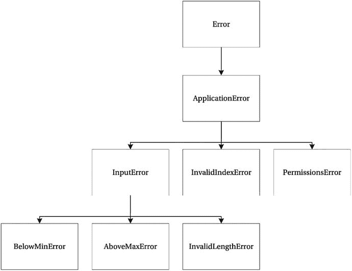
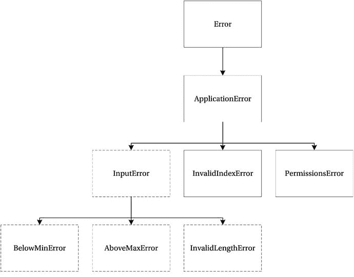
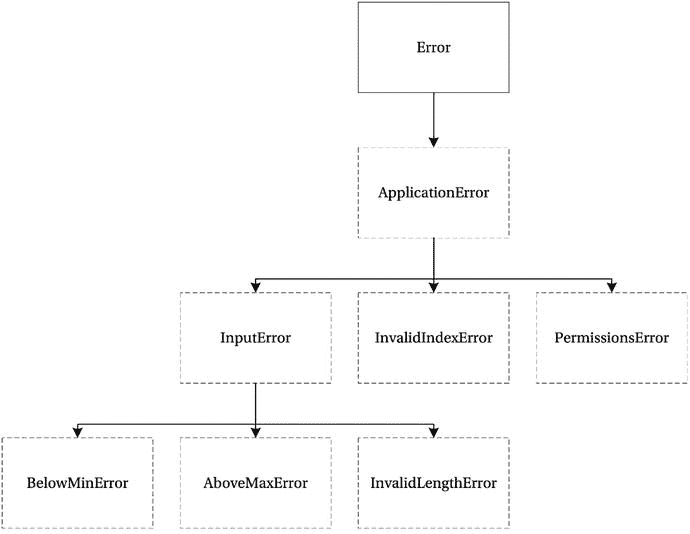
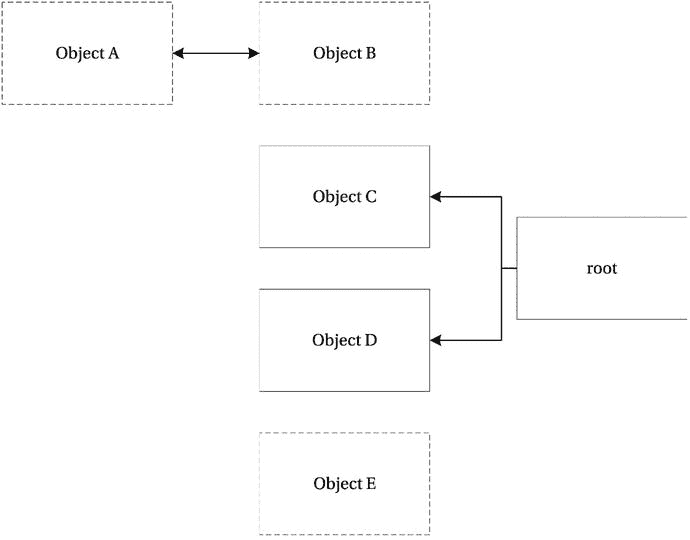

# 异常、内存与性能

> 异常处理程序的首要职责是把错误从程序员的手中拿出来，然后放到用户那惊讶的脸上。只要牢记这条基本原则，你就不会出大错。 ——维里蒂·斯托布

尽管缺乏语言特性或运行时环境的吸引力，但理解异常和内存管理将帮助你编写出更好的 `TypeScript` 程序。`JavaScript` 和 `TypeScript` 中的异常对于使用过 `C#`、`Java`、`PHP` 或许多其他语言的程序员来说可能看起来熟悉，但存在一些细微却重要的差异。异常处理和内存管理这两个主题是密不可分的，因为它们共享一个语言特性，这将在本章后面进行描述。

内存管理这个主题常常被各种传说、谬误和盲目应用的“最佳实践”所主导。本章涉及内存管理和垃圾回收的事实，并解释了如何通过测量数据来检验你的优化想法，而不是应用一个可能收效甚微（甚至比原始代码性能更差）的实践。这将会简要地引出性能这个话题。

## 异常

异常用于指示程序或模块无法继续处理。顾名思义，它们只应在真正异常的情况下被触发。因此得名！通常，异常用于指示程序状态无效或继续处理不安全。

尽管当某个例程接收到一个不合规的值作为参数时，你可能很想抛出异常，但通常更优雅的做法是在不引发异常的情况下处理那些你能预见到的输入。

当你的程序遇到异常时，除非在代码中被处理，否则该异常会显示在控制台中。控制台允许程序员写入消息，并且会自动记录程序运行期间发生的任何异常。

你可以在所有现代 Web 浏览器中检查控制台以查看异常。快捷键因浏览器而异，也因平台而异，但如果 `CTRL + SHIFT + I` 在你的 Windows 或 Linux 机器上不起作用，或者 `CMD + OPT + I` 在你的 Mac 上不起作用，你可以尝试 `F12` 键，或者在浏览器的菜单中找到列在“开发者工具”、“浏览器控制台”或类似名称下的工具。对于 `Node` 来说，错误和警告输出将出现在你用来运行 HTTP 服务器的控制台窗口中。

### 抛出异常

要在 `TypeScript` 程序中引发异常，你需要使用 `throw` 关键字。虽然你可以在此关键字后跟随任何对象，但最好提供一个包含错误消息的字符串，或者一个包装了错误消息的 `Error` 对象实例。

清单 8-1 展示了为避免不可接受的输入值而抛出的典型异常。当调用 `errorsOnThree` 函数并传入一个数字时，它会返回该数字，除非传入的数字是 3，在这种情况下会引发异常。

```typescript
function errorsOnThree(input: number) {
  if (input === 3) {
    throw new Error('Three is not allowed');
  }
  return input;
}
const result = errorsOnThree(3);
```

清单 8-1. 使用 `throw` 关键字

此示例中的通用 `Error` 类型可以替换为自定义异常。你可以使用一个实现了 `Error` 接口的类来创建自定义异常，如清单 8-2 所示。`Error` 接口确保你的类具有 `name` 和 `message` 属性。

清单 8-2 中的 `toString` 方法并非 `Error` 接口所必需，但在许多情况下用于获取错误的字符串表示形式。如果没有此方法，将调用 `Object` 的 `toString` 默认实现，这会在控制台输出“`[object Object]`”。通过向 `ApplicationError` 类添加 `toString` 方法，你可以确保在抛出并记录异常时显示适当的消息。

```typescript
class ApplicationError implements Error {
  public name = 'ApplicationError';
  constructor(public message: string) {
    if (typeof console !== 'undefined') {
      console.log(`Creating ${this.name} "${message}"`);
    }
  }
  toString() {
    return `${this.name}: {this.message}`;
  }
}
```

清单 8-2. 自定义错误

你可以在 `throw` 语句中使用自定义异常来对已发生的错误类型进行分类。一种常见的异常模式是创建一个通用的 `ApplicationError` 类，并通过继承它来创建更具体的错误类型。任何处理异常的代码随后都可以根据抛出的错误类型采取不同的操作，如下面有关异常处理的章节所示。

清单 8-3 展示了一个特定的 `InputError` 类，它继承自 `ApplicationError` 类。`errorsOnThree` 函数使用 `InputError` 异常类型来强调该错误是由于输入数据错误而引发的。

```typescript
class ApplicationError implements Error {
  public name = 'ApplicationError';
  constructor(public message: string) {
    if (typeof console !== 'undefined') {
      console.log(`Creating ${this.name} "${message}"`);
    }
  }
  toString() {
    return `${this.name}: {this.message}`;
  }
}
class InputError extends ApplicationError {
}
function errorsOnThree(input: number) {
  if (input === 3) {
    throw new InputError('Three is not allowed');
  }
  return input;
}
```

清单 8-3. 使用继承创建特殊异常类型

示例中的 `InputError` 只是扩展了 `ApplicationError`；它不需要实现任何属性或方法，因为它仅用于在你的程序中提供异常类别。你可以创建扩展 `ApplicationError` 的异常类，或者进一步特化 `ApplicationError` 的子类。

**注意**

你应该将原生的 `Error` 类型视为神圣不可侵犯，并且永远不要抛出这种类型的异常。通过创建作为 `ApplicationError` 类子类的自定义异常，你可以确保 `Error` 类型保留给你的代码在真正特殊的异常情况之外使用。

### 异常处理

当抛出异常时，除非该异常被处理，否则程序将会终止。要处理异常，你可以使用 `try-catch` 块、`try-finally` 块，甚至是 `try-catch-finally` 块。在任何这些情况下，可能导致抛出异常的代码都被包裹在 `try` 块内。

清单 8-4 展示了一个 `try-catch` 块，它处理了来自上一节 `errorsOnThree` 函数的错误。`catch` 块接受的参数代表被抛出的对象，例如，`Error` 实例或自定义的 `ApplicationError` 对象，具体取决于你在 `throw` 语句中使用了哪一个。

```typescript
try {
  const result = errorsOnThree(3);
} catch (err) {
  console.log('Error caught, no action taken');
}
```

清单 8-4. 无条件 `catch` 块

`err` 参数的作用域限定在 `catch` 块内，使其等同于使用 `let` 关键字声明的变量，而不是 `var` 关键字，如第 4 章所述。

在支持 `try-catch` 块的语言中，通常允许捕获特定的异常类型。这允许 `catch` 块仅适用于特定类型的异常，而对于其他类型的异常，其行为就像没有 `try-catch` 块一样。建议使用此技术来确保你只处理那些你知道可以恢复的异常，让真正意外的异常终止程序，以防止状态的进一步损坏。

目前没有符合标准的方法来有条件地捕获异常，这意味着你要么捕获所有异常，要么一个都不捕获。如果你只想处理特定类型的异常，可以在 `catch` 语句中检查类型，并重新抛出任何不匹配类型的错误。

清单 8-5 展示了一个异常处理例程，它处理 `ApplicationError` 自定义异常，但重新抛出任何其他类型。在 `if-statement` 内部，`err` 变量的类型被收窄为 `ApplicationError` 类型。

```typescript
try {
  const result = errorsOnThree(3);
} catch (err) {
  if (err instanceof ApplicationError) {
    console.log('Error caught, no action taken');
  }
  throw err;
}
```

清单 8-5. 检查错误的类型

**注意**

通过仅处理自定义异常，你可以确保只处理你知道可以恢复的异常类型。如果你使用默认的 `catch` 块而不进行 `instanceof` 检查，你将负责处理程序中可能发生的每种类型的异常。

此示例将允许 `catch` 块处理 `ApplicationError` 或 `ApplicationError` 的子类（例如本章前面描述的 `InputError`）。为了说明在类层次结构的不同级别处理异常的效果，图 8-1 展示了一个更复杂的层次结构，它扩展了 `ApplicationError` 和 `InputError` 类。



图 8-1. 错误类层次结构

当你选择处理 `InputError` 类别的异常时，你将处理如图 8-2 所示的四种异常：`InputError`、`BelowMinError`、`AboveMaxError` 和 `InvalidLengthError`。所有其他异常将被传递给调用栈，就像它们未被处理一样。



图 8-2. 处理 `InputError` 异常

如果你要处理 `ApplicationError` 类别的异常，你将处理层次结构中的所有七个自定义异常，如图 8-3 所示。



图 8-3. 处理 `ApplicationError` 异常

一般而言，你处理的异常应随着程序深入而更加具体。若你在底层代码附近工作，应处理非常具体的异常类型；当工作靠近用户界面时，则应处理更通用的异常。

异常问题将在讨论性能时再次出现，因为在程序中创建和处理异常会带来性能开销。尽管如此，如果你仅用它来指示例程无法继续执行，则无需担心其运行时成本。

## 内存

当你使用 TypeScript 或 JavaScript 这类高级语言编写程序时，你将受益于自动内存管理。你创建的所有变量和对象都会自动管理，因此永远不会出现越界、悬空指针或变量损坏的问题。事实上，所有可能遇到的可管理内存问题都已为你处理妥当。然而，仍有一些内存安全类别无法自动处理，例如系统资源耗尽、无法继续处理的内存不足错误。

本节将介绍你可能遇到的问题类型，以及避免这些问题所需掌握的知识。

### 释放资源

在 TypeScript 中，你不太可能遇到非托管资源。大多数 API 遵循异步模式，接受一个在操作完成时被调用的方法参数。现代 API 会通过 promise 暴露此功能。因此，你的程序永远不需要直接持有非托管资源的引用。例如，如果你想使用检测物体是否靠近传感器的接近 API，可以使用清单 8-6 中的代码。

```
const sensorChange = function (reading) {
const proximity = reading.near
? 'Near'
: 'Far';
alert(proximity);
}
window.addEventListener('userproximity', sensorChange, true);
```

清单 8-6. 异步模式

异步模式意味着，虽然你可以从接近传感器获取信息，但程序永远不必负责资源或通信渠道。如果你恰好遇到必须管理资源引用的情况，应使用 `try-finally` 块来确保资源被释放，即使发生错误也不例外。

清单 8-7 中的示例假设可以直接操作接近传感器来获取读数。

```
const sensorChange = function (reading) {
var proximity = reading.near ?
'Near' : 'Far';
alert(proximity);
}
const readProximity = function () {
const sensor = new ProximitySensor();
try {
sensor.open();
const reading = sensor.read();
sensorChange(reading);
} finally {
sensor.close();
}
}
window.setInterval(readProximity, 500);
```

清单 8-7. 假设的非托管接近传感器

`finally` 块将确保调用传感器的 `close` 方法，从而执行清理并释放所有资源。即使调用 `read` 方法或 `sensorChange` 函数时发生错误，`finally` 块也会执行。

对于类似 promise 的接口，其等效示例如清单 8-8 所示。使用 promise 时，通常要么执行 `then` 块，要么在出错时执行 `catch` 块。而 `finally` 块在所有情况下都会被调用。

```
const sensorChange = function (reading) {
var proximity = reading.near ?
'Near' : 'Far';
alert(proximity);
}
const readProximity = function () {
const sensor = new ProximitySensor();
sensor.open()
.then(() => {
return sensor.read();
})
.then((reading) => {
sensorChange(reading);
})
.finally(() => {
sensor.close();
});
}
window.setInterval(readProximity, 500);
```

清单 8-8. 使用类似 promise 接口的非托管接近传感器

在前两节中，我介绍了使用 `catch` 进行异常处理和使用 `finally` 进行资源管理。在所有情况下，你都可以将两者结合，同时执行异常和内存管理。

### 垃圾回收

当内存不再需要时，需要将其释放，以便重新分配给程序中的其他对象。用于判断内存是否可以释放的过程称为垃圾回收。根据运行环境的不同，你会遇到多种垃圾回收方式。

旧版网页浏览器可能使用引用计数垃圾回收器，当对象的引用计数达到零时释放内存。如表 8-1 所示。这是一种非常快速的回收方式，因为引用计数达到零时即可立即释放内存。然而，如果两个或多个对象之间创建了循环引用，这些对象将永远不会被垃圾回收，因为它们的计数永远不会达到零。

现代浏览器通过标记-清除算法解决了这个问题，该算法检测所有从根节点可达的对象，并回收不可达的对象。虽然这种回收方式耗时更长，但更不容易导致内存泄漏。为防止浏览器 UI 冻结，一些 JavaScript 引擎会将垃圾回收插入空闲时间，从而减少对浏览体验的影响。

表 8-1. 引用计数垃圾回收

| 对象 | 引用计数 | 内存是否释放 |
| --- | --- | --- |
| `Object A` | 1 | 否 |
| `Object B` | 1 | 否 |
| `Object C` | 1 | 否 |
| `Object D` | 1 | 否 |
| `Object E` | 0 | 是 |

表 8-1 中的相同对象如图 8-4 所示。使用引用计数算法，`Object A` 和 `Object B` 会因相互引用而保留在内存中。这些循环引用是旧版浏览器内存泄漏的根源，而标记-清除算法则解决了这个问题。`Object A` 和 `Object B` 之间的循环引用不足以让对象在垃圾回收中幸存，因为只有从根节点可访问的对象才会被保留。



图 8-4. 标记与清除

大多数现代垃圾回收器会对对象进行分代提升，其中针对短生命周期对象的回收最为频繁和高效。随着对象存活时间增长，它们的检测频率通常会降低，回收速度也可能变慢。一次完整的垃圾回收还可能包含压缩步骤以优化内存使用。

标记-清除垃圾回收算法的使用意味着，在你的 TypeScript 程序中，几乎无需担心垃圾回收或内存泄漏问题。

## 性能

> 毫无疑问，对效率的追求会导致滥用。程序员浪费大量时间思考或担忧程序中非关键部分的速度，而考虑到调试和维护时，这些提高效率的尝试实际上会产生强烈的负面影响。我们应该放弃对微小效率的执着，大约在 97% 的情况下：过早优化是万恶之源。然而，我们也不应放弃那关键的 3%。——唐纳德·克努特

这并非唐纳德·克努特（《带 GOTO 语句的结构化编程》，《计算调查》，1974 年）第一次就性能和优化问题被引用，也绝不会是最后一次。至少在这方面，他的言论经受住了时间的考验（尽管它们来自一篇为 GOTO 语句辩护的论文——这种观点随着时间的推移已基本失效）。

# 性能优化原则与测量

如果在出现可衡量的性能问题之前就考虑性能问题，那么你应该避免优化。有许多文章声称使用局部变量比全局变量快，应该避免使用闭包因为它们慢，或者对象属性比变量慢。虽然这些说法通常正确，但将它们作为设计规则会导致糟糕的程序设计。

优化的黄金法则是，你应该衡量两种或多种潜在设计之间的差异，并决定性能提升是否值得你为获得它们而必须做出的设计权衡。

> **注意**
>
> 就你的 TypeScript 程序而言，测量执行时间需要在多个平台上运行测试。否则，你可能会在一个浏览器中更快，但在另一个浏览器中更慢。

## 性能测试示例

清单 8-9 中的代码将用于演示一个简单的性能测试。将测试轻量级的 `CommunicationLines` 类。该类包含一个方法，该方法接收一个 `teamSize` 并使用著名的 `n(n–1)/2` 算法计算团队成员之间的沟通线路数量。名为 `testCommunicationLines` 的函数实例化该类，并成功测试了团队规模为 4 和 10 的两个案例，它们分别有 6 条和 45 条沟通线路。

```
class CommunicationLines {
    calculate(teamSize: number) {
        return (teamSize * (teamSize - 1)) / 2
    }
}

function testCommunicationLines() {
    const communicationLines = new CommunicationLines();
    let result = communicationLines.calculate(4);
    if (result !== 6) {
        throw new Error('Test failed for team size of 4.');
    }
    result = communicationLines.calculate(10);
    if (result !== 45) {
        throw new Error('Test failed for team size of 10.');
    }
}

testCommunicationLines();
```

*清单 8-9. 计算沟通线路*

## 使用 `Performance` 类

清单 8-10 中的 `Performance` 类将一个回调函数包装在一个方法中，该方法使用 `performance.now` 方法，并利用第 4 章讨论的高保真计时器来对操作进行计时。为了获得公平的测量结果，`Performance` 类默认将代码运行 10,000 次，尽管在调用 `run` 方法时可以覆盖此数字。

`Performance` 类的输出包括执行代码 10,000 次所花费的总时间以及每次迭代的平均时间。

```
export class Performance {
    constructor(private func: Function, private iterations: number) {
    }

    private runTest() {
        if (!performance) {
            throw new Error('The performance.now() standard is not supported in this runtime.');
        }

        const errors: number[] = [];
        const testStart = performance.now();

        for (let i = 0; i < this.iterations; i++) {
            try {
                this.func();
            } catch (err) {
                // Limit the number of errors logged
                if (errors.length < 10) {
                    errors.push(i);
                }
            }
        }

        const testTime = performance.now() - testStart;

        return {
            errors: errors,
            totalRunTime: testTime,
            iterationAverageTime: (testTime / this.iterations)
        };
    }

    static run(func: Function, iterations = 10000) {
        const tester = new Performance(func, iterations);
        return tester.runTest();
    }
}
```

*清单 8-10. `Performance.ts` 运行器*

要使用 `Performance` 类来测量程序，必须导入代码，并将对 `testCommunicationLines` 函数的调用替换为将函数传递给 `Performance` 类的 `run` 方法，如清单 8-11 所示。

```
import { Performance } from './Listing-8-010';

class CommunicationLines {
    calculate(teamSize: number) {
        return (teamSize * (teamSize - 1)) / 2
    }
}

function testCommunicationLines() {
    const communicationLines = new CommunicationLines();
    let result = communicationLines.calculate(4);
    if (result !== 6) {
        throw new Error('Test failed for team size of 4.');
    }
    result = communicationLines.calculate(10);
    if (result !== 45) {
        throw new Error('Test failed for team size of 10.');
    }
}

const result = Performance.run(testCommunicationLines);
console.log(result.totalRunTime + ' ms');
```

*清单 8-11. 运行性能测试*

## 测试结果分析

这段代码的结果是，控制台记录的总运行时间为 2.73 ms。这意味着整个 10,000 次迭代（即对沟通线路算法的 20,000 次调用）耗时不到 3 ms。在大多数情况下，这样的结果很好地表明你在寻找优化机会时找错了方向。

通过按清单 8-12 所示调整代码，可能会得到完全不同的结果。对代码所做的唯一更改是检查对 `communicationLines.calculate` 的调用，该调用中团队规模为 4 的结果是 7 条沟通线路。此测试将失败，并引发一个异常。

```
import { Performance } from './Listing-8-010';

class CommunicationLines {
    calculate(teamSize: number) {
        return (teamSize * (teamSize - 1)) / 2
    }
}

function testCommunicationLines() {
    const communicationLines = new CommunicationLines();
    let result = communicationLines.calculate(4);
    if (result !== 7) {
        throw new Error('Test failed for team size of 4.');
    }
    result = communicationLines.calculate(10);
    if (result !== 45) {
        throw new Error('Test failed for team size of 10.');
    }
}

const result = Performance.run(testCommunicationLines);
console.log(result.totalRunTime + ' ms');
```

*清单 8-12. 运行包含异常的性能测试*

运行包含失败测试以及创建和处理异常的代码，总运行时间为 214.45 ms——这比第一次测试慢了 78 倍。可以利用这些数据来指导你的设计决策。你可能希望多次重复测试或尝试不同的迭代规模，以确保获得一致的结果。

以下是一些使用清单 8-10 中的 `Performance` 类收集的数据，用以证明本节开头关于优化的论断。使用一个简单但有限的测试，基线时间为每次迭代 0.74 ms，结果如下（数字越高表示执行时间越慢）：

- `全局变量`：0.80 ms（每次迭代慢 0.06 ms）
- `闭包`：1.13 ms（每次迭代慢 0.39 ms）
- `属性`：1.48 ms（每次迭代慢 0.74 ms）

在 10,000 次执行中，你可以看到执行时间的微小差异，但重要的是要记住，由于对象复杂度、嵌套深度、创建的对象数量以及许多其他因素的差异，你的程序将返回不同的结果。在进行任何优化之前，请确保你已经进行了测量，以便能够比较更改前后的性能，从而判断它们是否产生了积极的影响。

## 总结

本章涵盖了三个重要主题，这些主题很可能是任何用 TypeScript 编写的大型应用程序的基础。在大多数情况下，这三个领域可能是横切关注点，在编写大量需要修改的代码之前考虑它们会更容易。

使用异常来处理程序中真正的异常状态，可以防止程序数据进一步损坏。你应该创建自定义异常来帮助管理不同类型的错误，并在 `catch` 块中测试类型，以便只处理你知道可以从中恢复的错误。

现代运行时都使用可靠的标记-清除算法来处理内存，该算法不会像早期的引用计数垃圾回收器那样受到循环引用内存泄漏的影响。人们普遍认为，程序员在编写代码时不需要考虑垃圾回收，但如果你能测量到性能问题并发现垃圾回收是问题所在，你可能会决定通过创建更少的对象来帮助垃圾回收器，从而减少其管理负担。

每当你进行优化时，你首先应该测量程序的性能，以证明你在进行更改时对优化的假设是否正确。你应该在多个环境中测量你的更改，以确保在所有环境中都提高了速度。

## 要点

*   你可以将 `throw` 关键字与任何对象一起使用，但最好使用自定义错误的子类。
*   你可以使用 `try-catch-finally` 块处理异常，在这些块中，你必须指定一个 `catch` 或 `finally` 块，或者根据意愿指定两者。
*   当处理 `Promise` 时，你可以使用 `catch` 块、`finally` 块，或两者都使用。
*   你无法可靠地仅捕获自定义异常，但你可以在 `catch` 块内测试异常类型。
*   你遇到的大多数 API 都将遵循异步或类似 `Promise` 的模式，但如果你发现必须管理一个资源，请使用 `try-finally` 块进行清理。
*   在性能方面，你需要优化前后的测量数据来支持你以优化为名义更改的任何代码。