# 9. 使用 JavaScript 库

> 我并不是说使用现有的软件或库不好。我的意思是，在最小化一方的努力和最小化另一方的冗余代码之间总是需要权衡。我的意思是，当你从现有库中需要的功能比例非常小（比如说低于 20%）时，你应该考虑编写自己的代码。长期背负额外的 80% 可能并不值得。 — Lea Verou

在编写框架、工具包、辅助函数和有用的代码片段方面，JavaScript 社区是最活跃的社区之一。如果你搜索任何类型的框架或工具包，你很可能会找到大量的选择。事实上，选择的数量既是祝福也是诅咒，尽管你找到行为驱动测试框架、单元测试框架、模型-视图-控制器（MVC）框架、模型-视图-视图模型（MVVM）框架、网络工具包、浏览器 polyfill 等都不会有问题。从众多选项中选出一个来使用并非易事。

一旦你权衡了你的选择，你就可以立即开始在 TypeScript 程序中使用该框架。在运行时，你的程序和框架都将是纯 JavaScript，但在设计时和编译时，你将把 TypeScript 代码与纯 JavaScript 库混合在一起。由于 TypeScript 编译器不知道 JavaScript 文件中提供的操作，你需要以类型定义的形式提供提示，以获得与 TypeScript 库相同级别的工具支持。

编译器使用类型定义来检查你的程序，语言服务则使用它们在你的开发工具中提供自动补全。所有类型定义都会被编译器擦除，这意味着它们不会给你的生产代码增加任何负担。本章包含一个示例应用程序，演示了当你需要在 TypeScript 程序中包含第三方 JavaScript 代码时，如何为其创建类型定义。

为了说明类型定义对现有代码的好处，让我们了解一下在纯 JavaScript 中使用 jQuery 的典型开发工作流程。

*   输入一个选择器和方法，例如 `$('#elem').on(`
*   搜索 jQuery 文档中 `on` 方法的签名
*   在你的代码和文档之间来回切换以完成你的代码行

这是除了 jQuery 中最常见的操作之外所有操作的典型描述，我还没有提及任何复制和粘贴示例的情况（我们都做过）。如果即使对于最通用的库，我们的开发工作流程也涉及在文档和代码之间来回切换，那么一定有更好的方法。类型定义就是这样一种更好的方法。

通过包含 jQuery 的类型定义，你将获得针对 jQuery 成员的智能自动补全，从而省去在编辑器和文档之间来回切换的麻烦。GitHub 上有一个官方的类型定义仓库（Definitely Typed）。所有这些定义都可以从 NPM 上的 Types 组织安装，如图 9-1 所示，或者通过运行清单 9-1 中的命令进行安装。

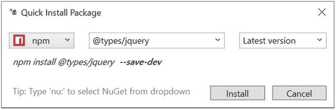

图 9-1. 添加 jQuery 类型定义

请注意，在这两种情况下，类型定义都作为开发依赖项保存，因为它们在运行时不是必需的。

```bash
npm install @types/jquery --save-dev
```

清单 9-1. 类型定义的 NPM 安装命令

但是，在我们通过获取现有类型定义而走得太远之前，让我们从头开始，并涵盖那些可能没有可用定义的场景。这将意味着你可以像处理流行的框架一样，轻松地处理你自己的 JavaScript 代码，或者一个尚未有社区贡献的冷门库。

## 创建类型定义

为了说明类型定义的创建过程，本章使用 Knockout 作为 JavaScript 库的示例。Knockout 是一个 MVVM 框架，它通过将模型映射到视图并在发生变化时保持两者同步来简化动态用户界面。虽然使用 Knockout 来说明从头开始创建类型定义的过程，但该技术可用于以 TypeScript 能够理解的方式描述任何 JavaScript 代码——甚至是你自己的遗留库。

当然，如果你要向程序中添加像 Knockout 这样的流行库，很可能已经有人完成了创建类型定义的工作。因此，在花时间自己创建之前，请检查 Definitely Typed 项目或通过 NPM 的列表（你会找到 `@types/knockout`）。

[`http://definitelytyped.org/`](http://definitelytyped.org/)

如果你使用的开源库未列在列表中，那么在创建了类型定义之后，你可以将其提交给 Definitely Typed 项目，以帮助未来的其他程序员。

正在运行的应用程序示例如图 9-2 所示。该应用程序允许你预订座位并从一系列食物选项中进行选择。

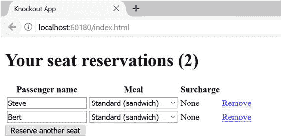

图 9-2. Knockout 应用程序

### 使用 Knockout 创建 TypeScript 应用程序

本章中的应用程序允许乘客在航班上预订座位并选择机上餐食。该应用程序由一个 HTML 页面和一个 `app.ts` 文件组成，后者包含将数据绑定到视图的 Knockout 代码。清单 9-2 展示了该应用程序的视图的 HTML 页面，该页面来源于 Knockout 教程网站： [`http://learn.knockoutjs.com/`](http://learn.knockoutjs.com/)

本示例中值得关注的部分是 Knockout 用于将视图模型绑定到 HTML 页面的 `data-bind` 属性。每个 `data-bind` 属性都接收一个表达式，该表达式描述了数据应绑定到元素的哪个位置（例如 `value` 属性或内部的 `text`），以及应显示哪些数据。

```
Knockout App

您的座位预订 ()

乘客姓名
餐食
附加费

移除

预订另一个座位
 0">
总附加费: $

清单 9-2.
HTML 页面
```

`app.ts` 文件包含使用 Knockout 将数据绑定到视图的代码，如清单 9-3 所示。本节不会更改此文件，而是用它来驱动出所需的类型定义，以便消除编译器错误，并为 Knockout 提供高质量的自动补全和类型检查。

```
// 表示座位预订网格中一行的类
function SeatReservation(name, initialMeal) {
var self = this;
self.name = name;
self.meal = ko.observable(initialMeal);
self.formattedPrice = ko.computed(function () {
var price = self.meal().price;
return price ? "$" + price.toFixed(2) : "无";
});
}
// 此屏幕的总体视图模型及初始状态
function ReservationsViewModel() {
var self = this;
// 不可编辑的目录数据——将从服务器获取
self.availableMeals = [
{ mealName: "标准（三明治）", price: 0 },
{ mealName: "高级（龙虾）", price: 34.95 },
{ mealName: "至尊（整只斑马）", price: 290 }
];
// 可编辑数据
self.seats = ko.observableArray([
new SeatReservation("史蒂夫", self.availableMeals[0]),
new SeatReservation("伯特", self.availableMeals[0])
]);
// 计算数据
self.totalSurcharge = ko.computed(function () {
var total = 0;
for (var i = 0; i < self.seats().length; i++)
total += self.seats()[i].meal().price;
return total;
});
// 操作
self.addSeat = function () {
self.seats.push(new SeatReservation("", self.availableMeals[0]));
}
self.removeSeat = function (seat) { self.seats.remove(seat) }
}
ko.applyBindings(new ReservationsViewModel(), document.body);
清单 9-3.
app.ts 中的程序
```

如果你将这些文件放入开发环境中，由于 Knockout 的 `ko` 变量未知，你会收到 TypeScript 编译器的许多错误。这些错误的示例如图 9-3 所示。

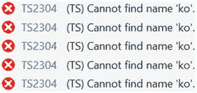

图 9-3. 编译器错误

### 消除编译器错误

如果你只对消除编译器错误感兴趣，那么只需提供一个快速提示，告知编译器你将负责所有使用 `ko` 变量并导致错误的代码。提供此提示的类型定义如清单 9-4 所示。

# Knockout 类型定义与 JavaScript 迁移

该类型定义通常放在名为 `knockout.d.ts` 的文件中，并通过引用注释或 `import` 语句在 `app.ts` 中引用它。

```
declare var ko: any;
清单 9-4.
快速的类型定义修复
```

当你使用这类类型定义时，你放弃了编译器对你的程序的检查，并且你将无法获得自动补全功能。虽然这是一个简单的快速修复方法，但你很可能希望编写更全面的类型定义。

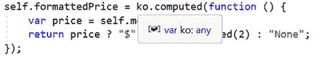

图 9-4. 第一次迭代

图 9-4 显示编辑器中的类型信息尚无用，但所有错误都已消失。

## 迭代改进类型定义

编写类型定义的一大优点在于可以增量式地进行。这意味着你可以根据每次增量提供的类型检查和自动补全带来的好处，来决定在类型定义上投入多少精力。

清单 9-5 展示了对 Knockout 类型定义的一次小的增量改进。`Knockout` 接口为应用中使用的所有第一级属性提供了类型信息：`applyBindings`、`computed`、`observable` 和 `observableArray`。这四个属性的具体细节没有给出；它们只是被简单地赋值为 `any` 类型。

声明的 `ko` 变量被更新为使用新的 `Knockout` 接口，而不是之前用来让编译器静默的 `any` 类型。

```
interface Knockout {
applyBindings: any;
computed: any;
observable: any;
observableArray: any;
}
declare var ko: Knockout;
Listing 9-5.
第一级类型定义
```

尽管这个更新后的定义很简单，但它可以防止许多常见的错误，否则这些错误只有在应用中观察到不正确行为时才会被发现。清单 9-6 展示了两个示例错误，基于这个第一级类型定义，编译器会捕获它们。

```
// 拼写错误被编译器捕获
self.meal = ko.observabel(initialMeal);
// 不存在的方法被编译器捕获
ko.apply(new ReservationsViewModel(), document.body);
Listing 9-6.
错误代码的编译器报错
```

本应使用 `observable` 却误拼为 `observabel`，以及本应使用 `applyBindings` 却调用了不存在的 `apply` 方法，这两者都会导致编译器报错。这是编译器所能达到的极限，因为接口中只指定了名称，而没有指定方法签名。

图 9-5 展示了使用更新后的定义所改进的自动补全。虽然成员被列出，但其类型信息尚未提供。

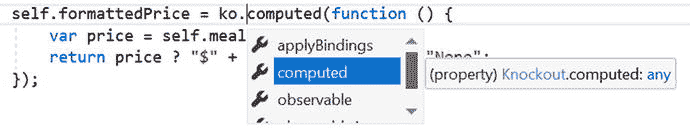

图 9-5. 第二次迭代

为了增加类型定义的细节，有必要参考该库的官方文档。在创建定义时参考一次文档，就能省去每次编写代码时都要查阅的麻烦。以 `applyBindings` 为例，文档指出该方法可以接受以下一个或两个参数：

*   `viewModel`—你想要与它所激活的声明式绑定一起使用的视图模型对象。
*   `rootNode`（可选）—你想要在其中搜索 `data-bind` 属性的文档部分。

换句话说，`viewModel` 是一个对象且必须提供，而 `rootNode` 是一个 `HTMLElement` 且是可选的。更新后的 `Knockout` 接口及其附加类型信息如清单 9-7 所示。

```
interface Knockout {
applyBindings(viewModel: {}, rootNode?: HTMLElement): void;
computed: any;
observable: any;
observableArray: any;
}
declare var ko: Knockout;
Listing 9-7.
'applyBindings' 定义
```

**注意**

即使你尚不清楚库中某个函数或对象的确切签名，将类型限制为通用的 `Function` 或 `Object` 类型也能防止许多可能的错误，例如传递简单类型。

这个更新后的类型定义提供了更全面的类型检查，确保至少向 `applyBindings` 传递一个参数，并且所有传递的参数都是正确的类型。它还允许开发工具提供有用的类型提示和自动补全，如图 9-6 所示。

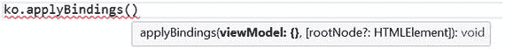

图 9-6. `applyBindings` 方法的自动补全

另一种扩展类型信息的技术是提供你根据自己对该库的使用情况推断出的签名。应用中 `ko.computed` 的两个实例都传入了一个执行计算的函数。你可以更新类型定义，以表明 `computed` 方法期望提供一个函数，如清单 9-8 所示。

如果求值器的返回类型是固定的，你可以在括号内的类型定义中指定它。同样，如果你需要使用 `computed` 方法返回的值，你可以更新括号外的返回类型以提供返回类型的详细信息。

```
interface Knockout {
applyBindings(viewModel: any, rootNode?: any): void;
computed: (evaluator: () => any) => any;
observable: any;
observableArray: any;
}
declare var ko: Knockout;
Listing 9-8.
'computed' 定义
```

你可以继续使用官方文档或基于示例推断类型来扩展定义，从而创建清单 9-9 中所示的 `Knockout` 接口。该接口现在包含第一级和第二级类型信息。

```
interface Knockout {
applyBindings(viewModel: {}, rootNode?: HTMLElement): void;
computed: (evaluator: () => any) => any;
observable: (value: any) => any;
observableArray: (value: any[]) => any;
}
declare var ko: Knockout;
Listing 9-9.
完整的第二级定义
```

为了完成类型定义，你需要重复这个过程，将每个 `any` 的用法转化为更详细的类型，直到你不再依赖用动态类型来隐藏细节。每当某个定义扩展到难以管理的规模时，你可以使用额外的接口来拆分它，以帮助限制定义中任何特定部分的复杂性。

清单 9-10 演示了"分而治之"技术，将 `applyBindings` 方法的细节移到一个单独的 `KnockoutApplyBindings` 接口中。然后在 `Knockout` 接口中使用这个接口将类型信息绑定到该方法。

```
interface KnockoutApplyBindings {
(viewModel: {}, rootNode?: HTMLElement): void;
}
interface Knockout {
applyBindings: KnockoutApplyBindings;
computed: (evaluator: () => any) => any;
observable: (value: any) => any;
observableArray: (value: any[]) => any;
}
declare var ko: Knockout;
Listing 9-10.
将类型定义拆分为接口
```

尽管这个 Knockout 的类型定义远未完成，但它涵盖了运行示例应用程序所需的所有 Knockout 功能。你可以根据需要添加更多类型信息，只在获得合理回报时才投入精力。

## 转换 JavaScript 应用程序

如果你有一个现有的 JavaScript 应用程序，并打算切换到 TypeScript，处理旧代码有三种可行的策略：

- 编写类型定义
- 将 JavaScript 文件加入编译
- 将 JavaScript 代码迁移到 TypeScript 文件中

为自己编写的 JavaScript 代码编写类型定义是最不理想的方案，因为这会带来大量重复或徒劳的工作。允许编译器包含你的 JavaScript 代码，可以让你开启向 TypeScript 迁移的进程；而将其移入 TypeScript 文件则标志着迁移完成。

为了演示 JavaScript 代码的迁移过程，我们将使用清单 9-11 中展示的一个非常基础的 JavaScript 文件。该文件包含一些任意的旧处理代码，我们希望在新 TypeScript 程序中使用它们。

```
function old_process(name) {
return name + ' processed';
}
```

调用旧 JavaScript 的新代码如清单 9-12 所示。

class NewProcessor {
    process(name: string) {
        return old_process(name);
    }
}
```

当你尝试编译 TypeScript 文件时，会看到错误信息 `mynewlib.ts(3,16): error TS2304: Cannot find name 'old_process'`。这是因为编译器无法识别旧代码。

```
tsc mynewlib.ts --outDir ./dist
```

在编写类型定义或尝试将旧库升级为 TypeScript 之前，你可以先启用包含 JavaScript 文件的编译选项。当在编译中包含 JavaScript 文件时，最好将输出重定向到单独的文件夹，因为 JavaScript 输入文件不能被覆盖。清单 9-14 展示了允许在编译中包含 JavaScript 文件的编译器命令，并将旧 JavaScript 文件和新 TypeScript 文件一同加入编译。

```
tsc myoldlib.js mynewlib.ts --allowJs --outDir ./dist
```

通过将 JavaScript 文件包含在编译中，编译器通常能推断出类型信息，之前的编译错误现在也消失了。

你可以进一步改进代码，如清单 9-15 所示，在 TypeScript 文件中显式声明 JavaScript 依赖关系。

```
///
class NewProcessor {
    process(name: string) {
        return old_process(name);
    }
}
```

添加了引用注释后，编译时就不再需要指定 JavaScript 文件了。此外，你的编辑器现在将提供推断出的类型信息作为自动完成提示。

```
tsc mynewlib.ts --allowJs --outDir ./dist
```

为了进一步改善开发体验，你可以开始将 JavaScript 文件迁移为 TypeScript 文件，这样可以添加类型注解来完善类型信息，并在编译器无法理解类型时提供帮助。如果 JavaScript 代码特别晦涩，编译器可能无法推断出很多类型。

如果你有大量 JavaScript 文件需要升级，可以先将底层依赖升级为 TypeScript，而其他依赖于这些底层代码的 JavaScript 文件继续引用 TypeScript 文件的编译输出。在运行时，只要只添加类型注解而不重构程序结构，文件最初是用 TypeScript 还是 JavaScript 编写的并无区别。

最好将任何重构工作留到整个程序都改用 TypeScript 编写之后再进行，因为 TypeScript 的重构支持更加智能。

## 本章小结

几乎所有流行的 JavaScript 库都已经在 Definitely Typed 上列出了类型定义，并通过 NPM 上的 Types 组织发布；但如果你遇到一个比较小众的库，或者一个全新的、尚未收录的库，你可以自己创建类型定义。采用迭代/增量式的方法来编写类型定义，可以让你在投入的时间和精力上获得最大回报，并且你可以利用库的文档来查找类型信息，或者通过阅读示例来推断类型。

你也可以使用相同的类型定义技术来重用自己编写的 JavaScript 代码，但更省时的方法是直接将 JavaScript 代码移入 TypeScript 文件，并添加编译器无法为你推断的所有类型注解。

无论你是在编写类型定义，还是将 JavaScript 升级为 TypeScript，编译器都有可能发现你从未意识到的错误——你可能会惊讶于之前遗漏了多少问题。

## 关键要点

- 类型定义通常放在扩展名为 `.d.ts` 的文件中。
- 你可以增量地创建新的类型定义——无需一次性投入时间为整个库生成类型信息。
- 你可以在 TypeScript 编译中包含 JavaScript 文件。
- 通常，将文件从 JavaScript 升级为 TypeScript，比创建类型定义文件更容易。
- 由于 JavaScript 是完全动态的，在升级到 TypeScript 时，你很可能会发现并修复一些你从未意识到的错误。

# 自动化测试

> 我对任何领域专家的定义是：一个对事情真相了解得足够多，以至于感到害怕的人。——P. J. Plauger

对于任何编写 TypeScript 所设计的那种大型应用程序的人来说，自动化测试都是一个至关重要的主题。通过自动化程序测试，开发者可以将更多时间用于开发新功能，减少修复缺陷的时间。自动化测试对于重构也至关重要。没有任何一种单一的测试方法能够独立提供足够高的缺陷检测率。这意味着需要结合多种测试方法，才能在软件发布前检测出合理数量的缺陷。

这可能会令人惊讶，但实证证据表明，对于不同类型的测试，你将达到以下缺陷检测率，正如 Steve McConnell 在《代码大全》（Microsoft Press，2004 年）中所记载的：

- 单元测试最多可检测出 50% 的缺陷。
- 集成测试最多可检测出 40% 的缺陷。
- 回归测试最多可检测出 30% 的缺陷。

这些数字表明，随着测试在软件开发生命周期中进行得越晚，就会有更多的缺陷漏网。同时，众所周知，缺陷发现得越晚，修复成本就越高。考虑到这一点，也许测试优先编程是减少缺陷最有效的方法之一（与结对编程并列，因为协作工作方法已被发现能比任何类型的测试检测出更多的缺陷）。测试驱动设计（TDD）的支持者也会很快指出，测试是额外收获，而非 TDD 的主要目的——TDD 是一种辅助设计内聚代码单元的工具。他们可能是对的，但测试本身也很不错！

本章的目的并非说服你采用测试驱动设计。无论你选择在编码之前编写测试，还是在编写完部分程序后编写测试，或者希望自动化测试而不是手动执行，本章的信息都将对你有用。

> 注意：缩写 TDD 最初是为测试驱动开发（test-driven development）创造的，但后来修订为测试驱动设计（test-driven design），以强调这种方法在帮助塑造程序设计方面所起的作用。

## 框架选择

有许多用 JavaScript 编写的高质量测试框架可用于测试程序。这里列出了三个最流行的框架，但还有更多未列出的框架，你甚至不需要使用框架，因为直接使用 TypeScript 代码也可以进行测试。

*   Jasmine
*   Mocha
*   Jest

本章中的示例均使用 Jest 编写，Jest 是一个易于设置的测试框架，因其与 React 框架的紧密联系而逐渐受到欢迎。

示例中展示的代码涵盖了 FizzBuzz 编程练习的前几个步骤。编程练习是一种通过解决简单问题来逐步挑战设计能力的实践方法。附录 4 对编程练习进行了说明。FizzBuzz 练习基于一个儿童游戏，该游戏包含一系列计数规则。在执行练习时，你的目标应该是仅通过游戏中的下一个规则；避免提前思考的诱惑。随着你编写更多代码，设计会逐渐显现，你可以重构程序（只要测试通过，你就没有意外改变行为，这一点可以放心）。

## 使用 Jest 进行测试

Jest 是为了补充 React 框架而编写的，但它也可以用于测试任何 TypeScript 或 JavaScript 程序。运行 Jest 最常见的方式是通过 Node。其语法简洁易学，对于过去使用过 Jasmine 的人来说会非常熟悉。

### 安装 Jest

将 Jest 添加到项目中最简单的方法是从 NPM 获取包和类型定义。你可以通过将这些包添加到开发依赖项中来实现，如代码清单 10-1 所示。你还会注意到，我们使用 `package.json` 文件来告诉 Node 哪个框架将处理我们的测试运行。

```json
{
  "name": "fizzbuzz",
  "version": "1.0.0",
  "devDependencies": {
    "@types/jest": "²¹.1.0",
    "jest": "²¹.1.0"
  },
  "scripts": {
    "test": "jest"
  }
}
```

代码清单 10-1. 包依赖

下载完这些包后，你就可以开始编写代码了。

### 第一个规范

代码清单 10-2 展示了一个待测试的 `FizzBuzz` 类的简单实现。该类的目的是当给定 FizzBuzz 游戏中报出的一个数字时，提供正确的答案。完整的实现应返回报出的数字，或者根据该数字是否能被三、五或三和五同时整除，用诸如 "Fizz"、"Buzz" 或 "FizzBuzz" 等游戏词汇替换该数字。

> **注意**
> FizzBuzz 游戏通常是在一个群体中进行的。每个人轮流说出从 1 开始的序列中的下一个数字。如果数字能被三整除，玩家应该说 "Fizz" 而不是数字。如果数字能被五整除，玩家应该说 "Buzz"，如果数字能被三和五同时整除，他们应该说 "FizzBuzz"。

与其一次性实现所有这些逻辑，我们使用规范来驱动编程任务。因此，在实现任何超出初始实现（总是返回数字 1）的行为之前，该类需要等待 Jest 规范。

```typescript
export class FizzBuzz {
    generate(input: number) {
        return 1;
    }
}
```

代码清单 10-2. `FizzBuzz.ts` 中的 `FizzBuzz` 代码

# 测试驱动开发

匹配此行为的 Jest 测试如代码清单 10-3 所示。这个测试代表了你向某人首次解释 FizzBuzz 规则时对话中的第一句话。例如，“当报出数字 1 时，你应该说 '1'。”

```typescript
import { FizzBuzz } from './FizzBuzz';

describe('一个 FizzBuzz 生成器', () => {
  it('当报出 1 时，应返回数字 1', () => {
    const fizzBuzz = new FizzBuzz();
    const result = fizzBuzz.generate(1);
    expect(result).toBe(1);
  });
});
```

代码清单 10-3. `FizzBuzz.test.ts` 中的 Jest 测试

`describe` 方法接受一组规范的名称和一个测试每个规范的函数。`it` 方法表示单个规范。规范集和规范中使用的语言旨在具有人类可读性。在这种情况下，将规范集描述与规范文本结合起来读作：

> 当报出 1 时，一个 FizzBuzz 生成器应返回数字 1。

通过仔细选择规范中的语言，你可以从测试套件中获得免费的文档。你甚至可能会想到一种更好的措辞方式，用更人性化的术语来描述这种行为。如果是这样，你应该更改描述以匹配你改进后的措辞。在这些细节上多花些心思是值得的，因为这从长远来看会使规范更有价值。

传递给规范的函数通过实例化 `FizzBuzz` 类、报出数字 1 并检查结果是否为 1 来验证这一声明。

Jest 会在文件名包含 `*.test.js` 的文件中查找测试，但排除 `node_modules` 文件夹中的文件，因此命名很重要。如果你忘记了这一点，运行 Jest 时将找不到任何测试。

要运行 Jest，只需在你的项目文件夹中运行代码清单 10-4 所示的命令。

```bash
npm test
```

代码清单 10-4. 运行 Jest

此命令的输出如图 10-1 所示。

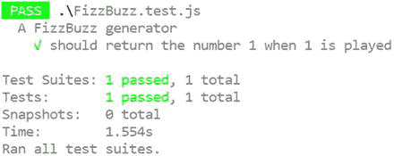

图 10-1. Jest 测试结果

现在一切设置完毕，可以开始测试了。接下来，你将使用更多的测试来驱动 FizzBuzz 程序的实现。

## 驱动实现

现在测试自动化已就位，便可以通过新的规格说明来驱动实现过程。清单 10-5 展示了在 FizzBuzz 游戏中输入数字 2 时的预期行为规格说明。

```typescript
import { FizzBuzz } from './FizzBuzz';

describe('一个 FizzBuzz 生成器', () => {
  it('输入 1 时应返回数字 1', () => {
    const fizzBuzz = new FizzBuzz();
    const result = fizzBuzz.generate(1);
    expect(result).toBe(1);
  });

  it('输入 2 时应返回数字 2', () => {
    const fizzBuzz = new FizzBuzz();
    const result = fizzBuzz.generate(2);
    expect(result).toBe(2);
  });
});
```

第二个规格说明将会失败，因为 `FizzBuzz` 类被硬编码为无论输入什么值都返回 `1`。运行测试的结果如图 10-2 所示。

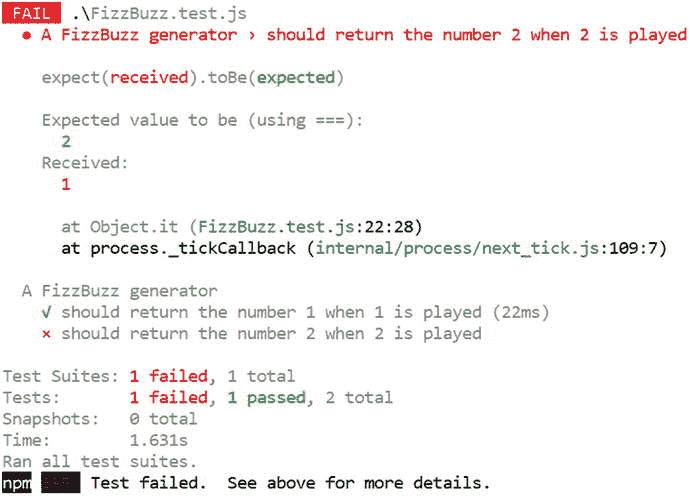

失败消息显示测试“`期望值为：2，实际接收：1`”，这意味着 Jest 测试失败，因为当预期返回 `2` 时，实际返回了 `1`。

为了通过测试，必须按照清单 10-6 所示更新 `FizzBuzz` 类。返回输入的任何数字将使现有两个规格说明均通过。尽管你可能知道很快会增加该实现无法覆盖的更多规格说明，但在编写代码前等待测试失败，可以确保每一种变化的测试都在你编写让其通过的代码之前编写并失败。知晓测试会在行为不正确时失败，这将让你在后续重构程序时充满信心。

```typescript
export class FizzBuzz {
  generate(input: number) {
    return input;
  }
}
```

此次更改后重新运行规格说明，所有规格说明都将通过。结果如图 10-3 所示。

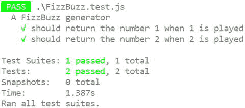

清单 10-7 展示了驱动 `FizzBuzz` 类实现的下一项规格说明。该规格说明要求输入数字 3 时，应将其替换为单词“Fizz”。

```typescript
it('输入 3 时应返回"Fizz"', () => {
  const fizzBuzz = new FizzBuzz();
  const result = fizzBuzz.generate(3);
  expect(result).toBe('Fizz');
});
```

在确认该规格说明失败后，你可以更新清单 10-8 所示的实现。此次更新同样是能通过测试的最简代码。

```typescript
class FizzBuzz {
  generate(input: number) : string | number {
    if (input === 3) {
      return 'Fizz';
    }
    return input;
  }
}
```

此阶段运行规格说明的结果如图 10-4 所示。阅读测试输出有助于理解测试如何以业务领域的语言描述程序。

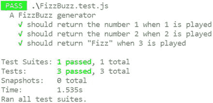

## 重构

既然已经编写了若干规格说明并实现了使其通过的代码，那么对程序进行重构是值得的。代码重构涉及在不改变行为的前提下改变程序的结构和设计。确认你确实是在重构（而非无意中改变程序实际功能）的最简单方法，就是拥有能够突出显示任何意外变更的自动化测试。

同样值得注意的是，你的测试代码应当像生产代码一样编写精良且易于维护，但抽象程度可以更低。因此，清单 10-9 展示了重构后的规格说明，其中重复的 `FizzBuzz` 类实例化被移至 `beforeEach` 方法中，Jest 会在每条规格说明之前自动运行该方法。

```typescript
import { FizzBuzz } from './FizzBuzz';

describe('一个 FizzBuzz 生成器', () => {
  let fizzBuzz: FizzBuzz;

  beforeEach(() => {
    fizzBuzz = new FizzBuzz();
  });

  it('输入 1 时应返回数字 1', () => {
    const result = fizzBuzz.generate(1);
    expect(result).toBe(1);
  });

  it('输入 2 时应返回数字 2', () => {
    const result = fizzBuzz.generate(2);
    expect(result).toBe(2);
  });

  it('输入 3 时应返回"Fizz"', () => {
    const result = fizzBuzz.generate(3);
    expect(result).toBe('Fizz');
  });
});
```

每当你重构代码时，都应重新运行所有测试，以确保没有改变程序的行为。如果测试套件失败，你可以轻松撤销更改并再次尝试，而非调试程序。每次测试运行之间的迭代应当足够小，以便可以放弃。

```typescript
export class FizzBuzz {
  generate(input: number): string | number {
    let output = '';
    if (input % 3 === 0) {
      output += 'Fizz';
    }
    if (input % 5 === 0) {
      output += 'Buzz';
    }
    return output === '' ? input : output;
  }
}
```

清单 10-10 中的代码展示了 `FizzBuzz` 类的一个可用版本，它涵盖了返回数字的默认规则以及 `Fizz`、`Buzz` 和 `FizzBuzz` 三种变体。此时，尽管 `generate` 方法仍然相当简短，但已能从代码中看出替代设计的雏形。特别是，随着新规则的加入（例如能被 7 整除的数字应返回'Bazz'），你可能会决定引入并适配一种设计模式来捕获特定规则。

**注意：** FizzBuzz 编程练习通常使用称为责任链的设计模式来解决，尽管也存在其他可能的解决方案。

为驱动此实现而创建的规格说明如清单 10-11 所示。目前共有八条规格说明，用于覆盖四种可能的响应类型。

```typescript
import { FizzBuzz } from './FizzBuzz';

describe('A FizzBuzz generator', () => {
```


let `fizzBuzz`: `FizzBuzz`;

const `FIZZ` = 'Fizz';

const `BUZZ` = 'Buzz'

const `FIZZ_BUZZ` = 'FizzBuzz';

beforeEach(() => {

`fizzBuzz` = new `FizzBuzz`();

});

it('should return the number 1 when 1 is played', () => {

const result = `fizzBuzz`.generate(1);

expect(result).toBe(1);

});

it('should return the number 2 when 2 is played', () => {

const result = `fizzBuzz`.generate(2);

expect(result).toBe(2);

});

it('should return "Fizz" when 3 is played', () => {

const result = `fizzBuzz`.generate(3);

expect(result).toBe(`FIZZ`);

});

it('should return "Fizz" when 6 is played', () => {

const result = `fizzBuzz`.generate(6);

expect(result).toBe(`FIZZ`);

});

it('should return "Buzz" when 5 is played', () => {

const result = `fizzBuzz`.generate(5);

expect(result).toBe(`BUZZ`);

});

it('should return "Buzz" when 10 is played', () => {

const result = `fizzBuzz`.generate(10);

expect(result).toBe(`BUZZ`);

});

it('should return "FizzBuzz" when 15 is played', () => {

const result = `fizzBuzz`.generate(15);

expect(result).toBe(`FIZZ_BUZZ`);

});

it('should return "FizzBuzz" when 30 is played', () => {

const result = `fizzBuzz`.generate(30);

expect(result).toBe(`FIZZ_BUZZ`);

});

});

清单 10-11. 可正常工作的 `FizzBuzz` 类的规范

除了测试 `FizzBuzz` 类之外，这些规范还为程序提供了准确的文档。输出结果如图 10-5 所示。你可能会注意到 Jest 标记了其中一个测试的执行时间（15 ms），这有助于你识别那些拖慢测试套件的测试。

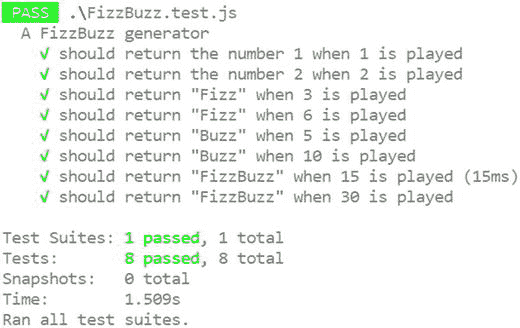

**图 10-5.** 包含三个测试且全部通过的测试套件

这些测试是一种可执行的规范——一种活的文档形式，同时也证明了你的程序执行了文档中描述的行为。

### 隔离依赖项

有时你可能需要测试代码中依赖于某个资源的部分，而这会使你的测试变得脆弱。例如，它可能依赖于第三方 API 或特定状态的数据库。如果你需要在测试时不依赖这些依赖项，可以使用本节介绍的技术在测试时对它们进行隔离。

在许多编程语言中，当你需要提供测试替身时，自然而然地会想到使用模拟框架。然而，在 TypeScript 中，创建测试替身非常容易，以至于你可能永远不需要去寻找框架。

清单 10-12 展示了 `FizzBuzz` 类的一个修改版本，它依赖于 `localStorage`（在 TypeScript 中实现了 `Storage` 接口）。`constructor` 接收存储对象，`generate` 函数使用它来获取在“Fizz”情况下要显示的显示消息。

```typescript
class FizzBuzz {
  constructor(private storage: Storage) {
  }

  generate(input: number): string | number {
    if (input === 3) {
      return this.storage.getItem('FizzText');
    }
    return input;
  }
}
```

清单 10-12. 一个依赖于存储的 `FizzBuzz` 类

你可以使用一个简单的对象来满足这个依赖，如清单 10-13 所示。`storage` 变量恰好匹配了 `Storage` 接口中足够通过测试的部分。与其他编程语言不同，解决测试替身问题的这个方案如此简单；你几乎不需要考虑使用框架来解决这个问题。

```typescript
describe('A FizzBuzz generator', () => {
  it('should return "FakeFizz" when 3 is played', () => {
    // 为存储创建一个测试替身
    var storage: any = {
      getItem: () => 'FakeFizz'
    };
    const fizzBuzz = new FizzBuzz(storage);
    const result = fizzBuzz.generate(3);
    expect(result).toBe('FakeFizz');
  });
});
```

清单 10-13. 使用一个对象

总的来说，你应该坚持使用简单的对象作为测试替身，并且你的测试应该检查结果，而不是具体的实现细节。知道当输入为 3 时得到“Fizz”是一个强有力的行为测试，但检查某个 `storage` 对象是否被调用以提供一个匹配特定键的值，则根本不是一个好测试，因为当你更改实现细节时，这个测试会失败。

## 总结

希望本章已经证明了自动化测试的价值。然而，如果你仍然持怀疑态度，可以尝试在有测试和没有测试的情况下运行编程练习，看看是否能帮助你下定决心。你可以在附录 4 中阅读更多内容。

尽管本章所有示例都使用了 Jest，但使用 Mocha 或 Jasmine 也同样简单，并且两者都提供了同样简洁的语法。无论你使用什么工具来运行测试，都尽量精心设计输出，使其呈现为人类可读的文档形式。这样，如果有人要求提供文档，你只需直接给出测试套件的输出结果即可。

我创建了一个基于 Gherkin 语言的 TypeScript 行为驱动框架，名为 TypeSpec，你可以用它来结合业务规范和测试自动化。但在本章中我使用了 Jest，因为我更希望程序员从更常用的工具开始。你可以在 GitHub 上找到更多关于 TypeSpec 的信息：

[`https://github.com/Steve-Fenton/TypeSpec`](https://github.com/Steve-Fenton/TypeSpec)

## 要点

*   自动化单元测试比集成测试或回归测试更有效（尽管好的策略是使用多种类型的测试，以获得尽可能最佳的缺陷检测率）。
*   JavaScript 和 TypeScript 有很多框架，但如果你想缩小范围，可以参考 Jest、Jasmine 和 Mocha。
*   你可以使用 Jest 来编写兼具测试和文档功能的规范。
*   用规范驱动实现，可以确保当行为不正确时测试会失败。在实现之后编写测试，并不能保证测试一定会失败。
*   你应该重构生产代码和测试代码。
*   你可以使用简单的对象来隔离依赖项，这比那些可能将测试与实现过度绑定的精巧工具更可取。

# 附录 1：JavaScript 快速参考

如果你还不熟悉 JavaScript，本快速参考旨在提供你将在 TypeScript 程序中使用的 JavaScript 核心功能的概述。在 TypeScript 语言旁边已经描述过的功能，此处不再赘述。

## 变量

变量用于在 JavaScript 中存储应用程序的状态，可以包含从字符串、数字到对象、函数等任何类型的数据。

列表 A1-1 展示了一些包含简单类型的变量。变量可以在声明的同时赋值，也可以分开声明和赋值。变量的类型会与其最近一次赋值的值相对应。如果未被赋值，变量的值将为 `undefined`。

声明变量时有两个关键字可供选择：`let` 和 `const`。这两个声明都是块级作用域的，就像大多数使用花括号的语言一样。使用 `let` 关键字声明变量时，你可以在后续代码中重新给该变量赋值。而使用 `const` 关键字时，则无法重新赋值。对 `const` 变量赋值的限制并不意味着它不可变，只是该变量本身不能被覆盖。在两者之间选择时，建议优先使用 `const`，当确定需要重新赋值时再升级为 `let`。`let` 和 `const` 都优于 `var` 关键字，因为 `var` 是函数级作用域，而非块级作用域。

```javascript
// 变量声明
let variable;

// 变量赋值
variable = 10;
```


# 变量

```javascript
variable = '一个字符串被赋给变量';

// 动态赋值（将变量类型改为数值）

variable = 10;
```

## 列表 A1-1. 变量

你可以在变量中存储数组。可以使用空字面量 `[]` 创建一个新的空数组，并使用 `array.push` 添加元素。也可以通过将值放入数组字面量中，一步完成数组的创建和填充，如列表 A1-2 所示。

```javascript
// 创建空数组并添加值

const myArray = [];

myArray.push(1);

myArray.push(3);

myArray.push(5);

// 使用数组字面量添加值

const myLiteralArray = [1, 3, 5];
```

## 列表 A1-2. 数组

对象可用于表示复杂结构的数据。对象可以包含属性，每个属性都像一个变量，可以包含字符串、数值、数组、函数以及其他对象。与数组类似，你可以使用空对象字面量 `{}` 创建空对象，也可以通过将属性放入对象字面量中，一步创建并填充对象。列表 A1-3 展示了这两种方式。

```javascript
// 对象

const myObject = {};

myObject.title = '示例对象';

myObject.value = 5;

// 对象字面量

const myLiteralObject = {

title: '示例对象',

value: 5

};
```

## 列表 A1-3. 对象

在所有示例中，我们都使用了字面量赋值，而非通过 `new` 关键字实例化值。虽然可以使用 `new Array()` 创建数组、`new Object()` 创建对象，甚至用 `new String()` 创建字符串，但在 JavaScript 中，字面量语法更受推荐。

# 函数

函数可用于在程序中创建可复用的代码块。你可以通过函数声明或函数表达式来创建函数，如列表 A1-4 所示。

```javascript
// 函数声明

function myFunction(name) {

return '你好 ' + name;

}

// '你好 Steve'

let greeting = myFunction('Steve');

// 函数表达式

var myFunctionExpression = function (name) {

return '嗨 ' + name;

};

// '嗨 Steve'

greeting = myFunctionExpression('Steve');
```

## 列表 A1-4. 函数

使用函数声明创建函数时，该函数在解析阶段被创建，这意味着它在整个程序中，只要作用域可访问的地方都能使用。而使用函数表达式时，函数在运行时才被求值，且只能在作用域可访问且调用代码位于函数表达式之后的位置进行调用。

# 条件语句

条件语句可用于在程序中实现逻辑分支。你可以使用条件语句仅在满足特定条件时执行代码。

`if` 语句允许根据自定义条件（计算结果为 `true` 或 `false`）进行代码分支。例如，列表 A1-5 中的 `if` 语句会根据 `age` 变量的值执行不同的代码。

```javascript
// If 语句

const age = 21;

if (age > 18) {

// 当 age 大于 18 时执行的代码

}

if (age > 40) {

// 当 age 大于 40 时执行的代码

} else if (age > 18) {

// 当 age 大于 18 但小于 41 时执行的代码

} else {

// 其他所有情况下执行的代码

}
```

## 列表 A1-5. If 语句

`switch` 语句适用于基于单个变量控制多个分支，且仅在特定值才会触发分支的场景。列表 A1-6 展示了一个典型的 `switch` 语句，它可以根据 `style` 变量的值执行不同的代码。如果没有其他条件被执行，则会执行 `default` 条件。

```javascript
// Switch 语句

const styles = {

传统: 1,

现代: 2,

后现代: 3,

未来主义: 4

};

const style = styles.传统;

switch (style) {

case styles.传统:

// 为传统风格执行的代码

break;

case styles.现代:

// 为现代风格执行的代码

break;

case styles.后现代:

// 为后现代风格执行的代码

break;

case styles.未来主义:

// 为未来主义风格执行的代码

break;

default:

throw new Error('未知风格: ' + style);

}
```

## 列表 A1-6. Switch 语句

> **注意**
> `switch` 语句与 TypeScript 枚举配合使用效果更佳，枚举将在第 1 章中介绍。

# 循环

循环用于在程序中重复执行一段代码。JavaScript 中最常见的循环是 `for` 循环，可用于遍历数组中的每一项并重复执行操作，如列表 A1-7 所示。

```javascript
const names = ['莉莉', '丽贝卡', '黛比', '安'];

for (let i = 0; i < names.length; i++) {

console.log(names[i]);

}
```

## 列表 A1-7. For 循环

你可以使用 `for-of` 循环简化列表 A1-7 中的代码。`for-of` 循环无需用变量跟踪索引值，直接将每次迭代的值赋给一个变量供你使用。列表 A1-8 展示了与第一个示例等价的 `for-of` 循环；其结果更具表现力且更易读。

```javascript
const names = ['莉莉', '丽贝卡', '黛比', '安'];

for (let name of names) {

console.log(name);

}
```

## 列表 A1-8. For-of 循环

`while` 循环允许重复执行一段代码，直到某个条件满足为止，如列表 A1-9 所示。这种循环常见的用途是向字符串中添加字符，并重复该过程直到字符串达到指定长度。

```javascript
let counter = 10;

while (counter > 0) {

counter--;

console.log(counter);

}
```

## 列表 A1-9. While 循环

`do-while` 循环与 `while` 循环几乎相同，区别在于它至少会执行一次代码，即使条件不满足。

```javascript
let counter = 0;

do {

counter--;

console.log(counter);

} while (counter > 0);
```

## 列表 A1-10. Do-while 循环

列表 A1-10 类似于前面展示的 `while` 循环，只是 `counter` 变量已经满足了退出条件（因为它不大于零）。尽管如此，代码仍会在条件评估前执行一次，从而导致循环退出。

# 字符串

虽然大量的字符串操作可能暗示着设计上的错误，但 JavaScript 中处理字符串的方式有一些值得了解的显著发展。列表 A1-11 展示了处理字符串的几种机制。

```javascript
const name = 'Jamie';

// 传统字符串

const classicString = 'Line One\n' +

'Line Two\n' +

'Line Three. Hello ' + name + '!';

// 反引号字符串

const backtickedString = `Line One

Line Two

Line Three. Hello ${name}!`;

// 'Five plus seven is 12.'

const expressionString = `Five plus seven is ${5 + 7}.`;
```

## 列表 A1-11. 字符串

传统字符串可以使用单引号或双引号。反引号字符串接受换行符，并允许使用 `${}` 包围的字符串插值。字符串插值允许插入变量和表达式。

# 期约（Promise）

期约正迅速成为 JavaScript 应用程序的核心特性，并为协调异步操作提供了一种简单的机制。列表 A1-12 展示了如何使用 `fetch` API 从 URL 检索数据，来通过期约进行编程。

```javascript
fetch('/Your/URL/').then(function (response) {

// 收到响应

if (response.status >= 200 && response.status < 300) {

// 我们得到了一个成功状态码

}

}).catch(function (error) {

// 请求失败

});
```

## 列表 A1-12. 使用期约

一个期约包含三个部分：一个调用返回期约的函数（例如 `fetch` 函数）、一个用于处理 `then` 结果（成功时调用）的处理程序，以及一个用于处理 `catch` 结果（发生错误时调用）的处理程序。

let promise = new Promise(function (resolve, reject) {
    window.setTimeout(function () {
        if (true) {
            resolve('Success');
        } else {
            reject('Failed');
        }
    }, 1000);
});

promise.then(function (message) {
    alert(message);
}).catch(function (error) {
    alert(error);
});

## 列表 A1-13. 使用自定义期约

当你使用`new Promise`实现自己的期约时，你的函数应接受一些处理程序作为参数，这些处理程序将在成功或失败时被调用。这些处理程序是一种松散的约定；传递给`resolve`和`reject`函数的参数可以是任何类型，尽管按照惯例，`reject`函数应传入一条错误消息。

## 总结

虽然本附录快速介绍了 JavaScript 的一些非常基础的功能，但它们是你开始学习 TypeScript 所需掌握的核心部分。如果某个功能与 TypeScript 语言有重要关联，我会将其包含在 TypeScript 的相关信息中，而不是放在本附录里。JavaScript 及其在不同执行环境中的内容远比我在此处能介绍的要多得多。

阅读完这个快速入门后，你应该能够毫无障碍地阅读本书，因为所有 TypeScript 语言特性都已详细描述。

# 附录 2：TypeScript 编译器

TypeScript 编译器可能隐藏在你的开发工具背后，但熟悉各种编译器选项仍然非常值得。由于现在有超过 70 个不同的编译器标志，我选择了提供关于更常见选项的更详细信息。编译器本身是为编译整个项目而非单个文件而优化的。针对整个项目运行编译器意味着你只需加载标准库一次，而不是多次。你可能会发现，编译单个文件（包括其所有依赖项）所需的时间几乎与编译整个项目一样长。

编译器名为`tsc.exe`，通常可以在 Windows 上的以下目录中找到：

- `C:\Program Files (x86)\Microsoft SDKs\TypeScript\[Version]\tsc.exe`

要运行编译器，只需在命令行中调用`tsc`并传入程序的根文件名，如下所示。你可能需要输入`tsc.exe`文件的完整地址。如果你厌倦了输入完整路径，可以将 TypeScript 文件夹的路径添加到你的环境变量中。

```sh
tsc app.ts
```

你也可以在任何操作系统上使用 Node 运行 TypeScript 编译器，因为编译器是用 TypeScript 编写的，并编译成了 JavaScript，如下所示。你需要输入`tsc.js`文件（而不是`.ts`文件）的完整路径。

```sh
node tsc.js app.ts
```

## 获取帮助

如果你在记住编译器的所有选项时遇到困难，可以使用以下命令之一获取帮助，这些命令将显示所有可设置的编译器标志的列表。每个编译器标志都暴露了一个设置，允许你更改编译器的行为。

```sh
tsc --help
node tsc.js
```

## 示例文件

为了说明编译器选项之间的一些关键区别，列表 A2-1 中的代码被用于使用一些不同的编译器选项生成输出。

```typescript
import * as Dependency from './module';

export class Example extends Dependency.BaseClass {
    exampleMethod(): number {
        return 5;
    }
}

// 注释
let example = new Example();
const val = example.exampleMethod();
```

**列表 A2-1. 示例 TypeScript 代码**

通过检查此列表生成的 JavaScript，你将了解模块加载和降级编译方面的一些差异。降级编译允许你使用 TypeScript 的最新特性，并将它们转换为与旧版 ECMAScript 规范兼容的 JavaScript。当输出基本相似时，我会删除相似的行，以使重要的差异更加突出。

## 常用标志

有一些编译器标志非常常见，你几乎肯定会在某个时候用到它们。这些标志将在以下章节中描述。

### 模块种类

`module` 编译器标志用于生成加载外部模块的代码，这些模块使用 CommonJS 或 AMD 模块模式。模块类型的有效值为 `commonjs` 和 `amd`。

```sh
tsc --module UMD app.ts
```

通用模块定义（UMD）创建的代码可以在两种主流的模块风格中运行：异步模块定义（AMD）和 CommonJS。例如，这允许你编写既能在 Web 浏览器中由 RequireJS 加载，又能在服务器端由 Node 加载的代码。这种模式的输出比 AMD 或 CommonJS 都要冗长，因为它包含了用于特性检测以使用正确加载风格的代码。

```javascript
(function (factory) {
    if (typeof module === "object" && typeof module.exports === "object") {
        var v = factory(require, exports);
        if (v !== undefined) module.exports = v;
    }
    else if (typeof define === "function" && define.amd) {
        define(["require", "exports", "./module"], factory);
    }
})(function (require, exports) {
    "use strict";
    exports.__esModule = true;
    var Dependency = require("./module");
    // Removed for brevity
    exports.Example = Example;
    // Comment
    var example = new Example();
    var val = example.exampleMethod();
});
```

*列表示例 A2-2. UMD 模块*

AMD 模块的输出在示例 A2-3 中更短，因为它不需要执行特性检测。该代码将与模块加载器（如 RequireJS 和 Dojo Toolkit）兼容。

```javascript
define(["require", "exports", "./module"], function (require, exports, Dependency) {
    "use strict";
    exports.__esModule = true;
    // Removed for brevity
    exports.Example = Example;
    // Comment
    var example = new Example();
    var val = example.exampleMethod();
});
```

*列表示例 A2-3. AMD 模块*

CommonJS 模块最著名的实现是 Node，但它们在 MongoDB 和 CouchDB 中也能找到。示例 A2-4 展示了使用 CommonJS 模块标志的输出。

```javascript
"use strict";
exports.__esModule = true;
var Dependency = require("./module");
// Removed for brevity
exports.Example = Example;
// Comment
var example = new Example();
var val = example.exampleMethod();
```

*列表示例 A2-4. CommonJS 模块*

一个新兴且值得关注的模块风格是 ECMAScript 模块语法，如示例 A2-5 所示。这种模块加载风格与原始的 TypeScript 代码最为相似。

```typescript
import * as Dependency from './module';
// Removed for brevity
export { Example };
// Comment
var example = new Example();
var val = example.exampleMethod();
```

*列表示例 A2-5. ESNext 模块*

AMD 和 System 模块类型也可以与 `--outFile` 标志一起使用，该标志会将你的程序合并成一个单独的 JavaScript 文件。在执行此操作之前，请先阅读下面“合并输出”部分中关于此标志的说明。

### ECMAScript 目标版本

`target` 标志允许你设置目标 ECMAScript 版本。目前，你可以针对多个版本的 ECMAScript 规范，包括 `ES3`、`ES5`、`ES2015`、`ES2016`、`ES2017` 或使用 `ESNext` 表示的最新版本。对于大多数语言特性，编译器会将代码编译到你指定的版本，尽管可能有一小部分特性不可用。

如果你针对 ECMAScript 3，则不能在 TypeScript 程序中使用属性，因为它们依赖于 ECMAScript 5 的特性。当添加 ECMAScript 6 选项时，它在编译期间将执行较少的转换。这是因为 ECMAScript 6 支持许多基本的 TypeScript 特性，例如模块、类、箭头函数和特殊参数类型。ECMAScript 6 支持也应允许新的 JavaScript 特性，如 `let`、生成器和解构。

```sh
tsc --target ES5 app.ts
```

示例 A2-6 展示了向下编译到 ECMAScript 5 规范的过程。关键字如 `const` 和 `let` 不能使用，因此它们被替换为 `var` 关键字。在会影响变量作用域的情况下，会生成额外的代码，将 `var` 关键字封装在一个新的函数作用域中。类被替换为立即调用函数表达式（IIFE）。

```javascript
import * as Dependency from './module';

var Example = (function (_super) {
    __extends(Example, _super);
    function Example() {
        return _super !== null && _super.apply(this, arguments) || this;
    }
    Example.prototype.exampleMethod = function () {
        return 5;
    };
    return Example;
}(Dependency.BaseClass));

export { Example };
// Comment
var example = new Example();
var val = example.exampleMethod();
```

*列表示例 A2-6. ES5 目标*

当针对支持你在 TypeScript 中使用的模块加载、类语法和变量声明的最新 ECMAScript 规范版本时，生成的 JavaScript 看起来几乎与你的 TypeScript 相同，如示例 A2-7 所示。

```typescript
import * as Dependency from './module';

export class Example extends Dependency.BaseClass {
    exampleMethod() {
        return 5;
    }
}
// Comment
let example = new Example();
const val = example.exampleMethod();
```

*列表示例 A2-7. ESNext 目标*

TypeScript 跟踪 ECMAScript 提案，这意味着最新版本的 TypeScript 和 JavaScript 将非常相似。编译后代码中唯一的实际区别是类型擦除，因为目前没有计划为 JavaScript 添加类型注解。

### 生成声明文件

`declaration` 标志将生成一个后缀为 `.d.ts` 的额外文件，其中包含你代码的环境声明。

```sh
tsc --declaration app.ts
```

示例 A2-8 展示了生成的声明文件，你可以将其作为程序打包策略的一部分。

```typescript
import * as Dependency from './module';

export declare class Example extends Dependency.BaseClass {
    exampleMethod(): number;
}
```

*列表示例 A2-8. app.d.ts 声明文件*

如果你通过包管理器（如 NPM）打包程序以便使用，此功能非常有用。

### 移除注释

`removeComments` 标志会从输出中删除所有注释，如果你的源代码中有大量注释，这会使输出文件变得更小。

```sh
tsc --removeComments true app.ts
```

### 合并输出

你可以使用 `out` 编译器标志将整个 TypeScript 程序合并到一个输出文件中。使用 `out` 标志时，你还必须为合并后的文件提供一个名称。

```sh
tsc --out final.js app.ts
```

将整个程序压缩到一个输出文件中的概念与 TypeScript 的目的——编写大型程序——背道而驰。即使你是为了学习习惯而使用 TypeScript 编写较小的程序，模块加载也是需要养成的关键习惯之一。

## 代码质量标志

以下标志可以帮助你提高代码质量，并在编译时捕获松散之处。如果你正在从头开始编写一个新程序，启用这些标志并遵循编译器的指导应该是一件简单的任务。对于现有程序，你可以决定启用这些标志，修复编译器发现的一些问题，然后再将其关闭。这将使你能够在许多离散的会话中改进代码，直到最终可以永久地保持它们启用。

### 默认值

就代码质量而言，许多选项默认设置为正确的值。以下所有标志的默认值都设置为 `false`，并且应该保持这样：

*   `--allowUnreachableCode`
*   `--allowUnusedLabels`
*   `--noImplicitUseStrict`
*   `--noStrictGenericChecks`
*   `--suppressExcessPropertyErrors`
*   `--suppressImplicitAnyIndexErrors`

### 严格模式开关

在默认设置的基础上，你可以启用严格模式来打开四个最常用的质量标志：

- `--noImplicitAny`：捕获无法推断类型且需要注解的情况。
- `--noImplicitThis`：捕获 `this` 关键字具有隐含 `any` 类型的表达式。
- `--alwaysStrict`：以严格模式解析，并为每个文件插入 `"use strict"` 语句。
- `--strictNullChecks`：捕获 `null` 和 `undefined` 值，防止意外的未赋值变量和属性。

严格标志的使用示例如下：

```sh
tsc --strict true app.ts
```

### 捕获意外的穿透

`noFallthroughCasesInSwitch` 标志会警告你 `switch` 语句中那些非空且缺少 `break` 关键字的 `case` 分支。

```sh
tsc --noFallthroughCasesInSwitch true app.ts
```

清单 A2-9 中的代码展示了一个常见的穿透错误，这种错误往往是意外发生的。只有当 `case` 分支非空时才会给出穿透错误提示，因为这代表了在可读性和可维护性方面结构不佳的代码。

```javascript
// 错误：switch 语句中存在穿透 case。
switch (num) {
    case 0:
    case 1:
        // 允许
        num = num * 2;
        break;
    case 2:
        // 允许
        num = num * 4;
        break;
    case 2:
        // 不允许
        num = num * 6;
        // 没有 break 语句 - 穿透
    case 4:
        // 允许
        num = num * 8;
        break;
}
```

清单 A2-9. 意外的穿透 case

### 捕获缺失的返回语句

`noImplicitReturns` 标志会警告你那些存在缺失 `return` 语句的代码分支的函数或方法。

```sh
tsc --noImplicitReturns true app.ts
```

清单 A2-10 会产生有效的 JavaScript 代码，因为允许省略 `return` 语句，从而导致返回 `undefined` 值。任何长期编写 JavaScript 代码的人都会体会到强制所有代码分支显式返回 `return` 语句的好处，否则你很可能会对程序的行为感到意外。

```typescript
// 错误：并非所有代码路径都返回值
function invert(cond: boolean) {
    if (cond) {
        return false;
    }
    // 此处缺少 return 语句
}
```

清单 A2-10. 意外的穿透 case

### 未使用的局部变量

`noUnusedLocals` 标志会在变量从未被使用时发出警告。这有助于识别可以删除的冗余代码。

```
tsc --noUnusedLocals true app.ts
```

### 未使用的参数

`noUnusedParameters` 标志会标记出未使用的函数和方法参数。这个标志比许多其他代码质量标志更棘手，因为有时你可能希望忽略传递给函数的某个参数。你可以使用此标志，直到遇到需要忽略参数的情况，然后如果它给你带来问题，再选择移除它。

```
tsc --noUnusedParameters true app.ts
```

## JavaScript 编译

如果你正在从 JavaScript 过渡到 TypeScript，当你的代码在这两种语言之间划分时，这些编译器选项可以帮助你弥合差距。

### 允许 JavaScript

`allowJs` 标志允许将 JavaScript 文件包含在编译中。

```
tsc --allowJs true app.ts
```

### 检查 JavaScript

`checkJs` 标志可以与 `allowJs` 标志一起使用，它会使编译器报告 JavaScript 文件中的错误。

```
tsc --allowJs true --checkJs true app.ts
```

## 附录 3：位标志

如第 1 章所述，你可以使用枚举来定义位标志。位标志允许通过开关序列中的各个位来选择或取消选择一系列项目。为了确保枚举中的每个值都对应一个位，编号必须遵循二进制序列，其中每个值都是 2 的幂，例如：

```
1, 2, 4, 8, 16, 32, 64, 128, 256, 512, 1024, 2048, 4096, 以此类推
```

清单 A3-1 是第 1 章示例的复制，展示了位标志的实际应用。为了代替手动分配 2 的幂，使用移位运算符来开启相应的位。要向此枚举添加新值，只需为每个新值将右侧操作数递增 1 即可。在处理枚举时，TypeScript 编译器会用普通数字替换表达式，而其他地方的其他表达式则保持不变。

- `1 << 0` 替换为 1
- `1 << 1` 替换为 2
- `1 << 2` 替换为 4
- `1 << 3` 替换为 8，以此类推。

```
enum DiscFlags {
    None = 0,
    Drive = 1 << 0,
    Influence = 1 << 1,
    Steadiness = 1 << 2,
    Conscientiousness = 1 << 3
}

// 使用标志
var personality = DiscFlags.Drive | DiscFlags.Conscientiousness;

// 测试标志
// true
var hasD = (personality & DiscFlags.Drive) == DiscFlags.Drive;
// false
var hasI = (personality & DiscFlags.Influence) == DiscFlags.Influence;
// false
var hasS = (personality & DiscFlags.Steadiness) == DiscFlags.Steadiness;
// true
var hasC = (personality & DiscFlags.Conscientiousness) == DiscFlags.Conscientiousness;
```

清单 A3-1. 标志

### 位标志详解

清单 A3-1 中的标志在表 A3-1 中进行了说明。由于位标志在大端序中表示为 32 位整数，因此代表最大值的位出现在左侧。为了按它们表示的顺序显示值，“责任心”显示在左侧，因为在示例中它由具有最大值的位表示：8。

表 A3-1. 位标志说明

| 责任心 (8) | 稳健性 (4) | 影响力 (2) | 驱动力 (1) | 二进制 | 十进制 |
| --- | --- | --- | --- | --- | --- |
| 0 | 0 | 0 | 1 | 0001 | 1 |
| 0 | 0 | 1 | 0 | 0010 | 2 |
| 0 | 1 | 0 | 0 | 0100 | 4 |
| 1 | 0 | 0 | 0 | 1000 | 8 |
| 0 | 0 | 1 | 1 | 0011 | 3 |
| 1 | 1 | 1 | 1 | 1111 | 15 |

如果标志开启，则该列显示 1。如果标志关闭，则该列显示 0。二进制值显示，二进制表示中的每一位对应于枚举中的一个值；每当“驱动力”开启时，最右侧的列将包含 1。这就是用于标志的枚举值必须使用二进制序列的原因，因为只有这种序列才能确保每个标志只影响集合中的单个位。

### 按位运算

使用位标志还意味着你可以使用按位运算符来操作表示枚举中各项的位。清单 A3-2 使用按位与运算符（`&`）来查找两组标志中的匹配特征。只有在两组标志中都开启的项，在按位与运算的结果中才会被开启；这就是为什么用按位与运算来判断某个值是否被开启。

```
// personalityA 和 personalityB 都包含 DiscFlags.Influence
var personalityA = DiscFlags.Drive | DiscFlags.Influence | DiscFlags.Conscientiousness;
var personalityB = DiscFlags.Influence | DiscFlags.Steadiness;

// 按位与的结果只包含匹配的标志
// DiscFlags.Influence
var matchingTraits = personalityA & personalityB;

// false
var hasD = (matchingTraits & DiscFlags.Drive) == DiscFlags.Drive;
// true
var hasI = (matchingTraits & DiscFlags.Influence) == DiscFlags.Influence;
// false
var hasS = (matchingTraits & DiscFlags.Steadiness) == DiscFlags.Steadiness;
// false
var hasC = (matchingTraits & DiscFlags.Conscientiousness) == DiscFlags.Conscientiousness;
```

清单 A3-2. 使用按位与查找匹配项

# 按位运算

各种按位运算的结果如表 A3-2 所示。它们产生以下结果：

*   **按位与**：如果两个集合中的该位均为开启状态，则结果中该位为开启状态。
*   **按位或**：如果两个集合中任一集合（或两个集合）中的该位为开启状态，则结果中该位为开启状态。
*   **按位异或**：如果仅有一个集合中的该位为开启状态，则结果中该位为开启状态。如果两个源中均未开启该位，或两个源中都开启了该位，则结果中该位为关闭状态。
*   **按位取反**：对一个集合进行反转，将所有“开”位关闭，将所有“关”位打开。

## 表 A3-2. 按位运算

| 第一个集合 | 第二个集合 | 按位运算 | 结果 |
| --- | --- | --- | --- |
| 1011 | 1101 | `&` (按位与) | 1001 |
| 1001 | 0011 | `|` (按位或) | 1011 |
| 1011 | 1101 | `^` (按位异或) | 0110 |
| 1011 | n/a | `~` (按位取反) | 0100 |

# 附录 4: 编程空手道

自 1999 年编程空手道被创造以来，它们变得越来越流行。如果你想提高编程技能，编程空手道就像一块磨刀石，可以用来磨练你的技巧。本附录将解释什么是编程空手道以及如何充分利用它们。这里提供了一些编程空手道合集和书籍的链接，可以用来练习你的 TypeScript 编程。

编程空手道是练习编程技巧的一种方法，许多空手道旨在锻炼你的设计能力，并让你熟练掌握工具和工作流程。空手道的题目描述了一个模拟真实编程的问题，有时规模非常小。你可以通过增加约束条件来重复练习某个空手道，例如限制可以使用的语言特性，或者尝试在不使用鼠标的情况下完成空手道。空手道的每种变体都能让你学习或练习不同的技能。

因为编程空手道仅仅是练习，你可以安全地尝试各种想法，因为你随时可以删除代码并从头开始：即使第一次尝试进展顺利，你可能也会选择这样做几次。你甚至可以用空手道来尝试一种新的编程语言或一个新的代码编辑器。

你可以单独进行编程空手道，但与其他程序员结对练习更有价值。你不仅能锻炼编程技能，还能与伙伴分享和学习。小组空手道工作坊（有时称为编程道场）提供了与许多其他程序员结对的机会。你甚至可以在一个编程群组中作为一个大团队来解决一个问题。你的练习方式越多样化，带入实际工作中的经验就越丰富。编程空手道的一些好处如下：

*   学习开发环境的特性，例如键盘快捷键。
*   练习测试驱动开发、行为驱动开发或其他测试优先技术。
*   为空手道问题设计面向对象的解决方案。
*   重构和代码设计练习。

你可以通过改变处理方式让空手道变得更有趣。在与伙伴一起进行编程空手道时，一个有价值的技术是打乒乓球。你编写一个失败的测试来描述一个单一行为，你的伙伴必须编写尽可能简单的代码来通过测试。然后你的伙伴为你编写一个测试，你再用最简单的方式使其通过。你们来回传递问题，轮流编写测试或使其通过。你甚至可能会发现这种练习会融入到你的日常工作中。

在编程空手道中，你可以为自己设定的另一个挑战是：只使用键盘来完成任务。通过摒弃所有其他输入设备，你会发现有趣且实用的键盘快捷键来执行你通常通过点击、选择、触摸等操作来完成的任务。

> **注意**
> “编程空手道”一词由“务实的”戴夫·托马斯创造。他还在 [`http://codekata.com/`](http://codekata.com/) 维护了一个空手道创意库。

## 进行空手道练习

进行一项编程空手道练习，你只需要以下内容：

*   一个开发环境；
*   一个测试框架或库（参见第 9 章）；
*   一个空手道问题。

编程空手道旨在让你练习“红-绿-重构”的测试驱动开发周期。这个过程包括：编写一个测试并确保它失败，编写最简单的代码转换来通过测试，以及在设计变得明显时重构代码。空手道让你在小的方面尝试想法，之后你可以将这些想法应用到更大的问题上。当你解决复杂的实际问题时，在编程空手道中获得的技术将指导你找到正确的抽象。

> **注意**
> 目前需要记住两个重要的术语。`转换`是对代码行为的更改，而`重构`是对代码的更改，但不影响行为。这是你在代码中会进行的仅有的两种代码更改。

当你第一次开始编程空手道时，采用增量方式处理问题会有所帮助。不要读得太远；一次一小步地解决问题。随着信心的增长，你可以尝试解决一个更大的问题，并自己将其分解为独立的测试。

通过实践测试驱动设计这门学科，你可以学习和提高以下几个关键方面：

*   如何将一个复杂问题分解为下一个可执行的单一步骤。
*   转换（改变代码行为以通过测试）与重构（在不影响行为的情况下改进代码设计）之间的区别；以及如何执行两者。
*   找到正确的隔离级别，以确保在重构代码时测试不需要更改。
*   如何用“厚颜无耻”的简单代码通过测试；以及如何推迟引入抽象，直到设计变得明显为止。

你可以使用相同的空手道来锻炼不同的编程技能，例如，在某个场合专注于编写最简单、最易读的代码来解决问题，在另一个场合则尝试不同级别的隔离。你还可以使用之前完成的空手道作为重构代码的起点。

空手道的规则应反映团队的期望；这通常意味着遵循诸如测试优先编程、结对编程和重构等实践。特别是对于 TypeScript，你应该力求实践第 3 章中描述的面向对象编程实践。

## 示例：Fizz Buzz 编码套路

Fizz Buzz 编码套路是编程练习的经典范例。它源于 Imran Ghory 基于儿童游戏 Fizz Buzz 设计的求职面试题。原始游戏规则只有寥寥几条，但当程序需要满足这些规则而不断扩展时，其复杂度恰好能催生出多种可能的设计方案。你可以在他的网站上阅读 Imran 的原始文章：

[`https://imranontech.com/2007/01/24/using-fizzbuzz-to-find-developers-who-grok-coding/`](https://imranontech.com/2007/01/24/using-fizzbuzz-to-find-developers-who-grok-coding/)

通过实践测试驱动设计方法论，你可以学习并提升以下几个关键方面：

-   编写一个输出 1 到 100 数字的程序。
-   对于任何能被三整除的数字，在输出中用单词 `Fizz` 替换该数字。
-   对于任何能被五整除的数字，在输出中用单词 `Buzz` 替换该数字。
-   对于任何能被三和五同时整除的数字，在输出中用单词 `FizzBuzz` 替换该数字。

这些要求通常足以让你的编程能力得到充分锻炼。你可以使用这个版本，也可以修改和扩展它；根据游戏的一些变体或添加你自己发明的新规则来调整这个套路完全没有问题。已知的 Fizz Buzz 替代版本包括：一种基于数字是否包含某个数字（而非被某个数字整除）的规则，另一种则针对序列中的任何质数引入了额外规则。

这是一个很好的套路示例，但还有许多不同的思路可以让你免于枯燥。请参阅附录末尾的参考资料以获取更多信息。

## 通用编码套路规则

为了从测试驱动设计过程中获得最大收益，需要遵守一些纪律要素。这些要素总结如下。你可能会对这些规则、原则和口号感到有些不知所措，如果真是这样，你可以从最少的限制开始，逐步添加，直到感觉已掌握当前的规则集为止。

-   在编写任何实现代码之前，我们要先编写一个测试；这将驱动代码仅满足已知的测试，并促使我们在编写代码之前考虑测试场景。
-   我们会保持测试与代码的解耦。我们不会为每个函数、类或模块创建测试，而是围绕一组行为创建一组测试。具体的实现细节（即，可能有多个类和方法满足测试）应该在测试中不可见。
-   我们所做的每一次更改，无论多小，都应产生可工作的代码。当我们重构时，每次停止键入时测试都应该通过。

在继续之前，还有几个朗朗上口的口号需要处理。

-   **安排-行动-断言。** 也称为“三重 A”或 AAA 模式。它描述了你所编写的每个测试的结构，该结构应包含：安排被测程序的代码、执行一个动作，并断言结果。尽管测试结构如此，但从断言开始编写测试是有益的，因为它能让你聚焦于当前问题。
-   **红-绿-重构。** 这是一个重要概念，涉及在流程的不同阶段使用三种独立的思维模式。当你编写通过测试的代码时，速度比设计更重要；因此你应该编写能通过测试的最简单代码。这一点很重要，因为你应该专注于通过测试，别无他念。只有当你对问题迭代了一段时间，并且所有测试都通过之后，才应切换到`重构`思维模式——并且只有在重构时才应考虑设计。

人们很容易一开始就使用设计模式或其他你认为能为问题提供正确抽象的解决方案来编写程序。然而，容忍代码中的重复，要好过预判一个错误的抽象。代码库中许多最耗时、最复杂的问题，往往直接源于在正确的设计尚不明朗之前就过早地选择了错误的设计。一旦你有了一个可工作的程序，正确的抽象通常就会变得显而易见。此外，通过推迟重构，你的测试更不容易与实现细节耦合。用 Sandi Metz 和 Katrina Owen 在他们合著的《*99 Bottles of OOP*》一书中的话来说：

> “你不应主动寻求抽象，而应抵制它们，直到它们绝对坚持要被创造出来。”

如果你迫不及待地想开始，请翻回第 10 章，了解使用 Jest 框架编写测试的详细信息。如果你对使用支持业务规范 Gherkin 语法的 TypeScript 行为驱动开发框架感兴趣，我在 GitHub 上编写了一个示例供你学习：

[`https://github.com/Steve-Fenton/TypeSpec`](https://github.com/Steve-Fenton/TypeSpec)

## 总结

一旦你练习了 Fizz Buzz 编码套路，网上还有更多可用的资源（例如，[`http://codekata.com`](http://codekata.com) ）。但不要局限于现有的编码套路列表；基于你遇到过的游戏或问题自己发明一些套路。最初的编码套路是一次实验，探究生产系统中针对一个真实问题的不同解决方案；因此，如果你正准备为程序添加一个功能，不妨先运行一个套路来生成并评估可能的解决方案。

你可以使用以下资源来了解更多关于编码套路和测试驱动开发的知识。

-   《测试驱动开发：实战》（Addison-Wesley，2002 年），Kent Beck 著
-   《编程道场手册》（Emily Bache，2013 年），Emily Bache 著
-   《99 Bottles of OOP》（电子书，2016 年），Sandi Metz 和 Katrina Owen 著
-   Ian Cooper 在 NDC 上的演讲：“TDD：哪里出了错？”

[`https://vimeo.com/68375232`](https://vimeo.com/68375232)

# 索引

## A

- `AbstractFactory` 模式
- `addEventListener` 方法
- `allowJs` 标志
- 环境光传感器
- `&&`（逻辑与）运算符
- `ApplicationError` 类
- 应用程序编程接口 (API)
- `Apply` 方法
- `applyBindings` 方法
- 安排-执行-断言 (AAA)
- 面向切面编程 (AOP)
- 异步 JavaScript 与 XML (AJAX)
  - HTTP Get
  - HTTP Post
- 异步模块定义 (AMD)
- `attachEvent` 方法
- 自动化测试框架
  - Jest
  - 请参阅 Jest 概述

## B

- `BatteryManager` 接口
- 电池状态
- 位标志
- 按位运算符
  - AND（与）
  - NOT（非）
  - OR（或）
  - XOR（异或）
- 图书项目
  - 添加图书路由
  - CSS 数据收集
  - HTML 属性
  - `submit` 函数
  - 更新后的路由数据存储
- 图书表单完成
  - `bookSchema` 变量
  - `book` 变量
  - `list` 函数
  - Pug 模板
  - `submit` 函数
  - 更新后的处理器
  - 首页路由处理器
  - MongoDB
    - MongoDB 安装
    - NPM 包
    - Pug 模板
    - 服务器输出
    - `Server.ts`
- 浏览器引擎

## C

- `CarWashProgram` 类
- 层叠样式表 (CSS)
- `checkJs` 标志
- 类
  - 抽象类
  - 访问修饰符
  - 类继承
  - 构造函数
  - `instanceof` 运算符
  - `name` 属性
  - `in` 运算符
  - 属性和方法
  - 正则表达式作用域
  - 回调和事件上下文
  - ECMAScript
  - 事件捕获
  - 实例方法属性与箭头函数
  - `registerClick` 方法
- `ClickLogger` 类
- 代码组织
  - 装饰器
    - AOP 类装饰器
    - 可配置的
    - 函数签名
    - 日志方法元编程
    - 属性
    - `@` 符号
  - 模块
    - AMD 模块
    - CommonJS 模块
    - 默认导出
    - 动态加载
    - ECMAScript 规范
    - `exports` 对象
    - 导入
    - `import` 语句
    - 具名模块成员
    - 原生 ECMAScript 模块
    - 导航
    - 重新导出
    - 示例发货模块
    - System 模块
    - UMD 模块
  - 命名空间
    - 类合并
    - 可发现性
    - 示例
    - 导入别名
    - 命名冲突
    - 嵌套和点分层次结构
    - 公共和私有成员
    - 引用注释
    - 作用域使用
  - 打包目录结构
    - NPM 包
    - `package.json` 文件
    - 打包命令
    - 发布命令
    - `README.md` 文件
- 编码道场
  - 好处
  - Fizz Buzz 道场概述
  - 性能规则
- CommonJS 模块
- 条件语句
  - `if` 语句
  - `switch` 语句
- `ControlPanel` 类
- `createIndex` 方法
- 跨浏览器增强事件
- 跨源资源共享 (CORS)

## D

- Definitely Typed 项目
- 委托
- 依赖倒置原则 (DIP)
- 文档对象模型 (DOM)
  - 更改元素
    - `appendChild`
    - `insertBefore`
    - 更新事件
  - 查找元素
    - CSS 选择器
    - HTML 标签包装器
    - 函数框架和库
  - HTML 文档
  - `Document Object Model (`DOM`) 方法
- `DomainId` 类型

## E

- `EmptyProductDatabase` 类
- 枚举
  - 位标志
  - 常量枚举
  - 多个块
  - `VehicleType`
- `Error` 类
  - `ApplicationError`
  - `InputError`
  - `errorsOnThree` 函数
- ESNext 模块
- `eviceMotionEvent` 标识符
- 异常
  - 定义
  - 错误接口
  - 异常处理
    - `ApplicationError` 错误类
    - `InputError`
    - `try-catch` 块
    - 继承
    - `throw` 关键字
    - `toString` 方法
- Express 模块
  - 错误处理
  - 多路由
  - `package.json` 文件
  - 程序实现
- 扩展对象
  - 替代方案
  - `classList` polyfill
  - `classList` API
  - 外观选项
  - polyfill
  - 原型
  - 密封对象

## F

- `FileReader` 类
- `FizzBuzz` 类
- 函数
  - 箭头函数
  - ECMAScript 标准
  - 作用域包装
  - 柯里化
  - 默认参数
  - 可选参数
  - 重载
  - 剩余参数
  - 专用重载签名
  - 类型注解

## G

- 泛型编程
  - 类
  - 泛型函数
  - 接口
  - 类型约束
- `getCurrentPosition` 方法
- `getData` 方法
- `getParagraphText` 函数
- `getProduct` 方法
- `getUserMedia` 方法
- 全局作用域

## H

- HTTP Get 方法
- `httpPost` 方法

## I

- `IDBRequest` 接口
- `If` 语句
- IndexedDB
  - `addProduct` 方法
  - 数据库升级定义
  - `deleteProduct` 方法
  - `IDBRequest` 接口
  - 产品类
  - `empty ProductDatabase` 类
  - 查询回调
  - `getProduct` 方法
  - HTML 页面
- `InputError` 类
- 接口隔离原则 (ISP)

## J, K

- JavaScript 引擎
- JavaScript 解释器
- JavaScript 库
  - 编码编译
  - 依赖潜在策略
  - 引用注释类型定义
  - `applyBindings` 方法
  - `app.ts` 文件
  - 好处
  - 编译器错误
  - `computed` 方法
  - `data-bind` 属性
  - HTML 页面
  - jQuery
  - Knockout 接口
  - `KnockoutApplyBindings` 接口
  - Knockout 教程
  - `ko` 变量
  - NPM
  - `rootNode`
  - 静默编译器
  - `viewModel`
- JavaScript 运行时 API
  - 块级作用域
  - 回调
    - `apply` 方法
    - 好处
    - 阻塞请求
    - `call` 方法
    - `go` 函数
    - 长时间运行进程
  - 类 C 作用域
  - 事件
    - 捕获与冒泡
    - `ClickLogger` 类
    - 跨浏览器事件
    - 自定义事件机制
    - 文档事件监听器
    - 事件阶段
    - 扩展对象
    - 请参阅扩展对象
    - 功能
  - 函数作用域
  - 全局作用域混乱
  - 排队定时器测试函数
  - 变量提升
- Jest 实现
  - 预期行为
  - 失败消息
  - Fizz 规范输出
  - 更新后的类
  - 安装
  - 隔离依赖
  - 重构
  - `beforeEach` 方法
  - 条件语句执行
  - `FizzBuzz` 类规范

## L

- `LimitedFileReader` 类
- 里氏替换原则 (LSP)
- 本地存储
- 逻辑运算符
  - AND（与）运算符
  - 条件运算符
  - NOT（非）（`!`）运算符
  - OR（或）（`||`）运算符
  - 短路求值
- 循环
  - `do-while` 循环
  - `for` 循环
  - `while` 循环

## M

- 标记-清除算法
- `Math.max` 函数
- 内存管理
  - 垃圾回收
  - 标记-清除算法
  - 引用计数
  - 类 Promise 接口
  - 非托管资源
  - 异步模式接近传感器
- 混入
  - 机制
  - 真正的混入
  - 限制
  - TypeScript Actor 类
  - `AllRounder` 类
  - 组合类启用函数
  - 可复用类
  - 简单混入
- MongoDB
- `MovieRepository`

## N

- NodeJS Express 模块
  - 请参阅 Express 模块
  - 安装
  - NPM
    - 请参阅 Node 包管理器 (NPM)
    - 程序实现
    - 命令窗口
    - `http` 模块
    - `requestListener` 函数
    - `response.end()` 方法
    - 网络浏览器项目创建
    - 请求信息
- Node 包管理器 (NPM)
  - 空的 `package.json` 文件
  - 安装
  - NUGet 包管理器
  - 类型定义
  - 更新后的 `package.json`
- 名义类型系统
- NOT（非）（`!`）运算符

## O

- `Object.isSealed` 方法
- 面向对象
  - 类委托
  - 设计模式
    - 抽象工厂模式
    - 车身清洁
    - `CarWashProgram` 类
    - 具体工厂
    - 策略模式
    - TypeScript `ValetFactory` 接口
    - 车轮清洁
  - 封装信息处理
  - 混入
    - 请参阅混入
    - 开放递归
  - 代码实现
    - `FileReader` 类
    - `LimitedFileReader` 类
    - `SyncFileReader` 类
  - 多态
  - 单一职责原则 (SRP)
  - 内聚性
  - SOLID 原则
    - DIP
    - 启发式过程
    - ISP
    - LSP
    - OCP
    - SRP
- 开闭原则 (OCP)
- 优化性能类
  - 回调函数
  - 带异常的 `CommunicationLines` 类
  - 执行运行方法
  - 规则
- `OrderedArray` 类
- OR（或）（`||`）运算符

## P, Q

- 包管理器扩展
- 传递函数回调
  - 错误处理
  - 虚构 API v1.0
    - `getData` 方法
    - 嵌套回调
    - 单次调用错误处理
  - 虚构 API v2.0
    - 嵌套回调输出
    - 单次调用工作观察者模式
  - Promise 对象错误处理
    - `fetch` API
    - 虚构 API v3.0 输出
    - `Promise.all`
    - Promise 链
    - `Promise.race` 方法
    - 单次调用
    - `XMLHttpRequest`
- 性能类
  - 回调函数
  - 带异常的 `CommunicationLines` 类
  - 执行规则
  - `run` 方法
- 加（`+`）运算符
- 原始类型
- `Printer` 接口
- `Private` 修饰符
- `ProductDatabase` 类
- `Promise.race` 方法
- Promise
- `Protected` 修饰符
- 接近传感器
- `Public` 修饰符

## R

- `reaaddirSync` 方法
- 红-绿-重构
- 引用计数算法
- 渲染引擎
- `requestListener` 函数
- 滚动底盘

## S

- 作用域传递函数
- 隔离接口
- 自执行匿名函数
- 传感器
  - 电池状态独特模式
  - 光线传感器
  - 运动和方向概述
  - 接近传感器
  - W3C
- 会话存储
- `setInterval` 方法
- 短路求值
- 单一职责原则 (SRP)
- SOLID 原则
  - DIP
  - 启发式过程
  - ISP
  - LSP
  - OCP
  - SRP
- `startAlarm` 方法
- 静态方法
- `statSync` 方法
- 字符串
- `Switch` 语句

## T

- 标记联合
- 抛出异常
- `toString` 方法
- 类型定义创建
  - `applyBindings` 方法
  - 编译器错误
  - `computed` 方法
  - Knockout 接口
  - `KnockoutApplyBindings` 接口
  - Knockout 教程
  - `app.ts` 文件
  - 编译器错误
  - `data-bind` 属性
  - Knockout 接口
  - `ko` 变量
  - `value` 属性
  - `rootNode`
  - 静默编译器
  - `viewModel`
- TypeScript 编译器标志
  - `allowJs`
  - AMD 模块
  - `checkJs`
  - CommonJS 模块
  - 声明默认值
  - ECMAScript 版本
  - ESNext 模块
  - 穿透错误输出
  - `removeComments`
  - `return` 语句
  - `return` 语句严格模式
  - switch
  - UMD 模块
  - 未使用的局部变量
  - 未使用的参数
- 示例 TypeScript 代码设置
- TypeScript 语言
  - 数组
  - 自动补全
  - 二元运算符
  - 按位运算符
  - 构建块
  - 类
    - 请参阅类
  - 代码组织
    - 请参阅代码组织
  - 常量
  - 解构
    - 数组自动解包
    - 默认值
    - 具名变量
    - 对象解构
    - 跳过
    - 元组未定义结果
    - 变量交换
  - 字典类型
  - 可辨识联合
  - 枚举
  - 特性
  - 函数
    - 请参阅函数
  - 泛型
    - 请参阅泛型编程
  - 递增 (`++`) 和递减 (`--`) 运算符
  - 接口
    - 声明
    - 混合类型
    - jQuery 原生 `NodeList`
    - `NodeList` 接口
    - 系列注解的使用
    - 交叉类型
  - JavaScript 字面量类型
  - 逻辑运算符
    - 请参阅逻辑运算符
  - 映射类型
  - 对象和动态类型
  - 原始类型
  - 展开运算符
  - 标准控制结构
  - 元组类型
  - 类型注解
  - 类型断言
  - 类型守卫
  - 联合类型
  - 变量
- 类型系统
  - Ambient 声明
  - 自动补全
  - 类和函数
  - 编译时检查
  - Definitely Typed 文件
  - 重复标识符
  - JavaScript 概述
  - 结构类型
  - 类型检查
    - 兼容类型
    - `name` 属性
    - 参数类型擦除
    - 代码转换
    - 有序数组类
    - 自执行匿名函数
  - 类型推断
    - 注解
    - 最佳通用类型
    - `CallsFunction` 接口
    - 上下文类型
    - `return` 语句
    - 拓宽类型
- TypeScript 类型理论

## U

- 一元加和减运算符
- 通用模块定义 (UMD)

## V

- 变量
  - 数组
  - 对象
  - 选择

## W

- `watchPosition` 方法
- 网络浏览器组件
  - 用户界面数据存储
    - IndexedDB
      - 请参阅 IndexedDB
    - 本地存储机制
    - 限制
    - 会话存储
  - DOM
    - 请参阅文档对象模型 (DOM)
  - 地理定位
    - `clearWatch` 方法
    - 错误函数
    - `getCurrentPosition` 方法
    - `watchPosition` 方法
  - JavaScript 解释器
  - 多次回流
  - 网络
    - AJAX
      - 请参阅异步 JavaScript 与 XML (AJAX)
    - 历史
    - 实时通信
    - WebSockets
  - 打包策略
  - 传感器
    - 电池状态独特模式
    - 光线传感器
    - 运动和方向概述
    - 接近传感器
    - W3C
  - 单次回流
  - 存储数据
  - Web Workers
    - 消息事件处理器
    - `postMessage` 机制
    - `setInterval` 方法
    - 更新后的 Worker 代码
    - `worker.js` 文件
- WebRTC
- WebSockets
- 小部件引擎
- `workerMessageReceived` 函数
- 万维网联盟 (W3C)

## X, Y, Z

- `XMLHttpRequest` 对象
- `XMLHttpRequest` 机制
- XOR（异或）运算符