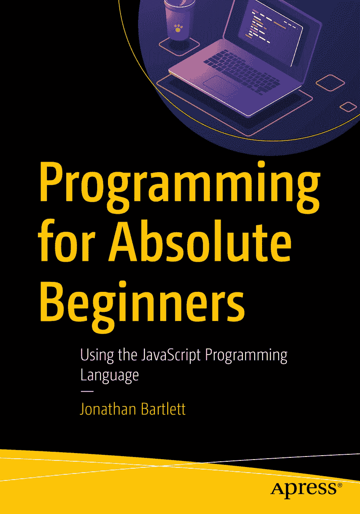

ISBN `978-1-4842-8750-7` e-ISBN `978-1-4842-8751-4` [`doi.org/10.1007/978-1-4842-8751-4`](https://doi.org/10.1007/978-1-4842-8751-4) © Jonathan Bartlett 2023

本作品受版权保护。无论全部还是部分材料，所有权利均独家授予出版商，具体包括翻译、重印、复用插图、朗诵、广播、以微缩胶片或任何其他物理形式复制，以及通过电子化改编、计算机软件、或目前已知或未来开发的类似或不同方法进行传输或信息存储与检索。使用本出版物中的通用描述性名称、注册商标、商标、服务标志等，即使未作明确声明，也不意味着这些名称可免于相关保护法律和法规的约束，因此可自由用于一般用途。出版商、作者及编辑均假定本书中的建议和信息在出版之日是真实准确的。出版商或作者、编辑均不对书中所含材料或可能存在的任何错误或遗漏提供明示或暗示的担保。出版商在已出版地图及机构归属方面的管辖权主张上保持中立。

本 Apress 印记由 Springer Nature 旗下注册公司 APress Media, LLC 出版。注册公司地址为：美国纽约州纽约市新广场 1 号，邮编 10004。

大多数优秀的程序员从事编程，并非为了获得报酬或公众的赞誉，而是因为编程本身就充满乐趣。

——林纳斯·托瓦兹