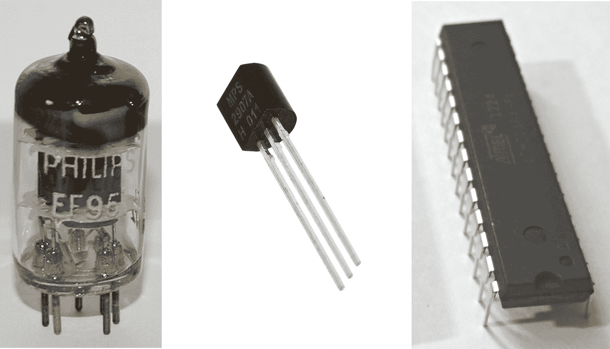

# 2. 计算机简史

计算机的历史既离奇又精彩。从抽象的哲学探索起步，最终在超过一个世纪的时间里塑造了社会进程，至今仍是现代生活最深刻的组成部分。本章旨在勾勒计算机的起源、发展历程与当前面貌。

## 2.1 计算机的前史

人类自古以来就拥有工具。从最初开始，人类就学会了生火、制作矛和建造房屋。然而，早期的技术仅限于固定的结构或作为身体延伸的工具——比如刀或弓箭。很少有早期技术是动力驱动并能自主运行的，它们大多依赖人力操作。因此，由于机器的动力受限于人力所能驱动的范围，当时只能设计出小型机器。

能够为机器提供动力，带来了技术的巨大进步。最早的动力来源可能是水，水流可以驱动水轮来磨小麦或运行锯木厂。不过，这些以水为动力的能源在能驱动的设备类型上相当有限，此类技术大多局限于固定的轮式装置。

这基本上就是公元前 300 年到公元 18 世纪初的技术状态。在那个历史时期，技术面临两个主要的限制因素：一是动力供应的限制，二是需要定制零件。工业革命同时解决了这两个问题。蒸汽机使得在任何地方都能创建动力机器。动力机器不再局限于靠近溪流的地方，而是可以随处移动，因为动力可以通过火和储存的水来产生。最终，这项技术甚至催生了火车，因为动力可以随车辆一同移动。

工业革命的另一项发明是可互换零件。这使得设备的标准化和维护成为可能，这在以前是无法实现的。不再需要每个零件都是独一无二的，零件变得标准化，从而让机器可以变得更加专业化。技术中有一个颇为奇特的悖论：当技术的`零件`变得不那么独特时，由这些零件组成的系统反而能变得更加先进和独特。标准化让技术使用者不必再考虑所有低层次的决策，从而能够专注于更宏大、更有意义的决策。这也使得关于系统的沟通变得更好，因为零件可以更容易地被描述。如果我能给你一张列出预制成品的示意图，那么设计和沟通这个设计，就比我必须同时描述每个单个零件应该如何制造要容易得多。

因此，工业革命中可用动力机械和标准化零件的引入，导致了专业化机器的激增。我们便有了能执行人们想做的各种任务的机器。下一步是引入不是由人直接控制，而是由编码指令来操控的机器。这类机器中最早的是雅卡尔织布机，它使用穿孔卡片来表示织物上的图案。卡片上的孔洞向机器指示特定纱线的升降，使其在图案中可见或隐藏。因此，通过指定每个点上每根纱线是应该升起还是降下，织布机就可以被编程来制作图案。

后来的发明将这一概念应用到了数学上。计算器早已存在，布莱兹·帕斯卡的机械计算器在 17 世纪中期就已发明。然而，这需要物理操作的力量来实际完成加法。大多数数学任务不像加法那样是单一步骤，而是需要一系列步骤，有时是重复步骤，才能找到答案。查尔斯·巴贝奇发明了一种更先进的机器来执行导航计算。在这台机器中，用户输入数据，然后机器利用这些输入运行一系列步骤，最终得出结果。巴贝奇最终设计了一台能够像现代计算机一样接收任意指令列表的机器，但他未能成功建造出那个设计。

一旦人类拥有了为机器提供动力的能力，创建了一台能根据外部指令运行的机器，并能使用这些指令执行数学功能，他们就拥有了制造计算机所需的所有要素。然而，引发计算革命的并非某项发明，而是一个哲学问题。

## 2.2 计算机的概念

现代计算机与过去的计算器之间的区别在于，现代计算机是`通用计算机`。也就是说，它们不局限于一套预定义的特定功能。我可以通过输入正确的程序，为计算机加载新的功能。我们是如何产生制造这种通用机器的想法的呢？

事实证明，哲学中的一个问题导致了通用机器的诞生。这个问题是：是否存在一种方法，可以创建一种无歧义的程序来检验数学证明？这看起来是个奇怪的问题，但在 19 世纪却是一个重大问题。当时有许多“证明”并不清楚其是否真的证明了主题。因此，数学哲学家们试图找出是否有办法设计出当时所谓的“有效程序”，来检验数学证明的有效性。但这又引出了另一个问题：到底什么才算“有效程序”？如果我列出了某个程序的步骤，我如何知道我已经提供了足够的细节，让你能够完全按照我的描述来执行这个程序？我如何判断我的指令足够清晰，以至于列出的程序可以被无歧义地执行？

20 世纪 30 年代，艾伦·图灵和阿隆佐·丘奇都着手解决了这个问题。结果证明，人们可以借助机器来定义无歧义的程序。通过描述一台能够执行操作的机器，可以确信该程序的操作是无歧义的。此外，图灵描述了一组操作，这组操作可以在给定正确输入的情况下模拟任何其他操作集。也就是说，图灵定义了一个计算系统达到真正可编程所需的最小特征集——即程序员拥有开放式的能力，可以编写他们想要的任何软件。至少与图灵特征集能力相当的机器和编程语言，被称为`图灵完备`或`通用`编程语言。几乎所有现代常用的编程语言都是`图灵完备`的。

有趣的是，计算的诞生源于一个哲学问题。许多人急于否定哲学在学术界的地位，认为它不切实际或不重要。但正如我们在这里所看到的，像所有真理一样，哲学真理往往会导向具有深刻实际重要性的东西。

那么最初的问题——能否开发出一种检验证明的有效程序？答案很奇怪：不能。事实证明，存在着无法通过机械手段证明的真实事实。但要了解这个答案，我们首先得发展出计算机。当然，这又引出了计算机与哲学之间的另一个有趣交集。如果存在无法被机械证明的真实事实，我们又如何能知道这一点呢？唯一的方法必定是我们的思维无法被机械地表示。这为人工智能的潜在能力设下了限制，并表明，即使计算机程序员开发出了一些非常巧妙的模拟人类的手段，人类的心灵仍然超出了机制或机械模拟的范畴。^(¹)

## 2.3 计算机时代

在图灵描述了计算机应具备的必要特性后不久，人们便开始着手制造它们。第一台图灵完备的机器很可能是康拉德·楚泽于 1941 年制造的`Z3`计算机。尽管`Z3`的工作原理与现代计算机有些相似，但它本质上仍是一台机械设备。第一台通用、数字电子计算机是 1946 年问世的`ENIAC`，其速度比机械前辈快约一千倍。值得注意的是，`ENIAC`体积相当于一个非常大的房间，但其处理能力仅与现代的科学计算器大致相当。它的主要任务包括为氢弹制造进行计算，以及编制火炮射击表。

下一代计算机引入了通常所说的冯·诺依曼架构，这意味着计算机拥有一个同时存放程序和数据的内存区域。这是基于一个事实：程序及其生成的值都可以用数字表示。因此，同一块内存既可以用于存储告诉计算机做什么的程序，也可以用于存储程序生成和操作的数据。这使得计算机更易于编程和使用，从而实现了计算机的商业化销售。第一台实现这一概念并投入商业使用的计算机是曼彻斯特马克 1 号。第一台大规模生产的计算机是`UNIVAC I`，紧随其后的是 IBM 的`650`。这些计算机体积仍然庞大，但其内存存储空间甚至比现代计算机上的一幅图形还要小。`UNIVAC I`是第一台拥有外部磁带存储的计算机，而外部磁盘存储（类似于现代硬盘驱动器）也很快随之出现。

计算机硬件的下一步发展方向是小型化。最初的计算机使用称为真空管的大型设备来处理数据（见图 2-1 左列）。这些真空管根据其他导线是否有电流流过，来决定是否允许电流通过。许多这类真空管的组合可以使得数据以电流形式存储、对这类数据执行数学运算，以及移动数据。

在真空管之后，晶体管被发明出来（见图 2-1 中列）。晶体管通常有三根引线，其中中间的引线控制着电流能否在另外两根引线之间流动。与真空管一样，晶体管可以连接起来组成数字计算机的内存、数字计算机的逻辑运算电路以及数字信息通路。晶体管虽然执行与真空管相同的基本功能，但能够以更小的封装完成，且功耗低得多。晶体管使得制造体积小得多的设备成为可能，这些设备所需的功率也几乎降低了 1000 倍。1956 年发布的 Metrovick 950 是第一款基于这一原理运行的商用计算机。

随着集成电路（通常称为微芯片或简称芯片）的出现，小型化进程得以继续（见图 2-1 右列）。集成电路本质上允许将小型化的晶体管存储在一块小小的硅片上。集成电路刚推出时，只包含几个晶体管。如今，集成电路有多种尺寸，用于台式计算机的集成电路可以在 2 英寸见方的芯片上容纳相当于数十亿个晶体管。集成电路基本上将我们所熟知的计算机带入了世界。然而，在它们刚问世时，主要被大型企业所使用。

20 世纪 60 年代，道格拉斯·恩格尔巴特领导了一个研究团队来探索计算的未来。1968 年，恩格尔巴特展示了他所谓的“所有演示之母”，该演示预测并展示了现代个人计算的几乎所有方面，包括图形界面、网络、电子邮件、视频会议、协作文档编辑以及万维网。这激励了许多公司开始努力将这一计算愿景变为现实。恩格尔巴特已在实验室中实现了它，但需要其他人来将其变为商业现实。

一组三张照片，分别是真空管、晶体管和芯片。

图 2-1 计算机硬件小型化的进步

左图是真空管（照片由维基媒体的 Tvezymer 提供）。真空管至今仍然存在，主要用于音频应用。中间的图片是晶体管。晶体管体积更小，生产所需材料更少，功耗更低，但功能与真空管大致相同。右图是现代电器中使用的微芯片（照片由维基媒体的 Vahid alpha 提供）。这样的微芯片包含相当于几十万个晶体管。

第一台娱乐性个人计算机是`Altair`，而第一台商用个人计算机是 1976 年发布的 Apple I，此后大量个人计算机涌入市场。IBM 最终进入市场，并由微软为其提供计算机软件。这些计算机的界面通常是纯文本的。然而，苹果公司最终发布了 Macintosh，开启了图形用户界面的时代。不久之后，微软发布了 Windows，将图形用户界面带入了个人计算机世界的 IBM 阵营。

## 2.4 网络时代的计算机

至此，计算机在很大程度上仍是孤立的机器。你可以通过磁盘共享文件，但总的来说，计算机是独立运行的。当你将两台或更多计算机连接在一起时，这就称为`网络`。虽然网络技术已经存在相当长的时间，但对于大多数个人电脑用户来说，它还不够廉价或普及，未能产生显著影响。

对大多数用户而言，网络始于办公室文件共享系统，通常使用一种名为`以太网`的本地网络技术，该技术通过专用的网络电缆运行网络服务。人们会使用自己电脑上安装的应用程序，但将文件存储在`服务器`上，以便办公室的其他成员能够访问。`服务器`是网络上的一台计算机，它向网络上的其他计算机和用户提供一项或多项服务。访问服务器的软件程序通常称为`客户端`。许多办公室网络最终在其网络中增加了`群件`服务——即允许办公室更高效协同工作的本地电子邮件和日历共享系统。较小的组织专注于文件共享和群件等本地服务，而较大的机构则同时致力于将不同网络连接起来。这使得组织之间能够更容易地共享信息和数据。

与此同时，一些家庭电脑用户开始通过电话系统相互联系。一种名为`调制解调器`的设备允许计算机通过标准电话线访问另一台计算机。名为`电子公告板系统`（简称 BBS）的服务开始出现，允许人们使用自己的计算机访问远程计算机，并为其用户留言和传输文件。

这些发展为`互联网`的概念奠定了基础。在其发展初期，存在许多不同且互不兼容的网络技术。各组织希望将自己的网络与其他组织的网络连接起来，但由于每个人使用的网络类型不同，这变得问题重重。在 20 世纪 70 年代和 80 年代，美国国防部高级研究计划局（DARPA）开发了一种方法，将来自不同组织的不同类型的网络统一在一个单一系统下，以便它们都能相互通信。这个被称为 ARPANET 的网络变得非常流行。其他大型跨组织团体开始采用 ARPANET 的设计来创建自己的网络。由于这些网络都使用相同的基本设计，它们最终在 20 世纪 80 年代末连接在一起，形成了互联网。

20 世纪 90 年代见证了互联网服务提供商（ISP）的兴起，它们为电脑用户提供了一种方式，使用户可以使用过去用于连接电子公告板系统的调制解调器将自己的电脑连接到互联网。与使用调制解调器连接到单一计算机（如电子公告板系统那样）不同，ISP 允许用户使用其调制解调器连接到整个网络。这开启了大众（包括个人和各类组织）对互联网的广泛采纳。

在互联网早期，网络速度非常慢，只有文本可以快速传输。最终，调制解调器被更先进（且更快速）的互联网连接方式所取代，例如 DSL、线缆和光纤。这使得越来越多复杂的内容能够在互联网上传输。此外，由于这些技术不会占用电话线，它们可以持续使用，而非断断续续地使用。另外，无线技术，如`WiFi`和基于蜂窝网络的联网，使用户无需受线缆束缚即可连接到互联网。这些发展共同促成了我们今天所拥有的近乎无处不在的互联网接入。

因此，如今几乎所有计算机软件在设计时都考虑到了网络。事实上，人们日常使用的许多软件并非运行在单台计算机上，而是通过网络运行。这使得用户无论身处何地或使用哪台计算机，都能访问软件程序。这也改变了软件开发方式，使得计算机软件的重点不再是个人和个人任务，而是组织群体协作。

### 2.4.1 回顾

在本章中，我们涵盖了计算机的基本历史。我们学习了以下内容：

- 人类从一开始就使用工具来完成任务。

- 早期的工具受到可用能源选项的限制。

- 能源技术的进步使得工具的改进和工业化成为可能。

- 部件的标准化允许构建和维护更复杂的机器。

- 电力使得能源可以被输送到任何需要的地方。

- 通过指令控制机器的能力（例如雅卡尔织布机）使得创建更通用的工具成为可能，这些工具可以通过提供正确的指令集来实现专门化。

- 艾伦·图灵和阿隆佐·丘奇确定了进行通用计算所需的逻辑条件。

- 几台早期计算机是围绕通用计算机构想的理念建造的。

- 电子学的进步使得能够将数百万个晶体管存储到单个微型芯片上。

- 微型芯片的出现带来了个人计算时代。

- 组织内计算机使用量的增加最终导致了对更好计算机间通信方式的需求。

- 网络被发明出来，允许计算机连接在一起以共享文件和消息。

- 世界各地孤立的网络最终被统一成一个单一的互联网络，即互联网。

- 互联网的发展与无线接入互联网的能力相结合，使得互联网成为计算机使用中的一个主要因素。

- 互联网的普及导致程序员开始在设计应用程序时首先考虑网络，而非事后才考虑。

### 2.4.2 学以致用

1.  花些时间思考技术和互联网的历史。你认为科技领域下一个即将出现的重大突破是什么？

2.  在过去的一个世纪里，技术的步伐似乎一直在加速。你认为是什么导致了这种加速？

3.  从这段简短的历史中选择你最喜欢的一项技术并进行研究。是什么启发了它的开发者？它之后催生了哪些其他发明？它成功了吗？写几段文字，描述你选择的技术、它的运作方式以及它如何影响了技术的未来。

脚注 1