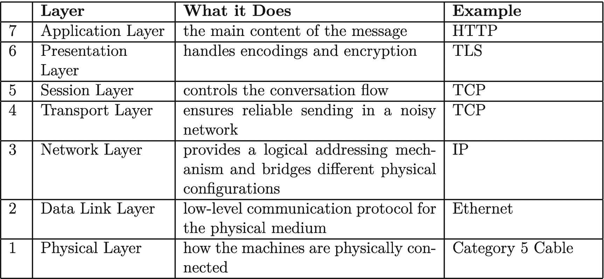

# 3. 计算机如何通信

在开始学习计算机编程之前，我们首先要研究计算机的通信方式。互联网本质上是一个巨大的通信系统。通信系统使用**协议**来运作。协议是一组预定义的步骤序列，用于确保通信的正常进行。

实际上，我们每天都在使用协议。想想你接电话时会做什么。你会说什么，又为什么这么说？想想接电话时发生的情景（见图 3-1）。这个动作向打电话的人发出信号，表明我们已经拿起电话，准备好开始交谈了。如果我们不说“你好”，对方可能会以为我们无意中接了电话却不自知，或者还没准备好说话。而在通话结束时，我们通常会像这样说：“谢谢来电！再见！”这向对方表明通话已经结束。如果我们不说再见，对方可能会以为我们还在线，并继续交谈。如果他们听到沉默，可能会以为我们因为不高兴而不说话，或是遇到了技术问题。因此，我们用“再见”来结束对话，以便让对方知道对话已经结束。

这就是协议的本质。通信协议是一系列步骤或可能的步骤，使双方能够进行通信或交互，并知晓通信或交互的状态。因为计算机无法思考或感知，所以计算机依靠非常严格和精确的协议来相互通信。事实上，计算机使用了数百种不同的协议，以不同的方式传输不同类型的数据。大多数情况下，实际上有多个协议在同时运行。


一幅两个拨号器的插图，带有“你好”和“嗨”两个标注框。

图 3-1

连接电话也有协议

想想写信这件事。当你写信时，有一种基本协议规范了信件的形式——至少它应该有日期、问候语和结束语。但是，如果你决定寄出这封信，就必须通过邮政服务来寄送，而邮政服务也有自己的协议。要通过邮寄方式寄信，你需要把信折好，放进信封里。你在信封上写的内容受制于美国邮政局设计的另一套协议。他们的协议要求在信封左上角写回信地址，信封中间写目的地地址，右上角贴邮票。现在你同时有两个协议在运行——写信协议和信封地址协议。这些协议是*分层的*，这意味着其中一个协议完全运行在另一个协议内部。用计算机术语来说，我们会说信封协议*封装*了信件协议。信封协议接收信件协议的结果，将其打包，并在其上加上自己的协议。

## 3.1 互联网通信的层次

在互联网上，也发生着类似的分层协议。区别在于，在互联网上，有更多的层次在同时交互，并且它们都有一些有趣的名字，比如 `HTTP`、`TLS`、`TCP`、`IP`、`IEEE 802.3`、`SMTP` 和 `FTP`。国际标准组织开发了一种方法，帮助您思考这些层次，称为**OSI 模型**，该模型标识了在计算机网络中通信时可能需要激活的七个不同的协议层。为了理解这些层次的作用，让我们看看为了在计算机之间实现对话，必须回答哪些问题。

假设我们有一个聊天应用，它要向另一台计算机发送消息。要让这条消息到达另一台计算机，需要完成哪些步骤？

1.  计算机必须物理连接到互联网。“物理连接”可以包括有线连接和无线连接。这被称为**物理层**。

2.  计算机必须知道如何在这些物理连接上移动数据。仅仅连接好电线是不够的；它们还必须知道在该物理介质上发送消息的协议。每台计算机都必须能够识别其他物理连接的计算机，能够向它们发出正在发送数据的信号，并知道它们正在向哪台计算机发送数据，以及其他细节。这被称为**数据链路层**。

3.  一旦计算机知道如何与它们直接物理连接的其他计算机通信，它们还需要能够与只间接连接的计算机通信。例如，大多数地点通过将**路由器**连接到其 DSL 或电缆线路来获得互联网连接，然后家中的其他设备再连接到该路由器。家中的设备都物理连接在一起，并使用数据链路层进行通信。然而，只有路由器才物理连接到互联网服务提供商（ISP）。其他计算机必须采用一种协议，以便告诉路由器将它们的消息中继到网络的其余部分。同样地，网络的其余部分也必须能够遵循相同的协议。此外，为了与网络上的其他计算机通信，你必须能够识别它们，因此它至少还包含了网络上的计算机的某种命名或编号系统。这个将仅间接互连的计算机连接起来的层，被称为**网络层**。

4.  现在我们可以跨互联网移动数据了，但还有另一个问题。其他网络可能不像我们期望的那样可靠。由于我们无法控制其他网络的可靠性，我们必须采用一种协议来确保所有数据安全到达网络的另一端，并允许我们重传任何未能到达另一端的丢失数据。这一层被称为**传输层**。

5.  一旦我们知道如何可靠地通过网络移动数据，我们需要能够向计算机发出信号，表明我们想要开始与其通信，并在通信结束时告知对方。这被称为**会话层**。

6.  现在我们与远程计算机建立了连接，并且远程计算机正在接受数据，有时我们需要调整或重新处理通信的某些方面。这被称为**表示层**。例如，我们通常希望计算机之间的通信是加密的。消息在发送时，会经过一个加密层。消息的加密和解密发生在表示层。其他时候（尽管这种情况很少见），两台计算机表示数据的方式不同，因此消息必须在计算机之间进行转换。这也会发生在表示层。


## 7. 应用层

至此，我们的应用程序终于可以可靠地将数据发送到另一台计算机上的类似应用程序了。当然，为了让我们的应用程序能够相互通信，它们必须使用各自的协议。这种应用程序之间的通信层被称为**应用层**。

正如你所见，当你通过互联网将消息从一台计算机发送到另一台计算机时，背后发生了很多事情！幸运的是，由于这一切是分层构建的，我们很少需要考虑不同层级上发生的所有事情。例如，当你给朋友寄一封信时，你从不需要考虑邮局里不同的邮件分拣设施、邮政路线或投递时间。这是一个已经建立好的系统，你只需将信件投入邮箱，剩下的交给系统处理即可。互联网上的通信也是如此。然而，了解幕后发生的事情是很好的，这不仅能让你更好地理解你所使用系统的能力，还能让你在出现问题时更好地定位问题！



一个 4 列 7 行的 OSI 模型表格。列标题为层号、层级、功能、示例。层级分别为应用层、表示层、会话层、传输层、网络层、数据链路层、物理层。

**图 3-2** OSI 模型概览

计算机并非一直通过互联网相互连接，OSI 模型是在互联网还不是主要通信方式时开发的。事实上，在当时，几乎所有通信都在私有网络上进行。自其开发以来，某些技术在各层中逐渐变得相当标准化。图 3-2 显示了各层常用的技术。

对于物理层和数据链路层，两种主要技术是有线连接的**以太网**和无线连接的**Wi-Fi**。此外，你连接到互联网的方式，无论是通过电缆、DSL 还是光纤，也使用其自身的物理层和数据链路层。网络层由**互联网协议**处理，通常缩写为**IP**。用于标识互联网上每台计算机的编号称为计算机的**IP 地址**。在互联网上，传输层和会话层通常合并在一起，并通过一种称为**传输控制协议**（缩写为**TCP**）的协议来处理。由于 TCP 和 IP 几乎总是同时出现，因此它们通常被统称为**TCP/IP**。唯一常见的表示层协议是**传输层安全**协议，通常缩写为**TLS**或**SSL**（基于其原名安全套接层）。TLS 负责在安全连接上加密和解密数据，以防止他人窃听你的通信。

然而，幸运的是，我们很少需要深入了解这些层。事实上，这也是发明这些层的主要原因之一——这样应用程序程序员需要交互的就只有应用层了。不过，知道这些其他层的存在仍然是有好处的，因为偶尔你可能需要与它们交互。此外，了解网络工作原理的基础知识也是成为程序员的一部分。

大多数计算机程序员直接打交道的是应用层。互联网上有几种应用层协议在运行。互联网最著名的是**HTTP**，这是用于访问网站的协议。仅次于 HTTP 的可能是**SMTP**，这是用于发送电子邮件的协议。**POP**和**IMAP**是两种常用于*接收*电子邮件的协议，如果你使用独立的电子邮件程序的话。这些协议构成了绝大多数人使用互联网的方式。

## 3.2 使用 HTTP 进行通信

如前所述，当你访问一个网站时，你使用的协议是 HTTP，它代表“超文本传输协议”。网页被认为是“超文本”，而网页使用的文件格式称为“超文本标记语言”或 HTML。我们将在第 6 章中深入探讨 HTML 的细节。现在，我们只考虑用于访问 HTML 文档的协议，而不关心其内容。

关于 HTTP，首先要了解的是，它本质上与*文档*相关。网站可能看起来很花哨，但实际上它们只是一组交互式文档的集合。因此，当你访问一个网站时，你的浏览器会连接到远程计算机（称为**服务器**）并请求一个文档。当你点击一个链接时，通常发生的事情是，链接告诉你的浏览器要获取的新文档的位置。然后你的浏览器会检索该新文档并显示给你。这些文档通过一段称为“统一资源定位器”或**URL**的文本来标识和定位。

一个典型的 URL 看起来类似图 3-3 所示。


URL 结构示意图，分为三个部分。协议为超文本传输协议。主机名为`www.bplearning.net`。路径为`/example/about.html`。

**图 3-3** 典型 URL 结构

每个 URL 有三个主要部分——应用层协议、主机名（服务器的名称或 IP 地址）和文档路径。可选地，还有第四和第五部分，即**查询字符串**和**锚点**，它们向服务器和/或页面上的 JavaScript 提供额外信息。在 URL 中，协议是冒号之前的所有内容。在这个例子中，它是“https”，这是互联网上用于加密连接的常用协议。如果连接是未加密连接，则协议仅为“http”。协议后的两个斜杠表示 URL 的下一个部分是**主机名**。在此例中，主机名是`www.bplearning.net`。我们将在第 3.4 节更深入地讨论主机名。主机名后的斜杠是路径的开始。路径包括起始斜杠，本质上是 URL 的其余部分。有时路径非常短。例如，当你首次访问一个网站时，路径通常只是`/`。它也可能非常长，比如`/orders/123/products/5`。理解路径的方式是把路径的每一部分想象成计算机上的一个文件夹，而路径则是某人必须经过才能找到文档的一系列文件夹。虽然服务器上实际发生的情况并非如此，但这是一种有益的思考方式。

举个例子，打开你的浏览器。找到浏览器中的地址栏。（有关如何找到浏览器地址栏的更多信息，请参阅第 B.1 节。）在地址栏中输入 `https://www.bplearning.net/example/` 并按回车键。这将打开我为本书构建的一个示例网站。根据你的浏览器，它可能会显示完整的 URL，或者为了便于阅读而去掉协议部分。某些浏览器还会在未点击进入地址栏时隐藏路径。

现在，点击标题为“关于”的链接。页面加载完成后，再查看一下浏览器的地址栏。地址栏现在应该显示为 `https://www.bplearning.net/example/about.html`。该 URL 用于查找服务器，并告知服务器它应返回给你哪个文档以及通信信道应使用的协议。


### 3.2 浏览器如何检索文档

现在，我们将看看浏览器实际上是如何检索文档的。使用 HTTP 在互联网上进行数据传输并不像看起来那么神秘。

主要步骤如下：

1.  与服务器建立连接。
2.  告诉服务器文档的路径。
3.  告诉服务器有关通信的附加信息。
4.  发送一个空行。
5.  接收文件。

一旦与服务器建立连接，请求“about”页面的协议看起来就像这样：

```
GET /example/about.html HTTP/1.1
Host: www.bplearning.net
Connection: close
```

第一行称为**请求行**，它完成了大部分工作。它有三个组成部分。第一个组成部分称为 **HTTP 动词**。这告诉服务器你想要执行什么操作。你正在检索文档，因此使用 `GET` 动词。其他动词包括用于远程删除文档的 `DELETE` 和用于向服务器上的文档发送数据的 `POST`。下一个组成部分是路径，它告诉服务器如何找到该文档。最后一个组成部分是协议版本——你正在使用 HTTP 1.1 版本^(²)。

接下来的几行称为**请求头**。它们是你发送给服务器的一系列选项，用于更详细地说明你想要什么以及希望如何交付。我们发送的第一行请求头告诉服务器你正在查找的主机名。这看起来可能有些多余，因为我们已经连接到了我们想要的服务器。然而，现代网络服务器实际上是为服务于任意数量的主机名（这些主机名可能共享同一台服务器）的请求而构建的。因此，即使你已连接到 `www.bplearning.net` 的服务器，你仍然需要告诉它你真正要找的是哪个站点。下一行请求头是可选的，但它告诉服务器在向你提供文档后关闭连接。否则，服务器会等待你请求其他内容。然后，为了表示我们的请求头已结束，我们会发送一个空行。此时，我们还可以发送一个可选的请求*消息体*（称为请求体），但这超出了我们讨论的范围。本章中我们将讨论的请求不会包含请求体。

当服务器收到空行时，它就知道你已经完成了文档的请求，并尝试处理你的请求。然后它会响应类似这样的内容：

```
HTTP/1.1 200 OK
...此处可能包含其他数据...
Server: Apache
Content-Type: text/html; charset=UTF-8
...此处可能包含更多数据...
....文档内容放在此处....
```

响应的格式与请求非常相似。第一行是**响应行**。它列出了服务器响应的协议版本，后跟状态码和状态消息。`200` 是状态码，表示一切正常，会有一个文档发送过来。其他常见的状态码包括：`404`（表示找不到文档）、`500`（表示服务器遇到错误）、`301` 和 `302`（表示文档已移动位置），以及 `400`（表示请求未遵循正确的协议或发送了错误的数据）。响应行之后是一系列**响应头**。它们传达有关服务器和响应的附加信息。此处显示的响应头只是一个示例——大多数服务器还会返回更多的响应头，并且通常没有特定顺序。显示的两个响应头告诉我们已检索文档的类型（在本例中是 HTML 文件，即 `Content-Type: text/html` 的含义）以及服务器运行的服务器软件名称（本例中是 `Apache`）。然后，服务器会发送一个空行，告诉我们它已发送完响应头，接下来的通信内容将是我们请求的文档。我们收到的文档是一个 HTML 文件。它可能看起来很奇怪，但这正是浏览器从服务器接收到的内容。它包括浏览器显示所需的所有数据，以及如何在屏幕上显示以及如何与用户交互的指令。

## 3.3 手动连接远程服务器

根据你的计算机和计算机设置，你可能已经安装了手动访问网络服务器所需的工具。如果没有，附录 C 提供了一些在你的计算机上设置必要工具的说明。大多数 Mac 和 Linux 计算机都已经安装了这些工具。为此，你需要进入计算机的命令行。关于什么是命令行以及如何根据你的计算机进入命令行的信息，请参见附录 B.2。如果由于某种原因你无法使本节中的命令正常工作，请不要担心，这些命令对于本书的其他部分并非必需，仅仅是为了向你展示幕后发生的事情。如果需要，请随意跳到下一节。

我们将首先使用 `telnet` 命令直接与服务器通信，而不使用浏览器，这样我们就可以确切地看到幕后发生的事情。进入命令行后，键入以下内容以使用 HTTP 连接到 `bplearning.net` 服务器：

```
telnet www.bplearning.net 80
```

现在，你正在亲自直接与网络服务器对话！接下来，你只需要遵循 HTTP 协议来获取你需要的内容。输入我们之前提到的请求（注意，请求以一个空行结束）：

```
GET /example/about.html HTTP/1.1
Host: www.bplearning.net
Connection: close
```

然后，服务器将如上所述，以其响应行、响应头和响应消息体进行响应。但是，它不会是我们请求的页面。相反，它将是一个*重定向*响应。这样做的原因是该网站只允许安全请求，而 HTTP 本身是未加密的。因此，我们必须使用 HTTPS（基于安全/加密连接的 HTTP）进行通信，而不能仅使用 HTTP。

你可能想知道原始 `telnet` 命令中的 `80` 是做什么用的。那是 HTTP 服务器默认监听的*端口*。服务器使用“端口号”来了解请求的是什么服务，因为每个服务在不同的端口号上监听。端口 `80` 是用于 HTTP 通信的标准端口号。对于我们的 HTTPS 通信，我们将连接到端口 `443`，这是 HTTPS 的标准端口^(³)。

用于通过 HTTPS 通信的命令是 `openssl`，它基本上执行与 `telnet` 相同的操作，但首先会建立一个安全连接（`openssl` 实际上可以做得更多，但我们不关心它的其他功能）。由于 HTTPS 的标准端口是 `443`，而不是 `80`，我们必须使用该端口进行连接。为了使用 `openssl` 进行连接，我们必须发出以下命令（由于 `openssl` 有如此多的选项和其他功能，该命令会更长一些）：

```
openssl s_client -crlf -quiet -connect www.bplearning.net:443
```

从这里开始，你可以发出与上面相同的请求。由于加密发生在表示层，因此不需要对我们输入的协议（完全在应用层进行）进行任何更改。`openssl` 命令为我们处理所有的表示层加密。

这次的响应将是你请求的完整文档（以及 HTTP 头）^(⁴)。

现在，你已经使用 HTTP 协议直接与服务器进行了通信。你已经说出了你的第一句“计算机语言”了！


### 3.4 计算机如何在互联网上被定位

我们还未讨论的一个问题是计算机如何在互联网上被定位。之前我们提到，URL 中包含一个用于标识计算机的主机名。你可能会好奇，如果只知道主机名，服务器是如何被找到的？事实上，这个过程涉及诸多环节！

我们在第 3.1 节中讨论了互联网中不同的协议层。第 3 层是网络层，在互联网中，网络层由互联网协议（`IP`）处理。互联网协议规定，互联网上的每一台计算机都由一串数字来标识，这串数字称为该计算机的 **IP 地址**。然而，我们通常不用那串数字来指代计算机，原因有二。一是人类不擅长记忆数字。记住 `google.com` 比记住 `64.233.160.138` 要容易得多。二是将*物理问题*与*逻辑问题*分开是有益的。换句话说，IP 地址告诉网络你希望到达互联网上的哪个物理位置。但是，用户并不关心那个位置在哪里。用户只想访问谷歌的网站。因此，通过为谷歌的网站创建一个*名称*（即 `google.com`），即使其网络上的物理位置发生变化，用户也能访问该网站。IP 地址类似于电话号码，而主机名则像你想联系的人的名字。

然而，当你想要连接到某个网站的服务器时，计算机必须知道目标 IP 地址才能建立连接。计算机是如何知道你想访问的网站对应的 IP 地址的呢？

计算机通过**域名系统**（`DNS`）找到目标 IP 地址。`DNS` 是一个将主机名转换为 IP 地址的系统，有点像电话簿将人名转换为电话号码。但是，`DNS` 是一个*分布式*系统，因此，它并非只有一个巨大的电话簿，而是有数以百万计的电话簿，它们按层级结构组织。这个系统中的每个服务器（即“电话簿”）都称为一个域名服务器。所以，当你告诉浏览器你想访问 [`www.bplearning.net/example/about.html`](http://www.bplearning.net/example/about.html) 时，在它与服务器建立连接之前，它必须先弄清楚 [`www.bplearning.net`](http://www.bplearning.net/) 位于*何处*。为此，它将主机名分解成由点分隔的多个部分。在我们的例子中，有三个部分——`www`、`bplearning` 和 `net`。浏览器从最右边的部分开始，该部分称为顶级域名（`TLD`）。每个浏览器都预编程了一组“根”域名服务器。浏览器首先向根域名服务器询问，它们是否知道谁负责维护 `.net` 域的 `DNS` 记录（即谁负责处理该域的电话簿）。根域名服务器会回复一个或多个负责处理这些域请求的域名服务器的 IP 地址。接着，浏览器前往 `.net` 域名服务器，询问它谁负责维护 `bplearning.net` 域的 `DNS` 记录。`.net` 域名服务器会指向另一个处理 `bplearning.net` 域的域名服务器。最后，浏览器会前往 `bplearning.net` 域名服务器，询问它是否知道 [`www.bplearning.net`](http://www.bplearning.net/) 的 IP 地址。`bplearning.net` 域名服务器会回复 [`www.bplearning.net`](http://www.bplearning.net/) 的 IP 地址，有了这个 IP 地址，你的计算机就能够与 [`www.bplearning.net`](http://www.bplearning.net/) 服务器建立连接。

这整个过程通常在不到一秒钟内完成，因此我们平时不会察觉到计算机在幕后进行所有这些工作。此外，计算机通常会跳过最近执行过的步骤，直接记住上次查询到的结果，这样就不必一遍又一遍地重复相同的查询了。

### 3.4.1 回顾

在本章中，我们介绍了互联网通信的基础知识。我们学到了以下内容：

*   协议定义了通信如何进行。

*   互联网建立在许多协议的分层结构之上，每个协议都有特定的一个或多个功能。

*   `HTTP` 是一种应用层协议，用于向浏览网页的用户传输交互式文档。

*   `URL` 是一段文本，它为浏览器提供了在互联网上定位文档所需的所有信息。

*   一个 `URL` 由协议（通常是 `HTTP` 或 `HTTPS`）、主机名和路径组成。

*   `URL` 中的主机名通过使用 `DNS` 域名服务器被转换为 IP 地址。

*   `URL` 的路径被发送到服务器，以标识被请求的文档。

### 3.4.2 学以致用

1.  访问你最喜欢的网站。点击浏览不同的页面。注意每个页面上的 `URL` 是如何变化的。每次点击都会改变 `URL` 吗？哪些操作会改变 `URL`，哪些不会？

2.  有些网站的 `URL` 路径结构非常清晰、易于理解，而有些则不然。当一个网站使用结构化的 `URL` 时，通常很容易预测你所查找内容的 `URL` 是什么。访问 `Wikipedia.org` 并点击浏览。观察 `URL` 的形式。然后，试着猜测维基百科上关于 JavaScript 的条目对应的 `URL` 是什么。将其输入到浏览器中，看看你的猜测是否正确。

3.  访问 `Amazon.com` 并点击浏览。其 `URL` 是否像维基百科上那样可预测且易于理解？你认为你能像猜测维基百科上 JavaScript 的 `URL` 那样，猜出某本书的 `URL` 吗？

4.  打开命令行，尝试直接使用 `HTTP` 协议从维基百科获取 JavaScript 的网页。

脚注 1   2   3


