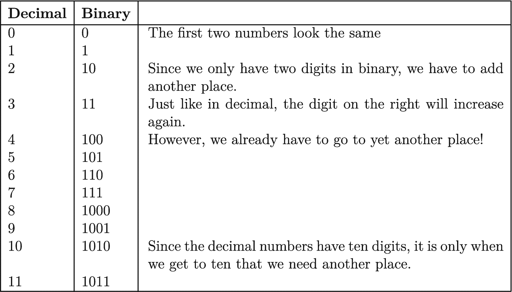
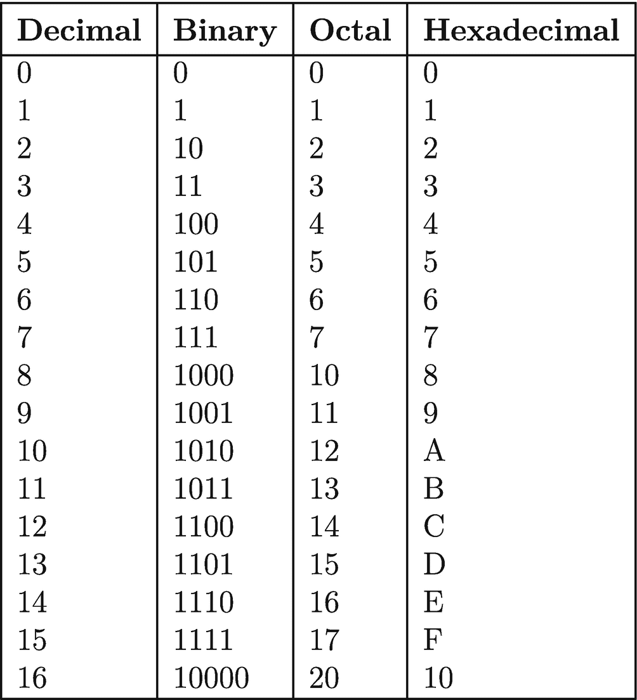
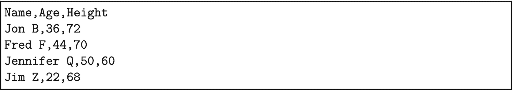

# 4. 计算机如何看待数据

第 3 章介绍了计算机如何通过互联网相互传输数据的基础知识。本章将对此进行扩展，涵盖文档在计算机内部的存储方式。与上一章类似，本章中的许多信息更多是背景知识而非实用技能。JavaScript 编程语言会自动为你处理大量数据处理工作，因此你无需为此操心。尽管如此，了解计算机在幕后为你做了什么仍然很重要！

我们通常认为计算机是无所不能的系统，但现实中计算机的能力非常有限。在许多工程领域，工程师通过*限制*可能性来获得最强大的成果，这使得剩余的可能性更具威力。发动机通过将燃烧反应的能量引导到特定方向来运作。能量不再向四面八方扩散（这是其常态），而是只被允许沿着特定方向运动。汽车驾驶员可以去任何想去的地方，但这仅仅是因为发动机内部的燃烧被限制在非常有限的方向上。计算机之所以强大，恰恰是因为它们同样受到了限制。

计算机的核心功能只有两个——处理数字和传输数字。这似乎有悖常理。毕竟，当你在键盘上打字时，屏幕上显示的不应该是字母吗？你的计算机难道不处理图形和声音吗？实际上，所有这些都由数字控制。屏幕上每个像素的颜色都是一个数字。你输入的每个字母都有一个对应的数字。每一种声音都是一长串数字。计算机*看起来*好像在做很多不同的事情，但实际上它只做两件事——处理数字和传输数字。

本章的第一部分将介绍计算机如何用数字存储数据。第二部分将介绍如何将这些数字组织成一种`文件格式`，以便 Web 浏览器等软件应用程序读取。

## 4.1 计算机内存的模样

要理解计算机如何看待内存，可以想象一个房间里摆满了编号的储物柜，它们的大小都一样。这些储物柜类似于计算机内存，因为它们都是编号的固定大小存储位置序列。例如，如果你有 2 GB 的计算机内存，那意味着你的计算机包含大约 20 亿个固定大小的存储位置，或者用我们的类比来说，就是 20 亿个储物柜。每个位置都有一个编号，并且每个位置都有相同的固定长度。储物柜和计算机内存的区别在于，你可以在储物柜里存放不同种类的东西，但计算机内存的每个存储位置只能存储一个数字。

在现代计算机中，每个存储位置可以存储一个介于 0 到 255 之间的数字。这样的数字被称为`字节`。你可能想知道为什么计算机使用 0 到 255 的范围，而不是更自然的数字，比如 100 或 1000。原因是 0 到 255 的范围对计算机*本身*就是自然的。在数学中，我们通常使用十进制系统来表示数字，该系统有十个数字——从 0 到 9。然而，计算机使用二进制系统，该系统只有两个数字——0 和 1。每个数字被称为一个`位`，是*二进制数字*的缩写。当你书写数字时，数到十就用完了数字，所以你会增加另一位数字来继续计数，形成一个两位数。在二进制中，数到二就用完了数字。

图 4-1 列出了十进制和二进制中从 0 到 11 的数字。



一个包含 3 列的十进制和二进制数字表格，并附有位值说明。十进制数字从 0 到 11。

图 4-1

十进制和二进制表示的数字

如果继续这样计算下去，你会发现 255 是用 8 位能得到的最大数字。它在二进制中看起来像 `11111111`。简而言之，计算机的一个字节之所以存储 0 到 255 之间的数字，是因为一个字节由 8 位组成。

需要注意的是，左列和右列中的数字是*相同的数字*，只是表示方式不同。我们使用十进制数字的原因，可能源于我们的文化最初是用手指计数的。少数文化，例如尤基人，开始用手指间的缝隙计数，因此他们的数字系统只有 8 个数字。这些情况下的数字本质并无不同——只是显示方式不同而已！

在计算机编程中经常遇到的另外两种数字系统是`八进制`系统和`十六进制`系统。八进制系统只使用数字 0–7，而十六进制系统实际上在我们现有的数字基础上*增加了*数字。十六进制使用字母来增加额外的数字。因此，在十六进制中，字母 A–F 代表十进制数字 10–15，而十六进制中的 10 与十进制中的 16 相同。

图 4-2 显示了十进制、二进制、八进制和十六进制中数字 0–16 的合并列表：



一个 4 列 17 行的表格，展示了数字 0 到 16 在十进制、二进制、八进制和十六进制中的表示。十六进制列包含数字和字母。

图 4-2

数字 0–16 的十进制、二进制、八进制和十六进制表示

在计算中经常使用八进制和十六进制的原因是，一位八进制数字恰好表示 3 位（bits），而一位十六进制数字恰好表示 4 位。两个十六进制数字组合在一起表示 1 字节（byte）。因此，八进制和十六进制本质上被用作书写二进制数的简写形式。屏幕颜色就是一个例子。屏幕上的每个点由 3 个字节表示——1 个字节用于红色分量，1 个字节用于绿色分量，1 个字节用于蓝色分量。在许多工具中，这些字节被拼接成一个六位十六进制数。例如，红色表示为`FF0000`，绿色表示为`00FF00`，蓝色表示为`0000FF`，蓝绿色表示为`00FFFF`，而更暗的蓝绿色表示为`009999`。

无论如何，计算机内存是一个由数百万或数十亿个字节依次排列而成的长序列。每个字节都有一个地址，它就像一个储物柜编号，因此你可以引用计算机中的特定内存位置。我们不会自己通过内存地址来访问字节，但计算机在最低级别上正是这样工作的。

现在，只能处理 0 到 255 之间的数字可能看起来非常有限。这之所以不是问题，是因为这只是机器在最低级别上的工作方式。编程语言会将几个这样的字节组合在一起，以表示更大的数字或其他类型的数据。表示带有小数点的数字是一个更困难的问题，但通常通过指定一定数量的位作为整数部分，再指定一定数量的位作为小数点在数字中的位置来解决。尽管在 JavaScript 中你不必处理这些细节，但最好记住，在最低级别上，你处理的所有东西都只是 0 到 255 之间的一系列数字。

在接下来的内容中，我们将假设计算机能够处理我们抛给它的任何大小的数字。这并不完全正确，但对于我们的目的来说已经足够了。

 一只手指向右方的手形图标。练习题

*   如何将十进制数 12 写成二进制？

*   一位十六进制数字表示多少位？

*   由于黑色是没有颜色，你认为在本节讨论的十六进制系统中如何表示黑色？

*   白色是所有颜色的混合，又该如何表示？

## 4.2 使用数字表示数据

那么，如果我们只能使用数字，如何存储其他类型的数据呢？答案是我们必须将信息转换成一系列数字。假设我们想描述一个人。我们可能想存储哪些信息？可能包括以下内容：

*   身高

*   体重

*   发色（黑色、金色、棕色、红色、白色等）

*   眼睛颜色（蓝色、绿色、淡褐色等）

其中一些值本身就是数字，比如身高和体重。我们只需要决定使用的单位。假设我们用英寸表示身高，用磅表示体重。发色和眼睛颜色不是数字，但计算机只能处理数字。那么我们该怎么办？我们为每个可能的值指定一个数字。例如，对于发色，黑色为 0，金色为 1，棕色为 2，红色为 3，白色为 4。某个颜色为什么获得特定的数值并不需要理由。重要的是，无论我们分配了什么数字，都要一致地使用同一个数字来表示那种发色。接下来，我们可以为眼睛颜色选择数字。对于眼睛，我们可以设蓝色为 0，绿色为 1，淡褐色为 2。这些数字与发色使用的数字重叠也没关系，只要我们知道当前处理的是哪一种数据即可。

现在，我们可以用四个数字的序列来表示一个人——他们的身高、体重、发色和眼睛颜色。使用这个系统，我本人就是 72, 275, 2, 2。一个与我完全相同但眼睛是蓝色的人将是 72, 275, 2, 0。注意数字的顺序有多么重要。如果我们不知道数字的顺序，就无法理解这些数据。这并非因为数字是按重要性排列的——我们完全可以将其排列为体重、眼睛颜色、身高、发色——重要的是我们*知道*预期的数字顺序，并且在每次使用数据时*遵循该约定*。否则，我们可能会把某人的体重误认为是身高，或者把眼睛颜色误认为是发色。

当你拥有一个预定义的数据集来描述某事物时，这被称为`数据格式`。数据格式看起来可能没什么大不了的。然而，当与其他程序通信时，它们的数据模式可能与你的不同。想象另一个程序，它存储相同的数据，但身高使用的是英尺而不是英寸。或者，假设它对每个人使用五个数字，第五个是年龄。在这些情况下，如果你从这种其他格式加载数据，就必须将数据从给定的数据格式转换为你自己程序所需的数据格式。这可能包括转换某些数据（例如，英尺到英寸）、忽略某些数据（因为我们的格式不包含年龄）、计算数据（如果一个程序需要年龄，或者另一个程序发送了出生日期），以及许多其他可能性。这些被称为`数据转换`，并且占据了编程任务的很大一部分。

 一只手指向右方的手形图标。练习题

1.  使用本节描述的数据格式描述你自己。

2.  用通俗的语言写出以下数字代表的人长什么样：

    ```
    69, 150, 0, 1
    ```

## 4.3 数据中的序列

我们在第 4.2 节中探讨的数据格式仅在我们需要存储固定数量的内容时才有用。由于每条数据都是通过其在序列中的位置来标识的，因此如果我们改变数据中项目的数量，它们的含义也会随之改变。假设你想存储一个人孩子的年龄。问题在于我们不知道一个人可能有多少个孩子。他们可能没有孩子，也可能有 20 个。解决这个问题的一种方法是先存储孩子的数量，然后再存储孩子的年龄。这样我们就能知道孩子的年龄序列何时结束。例如，我们可以将格式修改为：身高；体重；孩子数量；孩子 1 的年龄，孩子 2 的年龄，等等；发色；以及瞳色。通过在儿童列表*之前*存储孩子的数量，即使每条记录的长度略有不同，我们仍然能够知道每条数据在记录中的位置，因为我们知道需要寻找多少个孩子。

假设我们的朋友弗雷德有三个孩子，年龄分别为 12 岁、10 岁和 5 岁。他的记录可能如下所示：`70, 200, 3, 12, 10, 5, 1, 1`。数字 3 告诉你接下来的三条记录将是孩子的年龄。之后，你再继续处理记录的其余部分。

另一种存储重复值的方法是使用所谓的`哨兵`值。哨兵是一个值，它告诉你已经到达列表的末尾。因此，与其存储孩子的数量，我们可以决定使用一个哨兵值。由于没有孩子的年龄是负数，我们可以使用`-1`来表示列表结束，而不是使用计数。在这种方案下，弗雷德的记录将如下所示：`70, 200, 12, 10, 5, -1, 1, 1`。

此类数据序列通常被称为`数组`。数组就是将一系列数据打包成一个单一集合的序列。在这个例子中，孩子们的年龄就被视为一个数组。

一个手指指向右方的手型图标。

**练习题**

1.  如果弗雷德有六个孩子，年龄分别是 21、19、14、12、10 和 5 岁，使用带有孩子计数格式的记录会是什么样子？
2.  如果使用带有哨兵值的格式，该记录又会是什么样子？
3.  为什么哨兵值不能是一个可能的数据值很重要？

## 4.4 用数字表示字母

现在我们稍微了解了计算机如何使用数字表示数据，就可以讨论计算机最常见的存储内容之一——文本了。在前一节中，我们对一个人的描述缺少了一个东西：这个人的*名字*。你如何仅用数字来表示一个名字，或者任何文本呢？

在我们研究计算机如何存储整段文本之前，我们先来看看计算机如何存储单个字符。由于计算机将所有内容都存储为数字，因此对于字母也是如此。就像我们用数字 0 来表示蓝色眼睛一样，我们可以为字母表中的每个字母都指定一个数字。然而，我们在屏幕上显示的不仅仅是字母表中的字母。还有标点符号、大小写字母、符号，甚至数字。数字需要用数字来表示似乎很奇怪，但当你将它们与“需要键入或显示的字符”列表混合在一起时，这就有意义了。因为没有什么能阻止你在文本中键入一个 0，所以它必须与其他所有字符一起被表示出来。

每个可能显示的字符都有一个对应的数字来表示它。最常用的在单字节中通过数字表示字符的系统称为`ASCII`码，它是在 20 世纪 60 年代开发的。在 ASCII 中，十进制数 65–90 代表大写字母 A–Z，十进制数 97–122 代表小写字母 a–z，十进制数 48–57 代表数字 0–9，空格则由十进制数 32 表示。更完整的 ASCII 表见附录 D。

这就是表示单个字符的方法，但如何表示一整段文本，比如某个人的名字呢？回顾一下上一节，我们是如何表示一系列事物的？我们使用了数组，而一段文本可以被视为一个字符数组。作为数组，它既可以表示为一个长度值后跟字符列表，也可以表示为一个带有哨兵值的字符列表。在 ASCII 中，十进制数 0 是一个特殊字符，称为`空`字符，它被用作字符列表的哨兵。字符数组通常被称为`字符串`，而使用空字符作为哨兵值来表示的字符串通常被称为`空终止字符串`。

让我们回到我们在添加孩子之前的人物数据格式。假设我们想在记录中存储这个人的名字。该记录将存储姓名、身高、体重、发色和瞳色。我们可以使用空终止字符串来表示姓名。因此，我的名字“Jon”将被编码为`74, 111, 110, 0`。那么，我的完整记录如下所示：

```
74, 111, 110, 0, 72, 275, 2, 0
```

你可以通过哨兵值来判断我的名字在哪里结束以及记录的其余部分从哪里开始。

现在，我们添加孩子，使用`-1`作为哨兵值。假设我有两个孩子，Jim 和 Bob。在接下来的记录中，我们将使用格式：姓名、身高、体重、发色、瞳色、孩子 1 的姓名、孩子 1 的年龄、… 、-1。看起来像这样：

```
74, 111, 110, 0, 72, 275, 2, 0, 74, 105,
109, 0, 14, 66, 111, 98, 0, 12, -1
```

一个手形图标，食指指向右侧方向。

**练习题**

*   查看上面的记录。根据这个格式，Jim 的年龄是多少？
*   如果我还有一个名叫 Mary Ann、年龄为 6 岁的孩子，请为我创建一条新记录。

正如你所见，为了处理数据，计算机必须非常精确地知道何种数据放在何处、其长度是多少、以及它是否重复。为了让两个程序之间进行通信，甚至让同一程序内的两个函数之间进行通信，它们必须就数据的格式达成一致。现在，在像 JavaScript 这样的现代编程语言中，其表示方式比一串数字友好得多。例如，JavaScript 允许你写`"Jim"`而不是`74, 105, 109, 0`，但在底层它实际上做的是同样的事情。`"Jim"`是一个字符串。在大多数编程语言中，给一串字符加上引号表示这些字符应该被视为一个文本字符串。通常，如果你在程序中看到`234`，它表示的是*数字*234，但`"234"`表示的是字符`2`、`3`、`4`组成的字符串（在 ASCII 中分别由数字 50、51、52 表示）。

现代编程语言和程序使用一种称为`UTF-8`的编码，而不是 ASCII，但在大多数情况下，当使用英语时，它们是等价的。有关字符编码和 UTF-8 的更多信息，请参见附录 D。

## 4.5 什么是文件格式？

到目前为止，我们已经讨论了计算机如何使用数据格式在内存中存储内容。之所以使用数据格式，是因为一切内容都由数字表示，因此我们需要一种格式来了解这些数字的*含义*。*文件格式*与数据格式完全相同，区别在于它存储在磁盘上而非内存中。

你是否曾尝试用错误的应用程序打开文档？结果如何？通常，如果用错误的应用程序打开文档，要么会报错，要么会显示一堆乱码。正如我们所见，由于程序只处理数字，它们必须知道数据格式才能理解数据。如果不了解格式，文件就是一堆无意义的内容。

计算机通常通过文件名来区分不同的文件类型。大多数文件都有一个`文件扩展名`，用于标识文件类型。例如，Adobe 可移植文档格式文件通常以`.pdf`结尾。还有许多不同的图形格式，每种都有各自的扩展名，例如`.jpg`、`.jpeg`、`.png`或`.gif`。MP3 音频文件的扩展名为`.mp3`。

然而，在互联网上，URL 并不总是包含扩展名，而且出于各种技术原因，有时甚至会包含与所发送文件类型*不同*的扩展名。此外，有时多个格式共享同一个扩展名。因此，为了消除歧义，互联网使用`内容类型`（也称 MIME 类型）来标识文件格式。如果你还记得在第 3 章中使用 HTTP 与服务器通信的内容，在我们发送请求后，服务器会返回响应行、响应头和响应文档。其中，Web 服务器返回的一个响应头就是 `Content-Type` 头。在我们的示例中，服务器返回的内容类型是 `text/html`。内容类型包含两部分：类型和子类型。在此例中，类型是 "text"，子类型是 "html"。既然类型是 "text"，你认为它如何存储数据？所有文本文档都将数据存储为长字符串。在文本文档中，*唯一*允许的数据类型就是字符。大多数不具有 "text" 类型的文件被称为`二进制`文件，这仅意味着它们包含非文本数据。

然而请注意，这里有一个子类型 "html"。这表明文本文件本身也可以具有格式。也就是说，我们可以对文本文件进行组织，使其便于计算机定位特定类型的数据。例如，电子表格常使用 CSV（逗号分隔值）文件。CSV 文件格式使用逗号分隔不同列的数据，使用回车符分隔不同行的数据。图 4-3 显示了一个包含三列四行的 CSV 文件示例。



CSV 文件的图示包含了 Jon B、Fred F、Jennifer Q 和 Jim Z 的姓名、年龄和身高。

**图 4-3** CSV 文件示例

由于 CSV 是文本文档，整个文件将作为字符串存储。电子表格在加载文档时，可能会将第 2 列和第 3 列转换为数字，但在磁盘上，由于它是文本文档，它是以字符串形式存储的。该格式规定：当电子表格加载文件时，应基于逗号位置将行拆分为列，并基于换行位置将文件拆分为行。因此，因为它是文本格式，文件的所有细节都易于被人查看和理解——因为它只是一串字符。然而，它实际上是一种*数据格式*，因为文件的不同部分具有重要含义——在此例中，就是逗号和换行符。

在第 6 章中，我们将探讨 HTML 文件格式。

要了解文本文件和二进制文件的区别，请用文本编辑器打开不同类型的文件。关于什么是文本编辑器以及如何使用，请参见附录 B.3。

1.  按照 B.3 中的说明打开你的文本编辑器。

2.  在计算机上打开一个具有以下扩展名之一的文件：`.jpg`、`.jpeg`、`.png`、`.pdf`、`.mp3`、`.doc`、`.xls`。如果你的计算机没有显示文件扩展名，B.3 节介绍了如何使其可见。

3.  由于你使用的是文本编辑器，它会尝试将文件中的每个数字当作字符处理。这就是为什么会出现各种奇怪字符——你的文本编辑器不知道如何处理非文本字符。

4.  现在，在计算机上打开一个具有以下扩展名之一的文件：`.txt`、`.csv`、`.html`、`.rtf`。如果你没有这些类型的文件，你可以使用任何文字处理器轻松创建一个 `.rtf` 文件。只需告诉文字处理器将文档导出为“富文本格式”，它就会生成一个扩展名为 `.rtf` 的合适文件。

5.  即使你*不理解*该文件，它至少应该是可查看的——你应该能识别出它使用的字符。

6.  请注意，扩展名本身不起任何作用——它们仅仅用于帮助你了解文件内容、使用哪个程序打开文件以及为该文件显示哪个图标。你的操作系统会保留一个默认程序列表，用于处理各种文件扩展名。如果你更改了文件的扩展名，计算机很可能会为该文件打开错误的程序！

## 4.5.1 回顾

在本章中，我们介绍了计算机如何查看和处理数据的一些细节。我们学到了以下内容：

*   计算机使用数字存储一切内容。

*   为了让计算机理解这些数字的含义，它们必须采用预定义的数据格式。

*   数据列表通常通过存储长度（位于数据项数量之前）或使用哨兵值来指示列表末尾的方式进行存储。

*   显示字符（包括字母、数字、标点符号和空格）通过用数字表示每个字符来存储。

*   文本块存储为由显示字符组成的序列，称为*字符串*。

*   与其他序列一样，字符串的大小由长度或末尾的哨兵值（通常为数字 0，而非文本数字 `"0"`，称为*空*字符）给出。

*   文件格式就是存储在磁盘上的数据格式。

*   文件名具有*文件扩展名*，用于指示数据的格式。

*   文本文件是一种文件格式，其中整个文件存储为一个长字符串。

*   文本文件本身通常具有特定的结构。

*   CSV 文件是具有特定结构的文本文件示例——它们使用换行符分隔记录，使用逗号分隔字段。

*   HTML 文件是具有自身结构的文本文件。

## 4.5.2 学以致用

1.  假设我们想在一台计算机上存储关于一辆汽车的数据。我们可能需要存储哪些数据？我们该如何用数字在计算机中表示这些数据？

2.  用 `ASCII` 码数字写出你最喜爱的汽车品牌名称。

3.  尝试用文本编辑器创建你自己的 CSV 格式文件。保存时务必确保文件扩展名为`.csv`。现在，如果你的计算机上有电子表格程序，尝试用该程序打开这个文件。会发生什么？

4.  打开你的电子表格程序并创建一个电子表格。为电子表格单元格添加颜色和样式。然后，将电子表格保存或导出为 CSV 文件。在文本编辑器中打开该文件。它看起来是什么样？再在电子表格程序中打开该 CSV 文件。发生了什么变化？

5.  在你的文字处理程序中编写一个文档。写上三到四行文字，每行的格式略有不同（字体大小、斜体等）。将此文件保存为 RTF（也称为“富文本格式”，扩展名为`.rtf`）文件。RTF 文件是文字处理程序的一种文本格式。用文本编辑器打开该文件。它看起来是什么样？你能找到你原本的文本吗？你能解读那些其他字符可能代表什么意思吗？现在，在文本编辑器中对你原有的一些文本进行修改，然后用文字处理程序打开该文件。发生了什么？