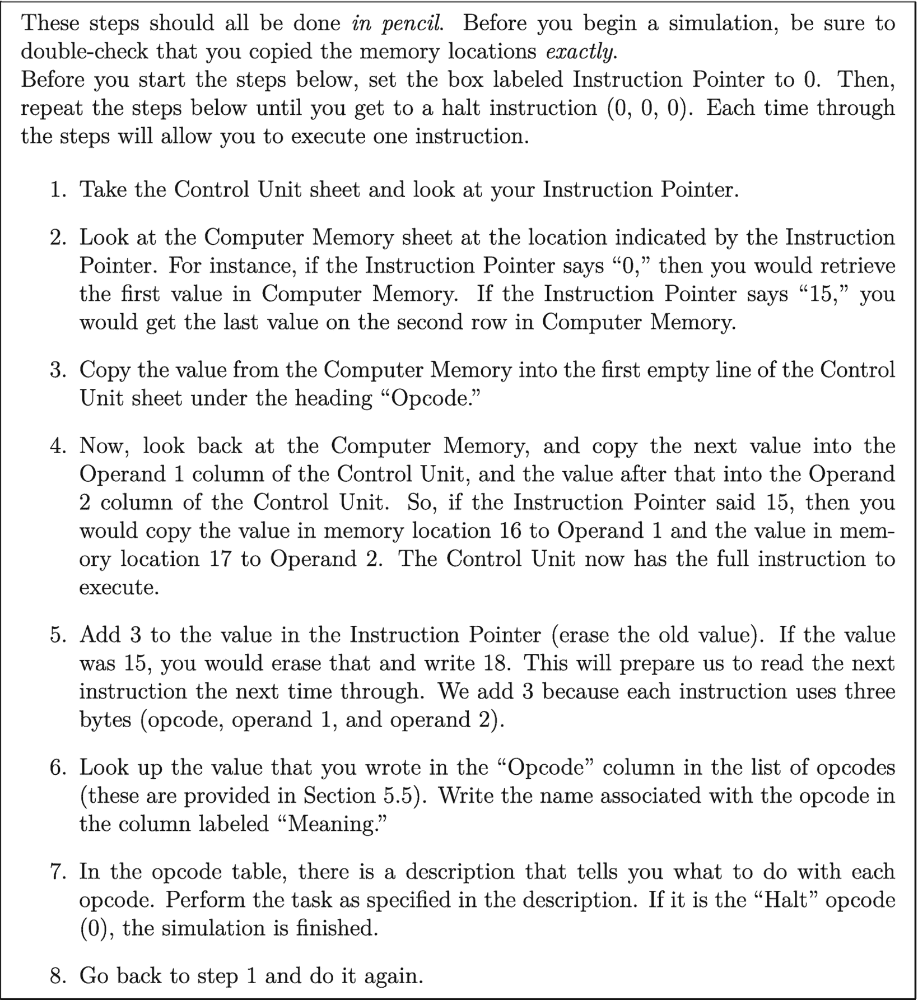
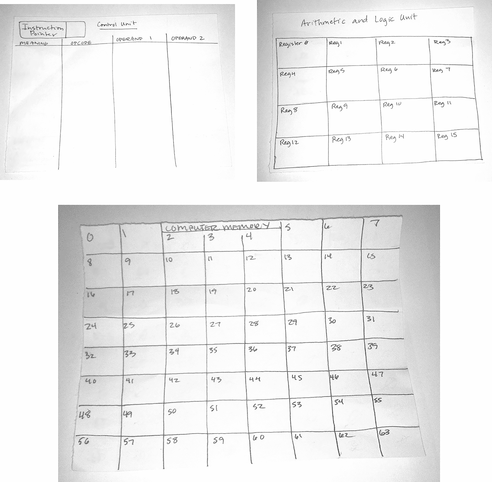
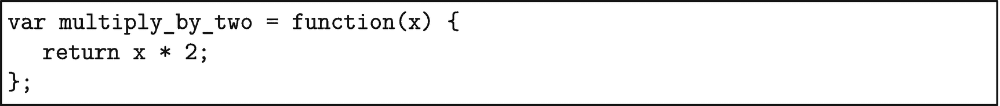
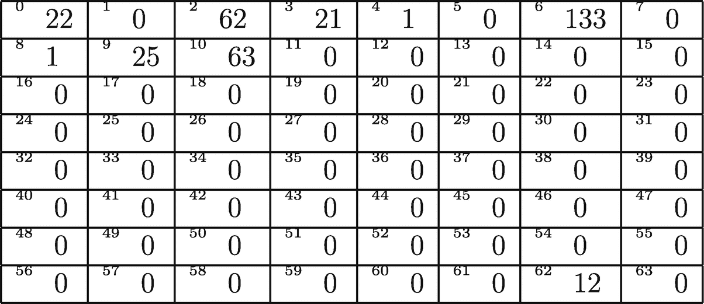
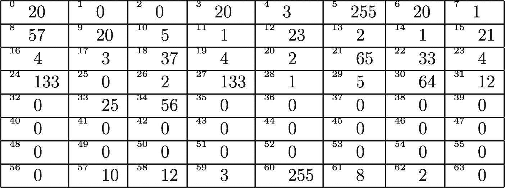
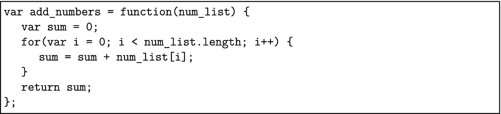
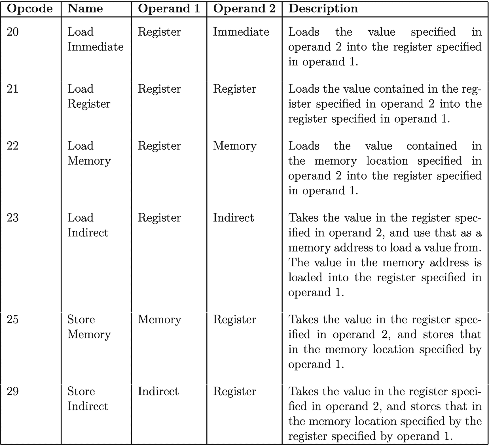
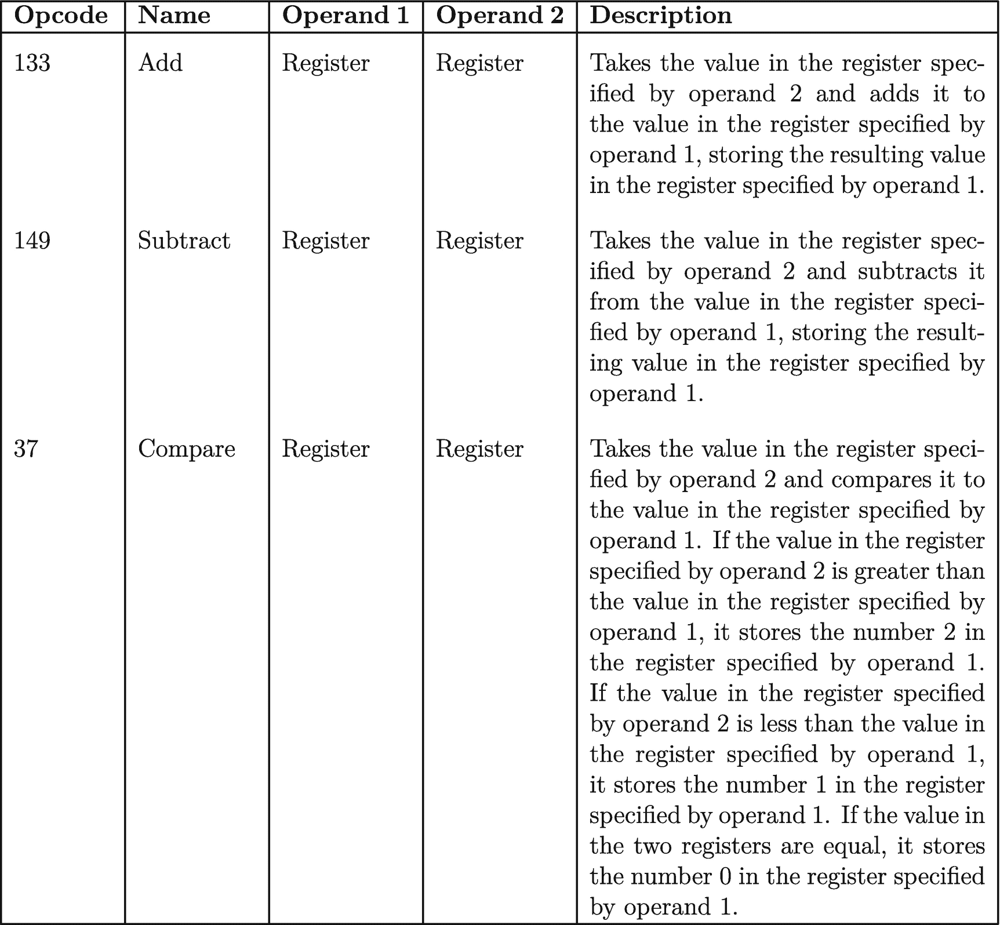
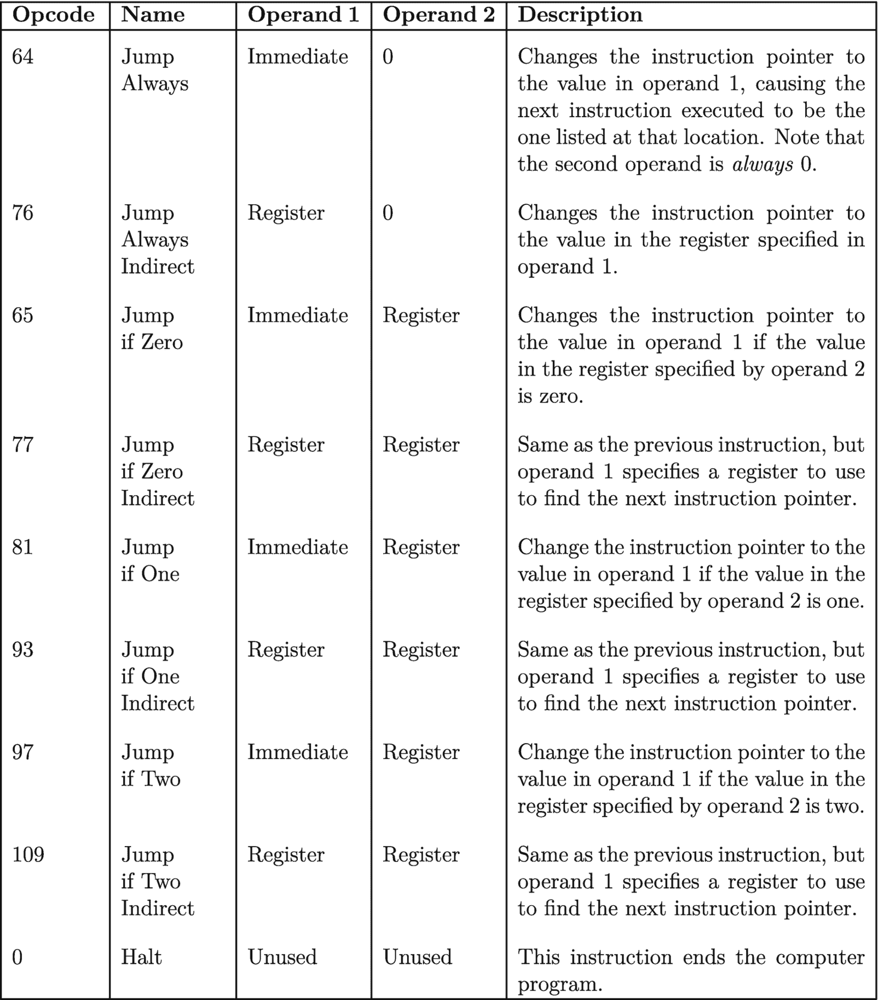

# 5. 计算机的工作原理

既然我们已经对计算机的来源、通信方式以及数据存储方式有了一些了解，我们就可以学习计算机是如何工作的了。第 1 章讨论了机器语言与编程语言的区别，机器语言允许程序员向计算机发出它直接理解的指令，而编程语言则是一种更接近人类思考方式的计算机编程方法。由于编程语言并非计算机的母语，它们最终必须被翻译成机器语言指令。因此，由于必须能够翻译成机器语言，编程语言比人类语言要更严谨、更精确。

大多数程序员永远不需要使用机器语言。然而，至少在概念上理解机器语言是什么样子的，还是很有好处的，因为这有助于你理解编程所需的精确性。新手程序员遇到的最大问题是，他们在编写程序时，期望计算机执行他们*实际意图*所要表达的内容，而这往往与他们实际告诉计算机去做的内容不同。

我年轻时上过一堂课，课上老师让两个人背对背坐着，这样他们就看不到对方。然后，其中一个人需要折一架纸飞机，并向另一个人准确描述折叠纸张的步骤，以便对方也能折出一架。如果你曾尝试过类似的事情，你就会知道，在你无法看到对方如何尝试理解你的话，并且没有任何视觉线索表明你意图的情况下，要传达准确的指令有多么困难。几乎无一例外，对方会把纸折错，最后得到一堆无用的废纸。关键在于，即使我们认为自己表达得很精确，即使我们努力追求精确，我们给出的指令往往也不像我们以为的那么精确。然而，计算机在接收指令时却要求绝对的精确。

了解机器语言的工作原理，能让你体会到编程所需的那种精确性。因此，在我们开始学习编程之前，本章将让你感受一下计算机在机器语言层面是如何实际进行处理的。

本章中的例子可能看起来很繁琐。它们确实*很*繁琐。如今很少有人再用机器语言编程了，因为*它*实在太繁琐了。不过别担心，编程语言的发明正是为了消除机器语言的繁琐。这里的重点是向你介绍机器的思考方式，以便你更好地理解所需的精确性，并开始按照计算机需要你思考的方式来思考。在我整个编程生涯中，从未需要过用机器语言编程。然而，了解机器语言如何工作极大地帮助我调整了自己的想象和思维，从而更好地理解如何让程序运行起来。

## 5.1 计算机的组成部分

你可以从概念上将计算机分为四个主要部分：

*   **中央处理器** (CPU)
*   计算机的**内存** (也称为随机存取存储器，或 RAM)
*   一个**输入/输出系统**
*   一条用于在这些不同部件之间移动数据的**数据总线**

计算机的 CPU 是大部分数据处理发生的地方。CPU 本身又分为两个组件：**控制单元** 和 **算术逻辑单元** (ALU)。控制单元管理计算过程本身。控制单元维护一个被称为**指令指针**的数据，它保存着内存中下一条要执行指令的位置。控制单元查看一条指令，确定处理该指令所需的条件，然后管理执行该指令所需的所有组件。这可能包括从内存写入和读取数据、向输入/输出系统读写数据，以及告诉算术逻辑单元执行计算。算术逻辑单元直接执行基本计算，如加、减、乘、除。它还执行逻辑比较，比如比较两个值是否相等，或者一个值是否大于另一个值。尽管有些处理器拥有比其他处理器更多的内置计算功能，但它们在计算能力上是等价的。即使你只有一个只能做加法和减法的处理器，你也可以编写额外的代码，利用加法和减法来实现乘法和除法。一台配备最少指令的计算机也能执行任何必要的计算——只是需要程序员付出更多努力。ALU 还可以包含称为寄存器的临时存储位置，用于执行计算和存储结果。

计算机的内存是计算机存储正在被积极处理的数据的地方。计算机的内存*不同于*它的硬盘驱动器。硬盘驱动器实际上是在计算机外部，通过输入/输出系统连接的。硬盘驱动器是数据可以永久存储的地方。计算机内存则是数据在使用时存储的地方。为了理解这种差异，如果你突然关闭计算机，存储在内存中的信息会被清除。在第 4 章中，我们讨论了计算机内存是如何布局的。它被划分为数十亿个存储单元，每个单元可以保存一个 0 到 255 之间的数字。这些单元本身是编号的，以便于识别和快速访问。

计算机中的输入/输出系统负责与外部世界进行通信。计算机主机本身无法与人交互。键盘输入、屏幕输出、硬盘驱动器、网络适配器，以及我们与计算机交互时所想到的所有其他设备，实际上都位于计算机的“外部”，通过输入/输出系统连接。存在几种输入/输出系统标准，其中最常用的是**通用串行总线** (USB)。USB 定义了一种将输入/输出设备连接到计算机的标准方式。这使得 U 盘、USB 摄像头、USB 键盘以及无数其他设备都能连接到你的计算机。没有输入/输出系统，计算机将无法使用，因为我们就没有办法向它提供数据或程序，也无法看到计算结果。

数据总线负责在各个系统之间传输数据。它是计算机系统中一个**重要但常被忽视**的特性。例如，如果你有一个非常快的 CPU 和大容量内存，但数据总线在将内存数据传输到 CPU 时速度缓慢，那么两者都无法发挥太大作用。总线通过集线器连接在一起，集线器负责引导进出每个设备的数据流。许多现代计算机架构都包含两个独立的集线器。直接连接 CPU 的最快集线器通常被称为**北桥**。它将 CPU 连接到内存和显卡。另一个集线器通常被称为**南桥**，它连接北桥与其余的输入/输出系统。

## 5.2 一个简化的纸面机器模拟

在本章的剩余部分，我们将以一个“纸面机器”进行实践。也就是说，我们将用笔和纸来模拟 CPU 在运行程序时的行为。

这里介绍的机器和机器语言的目的是帮助你理解机器语言的*概念*。我们将要介绍的机器语言并不是任何计算机上实际使用的机器语言，但它非常相似。如果你将来希望学习真实的机器语言，这将有助于你理解和学习。因此，你不需要记忆本章后面的任何内容。但是，你确实需要按照说明进行操作并完成活动，因为它们将帮助你理解计算机正在做什么。

为了进行模拟，你需要几张白纸、一支钢笔和一支带橡皮擦的铅笔。你可能还想用一把尺子来辅助画直线。当说明提到要用铅笔时，务必使用铅笔，因为你会进行大量擦除操作。

以下初始步骤应使用钢笔完成。

在第一张纸的顶部，将标题写为“计算机内存”。然后，画一个填满整张纸的 8x8 网格方格。在每个方格的左上角编号，从 0 开始，一直到 63。这些就是内存位置的地址。请务必留出足够的空间在每个方框内写入一个值。每个内存位置可以接收一个介于 0 到 255 之间的数字。如果方框内没有写入值，则假定该值为零（因此，现在你的内存全是零）。这张纸将代表一个非常微小的计算机内存。（真实的计算机内存大约需要五十亿张这样的纸。）随着我们模拟的进行，方格中的值将会改变。

在第二张纸的顶部，将标题写为“控制单元”。然后，在纸的左上角画一个空方框，并将其标记为“指令指针”。接着，在纸的剩余部分创建四列，分别标为“含义”、“操作码”、“操作数 1”和“操作数 2”。

在第三张纸的顶部，将标题写为“算术逻辑单元”。在这片区域内画 16 个方框，并分别标为“寄存器 0”到“寄存器 15”。

这个过程结束后，你应该有三张纸，看起来与图 5-1 所示一致。

在下一节中，我们将处理一个机器语言程序，这个操作应使用铅笔完成。你将把该程序（图 5-3）复制到内存中。然后，为了运行模拟，你将使用图 5-2 中详述的步骤。

在这种机器语言中，每条指令由三部分组成——`操作码`、`操作数 1`和`操作数 2`。`操作码`是实际执行的功能。操作码列表及其含义在本章末尾。每个操作码都有非常特定的任务。一个操作码可能指示你从内存中加载一个值到寄存器，将寄存器值相加，比较寄存器值等等。`操作数 1`和`操作数 2`的行为会根据所使用的操作码而有所不同。说明会告诉你如何使用它们。

操作数的使用方式称为模式。有时，操作数会指定一个寄存器编号（称为*寄存器模式*）。这意味着操作数中的数字指向算术逻辑单元中的一个寄存器。如果操作数是 6，使用寄存器模式意味着该操作数指向寄存器 6。有时，操作数会指定一个内存位置（称为*内存模式*）。这意味着操作数中的数字指向计算机内存中的一个内存位置。如果操作数是 6，使用内存模式意味着该操作数指向内存位置 6。有时，操作数会指定一个数值（称为*立即数模式*）。这意味着操作数中的数字本身被用作数值。如果操作数是 6，使用立即数模式意味着该操作数仅仅指向数值 6 本身。最后，还有一种模式称为*间接模式*。在这种模式下，操作数指向一个寄存器，但该寄存器被用来指向一个内存位置。所以，如果操作数是 6，使用间接模式意味着该操作数指向存储在寄存器 6 中的一个内存位置。如果寄存器 6 的值是 23，那么在间接模式下，将使用内存位置 23 作为操作数。

举个例子，假设指令是`20, 5, 10`。这意味着 20 是操作码，5 是`操作数 1`，10 是`操作数 2`。现在，我们在本章末尾（第 5.5 节）的操作码表中查找操作码 20。表中显示，这个操作码的意思是“立即数加载”。表格中还说明，`操作数 1`使用*寄存器模式*，因此指向一个寄存器。由于`操作数 1`是 5，所以`操作数 1`被解释为指向寄存器 5。表格说明`操作数 2`使用*立即数模式*，因此使用数值本身。由于`操作数 2`是 10，所以`操作数 2`就是数值 10。在描述中，它说我们应该将由`操作数 2`指定的值加载到由`操作数 1`指定的寄存器中。因此，我们需要拿出“算术逻辑单元”那张纸，擦掉寄存器 5 中的内容，并写入数值 10。

一个用于模拟过程的 8 步文本指令。第一步是拿出控制单元纸，查看你的指令指针，最后回到步骤 1 并再次执行。

图 5-2
模拟步骤

一组 3 张表格。1，控制单元，有 4 列：含义、操作码、操作数 1 和操作数 2。2，算术逻辑单元是一个 4x4 的表格，标注为寄存器 0 到 15。3，计算机内存是一个 8x8 的表格，编号从 0 到 63。

图 5-1
机器模拟设置

在下一节中，我们将进行一次完整的模拟。

一只手形图标，食指指向右侧。
### 在课堂环境中进行模拟

这种模拟很容易在课堂环境中进行，实际上它最初就是为课堂使用而开发的。要做到这一点，你需要使用白板或黑板，而不是纸张。指定一名学生担任控制单元。该学生负责执行上述步骤，但不能离开控制单元区域或在其他学生的板上书写。

指定另一名学生担任数据总线。该学生负责在计算机内存之间传输所有必要的数据。控制单元将指示数据总线需要获取或存储哪些值。数据总线只听从控制单元的指令。

再指定一名学生处理算术逻辑单元的纸。他们将执行控制单元要求在其寄存器上进行的任何计算，并可以向控制单元提供其寄存器中已计算出的任何值。

我发现，互动式地执行计算极大地提高了学生将计算机内部发生的情况可视化的能力，从长远来看，这使他们成为更好的程序员。

## 5.3 一个简短的程序：乘以 2

现在我们将编写一个程序来实现将一个数乘以 2。如果你翻阅本章末尾（5.5 节）的操作码表，可能会注意到其中没有用于乘法的操作码。但基础算术告诉我们，可以通过重复加法来实现乘法。因此，我们需要取出一个数，将其自身相加，然后把结果存回寄存器或内存中。在我们的程序中，内存地址 62 将存储要乘的数（本例中为数字 12），而程序结束时，内存地址 63 将存储计算出的结果。

一段用于两个数乘法的 3 行 Java 代码。它写着：`var multiply underscore by underscore two equal functions of x, open brace. 2, return x multiplied by 2 semicolon. 3, close brace semicolon`。

图 5-3
用 JavaScript 实现一个数乘以 2

### 5.3.1 设置模拟环境

开始模拟前，需要将代码和数据都写入内存。请将图 5-4 中的数值复制到你的计算机内存表中。

一个 8 行 8 列的表格，单元格标号从 0 到 63。单元格中包含的数字有：0、22、62、21、1、133、25、63、12。其余所有单元格数字均为 0。

图 5-4
用于实现一个数乘以 2 的机器语言程序

在你打算彻底放弃编程之前，请允许我提醒你，这个练习的重点并非我们真的会用这种方式编程，而是让你一窥计算机处理问题的视角。计算机编程语言被发明出来的根本原因，正是为了让我们不必每天处理这些底层内容。所以，为了缓解你的焦虑，图 5-3 展示了用 JavaScript 实现相同功能的代码。

你可能仍然不明白这段代码具体做了什么，也不理解为什么这样写，但希望它能给你带来希望——这总比一堆写出来的数字更容易理解。

现在，要运行这个程序，你需要查看图 5-2 中的步骤。我们将一步步地执行，以便你掌握操作方法。

### 5.3.2 运行模拟

现在，让我们一步步地执行这个程序，看看发生了什么。所有操作都*用铅笔*完成。查看图 5-2。第一步是核对内存位置是否已正确复制。请现在完成这一步。接着，在标有“指令指针”的方框中写入 0。现在就开始执行。然后，我们可以按编号步骤继续。

步骤 1 要求查看指令指针。它应该显示为 0。

步骤 2 要求查看指令指针所指向的内存位置。由于指令指针为 0，我们查看内存地址 0。

步骤 3 要求将该内存位置的值复制到控制单元表的第一行，位于“操作码”标题下。内存地址 0 的值是 22，因此我们在控制单元表第一行的操作码列中写入 22。

步骤 4 要求将内存中的下一个值复制到“操作数 1”列。下一个内存地址是地址 1，其值为 0。因此，我们在操作数 1 列写入数字 0。接着，将内存中的下一个值（地址 2）复制到“操作数 2”列。内存地址 2 的值是 62，所以在操作数 2 列写入数字 62。这就是我们的第一条指令：`22, 0, 62`。

步骤 5 要求将指令指针的值加 3。当前指令指针的值为 0，所以`3 + 0`等于 3。擦除 0，在方框中写入 3。这让我们可以在下次执行这些步骤时读取下一条指令。然而，现在执行这一步很重要，而不是在步骤末尾，因为有些指令可能会进一步修改这个值。

步骤 6 要求在 5.节的操作码列表中查找操作码列中的值。操作码是 22，所以浏览操作码列表找到操作码 22。操作码并非按数字顺序排列，因此你需要逐一查找，直到找到正确的那个。操作码是“Load Memory”（加载内存）。因此，在“含义”列中写入“Load Memory”。

步骤 7 要求执行该操作码在操作码表中列出的步骤。你会注意到操作码表指出，操作数 1 指向一个寄存器，操作数 2 指向一个内存位置。因此，我们将处理寄存器 0 和内存地址 62。描述说明，要将操作数 2 指定内存位置的值加载到操作数 1 指定的寄存器中。因此，我们将内存地址 62 的值加载到寄存器 0 中。内存地址 62 的值为 12，所以在算术逻辑单元表的寄存器 0 中写入 12。

步骤 8 要求返回步骤 1，并对下一条指令重复执行。

现在我们回到了步骤 1。因此，我们需要再次查看指令指针。这次它被设置为 3。步骤 2 要求查看指令指针指向的内存位置。该位置包含数字 21。步骤 3 要求将该数字复制到控制单元表的下一行，位于操作码列。因此，在操作码列中写入数字 21。步骤 4 要求将接下来的两个内存位置复制到操作数 1 和操作数 2 列。接下来的两个内存位置分别包含数字 1 和 0，所以在操作数 1 列写入 1，在操作数 2 列写入 0。我们复制的指令是`21, 1, 0`。

步骤 5 要求将指令指针的值加 3。因此，在指令指针方框中写入 6，擦除之前的值。

**步骤 6** 指示在 5.5 节的操作码列表中查找 `Opcode` 列中的值，并将该操作码的名称写入 `Meaning` 列。该操作码的含义是“加载寄存器”。**步骤 7** 指示执行操作码描述的功能。描述说明要将 `Operand 2` 指定的寄存器中的值复制到 `Operand 1` 指定的寄存器中。`Operand 1` 是 1，`Operand 2` 是 0。因此，查看寄存器 0。它当前包含数字 12。所以，将 12 写入寄存器 1 的方框中。

这条指令为我们提供了同一个数字的两个副本——一个在寄存器 0 中，另一个在寄存器 1 中。这很好，因为乘以 2 就是将同一个数字相加两次。因此，你认为下一条指令会是什么类型？浏览指令列表，看看你认为我们下一步会执行哪一条。**步骤 8** 指示对下一条指令重复此过程，那么我们现在开始。

如果你再次执行步骤 1–4，你将复制到下一条指令，即 `133, 0, 1`。**步骤 5** 告知我们要将 `Instruction Pointer` 加 3，所以在 `Instruction Pointer` 框中写入 9。**步骤 6** 指示在操作码列表中查找 `Opcode` (133) 并写下其含义。在 `Meaning` 列中写入“Add”。**步骤 7** 指示执行操作码描述的功能。它说明要将 `Operand 1` 和 `Operand 2` 指定的两个寄存器相加，并将结果存储在 `Operand 1` 指定的寄存器中。`Operand 1` 是 0，`Operand 2` 是 1。因此，我们将把寄存器 0 中的值与寄存器 1 中的值相加。寄存器 0 中有 12，寄存器 1 中也有 12。相加得到 24。指令说将值存储在 `Operand 1` 指定的寄存器中。`Operand 1` 是 0，所以我们将结果存储在寄存器 0 中。因此，擦除寄存器 0 中当前的内容，并在其中写入 24。

寄存器 0 现在有了我们想要的值（24 是 `12 * 2`），但目标是将它存储到内存地址 63 中。那么你认为下一条指令可能会做什么？**步骤 8** 指示重复此过程来找出答案。

执行步骤 1–4 将得到下一条指令：`25, 63, 0`。**步骤 5** 指示我们将 `Instruction Pointer` 增加到 12。**步骤 6** 指示我们在操作码列表中查找操作码 25 的含义，并将其写在 `Meaning` 列中。这得到了“存储内存”。

**步骤 7** 指示我们执行与该操作码关联的指令。这说明了要将 `Operand 2` 指定的寄存器中的值存储到 `Operand 1` 指定的内存位置中。`Operand 1` 是 63，`Operand 2` 是 0。因此，我们将获取寄存器 0 中的值（即 24）并将其写入内存位置 63，擦除该位置当前的内容。因此，将 24 写入内存位置 63。

**步骤 8** 指示返回步骤 1 并处理下一条指令。

执行步骤 1–4 将得到下一条指令——`0, 0, 0`。**步骤 5** 指示将 `Instruction Pointer` 增加到 15。**步骤 6** 指示查找操作码，它告诉我们操作码 0 是“Halt”。**步骤 7** 指示如果我们到达 `Halt` 指令，我们应该结束模拟。

现在我们完成了！如果你还记得本节开头的内容，目标是将存储在内存位置 62 中的值乘以 2，并将其存储在内存位置 63 中。内存位置 62 中有 12，内存位置 63 中有 24。虽然做了很多工作，但这正是计算机在处理指令时所做的事情。这些指令必须如此简单，因为计算机本身无法思考；它们只能处理。由于指令非常简单，即使执行简单的任务也需要相当多的指令。然而，这种简单性也允许计算机每秒执行数十亿条指令。

## 5.4 对数字列表求和

现在我们将做一个更复杂的程序——我们将对一个数字列表求和。为了做到这一点，我们需要能够知道何时到达数字列表的末尾。我们将使用一个哨兵值来表示我们到达了数字列表的末尾。（有关哨兵值的更多信息，请参见第 4 章。）我们将使用数字 255 作为哨兵来表示数字列表的末尾。

这个程序要做的是，将从内存位置 57 开始的所有数字相加，直到遇到哨兵值，然后将结果存储在内存位置 56 中。

程序如图 5-5 所示。

一个 8 行 8 列的表格，编号从 0 到 63。其中一些单元格包含随机数字，其他单元格为 0。

**图 5-5** 用于对数字列表求和的机器语言程序

现在，在我们逐步讲解程序之前，让我们思考一下执行这个过程需要发生什么。首先，我们需要一个地方（可能是一个寄存器）来在我们遍历数字时保存当前的和。在过程中，我们需要检查每个数字，看它是否与我们的哨兵值 255 匹配。如果遇到哨兵值，我们需要让计算机执行与未遇到时 *不同的* 操作。最后，我们需要一种重复步骤的方法，因为我们不知道要进行多少次计算。

实现所有这些的方法是比较和条件跳转。也就是说，我们将比较两个数字，并根据比较结果，潜在地修改指令指针，告诉计算机运行不同的代码。由于我们通过查看指令指针来获取下一条代码，如果一条指令修改了指令指针，那么我们将执行与否则会执行的 *不同的* 任务。

我们将看到的另一个特性是间接模式。由于我们将要查看未知数量的不同值，因此我们无法将要加载的值的地址放在代码中。因此，我们要做的是使用一个寄存器来保存第一个值的地址，然后使用间接模式告诉计算机从寄存器中存储的地址加载值。然后，我们可以将寄存器中的值加一，使其指向内存中的下一个位置。

那么现在，让我们使用图 5-2 中的步骤进行模拟。与我们在上一个程序中逐步执行每个步骤不同，我假设你现在知道如何操作这些步骤。每个段落都是八个步骤的全部内容。我将重点放在每条指令的含义上，而不是执行它的所有步骤。执行步骤是你的工作，但一定要 *按正确的顺序* 完成所有步骤。另外，为了使发生的事情更容易理解，我们将在进行过程中为我们的寄存器命名，以便我们知道它们在做什么。计算机不使用这个——这完全是为了我们自己的目的，以便我们知道每个寄存器的用途。

第一条指令是 `20, 0, 0`。这表示用数字 0 加载寄存器 0。寄存器 0 将保存所有数字的和。你可以继续将寄存器 0 标记为“sum”，以便记住它的用途。记住，计算机不关心它是做什么用的——计算机只做你告诉它的事情。但是 *你* 需要记住它的用途，这样你才能理解这个程序。

下一条指令是 `20, 3, 255`。这表示用数字 255 加载寄存器 3。这是我们的哨兵值，将用于比较。你可以用单词“sentinel”来标记寄存器 3。

下一条指令是`20, 1, 57`，这条指令将数字 57 加载到寄存器 1 中。这是我们开始读取数值的位置起点。请注意，我们是将数字 57 存入寄存器 1，而不是内存地址 57 的内容。那将是后续步骤。将寄存器 1 标记为“指针”（`pointer`），因为它将指向我们要读取数值的内存位置。

下一条指令是`20, 5, 1`，这条指令将数字 1 加载到寄存器 5 中。这是我们将用于递增内存位置指针的数字。将寄存器 5 标记为“递增”（`increment`）。

请注意当前指令指针的位置，它应位于 12。之前的所有指令都是“设置”指令，旨在为流程启动做准备。下一条指令将真正启动处理过程。你应该将内存位置 12 标记为“主进程开始”（`main process start`），以提醒自己这是核心处理过程发生的地方。

位于内存位置 12 的指令是`23, 2, 1`。这条指令要求查看寄存器 1 中的值，并将该值作为要去查找的内存位置。目前，寄存器 1 中的值是 57。因此，查看内存位置 57，并将该值放入寄存器 2。将寄存器 2 标记为“当前值”（`current value`），它此时应包含值 10。

回想一下我们要实现的目标，接下来需要判断当前值是否是我们的哨兵值。因此，我们必须将当前值（寄存器 2）与哨兵值（寄存器 3）进行比较。然而，由于在这种机器语言中，比较操作会用比较结果覆盖其中一个被比较的值（请参考表格中的比较指令），我们必须先将其中一个值复制到一个新寄存器中，以免它被破坏。因此，下一条指令是`21, 4, 3`，这条指令将寄存器 3（哨兵值）的内容复制到寄存器 4。将寄存器 4 标记为“哨兵比较”（`sentinel comparison`），它此时应包含值 255。

下一条指令是`37, 4, 2`。查阅该指令可知，它用于比较寄存器 2（当前值）与寄存器 4 中的值。如果两者相等，则将数字 0 存入寄存器 4。如果寄存器 2 中的值大于寄存器 4 中的值，则将数字 2 存入寄存器 4。最后，如果寄存器 4 中的值大于寄存器 2 中的值，则将数字 1 存入寄存器 4。这样一来，比较结束后，寄存器 4 将包含当前值与哨兵值比较的结果。由于寄存器 4 的值为 255，寄存器 2 的值为 10，寄存器 4 中的值将被擦除，并在其位置写入数字 1，因为 255 大于 10。

现在我们已经完成了比较，下一步该做什么？下一条指令是`65, 33, 4`。这条指令要求查看寄存器 4：如果值为 0，则将指令指针改为 33；否则，不做任何操作。这是一个条件跳转指令。基本上，它表示如果之前对当前值与哨兵值的比较显示它们相等（结果为 0），则跳转到程序的结尾（位于内存位置 33）。由于寄存器 4 包含 1，条件不触发，我们像往常一样继续执行下一条指令。

下一条指令是`133, 0, 2`。这条指令将寄存器 2（当前值）的内容加到寄存器 0（当前总和）上，并将结果存入寄存器 2。由于寄存器 0 当前为 0，现在它应该是 10 + 0，即 10。

现在我们需要对下一个值执行相同的操作。但我们如何获取下一个值呢？由于寄存器 1 保存着指向下一个值的指针，我们只需将寄存器 1 增加 1，而这个增量值存储在寄存器 5（递增）中。下一条指令是`133, 1, 5`，这条指令将寄存器 5（递增）的内容加到寄存器 1（指针）上，并将结果存入寄存器 1。

现在我们已经准备好对下一个值执行相同的计算。我们只需要跳回到代码中的正确位置，以便重复整个过程。下一条指令是`64, 12, 0`。指令 64 是“无条件分支”。这意味着我们直接修改指令指针为 12。因此，下一条指令执行时，你将回到内存位置 12 以获取下一条指令。我们之前将这个位置标记为“主进程开始”（`main process start`）。将当前内存位置（30）标记为“主进程结束”（`main process end`）。

一段 7 行的代码：`var addNumbers = function(numList) {`，`var sum = 0;`，`for` 循环，`sum = sum + numList[i];`。

**图 5-6**  
在 JavaScript 中计算一组数字的和

现在，我不打算逐一带你走完所有后续步骤，因为你将反复经历相同的步骤。不过，请思考一下当你从内存中加载值 255 时会发生什么？此时，之前的比较操作会发现寄存器 4（哨兵比较）中的值与寄存器 2（当前值）中的值相等，因此会将值 0 存入寄存器 4。然后，下一条“如果为零则跳转”（`Jump if Zero`）指令将真正生效——寄存器 4 中的值为 0，因此我们会将指令指针修改为指令中指定的位置（即 33）。

此时，我们将加载内存位置 33 处的指令`25, 56, 0`。这条指令将寄存器 0（当前总和，此时已是最终总和）的值存入内存位置 56。内存位置 56 现在应包含相关数值的总和（即 25）。

下一条指令是`0, 0, 0`，这条指令通知模拟器停止。现在我们已经完成，内存位置 56 保存着内存位置 57、58 和 59 中数值的总和。

和之前一样，这在 JavaScript 中要简单得多。在 JavaScript 中，类似的函数如图 5-6 所示。

同样，我不期望你现在就理解它的含义，但你至少应该认识到，这比编写一堆机器语言指令的数字要容易得多！

希望这个练习能帮助你理解计算机执行处理时的精确性，以及对程序员准确性的要求。如果计算机程序的指令中哪怕有一条写错了，整个程序都会失败。虽然你很可能不会再需要这样做，但目标是让你的思维方式与计算机的思维方式保持一致。这将使你在未来思考编程问题时变得更容易。

如果你喜欢这个过程，附录 E 中还提供了其他一些机器语言程序的示例。

### 5.5 机器操作码表

本节列出了本章模拟机器所使用的不同机器操作码。操作码按类别排序，而非按编号排序，但由于总数不超过 20 个，这不会造成太大不便。虽然我们不会使用所有列出的操作码，但为了完整性和附录 E 中的示例，仍将它们全部列出。

每个操作码都附带了其所使用的操作数类型。操作数是用于处理指令的值列表。例如，对于`add`指令，操作数将是指存放待相加数值的位置以及结果应存放的位置。该模拟机器有四种类型的操作数：

-   **立即数操作数**：立即数操作数表示数值本身。也就是说，如果我们要将值`1`加载到某处，我们会使用立即数模式的操作数。
-   **寄存器操作数**：寄存器是 ALU 内部的临时存储位置。因此，如果一个操作码使用寄存器操作数，该操作数将指向寄存器编号。
-   **内存操作数**：内存操作数是一个数字，称为**内存地址**，它指向计算机内存中用于加载或存储值的一个存储位置。
-   **间接操作数**：间接操作数将寄存器中的值用作该操作数的内存位置。例如，假设一个间接操作数的值为`1`。这意味着要查看寄存器`1`，并将该寄存器中的值用作指令需要操作的内存地址。所以，如果寄存器`1`的值为`35`，那么我们将对内存地址`35`进行读写。

我们要看的第一组指令是加载/存储指令（图 5-7）。这些指令只是在存储位置之间移动数据。它们也最充分地利用了上述不同的操作数类型。

*图 5-7 — 加载/存储指令*

下一组操作码是算术操作码（图 5-8）。这些是通过加、减等操作来修改数值的操作码。在我们的模拟机器中，算术操作码非常少，但大多数真实计算机都有一套相当丰富的算术操作码。尽管如此，即使操作码列表有限，通过一点创意，用它们也能完成很多事情。请注意，比较操作码也包含在此列表中。

*图 5-8 — 算术指令*

最后一组操作码是跳转指令（图 5-9）。这些指令会改变指令指针，通常基于某个条件。这些条件被设计为与上面`Compare`操作码（即`37`）的结果相匹配。一种常见的模式是`Compare`指令之后跟上基于比较结果的条件`Jump`指令。本书中我们不使用跳转指令的间接版本，但它们在此列出，是因为它们在所有通用处理器中都是非常强大且重要的功能。

*图 5-9 — 跳转指令*

就是这样！这就是计算机的全部。尽管这可能看起来很令人困惑，但你能在几页纸内写出所有规则，这本身就相当了不起。计算机的本质确实很简单。大多数人感到困惑是因为他们认为计算机很复杂。但实际上，它们只是精确地执行你的指令。精确地执行。

虽然执行这些微小的计算对你来说可能显得很繁琐，但对计算机来说却相当简单。事实上，正是这种简单性使计算机能够快速运行。现代计算机每秒可以执行大约 50 亿条此类指令*。它们必须如此之快才能跟上最新的软件。每当你移动鼠标时，计算机都必须执行与上述非常相似的操作，以重新计算新的鼠标位置并在屏幕上重绘光标。你可能已经注意到，即使每秒有 50 亿条指令，有时仍然不够用！

 **操作码编号**

你可能觉得操作码的编号系统有点奇怪。然而，这个编号系统实际上有一个非常合乎逻辑的顺序，但只有当你把这些数字写成二进制形式时，这个规划才会显现出来。每个操作码都是一个通用指令类型（`load`、`add`、`jump`等）及其所使用操作数类型的组合，每个操作数占用 2 位。这在计算机中经常如此——那些看似随意或奇怪的东西，在你了解更多知识后，往往会变得非常有意义。

别担心，我没指望你去逐个将操作码转换成二进制——毕竟，这只是一个帮助你理解这些工作原理的玩具系统。但无论如何，请记住，不仅计算机，整个生活都充满了这样的事物：它们的逻辑可能不会直接显现，但如果你愿意深入挖掘并观察表象之下，这些逻辑是可知的。

### 5.5.1 回顾

在本章中，我们讲解了机器实际工作的原理。我们学到了以下内容：

-   计算机的主要部件是 CPU、计算机内存、输入/输出系统和数据总线。
-   CPU 的工作方式是逐条获取指令、解码，然后执行指令指定的过程。
-   CPU 上的每条指令都执行一个非常微小的单一任务。
-   计算机只能精确执行你告诉它的指令。
-   程序的所有步骤都必须精确指定，计算机才能正确执行。

### 5.5.2 学以致用

1.  思考一下，如果程序中某条指令被更改，会发生什么？一条缺失或有缺陷的指令会如何影响结果？
2.  你是否注意到代码和数据都存放在同一内存中？通过将所有内容存储为数字，代码和数据可以使用同一系统进行存储。如果你意外地用数据值覆盖了一条指令，可能会遇到什么问题？
3.  从附录 E 中选择一个程序，看看你是否能成功运行它。
4.  你如何修改本章中的第一个程序，使其乘以`3`而不是`2`？

