# 6. HTML 文件格式

在第 4 章中，我们了解了计算机如何格式化数据。在本章中，我们将探讨互联网上用于显示网页的数据格式。这种格式就是 HTML——超文本标记语言。本书并非 HTML 专著，但若要真正理解 JavaScript 的工作原理，掌握 HTML 是必要的。本章对 HTML 的介绍不会过于深入，但足以让你对 HTML 的运作机制有一个功能性的理解。

## 6.1 HTML 快速入门

HTML 具有许多使其广受欢迎的特性，并已成为网络官方格式。首先，它是一种超文本格式。这意味着每个文件都包含指向互联网上其他文件的`超链接`（或简称为`链接`）。正是这一点实现了互联网上的网状结构。每个文档（即网页）都包含许多指向其他网页的链接，而这些网页本身又包含指向更多网页的链接。因此，这种文件格式遵循了网络的基本理念——信息相互关联，如果我们想进一步了解某件事，只需点击链接即可。

HTML 的另一个重要特性是它是一种`标记语言`。“标记语言”一词源于手稿在计算机出现之前的编辑和排版方式。手写与制作印刷书籍略有不同。制作书籍时，你需要知道文本使用什么字体、字母多大、是否要加粗等等。打字机和手写材料无法向印刷厂传达这些信息。因此，作者在写书时，会用注释“标记”稿件，告知印刷厂如何呈现最终文本效果。


一个文本文档有作者为 3 行和 1 个段落做的 4 处标记。文字为：Time 18 B F center, Helv 12 F R, C T Helv 14 B F, 以及 Helv 12。

图 6-1

作者为印刷厂标记文档的示例

图 6-1 展示了标记过的文档是什么样子。由于手稿是手写或使用打字机完成的，作者无法以想要的字体输入文档，因此他们插入这些标记注释来告知印刷厂该怎么做。“Helv 12”告诉印刷厂将字体设为 12 点 Helvetica；“BF”表示使用粗体字；“FR”表示将文本右对齐。这类指令精确地告诉印刷厂如何排版每段文本。有时这可能会很繁琐，因此另一种做法是，给印刷厂的指令告诉他们文本具有什么*功能*，然后再用单独的页面说明如何排版该功能。在此例中，“CT”告诉印刷厂标记文本是章节标题，因此印刷厂也知道将该标题放入每页顶部的页眉中。有时标记会精确告诉印刷厂该做什么（例如，“Helv 12”表示使用 12 点 Helvetica 字体），有时标记则会告诉印刷厂文本在文档中的功能（例如，“CT”告诉印刷厂该文本是章节标题）。如果作者指定了文本的功能，他们还会提供单独的页面，告知印刷厂每种文本片段应如何处理。这种将文档的结构和功能与其显示方式分离的思想，我们将在第 7 章再次探讨。

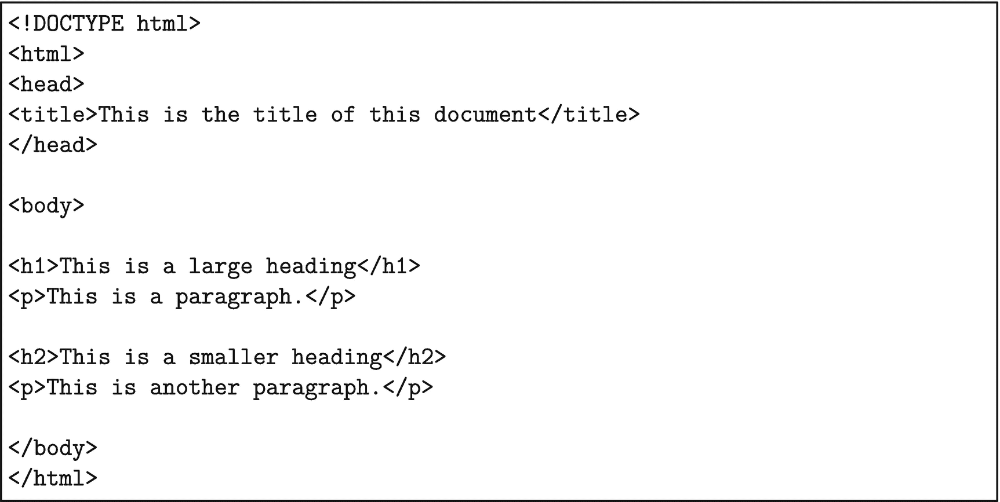

一个 HTML 文档包含一个带有标题的头部区域、一个带有主标题和子标题的主体区域，以及一个页脚区域。

图 6-2

一个简单的 HTML 文档

HTML 是一个极其相似的概念。它是一种标记语言，意味着它由文本以及告知计算机如何解释这些文本的附加文本组成。图 6-2 展示了一小段 HTML，让你感受一下这种语言。

如你所见，HTML 文档主要由文本组成，并在文本周围编写了附加代码，以告知计算机该文本应起什么作用。用 HTML 的行话来说，这些代码被称为`标签`。`<p>` 是一个`开始标签`，它告诉计算机将该段文本视为一个段落；`</p>` 是一个`结束标签`，它告诉计算机这是该段落的结束。类似地，`<h1>` 告诉计算机将该文本视为一个大标题（即一级标题），`</h1>` 告诉计算机这是这个大标题的结束。HTML 有一套预定义的标签可供你用来构建文档。通过在文本文件中排列文本和标签，你可以轻松构建自己的网页！

 一只手形图标，食指指向右侧方向。动手实践

1.  打开你的文本编辑器，将图 6-2 中所示的 HTML 文档输入到一个新文件中。

2.  保存文件，使其扩展名为 `.html`。

3.  打开你的浏览器。不要输入 URL，而是转到“文件”菜单并选择“打开”。打开你刚刚保存的文件。

4.  观察浏览器如何显示每个被标签标记的文本块。

5.  同时观察浏览器的地址栏。如果它显示了协议，请注意它*不是* HTTP URL，而是 `file:` URL。这是因为它是从你的硬盘驱动器获取文件，而不是从网络服务器。

6.  返回你的文本编辑器，添加一个新标题和一段新文本，然后保存文件。

7.  点击浏览器上的刷新按钮查看你的更改。

8.  在单词之间以及标签前后添加额外的空格。保存文件并重新加载浏览器。有什么变化吗？除了分隔单词外，空白（称为`空白字符`）在 HTML 中是不起作用的。如果你需要调整间距，必须使用标签来告诉计算机你想要做什么。

## 6.2 HTML 文档的组成部分

现在你已经了解了 HTML 文档的样貌，是时候深入探究其格式了。首先需要了解的是标签的基本规则。这些规则很重要，请特别留意。

1.  所有标签都由尖括号（即 `<` 和 `>`）括起来。

2.  几乎所有标签都有起始标签和结束标签。对于段落标签而言，起始标签是 `<p>`，结束标签是 `</p>`。它们之间唯一的区别在于结束标签在标签名前有一个正斜杠（`/`）。如果你忘记了结束标签，许多浏览器不会报错，但你可能会得到奇怪的结果。

3.  成对的起始标签和结束标签必须完整地包含在其他成对的起始标签和结束标签之内。例如，`<p>hello <i>there</p></i>` 是不允许的，但 `<p>hello <i>there</i></p>` 是允许的。在第一个（错误的）例子中，`<p>` 标签起始于 `<i>` 标签**之前**，但结束标签 `</p>` 却出现在结束标签 `</i>` 之前。因此，`<i> </i>` 这对标签并未完整地包含在 `<p> </p>` 这对标签之内。

4.  对于少数没有结束标签的标签，你可以将起始标签和结束标签合并在一起。`<br/>` 没有结束标签，因此它被写成 `<br />`。这被称为自闭合标签。

5.  起始标签、结束标签以及它们所包含的内容和标签的组合称为一个`元素`。`<p>` 是一个标签，但 `<p>hello</p>` 是一个元素。

6.  空白（称为空白符）用于分隔单词，但别无他用。HTML 会忽略单词之前、之间和之后的所有额外空格。这包括换行符和用于对齐的空格。所有这些都由标签控制，而不是由你手动添加空格来完成。

从现在开始，我将仅用起始标签来指代标签。除非我们明确说明，否则你应始终假定起始标签需要对应的结束标签。

现在，你可能已经注意到，在我们原始的 HTML 示例中，有几个标签似乎没有起到任何作用——即 `<html>`、`<head>` 和 `<body>`。`<html>` 标签被称为文档根标签。它是包含所有其他标签的标签，并且是必须存在的。在本书中，如果你看到某个示例没有 `<html>` 标签，那它只是展示了文档的一个片段——其余部分默认为存在，但我们只展示重要部分以使示例更清晰。每个文档的第一个标签都应该是 `<html>` 标签，并且每个文档都应以 `</html>` 结束标签结尾。`<head>` 标签包含用于告知浏览器**关于**文档的信息的标签，但这些信息不会在文档本身中显示。在给出的示例中，`<head>` 标签包含一个 `<title>` 标签，该标签告知浏览器文档的标题。浏览器通常会在窗口顶部显示此标题，并且在你将该页面加入书签时也会用到它。`<body>` 标签告知浏览器，我们开始进入文档中应被显示的部分。

你将在大多数 HTML 文档中遇到的一些基本标签包括：

*   `<html>` – 这是文档中所有其他标签的主要容器。

*   `<head>` – 此标签包含向浏览器提供**关于**页面的信息（而非页面内容本身）的标签。

*   `<title>` – 此标签告知浏览器你页面的标题。

*   `<body>` – 此标签包含实际的页面内容。

*   `<h1>` – 此标签用于页面中最大的标题。

*   `<h2>` – 此标签用于页面中的副标题。HTML 还有更小尺寸的副标题，直至 `<h6>`。

*   `<p>` – 这是段落标签。浏览器通常会在任意两个段落之间添加一个空行。

*   `<br/>` – 这是一个换行符。此标签是自闭合的，用于在文档中的任何位置强制换行。

*   `<b>` – 此标签告知浏览器使用粗体字体。

*   `<i>` – 此标签告知浏览器使用斜体字体。

*   `<u>` – 此标签告知浏览器为其内容添加下划线。

*   `<div>` – 这是一个通用标签，用于将内容块分组在一起。

*   `<span>` – 这是一个通用标签，用于将段落或其他文本块中的字母或单词分组在一起。

另外，请注意我们以 `<!DOCTYPE html>` 开头文件。这被称为`文档类型声明`，它告知浏览器，没错，这确实是一个 HTML 文档。

**练习题**

1.  如果 `<h4>` 是起始标签，那么它的结束标签是什么？

2.  以下哪段 HTML 片段使用了无效的标签？为什么？

## 6.3 为标签添加属性

HTML 标签还可以拥有所谓的`属性`。属性用于修改或特化一个 HTML 标签。例如，大多数标签可以接受一个 `width` 属性，该属性告知浏览器标签内容的宽度应该设置成多大。图 6-3 展示了一个属性示例。

如你所见，该属性被放置在起始标签**内部**。其格式为 `attribute-name="value"`。该值应始终用引号括起来，不过你可以选择单引号或双引号。^(⁵) 引号内允许的值取决于你正在使用的特定标签。你还可以在同一个标签上指定多个属性。如果指定多个属性，只需用空格（**而不是**逗号）分隔它们，并且可以根据需要添加任意数量的属性。

我应该指出，以这种方式设置宽度在 HTML 中实际上是不被提倡的（你将在第 7 章中看到更好的方法）。我在此提到它，仅仅是因为它能以简单的方式说明属性的概念。

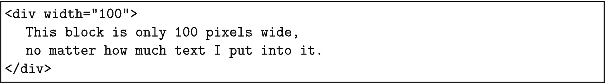

`图 6-3` – 标签属性示例

## 6.4 引用其他文档的标签

如前所述，`超文本`的价值之一在于其引用其他文档的能力。HTML 页面引用其他文档，要么是为了将其包含到当前页面中，要么是在用户执行操作时链接到这些文档。你最常见的标签如下：

*   ``——该标签用于在标签放置的位置将图像包含到页面中。`src`属性告诉浏览器在哪里找到图像。注意，``是一个自闭合标签。使用标签``会将一张猫咪图片放入你的网页中。

*   `<a>`——该标签用于在点击标签内的文本时链接到另一个文档。`href`属性（即超文本引用）告诉浏览器下一步要访问哪个 URL。使用标签`<a href="https://mindmatters.ai/">点击我</a>`会创建一个指向 MindMatters 新闻网站的链接。

*   `<link />`——该标签用于将样式表连接到你的 HTML 页面。我们将在第 7 章中详细介绍样式表。注意，`<link />`是一个自闭合标签。

*   `<script>`——该标签用于将 JavaScript 程序连接到你的 HTML 页面。我们将在第 8 章开始介绍 JavaScript。

文档中这些标签的几个示例如图 6-4 所示。

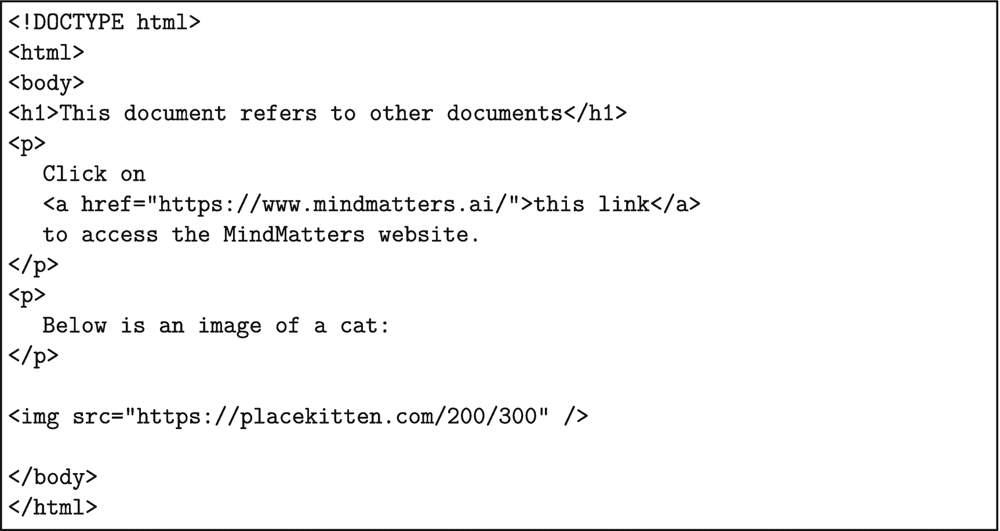

*一个 HTML 文档包含头部部分、带有主标题的主体部分以及页脚部分。主体部分包含一个指向 MindMatters 网站的链接标签和一个猫咪图片的图像源标签。*

`图 6-4` – 展示引用其他文档标签的示例文档

如本例所示，`<a>`标签创建了一个指向其他文档的链接。要链接的文档放在`href`属性中，而链接文本放在开始和结束标签之间。最后，``标签引用指定 URL 处的图像文件，并将其包含在页面中。


*一个手形图标，食指指向右侧方向。*

### 练习题

*   使用本节中的示例文档创建一个新的 HTML 文件。在浏览器中查看它，确保所有内容输入正确。

*   修改这个 HTML 文件。为你所有喜欢的网络去处添加链接。

*   在网上找一张你喜欢的图片。找到它的 URL（见附录 B.5）。将那张图片添加到你的网页中。

当一个文档引用另一个文档时，并不总是需要引用目标文档的完整 URL。此外，如果你需要移动一组文档，修改所有网页中的链接以指向新的 URL 会非常困难。例如，假设你拥有网站`www.example.com`。但随后有人出高价购买这个域名。现在你必须把内容转移到另一个域名下。然而，如果你的所有链接都指向`www.example.com/whatever`，你就必须逐个修改它们以指向新域名！在实际场景中，考虑一下你在构建网站新版本的情况。当你还在构建时，当前网站需要保持原样，所以你把测试版本放在另一个网站上。如果当你迁移时所有链接都能正常工作，那不是很好吗？完整的 URL 做不到这一点，因为它们指向的是互联网上的精确位置。一旦我们改变位置，URL 就失效了。

为了解决这个问题，URL 可以被重写为相对于当前文档位置的`相对路径`。假设我有一个文件在`www.example.com/fruit/oranges.html`，另一个在`www.example.com/fruit/apples.html`，并且它们相互链接。按照目前展示的方案，第一个文件中的链接应该这样写：

```
查看苹果
```

第二个文件中的链接回第一个文件应该这样写：

```
我更喜欢橙子
```

这相当繁琐，尤其是当它们位于同一个目录下时（例如`www.example.com/fruit`）。

HTML 标准为我们提供了三种选择。我们一直在使用的常规 URL，也称为`完全限定 URL`或`绝对 URL`，包含了连接所需的所有数据。`相对 URL`则从*当前*URL 中获取大部分连接信息，出于链接目的，当前 URL 也称为`基础 URL`。因此，在前面的例子中，如果我们已经在查看`www.example.com/fruit/apples.html`，我们可以仅通过引用`oranges.html`来链接到另一个文件，如下所示：

```
查看橙子页面
```

这是一个相对 URL，它告诉浏览器在我们当前所在的文件夹中查找，但只需替换 URL 的最后一部分，使其指向这个新文件。使用相对 URL 不仅减少了输入量，还更容易移动文档组。只要`apples.html`和`oranges.html`保持在同一个目录下，你可以将它们移动到不同的网站或站点内的不同目录，它们的链接仍然有效。简而言之，相对 URL 使用当前 URL（包括当前目录及之前的部分）作为起点。相对 URL 只是告诉如何*从当前位置*到达文档。你可以通过相对 URL 不包含协议且不以斜杠开头来区分它和完全限定 URL。

还有其他两种 URL，它们是绝对 URL 和相对 URL 的混合体。第一种是`绝对路径`。绝对路径告诉浏览器使用当前协议和服务器，但将路径完全替换为指定的路径。在我们的例子中，`apples.html`的绝对路径是`/fruit/apples.html`。注意，绝对路径*总是*以斜杠开头。如果它不以斜杠开头，则被认为是相对 URL。

最后一种 URL 是`网络路径`。这种 URL 使用当前页面的协议，但你需要指定其余所有内容。因此，`oranges.html`的网络路径是`//www.example.com/fruit/oranges.html`。网络路径很少需要用到，但如果看到它们，了解其含义是好的。


*一个手形图标，食指指向右侧方向。*

### 练习题

1.  在与你的其他网页相同的目录中，创建另一个简单的网页。

2.  从你的新页面创建一个链接到你其他页面之一。记得使用相对链接！

3.  创建另一个链接到互联网上的其他页面。

4.  保存页面，并在浏览器中打开它。

5.  测试你的链接。它们起作用了吗？如果没有，请检查浏览器中的 URL，看看浏览器认为你要求它去哪里。

## 6.5 相对 URL

相对 URL 拥有许多特性，无论是在构建网站还是在使用本书这样的教材时都非常有用。例如，由于我们创建的文件将存放在你的硬盘上，而不是网络服务器上，因此使用相对 URL 比使用指定硬盘上其他文档位置的极长的 `file:` URL 要容易得多。此外，使用相对 URL 意味着，即使你将创建的网页交给老师或家长，它们仍然能够正常工作。如果你使用 `file:` URL，那么当你的家长或老师在他们的电脑上加载这些 URL 时，所有 URL 都会出错，因为这些文件在他们电脑上的位置与在你电脑上的位置不同。相反，如果你使用相对 URL，那么只要你将所有文件一起交付，这些 URL 在新位置仍然能正常工作。出于本书的目的，每当你引用自己创建或存储在硬盘上的文件时，都应使用相对 URL；但当你引用存储在网络其他地方的文件时，则应使用绝对 URL。

相对 URL 的另一个特性是你可以用它们来引用子目录。假设你希望 `www.example.com/fruit/apples.html` 这个页面链接到 `www.example.com/fruit/exotic/rambutan.html` 文件。你会注意到，它们之间共享了大量的 URL 路径。相对 URL 告诉了你如何从当前目录到达目标文档。从 `www.example.com/fruit/` 开始，我只需要说我想去 `exotic/rambutan.html`。因此，我可以像这样链接到这个页面：

```
<a href="exotic/rambutan.html">红毛丹果实</a>
```

现在，假设我正在编写关于红毛丹的页面，并且想查看我的苹果页面。使用相对 URL 该如何实现呢？有一个特殊的目录名用于指代上级目录（也称为父目录）。它用两个点（即 `..`）表示。如果你正在编写页面 `www.example.com/fruit/exotic/rambutan.html`，并且想要链接到 `www.example.com/fruit/oranges.html`，你可以像这样编写链接：

```
<a href="../oranges.html">橙子</a>
```

你可以在 URL 中包含任意多级目录。例如，如果你正在编写页面 `www.example.com/fruit/exotic/rambutan.html`，并且想链接到页面 `www.example.com/fruit/poisonous/snowberry.html`，你应该这样写：

```
<a href="../poisonous/snowberry.html">雪莓果实</a>
```

另一个重要的特殊目录名是 `.` 目录。虽然两个点（`..`）指代父目录，但单个点（`.`）指代当前目录。这在 HTML 中很少使用，但你偶尔会见到它。

## 6.6 其他 HTML 特性

HTML 还有许多其他优秀特性。本书的目标是让你掌握足够的 HTML 知识，以便能够入门并理解你在互联网上阅读的关于 HTML 的内容。有很多标签可以执行各种不同的功能。在本节中，我们将介绍一些更常用的标签和简单特性，但这并非详尽无遗的列表。

### 6.6.1 实体

由于 HTML 使用 `<` 和 `>` 字符来表示给定文本是一个标签，那么你该如何实际编写这些字符呢？HTML 提供了实体（Entities）来指代那些要么在 HTML 格式中有特殊用途，要么难以键入的字符（例如其他语言的字符）。一个 HTML 实体以和号（`&`）开头，并以分号（`;`）结尾。常见的实体包括：

*   `&gt;` >
*   `&lt;` <
*   `&amp;` &
*   `&quot;` "
*   `&apos;` '
*   `&nbsp;` 一个“不换行”空格——即在该点不允许换行的空格
*   `&copy;` ©

### 6.6.2 列表

列表是在 HTML 中组织内容的绝佳方式。列表可以是无序的（即项目符号列表），也可以是有序的（即编号列表）。用于包裹整个列表的标签，对于无序列表是 `<ul>`，对于有序列表是 `<ol>`。然后，无论是哪种列表，每个列表项都包含在 `<li>` 标签中。

图 6-5 展示了一个简短的 HTML 片段，说明了如何使用这些列表。第一个列表将显示为项目符号列表，而第二个列表将显示为编号列表。

### 6.6.3 表格标签

除了段落、标题和列表之外，人们经常需要在网页上呈现数据表格。HTML 拥有一套专门用于显示数据表格的标签。假设我们想制作一个朋友名单，包含他们的姓名、电子邮件和电话号码。我们希望第一行是表头（例如“姓名”、“电子邮件”和“电话”），其他行是数据。为此，我们需要几个标签：

*   `<table>` 此标签包裹整个表格。

```
<ol>
  <li>我花园里的植物</li>
</ol>
<ul>
  <li>G. K. 我最喜欢的书</li>
</ul>
```

*   `<tr>` 此标签包裹一行数据。
*   `<td>` 此标签包裹单个数据单元格的内容。
*   `<th>` 此标签与 `<td>` 标签类似，但用于表头（它通常使内容变为粗体）。
*   `<thead>` 此标签并非严格必需，但通常用于包裹表格表头的一行或多行。
*   `<tbody>` 此标签也并非严格必需，但通常用于包裹表格中的数据行。
*   `<tfoot>` 类似于 `<thead>` 标签，但用于表格的页脚。

图 6-6 是一个片段，展示了如何将这些标签组合起来创建一个表格。

```
<table>
  <thead>
    <tr>
      <th>姓名</th>
      <th>电子邮件</th>
      <th>电话</th>
    </tr>
  </thead>
  <tbody>
    <tr>
      <td>杰夫</td>
      <td>jeff@example.com</td>
      <td>555-555-1234</td>
    </tr>
    <tr>
      <td>梅丽莎</td>
      <td>melissa@example.com</td>
      <td>555-555-6789</td>
    </tr>
  </tbody>
</table>
```

| 姓名 | 电子邮件 | 电话 |
| --- | --- | --- |
| 杰夫 | jeff@example.com | 555-555-1234 |
| 梅丽莎 | melissa@example.com | 555-555-6789 |

### 6.6.4 表单标签

许多网页允许你输入数据。用于输入数据的网页通常被称为“表单”。这些标签允许用户输入他们自己的值。在我们知道如何处理它们之前，它们还不会派上用场，但我们会列出其中一些标签以备将来使用。请注意，`<input />` 标签实际上可以是几种不同的输入元素。页面上显示的控件元素取决于 `type` 属性。`<input />` 标签也应被编写为自闭合标签。

*   `<form>` 此标签通常包裹其他表单标签。如果表单需要将数据提交到服务器，该目标地址通常放在 `action` 属性中。
*   `<input type="text" />` 这是一个基本的单行数据输入字段。
*   `<input type="checkbox" />` 这是一个可以选中或取消选中的单个复选框。
*   `<textarea>` 这是一个多行数据输入字段。
*   `<select>` 这是一个下拉列表。每个选项都在此标签内部使用 `<option>` 标签指定。
*   `<button>` 这是一个基本的按钮。其内部包含的文本就是按钮上的文字。

这些标签大多还有一个 `name` 属性，你可以用它来指定该字段的用途（这将在以后变得重要），以及一个 `value` 属性，用于给字段设置初始值，或者在复选框的情况下，指定该复选框所代表的值。

图 6-7 展示了一个表单的示例 HTML 片段（注意：这实际上并不执行任何操作；它只是让用户与之交互而已）。

### 6.6.5 标准属性

每个 HTML 元素都有几个标准属性。其中对本书较为重要的有三个：`id`、`class` 和 `style`。`id` 属性本质上为你的 HTML 元素赋予了一个在文档中唯一的名称。我们可以利用此属性来定位该元素，以便通过 JavaScript 进行处理或设置样式。请注意，如果同一页面中有两个元素具有相同的 `id` 属性，浏览器并不会报错，但这可能会引发细微的错误。

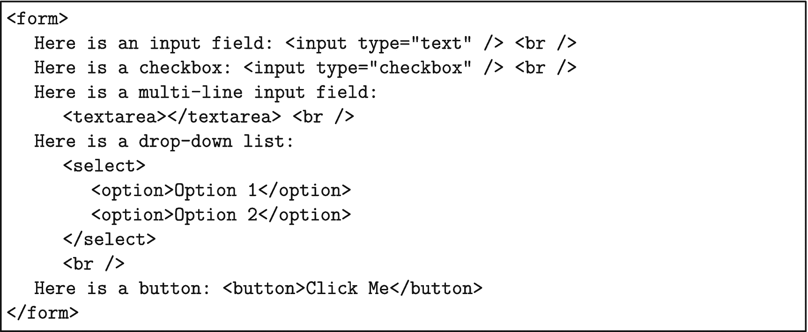

一个 HTML 代码片段，展示了表单元素列表：用于文本输入的 input 字段、复选框、用于多行输入的文本区域、带有选项列表的 select 标签（用于下拉菜单），以及用于按钮的 button 标签。

**图 6-7** 表单元素演示

`class` 属性则更偏向于一种临时属性——你基本上可以根据需要随意使用它。通常，它用于将某些项目归为一组，以便赋予它们相似的样式，或者让整个元素组被 JavaScript 处理。

最后，`style` 属性可用于显式设置元素的样式信息（参见第 7 章）。

### 6.6.6 注释、声明、处理指令和 CDATA 块

当我们讨论一种语言的结构时，我们谈论的是它的语法。语法规定了哪些类型的字母、符号和特性允许出现在哪些位置。例如，标签是 HTML 语法中不可或缺的一部分。为了很好地理解什么是语法，或许举一个违反语法的例子会有所帮助。我们看到过像 `<p><i>This is an italicized paragraph</i></p>` 这样的标签，这是完全合法的。但是，想象一下，如果我们不小心输入了 `<p <i>>` 而不是 `<p><i>`，这就构成了语法错误，意味着我们没有正确遵循 HTML 的结构。

语法之所以重要，是因为计算机正是通过它来理解我们试图做什么。

到目前为止，我们讨论的 HTML 语法的两个主要单元是标签和实体。还有其他一些重要的语法单元需要了解，但它们在本书中很少用到。

一个常见的语法单元是 HTML 注释。在编写任何类型的代码时，大多数编程语言和标记语言都允许开发者为其代码添加注释。注释是程序员为自己或任何其他查看代码的开发者所写的笔记。它大致表述为“我这样做是因为用其他方法遇到了困难”或“代码如此编写的原因”。它包含了一些查看代码时不易立即察觉的重要信息，但浏览器会忽略这些信息。

在 HTML 中，与大多数其他计算机语言一样，注释本质上会被浏览器忽略。这一特性使得注释有了另一个用途——临时禁用代码的某些部分。假设你构建了一个大型网页，并且想看看在没有一大段代码的情况下页面是什么样子。与其删除那段代码之后再重新输入，不如将其包裹在注释中，这样浏览器就会忽略它。这被称为`注释掉`代码，因为你通过使用注释将代码从文档或程序中移除了。

那么注释长什么样呢？注释很简单。它们以 `<!--` 开头，以 `-->` 结尾。以下是一个包含几个注释的简短 HTML 片段：

```
带注释的网页

这是一个列表项
这个列表项不可见，因为它已被注释掉
-->
另一个列表项
```

HTML 的另一个特性是声明。声明用于标识并可能扩展有效标签、属性和实体的列表。通常，你唯一会看到的声明是 HTML `文档类型`声明，它告诉计算机你正在处理的文档的基本类型，以便其知道哪些标签是有效的以及它们的含义。HTML 文档类型声明告诉计算机：没错，你确实正在查看一个 HTML 文档。其基本形式如下：`<!DOCTYPE html>`。它总是被放置在第一个 `<html>` 标签*之前*。还有其他更花哨的写法，但其含义基本相同——是的，计算机，你正在查看一个 HTML 文档。

另一个特性是处理指令。这些指令用于向文档处理器（如浏览器）提供关于如何处理文档的特殊信息。然而，除了极少数处理指令外，这个特性几乎完全未被使用。处理指令看起来像一个开始标签并且可以包含属性，但在处理指令名称之前和右尖括号之前都有一个问号，如下所示：

```
<?指令名称和属性?>
```

你唯一可能看到的处理指令是下面这个，被称为 XML 声明：

```
<?xml version="1.0" encoding="UTF-8"?>
```

# 7. 层叠样式表入门

## 7.1 层叠样式表的起源

当 HTML 最初被开发时，它完全用于传递信息。HTML 最初被构建为一种浏览和查看文档的简单方式。因此，HTML 文档从不美观，但非常实用。此外，所使用的标签与标签所标记文本在文档中的目的之间存在直接对应关系。例如，`<h1>` 标签意味着给定的文本是一个主标题。如果你查看 HTML 代码本身，你会发现带有该标签的文本，从而确切地知道它的含义。事实上，如果你认识这些标签，你几乎可以像在浏览器中阅读渲染后的文档一样轻松地阅读带有标签的文档源码。

然而，随着越来越多的人开始使用 Web，HTML 开始服务于除了纯粹信息性目的之外的更多用途。现代 Web 更加以用户为中心，并融合了许多其他类型的媒体和功能，包括导航、娱乐、广告和品牌塑造。在早期，为了适应这些新用途，HTML 的标签和属性集不断扩展。然而，问题在于 HTML 最初的美感和简洁性丢失了。网页变成了由难以辨认的标签组成的复杂混乱体。此外，不同的浏览器对标签的渲染方式略有不同。因此，要编写一个网页，你不仅需要知道每个标签*做什么*，还需要知道该标签在每个浏览器中*看起来*是什么样子，以及如何让它们协同工作以产生一个好看的网页。

控制 Web 标准的组织认识到了这个问题，并决定让 HTML 回归其本源。为了实现这一点，他们试图将**内容**与**表现**分开。内容指的是网页旨在传达的数据。表现指的是该页面在用户眼中看起来的样子。标题、段落、图表等都属于内容。背景、格式、布局、颜色、字体和装饰都属于表现。

为此，他们从 HTML 中移除了样式，并创建了一种新的语言，称为**层叠样式表**（简称 CSS），来告诉浏览器 HTML 应该看起来如何。在这个新范式下，文档的结构和内容由 HTML 编写。这些内容应该如何布局、格式化和呈现，则由 CSS 编写。用户与内容之间的高级交互由 JavaScript 编写。这种分离并不完美，但这是一个巨大的改进。

> 一个手形图标，其食指指向右侧。技术的演进。

### 技术演进中的重构

有趣的是，我们可以观察到技术演进的方式。`HTML`的演进过程与许多其他技术非常相似。第一个版本非常简洁直接，很好地满足了用户的需求。

然而，它的成功也带来了许多问题。因为每个人都在使用它，新的用户（有着与原始用户不同的需求）也开始使用它。为了适应这种情况，开发者们简单地向`HTML`添加了大量功能。但很快人们发现，简单地添加功能只会让事情变得混乱。虽然这扩展了`HTML`的能力，但代价是让所有`HTML`工作变得更加复杂（且昂贵）。

`HTML`演进的下一步是重新评估`HTML`工作的不同方面以及它们所服务的不同需求。事实证明，有几个需求是明显不同的：处理内容的需求、以视觉愉悦的方式展示内容的需求，以及使内容具有交互性的需求。

因为这些需求是可以区分的，它们被**重构**为完全独立的组成部分。`HTML`负责内容，`CSS`负责呈现，而`JavaScript`负责交互。`HTML`是一种优秀的内容语言，但并不是好的样式语言。因此，这种新的架构让`HTML`能够专注于它最擅长的领域，而将样式和交互留给更适合这些任务的其他技术。

重构在技术演进中是一种常见的现象。单词"refactoring"（重构）基于数学中的"factoring"（因式分解）概念。在数学中，因式分解指的是将一个数字分解为其质因数。数字`15`的质因数是`5`和`3`。在技术领域，重构也是类似的：重新评估已有的技术，寻找更基础的、可以将技术划分而成的组件。这通常发生在技术的发展导致其变得过于复杂时。此时，就需要重新评估，看看是否存在技术可以划分成的*更简单*的组件。

重构并非万能药，必须谨慎使用。如果过早进行重构，可能无法清晰看到所有不同的组件，并且可能会以让进展变得更加困难而非更容易的方式进行重构。不过，在大多数情况下，重构往往能给旧技术带来新的活力，因为它同时提高了灵活性和可理解性。

### CSS 文档的结构

理解`CSS`基本操作的最佳方式是亲自实践。首先，创建一个名为`basic.css`的文件，内容如图 7-1 所示（和往常一样，请确保*完全*按照所示内容输入）。

这个文档表达的意思是：

- 所有`<h1>`标签内的文本应显示为蓝色、20 点字号的字体（**点**是排版中的度量单位——1 点等于 1/72 英寸）。
- 所有`<p>`标签内的文本应显示为黑色、12 点字号的字体。

现在，在与`basic.css`相同的目录下创建一个名为`basic.html`的文件，内容如图 7-2 所示。

将这两个文件关联起来的部分是`<link>`标签。`<link>`标签可以用于指定各种相关的文档（其链接的内容由`rel`属性指定），但它最重要的用途是指定网页要使用的样式表。`<link>`标签所引用的文档列在`href`属性中。简而言之，上面文档中的`<link>`标签表示使用`basic.css`文件作为其样式表。


图 7-2 使用 CSS 的网页

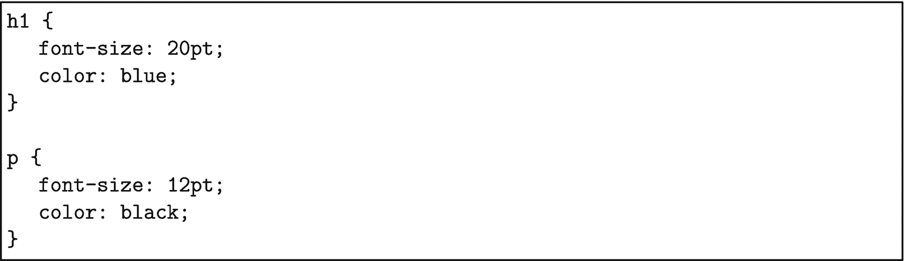

图 7-1 一个简单的 CSS 文档

如果你用浏览器打开这个文件，你会发现它确实按照我们的指定渲染了文档。如果没有，请回头检查并尝试找出错误（首先，确保两个文件在同一个目录下）。

`CSS`文件格式相当简单明了。它由两个主要部分组成：选择器和属性。`CSS`属性列出要使用的样式，而`CSS`选择器则告诉这些样式要应用于哪些`HTML`元素。所以，在我们查看的文件中，`h1`和`p`就是选择器。选择器后面跟着用花括号（`{`和`}`）包裹的属性列表，属性列表说明了要在文本上使用哪些样式。

我们在图 7-1 中使用的两个属性是`color`（定义文本的颜色）和`font-size`（定义文本使用的字号）。`CSS2`定义了 98 个可供使用的属性，而`CSS3`定义了更多。不过，入门所需的属性并不多。本章将只介绍最重要的属性，但你可以在[`www.w3schools.com/cssref/`](http://www.w3schools.com/cssref/)上看到相当全面的`CSS`属性列表。

### 理解选择器

上一节中使用的`CSS`选择器列出了要设置样式的标签名称。然而，这样的选择器用途有限，无法提供我们制作真正优秀文档所需的灵活性。

假设你有不同类型的段落想要以不同的方式进行布局。你希望一个段落是蓝色背景上的红色文本，另一个段落是黑色背景上的绿色文本。为了实现这一点，`CSS`文件必须能够区分这两种不同类型的段落，但`HTML`只提供了一种段落标签（`<p>`）。为了实现这一目标，`CSS`也可以使用属性来选择一组属性应用于哪些标签。为了促进这一过程，`HTML`定义了一个`class`属性，该属性适用于*所有*`HTML`标签，可以用于编写者想要的任何目的。通常，它们用于区分标签，以便`CSS`进行处理。


图 7-3 使用类的 HTML 文件

让我们看看这是如何工作的。创建图 7-3 所示的 HTML 文件，并将其命名为`classes.html`：

这个文档使用`<div>`标签将文档分为两个部分，每个部分都有一个标题和一个或多个段落。这些部分通过`class`属性相互区分。在第一个部分中，段落之间也通过相同的方式区分。

`CSS`允许我们使用`HTML`属性为同一个标签的不同用途提供特定的样式。

为了看到实际效果，在与上一个文件相同的目录下创建一个名为`classes.css`的文件，内容如图 7-4 所示。输入完`HTML`和`CSS`文件后，打开`classes.html`文件，看看结果是什么样子。

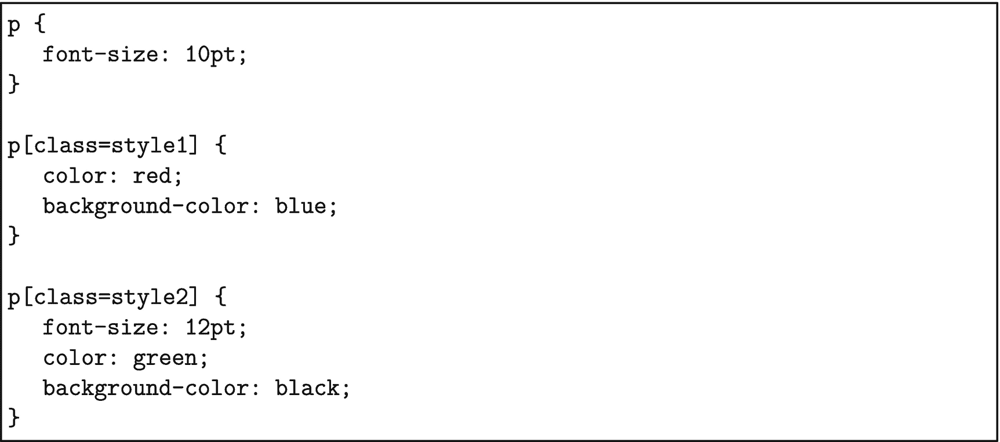

图 7-4 为类设置样式的 CSS 文件

现在让我们看看图 7-4 中指定的样式如何在 HTML 上生效。第一个选择器与之前一样——它由一个标签名及其后的样式属性组成。它规定段落标签的字体大小应为十磅。

然而，下一个选择器则不同。这个选择器写的是 `p[class=style1]`，这意味着它*仅*适用于那些 `class` 属性值为 `style1` 的 `<p>` 标签。其属性表明，带有 `style1` 类的段落应为蓝底红字。请注意，带有 `style1` 类的 `<p>` 标签也*会*匹配第一个选择器，因为第一个选择器适用于*所有* `<p>` 标签。因此，原始选择器中设置的任何属性仍然会被应用，所以它同样会使用十磅字体。

最后一个选择器与前一个类似，区别在于它被设置为匹配带有 `style1` 类的段落。它将以黑底绿字显示该段落，并将字体大小设置为 12 磅。这与第一组 CSS 属性中设置的、将所有 `<p>` 标签字号设为十磅的设置存在冲突。然而，*由于这些属性的选择器更具体*，它的属性会取代更通用选择器中的属性。

```
p {
    font-size: 10pt;
}
p[class=style1] {
    color: red;
    background-color: blue;
}
p[class=style2] {
    color: green;
    background-color: black;
    font-size: 12pt;
}
```

---

# 脚注

---

# 6.6.7 回顾

在本章中，我们介绍了 HTML 的基础知识，它是什么，以及如何编写它。我们学习了以下内容：

*   标记语言是一种文本文档，它使用标签（同样是文本）来指定文档不同部分的结构和功能。
*   HTML 是互联网上用于网页的标记语言。
*   在 HTML 中，空格本质上被忽略——取而代之的是使用标签来标记段落和换行的位置。
*   URL 指定了互联网上文档的位置。
*   一个 HTML 文档可以使用 URL 引用互联网上的另一个文档。
*   可以使用相对 URL 来引用同一网站上的其他相关文件。
*   只要文件被一起移动，相对 URL 可以轻松地保持文档链接的可用性。
*   HTML 有许多适用于各种不同情况的标签。
*   标签可以拥有属性，属性进一步特化了它们的功能。
*   `id`、`class` 和 `style` 属性可以应用于任何标签。

# 6.6.8 应用你所学到的知识

1.  创建一个新的 HTML 文件。在同一目录下放置一张图片（扩展名为 `.jpg` 或 `.png`）。你能想出如何使用相对 URL 编写 `` 标签来将图片包含到你的网页中吗？
2.  创建一系列三个相互关联且主题相同的网页。在网页顶部放置指向组内其他每个页面的链接。进行测试，确保你能够在浏览器中导航它们。
3.  浏览本章的标签列表。修改你的页面，使每个页面都有一个或多个标题，并且你的页面序列至少包含一个表格、一个列表和一个实体。
4.  访问几个你最喜欢的网站，并查看该网站几个页面的 HTML（参见附录 B.4）。识别出你认识的标签和你不知道的标签。在互联网上查找至少两个你不熟悉的标签。当前版本 HTML 的官方标签列表可在 [`www.w3.org/TR/html-markup/elements.html`](http://www.w3.org/TR/html-markup/elements.html) 找到。
5.  当浏览不同网站时，留意它们的组织方式和布局。哪些类型的内容是所有网站共有的？是否有常见的布局方式？网页本身的基本结构及其在网站上的组织被称为网站的**信息架构**，也称为 IA。你能勾勒出网页的基本布局——他们把菜单放在哪里，把图片放在哪里，把内容放在哪里等吗？你能画出一个你在网站上从一个页面导航到另一个页面的地图吗？

---

如果使用了此标记，它必须位于文档的开头、`<!DOCTYPE>` 声明之前，甚至在任何空行或空白字符之前。它告知浏览器在处理 HTML 文档时使用特殊的、更严格的规则。例如，如果不使用此标记，浏览器对于 HTML 标准的小违规行为会更加宽容。

另一个偶尔会看到的特性是 CDATA 区段。当需要在文档中写入大量尖括号，但又不想为每个尖括号都编写实体时，通常会使用 CDATA 区段。CDATA 区段告知浏览器将文本视为纯文本，不要尝试查找标签、注释或实体。CDATA 区段以 `<![CDATA[` 开头，以 `]]>` 结尾。

图 6-8 展示了一个简短示例。

许多浏览器并非在所有情况下都完全支持 CDATA 区段，因此最好避免使用它，但了解什么是 CDATA 区段是好的，以防万一遇到。

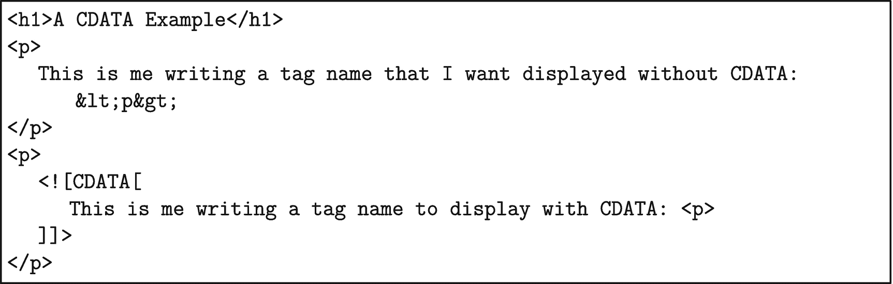

一个 HTML 的 CDATA 代码以小于号、感叹号、左方括号、`CDATA`、左方括号开头，并以两个右方括号和一个大于号结尾。

**图 6-8** 一个 CDATA 示例

一个 12 行的 CSS 代码程序，展示了带有 class 样式 1 和 2 的三个段落的字号、颜色和背景色。

```
图 7-5 使用简化类表示法的 CSS 文件
```

你可以通过任意属性选择 HTML 元素。不过，通过 `class` 属性进行选择非常常见。事实上，它如此常见，以至于有了一种专门的简化表示法来按类选择。对于选择器，我无需写成 `p[class=style1]`，而可以简写为 `p.style1`。因此，如果我使用这种简化表示法重写我的 `classes.css` 文件，它将如图 7-5 所示。这不仅更容易编写，也更容易阅读！

CSS 提供了丰富的选择器，让你能够以非常动态的方式为文档设置样式。你可以拥有表示其他标签内部标签、前面有其他标签的标签，以及多种其他选择 HTML 元素进行样式设置的方式。然而，本书仅涵盖理解如何编写网页程序所需的最基本的 CSS 元素，因此我们不会对 CSS 选择器进行更深入的探讨。

## 7.4 CSS 盒模型

为了更深入地理解 CSS 样式的工作原理，了解 CSS 如何看待网页上的内容至关重要。这被称为 CSS“盒模型”，因为 CSS 从方框的角度来思考网页。CSS 有多种审视内容的方式，但主要有两种——要么作为文本行（称为*内联*样式），要么作为矩形框（称为*块级*样式）。还有其他更专用的结构，例如表格、列表和弹性布局结构，但本章将只关注内联和块级样式。其他样式包含许多复杂性，超出了本书的讨论范围。

我们处理过的大多数标签，如 `<div>`、`<p>`、`<h1>`、`<h2>` 等，默认情况下都是块级样式标签。这意味着在生成内容时，浏览器会将给定元素放入一个矩形框中。除非另有指定，否则该框的宽度将尽可能宽（即其容器的尺寸），高度则足以容纳所有内容。内联标签，如 `<a>` 和 `<span>` 标签，主要用于段落*内部*的文本。因此，它们并非严格的矩形框，因为文本可能从一行的中间开始，并换行到下一行，从而产生不规则的形状。

所以，块级标签用于设置段落、段落组以及其他块状内容的样式，而内联标签则用于设置段落（或其他块级元素）*内部*文本的样式。你也可以使用 `display` 属性将 HTML 元素从内联更改为块级，反之亦然。通过使用 `display: block;` 或 `display: inline;` 设置该属性，你可以强制 HTML 元素以不同于其默认方式的行为表现。

通用盒模型如图 7-6 所示。块级元素以直接的方式使用盒模型的所有部分，而内联元素由于其内容的不规则形状，有时行为会有点奇怪。

CSS 为块级元素创建的每个框都是一个矩形内容区域，周围环绕着内边距、边框和外边距。它们以如下方式协同工作：

- **内容**是你放在元素内部的 HTML，无论是纯文本、其他标签（甚至可能什么都没有）。
- **内边距**是紧挨着内容周围的区域（可以分别为每一边设置内边距大小）。
- **边框**是环绕内边距的一条线（通常是实线）。
- **背景**（如果已设置）会延伸到内容、内边距和边框的后面。

```
一个由 4 层同心矩形组成的示意图，分别标注为内容、内边距、边框和外边距。
```

**图 7-6** CSS 盒模型

- **外边距**是边框外部的区域。然而，外边距略有不同，因为它是一个元素与下一个元素之间的`最小`间距。因此，如果相邻的两个元素都设置了外边距，则只会使用两者中较大的那个外边距（不会将两者相加）。

## CSS 盒模型

内容区域的大小可通过 `width` 和 `height` 属性手动设置。若未设置宽度，则宽度会被自动调整，使得整个盒模型（包括内容、内边距、边框和外边距）能够适应其包含盒（若无其他包含盒，则适应屏幕）的完整宽度。随后，根据已确定（或手动设置）的宽度，高度会设置为容纳内容所需的任意值。通常你无法看到所有这些部分（尤其是边框），因为它们宽度为零。不过，你可以使用 CSS 为任意盒模型的这些方面分别设置大小和其他属性。

行内内容因其不规则的形状，可以拥有内边距和边框，但外边距的行为较为特殊。本质上，对于行内元素，顶部和底部的外边距会被忽略，而左右外边距仅在该元素的起始和结束位置生效。然而，如果行内内容跨越多行，左外边距仅在第一行生效，右外边距仅在最后一行生效。

如果回到图 7-3 中的 HTML 代码，我们可以修改 CSS 样式表（`classes.css`）来展示盒模型的工作方式。该 HTML 通过 `<div>` 标签分为两个部分。我们将为每个 `<div>` 标签设置边框、背景、内边距和内部宽度。图 7-7 展示了要使用的代码。

这将产生两个大盒子（每个部分对应一个）和几个小盒子。请记住，除非另有约束，盒模型会占据尽可能多的宽度。顶部的盒子占据页面的整个宽度（减去其自身周围的外边距）。该盒子内部的盒子也占据尽可能多的宽度，但它们会受到其外部盒子的外边距、边框和内边距的约束。

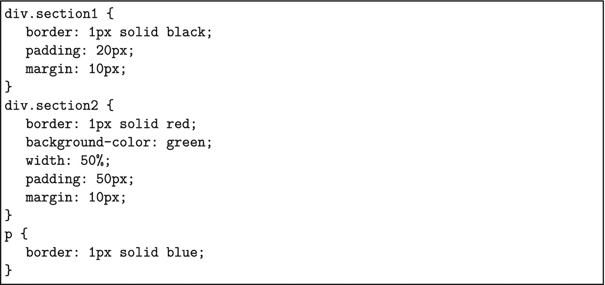

一段 15 行的 CSS 代码包含了第一部分的过程、内边距和外边距细节，以及第二部分的边框、背景、宽度、内边距和外边距。

**图 7-7** 盒模型的 CSS 示例

第二个盒子并未横跨整个屏幕，因为我们将其宽度设置为 `50%`。因此，它仅横跨了页面的一半宽度。同样地，该盒子内部的盒子也受限于此新尺寸。

虽然我们将所有方向上的外边距、内边距和边框都设置为相同值，但我们也可以为不同方向设置不同值。例如，我们可以不直接使用 `padding`，而是分别设置 `padding-right`、`padding-left`、`padding-top` 和 `padding-bottom` 为不同的值。

到目前为止，我们已经看到了 CSS 中几种不同的尺寸单位。CSS 提供了多种度量单位，但最常见的是：`pt`（点）、`px`（像素）、`in`（英寸）、`mm`（毫米）以及 `%`（相对于包含尺寸的百分比）。此外，CSS 还拥有一些相对于当前所选字体大小的单位：`em` 是当前字体中字母“m”的大小，`ex` 是当前字体中字母“x”的大小，`ch` 是当前字体中数字“0”的大小。`rem` 则是页面根元素字体大小中字母“m”的大小。`rem` 单位非常流行，因为如果在各处都使用它，只需更改根元素的字体大小，即可自动缩放整个网页。

## CSS 的其他能力

本章内容仅是 CSS 的冰山一角，但希望你已经对其功能和工作原理有了初步的了解。除了目前已讨论的功能外，CSS 还具有以下能力：移动盒子、将数据放入表格、为列表添加编号、生成少量内容、使用图像作为背景、显示和隐藏元素，甚至更多。此外，CSS 还可以根据屏幕尺寸调整布局。例如，如果你的页面内容很多，但只在屏幕较小（如手机）时希望显示其中一小部分，CSS 允许你根据屏幕尺寸隐藏或显示不同元素，或为它们应用不同的样式。能够轻松适应各种截然不同屏幕尺寸的设计，通常被称为`响应式`布局。

多年来，人们开发了许多不同的 CSS 扩展，用于实现额外功能，例如动画、部分 3D 操作、渐变背景（一种颜色平滑过渡到另一种颜色）等。这些扩展并非在所有浏览器上都得到支持，但每年都会有更多功能可供开发者使用。

要领略 CSS 惊人的灵活性，你应该查看一下 CSS Zen Garden，网址是 [`www.csszengarden.com`](http://www.csszengarden.com)。这是一个样式集合，所有样式都用于展示`同一张网页`，唯一的区别是所使用的 CSS。这种方式能够实现的创造力简直令人难以置信。同时需要注意的是，这之所以成为可能，正是由于 HTML 被重构为独立的内容和设计组件。因此，你确实只需通过替换样式表就能改变整个网站的设计。在 CSS 出现之前，这样的更改需要重写整个网站。而现在，只需要重写样式表即可。

### 本章回顾

本章涵盖了层叠样式表的基础知识。我们学到了以下内容：

*   技术通常通过将旧的单体技术重构为不同概念来发展。
*   层叠样式表（CSS）是在 HTML 被重构以分离网页内容、呈现和交互性时发展起来的。
*   CSS 文件用于处理 HTML 内容的呈现。
*   CSS 允许 HTML 容纳网页内容，而无需考虑其显示方式。
*   CSS 通过将一系列样式属性应用于由选择器指定的 HTML 元素来工作。
*   CSS 选择器通常基于标签名称和属性值。
*   CSS 基于 CSS 盒模型进行页面布局，其中每个 HTML 元素在页面上被分配一个矩形框，并拥有自己的内边距、边框和外边距。
*   仅通过更改样式表，就能为 HTML 内容实现多种多样的布局，其效果令人惊叹。
*   由于页面或页面集的样式存在于外部文件中，CSS 允许通过仅更新共享的 CSS 文件来改变整个网站的外观。

### 学以致用

1.  将图 7-3 中的 HTML 文件取出，并为其编写一个新的样式表。将标题设置为 16 点字号的字体，段落文本设置为 12 点字号的字体。在段落之间设置 12 点的间距。

2.  创建一个新的 HTML 文件和一个新的 CSS 文件。在屏幕上创建四个矩形，每个矩形具有不同的宽度、高度和背景颜色。

3.  为图 7-3 中的内容构思你自己的设计。首先，在一张纸上画出你想要的布局——尽情发挥创意！然后，试着看看当前掌握的 CSS 知识能实现设计中的哪些部分。如果你的想象力超出了现有技能，不必担心。尽力而为即可！你还可以上网查找其他 CSS 属性，让你的设计变得生动。像 `w3schools.com` 这样的网站提供了丰富的 CSS 创作资料。

4.  在 CSS Zen Garden（`csszengarden.com`）上找到你最喜欢的设计。页面某处有一个“查看该设计的 CSS”链接。点击该链接，看看能否理解 CSS 文件的作用。如果有很多不懂的地方，不必担心。专注于那些你*确实*理解的部分。

## 8. 你的第一个 JavaScript 程序

到目前为止，我们已经介绍了网页内容（使用 HTML）和呈现（使用 CSS）的基础知识。如前所述，HTML 是一种*标记语言*，用于告诉计算机文本的结构。CSS 是 HTML 的对应物，作为一种*样式语言*，用于告诉计算机你希望 HTML 如何呈现。这两者都是有限且专用的文档语言。它们告诉计算机一个或一组文档的静态结构，但并不执行任何功能或计算。无论是 HTML 还是 CSS，都不是真正通用的**编程语言**。因此，为了给网页添加交互和计算功能，我们需要使用 JavaScript 编程语言。本章将介绍一个简短而简单的程序。不过，详细阅读本章非常重要，因为我们将介绍许多在讨论程序和编程语言工作原理时会用到的术语。

### 8.1 JavaScript 简史

JavaScript 由布兰登·艾奇（Brendan Eich）于 1995 年创建，当时他就职于网景公司（Netscape，现为 Mozilla）。JavaScript 是网络工作方式的一场革命，因为它将网络从一个主要是相互链接的文档群体，转变为一个真正沉浸式的交互环境。许多开发者（包括我自己）最初都对 JavaScript 的实用性持怀疑态度。然而，多年来它已经证明了自己的价值。JavaScript 刚发布时，其他几家供应商曾试图通过推出自己的脚本语言与之竞争。其中最主要的是 `VBScript`，由微软从 Internet Explorer 3（1996 年）版本开始实现。但到了 2019 年，所有浏览器都已正式移除对 `VBScript` 的支持。

还有其他技术也能让网页更具动态性，例如 Java、Flash、Silverlight、ActiveX 以及其他插件，但这些技术都未能像 JavaScript 那样与 HTML 文档深度集成。这些其他技术通常通过从浏览器中接管网页的特定区域并自行处理来工作。而 JavaScript 则是作为网页本身的一个集成部分来工作。这些其他技术是为了弥补 JavaScript 在动画、视频以及与计算机其他部分（如摄像头，这些通常不属于浏览过程的一部分）集成等方面的不足而开发的。然而，JavaScript 也逐渐接管了这些任务，时至今日，几乎你浏览体验中的任何方面都离不开 JavaScript。JavaScript 经受住了时间的考验，并不断证明其实用性。

关于 JavaScript 的一个容易混淆之处是其名称。如前文所述，还有另一种*不同的*网页编程语言叫做 Java。它们并非同一回事，甚至也不相似。务必始终使用 JavaScript 的全名称呼它，因为它的工作方式和行为与 Java 有显著不同。^(⁶)

多年来，JavaScript 的支持和标准化程度大幅提升。在 JavaScript 早期，每个浏览器处理 JavaScript 的方式都大相径庭，编写一套能到处运行的 JavaScript 非常困难。30 年后的今天，情况已大为改善。JavaScript 已由 ECMA 标准化，命名为 `ECMAScript`。尽管以不同的名称标准化，但它与 JavaScript 是同一门语言。

JavaScript 现在绝对是开发交互式网页最标准的方式。它安装于所有主流浏览器上，且版本间几乎所有的差异都已解决。它也得到了众多第三方开发者的支持，他们编写编程**库**（附加功能模块），为 JavaScript 程序员提供了实现几乎任何想象到的功能的能力。

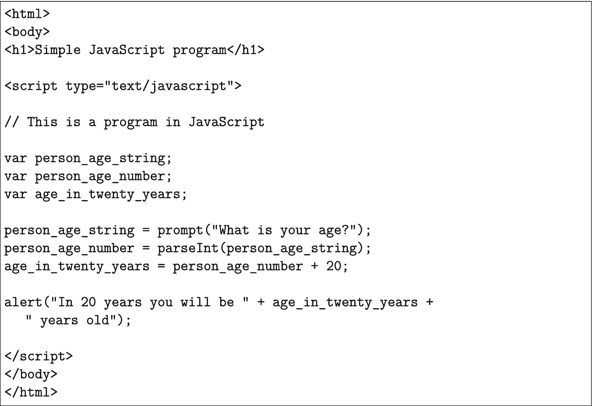

一个 14 行的简单 JavaScript 程序，包含 header 标签、body 标签、script type 为 text/javascript，并声明了无值的变量：person age string、number 以及 age in twenty years。最后显示一条警告消息：“in 20 years you will be + age in twenty years + years old”。

**图 8-1** 包含 JavaScript 程序的简单网页

### 8.2 一个简单的 JavaScript 程序

我们不会先描述 JavaScript 的外观和工作原理，而是直接输入一个示例程序来开始学习 JavaScript，*随后*再解释其工作原理。将图 8-1 中所示的程序键入文本编辑器，并将其保存为 HTML 文件。

输入此程序后，在浏览器中加载它。它会打开一个对话框，询问你的年龄。接着它会打开另一个对话框，告诉你 20 年后你的年龄。非常简单，对吧？如果你的浏览器没有执行这些操作，请仔细检查，确保你输入的代码与列出的代码*完全*一致。如果仍然无法运行，请参见附录 B.6。

现在，我们来看看这段代码的作用。

首先要注意的是 `<script>` 标签。这个标签告诉浏览器，位于 `<script>` 开始和结束标签之间的内容是 JavaScript 代码。浏览器一遇到结束标签就会开始运行这段代码，甚至在页面加载完毕之前就会执行。`<script>` 标签有两个可能的属性。这里使用的是 `type` 属性，它告诉浏览器脚本的语言类型。这个属性值应该始终是 `text/javascript`。`<script>` 标签还可以接受另一个属性 `src`，它告诉浏览器在另一个文件（由 `src` 的值指定）中寻找 JavaScript 代码，而不是让代码直接位于网页本身中。

在 `<script>` 标签之后，是一条 JavaScript 单行注释。

# JavaScript 程序示例

## 注释

每当 JavaScript 代码中出现两条斜杠时，从该位置到行尾的内容都被视为注释，会被浏览器忽略（更多关于注释的信息，请参见第 6.6.6 节）。你在 JavaScript 中还会看到的另一种注释类型以 `/*` 开头，以 `*/` 结尾，适用于跨越多行的注释。

## 变量声明

第一组编程语句以关键字 `var` 开头：

```javascript
var person_age_string;
var person_age_number;
var age_in_twenty_years;
```

`var` 告诉 JavaScript 我们需要一个临时存储空间，称为**变量**，用来保存某些数据，并为该临时存储空间指定一个名称。因此，`var person_age_string` 表示 `person_age_string` 将是一个临时存储空间的名称，我们将用它来保存数据。程序员表述这种方式为：`var person_age_string` 创建了一个名为 `person_age_string` 的变量。这也被称为定义或声明一个变量。当我们稍后引用 `person_age_string` 时，它指的就是这个变量。

其后是一个分号（`;`）。在 JavaScript 中，分号用于分隔各个语句。因此，当我们看到分号时，就知道已经到达一条语句的末尾。

接下来的两条语句与第一条类似，定义了变量 `person_age_number` 和 `age_in_twenty_years`。注意，我们在变量名中使用了下划线（`_`）。这使我们程序员能够看清单词的拼写，同时也确保计算机知道它们是一个整体。例如，如果我说“我要去公交车站（bus stop）”，你知道“bus stop”实际上是一个概念。然而，计算机并没有那么智能。因此，如果你与计算机交谈，你需要说“我要去 bus_stop”（注意下划线），这样计算机就知道 `bus_stop` 应该被视为一个单词。

## 赋值与函数调用

下一条语句包含了更多操作。代码如下：

```javascript
person_age_string = prompt("What is your age?");
```

这行代码中有几个重要的事情发生。首先，注意等号（`=`）。在大多数编程语言（包括 JavaScript）中，等号是一条命令，表示将等号右侧的值赋给左侧的变量。它*不表示*这两个东西已经相等；它表示将右侧的值赋值给左侧的变量。这被称为**赋值语句**。这条语句的左侧是我们刚刚定义的一个变量。这条语句表示我们应该将一个新值存入该变量。这条语句的右侧则指明了这个值应该是什么。

右侧的部分就变得有趣了。`prompt("What is your age?")` 告诉计算机弹出一个对话框，询问给定的问题，然后返回用户输入的值。这被称为**函数**，因为它调用了定义在其他地方的功能。JavaScript 中的函数以函数名（此处为 `prompt`）开头，接着是左括号 `(`，然后是函数**参数**，最后是右括号 `)`。*参数*（也称为**实参**）是发送给函数的值，函数使用该值来执行其功能。在本例中，函数有一个参数，即 `"What is your age?"`。这是一个字符串——一个由多个字符组合成单个单元的序列（就像我们在第 4.4 节讨论的那样）。在 JavaScript 中，字符串用双引号（`"`）、单引号（`'`）或反引号（`` ` ``）括起来，并被视为一个单一的值，不过如果需要，你也可以单独访问其中的字符。^(⁷)

我们说这个参数*被传递给函数*，因为函数会接收我们放在这里的任何值。`prompt` 函数可以接受一个或两个参数。第一个参数是你希望显示在输入框前面给用户看的文本。第二个参数（我们在这里没有使用）会为用户提供一个默认值。如果某个函数需要多个参数，每个参数之间用逗号（`,`）分隔。因此，如果我们想给用户一个默认年龄，可以这样写：

```javascript
prompt("What is your age?", "25")
```

请记住，`prompt` 处理的是**字符串**，而不是数字，这也是为什么我们默认值要用引号括起来。代码会等待该函数执行完毕才继续，这意味着，在这种情况下，用户需要输入一个值并点击“确定”按钮。当用户真的输入了内容时，该值就会被用作该函数的结果值。我们说这个函数*返回*了那个值。

因此，用我们目前讨论的术语来说，就是代码 `prompt("What is your age?")` 使用参数 `"What is your age?"` 调用了函数 `prompt`，并返回用户输入的任何内容作为该函数的值。然后，由于 `prompt` 函数返回用户输入的任何内容，用户输入的值就被存储到变量 `person_age_string` 中。

那么，我们为什么要把变量命名为 `person_age_string` 呢？因为我们无法控制用户输入的内容，所以得到的是用户以字符串形式返回的内容。我们希望用户输入一个数字，但实际上他可以输入任何他想输入的内容——没有什么能阻止他输入非数字字符。因此，`prompt` 函数总是返回一个字符串。希望用户按我们的要求输入了一个数字。但无论如何，`prompt` 返回的是一个字符串。我们将变量命名为 `person_age_string`，以便记住它保存的是一个字符串，而不是数字。

## 类型转换与计算

现在，程序需要将用户输入的年龄加上 20 岁。目前这还无法实现，因为我们保存的是用户输入的*字符串*，而要执行加法运算，我们需要一个*数字*。下一行代码 `person_age_number = parseInt(person_age_string)` 完成了我们所需的转换。`parseInt` 是一个内置函数，它接收一个字符串，并将其**解析**为数字。*解析*是将一个字符串转换成一个更易于计算机程序操作的计算机化表示形式的过程。这里，我们是将一个字符串转换（解析）成一个数字。`parseInt` 是“parse integer”（解析整数）的缩写，其中**整数**（integer）是一个完整的数字（例如 1、2、3、4 等）。如果你想要一个带小数的数字，你应该使用 `parseFloat`，它是“parse a floating-point number”（解析浮点数）的缩写，而**浮点数**（floating-point number）是包含小数点的数字（例如 31.25、0.002、23.12 等）。

然后，我们从 `parseInt` 函数获取值，并将其存储到变量 `person_age_number` 中。现在，我们以数字形式将所需的值保存在一个变量中。由于它是一个数字，我们就可以用它进行计算了！

`age_in_twenty_years = person_age_number + 20` 告诉计算机将变量 `person_age_number` 的值加上 20，然后将结果存储到 `age_in_twenty_years` 中。

在 JavaScript 中，`+` 和 `=` 被视为**运算符**，而它们所操作的值被称为**操作数**。运算符是语言中内置的特殊操作。它们与函数不同，因为正如我们将要学到的，你可以编写自己的函数，但语言的运算符本质上是固定的。运算符用于执行特殊任务（例如赋值），或者用于那些使用函数调用看起来很奇怪的地方。例如，对于数学运算，写 `2 + 3` 比写类似 `add(2, 3)` 的东西要自然得多。

## 显示结果

现在我们有了要找的值；我们只需要显示它。下一行代码会显示该值。

```javascript
alert("20 年后你将 " + age_in_twenty_years + " 岁");
```

```
这段代码有几个奇怪的地方。首先，它对字符串使用了加号（`+`）。字符串要怎么相加呢？呃，在 JavaScript 中，当加号用于字符串时，它不再表示加法，而是表示**拼接**。拼接意味着将两个东西连接在一起。在这里，我们将字符串首尾相连。有一个问题——`age_in_twenty_years` 不是字符串而是数字！JavaScript 通过在加法执行之前自动将与字符串相加的任何内容转换为字符串来处理这个问题。所以，如果加号两边都是数字，它表示加法；但如果加号任何一边是字符串，它则表示拼接。此外，拼接会在另一个值不是字符串时将其转换为字符串。

这段代码另一个有趣的特点是它组合了多个操作。它将三个项目拼接在一起，然后将结果字符串传递给 `alert` 函数。在大多数编程语言（包括 JavaScript）中，你可以根据需要将任意多的操作和函数组合在一起，以得到最终值。最内层的操作会先执行，其结果随后作为输入传递给更外层的操作。

最后，这段代码引入了 `alert` 函数，它会向用户显示一个弹出窗口。当用户点击“确定”按钮时，`alert` 函数返回。

### 练习题

1.  什么是变量？如何在 JavaScript 中声明变量？
2.  JavaScript 中加号的两种不同用途是什么？
3.  `prompt` 和 `alert` 函数分别有什么作用？

### 练习活动

在这个活动中，我们将尝试修改本节中的程序。在开始活动之前，请确保原始程序能够正常运行。每完成一步都要测试你的程序，确保它仍然能工作。如果你等到最后才测试，而程序无法工作，你将不知道错在哪里。

1.  在你的 `prompt` 之前添加一个仅显示“hello”的 `alert`。
2.  将增加的年限改为 25 年。同时确保修改最后的 `alert` 显示正确的内容！
3.  你能想出如何将 `prompt` 和 `parseInt` 这两行代码合并成一行，使得 `prompt` 的输出成为 `parseInt` 的输入吗？在这种情况下，哪个变量不再需要了？

### 将 JavaScript 移至单独文件

就像 CSS 一样，JavaScript 既可以嵌入到你的 HTML 文件中，也可以存储在单独的文件中。我建议除非有特定原因需要将 JavaScript 包含在页面中，否则应始终将其保存在单独的文件中。有时 JavaScript 和 HTML 之间的交互可能导致意外结果，例如浏览器将你的部分 JavaScript 误认为是 HTML 标签。通过将 JavaScript 代码保存在单独的文件中，可以避免这些问题。

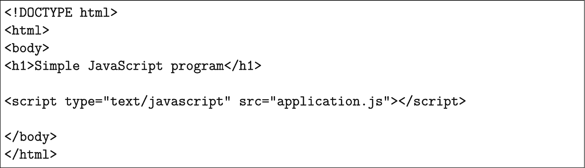

**图 8-2** 引用外部 JavaScript 的 HTML 文件

要将 JavaScript 放入单独文件，你只需复制 `<script>` 开始和结束标签之间的代码，并将其粘贴到一个扩展名为 `.js` 的新文本文档中。然后，修改你的 `<script>` 标签，添加一个 `src` 属性（保持 `type` 属性不变），其值为新 JavaScript 文件的相对 URL。如果我们将 JavaScript 文件命名为 `application.js` 并放在与 HTML 文件相同的文件夹中，那么 HTML 将如图 8-2 所示，而 JavaScript 将如图 8-3 所示。

#### 将 JavaScript 保存在单独的文件中

将 JavaScript 代码保存在单独的文件中还有其他好处。首先，它能让你的 HTML 页面更易于阅读，因为页面中只包含一种语言——HTML。通过将不同语言分隔到各自文件中，你能够更好地保持头脑清晰。另一个原因是，它允许你在多个网页之间共享 JavaScript 程序及其代码片段，这样你就不必一遍又一遍地编写或复制相同的代码。这也意味着，如果你在一个地方修改了代码，就不必在每个其他页面上搜索并进行相同的修改，而这个过程既繁琐又容易出错。如果你有一个大型的 JavaScript 应用程序，分离 JavaScript 代码实际上可以让你的页面加载更快，因为浏览器只需加载一次你的 JavaScript，而不是让它占据每个文件中间的位置。

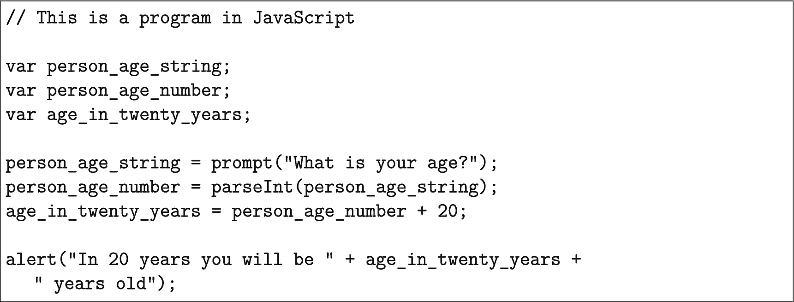

一个包含 7 行代码的简单 JavaScript 程序，声明了一个变量为 `personAge` 字符串、数字以及二十年后的年龄，但没有赋值。最后弹出一条提示信息，内容为“20 年后你将 + 二十年后的年龄 + 岁”。

**图 8-3**
从 HTML 引用的简短 JavaScript 文件

#### 8.3.1 回顾

在本章中，我们介绍了编写 JavaScript 程序的最基础知识。我们学习了以下内容：

- JavaScript 是一种通用编程语言，允许我们创建动态网页。
- ECMAScript 是由负责标准化的组织为该语言指定的名称，但大多数人通常仍称其为 JavaScript。
- JavaScript 可以嵌入到页面中，也可以存储在单独的文件里。
- 在网页中，JavaScript 通过 `<script>` 标签进行标识。
- 变量是用于存储值的位置，并使用 `var` 关键字进行声明。
- `=` 运算符用于给变量赋值。
- 函数是在其他地方定义的、有名称的过程。
- 函数可以被赋予值，这些值称为参数（或实参），在函数运行时供其使用。
- 多个函数参数之间用逗号分隔。
- 函数完成后，其返回的值称为*返回值*。
- JavaScript 使用引号（`'`、`"` 或 `` ` ``）来表示字符串。
- `prompt` 是一个函数，它会弹出一个对话框，让用户输入字符串，并返回该字符串。
- `parseInt` 是一个将字符串转换为数字的函数。
- `alert` 是一个弹出带有消息的对话框的函数。
- `+` 运算符的作用是相加（对于数字）或拼接（对于字符串）。

#### 8.3.2 学以致用

1.  创建一个新的 JavaScript 程序，向用户询问*两个*值。将这些值转换为整数，然后将它们相加并显示结果。
2.  尝试重写你刚刚创建的程序，使其不使用变量。提示：让你的函数的返回值成为其他函数的参数。一次逐步合并代码，每次消除一个变量，这可能会有所帮助。
3.  如果你输入了非数字的内容，这些函数会发生什么？它们会显示什么？你认为为什么会这样？

---

# 第三部分：JavaScript 基础

**JavaScript 基础**

本部分涵盖了开始使用 JavaScript 进行编程所需的许多基本原则。

## 9. 基本 JavaScript 语法

所有语言，无论是人类语言还是计算机语言，都有所谓的**语法**。语言的语法是词语和符号允许组合的方式。例如，考虑英语句子“I ate the the apple.”。这个句子有一个*语法错误*——我连续放了两个“the”。这在英语中是不允许的（并且毫无意义）。但语法的作用不仅仅是告诉你如何避免形成错误的句子。它还告诉你一个句子的*含义*。例如，如果我说“我有一根黄色的香蕉和一个红色的苹果”，你就知道“黄色”这个词描述我的香蕉，“红色”这个词描述我的苹果。你知道这一点是因为英语语法告诉了你形容词放在一个词前面意味着什么——它意味着这个形容词修饰该词。编程语言的语法非常类似。与往常一样，编程语言与人类语言的不同之处在于其语法更严格、更精确。计算机永远不会理解你的*意图*，只会理解你告诉它的东西。如果我对你说“我有一根香蕉黄色”，你可能会明白我的意思。但在大多数情况下，计算机不会。

请注意，为了运行本章中的程序，你需要像在 8.3 节中那样为它们创建一个 HTML 包装器。建议你将 JavaScript 保存在一个单独的文件中，并通过 `<script>` 标签的 `src` 属性来引用它。

### 9.1 语法的构成元素

虽然每种编程语言都有自己的语法，但某些类型的语法单位（即句法片段）是几乎所有编程语言所共有的。例如，几乎每种编程语言都有一个语句分隔符——一个告诉编程语言你已结束一条语句的符号。在 JavaScript（以及许多其他语言）中，分号 (`;`) 起到这个作用。因为编程语言需要知道语句在哪里开始和结束，所以大多数语言都包含一个语法单位，用来表示我们已完成一条语句。

JavaScript 中包含的标准语法元素有：

- **字面量**：在语言中书写一个特定值的方式称为**字面量**。例如，在 JavaScript 中，`2` 是一个表示数字 2 的字面量，而 `"2"` 是一个表示包含一个字符（即数字“2”）的字符串的字面量。我们将在学习不同类型的字面量时讨论如何编写它们。目前，数字和字符串是我们主要关注的两种字面量类型。

- **标识符**：**标识符**是程序员定义的名称。例如，变量的名称就是标识符。每种编程语言都有关于如何命名标识符的规则，通常限制你只能使用某些字符作为名称。在大多数编程语言中，标识符不能包含空格、破折号或其他符号字符，但可以包含下划线，并且应以字母开头。`my identifier` 不是一个有效的标识符，但 `my_identifier` 是。

- **关键字**：**关键字**看起来像一个标识符，但由编程语言本身定义。我们目前见过的 `var` 就是一个关键字，它表示接下来的标识符将是一个新变量的名称。许多语法单位都由特定的关键字指示。在 JavaScript 中，关键字也是**保留字**，这意味着你*不允许*使用与关键字同名的标识符。

- **运算符**：**运算符**是执行某项任务的东西（通常是像 `+` 或 `-` 这样的符号），如果将其写为函数会很不方便或不自然。运算符用于执行操作的值称为**操作数**。因此，对于 `2 + 3`，`+` 是运算符，而 `2` 和 `3` 是操作数。

- **函数**：**函数**是一种将代码分组以作为一个单元执行的方法，该单元可以反复使用。大多数语言都既有语言本身提供的内置函数，也有让用户定义执行特定项目任务的自定义函数的方式。我们将在第 10 章详细讨论如何创建函数。

- **表达式**：**表达式**是函数、关键字、运算符、标识符和字面量的组合，它们共同作用以产生一个值。例如，`5 + 2 + 3` 就是一个表达式，它产生的值是 `10`。

- **控制结构**：**控制结构**（也称为**流程控制语句**）用于改变计算机程序通常的线性执行流程。例如，如果你想只在某人勾选了某个复选框时才执行一个任务，你就需要使用控制结构来确保代码只在符合条件时运行。

请记住，本书的目标是为你提供一个实用的入门介绍，而非一份详尽的清单。我们会跳过某些语法细节，或仅作简短提及与过度简化。实际上，我可以保证，如果我把所有细节都告诉你，你会放下这本书去找别的事情做！但这并非障碍。事实上，程序员很少能完全掌握自己所使用的编程语言的每一个语法细节。有些细节涵盖了程序员从未想过要处理的情况，它们是由语言创建者为完备性而包含进来的。因此，在任何语言中，你几乎永远都是一名学生，极少能成为大师。而那些少数大师通常就是创造这些语言的人。本书所涵盖的内容应能在很长一段时间内为你提供良好的指导，但请记住，总有更多东西需要学习。

## 9.2 赋值语句

在第 8 章中，我们已经相当详细地讨论了赋值语句。赋值语句是大多数编程语言的基础。

一个赋值语句示例如下：

```javascript
var myVariable;
myVariable = 5;
```

# 赋值语句与表达式

`x = 2 + 3;`

赋值语句有两边——左侧和右侧。左侧要么是一个变量，要么（如我们将在第 11 章看到的）是某个可以存储值的位置的引用。就本章而言，赋值的左侧将是一个变量。赋值语句的右侧是一个`表达式`。如前所述，表达式是运算符、函数、字面量和标识符的组合，它们会生成一个值。在这种情况下，`2 + 3`生成了值`5`。因此，右侧的值是`5`。右侧生成的值随后被存储在左侧。

表达式可以很简单——你可以只有一个字面量值（例如`2`）。你也可以在表达式中使用变量。实际上，你甚至可以在接收赋值的同一表达式中使用该变量。请看以下代码：

```javascript
var x;

x = 10; // x 当前值为 10

x = x + 13; // x 现在值为 23
```

如果你看最后一条语句，表达式是`x + 13`。由于`x`的当前值是`10`（前一行赋予的值），因此表达式的值是`10 + 13`，即`23`。由于这是一个赋值语句，右侧表达式的值（`23`）现在被赋给左侧的变量（`x`）。现在，`x`的值是`23`。

表达式也可以使用括号进行分组，以告知编程语言你希望哪些运算先执行。例如，请看以下代码：

```javascript
var x;

x = (2 + 10) * 3;
```

这里，首先计算`2 + 10`，得到值`12`，然后计算`12 * 3`，得到`36`。这个数字（`36`）随后被存储在变量`x`中。

你还可以在表达式中包含函数调用。例如，我们可以这样做：

```javascript
var x;

x = "123"; // 这是字符串 "123"，不是数字 123

var y;

y = parseInt(x) + 12;
```

这段代码的最后一行结合了一个函数调用与`+`运算符。函数调用接收`x`中的值并返回其整数值，然后该值与`12`相加，结果为`135`。

表达式也可以包含在函数的参数中。请看以下代码：

```javascript
var x;

x = parseInt("12" + "3");
```

这里我们有`"12" + "3"`作为一个表达式，它生成了值`"123"`（因为`"12"`和`"3"`都是字符串）。这个值随后被传递给`parseInt`函数，该函数生成*数字*`123`，然后被存储在`x`中。

## 9.3 控制结构

控制结构会修改程序的执行流程。通常，你会认为程序是按顺序逐条语句执行的。控制结构是一种语法单元，它会导致程序的流程以某种方式被改变。每种编程语言都有的、用于修改流程的两种基本控制结构是：*条件分支*，它使计算机根据某个条件执行一段代码或另一段代码；以及*循环*，它使计算机重复执行一段代码（重复次数取决于指定的条件）。

### `if` 语句

`if`语句是 JavaScript 程序员进行条件分支的主要方式。

`if`语句的基本形式如下：

```javascript
if (some_condition) {
    // 如果 some_condition 为 true，则执行这里的代码
} else {
    // 如果 some_condition 不为 true，则执行这里的代码
}
```

首先注意花括号（`{` 和 `}`）的使用。在 JavaScript 中，花括号用于将多条语句组合成**块**。`if`语句通常有两个块——一个在条件为真时执行，另一个在条件为假时执行（前面有关键字`else`）。你可以在这些块中放入任意数量的语句。


一个 JavaScript 代码将年龄作为变量且由用户定义。其中包含 if 和 else 循环，包括年龄和投票年限。

**图 9-1** 一个 `if` 语句示例

第二件要注意的事情是`if`后面的`some_condition`。`if`语句使用**条件表达式**来决定执行哪个块。条件表达式与其他表达式一样，只不过表达式的值不是数字或字符串，而是一个**布尔**值。布尔值就是要么为`true`，要么为`false`的值。布尔表达式通常比较两个值，以确定它们是否相等、一个是否大于另一个，或进行其他类似可得出`true`或`false`的操作。

为了更清楚，图 9-1 展示了一个使用`if`语句的程序。在这个例子中，条件表达式是`my_age > 17`。它的作用是查看变量`my_age`，如果`my_age`的值大于 17，那么表达式的值就是`true`；如果`my_age`的值不大于 17，那么表达式的值就是`false`。`>`运算符的工作原理类似于数学运算符，只不过它给出的值是一个布尔值（`true`/`false`）而不是一个数值。注意代码中发生的情况。如果你的年龄超过 17 岁，它只会弹出一个提醒。然而，如果你的年龄是 17 岁或以下，它会执行多项任务——首先，它会计算你还需要等多少年才能投票，然后显示结果。编程语言正是通过将语句组合成块，从而根据条件知道哪些语句需要一起执行。

## 常见布尔运算符

常见的布尔运算符（结果为 `true` 或 `false` 的运算符）包括以下这些：

| 运算符 | 含义 | 示例 |
| --- | --- | --- |
| `==` | 相等 | `2 == 2` 结果为 `true`；`2 == 3` 结果为 `false` |
| `!=` | 不相等 | `2 != 2` 结果为 `false`；`2 != 3` 结果为 `true` |
| `<` | 小于 | `2 < 2` 结果为 `false`；`1 < 2` 结果为 `true` |
| `>` | 大于 | `2 > 2` 结果为 `false`；`3 > 2` 结果为 `true` |
| `>=` | 大于或等于 | `2 >= 2` 结果为 `true`；`1 >= 2` 结果为 `false` |
| `<=` | 小于或等于 | `2 <= 2` 结果为 `true`；`3 <= 2` 结果为 `false` |
| `===` | 严格相等 | `2 == "2"` 结果为 `true`，但 `2 === "2"` 结果为 `false` |

通常，我们需要将多个条件组合起来。假设我们想知道*以下两个条件是否同时成立*——你的年龄正好是 18 岁，并且你的名字是弗雷德。有两种方法可以实现这个需求。第一种方法是将一个 `if` 语句嵌套在另一个 `if` 语句中，如下所示：

```javascript
var my_age;
var my_name;
my_name = prompt("What is your name?");
my_age = parseInt(prompt("What is your age?"));

if(my_age == 18) {
    if(my_name == "Fred") {
        alert("Your name is Fred and you are 18!");
    }
}
```

请注意，首先，这些 `if` 语句没有 `else` 分支。`else` 分支实际上是可选的。如果条件为假，并且没有 `else` 分支，程序就会跳过它，继续执行下一条语句。另一点需要注意的是，我们可以在某个条件成立的代码块内再放置一个 `if` 语句。在 JavaScript 中，*任何*代码都可以放在这些代码块中。

然而，这种方式需要输入很多代码。如果能将两个 `if` 语句合并成一个单一的语句，那就更好了。我们可以通过组合布尔表达式来实现这一点。布尔表达式可以通过两个运算符进行组合：`&&`（读作“且”）和 `||`（读作“或”）。如果 `&&` 的*两个*操作数都为真，那么它返回真值；如果 `||` 的*任一*操作数为真，它返回真值。因此，我们可以使用 `&&` 将这些语句合并成一个 `if` 语句：

```javascript
var my_age;
var my_name;
my_name = prompt("What is your name?");
my_age = parseInt(prompt("What is your age?"));

if(my_age == 18 && my_name == "Fred") {
    alert("Your name is Fred and you are 18!");
}
```

### `!` 运算符

我们还需要介绍的最后一个布尔运算符是 `!`（读作“非”）运算符。`!` 运算符没有两个操作数，只有一个，位于该运算符的右侧。该运算符返回其右侧布尔值的*相反值*。最好使用带圆括号的 `!` 运算符，这样你、计算机以及阅读你代码的其他人就能清楚地知道你要将该运算符应用于哪个表达式。例如，如果我想判断变量 `my_value` 是否不在 3 到 10 之间，我可以这样写 `!(my_value >= 3 && my_value <= 10)`。如果值在范围内，圆括号内的表达式将返回真值，然后 `!` 运算符会使其返回相反的结果。

### `while` 语句

我们已经学习了使用 `if` 语句的条件语句，现在是时候来看看循环语句了。循环用于重复执行一段代码，重复一定次数，或者直到满足特定条件为止。假设你有一个问答游戏，你想让某人不断尝试答案，直到答对为止。你会使用循环，因为你希望代码不断向他们提问并读取答案，直到他们给出正确答案。换句话说，你希望他们*重复*执行提问和检查答案的代码。

JavaScript 中最基本的循环结构是 `while` 语句。`while` 语句的整体结构如下：

```
while(some_condition) {
    // 在此处执行任务
}
```

`while` 语句告诉 JavaScript 重复执行给定代码块中的代码，直到 `some_condition` 变为假。它在每次运行代码块之前都会检查 `some_condition`，如果条件为真，则运行循环。如果条件为假，则循环结束，继续执行代码的下一部分。

以下是一个包含 `while` 循环的示例程序，该循环将重复执行，直到用户输入正确的值：

```
var answer;
while(answer != "Genesis") {
    answer = prompt("What is the first book in the Bible?");
}
alert("You got the answer right!");
```

这段代码会先创建一个名为 `answer` 的变量。除非另有指定，否则 JavaScript 中创建的变量会被赋一个特殊的空值，叫做 `undefined`。创建变量后，代码开始执行 `while` 循环。循环开始时，会评估其条件，该条件称为**循环条件**。条件是 `answer != "Genesis"`，即检查变量 `answer` 是否与字符串 `"Genesis"` 不同。的确，`undefined` 与 `"Genesis"` 不同，因此条件为真。这意味着我们可以继续执行循环。循环条件之后是一个用花括号括起来的语句块，称为**循环体**。如果循环条件为真，就会执行这些语句。在这个循环中，只有一条语句，它要求用户回答一个问题，并将结果存储在 `answer` 变量中。

当计算机执行完循环体后，它会重新评估循环条件，以判断是应该再次运行循环还是结束。假设用户错误地回答了问题，输入了 “Exodus”。会发生什么？`answer` 的值会是 `"Exodus"`。当评估循环条件时，`answer != "Genesis"` 仍然返回真。因此，它再次运行循环体。现在假设这次他们正确输入了 “Genesis”。会发生什么？`"Genesis"` 被存入 `answer`。现在循环体再次执行完毕，所以它重新评估循环条件。这次，条件 `answer != "Genesis"` 是假！当循环条件为假时，控制权会转移到循环体之后的第一条指令。在这个例子中，那条指令告诉用户他们输入了正确的值。

编写循环时需要注意的一点是，要确保循环条件最终能够评估为假。否则会发生什么？它会永远循环下去！用计算机术语来说，这被称为**无限循环**。你应该始终仔细检查，确保你的循环最终会终止。我们将在下一节更详细地讨论无限循环。

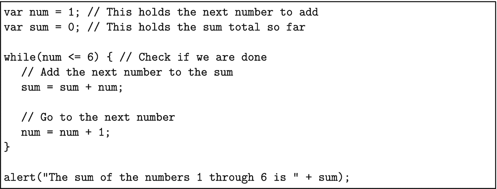

一段包含 6 行 JavaScript 代码的程序，用于处理数字和累加总和，将下一个数字加到总和上，转到下一个数字，执行 while 循环，并通过 alert 消息提示数字 1 到 6 的总和是多少。

**图 9-2** 使用 `while` 循环累加数字 1 到 6

### `for` 语句

循环的一个常见用途是按指定次数执行计算。假设我们想编写一个程序，将 1 到 6 之间的所有数字相加。这可以通过循环轻松实现。图 9-2 展示了如何使用 `while` 循环来完成此任务。

其工作原理是，首先为每个变量赋予起始值。这被称为**初始化**变量。程序的成功或失败往往取决于变量是否被初始化为了正确的值。在此例中，`num` 被设置为我们要相加的第一个数字。变量 `sum` 被设置为零。之所以设为零，是因为这是任何数相加前的初始状态——什么也没加的总和就是零。

接着，对循环条件进行求值。是的，`num` 的值是 1，小于或等于 6。然后，将该数字加到 `sum` 中，并重新赋值给 `sum`，此时 `sum` 变为 1。下一步是最关键的部分——给 `num` 加 1，并将结果存回 `num`，使其移动到下一个数字。现在 `num` 的值是 2。注意，尽管它仍然小于或等于 6，但它离终止循环又近了一步。然后我们再次检查循环条件并执行循环体。在下一次循环迭代结束时，`num` 的值又向循环终止迈进了一步。

在循环体执行六次之后，`num` 的值变为 7，这将终止循环并给出最终结果。

现在花点时间思考一下——如果我们不小心省略了循环末尾给 `num` 加 1 的代码，会发生什么？`num` 将永远不会增加，因此它将*始终*为 1，那么 `num <= 6` 将*始终*为真，循环将永远无法结束。永不结束的循环被称为**无限循环**。无限循环可能会锁死你的浏览器，甚至更糟，导致整个电脑死机。

当你有一个像这样简单的循环时，其中只有一个变量用于控制循环是否重复进行，这个变量被称为**循环控制变量**。在 `while` 循环中，循环终止条件与循环控制变量递增的位置是分离的。而初始化循环控制变量的位置又在另一处。将这些重要的循环部分分散在不同位置可能会很危险，因为我们很容易忘记包含循环控制的一个或多个部分。

不过，还有另一种流程控制语句可用，对于简单循环，它能将所有管理控制变量的步骤集中在一处。这个语句就是 `for` 语句。

`for` 语句的结构如下：

```
for(循环控制变量初始化; 循环条件; 循环控制变量修改) {
    // 循环体
}
```

现在我们使用控制变量的三个位置都打包在了 `for` 语句的同一个位置。这使得编写简单循环的过程更不容易出错。因此，如果我们使用 `for` 语句重写之前的程序，结果将如图 9-3 所示。

如你所见，我们针对循环控制变量所做的所有操作都被包含在一起。这种语法通过将所有管理代码集中在一处，让你能更好地管理循环控制变量。同时，它也使得代码更易于阅读。`while` 语句仍然非常重要，尤其是对于具有更复杂条件和控制的循环来说。然而，多数情况下，使用 `for` 循环就足够了。

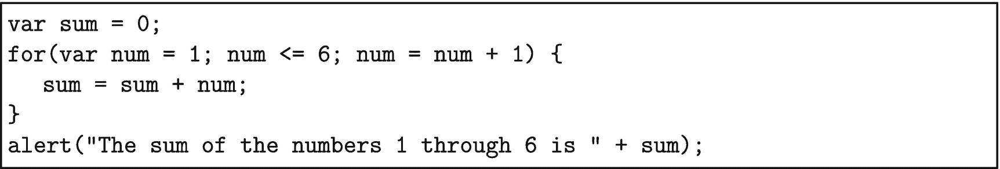

一段 5 行 JavaScript 代码。第 1 行是 `var sum = 0` 分号。第 2 行，`for` 循环包含 `var num = 1` 分号，`num <= 6` 分号，`num = num + 1` 分号。第 3 行，`sum = sum + num` 分号。第 4 行，`alert` 消息。

**图 9-3** 使用 `for` 语句对 1 到 6 的数字求和

### 9.3.4 回顾

在本章中，我们介绍了 JavaScript 语法的基础知识。我们学习了以下内容：

- 语法是程序或句子的结构表达其含义的方式。
- 每种语言都有其独特的语法。
- 许多编程语言通用的语法单元类型包括字面量、标识符、关键字、运算符、函数、表达式和控制结构。
- 表达式是由字面量、标识符、运算符和函数组成的序列，它们组合在一起产生一个值。
- JavaScript 赋值语句有一个右侧部分，其中包含提供要赋值值的表达式，以及一个左侧部分，指明该值应放置在何处（哪个变量中）。
- 控制结构是修改程序流程的语句。
- 控制结构修改程序流程的两种最常见方式是通过条件分支和循环。
- `if` 语句是 JavaScript 中条件分支的主要方法。
- JavaScript 中的大多数循环是通过 `while` 语句或 `for` 语句实现的。
- 循环的基本结构是循环初始化器、循环条件和循环体。
- 简单循环围绕单个循环控制变量进行，该变量用于循环结构的全部三个部分。
- `for` 循环允许程序员将所有对循环控制变量的操作集中在一个位置，这样程序员更易正确编写，也便于他人阅读和理解。
- 可以在条件分支语句或循环语句的体中放置多条语句。花括号表示哪些语句属于控制结构的体，这被称为代码块。
- 条件分支语句和循环语句也可以嵌套在其他分支和循环语句内部，以实现更复杂的处理。
- `var` 语句也可以与赋值语句结合使用，为变量提供初始值。

### 9.3.5 学以致用

1.  输入第 9.3.2 节中问答游戏的代码。务必创建一个加载该 JavaScript 代码的 HTML 文件。验证游戏是否正常运行。
2.  创建你自己的问答游戏，至少包含三个问题。
3.  为此游戏添加额外代码，以便在用户答错问题时给出提示。如果这是你第一次编程，这可能比你想象的要难。仔细思考程序具体是如何运行的，以及你需要做些什么才能在正确的位置给出提示。根据你决定采用的方式，你可能需要在循环体中嵌入一个 `if` 语句。
4.  输入第 9.3.3 节中用于将数字 1 到 6 相加的代码。务必创建一个加载该 JavaScript 代码的 HTML 文件。验证其是否正常运行。
5.  修改代码，让用户输入他们想用来求和的数字范围。别忘了使用 `parseInt`！
6.  在上一个示例中，用户有可能会输入一个无效的范围（即，数字范围的起始值大于结束值）。添加 `if` 语句来处理这种情况，既可以向用户发出警告，也可以直接修复该问题。

## 10. 函数与作用域介绍

### 函数

在前一章中，我们学习了编程的基本要素：赋值语句、条件分支和循环。对于小型程序来说，这些就足够了。实际上，仅凭这些特性，你就可以完成任何可能的计算。然而，随着程序规模的增长——哪怕只是稍微变大一点——你都需要一些工具，让你能用每一行代码完成更多工作，并将代码组织成逻辑块。想象一下，如果你的程序有一万行代码，当你需要修改某一行时，可能很难找到它！

同样，假设有一个任务你需要反复执行。如果每次都要重新输入代码，那将浪费大量精力！此外，假设你发现复制的代码中存在一个错误（称为`bug`）。如果你有 20 份代码副本，就必须找到每一份并逐个修复。这既繁琐、浪费，又容易出错。

我们需要做的是将代码片段打包成一个单元。这样做能使代码更有条理且可复用。大多数编程语言使用**函数**来组织和复用代码片段。


**图 10-1** 使用函数的示例

### 10.1 你的第一个函数

你已经对函数有一些经验了。还记得`parseInt`、`prompt`和`alert`吗？这些被称为**内置函数**，因为它们是 JavaScript 本身的一部分。不过，你也可以定义自己的函数，并以同样的方式调用它们。

为了开始讨论函数，我先展示一个简单的程序来说明函数是如何工作的。请记住，和本章中的其他程序一样，你需要按照第 8.3 节描述的方法，将这个程序嵌入到一个 HTML 文件中。图 10-1 展示了代码。这个程序定义了一个函数，它接收一个值并返回该值的平方（即该值乘以自身）。然后，该函数被使用了两次，传入了不同的数字进行平方运算。

这段代码中的函数使用`function`关键字定义。在`function`关键字后面是一个参数列表——括号内列出了该函数可以接收的所有参数。我们定义的函数接收一个参数，并将其命名为`num`。这意味着传递给函数的值会在函数执行期间被存储在`num`中，这样我们就有了一个名字来引用它。由于它出现在参数列表中，我们不需要使用`var`关键字来定义它。

简而言之，`function(num)`告诉 JavaScript 定义一个接收一个参数的函数，并将该参数命名为`num`。当我们在函数内部使用`num`时，操作的是程序被调用时传入的值。我们本可以使用任何有效的名字来代替`num`，但`num`对于数字来说是一个合适的名字。

花括号内部是定义函数行为的代码块。在这个例子中，我们创建了一个名为`value`的新变量，将`num`乘以自身，然后将结果存入`value`。接着，`return`语句告诉 JavaScript 将什么值返回给调用该函数的代码。在这个程序中，返回语句表示当前存储在`value`中的结果应该作为函数的结果返回。

`function`运算符定义了一个函数。然而，我们需要能够从代码中调用这个函数，所以它需要一个名字。在 JavaScript 中，我们如何命名一个东西呢？答案是将其存储在一个变量中。正如你在代码中看到的，我们将函数存储在一个名为`square_a_number`的变量中。像往常一样，别忘了在赋值语句末尾加上分号（`;`），否则 JavaScript 可能会混淆。

现在，我们有了包含函数的变量`square_a_number`，就可以像调用其他函数（如`parseInt`）一样调用它。`square_a_number(5)`将返回 25，而`square_a_number(6)`将返回 36。

#### 练习

1.  在与`square_a_number`函数相同的文件中，定义另一个名为`cube_a_number`的函数，该函数返回一个数的立方（即该数乘以自身再乘以自身）。
2.  像我们对`square_a_number`所做的那样，多次调用`alert`函数，并传入`cube_a_number`函数的结果。
3.  `square_a_number`函数的主体创建了一个名为`value`的变量来存储计算的临时结果。但是，由于计算非常简单，我们实际上不需要这个变量。你能重写`square_a_number`，使其不使用变量吗？
4.  修改程序，让用户输入一个数字，然后调用`square_a_number`计算平方，最后将结果显示给用户。
5.  将你刚刚编写的程序中的用户交互部分放入一个运行三次的`for`循环中，这样程序会询问用户三次数字并给出结果。
6.  将循环从`for`循环改为`while`循环，并持续执行操作，直到用户输入零作为要平方的数字为止。


**图 10-2** 一个嵌入了`while`循环的函数

### 10.2 更多函数示例

为了确保你掌握函数的概念，我们再来看一个例子。假设我们想编写一个函数，用于对某一范围内的数字求和，比如 2 到 12 之间的所有数字。这与我们在 9.3.3 节中编写的代码类似，但这次它会把起始值和结束值作为参数。那么我们应该如何编写呢？

我们需要一个函数，但这个函数内部还需要有一个循环，用于遍历从起始值到结束值的所有数字。代码如图 10-2 所示。

这个函数与我们之前写的函数有几个不同之处。首先，它有两个参数，而不是一个——`range_start` 和 `range_end`。函数可以有任意多个参数，甚至可以没有参数，此时写作 `function()`。在这个例子中，我们需要两个值，因为我们需要范围的起始值和结束值。在 JavaScript 中，参数是**按位置对应**的，这意味着你用 `function` 关键字定义参数的顺序，必须与调用函数时传入值的顺序一致。换句话说，由于 `range_start` 是第一个参数，函数调用中的第一个值就会被赋给这个参数。`range_end` 是第二个参数，因此传递到函数调用的第二个值就会赋给它。所以，调用 `sum_range(start_val, end_val)` 会告诉 JavaScript 执行 `sum_range` 函数，将 `start_val` 的值赋给 `range_start`，将 `end_val` 的值赋给 `range_end`。然后它执行函数并返回值，在这个例子中，返回值被存入变量 `result`。接下来，函数内部还嵌入了一个 `for` 循环。就像 JavaScript 中的任何代码块一样，我们可以在函数内部嵌入任何类型的语句或运算符。

对于这个小程序，由于我们只使用了一次 `sum_range` 函数，它并没有帮我们节省多少输入量。但你能想象吗，如果我们在程序的多个不同地方都需要这个功能，并且反复使用它，那么将这段代码放入一个函数中将在未来节省大量的输入工作和麻烦。

尽管这个例子并没有节省多少输入量，但使用函数仍然有一个显著的优势——它可以将应用程序的不同组成部分分离开来。在这个程序中，我们既有用户交互（提示、接收输入和显示输出），也有计算（对范围内的所有数字求和）。通过将计算部分放入函数中，我们让这两个部分都变得更清晰。

想象一下，如果我们把所有代码都混在一起而不使用函数，可能连理解程序试图做什么都会变得困难。相反，通过将一部分代码分离成一个名称易于理解的函数（例如 `sum_range`），我们就能更清楚地了解整个程序在做什么。你可以看着它说：“哦，是的，这个名为 `sum_range` 的代码片段是对范围内的数字求和。看！在这里我们用这个函数处理来自用户的两个输入。”

同样，对于小型程序来说，这可能不是什么大问题，但当你编写包含成千上万行代码的程序时，将代码分解成可管理、可理解的组件，每个组件负责一个小的、定义明确的任务，会使代码更容易理解和修改。

总的来说，在计算机编程中，将用户界面与计算分离开来是一个好主意。这为程序本身带来了许多长期的好处。在计算机编程中，用户界面往往会经常变化，即使底层逻辑保持不变。因此，将核心逻辑与其界面分离，可以使程序更易于扩展和修改，而不会带来不必要的麻烦。通常情况下，程序可能拥有多个面向核心逻辑的用户界面，或者一个用户界面加上一个供外部程序使用的接口。在这里，分离核心逻辑使得该逻辑不必在每个界面中重复。此外，编写测试来确保代码正常工作也是一种好的实践。测试核心逻辑通常比测试用户界面更直接，因此单独编写核心逻辑也使其更容易被测试。

### 练习题

1.  创建一个函数，它接受三个参数并返回这三个参数中的最大值。你需要使用多个`if`语句来完成这个任务。
2.  创建一个名为`multiply`的函数，该函数接受两个参数并执行与`*`（乘法）运算符相同的功能。但是，请不要在你的代码中使用`*`运算符。相反，通过对第一个参数进行重复加法来完成任务。请确保包含运行该函数并显示结果的代码，以便你知道自己是否做对了！

### 10.3 函数调用函数

函数也可以调用其他函数。例如，我们可以创建一个名为`sum_squares_for_range`的新函数，它类似于`sum_range`函数，但不同的是，它不会对范围内的数字求和，而是对范围内的每个数字调用`square_a_number`，以求取其平方并求和。在查看代码（图 10-3）之前，请思考一下你将如何实现这样一个函数。

正如你所看到的，就像我们可以在程序中的任何其他地方调用函数一样，我们也可以在一个函数内部调用另一个函数。利用这一特性，我们可以构建越来越复杂的函数。我们可以将几个经常一起使用的小函数组合起来，编写一个更大的函数，以一种有趣且有用的方式将它们结合起来。同样，如果我们有一个难以理解的大型函数，我们可以尝试将其分解成定义明确的几个部分，并为这些部分分别创建独立的函数。

### 10.4 变量作用域

既然我们已经了解了函数在 JavaScript 中的工作方式，现在需要讨论一下变量作用域。变量的作用域指的是在程序中变量被创建、处于激活状态可供使用，以及被销毁的位置。

在一些最早的编程语言中，所有变量都具有全局作用域——这意味着该变量在整個程序中始终存在，并且在程序中的任何位置都可以访问。然而，这很快就会导致问题。我们已经多次创建了临时变量来保存中间值，例如`sum_range`函数中的`sum`变量。如果你所有的变量都是全局作用域，当你从一个函数调用另一个函数时，如果两个函数都为临时变量使用了相同的名称，那么你的临时结果就会被另一个函数覆盖！

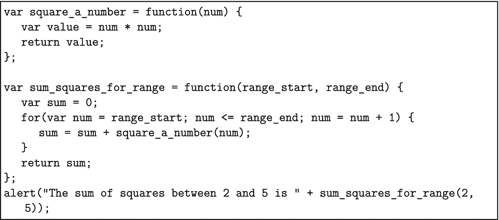

一个 JavaScript 程序包含一个变量 squared number，该变量具有一个数字的函数且是用户自定义的。使用了 for 循环，并包含了 range 起始和结束值，然后给出一个提示消息，内容为 2 到 5 之间的平方和。

**图 10-3** 一个函数调用另一个函数

如果所有变量都具有全局作用域，避免这种情况的唯一方法就是确保每个变量都有一个唯一的名称。无论是跟踪变量名，还是编写由此产生的不可避免地过长的名称，都会既繁琐又耗时。编程语言很快采用了新的作用域策略，赋予程序员更多的自由度。

JavaScript 对函数内部使用`var`声明的变量所采用的作用域类型称为函数作用域。这意味着除了全局作用域之外，每个函数都有一个唯一的、独立的作用域。如果在函数外部声明变量`var myvar`，那么该变量存在于全局作用域中，被称为全局变量。由于它是全局的，我可以在*程序中的任何位置*访问`myvar`。如果我们改为在函数*内部*声明`var myvar`，那么`myvar`将*仅在该函数内部*可用。这样的变量通常被称为局部变量。函数的参数也表现得如同它们是函数作用域内的局部变量一样。

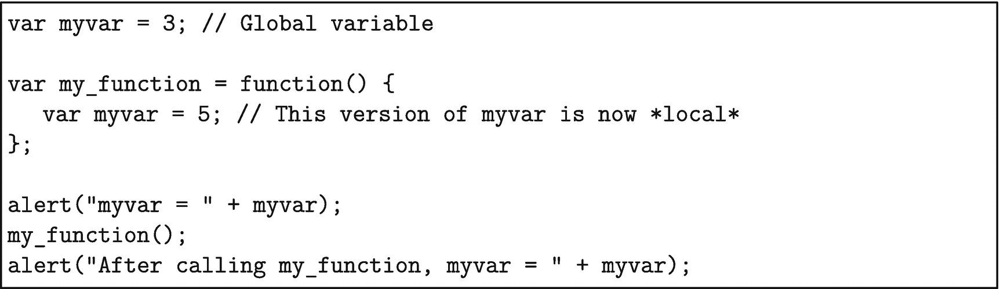

一段 7 行代码中，`var myvar = 3` 是全局变量，`myvar = 5` 这一版本的 `myvar` 现在是局部的，调用函数，并给出一个提示消息：调用 my 函数 `myvar` 之后。

**图 10-5** 全局变量与局部变量

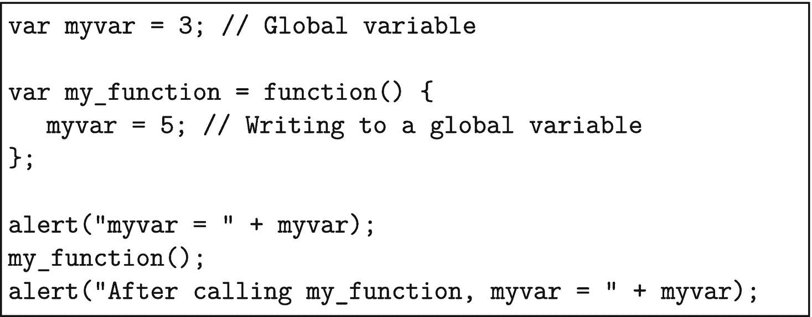

一段 7 行代码中，`var myvar = 3` 是全局变量，将全局变量写为 `myvar = 5`，调用函数，并给出一个提示消息：调用 my 函数 `myvar` 之后。

**图 10-4** 修改全局变量

为了说明这一点，图 10-4 展示了一个在函数内部修改全局变量的程序。在这段代码中，程序开始时，创建了全局变量`myvar`（它在任何函数之外定义）并赋值为`3`。然后，程序调用`my_function()`。该函数将`myvar`设置为`5`，然后返回。现在，当我们再次显示这个变量时，它的值是`5`。将其与图 10-5 中程序发生的情况进行对比。在这个例子中，因为在函数中`myvar`前面有`var`关键字，所以创建了一个该函数特有的局部变量。这个变量在其他任何地方都不存在。即使在全局作用域中存在一个`myvar`，在函数执行期间，`myvar`将指向同名的局部变量。因此，在函数内部设置局部变量`myvar`不会对全局作用域产生影响。两个警示框都会显示相同的值，因为修改发生在局部变量上。

此外，如果另一个函数也有一个局部作用域的`myvar`，那么它将是与全局作用域的`myvar`或此函数局部作用域的`myvar`都不同的变量。每个函数的局部变量都属于该函数，甚至不能在函数外部被引用。

拥有局部作用域使得函数能够像“黑盒”一样工作，这意味着编写调用函数代码的人不必关心该函数是如何实现的细节。如果我们只有全局作用域，那么在调用一个函数之前，我需要去查找它正在使用的所有变量，以确保我没有使用相同的变量。然而，如果函数编写者只使用局部变量，那么如果我在程序中使用该函数，我就不必担心它可能会意外地覆盖我正在使用的变量。即使只有一个程序员在编写大型程序时，情况也是如此。你不会记住在函数中使用的每一个变量的名称。但是，如果你确保只在函数内部使用局部变量和参数，那么你就不需要记住所有的变量名，因为它们都将限定在给定函数的范围内。

偶尔，你也会需要使用全局作用域。事实上，我们在函数名上正是这样做的——我们将它们存储在全局变量中。在 JavaScript 中，函数像其他任何值一样被存储在变量中。因此，为了让函数能够互相调用，它们必须存在于全局作用域中。你也可以在另一个函数内部定义一个函数，但我们将在第 14 章再讨论这一点。

#### 10.4.1 回顾

在本章中，我们讨论了什么是函数以及如何在代码中使用函数。我们学到了以下内容：

*   `function` 运算符用于创建一个函数。
*   一个函数接受参数，这些参数是指向传递给函数的值的变量。
*   函数参数是按位置对应的，这意味着使用 `function` 运算符定义参数的顺序，与函数调用时必须使用的顺序相同。
*   一个函数有一个函数体，这是告诉计算机在调用函数时需要做什么的代码。

**函数**

- 函数存储在命名变量中，以便于调用。程序员通常将函数存储在全局变量中，以便在程序的任何位置都能访问该函数。
- 函数可以调用其他函数。
- 函数可用于将代码组织成定义明确、易于理解的单元。
- 函数可用于通过将重复的代码段移至函数中，来最小化需要编写的代码量。
- 当重复的代码段被移入函数时，还有助于修复错误，因为只需在一个位置进行修复即可。
- 变量的作用域指的是变量何时生效以及可从哪些位置访问它。
- 全局作用域中的变量可以从代码中的任何位置访问。
- 函数局部作用域中的变量只能在该函数内部访问。
- 如果函数有一个与全局变量同名的局部变量，那么在该函数执行期间，全局变量将被隐藏。
- 如果两个函数有一个同名的局部变量，这两个变量指的是两个*不同的*变量，因为它们各自存在于不同的作用域中。

### 应用所学知识

凭借目前所学知识，你现在可以开始编写真正的程序了。记住你的工具——`if`、`while`、`for`和`function`——你将能够编写以下所有程序。

1.  创建一个摄氏温度转华氏温度转换器。它应询问用户摄氏温度，并返回华氏温度。从摄氏温度转换为华氏温度的公式是：将摄氏温度乘以 9，结果除以 5，然后加上 32。确保实际的转换代码包含在一个函数中。
2.  创建一个燃油效率计算器。它应询问你行驶的里程数、使用的加仑数以及每加仑燃油的价格。然后，它应告知你每英里的行驶成本（美元）。计算公式为：每加仑价格乘以加仑数，再除以里程数。确保该公式在一个函数中处理。
3.  实现阶乘函数。阶乘函数接收一个数字，并将从 1 到该数字的所有数字相乘。例如，6 的阶乘是 `6 * 5 * 4 * 3 * 2 * 1`。3 的阶乘是 `3 * 2 * 1`。请注意，由于你在重复一个操作，因此需要一个循环。确保阶乘计算写在一个函数中。编写一个用户界面，允许用户输入他们想要计算阶乘的数字。
4.  从这些计算器中任选一个，使其允许用户输入任意数量的值。你可以通过事后询问用户是否要继续，或者设置一个特殊值让用户输入以表示完成来实现。无论如何，要让用户能够持续使用该应用程序，直到他们准备结束为止。

### 使用对象和数组将值组合在一起

到目前为止，在编程过程中，我们基本上处理的是简单值，例如单个数字和字符串。然而，在编写计算机程序时，通常需要处理多个组合在一起的值。例如，考虑一笔银行交易——你需要存储哪些值？你需要知道交易发生的时间、交易金额、汇款人和收款人。因此，你至少需要四个值——交易的时间戳、金额、转出账户和转入账户。

现在，我们可以用四个独立的变量来表示这些信息。我们可以这样写：

```javascript
```

var transaction_timestamp;
var transaction_amount;
var transaction_from_account;
var transaction_to_account;

如果这样写，当我们必须将这些变量传入一个函数时，我们就得将它们作为四个独立的参数传递。想象一下，如果后来我们为这笔交易添加了额外的数据，比如转账手续费和转账所用的货币。那么我们需要传递的变量数量就增加到了 6 个！不仅如此，每个处理这些数据的函数都必须重写，以接受额外的参数！这种情况并不罕见。在许多程序中，可能有几十个相互关联的值。将它们作为单个值传递会很快变得难以控制。

## 对象基础介绍

为了将数据片段打包在一起，JavaScript 使用`对象`。对象就是一组带名称的值的集合。这就像一个把几个变量打包成一个单元的过程。

回到我们银行交易的例子，我可以将所有变量打包成一个单一的变量，该变量为每个组成部分拥有命名的值。与某些编程语言不同，JavaScript 不关心你在一个对象中打包了多少个值，你甚至不必提前告诉 JavaScript 它们将是什么。你通常从一个空对象开始，然后使用任何你想要的名称把你想要的任何值放进去。这并不意味着名称不重要——它们非常重要，因为那是你跟踪它们的方式，但 JavaScript 本身并不关心。

JavaScript 中的对象可以通过多种方式生成。我们将要介绍的第一种方式是使用`new`关键字。要获得一个空白对象，你只需输入`new Object()`。

```javascript
var my_transaction = new Object();
```

对象本身也是值，可以像任何其他值一样存储在变量中并在表达式中使用。

现在，让我们看看如何为对象赋值：

```javascript
var my_transaction = new Object();

my_transaction.timestamp = "2014-02-05";

my_transaction.amount = 1000;

my_transaction.from_account = "12345";

my_transaction.to_account = "54321";
```

JavaScript 根据名称将值存储在对象中。这些值通常被称为对象的`属性`或`特性`。因此，当你输入`my_transaction.amount`时，这告诉 JavaScript 查找`my_transaction`对象的`amount`属性。

这些是我们进行银行交易所需要的信息。然而，一笔交易也需要账户的信息。一个银行`账户`对象会是什么样子？这样一个对象需要账号、账户持有人姓名以及当前余额。因此，我们可能会有一个如下所示的对象：

```javascript
var my_account = new Object();

my_account.account_number = "12345";

my_account.owner = "Fred Fredston";

my_account.current_balance = 1200;
```

# 第 11 章：对象与函数

现在，假设我要定义一个函数，用于处理一笔针对账户的交易。我希望它能接收 `my_transaction` 并将其应用于 `my_account`（即将 `my_transaction` 中的金额添加到 `my_account` 的余额中）。为此，我可以创建一个函数，该函数接收两个对象，提取所需的值，并处理交易。如果账户号码与交易的 `from_account` 匹配，则从该账户中扣除金额；如果与交易的 `to_account` 匹配，则将金额存入该账户。图 11-1 展示了这一过程。

现在，我可以调用这个函数：`process_transaction(my_account, my_transaction);`。请注意，我们不必传入每个值，只需传入*包含*所需值的对象即可。

另一个要点是，当我们传入对象时，实际上可以*修改*接收到的对象。注意，这个函数不返回值，而是修改 `account` 对象本身。结果是对象的修改，而不是返回值。这被称为`变异函数`，因为它修改（即改变）作为参数传入的对象，而不是返回一个值。不过，变异只适用于对象。基本类型的值（如数字、字符串等）直接作为参数传入时，无法以这种方式修改。

请注意，如果一个函数没有返回值，它会返回特殊值 `undefined`，意为“无值”。

总之，对象允许函数操作值，而不仅仅是处理值。当我们只传入数字和字符串时，即使修改了参数变量，也不会影响调用函数中的值。现在使用对象，我们可以修改传入的任何对象的*属性*。然而，我们无法用一个新对象完全替换整个对象，但可以修改它的所有属性。

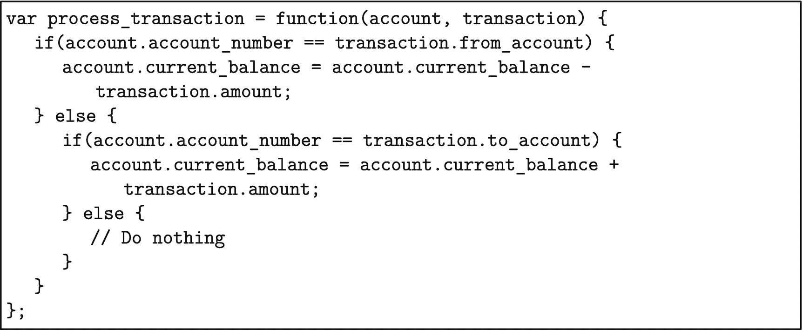

一个使用 `if` 和 `else` 条件判断账户当前余额的程序。

**图 11-1** 一个接收两个对象的函数

👉 **练习题**

1.  找一个产品目录（任何类型均可）。浏览目录，列出每个目录项包含的数据字段。从中挑选两个目录项，用于完成本练习的后续部分。
2.  创建一个程序，构建两个对象——每个挑选的目录项对应一个对象。程序应使用你在上一步中列出的字段（如果字段很复杂，如图像，可以跳过）。使用 `alert` 函数显示你已放入对象中的部分数据。
3.  创建一个函数，用于显示单个项目的所有信息。该函数接收一个参数——要显示的项目。它应显示该对象上定义的每个属性。然后，对每个项目调用该函数。
4.  创建一个函数，向用户询问要放入对象中的值，然后返回一个包含这些属性值的新对象。

## 11.2 简化对象创建

因为 JavaScript 程序员总是使用 `new Object()` 来创建对象，所以 JavaScript 提供了一种特殊语法，让你能更快更简便地创建新对象：`{}`。这与 `new Object()` 效果相同，都会创建一个新的空对象。因此，我们之前可以用以下代码开头：

```javascript
var my_transaction = {};

my_transaction.timestamp = "2014-02-05";

my_transaction.amount = 1000;
```

然而，`{}` 还能玩出更多花样。你实际上可以用它在一开始就指定一组初始属性，这样就不必逐个赋值了。语法如下：

```javascript
var my_transaction = {

  timestamp: "2014-02-05",

  amount: 1000,

  from_account: "12345",

  to_account: "54321"

};
```

如你所见，使用这种语法，在 `{` 和 `}` 之间，包含一组命名值，这些值将成为对象的属性。每个属性名后跟一个冒号和我们要设置的属性值。这使得初始化对象比冗长的方式更快、更简洁。请记住，属性名通常应限于变量允许的名称类型（即，不要在属性名中包含空格、破折号或特殊字符）。

👉 **练习题**

修改上一节的练习代码，使用更简短的对象创建语法。

## 11.3 使用数组存储值序列

到目前为止，我们处理的是对象，它是命名值的集合。在本节中，我们将讨论`数组`，它是有序的*值序列*。

在第 4.3 节中，我们讨论了计算机如何存储值序列。简而言之，它存储序列中元素的数量，然后存储这些值本身。JavaScript 中的这种结构称为数组。JavaScript 中的数组并非完全按照我们在第 4.3 节中讨论的方式存储，但这仍然是思考它们的一种有用方式。

为什么我们需要值序列？假设我想存储我孩子们的年龄。我*可以*用对象来做，但会相当笨拙。使用对象，我可以这样做：

```javascript
var children_ages = {

  first_child: 11,

  second_child: 8,

  third_child: 7

};
```

这在一定程度上可行，但使用这样的结构会很困难。例如，如果我想输出每个孩子的年龄，编写一个循环来遍历每个孩子并输出年龄会很难，尤其是如果我事先不知道有多少个孩子的话。

而数组允许我们定义有序的值序列。因此，与其用笨拙的对象，我们可以编写更优雅的代码，如下所示：

```javascript
var children_ages = new Array();

children_ages[0] = 11;

children_ages[1] = 8;

children_ages[2] = 7;
```

# 11.3 数组的赋值与索引

在这段代码中，`children_ages` 首先被赋值为一个空数组——这就是 `new Array()` 的作用。第一行告诉 JavaScript 创建一个空的值序列，并将其存储在变量 `children_ages` 中。在下一行，我们告诉 JavaScript，序列中的第一个值应为 `11`。`[]` 表示法表示我们需要使用括号内的数字来告诉我们要引用数组中的哪个元素，如果该元素还不存在，则创建它。^(⁸) 数组中的元素通过其索引号来引用。索引号从零开始（而不是一），然后依次递增。^(⁹) 因此，`[0]` 表示引用数组的第一个成员。

代码 `children_ages[0] = 11;` 告诉 JavaScript 在 `children_ages` 数组中查找第一个值，如果不存在则创建一个。接着，它会查看等号右侧，看表达式的结果是什么。在本例中，值是 `11`，因此它在 `children_ages` 的索引 0 处存储数字 11。索引 1 和 2 也是如此。代码执行完毕后，`children_ages` 中有三个值——11、8 和 7。

# 11.4 在程序中使用数组

将值存入数组后，操作起来就方便多了。当我们尝试将值存入对象时，必须知道每个值的名称（例如 `first_child`、`second_child` 等）。如果事先不知道有多少个孩子，我们就无法命名变量。而通过将它们存入数组，每个值都会获得一个数字索引，而非属性名称。计算机按顺序遍历这些索引要容易得多。

假设我们要遍历一个包含孩子年龄的数组，并找出最大年龄。该怎么做呢？当我们说“遍历数组”时，意味着要对数组中的每个元素重复执行某些代码。在需要重复代码时，我们使用哪种编程结构？当然是循环！

问题在于我们必须知道何时结束。也就是说，需要知道数组中有多少个值，这样我们才能在不需要更多值时停止。数组除了能通过索引访问值之外，在某些方面也像对象一样工作。


**图 11-2** 在数组中查找最大值

数组有一些特殊属性可用于获取关于数组的信息。数组最重要的属性是 `length` 属性。`length` 属性返回数组中值的数量。因此，在我们的代码中，`children_ages.length` 将返回 3，因为它包含三个值。请注意，由于 JavaScript 数组使用从零开始的索引，这比最大的索引（即 2）大 1。数组大小比最大索引大 1 是你在计算机编程中需要经常记住的一个特性。

图 11-2 展示了一个函数，它接收一个年龄数组并返回最大值。在这段代码中，`for` 循环使用 `i` 作为循环计数器重复执行。`i` 从 0 开始，因为数组索引从 0 开始。每次循环结束时，`i` 增加 1（`i++` 只是 `i = i + 1` 的简写）。将索引递增 1 基本上意味着“转到列表中的下一个值”。`for` 语句的中间部分是条件。这里的条件是 `i < age_array.length`。由于数组长度比数组的最后一个索引大 1，这个条件意味着只要索引有效就继续执行。当 `i` 最终达到 `age_array.length` 时，它将不再指向有效值，因此我们应该停止循环。

我们在循环内部做什么？我们只是测试每个值（`age_array[i]`）是否大于前一个值（`the_largest`）。如果更大，则将当前值写入 `the_largest`；否则忽略它。然后，在循环结束后，我们返回 `the_largest` 的值作为函数的结果。

图 11-3 展示了如何将这个函数整合到一个更大的程序中。

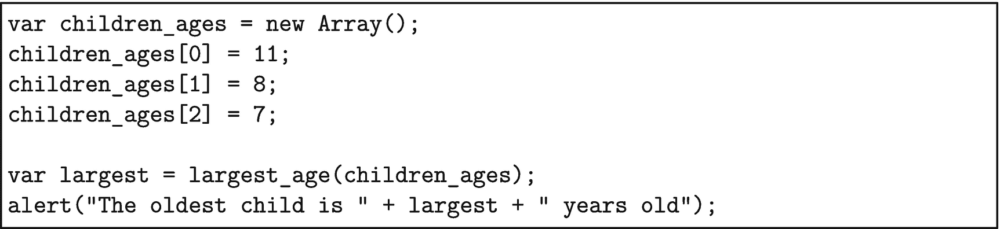

**图 11-3** 使用 `largest_age` 函数

就像我们可以用 `{}` 语法简化对象创建一样，数组也有特殊的语法，使其易于创建。在 JavaScript 中，你只需在方括号（`[]`）中放入一个列表即可创建数组。以下是一些示例：

```javascript
// 创建一个空数组
var empty_array = [];

// 创建我们之前用过的数组
var children_ages = [11, 8, 7];

// 获取 children_ages 中的最大值
var largest = largest_age(children_ages);

// 跳过变量，直接传入数组
var largest_inline = largest_age([11, 8, 7]);
```

使用这种语法可以节省我们大量的编程工作量。

另一个值得注意的技巧是如何向数组末尾添加值，无论数组有多长。虽然有多种方法，但最符合你当前学习进度的做法是直接将数组长度用作索引。请记住，长度总是比最后一个索引大 1，因此它也是即将添加的下一个索引。

以下代码展示了如何向数组中添加三个数字：

```javascript
var my_array = [];
my_array[my_array.length] = 23;
my_array[my_array.length] = 99;
my_array[my_array.length] = 10;
```

如果需要访问 `my_array` 数组的最后一个元素，可以使用 `my_array[my_array.length - 1]`。第一个元素始终是 `my_array[0]`。此外，如果你想删除数组末尾的元素，也可以设置 `length` 属性。要删除 `my_array` 数组的所有元素，只需执行 `my_array.length = 0;`。

> 一个手指向右指的手形图标。

### 练习题

1.  完整写出 `largest_age` 函数。向它传入不同的数组进行测试，确保它总是返回最大年龄。

2.  不要自己创建数组值，而是让用户输入值。首次尝试时，让用户输入恰好三个值。确保这些值在存入数组之前被转换为数字！

3.  扩展你的程序，使用户可以输入任意数量的值。记得包含一种让用户表示输入完成的方式，可以是在每次输入后询问他们是否完成，或者要求用户输入一个特殊的哨兵值来表示完成。

## 11.5 混合使用对象与数组

虽然对象和数组本身已经相当强大，但通过将它们混合使用，可以进一步提升两者的能力。对象属性中存储的值不必局限于数字和字符串——它们可以是任何 JavaScript 值，包括其他对象或数组！同样，数组中的值也不一定只是数字；它们可以是 JavaScript 支持的任何值，包括对象和其他数组。混合搭配对象和数组，让你能够灵活地表示几乎任何现实世界的数据集。

例如，假设我想记录更多关于孩子的信息，而不仅仅是年龄。我还想包含他们的名字和最喜欢的颜色。此外，假设我希望孩子列表是包含我个人信息的更大记录的一部分，而不是独立存在的一个变量。该如何编写呢？图 11-4 展示了完整写法。

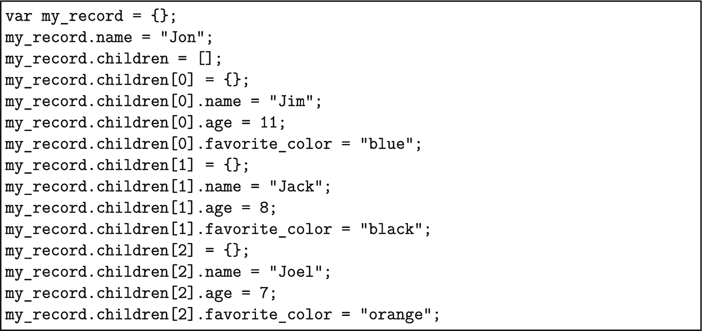

记录名为 Jim、Jack 和 Joel 的三个孩子的姓名、年龄和最喜欢颜色的程序。

**图 11-4**
构建一个复杂对象

如你所见，我们首先在变量 `my_record` 中创建了一个空对象。然后我们向该对象添加了一个名字。接着，我们向该对象添加了一个空数组，并将该属性命名为 `children`。现在，要访问这个数组，我们必须使用 `my_record.children`。由于 `my_record.children` 是一个数组，我们可以对其使用索引。因此，`my_record.children[0]` 指的是 `my_record.children` 数组中的第一个值。由于该索引尚不存在，它会被创建。但是，那里存储的是什么呢？是一个新的空对象！因此，`my_record.children[0]` 现在指向一个空对象。我们能对对象做什么呢？我们可以添加属性。我们可以通过执行 `my_record.children[0].name = "Jim";` 在这个新的空对象上创建一个 `name` 属性。然后我们以同样的方式设置年龄。在此过程结束时，我们得到了一个包含对象数组的对象。现在，如果我们想使用 `largest_age` 函数，我们必须重写它。为什么呢？因为现在数组不再是一个数字数组，而是一个对象数组。因此，对于每个对象，我们必须查找 `age` 属性。图 11-5 展示了相关代码。

我们在这个函数中所做的是修改循环，使其将对象临时存储在一个名为 `child` 的变量中。然后我们使用 `child.age` 来访问孩子的年龄。请注意，如果不使用这个额外的 `child` 变量，我们也可以直接输入 `child_array[i].age` 来实现，但从长远来看，创建这个额外的变量会减少大量输入，并且更易于阅读。

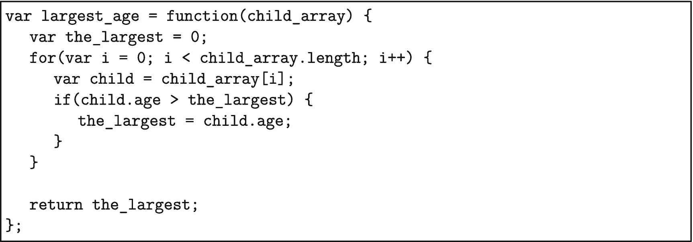

一个使用 `if` 条件判断孩子中最大年龄的程序。

图 11-5
使用对象的 `largest_age` 函数

要在我们的 `my_record` 中的孩子列表上调用此函数，我们只需编写 `largest_age(my_record.children)`。图 11-4 展示了构建复杂对象的复杂方式。然而，就像有更简单的方法来编写简单的对象和数组一样，复杂的对象和数组也可以使用简化的语法来构建。图 11-6 展示了与我们在图 11-4 中构建的完全相同的对象，但使用了简化表示法。正如你所见，这样做输入量少得多，且更易于阅读。由于书写方式，它占用了更多空间，但你并非必须那样做——JavaScript 不关心使用了多少或少量的空间。如果你愿意，完全可以将整个复杂对象写在一行上，但我认为将事物分开带来的清晰度值得占用额外的空间。

## 11.6 对象方法

**方法** 是一个物理上附加到对象上的函数。我们目前看到的函数（例如 `alert` 和 `prompt`）存储在全局变量中，可以在任何地方使用。而方法是一个作为属性存储在对象本身的函数。请记住，创建函数实际上是一个两步过程——`function` 关键字*创建*了函数，但之后我们必须将其赋值给一个变量才能通过名称调用它。然而，就像我们可以将函数存储在变量中一样，我们也可以将其存储在对象的属性中。以这种方式存储的函数称为方法。

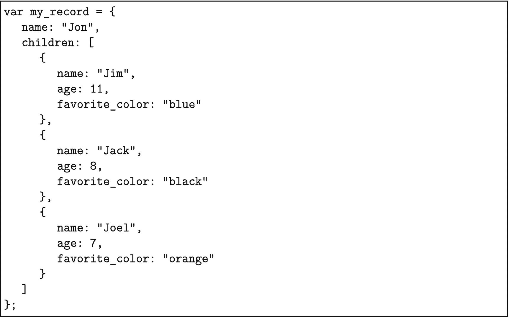

一个使用简化表示法记录 Jon 三个孩子姓名、年龄和最喜欢颜色的程序。

图 11-6
使用简化表示法的复杂对象

由于它们存储在对象属性中，因此它们没有全局名称；它们只能通过对象来访问。此外，方法在被调用时会隐式地传递它们所属的对象。

举个例子，让我们看看数组对象的一个内置方法，称为 `push`。`push` 方法只是将一个项目添加到数组的末尾。以下代码创建数组 `[5, 6, 7]`：

```javascript
var my_array = [];
my_array.push(5);
my_array.push(6);
my_array.push(7);
```

`my_array.push(5)` 的作用是查看 `my_array` 对象上的 `push` 属性，并调用在那里找到的函数。因为是以这种方式调用的，它会隐式地将 `my_array` 传递给该函数，并显式地将数字 5 作为第一个参数传递。然后 `push` 方法实现了与编写 `my_array[my_array.length] = 5;` 相同的功能。

对象方法有很多好处。首先，它们减少了全局定义方法的数量。就像我们通常尽量消除全局变量一样，因为记住哪些变量已经在使用会增加心智负担，将函数打包到对象的方法中而不是全局变量中，减少了我们需要关注的全局定义方法的数量。同样地，因为方法是在对象本身上定义的，我们实际上可以在不同对象上重用相同的方法名。在数组上，`push` 的意思是“将值推送到末尾”。然而，对于其他类型的对象（比如割草机），`push` 可能意味着完全不同的东西。因此，在不同对象上，可能存在一个含义完全不同的 `push` 方法。如果所有这些不同的函数都必须存在于全局作用域中，它们将都需要不同的名称，例如 `array_push` 和 `lawnmower_push`。这会增加输入量，并且最终会变得更加混乱。

最后，方法语法明确了方法中的主要参与者。定义方法的对象通常是方法中最重要的参数，并为操作提供上下文。它使代码读起来有点像句子。你可以将 `my_array.push(5)` 解读为“告诉 `my_array` 去 `push` 数字 `5`”。至少对我来说，这比语法是 `array_push(my_array, 5)` 更清晰（或者至少更整洁）。

与数组上的 `push` 方法相对应的是 `pop` 方法。`pop` 方法移除数组的最后一个元素（将其长度减 1）并返回被移除的值。

我们将在第 15 章深入探讨方法（以及如何创建自己的方法）。不过现在，我只希望你熟悉它们的运作方式，因为我们将在第 12 章更多地使用它们。

> **练习题**
>
> 1.  编写一个程序，使用户可以不断向数组中添加项目，直到完成。使用 `push` 方法添加它们。然后，完成后，将数组中的所有值相加并显示结果。
> 2.  尝试创建一个对象，并将一个函数赋值给它的某个属性。在第 15 章之前，你还不知道如何接收隐式传递的对象，但至少可以练习将函数作为对象属性进行赋值和使用。

### 11.6.1 回顾

在本章中，我们介绍了复合值（对象和数组）的基础知识。我们学到了以下内容：

-   对象将相关数据片段保存为一个单一的、内聚的整体。
-   对象中的每个值都放入一个属性中，该属性是一个用于访问该值的名称。
-   数据序列称为数组。
-   每个数组保存一系列相关的值。
-   通过索引访问数组中的值。
-   数组索引从零开始，这意味着第一个索引始终为 0，最后一个索引始终比数组长度小 1。
-   如果你为一个尚不存在的对象属性或数组索引赋值，系统会自动为你创建该属性或索引。
-   每个数组都有一个 `length` 属性，告诉你数组的大小。
-   `length` 属性可以在循环中用来控制循环执行的次数。

### 对象与数组

-   对象和数组可以互相嵌套——一个属性的值可以是数组，而某个数组索引位置的值也可以是一个完整的对象（该对象也可能包含数组）。
-   对象和数组都有特殊的语法（`{}` 和 `[]`），以便于输入。
-   函数也可以作为对象的属性存储，此时被称为方法。
-   当使用 `对象名.方法名()` 语法调用方法时，该对象会隐式地作为参数传递给该方法。

### 11.6.2 实践所学

1.  创建一个产品数组，使每个产品都是一个包含 `name`、`code`、`description` 和 `price` 属性的对象。
2.  现在，创建一个接受两个参数的函数：一个产品数组和一个产品代码。该函数应循环查找与代码匹配的对象。找到对象后，应返回包含匹配代码的完整对象。
3.  现在，添加用户交互功能。用户应能输入产品代码，程序将查找该产品的信息，并通过 `alert` 弹出框显示出来。
4.  扩展程序，使用户可以查找任意数量的产品代码。

# 12. 与网页交互

在前面的章节中，我们学习了对象如何工作以及如何构建自己的对象。然而，JavaScript 也提供了多个现成的内置对象供你使用。这些标准对象是程序与系统其他部分（包括 HTML 文档、屏幕、计算机存储、通信设施以及其他重要系统功能）之间的桥梁。在本章中，我们将使用标准的 `document` 对象与网页进行交互。请注意，在本章的前半部分，我们将*仅*与 JavaScript 控制台交互。要使它与从网页加载的脚本协同工作，还需要额外的步骤，这将在 12.6 节中介绍。

## 12.1 使用 JavaScript 控制台

为了观察 `document` 对象的实际运作，我们将使用 **JavaScript 控制台**。JavaScript 控制台允许你逐行输入 JavaScript 代码，并立即查看结果。关于如何在你的系统上访问 JavaScript 控制台，请参见附录 B.4.1。

在开始使用控制台之前，请将图 12-1 所示的网页代码输入到一个文件中，并在浏览器中加载它。

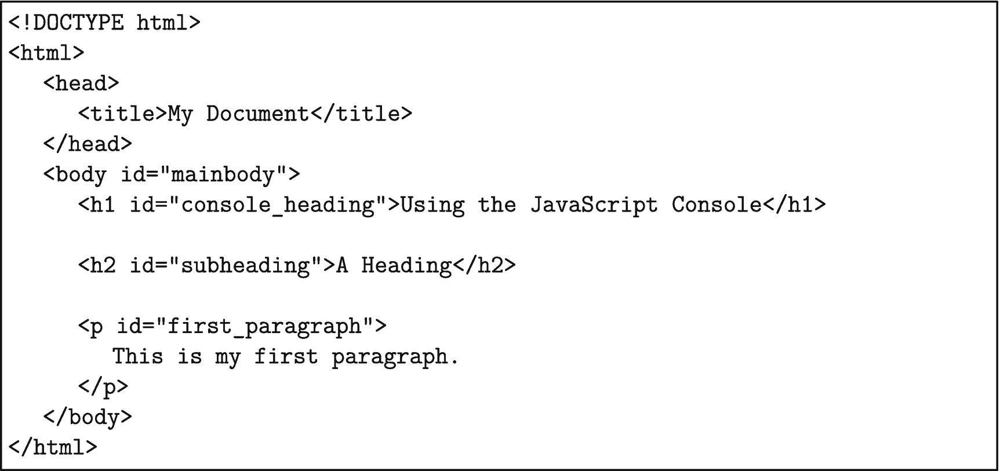

*代码截图展示了一个 JavaScript 格式的 HTML 文件。*

**图 12-1** 用于操作的基础 HTML 文件

现在，网页已加载完成，请按照附录 B.4.1 的描述打开 JavaScript 控制台。首先，为了熟悉控制台的操作，在控制台中输入 `2 + 5` 并按下回车键。发生了什么？它应该会显示结果 `7`。每次输入命令后，当你按下回车键，控制台都会显示你所输入内容的值。

接下来，输入 `var a = 2 + 5;` 并按下回车键。这次发生了什么？它应该返回 `undefined`。这是为什么呢？值 `7` 被加载到了变量 `a` 中，但变量声明本身没有返回值。因此，如果在声明变量后结果是 `undefined`，请不要感到惊讶。这是正常情况。

为了确认 `a` 确实接收到了我们的值，只需单独在一行输入 `a`。它应该返回值 `7`，这意味着控制台知道 `a` 的值。现在，我们故意犯一个错误。在控制台中输入 `a = 7 +;` 并按下回车键。它应该会返回某种错误信息，例如“语法错误”或类似的错误消息。注意这一点非常重要。如果你在使用控制台时收到错误消息，*请务必关注它*，因为很可能你在某处输入了错误的内容。请重新检查你输入的内容，确保其有效。编程语言往往非常挑剔。一个大小写错误的单词、一个意外的空格或一个放错位置的分号，都会导致你的代码无法运行。

> **练习题**
>
> 在继续操作网页之前，你应该在 JavaScript 控制台中练习以下内容。
>
> 1.  使用 `alert` 函数显示一个弹出消息。
> 2.  使用 `prompt` 函数从用户处获取一个值。
> 3.  输入第 10 章中的 `square_a_number` 函数。因为控制台会逐行处理你输入的内容，所以你需要将整个函数写在一行内。
> 4.  现在，在 JavaScript 控制台中使用 `square_a_number` 函数计算 3 和 6 的平方。

## 12.2 查找和修改网页元素

现在，我们对 JavaScript 控制台的工作原理有了一定了解，是时候与我们的网页进行交互了。JavaScript 提供了一个存储在全局变量 `document` 中的特殊对象，它是与网页交互的桥梁。在 JavaScript 中，网页上的每个标签都由其自身的对象表示，并拥有自己的属性和方法。用于 HTML 页面的标准对象类型列表（包含其属性和方法）被称为**文档对象模型**，通常简称为 **DOM**。本章将介绍这些对象的一些常用方法。

我们要做的第一件事是查找一个 HTML 元素。请记住，*元素* 是开始/结束标签及其之间所有内容的组合。请注意，在文件中，我们为几个标签添加了 `id` 属性。这使得在 JavaScript 中查找它们变得容易。`document` 对象有一个通过 `id` 属性查找 HTML 元素的方法，名为 `getElementById`。它接受一个参数，即要查找的 HTML `id` 值，并返回一个表示该 HTML 元素的 JavaScript 对象。如果未找到该元素，则返回特殊的 JavaScript 值 `null`，该值被视为“空”值。在你的控制台中，输入以下内容：

```javascript
document.getElementById("first_paragraph");
```

这将返回一个对象，该对象代表第一个段落的 HTML 元素。一旦我们有了这个对象，就可以对其进行修改，这些修改将反映在网页本身中。每个浏览器在控制台中展示这个值的方式可能不同，但底层结果是相同的——它是一个代表我们在屏幕上看到的 HTML 元素的 JavaScript 对象。无论如何，我们不仅想显示这个值，还想操作它。一个好的第一步是将该对象存储在一个变量中。因此，请执行以下操作：

```javascript
var x = document.getElementById("first_paragraph");
```

现在代表 HTML 元素的对象被存储在我们的变量`x`中。我们可以用它做什么？一个简单的事情就是更改文本。仅包含文本（即没有子元素）的 HTML 元素可以通过其`textContent`属性访问或更改该文本。输入以下代码：

```
x.textContent
```

它应该返回`"This is my first paragraph"`这个值，不过可能带有多余的空格。现在既然我们可以访问`textContent`属性，我们也可以更改它。输入以下代码为段落设置新文本：

```
x.textContent = "This is a changed paragraph.";
```

你应该会看到网页立即随着新段落文本而改变。如你所见，如果我们为 HTML 元素添加`id`属性，就可以轻松地找到它们并在 JavaScript 程序中进行操作。

一只手形图标，其食指指向右侧方向。

### 练习题

请使用 JavaScript 控制台完成以下任务：

1.  查找并修改`<h1>`元素的文本。
2.  查找并修改`<h2>`元素的文本。
3.  使用`prompt`函数请求用户输入一个字符串，并将其存储在一个变量中。然后将该段落文本设置为此值。

## 12.3 创建新的 HTML 元素

现在我们已经学会了查找和修改 HTML 元素，是时候学习如何创建一个新元素了。`document`对象有一个名为`createElement`的方法正是用来做这件事的。

在控制台中输入以下代码：

```
var new_element = document.createElement("p");
new_element.textContent = "This is a new paragraph";
```

这会创建一个新元素，但尚未将其添加到页面中。它仅仅存在于内存中，只存在于变量里。我们还没有告诉文档要把它放在哪里。现在，我们想将新元素作为`<body>`元素中的最后一个内容。因此，首先我们需要查找`<body>`元素：

```
var body_element = document.getElementById("mainbody");
```

现在我们需要告诉`<body>`元素将我们的新元素追加到其子元素的末尾。这可以通过我们的`<body>`元素的`appendChild`方法来完成。输入以下代码：

```
body_element.appendChild(new_element);
```

只要输入这行代码，新的段落就会立刻出现！

一只手形图标，其食指指向右侧方向。

### 练习活动

为了练习向网页添加 HTML 内容，我们将创建一个`<ul>`标签，然后通过 JavaScript 控制台向其中添加额外的`<li>`标签。如果您对这里的任何步骤感到困惑，请回顾前面的部分来了解如何执行每一步。

1.  首先，修改本节使用的 HTML 文件，在其中添加一个包含至少一个`<li>`标签的`<ul>`标签。
2.  为`<ul>`标签添加一个`id`属性，以便在下一步中使用 JavaScript 找到它。
3.  打开 JavaScript 控制台。使用`document`对象的`getElementById`方法找到`<ul>`元素并将其存储在变量中。
4.  现在使用`document`对象的`createElement`方法创建一个新的`<li>`标签来放入其中。
5.  使用新标签的`textContent`属性将其设置为您想要的任何文本。
6.  现在对您的`<ul>`元素使用`appendChild`方法，将新的`<li>`标签添加到列表末尾。
7.  练习向列表中添加另一个`<li>`标签。
8.  尝试使用 JavaScript 创建一个全新的`<ul>`标签，并将其添加到页面底部。然后向您用 JavaScript 创建的`<ul>`标签中添加额外的`<li>`标签。

## 12.4 与输入字段通信

到目前为止，与用户的所有交互都是通过`alert`和`prompt`函数进行的。但是，您可能已经注意到，在网页上，大多数交互都直接发生在网页本身内部。这几乎完全像我们在前几节中进行的网页操作一样。区别在于我们将要使用`<input />`标签。`<input />`元素对象的运作方式与我们见过的其他元素对象类似，但它有一个特殊的属性叫做`value`，代表字段中的文本。

为了了解这些输入字段的工作方式，请将图 12-2 中的 HTML 代码输入到一个文件中，并在浏览器中加载它。

有一点需要注意——*务必*在按钮上包含`type="button"`属性。否则，单击按钮可能会导致页面重新加载，从而丢失您创建的所有变量。


一个 Doctype HTML 文件的屏幕截图，包含输入字段示例，其中用 Java 脚本编写了输入字段 1 和 2。

**图 12-2** 包含输入字段的 HTML 文件

现在，打开 JavaScript 控制台。我们首先要做的是查找两个`<input />`元素并将它们存储在变量中。为此，输入以下代码：

```
var fld1 = document.getElementById("field1");
var fld2 = document.getElementById("field2");
```

现在单独输入`fld1`以确保它返回一个 HTML 元素作为值。如果没有返回，则说明您输入有误。对`fld2`执行相同操作以进行检查。

现在输入以下代码：

```
fld1.value = "Hello";
```

输入后，第一个字段中应该会出现文本“Hello”。进入第二个字段，在网页中输入文本“Goodbye”。现在在 JavaScript 控制台中输入以下代码：

```
fld2.value
```

它现在应该会把您输入的值（如果按指示操作，应为`"Goodbye"`）打印到控制台上。现在我们知道如何设置和读取`<input />`元素的值了！

现在查找`<span>`标签。请记住，`<span>`标签用于指定文本区域。在我们的例子中，我们指定了要写入结果的位置。无论如何，请执行以下操作来查找`<span>`标签，以便我们准备好写入该位置的页面：

```
var results_span = document.getElementById("results");
```

现在单独输入`results_span`，以便检查您是否正确获取了`<span>`元素。我们要做的是从每个输入字段读取一个数字，将它们相乘，然后将结果写入`<span>`元素中。

首先在每个输入字段中输入两个数字。在这个例子中，假设您在第一个字段中输入了“5”，在第二个字段中输入了“7”。请记住，由于这是从键盘输入的，因此它被视为字符串，而不是数字。因此，`fld1.value`将是字符串`"5"`而不是数字`5`，而`fld2.value`将是字符串`"7"`而不是数字`7`。因此，我们需要使用`parseInt`函数将这些字符串转换为数字。

在 JavaScript 控制台中输入以下代码以读取字段的值并将其存储在变量中：

```
var val1 = parseInt(fld1.value);
var val2 = parseInt(fld2.value);
```

现在，`val1`和`val2`应该包含您输入的数字。您可以通过在控制台中单独输入变量名来验证，确保它返回正确的值。

现在，我们需要将两个数字相乘。输入以下代码来完成此操作：

```
var result = val1 * val2;
```

`result`现在包含了结果。

现在，我们只需要将`result`中的值写回到页面上。我们将使用`results_span`的`textContent`属性来完成此操作。JavaScript 在显示数字之前会自动将其转换为字符串。以下代码实现了这一点：

```
results_span.textContent = result;
```

## 12.5 为按钮添加功能

到目前为止，我们已经能够在文档中对输入字段手动执行一些 JavaScript 处理。但这并不是网页通常的工作方式。通常，用户通过点击按钮来告诉计算机完成某个功能。因此，我们必须将所需的功能附加到按钮上。

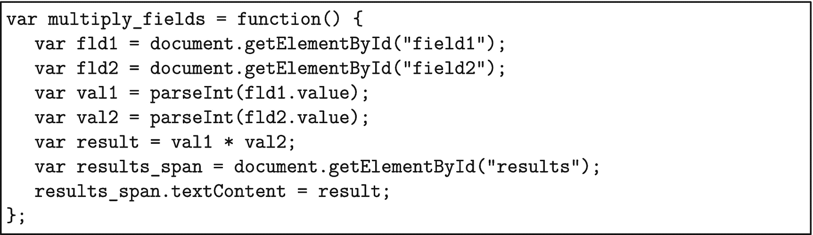

一个用 JavaScript 编写的 HTML 文件截图，其中包含一个将变量 1 和 2 相乘的函数。

**图 12-3** 用于相乘两个文本字段的函数

那么，首先，我们将创建一个函数，用于执行我们在上一节中完成的任务。为了便于阅读，我会将其写成多行。然而，由于 JavaScript 控制台每次只解释一行，你*必须*将整个函数写在同一行。别担心，JavaScript 语言无论写成一行还是多行，其工作方式完全相同——正因如此，它使用分号来分隔语句。所以，只要你正确输入所有内容，即使写在一行也能正常运行。图 12-3 展示了这个函数。请注意，它使用了 `document` 对象。这之所以可行，是因为 `document` 是一个全局变量。同时也要注意，该函数不接受任何参数。它仅通过使用 `document` 这个全局变量来工作。

一旦你在控制台中输入了该函数（全部写在一行），调用此函数就应该能执行所有任务。为了测试一下，在输入字段中输入两个不同的数字，然后在 JavaScript 控制台中输入以下内容：

```
multiply_fields();
```

这应该会将两个数字相乘，并将结果写入 `results <span>` 标签中。如果未能生效，请重新检查你的函数。现在，我们希望用户在点击我们的按钮时，能够运行这个函数。这实际上非常容易实现。`<button>` 标签有一个名为 `onclick` 的属性。如果你将 `onclick` 设置为一个函数，那么当按钮被点击时，它就会调用该函数！目前，你应该只使用不接受参数的函数。

那么，要实现这一点，我们需要在页面上找到 `<button>`，然后设置它的 `onclick` 属性。代码如下：

```
var btn = document.getElementById("my_button");
btn.onclick = multiply_fields;
```

请注意，这里我们并不是在*调用*函数 `multiply_fields`。我们是在将函数本身*存储*到 `onclick` 属性中，以备日后使用。记住，JavaScript 函数本身就是值，并且像其他任何值一样存储在变量和属性中。因此，我们是将函数存储在 `btn` 对象中，而 `btn` 对象会在适当的时候调用该函数。试试看，输入两个值，然后点击按钮。如果一切设置正确，它应该会在正确的位置显示结果。

## 12.6 整合所有内容

现在，我们真正想要的是让所有这些功能随网页一起加载。为此，我们需要将所有代码放入一个 JavaScript 文件中。在与 HTML 文件相同的目录下创建一个名为 `multiply.js` 的文本文件。将图 12-4 中的代码输入到 `multiply.js` 中。

现在我们需要将其附加到 HTML 文件中。为此，请在 HTML 文件的 `<head>` 元素中添加以下标签：

```
<script src="multiply.js" defer="defer"></script>
```

注意我们添加的新属性——`defer="defer"`。这个属性改变了 JavaScript *何时*被加载和运行。通常情况下，JavaScript 会在这个标签所在的位置被精确加载和运行。在我们的案例中，这意味着只有 `<head>` 元素存在，因为该标签出现在页面其余部分之前。这无法正常工作，因为 `document.getElementById("my_button")` 会返回 `null`（即无值），因为按钮此时尚未成为页面的一部分。属性 `defer="defer"` 告诉浏览器等到整个页面加载完毕后再运行 JavaScript 代码。

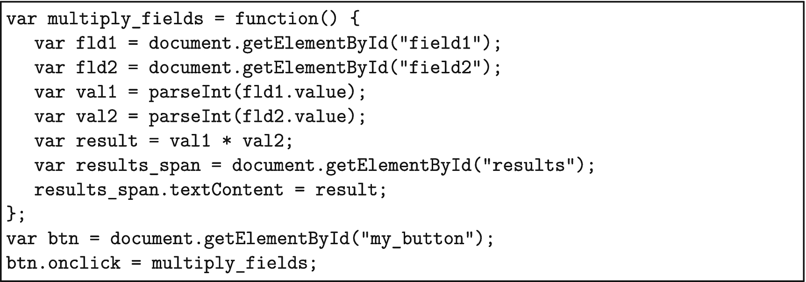

一个用于在 JavaScript 中相乘变量 1 和 2 字段的完整 HTML 代码截图。

**图 12-4** 用于相乘两个字段的完整代码

现在，在将你的 `<script>` 标签添加到 HTML 文件并保存所有内容之后，重新加载页面。在你输入两个数字并点击按钮后，它应该会给出答案。

### 练习活动

既然你已经知道如何为网页添加功能，本活动将让你在同一个页面上添加第二个函数。

1.  从本节完成的文件开始。
2.  接下来，在你的 JavaScript 文件中创建一个新函数，该函数将把两个数字相加，而不是相乘。将这个函数命名为 `add_fields`。*不要*删除原有的 `multiply_fields` 代码。只需添加一个新函数。
3.  现在向页面添加第二个按钮。确保给它一个不同的 `id` 属性，这样你才能找到它。不要删除现有的按钮。
4.  现在在你的 JavaScript 文件中添加代码，使其能够找到新按钮，并将你的 `add_fields` 函数附加到该按钮上。
5.  测试你的新页面。确保两个按钮都能执行各自相应的操作。

## 12.7 向控制台记录日志

如果你的程序存在实际错误，这些错误通常会在 JavaScript 控制台中报告。因此，在进行开发时，我几乎总是保持控制台打开，以便可以查看自己哪里搞砸了。不过，你也可以自己向控制台写入值。当你拥有复杂的代码或计算，并希望跟踪计算过程中各个阶段的状态时，这通常会很有帮助。JavaScript 很贴心地提供了一个名为 `console` 的全局变量，允许你向控制台写入内容。`console` 对象有一个 `log` 方法，允许你将任何你想要的内容写入控制台。

修改你之前的程序，在 `multiply_fields` 函数的某处添加以下这行代码：

```
console.log("I am here");
```

现在，当你点击按钮时，它应该会在控制台中写入“`I am here`”。

大多数浏览器都有额外的工具用于调试你的 JavaScript 程序。如何使用这些工具的详细内容超出了本书的范围，但我至少会提一下最常见也最强大的一个工具——断点。断点会告诉 JavaScript 解释器在某一代码行处停止。然后，你作为程序员，就可以查看此时所有变量的值，并让 JavaScript 逐行执行你的代码，以观察每一行如何影响正在发生的事情。

控制台日志记录和断点经常被用作彼此的替代，但它们各自有更适合某些问题的场景。控制台日志对于实时监控正在运行的程序非常有用。通过让控制台日志报告重要的状态信息，你可以观察程序在执行计算时的流程。断点则适用于代码中有一个特定位置出现问题，并且你需要查看过程中每一步如何影响结果的情况。为什么这个变量被设置成了那个值？是哪个条件导致它走错了分支？哪个值意外地变成了 `null` 或 `undefined`？通过设置合适的断点并逐步执行你的程序，这些问题可以很快得到解答。

# 食指指向右侧的手形图标

### 编程接口的宏观视角

本章向你介绍了文档对象模型（DOM）。你可能会好奇，如何知道有哪些对象、属性和函数可供使用。当你把一个函数赋值给 `onclick` 属性，点击按钮时它就能神奇地调用该函数，这看似神秘甚至随意。实际上，当程序员创建 JavaScript 和 DOM 这类系统时，他们必须决定如何表示和交互各种事物——例如对象和属性的命名方式及使用方法。这些对象、函数和属性的名称本质上是随意的——完全取决于程序员如何命名。幸运的是，这些命名通常具有逻辑性，能帮助你学习如何使用它们；但有时，由于疏忽或历史原因，也会出现一些不合逻辑的古怪命名。这在编程中相当常见。

系统所支持的标准对象、属性和函数的列表被称为`应用程序编程接口`，更常见的叫法是`API`。那么，你如何知道 `API` 中提供了哪些对象、属性和函数呢？通常，程序员会将其记录下来，并通过`文档`进行共享。大多数编程系统都有一份参考手册，列出了所有可用的函数。不过，这些手册通常相当冗长，因为系统开发者会尽力预想你可能需要的所有功能，并为每一项提供对应的函数。但通常来说，大多数 `API` 都围绕少数几个核心概念展开，一旦你掌握了这些概念，其余细节随时可以查阅。

#### 12.7.1 回顾

在本章中，我们练习了如何使用 JavaScript 与网页进行交互。我们学习了以下内容：

- JavaScript 内置了一些对象，使我们能够与系统其余部分及网络进行交互。
- `document` 对象是允许我们与当前网页交互的入口。
- DOM 是在与 HTML 页面及其元素交互时可使用的对象和属性列表。
- HTML 标签的 `id` 属性可用于从 JavaScript 中查找元素并进行操作。
- `document` 对象的 `getElementById` 方法允许我们利用 `id` 属性获取代表页面中 HTML 元素的对象，并将其存储在变量中进行检查和操作。
- HTML 元素对象的 `textContent` 属性允许我们获取和设置 HTML 元素的文本内容。
- 可以使用 `document` 的 `createElement` 方法创建元素。
- 新创建的元素可以使用元素的 `appendChild` 方法添加到页面中。该方法会将元素作为给定元素对象的最后一个子元素添加。
- `<input />` 标签可用于允许用户输入数据以供处理。
- `<input />` 标签对象的 `value` 属性可用于读取或设置文本字段的值。
- `<button>` 标签可用于启动处理过程。请务必设置 `type="button"` 属性，以确保其正常运行。
- 将 `<button>` 元素对象的 `onclick` 值设置为一个函数，将在点击该按钮时运行该函数。
- 在 `<script>` 标签上设置 `defer="defer"` 属性将使其在文档完全加载后再执行 JavaScript。从现在开始，所有 `<script>` 标签都应添加此属性。
- `console` 对象是一个内置的 JavaScript 对象，它有一个 `log` 方法，可以将任何值写入控制台。
- `API` 是系统中可供程序员使用的标准对象、属性和函数的列表。
- `API` 文档描述了哪些对象、属性和函数可用，以及它们如何工作的详细信息。

#### 12.7.2 学以致用

1.  既然你已经知道如何从 HTML 页面获取用户输入以及如何将输出写入 HTML 页面，请从之前章节中选择一个程序，将其重写为使用 `<input />` 标签而非 `prompt` 函数。
2.  创建一个 HTML 页面，该页面只有一个带有 `id` 属性的空 `<body>` 标签。仅使用 JavaScript 代码，构建一个包含标题、段落以及一个包含两个列表项的 `<ul>` 列表的页面。
3.  创建一个 HTML 页面，该页面只有一个带有 `id` 属性的空 `<ul>` 标签。编写 JavaScript 代码，使用数组和 `for` 循环来填充 `<ul>` 元素，为其添加 `<li>` 元素。使用数组 `["One", "Two", "Three"]`，并让你的代码遍历数组的每个元素，为数组的每个成员添加一个新的 `<li>` 元素。

# 第四部分 中级 JavaScript

## 中级 JavaScript

本部分将更深入地探讨 JavaScript 语言的运行机制。这要求你更深入地思考 JavaScript 如何解释你所编写的内容，以及当你编写代码时计算机内部实际发生的事情。

# 13. 递归函数与调用栈

在第 10 章中，你了解到函数可用于将代码片段打包成可重复使用的、定义良好的单元。在本章中，我们将更详细地探讨 JavaScript 是如何追踪这些函数的。

### 13.1 程序栈

此前，我们讨论了局部变量（函数内定义的变量）和全局变量（函数外定义的变量）。我们提到局部变量仅限于定义它的函数内部使用。也就是说，如果有一个名为 `x` 的全局变量，而某个函数内部也定义了一个名为 `x` 的局部变量，那么这两个 `x` 代表的是**不同**的变量。因此，函数可以修改其内部的局部 `x` 而不会影响全局 `x`。这样做的好处之一，就是我们在开发函数时无需担心项目中其他开发人员使用了什么变量名。

设想一下，如果你正与一位伙伴共同开发一个程序。如果你们必须就每一个变量名达成一致（以防止一方的操作意外覆盖另一方的变量），这将变得十分繁琐，从而使开发进程非常缓慢。而有了局部变量，只要变量是在函数内部定义的，其具体名称就无关紧要。全局变量仍然需要统一命名，但尤其是在大型项目中，全局变量的数量应该要少得多。

那么，JavaScript 是如何追踪局部变量的呢？事实证明，几乎所有编程语言都以大致相同的方式来追踪局部变量——通过一种称为`程序栈`（或简称栈）的机制。栈是编程语言用来追踪程序当前执行状态的方式。说白了，它就是一个信息栈，编程语言用它来记录程序中正在发生的事情。

例如，当一个程序调用一个函数时，它必须记住函数执行完毕后应该返回哪里。因此，它会将返回位置压入栈中，以便在函数结束后知道该回到何处。如果这个函数又调用了另一个函数，那么它会将另一个返回位置压入栈顶。当第二个函数执行完毕，它会查看栈顶，了解应该返回的位置，弹出（移除）该值，然后从指定位置继续执行。当最初的函数执行完毕时，其返回位置再次回到栈顶，因此它就知道应该返回哪里了。

图 13-1 展示了一些相互调用的函数。其中包含了注释，标明了程序即将执行的不同位置（标记为“位置 1”、“位置 2”等），以便我们讨论程序在这些函数间的执行流程。如果跳过函数中变量的声明部分，实际代码是从位置 8 开始执行的。就我们目前讨论的内容而言，可以认为程序开始时栈是空的。

程序做的第一件事就是调用函数 `function_one`。当 `function_one` 结束时，程序应该在哪里继续执行？它应该在位置 9 继续执行。此时的栈如图 13-2 所示。

现在，来看 `function_one`。代码从位置 1 开始执行，接着立即调用了函数 `function_two`。想想在 `function_two` 执行完毕后，代码应该从哪里继续？它应该从位置 2 继续执行。因此，将该位置压入栈顶。此时栈如图 13-3 所示。

那么，`function_two` 做了什么？它调用了另一个函数 `function_three`。由于 `function_three` 执行完毕后，它应该继续执行的下一个位置是位置 5，因此将这个位置压入栈中。此时栈如图 13-4 所示。

现在，`function_three` 也发起了自己的函数调用，不过这次是调用一个内建函数。对内建函数的调用与其他函数调用的工作方式完全相同。那么，`alert` 执行完毕后，`function_three` 应该从哪里继续执行？它应该回到位置 7，此时栈将如图 13-5 所示。

现在情况变得有趣了。当 `alert` 执行完毕后会发生什么？它如何知道该去哪里？它只需查看栈顶！栈顶写着：“执行完毕后，返回代码中的位置 7。” 然后 JavaScript 移除栈顶元素，并从位置 7 继续执行。此时栈恢又复到图 13-4 所示的状态。但是，在位置 7 剩下的唯一一件事就是从函数返回。因此，它再次执行同样的过程——查看栈顶以确定应该返回的位置。这次它返回位置 5，栈恢复到图 13-3 所示的状态。同理，在位置 5 唯一要做的就是返回，栈指示返回位置 2。于是我们返回到位置 2，并将其从栈顶移除。栈再次恢复到图 13-2 所示的状态。

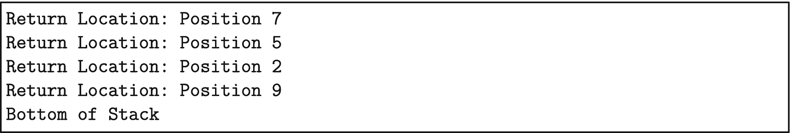

一幅包含 5 行文本的示意图。1，位置 7 的返回地址。2，位置 5 的返回地址。3，位置 3 的返回地址。4，位置 9 的返回地址。5，栈底。

**图 13-5** 内建函数调用后的栈

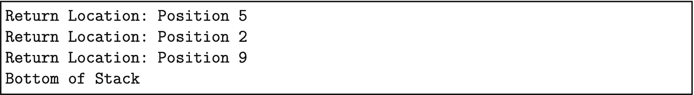

一幅包含 4 行文本的示意图。1，位置 5 的返回地址。2，位置 2 的返回地址。3，位置 9 的返回地址。4，栈底。

**图 13-4** 第三次函数调用后的栈


一幅包含三行文本的示意图。1，位置 2 的返回地址。2，位置 9 的返回地址。3，栈底。

**图 13-3** 第二次函数调用后的栈


第一次函数调用后的栈有两行。第 1 行，位置 9 的返回地址。第 2 行，栈底。

**图 13-2** 第一次函数调用后的栈

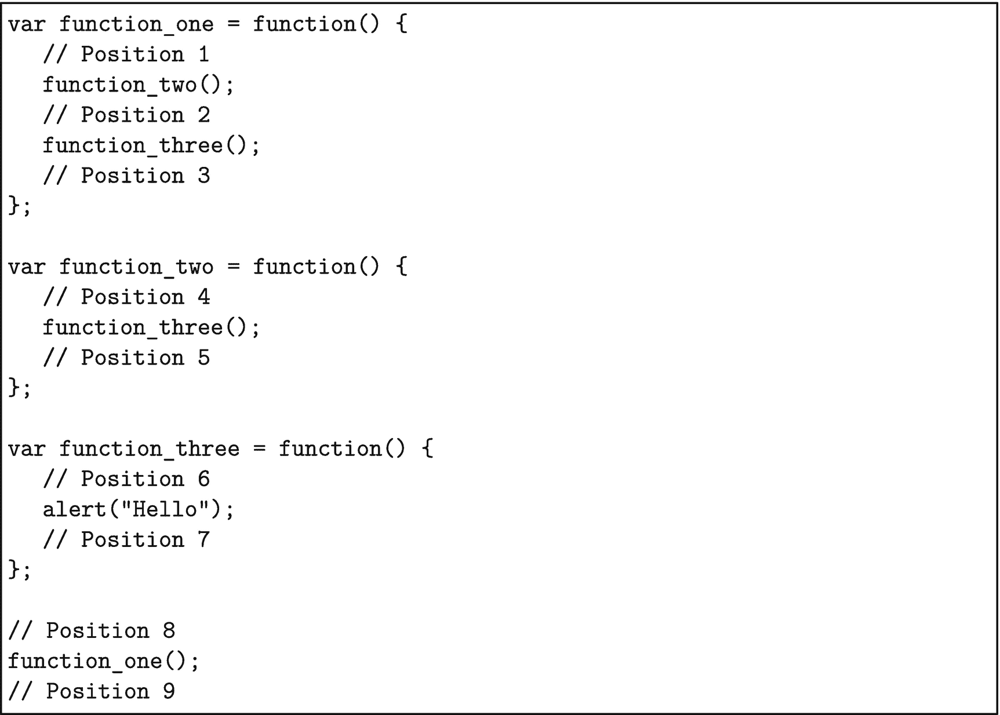

一个包含三个函数、变量、调用函数以及不同位置（位置 1 至位置 9）的程序代码。

**图 13-1** 函数相互调用的示例

现在情况变得更加有趣了。在位置 2 发生了什么？它再次调用了 `function_three`，但这次返回位置与之前不同——是位置 3。此时栈如图 13-6 所示。

当 `function_three` 运行时，它知道这次应该返回位置 3，而不是像之前被 `function_two` 调用时返回位置 5。所以，正如你所见，栈负责追踪程序的执行状态，并帮助计算机了解如何以及从哪里返回函数调用。


一幅包含 3 行文本的示意图。1，位置 3 的返回地址。2，位置 9 的返回地址。3，栈底。

**图 13-6** 第二次调用 `function_three` 后的栈

通常，代码中的实际情况比这更复杂。由于许多函数都有返回值，而且函数实际上只是语句的一部分，因此返回时必须将程序发送到代码行中间的准确位置。这和之前的思路相同，只是计算机追踪的位置比我们示例中的行号要复杂得多。例如，考虑以下代码：

```

```
var `square_a_number` = function(`x`) {
    return `x` * `x`;
};
var `y` = `square_a_number(square_a_number(2) * 4)`;
```

### 13.2 栈中的局部变量

在本例中，我们在*同一行*多次调用一个函数，每次调用都会返回到*该行中的不同位置*。不用担心，JavaScript 确切地知道每次应该返回到哪里。它的定位系统比我们上面粗浅的例子要精确得多。此外，随着我们深入学习，JavaScript 在栈中存储的信息远不止返回位置。

JavaScript 在栈中存储的另一项主要内容是当前函数中使用的局部变量列表。为了讨论这一点，让我们看一个函数，它将计算一个范围内的所有数值之和，我们称之为 `sum_range`。例如，如果你给它数字 3 和 7，`sum_range(3, 7)` 将计算 `3 + 4 + 5 + 6 + 7` 并得出 `25`。图 13-7 展示了这段代码的样子。在这个例子中，我们有局部变量——`r_start`、`r_end`、`x` 和 `total`。请记住，局部变量对全局作用域是不可见的。JavaScript 实现这一点的方法是将当前变量列表保存在栈上。

因此，当函数被调用时，不仅返回位置被放入栈中，还会在内存中创建一个"作用域"（可访问变量列表），并将栈链接到该作用域。

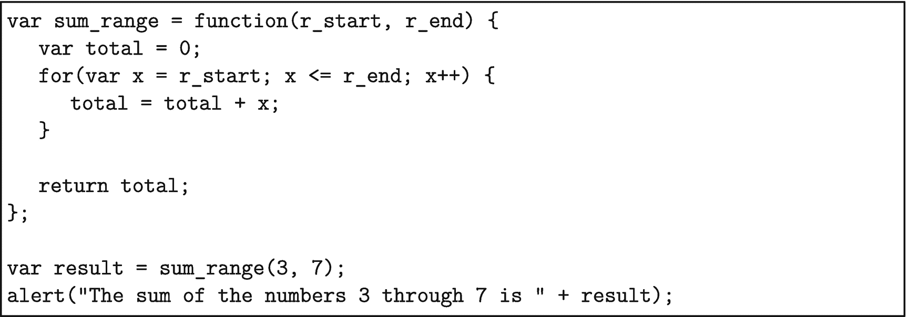

一个 9 行代码的求和程序，其中 `sum_range` 的 `r_start` 和 `r_end` 分别为 3 和 5，提示消息显示数字 3 到 7 的和。

**图 13-7** 对范围内所有数值求和

所以，当我们调用 `sum_range` 时，栈看起来会更复杂一些。图 13-8 展示了当 `sum_range` 函数刚开始执行 `for` 循环时栈的状态。请注意，当前作用域和当前位置周围有一个粗黑线框，这被称为**栈帧**。栈帧是为特定函数调用在栈上打包在一起的所有数据。作用域和返回位置共同组成了每个函数调用的栈帧。

栈帧将 JavaScript 指向当前用于处理变量的作用域。作用域的工作方式是：当你在程序中引用一个变量，比如 `x` 时，JavaScript 首先在栈上查找当前作用域的位置，然后在当前作用域中查找该变量。如果找到，就使用这个值。你看到局部作用域顶部写着"父级作用域"的方框了吗？每个作用域都链接到一个父级作用域，这告诉 JavaScript 如果在当前作用域中找不到变量，应该去哪里查找。在本例中，父级作用域是全局作用域。在第 14 章中，我们将看到如何链接更多的作用域。

所以，当函数被调用时，不仅返回位置被放入栈中，还会创建一个*全新的*作用域，并且该新作用域的链接也会被放入栈中。

让我们看另一个类似的程序，它将声明一个名为 `sum_squares_of_range` 的函数。这个函数的工作方式与 `sum_range` 类似，不同之处在于它会对范围内的每个数字进行平方运算。代码如下：

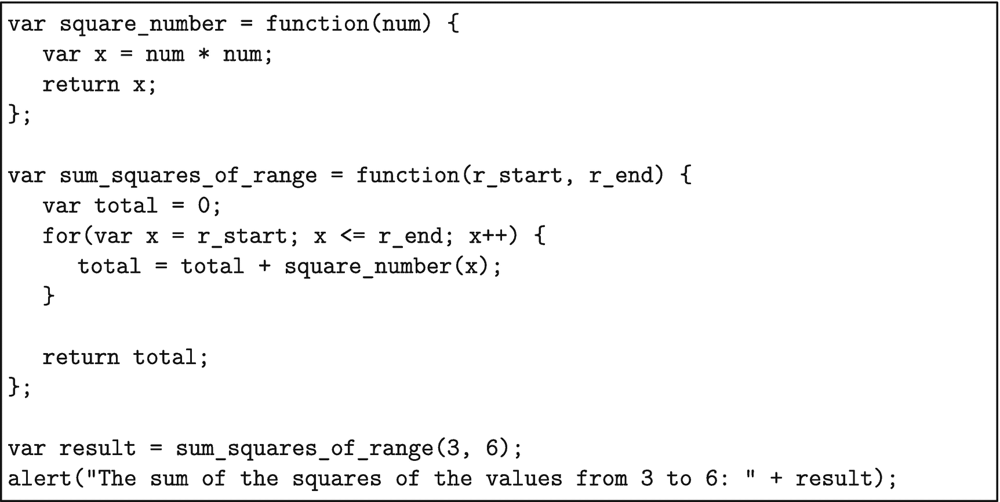

一个 13 行代码的程序，用于计算范围内数字的平方和。`sum_square_range` 的值为 3 和 6，提示消息显示数字 3 到 6 的平方和。

**图 13-9** 对范围内数字的平方求和

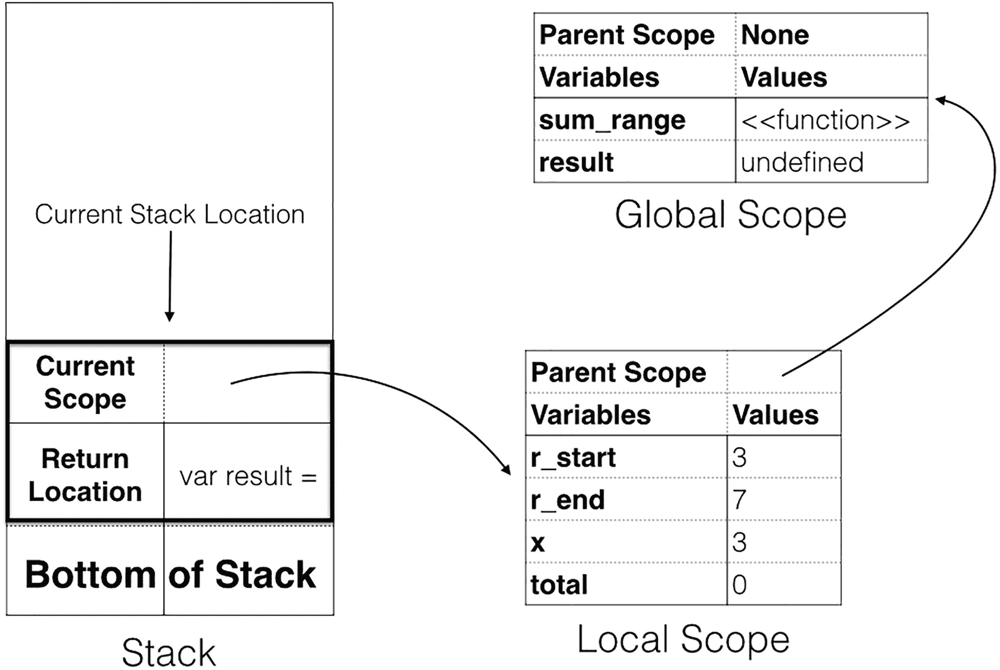

一个概念性的计算机内存布局示意图，包含栈、局部作用域和全局作用域三个数据表。

**图 13-8** 函数调用中计算机内存的概念布局

在这个程序中，栈的深度达到了两层。首先，它调用 `sum_squares_of_range`，这导致了与上一个例子类似的情况。然后，为了计算每个数字的平方，它对每个数字调用 `square_number`。图 13-10 展示了第一次调用 `square_number` 后、即将返回之前的栈布局。请注意，这两个函数的所有局部变量都*存在*，但它们只能从各自的函数内部*访问*。当 `square_number` 函数激活时，"当前作用域"指向 `square_number` 的局部作用域，该作用域包含其变量以及一条指向全局作用域的链接。因此，当 `square_number` 设置 `x` 的值时，它只影响其自己作用域内的 `x` 值。`sum_squares_of_range` 中的 `x` 对这个函数甚至不可见。所以，即使我们为 `x` 赋值，也只是针对特定于该函数的 `x` 的*局部*副本。当函数返回时，它会移除*同时*移除局部作用域的链接和返回位置。当 `sum_squares_of_range` 再次开始执行时，其自己的作用域将位于栈顶，并且它完全看不到 `square_number` 的作用域。

另外需要注意的一点是，当函数首次开始执行时，局部作用域*只*包含父级作用域和参数的条目。JavaScript 依赖 `var` 关键字在其作用域内创建新变量。`var` 关键字使 JavaScript 在当前作用域（而*不是*任何父级作用域）中查找该变量是否*在该作用域内*存在。如果变量不存在，JavaScript 就在当前作用域中创建该变量。如果变量已经存在，JavaScript *不会*创建新副本，而是继续使用已经存在的那个。

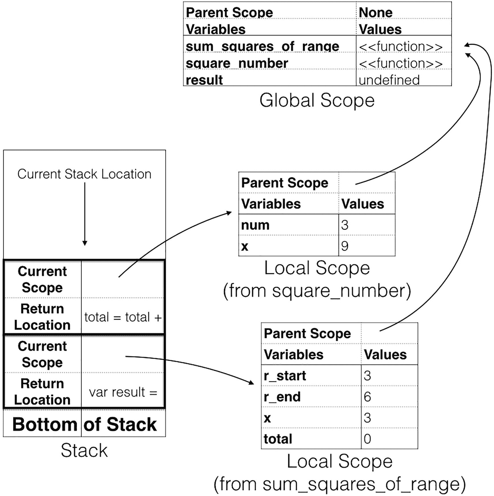

一个包含栈帧、`square_number` 的局部作用域、`sum_squares_of_range` 的局部作用域和全局作用域四个数据表的示意图。

**图 13-10** 两个函数同时激活时的栈帧

一个手掌图标，食指指向右侧。

#### 实践活动

1.  查看你在第 10 章编写的使用函数的程序，挑选其中一个。
2.  打印出你的函数。从任何函数调用处画线到被调用函数的开头。从 `return` 语句画线到程序中返回的位置。
3.  为这个程序创建一个类似于图 13-10 的栈、局部作用域和全局作用域图，要求至少有一个函数处于激活状态。

### 13.3 递归函数

既然我们已经了解了栈帧和局部变量的工作原理，是时候学习**递归函数**了。递归函数是一个以自身为基础定义的函数。想一想前面图 13-7 中对两个数之间的所有值求和的程序。在该程序中，我们使用了一个循环来遍历整个范围。但是，有没有另一种思考这个问题的方式呢？另一种解决途径呢？

考虑对 4 到 10 之间的所有数字求和。是否存在一个更小的、类似的、可以以相同方式利用的问题？确实，对 4 到 10 之间的所有数字求和，等同于将 4 加上 5 到 10 之间数字的和。所以，`sum_range(4, 10)` 与 `4 + sum_range(5, 10)` 的结果相同。同样，`sum_range(5, 10)` 与 `5 + sum_range(6, 10)` 的结果相同。

以自身为基础定义函数被称为递归。我们如何编写一个使用递归的程序呢？图 13-11 展示了这种实现的部分示例。

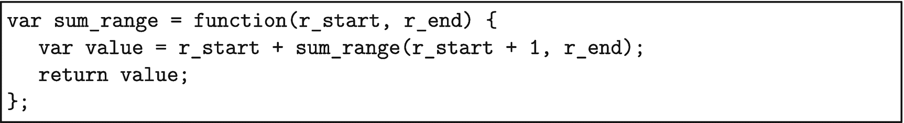

#### 用于定义 `sum_range` 函数的 4 行程序代码

1.  `var sum_underscore_range = function(r_start, r_end)`
2.  `var value = r_start + sum_range(r_start + 1, r_end)`
3.  `return value;`
4.  `};`

**图 13-13** `sum_range` 函数的部分递归定义

如你所见，该函数是根据其自身定义的。然而，如果你尝试运行这个函数，你会意识到一个问题：它永远停不下来！函数中没有任何机制使其在到达范围末端时停止，因此它会一直运行下去。

在编写递归程序时，主要需要处理两种情况：**基线情况**和**归纳情况**。归纳情况就是我们刚刚已经编写好的情况——即使用递归来解决问题的情况。归纳情况的名称来源于数学中的归纳证明，这与递归函数非常相似。而我们缺失的情况是基线情况——即停止递归以返回答案的情况。

在我们的程序中，当 `r_start` 和 `r_end` 相等时，就出现了基线情况。当这种情况发生时，我们不需要再递归了——我们知道答案是什么！当范围的起点和终点相等时，我们只需返回*那个*数字。

因此，使用递归的 `sum_range` 函数的完整定义如图 13-12 所示。如你所见，现在有一个用于检查基线情况的 `if` 语句，如果找到基线情况，它会立即计算结果。否则，程序将继续递归执行。

然而，你可能已经注意到了某个有趣的现象。我们这里使用了局部变量，但却是反复使用相同的局部变量。难道每次调用函数时这些变量不会被覆盖吗？事实上，它们不会。原因在于，**每次调用函数时**，JavaScript 都会创建一个*新的*局部变量作用域。因此，每次调用 `sum_range` 时，都会创建一个新的局部作用域。所以，如果你调用 `sum_range(2, 5)`，它会创建四个局部变量作用域，每次调用 `sum_range` 都会生成一个。

在第三次调用之后，堆栈看起来会像图 13-13 所示。请注意，在第三次调用 `sum_range` 后，图中恰好有三个 `sum_range` 局部作用域的副本，每个副本都以全局作用域作为父作用域，并且每个作用域中都有 `r_start` 和 `r_end` 自己的值。这就是计算机使递归函数调用成为可能的方式。

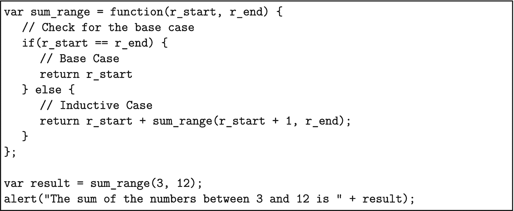

#### `sum_range` 函数实现的 9 行程序代码

该程序包含一个处理基线情况和归纳情况的 `if` 和 `else` 条件语句，`sum_range` 的参数为 `3` 和 `12`，并弹出一条提示消息，内容为：3 到 12 之间所有数字的和即为结果。

**图 13-12** `sum_range` 函数的完整递归实现

在迄今为止的示例中，并没有使用递归的必要。事实上，考虑到生成的所有函数调用、堆栈帧和局部作用域，我们的代码实际上比使用简单循环时要慢得多。尽管如此，在许多情况下，递归是使问题最具可理解性的方式，或者使用递归编写程序是最简单的。如今的程序很少需要大量的优化。虽然程序本身的速度不应被忽视，但通常最重要的事情是程序员编写程序所花费的时间，或者另一位程序员阅读和理解程序所花费的时间。这些通常比纯计算速度更为重要。

理解递归能帮助你更轻松地找到某些问题的解决方案。当你熟练使用递归时，你会开始将许多复杂的问题看成是伪装起来的简单问题。此外，理解递归还能帮助你更好地理解他人使用递归编写的代码。使用递归的最佳时机是当你可以将问题视为一个反复出现的相同问题，并且每一步都只是前一个问题的一个更小版本时。

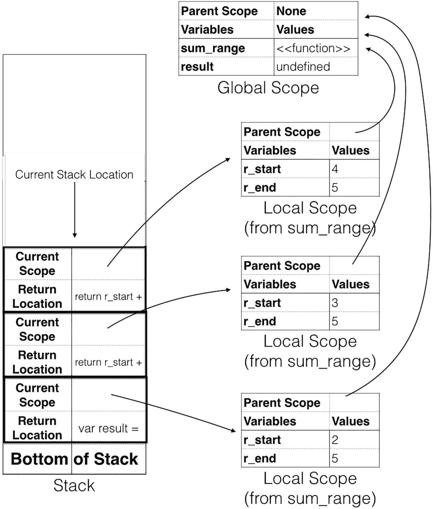

#### 堆栈帧递归函数调用的 5 个数据表示意图

堆栈从 3 个 `sum_range` 流向局部作用域，然后是全局作用域。

**图 13-13** 递归函数调用的堆栈帧

### 13.3.1 回顾

在本章中，我们学习了 JavaScript 堆栈的工作原理，以及它如何使我们能够编写递归函数。我们学习了以下内容：

*   JavaScript 使用堆栈来跟踪程序中正在发生的事情。
*   每次调用函数时，JavaScript 会将返回位置的书签压入堆栈，指示函数完成后程序应跳转到的位置。
*   每次函数完成时，JavaScript 会从堆栈中弹出一个书签，以确定应在何处恢复程序执行。
*   这种堆栈机制允许 JavaScript 返回到代码中的正确位置，即使函数从多个位置被调用也是如此。
*   每次调用函数时（即使多次调用的是同一个函数），JavaScript 都会保留一个独立的局部变量列表（局部作用域）。
*   每次调用函数时，JavaScript 也会将指向新局部作用域的链接压入堆栈，以便知道当前正在使用哪个作用域。在函数执行结束时，该作用域会连同返回位置一起被弹出。
*   当程序引用一个变量时，JavaScript 只会查找*当前*局部作用域，并尝试在该作用域中找到你的变量。
*   每个 JavaScript 作用域都有一个指向父作用域的链接。如果引用的变量在局部作用域中找不到，程序会尝试在父作用域中查找。
*   使用 `var` 关键字会在当前局部作用域中创建一个新变量。如果当前没有局部作用域（即程序不在函数内部），则会在全局作用域中创建该变量。
*   递归函数是根据其自身定义的函数。
*   每个递归函数至少需要两种情况——归纳情况和基线情况。
*   当问题的每一步都只是更大问题的一个简化形式时，最适合使用递归函数。
*   JavaScript 堆栈是使递归程序能够工作的关键，因为堆栈为每次函数调用都保留了独立的局部作用域，从而允许函数在每次被调用时都有变量的独立副本。

### 13.3.2 学以致用

1.  图 13-13 显示了图 13-12 中的代码在执行到某一特定时刻时的堆栈帧。请为*每一次*函数调用后的堆栈和作用域绘制类似的示意图。最后你应当绘制四张图。
2.  在第 10.4 节中，我们讨论并实现了一个阶乘函数。尝试将阶乘函数实现为一个递归函数。如果遇到困难，可以使用图 13-12 中的代码作为模板来帮助你。
3.  打印出你的阶乘函数。圈出归纳情况和基线情况。
4.  扩展图 13-12 中的程序，使用户能够输入范围的起点和终点。
5.  扩展你的阶乘程序，使用户能够输入他想计算阶乘的数字。
6.  扩展前两个程序中的任意一个，使其在生成答案后询问用户是否要继续。将程序放入循环中，让用户可以随意多次运行计算，并仅在用户想要停止时才停止。

## 14. 操作函数与作用域

在第 10 章中，我们学习了函数及其如何创建局部作用域。第 13 章进一步深入探讨了 JavaScript 程序栈如何帮助 JavaScript 跟踪其在程序中的位置以及应使用哪个局部作用域。在本章中，我们将更进一步，展示函数如何作为参数传递和作为返回值返回，以及如何生成从全局作用域之外的其他作用域继承的新函数。

### 14.1 函数作为函数的参数

在本书中，我一直试图强调一个事实：在 JavaScript 中，函数与其他任何值一样，都是值。我们已经看到，它们可以使用 `function` 运算符创建，并使用 `=` 运算符赋值给变量。它们也可以作为函数的参数传递，并作为函数的结果返回。

在第 13 章（图 13-9）中，我们研究了一个名为 `sum_squares_of_range` 的函数，它接受一个数字范围，对每个数字进行平方，然后返回所有平方值的总和。代码在图 14-1 中重复列出，供您参考。

假设我们不想对每个数字进行平方，而是想计算立方（将数字自乘一次，然后再自乘一次）。函数将是相同的，但不会调用 `square_number` 函数，而是会调用一个名为 `cube_number` 的函数。

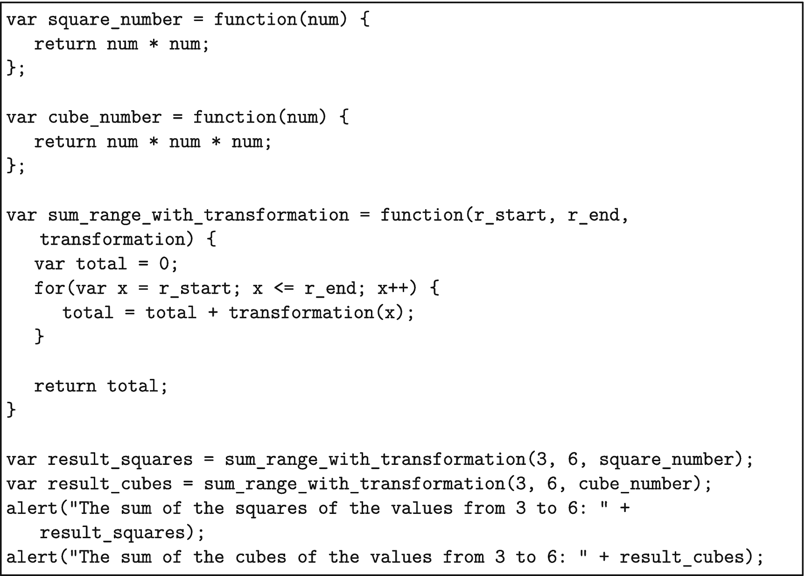

一个 15 行代码，用于对范围 3 到 6 的值求和平方和立方，使用函数声明变量，返回 num 和 total，包含 for 循环并给出警报消息。

**图 14-3** 对带有变换的数字范围求和

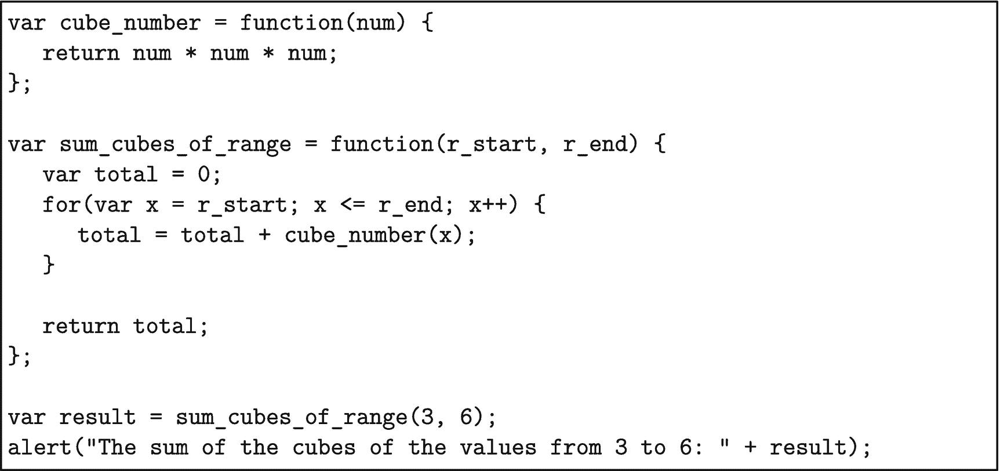

一个 12 行代码，用于对范围 3 到 6 的值求立方和，使用函数声明变量，返回 num 和 total，包含 for 循环并给出警报消息。

**图 14-2** 对数字范围求立方和


一个 13 行代码，用于对范围 3 到 6 的值求平方和，使用函数声明变量，返回 x 和 total，包含 for 循环并给出警报消息。

**图 14-1** 对数字范围求平方和

该代码如图 14-2 所示。如您所见，`sum_squares_of_range` 和 `sum_cubes_of_range` 之间的唯一区别在于，在新代码中将 `square_number` 替换为 `cube_number`。如果我们能只用一个函数来处理两者，然后只需传入我们想要应用于每个数字的任意函数（我们称之为*变换函数*），那该多好啊？事实上，您完全可以做到这一点。我们可以创建一个参数来用于变换函数。

新代码如图 14-3 所示。如您所见，这仍然是完全相同的代码；唯一的区别是 `square_number` 被替换为作为参数传入的 `transformation`！这种其功能由其他作为参数传入的函数修改的函数，被称为**高阶函数**。

一个手形图标，食指指向右侧。

#### 练习题

1.  修改图 14-3 中的程序，添加一个将数字提升到四次方的函数，然后将其传入 `sum_range_with_transformation`。
2.  再次修改程序，使其在不进行任何变换的情况下简单地对 3 到 6 的数字求和。（提示——创建一个仅返回给定数字的函数。）

### 14.2 返回函数的函数

现在我们了解了函数作为参数，接下来我们将研究返回函数的函数。

第一个例子（图 14-4）并不实用，但有助于说明要点。在这个程序中，我们有传统的 `square_a_number` 函数。但是，我们并没有直接使用它，而是有另一个名为 `get_square_a_number_function` 的函数，它返回该函数。请注意，`get_square_a_number_function` 上的返回语句*并未调用* `square_a_number`；函数名后面没有表示函数调用的括号。相反，该函数本身从此函数返回。

然后，在主程序中，`get_square_a_number_function` 返回的值存储在 `my_func` 中。这是什么值？正是 `square_a_number` 函数！因此，`my_func` 实际上持有 `square_a_number` 函数本身。由于 `my_func` 持有一个函数，因此它可以作为函数被调用。`my_func(5)` 正是这样做的——它调用存储在 `my_func` 中的函数，即求平方函数。正如预期的那样，这将返回值 `25`。

### 14.3 创造函数的函数

假设我们想要一个充当计数器的函数。也就是说，每次调用该函数时，它都会给出下一个数字。第一次调用该函数时，它返回 1，然后返回 2，依此类推。我们该如何编写这样的函数呢？

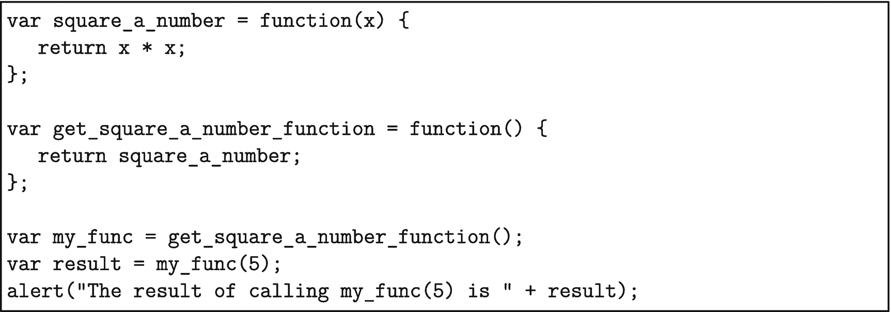

一个 9 行代码的函数，返回一个函数，声明将数字平方作为 x 的函数的变量，返回 x 乘以 x，结果作为 my function 5，并给出调用 my function 5 结果的警报消息。

**图 14-4** 返回一个函数的函数

让我们首先探讨一种*不*奏效的方法。花点时间看看您是否能找出图 14-5 中展示的程序有什么问题。如果您还没想出来，请尝试将其放入网页中并运行。会发生什么？

该程序的问题在于 `counter` 的定义是一个局部变量。因此，每次运行该函数时，它都会创建一个全新的名为 `counter` 的变量并将其设置为零。因此，这个函数将始终返回值 `1`。

解决此问题的一种方法是将 `counter` 变量设为全局变量而不是局部变量。图 14-6 中的代码会稍微好一些。这个代码实际上按我们期望的方式运行，但它有两个非常大的缺点。第一个缺点是 `counter` 变量是一个全局变量。这意味着使用 `next_value` 函数的人必须知道 `counter` 变量，以免自己使用它。对于函数的用户来说，必须了解如此多关于函数如何实现的信息是不良的编程实践。第二个缺点是这仅允许程序中使用一个计数器函数。为了获得第二个计数器函数，我们需要重新编码。编写两次完全相同的代码，只改变变量名，这似乎非常浪费。

为了解决这些问题，我们需要一种方法，使 `counter` 的作用域与全局作用域隔离，并且能够动态创建计数器函数的新实例，每个实例都有自己独立的 `counter` 变量。这两点都可以通过创建函数生成函数来解决。

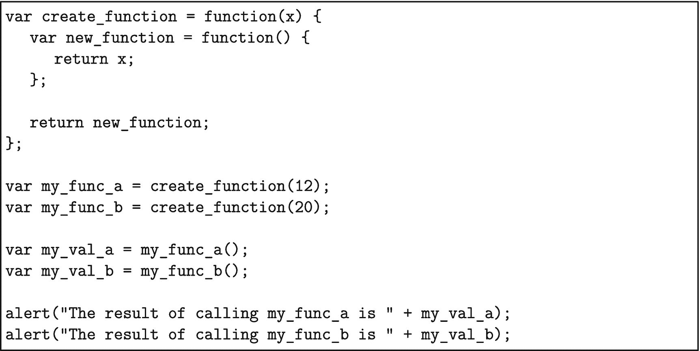

一个 12 行代码的具有局部作用域的函数。声明变量以创建新函数，返回 x 和新函数，变量 my function a 和 b 等于 create function of 12 和 20，并给出警报消息。

**图 14-7** 以局部作用域为父作用域的函数示例

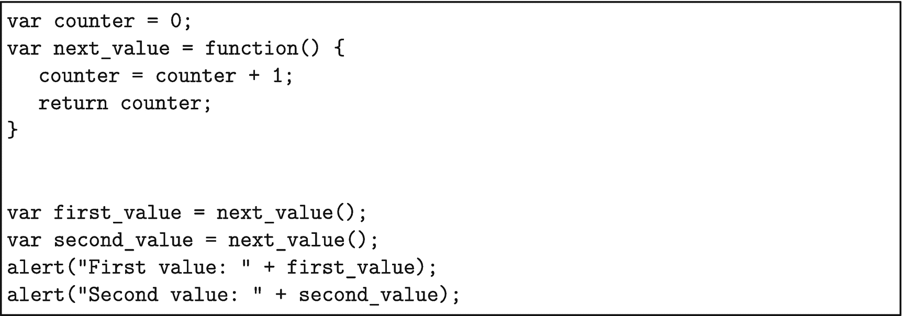

一段 9 行的计数器全局变量代码：声明变量 `counter` 为 `0`，下一值作为一个函数，`counter` 等于 `counter 加 1`，`return counter`，声明变量，并针对第一个和第二个值给出提示信息。

**图 14-6** 为计数器使用全局变量

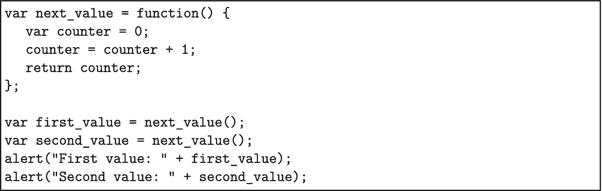

一段 9 行的错误创建计数器程序代码：将下一值作为函数声明变量，`counter` 为 `0`，`counter` 等于 `counter 加 1`，`return counter`，声明变量，并针对第一个和第二个值给出提示信息。

**图 14-5** 创建计数器的错误程序

在第 10 章中，我们学习了 `function` 操作符会利用给定代码创建一个新函数。在第 13 章中，我们了解到每次调用函数时，都会为该函数创建一个新的局部作用域。我们还了解了每个新的局部作用域如何与一个父作用域建立链接，到目前为止，这个父作用域一直是全局作用域。（回顾一下，可以回头查看图 13-8、13-10 和 13-13 以加深印象。）那么，这个父作用域的链接是如何创建的？它是否可以指向全局作用域以外的其他作用域？

原来，父作用域指向的是函数创建时*处于活动状态的任何作用域*。到目前为止，在我们的函数被创建时，活动的作用域一直是全局作用域。这就是为什么我们函数上的父作用域始终是全局作用域。相反，如果函数是在另一个函数处于活动状态时创建的，那么它的父作用域将是其创建时处于活动状态的局部作用域！当这样的函数被调用时，它仍然会为其参数以及所有使用 `var` 关键字声明的变量创建一个全新的局部作用域。然而，当引用其局部作用域中未定义的任何变量时，它会去查找其父作用域，也就是函数创建时处于活动状态的局部作用域。当一门计算机编程语言将活动函数的局部作用域存储为在该作用域内创建的函数的父作用域时，这种特性被称为**词法闭包**。

图 14-7 展示了这种父作用域操作的实际应用。这个示例被设计得非常简短，以便你能更轻松地看清所有运作环节。从高层来看，`create_function` 函数接收一个参数并创建一个始终返回该值的函数。请注意 `var my_func_a = create_function(12);` 这一行。这行代码会让 `create_function` 构建一个始终返回数值 `12` 的新函数，并将这个新函数存储在 `my_func_a` 中。

`create_function` 是如何做到这一点的呢？好吧，让我们逐步分析代码。

`create_function` 函数所做的第一件事就是创建一个函数。`function` 操作符可以在任何位置用于创建新函数。然后，它将该函数存储到 `new_function` 中，后者是 `create_function` 的一个局部变量。接着，它返回这个新创建的函数。

这个新创建的函数有什么特别之处呢？由于它是在 `create_function` *内部*定义的，因此它的父作用域就是在 `create_function` 被调用时创建的局部作用域。因此，每当 `create_function` 运行时，它都会创建一个具有*不同*父作用域（即调用 `create_function` 函数时创建的那个作用域）的 `new_function` 函数的*新版本*。现在，当 `create_function` 返回时，它的局部作用域不再处于活动状态，但它不会被销毁，因为返回的函数仍然引用着它。这个作用域将一直处于休眠状态，直到所创建的函数被调用，届时它将变成所创建函数的新局部作用域的父作用域。

因此，当你调用 `create_function(12)` 时，会创建一个包含变量 `x` 的新局部作用域，并且 `x` 通过参数列表被赋值为 `12`。当将要存储在 `new_function` 中的函数被创建时，当前的局部作用域（其中 `x` 是局部变量）会被链接到该函数，从而使其成为通过调用该函数所创建的每个新局部作用域的父作用域。然后，这个函数被返回并存储在 `my_func_a` 中。当稍后调用 `my_func_a` 时，它会为函数调用创建一个新的局部作用域。然而，父作用域被设置为函数创建时活动的作用域——即 `x` 被设置为 `12` 的那个作用域。因此，当它执行 `return x;` 代码时，它首先会在新创建的局部作用域中查找 `x`，但没有找到。接着，它会去父作用域中查找，并在那里找到了 `x`。如果在父作用域中也没有找到 `x`，它会继续沿着作用域链向上，直到全局作用域。

请注意，`my_func_b` 是以相同方式创建的。然而，正如我们提到的，每次调用函数时都会创建一个新的局部作用域。因此，当调用 `create_function(20)` 时，会创建一个*新的*局部作用域，并且这个作用域中的 `x` 被设置为 `20`。这个作用域会被附加为所创建并存储在 `my_func_b` 中的函数的父作用域。

当 `my_func_a` 被调用时，父作用域是 `x` 被设为 `12` 的那个；但是当 `my_func_b` 被调用时，父作用域是 `x` 被设为 `20` 的那个。

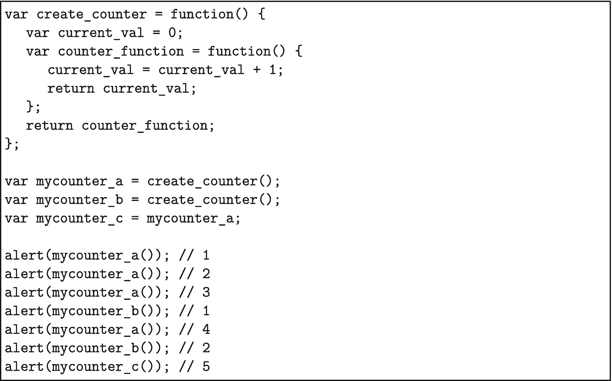

一段 18 行的创建计数器函数的代码。第 1 行：`var create_underscore_counter = function()`。第 2 行：`var current_underscore_value = 0;`。代码中包含 5 行提示信息。

**图 14-8** 用于创建计数器函数的函数

我们现在有两个来自相同代码但功能不同的函数。这两个函数之所以工作方式不同，是因为它们在调用时具有*不同的父作用域*。

现在，让我们回到计数器函数的问题上。我们想要一个能够为我们创建新的计数器函数的函数。因此，我们真正需要的是一个可以附加到不同的父作用域上的计数器函数，每个父作用域都有自己的当前计数值。

图 14-8 展示了这在代码中是如何实现的。这段代码与之前仅仅从父作用域输出值的代码非常相似。唯一的区别在于，我们在返回 `current_val` 之前，先操作了父作用域中 `current_val` 的值（将其加 1）。这个修改会被保留，因为每次调用 `mycounter_a` 时，它都会拉取同一个作用域作为父作用域。由于 `current_val` 在 `counter_function` 内部并未使用 `var` 关键字声明，因此无论是在读取还是写入该值时，它始终会引用其父作用域中的 `current_val`。

由于 `mycounter_a` 和 `mycounter_b` 是通过不同的 `create_counter` 调用创建的，它们各自维护着不同的父作用域，因此对于 `current_val` 拥有独立的值。不过请注意，`mycounter_c` 的表现就好像再次调用了 `mycounter_a` 一样。这是为什么呢？因为 `mycounter_c` *并非一个新函数*。它和 `mycounter_a` *是同一个函数*，因为它只是被赋值（引用）过去的。

`mycounter_a` 和 `mycounter_b` 都是通过调用 `create_counter` 创建的，但 `mycounter_c` 只是获取了 `mycounter_a` 中存储的同一个函数。请记住，函数和任何其他值一样存储在变量中，并且可以在不同的变量之间来回赋值，而这些赋值并不会改变底层的值。因此，`mycounter_a` 和 `mycounter_c` 指向的完全是同一个函数（使用完全相同的父作用域）。

### 14.4 柯里化函数

在第 14.1 节中，我们学习了如何获取多个特定函数，并将它们组合成一个接收函数作为参数的单一高阶函数。在本节中，我们将研究相反的过程——获取一个泛化的（即高阶的）函数，并通过预先指定一个或多个参数来创建其更新、更具体的版本。

回顾一下图 14-1、14-2 和 14-3。你会注意到，图 14-1 和图 14-2 的功能都存在于图 14-3 中。你可能正确地推断出，图 14-3 中定义的函数 `sum_range_with_transformation` 因此比其他程序中定义的单个函数 `sum_cubes_of_range` 和 `sum_squares_of_range` 更强大。然而，有时调用那些将另一个函数作为参数的函数可能会令人困惑。例如，如果程序员通常需要对一个范围内的数求平方和，但很少需要应用其他变换，那么将 `sum_squares_of_range` 作为其独立的函数可能会很有用。

现在，我们仍然希望利用我们的 `sum_range_with_transformation` 函数。原因在于，如果你有执行某项任务的代码，你不想让它存在两份副本。如果你在一份副本中发现了一个错误，你必须记得在另一份副本中也修复它。如果你找到了一种更好的方法来实现该函数，你也必须记得（并花时间）重写另一个函数以保持一致。

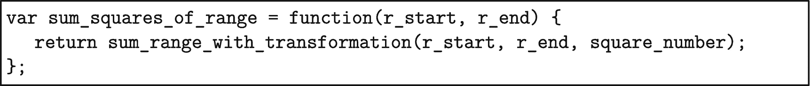

一个包含变量 sum_of_square_range（函数为 r start 和 r end）的三行代码。该函数包含 return range_transformation（r start, r end, 和 square_number 值）。

**图 14-9** 从通用函数创建专用函数

我们希望能够轻松调用 `sum_squares_of_range`，同时保留将所有逻辑集中通过 `sum_range_with_transformation` 处理的能力。实现这一点的方法就是**柯里化**。柯里化一个函数意味着你获取一个通用函数，并通过将一个或多个参数固定为常量值，从中创建一个专用函数。

例如，如果我们想在图 14-3 的程序基础上构建一个名为 `sum_squares_of_range` 的专用函数，我们可以添加图 14-9 中列出的代码来实现。如你所见，我们没有像在图 14-1 中那样从头编写 `sum_squares_of_range` 函数，而是使用了 `sum_range_with_transformation` 作为构建块来创建我们的函数。这使 `sum_squares_of_range` 成为一种更简单的编写 `sum_range_with_transformation` 的方式，其中部分参数已经内置。

我们可以更进一步，定义一个生成函数的函数，你可以根据一个变换函数创建自定义的求和函数。这听起来有点奇怪，但举个例子可能会有所帮助。图 14-10 中的代码可以附加到图 14-3 的末尾，以生成一个可运行的程序。在这个例子中，`create_summing_function` 将变换作为其参数，并返回一个全新的函数，该函数将该参数用作 `sum_range_with_transformation` 的最后一个参数，从而提供了一种创建新变换函数的非常简单的方法。

### 14.5 匿名函数

函数只是值。正如我们早在第 8 章中所学，你通常甚至不需要创建变量来保存每个中间值。类似地，我们也并不总是需要将函数存储在变量中。

就像键入数字 `5` 会生成值 5 一样，使用 `function` 关键字会定义一个新函数。让我们回顾一下我们在图 14-10 中编写的代码。假设我们想创建一个新的求和函数，但这次我们希望在求和之前将范围内的数字提升到四次幂。现在，我们可以创建一个单独的函数来将数字提升到四次幂，然后直接使用图 14-10 中的技术。然而，一个更简单的方法是完全省略函数命名，在调用 `create_summing_function` 时直接定义它。结果将类似于图 14-11，它将附加到你图 14-10 中编写的程序中。

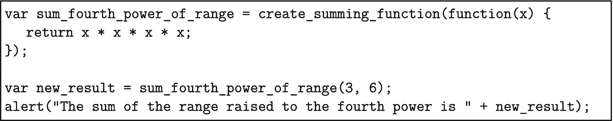

一个包含变量 sum_of_fourth_power_of_range（函数为 x 的 sum_function）的五行代码。该函数包括 return x 的幂，以及变量 new_result 等于从 3 到 6 的数字之和，并给出一个 alert。

**图 14-11** 使用匿名函数

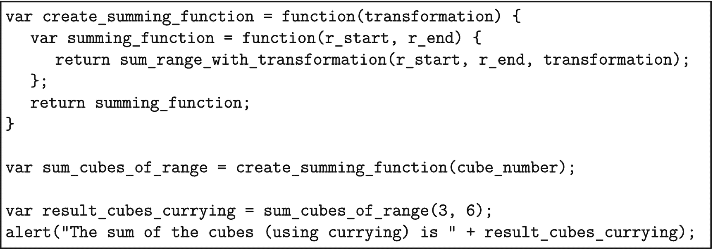

一个用于创建专用函数生成器的九行代码。第 1 行是 `var create_summing_function = function(transformation)`。

**图 14-10** 创建专用函数生成器

如你所见，在图 14-10 中我们为变换使用了命名函数，而这里我们直接传递了函数。我们传递的这个函数没有名字。它被定义后，不是存储在变量中，而是简单地作为参数传递给另一个函数。在代码中定义但没有给定名称的函数被称为**匿名函数**。

### 14.5.1 回顾

在本章中，我们学习了几种创建和使用函数的高级方法。我们学到了以下内容：

*   函数可以作为参数传递给其他函数。
*   当一个函数将另一个函数作为参数时，它允许调整该函数的过程。
*   当两个函数看起来很相似，只是各自执行略有不同的过程时，它们通常可以合并成一个接受函数作为参数的函数。
*   当一个函数接受一个函数作为参数时，它被称为高阶函数。
*   函数可以返回其他函数作为值。
*   函数可以创建新函数作为返回值。
*   当创建一个函数时，它组合并存储了要执行的代码以及指向它被创建时所在作用域的链接。
*   当为每次函数调用创建局部作用域时，这个指向作用域的链接将用作父作用域。
*   如果一种计算机编程语言在创建函数时存储了一个指向活动作用域的链接，以便在函数中用作父作用域，那么我们就说该编程语言具有词法闭包。
*   柯里化是通过预先指定一个或多个参数，从更通用或更高阶的函数定义新的、特定函数的过程。

### 14.5.2 学以致用

1.  修改图 14-8 中的计数器程序，使其接受一个起始值，允许你从任意值开始计数。
2.  进一步修改计数器程序，使你还可以指定一个“步进”值（即，每次调用使计数器的递增值大于 1）。
3.  修改图 14-11 中的程序以执行另一种变换。如果你需要灵感，可以尝试仅将值翻倍。

## 15. 中间对象

截至目前，我们创建的只是包含数据的对象。仅包含数据的对象有时被称为**记录**（records）——它们存储数据，但不会执行任何操作。在第 11 章中，我们编写了操作这些记录的函数。如果要执行某项操作（例如从账户中取款），你会调用相应的函数，它就会完成你的需求。这是一种不错的编程风格，适用于许多场景。然而，随着程序变得更大更复杂，将操作对象的函数与对象本身更紧密地关联起来会更有益处。

在第 11 章中，我们将几个相关的变量分组到单个对象中。这为代码带来了几项改进：

1.  它使用了更少的变量，因为值都是同一个变量的属性。
2.  它允许相关的值一起传递给函数，而无需逐个传递。
3.  它使代码更易于理解，因为相关的值被打包成一个单一单元。

### 15.1 将函数附加到对象

像我们在第 11 章中那样，将相关的值打包成一个对象被称为**封装**（encapsulation）。然而，通过将函数也添加到对象中，可以进一步推进封装。如第 11 章所述，这些函数被称为“方法”。方法是作为对象属性的函数，从对象调用该函数会将对象作为隐式参数（即，不在参数列表中）传递给函数。我们将从创建显式传递对象的函数开始，然后展示如何隐式传递对象。

假设我们有一个表示汽车的对象。它有两个值——行驶里程数和剩余油量。现在，假设我们有一个能让我们行驶十英里的函数。需要发生什么？好吧，该函数会增加行驶里程数并减少剩余油量。

图 15-1 展示了这样一个对象的代码。如你所见，`drive_car`函数关联了几个不同的值——行驶里程数、油箱剩余油量以及汽车的燃油效率。由于`drive_car`函数与汽车抽象紧密相关，因此将函数直接附加到`my_car`对象上是合理的，如图 15-2 所示。

如你所见，我们分配函数的方式与分配其他值的方式相同。我们也可以通过输入`my_car.drive = function() { ...}`来完成，但这种方式更简单。

既然函数在对象中，如何调用它呢？本书中我们所做的所有函数调用，都是通过简单地输入持有函数的变量名（通常是全局变量），然后添加括号并列出要传递给函数的参数来完成的。这里的方式相同。唯一的区别在于，由于函数存储在对象中而不是全局变量中，我们必须将函数值作为对象的属性来访问。

因此，我们会这样写：

```
my_car.drive();
```


`my_car.drive(my_car, 50);`


这给我们带来了什么优势？目前还不多。然而，这样做实现的一个重要事情是减少了全局变量的数量，因为到目前为止，我们通常将函数存储在全局变量中。现在，该函数只存储在*汽车*对象内部。对于我们的简单程序来说，这似乎不重要，但在大型项目中，函数的数量可能增长到数千个。在这种情况下，将全局变量的数量保持在最低限度对于保持清晰至关重要。

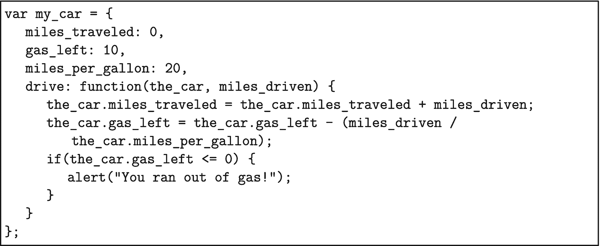

这是一个 11 行的程序代码，用于计算汽车记录的剩余油量：行驶里程数、剩余油量和每加仑英里数。该程序说明，如果汽车剩余油量小于 0，则显示一条警告消息。

**图 15-2 将函数附加到对象**

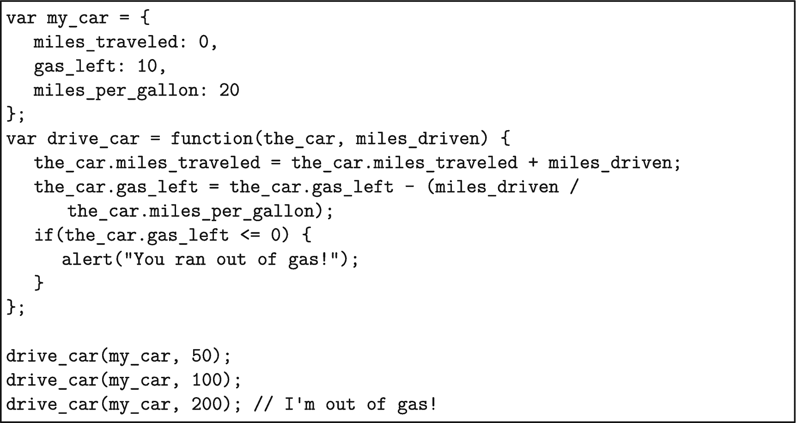

这是一个 14 行的程序代码，用于计算汽车记录的剩余油量：行驶里程数、剩余油量和每加仑英里数。

**图 15-1 一个简单的汽车对象**

同理，请注意，当它是一个全局变量时，我们将其命名为`drive_car`。我们给它取了一个更长的名字，以防止**命名冲突**（name clashes）——即两个函数意外地同名。当你将函数放在全局变量中时，通常必须给它们起非常长的名字，以防止其他人意外地调用同名的另一个函数。当函数存储在对象本身上时，情况并非如此。此外，如果函数只附加到对象上，我们已知它是在操作汽车，因为那是我们分配它的地方。因此，我们将函数名缩短为`drive`，这使得代码更清晰，也更易于编写。

不过，有一个问题，`drive`函数看起来有点冗余。代码正在对象上调用`drive`函数，但还必须将对象作为参数传入。事实证明，你在对象上定义的几乎所有函数都需要对象的存在。因此，如果你通过属性（例如`car.drive`）在对象上查找函数，JavaScript 有一种方法可以隐式地将对象（即`car`）发送给该函数，而无需使其成为参数。JavaScript 有一个特殊的变量，总是命名为`this`，它保存了用于查找函数的对象（如果有的话）。它被称为`this`，因为它指的是“*这个*我们正在使用的当前对象”。

因此，我们可以从函数中移除参数`the_car`，因为它将通过`this`变量自动传入。利用`this`变量，我们可以将代码写成如图 15-3 所示。

因此，虽然大多数函数参数是*显式*传递给函数的，因为我们在定义函数时命名了它们，但`this`参数是*隐式*传递给函数的——它不在参数列表中。相反，JavaScript 在幕后自动处理它。

在面向对象编程中，定义在对象上并使用`this`变量的函数通常被称为**方法**（methods）或**消息**（messages）。与其他语言不同，在 JavaScript 中，函数和方法之间的区别*仅*在于你使用它们的方式——如果你的函数使用了`this`变量，那么它就是方法。

你也可以从人类语言的角度来思考方法。对象是主语，方法是动词或命令，函数参数是直接宾语、副词或其他修饰语。

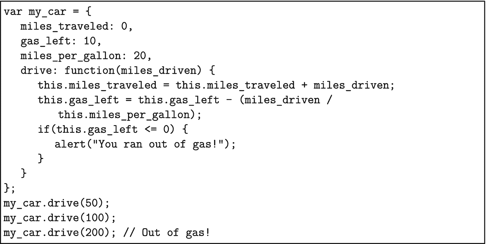

这是一个 14 行的程序代码，用于使用`this`变量计算汽车记录的剩余油量：行驶里程数、剩余油量和每加仑英里数。如果剩余油量小于 0，则警告消息显示“你没油了”。

**图 15-3 使用`this`为对象编写函数**

当我们看到`my_car.drive(50)`时，应该将其理解为“亲爱的`my_car`，请使用 50 作为参数执行你的`drive`函数”。

到目前为止，我们已经看到，使用附加到对象上的函数可以减少全局变量名称的数量，引出更短的函数名，并使编程更接近英语表达习惯。

## 15.2 高效使用对象

在代码中使用对象有几个原因。因为它遵循语言的主语/动词/宾语模式，所以理解以面向对象风格编写的代码要容易得多。因此，通过将函数与其相关数据结合，你使程序更易于使用和修改，因为代码更清晰了。

### 对象与模块化

对象还有助于程序员将代码划分为清晰可辨的部分。这种做法被称为**模块化**。通过将函数附加到持有其数据的对象上，你不仅是在给计算机编程，更是在向未来的程序员（以及未来的自己）传达代码中想法之间的分界。这使得程序员能够将思路和行动专注于相关的函数。如果我知道所有与 `my_car` 相关的代码在哪里，我就能轻松找到并修改它。由于围绕 `my_car` 的所有函数都定义在彼此附近，当需要做出修改时，更容易找到也需要同步修改的相关函数。

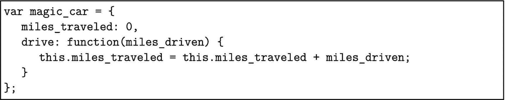

一段 6 行的程序代码记录了行驶里程，这是一个关于行驶英里数的函数，以及行驶里程加上行驶英里数。第 1 行写着 `var magic underscore car equal open curly brace`。

**图 15-4** 一个实现相同接口的新对象

当编写较大的程序时，有时很难追踪数据在整个程序中的变化。如果你删除了一个字段或改变了它的使用方式，如何知道你是否已经修改了其余代码以正确使用它？通过将与对象相关的所有代码*植入*对象本身，当对象的代码被修改时，更容易找到需要更改的地方。

编程不仅仅是让程序运行。你还必须让代码对你自己和他人而言都能理解且易于修改。思考你需要哪些对象、它们需要哪些函数来工作、以及它们需要哪些数据，这将帮助你创建更好的对象，这对你当前和未来的工作都有帮助。这会让你的代码更具可读性、更易于理解和维护。

然而，面向对象编程的好处不仅仅是让代码更易读和易理解。它还允许你根据对象能执行的功能（而非其所包含的数据）来使用对象。

我们已经有能够驾驶汽车的代码。假设我们发明了一种新型魔法汽车，它完全不受汽油限制。它可以驾驶任意你想要的里程数。这种汽车可以使用图 15-4 所示的代码来实现。这个对象远没有我们之前的对象那么复杂，但这不是我要强调的重点。你是否注意到这个对象*也*有一个 `drive` 方法？对于这种新型汽车，该函数的操作方式不同，但它与我们另一个对象上的 `drive` 函数同名，且接受相同的参数。

这使我们能够编写接受对象作为参数的函数和方法，而无需关心这个对象具体是什么。换句话说，如果我的函数需要使用 `drive` 方法，那么这个函数不需要关心它正在使用的是 `drive` 方法的*哪个*版本。无论是汽车还是魔法汽车，只要我的函数使用了 `drive` 方法，我就可以将任一种类型的对象用于这个函数。

#### 构建对象

只有一个附加了函数的对象并不能让我们取得多大进展。大多数程序都包含大量相似的对象。按照固定模式构建对象被称为构建对象，而构建对象的函数被称为**构造函数**。JavaScript 有多种不同的对象构建方式。然而，由于这是一本入门书籍，我们只讨论其中一种——构造函数。

构造函数是一种使用 JavaScript 的 `new` 关键字调用的函数。按照惯例，构造函数名称以大写字母开头，以便轻松识别其为构造函数。

假设我想为我的汽车编写一个构造函数，它接受汽车的初始油量。这样的函数可能如图 15-5 所示。注意，我们通过 `new Car(50)` 来创建车辆。这创建了一个新的空对象，并将其设置为 `Car()` 函数内的 `this` 对象。然后我们用参数 `50` 调用了 `Car` 函数。`new` 关键字不依赖函数使用 `return` 关键字返回值，而是返回在 `this` 变量中使用的新构建的对象。

在这个程序中，`Car` 函数是一个构造函数。它与 `new` 关键字配合使用，来构建一个新的对象以供使用。函数*不*必须以大写字母开头，但大多数 JavaScript 程序员都遵循这个约定，以确保哪些函数被用作构造函数是明确的。

在某些编程语言中，`Car` 会被视为一个**类型**或**类**。类让程序员对对象能做什么有所预期——它将具有哪些属性、哪些函数，以及它们如何协同工作。这在某种程度上类似于 JavaScript 中的构造函数，因为构造函数在对象上设置初始属性和函数。

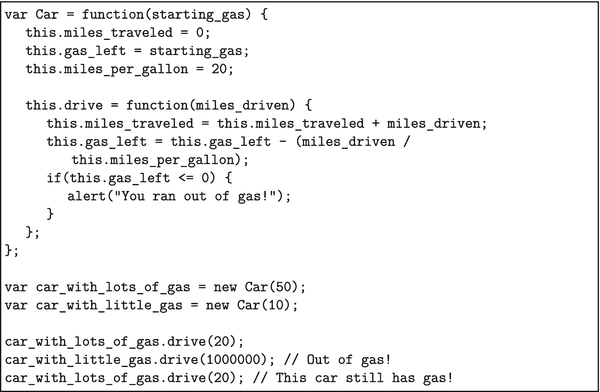

一个 16 行的汽车构造函数程序代码。程序提到了行驶里程、剩余油量和每加仑英里数。最后，程序识别出每辆车中的剩余油量。

**图 15-5** 一个汽车构造函数

这意味着，大多数由构造函数创建的对象都将具有相似的属性和函数。

##### 回顾

在本章中，我们涵盖了如何将函数附加到对象上的基础知识。我们学到了以下内容：

*   由于函数也是值，因此函数可以像其他值一样作为对象的属性存储。
*   将函数附加到对象上可以减少全局命名空间的杂乱。
*   如果通过对象调用函数，则该函数所存储的对象会通过 `this` 参数隐式传递。
*   以这种方式组织代码可以使软件更具可读性，因为它遵循典型的英语主谓宾句子结构。
*   创建并初始化新对象的函数被称为构造函数。
*   构造函数通常存储在以大写字母开头的变量中，以便与其他函数区分。
*   构造函数通常根据它们正在创建的对象类型来命名。
*   构造函数使用 `new` 关键字进行调用。
*   使用构造函数可以用很少的代码创建大量相似的对象。

##### 实践应用

1.  创建一个构造函数 `Rectangle`，它创建一个具有 `base` 和 `height` 属性的对象。

2.  扩展你的 `Rectangle` 构造函数，使其包含两个方法：`find_area()` 和 `find_perimeter()`，这两个方法能返回相应的计算结果。这些方法不应有任何参数，只能使用隐式的 `this` 参数。如果你忘记了几何知识，对于矩形，*面积* = *底* × *高*，*周长* = *2* (*底* + *高*)。务必测试它们以确保其正常工作。

#### 3. 创建 Circle 类

为`Circle`创建一个新的构造函数，它接受一个半径作为参数。它还应具有`find_area()`和`find_perimeter()`方法。如果你忘记了几何知识，*面积* = *π* x *半径*²，*周长* = 2 x *π* x *半径*。请确保测试它们以确认它们能正常工作。

#### 4. 创建 biggest_area 函数

创建一个名为`biggest_area`的函数，它接受一个`Rectangle`对象数组，并使用`find_area()`函数告诉用户数组中最大的面积是多少。

#### 5. 多态性应用

如果你的`biggest_area`函数只使用了对象的`find_area()`函数，那么你应该能够将任何实现了类似函数的对象传递给它。由于`Circle`对象也具有`find_area()`函数，尝试将`Rectangle`和`Circle`对象交错放入同一个数组中。由于它们都应该以相同的方式响应，因此它们都应该能被`biggest_area`函数同等对待。

# Part V：编程应用

在本部分中，我们将探讨应用程序运行的一些基础知识。我们将研究如何使用 JavaScript 修改页面、访问外部服务，甚至编写一个简单的服务。

# 16. 现代化 JavaScript

在我们开始介绍现实世界中应用程序编写的一些细节之前，我想花点时间向你介绍一些现代 JavaScript 中常用的特性，这些特性在现代应用程序中很常见。请注意，本书的目标并非提供 JavaScript 本身的全面介绍，而是将 JavaScript 作为学习通用编程的跳板。尽管如此，我想花点时间介绍一些多年来引入的 JavaScript 现代化特性，你在阅读 JavaScript 代码时很可能会遇到这些特性。这些都不是根本性的变革，但它们确实让 JavaScript 的读写变得稍微容易一些。

JavaScript 最初编写时的主要目标是简单、易于实现和易于学习。JavaScript 背后的基本思想非常简单，以至于其作者最初仅用 10 天就编写出了 JavaScript。然而，随着它作为一种编程语言变得越来越普及，越来越多的附加功能被添加进来。

在本章中，我们将探讨一些多年来被添加到 JavaScript 中且最常用的功能。此外，我们还将涉及一些重要但本书尚未讨论过的旧特性。

## 16.1 使用 let 和 const 声明变量

到目前为止，我们在本书中一直使用`var`关键字来声明变量。正如我们所注意到的，当在函数外部使用时，`var`声明一个全局变量；当在函数内部使用时，`var`声明一个局部变量，其作用域限定在包含它的函数内。然而，`var`有一些奇怪的行为，为了与旧代码向后兼容，这些行为需要保留，尽管使用这些行为可能并不明智。

首先，`var`关键字可以出现在函数中的*任何位置*，并且它仍然会反向应用于该函数中先前对该变量的使用。如果你使用`var`多次声明一个变量，所有这些声明都会被合并为一个单独的变量声明。最后，函数作用域是一个令人惊讶的特性，因为大多数编程语言在*块*级别划分作用域。

由于这些缺点，JavaScript 的较新版本引入了`let`关键字来声明变量。使用`let`与`var`非常相似，但有一些重要的区别：

*   `let`关键字必须出现在使用该变量*之前*。
*   每次使用`let`关键字都会声明一个全新的变量。
*   `let`关键字是块级作用域，而不是函数级作用域。
*   如果你尝试在同一作用域内对同一个变量两次使用`let`，将会产生错误。

图 16-1 中的代码说明了这些差异。跟随学习将帮助你理解这两种声明变量方式在行为上的差异。

另一个用于声明变量的关键字是`const`，它代表“常量”。它的工作方式与`let`非常相似，区别在于，一旦赋值，该变量就不能再被赋予其他值。这在两个方面很有帮助。首先，它使得 JavaScript 内部能够进行优化，如果你有需要快速执行的代码，这可以使你的代码运行得更快。其次，更重要的是，它帮助你记住哪些变量是实际变化的，哪些变量应该保持不变。`const`关键字会提醒你，这个变量只应被赋值一次，如果你忘记了，随后对该值的赋值将会产生错误。

图 16-1 的最后几行将会产生错误，因为常量值被重新赋值了。

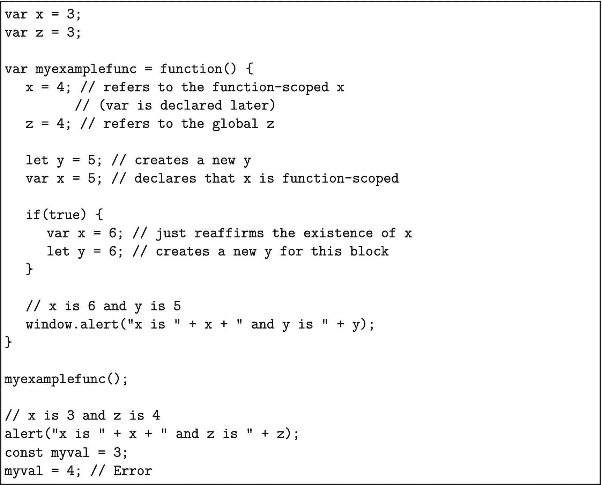

一个 14 行的代码初始化变量`x`和`z`为 3，引用了函数作用域的`x`、全局的`z`，重新确认了`x`的存在，并为这个块创建了一个新的`y`。

**图 16-1 `let`和`var`之间的区别**

在大多数现代 JavaScript 应用程序中，`let`和`const`比`var`更受青睐。我们主要使用`var`，因为它对初学者更宽容，并且反映了大量现有的 JavaScript 文档。然而，如果你进一步深入学习，你很可能会经常看到`let`和`const`。

## 16.2 解构赋值

一种可以节省大量输入的特性是所谓的**解构赋值**。假设你有一个数组`myary`，其值为`[23, 43, 5]`。现在，假设你想将这些值分别赋给变量`x`、`y`和`z`。通常，你会像下面这样做：

```
var x = myary[0];
var y = myary[1];
var z = myary[2];
```

使用解构赋值，你可以用一行代码完成同样的事情：

```
var [x, y, z] = myary;
```

这行代码从`myary`中取出第一个值赋给`x`，第二个值赋给`y`，第三个值赋给`z`。它不仅更简洁，而且意图更清晰。

解构赋值也适用于对象。假设你有一个对象`mycar`，它有`mileage`、`fuel`和`mpg`属性。你可以这样提取它们：

```
var {mileage, fuel, mpg} = mycar;
```

这会创建三个新变量`mileage`、`fuel`和`mpg`，并分别从`mycar`对象中取出对应的值赋给它们。

你还可以在解构时重命名变量。例如：

```
var {mileage: miles, fuel: gas, mpg: efficiency} = mycar;
```

现在，`miles`的值是`mycar.mileage`，`gas`的值是`mycar.fuel`，`efficiency`的值是`mycar.mpg`。

解构赋值在处理函数返回多个值或配置对象时特别有用。它减少了样板代码，使代码更易于阅读和维护。

## 16.2 解构赋值

```javascript
let x = myary[0];
let y = myary[1];
let z = myary[2];
```

然而，解构允许我们以一种简洁的方式告诉 JavaScript 如何执行赋值。以下是使用解构的相同赋值：

```javascript
let [x, y, z] = myary;
```

这表示我们应该预期`myary`的结构与左侧相似，并相应地分配变量。数组中的任何其他成员都会被忽略，如果数组成员不足，变量将被赋值为`undefined`。

这也适用于对象。假设我们有一个如下所示的对象：

```javascript
var myobj = {
    field1: "val1",
    field2: "val2",
    field3: "val3"
};
```

假设我们想将`field1`和`field2`提取到各自的变量中。可以按如下方式完成：

```javascript
let { field1, field2 } = myobj;
```

如果我们想将`field2`重命名为`myotherfield`，可以这样写：

```javascript
let { field1, field2: myotherfield } = myobj;
```

当你想要从一个对象或数组中提取多个部分而无需编写复杂代码时，解构非常有用。你只需镜像左侧，使你要赋值的变量位于你期望的右侧的相同位置。你可以将数组嵌入对象中，再将对象嵌入数组中，以此类推。

如前所述，本书不旨在成为一本完整的 JavaScript 书籍，但我确实想让你了解一些既有帮助你又可能在现实世界中遇到的语法片段。

## 16.3 使用字符串访问属性

JavaScript 从一开始就具备的一个重要特性是能够通过属性的字符串名称来访问属性。这允许将 JavaScript 对象用作极其灵活的数据存储。为了理解我的意思，让我们看一个示例对象。

```javascript
var theperson = {
    name: "Jim",
    age: 20,
    hair: "brown"
};
```

现在，我们已经知道如何使用`theperson.name`或`theperson.age`访问该对象的单个属性。但是，我们也可以使用字符串形式的属性名来向对象请求某个属性。如果要获取`name`属性，可以通过`theperson["name"]`来实现。通过将其放在赋值语句的左侧，我们同样可以设置一个字段，无论该字段之前是否存在。

因为这是一个字符串，我们也可以使用变量。

```javascript
var myfield = "name";
alert("The person's name is " + theperson[myfield]);
```

这意味着用户甚至可以指定他们想要访问的字段。

```javascript
var myfield = prompt("What field would you like to read?");
alert("The value of that field is " + theperson[myfield]);
```

这在对象字段的创建和使用中提供了极大的灵活性。事实上，属性名称可以是任意字符串，甚至不必通过“标准”语法访问。例如，我可以设置一个类似`theperson["some,;/field–+"]`的字段。如果尝试使用标准方法访问该字段，将会出现语法错误。但作为字符串，这是一次完全合法的操作。在许多情况下，让对象充当随机的键值对集合是很有用的。以这种方式使用对象可以实现这一点。在计算机编程中，以这种方式使用的对象有不同的称呼，例如`字典`、`哈希表`、`映射`或`关联数组`。

## 16.4 函数语法

到目前为止，我们声明函数的方式如下：

```javascript
var myfuncname = function(param1, param2) {
    // Function body here
}
```

选择这种语法是为了强调*创建*函数与*为函数分配名称*之间的区别。我认为这样做有助于更轻松地理解如何创建函数并将其作为参数传递（就像我们在第 14 章中所做的那样）。然而，还有另一种同时完成这两件事的语法，它更常用。上面同样的代码片段，使用这种语法，看起来像这样：

```javascript
function myfuncname(param1, param2) {
    // Function body here
}
```

然而，现代 JavaScript 又增加了一种创建函数的方法，即所谓的`lambda 函数`或`箭头函数`。^((10))使用 lambda/箭头函数创建相同的函数如下所示：

```javascript
var myfuncname = (param1, param2) => {
    // Function body here
}
```

# 17. 使用远程服务（API）

现代计算机编程最基本的方面之一就是编写与服务器交互的程序。JavaScript 主要是一种前端语言，意味着它通常处理与用户的交互。通常，你的数据存储、检索或操作都位于某个远程服务或数据库中。那么，如何访问这些服务呢？大多数现代服务（如果不是全部）都是通过 Web 上的 HTTP/HTTPS 请求进行访问的（回到第 3 章复习 HTTP）。本质上，服务器的构建方式是，URL 告诉服务器你想要或需要修改哪些数据，然后服务器做出相应的响应。因此，通过了解这些 URL 的结构以及服务器的期望，你可以构建 URL 和 HTTP 请求来获取、修改和操作服务器上的数据。

URL 的结构及其应如何通过 HTTP 访问的具体细节被称为`应用程序编程接口`，简称`API`。`API`实际上指的是用于编程另一个系统的任何有文档记录的接口。例如，所有标准的 JavaScript 对象和函数（如`alert`、`prompt`、`document`等）都是 JavaScript `API`的一部分。

然而，在本章中，当我们提到`API`时，我们指的是远程服务在 HTTP 上公开的、有文档记录的接口。

许多`API`的使用是需要付费的，但有一个`API`现在是免费的，并且几乎可以确定将来也会保持免费，因为你已经通过纳税支付了它的费用：NASA 数据`API`。该`API`为 NASA 收集和整理的各种数据提供了访问入口。NASA `API`包括以下内容：

*   每日天文一图
*   地球卫星图像
*   火星车照片
*   火星天气服务
*   更多，远不止这些！

你可以在`api.nasa.gov`找到关于 NASA `API`的通用信息。

## 17.1 获取 API 密钥

大多数`API`都需要知道你的身份，或者至少需要识别你是一个独立的个体。这样做的原因是，如果你开始滥用该平台（试图入侵、使用过多资源、添加不良数据等），`API`的运营者需要有能力取消你对`API`的访问权限。

因此，大多数`API`至少要求进行最低限度的身份验证。执行这种身份验证的一种方法就是使用`API 密钥`。通常，`API 密钥`在访问网站时同时充当用户名和密码。有时它们需要保密，有时则不需要。但请注意，网页上传递给用户的*所有内容*（包括你的 JavaScript）对用户都是可见的，因此你不希望将任何*秘密*访问密钥包含在你的 JavaScript 中，或包含在你的 JavaScript 加载到浏览器的任何文件中。对于 NASA 数据`API`的情况，将你的`API 密钥`包含在 JavaScript 文件中是完全没问题的。

为了完成这些练习，你需要注册你自己的`API 密钥`。为此，请访问`api.nasa.gov`并填写他们的“生成 API 密钥”表单。这将返回一个很长的字符串，如下所示（这并非真实`API 密钥`）：

```
hgohi60L0JLMZProclQIY2ku1lXebMHfMlxXQ94E
```

你需要将其复制下来以备将来使用。在本章的所有示例中，我们将简单地将其称为`APIKEY`。因此，无论你在何处看到`APIKEY`，都请将其替换为你从 NASA 获得的值。

你可以直接用浏览器测试你的`API 密钥`。访问下面的 URL，你会看到关于 NASA 每日天文一图的信息：

```
https://api.nasa.gov/planetary/apod?api_key=APIKEY
```

这是一个特定的 URL，它执行一个预定义的功能，旨在供其他程序使用。这样的 URL 通常被称为`端点`。我们在本章将要做的就是让我们的 JavaScript 代码访问并使用这些数据。

## 17.2 JSON：数据的语言

你可能已经注意到，我们在上一节中访问的 URL 里的数据看起来似曾相识。你可能觉得它惊人地像是一个 JavaScript 对象。实际上，这个 URL 生成的数据采用一种称为 JSON 的格式，JSON 代表 JavaScript 对象标记法（JavaScript Object Notation）。它是 JavaScript 的一个子集，经常用于在互联网`API`上传输数据。

在 JSON 之前，互联网`API`的主要格式是 XML。XML 类似于 HTML，但你可以创建任意想要的标签。^((11)) 然而，最终 XML 使用起来比许多人预期的要困难得多。处理 XML 是一项相当困难的编程任务，既耗时又容易出错。

但是，使用 JSON，数据到来时*已经准备好可以放入变量中*。不需要进行真正的处理——它直接就能用。因此，读取和处理数据以使其成为可用形式的整个步骤都可以直接跳过。JSON 数据以一种已经可用于程序的形式传输。

JavaScript 提供了两个主要函数来读写 JSON（不过，正如我们将看到的，即使这两个函数最终也很大程度上变得没有必要）。要将一个对象或数组转换为 JSON，只需使用`JSON.stringify()`函数。该函数接受一个 JavaScript 值作为参数，然后返回一个字符串，该字符串是该对象的 JSON 格式版本。

另一个函数是`JSON.parse()`，它接受一个 JSON 字符串并返回等效的 JavaScript 对象。下面的代码展示了这两个函数的实际应用：

```javascript
var obj = {
    mykey: "myval",
    myotherkey: [1, 2, 3]
};
var str = JSON.stringify(obj);
console.log(str);
var newobj = JSON.parse(str);
console.log(newobj);
```

### 16.4.1 回顾

在本章中，我们学习了 JavaScript 中可用的其他语法。我们学习了以下内容：

*   可以使用`let`和`const`关键字声明变量，以实现块级作用域和更清晰的行为。
*   使用`const`关键字声明的变量在声明后不应重新赋值。
*   通过解构赋值，可以大大简化基于复杂对象和数组布局的变量赋值。
*   箭头函数语法更紧凑，编写起来也更方便。
*   箭头函数语法不会覆盖`this`特殊变量。

### 16.4.2 学以致用

1.  回顾你之前的程序，并使用`let`替换`var`来重写它们。
2.  检查一个程序，找到从未重新赋值的变量，并使用`const`关键字声明该变量。
3.  重写一个使用函数的程序，使其使用箭头语法。
4.  重写图 11-5 中的函数，使其使用解构语法将孩子的年龄放入单独的变量中。

其含义（几乎）相同，但省去了冗长的`function`关键字。

它们与常规函数确实存在一些细微差别，但通常这些差别并不重要。主要区别如下：

*   常规函数会获得另一个我们尚未讨论过的特殊变量，名为`arguments`。这本质上是一个包含传递给函数的所有参数的数组，允许使用比参数列表中显示的更多参数来调用函数。箭头函数没有这个特殊变量。
*   箭头函数不会覆盖`this`变量（参见第 15 章）。如果你想继承当前正在使用的`this`变量，箭头函数会有所帮助。如果你想创建对象方法，则应使用传统语法。
*   常规函数可以配合`new`关键字调用来构建对象（同样，参见第 15 章）。由于箭头函数不处理自己的`this`变量，因此不能以这种方式使用箭头函数。

因此，除了一些边界情况外，箭头函数与我们迄今为止使用的语法基本相同。然而，尽管看起来微不足道，但箭头函数不会覆盖`this`变量这一特性非常实用。如果你正在对象内部编写方法，并且需要动态创建函数，可以根据是否希望`this`被覆盖来选择使用常规函数或箭头函数。

运行时，它首先会在控制台中记录一个*字符串*，该字符串包含对象的 JSON 表示形式，大致应该与 JavaScript 对象匹配。第二次记录的对象则是从处理 JSON 代码创建的对象。作为一个术语说明，将编程语言的数据结构转换为可传输或可存储的结构（如字符串）被称为`序列化`，而将可传输/可存储的结构重新生成编程语言数据结构的过程被称为`反序列化`。

# 17.3 使用 JavaScript 访问网络

既然我们对所使用的数据结构有了一点了解，现在可以看看如何使用 JavaScript 代码加载这些数据了。JavaScript 提供了两种访问网络的机制。较旧的一种称为 `XMLHTTPRequest`。你会在很多旧代码中看到它。较新的（且更易于使用的）一种称为 Fetch API，以其主要函数 `fetch` 命名。

Fetch API 用一个例子最容易说明。那么，我们先来获取 NASA 每日天文一图的信息，并向用户显示标题。图 17-1 展示了代码。

这段代码以调用 `fetch` 开始，传入我们想要获取的 URL。然而，网络并不总是立即响应，但 `fetch` 函数会立即返回，以防你还有其他事情要做。但是，`fetch` 函数返回的是一个称为 `Promise` 的对象。`Promise` 是一个封装了如下概念的对象：某些事情需要花费未知的时间来处理，而我们希望对结果进行某些操作。在这里，我们不知道传输数据需要多长时间，但是，一旦数据传输完成，我们就想处理它。`Promise` 有一个名为 `then` 的函数，它向 `Promise` 提供一个函数，当 `Promise` 的所有处理完成后会调用该函数。这个函数应该接受一个参数，即我们试图执行的任何操作的结果。


一段 8 行 JavaScript 代码的 Fetch API 示例。它从链接获取图片，并弹出消息显示图片标题。

**图 17-1** Fetch API 的简单示例

在我们的代码中，我们调用了 `then`，并传入一个函数，该函数接受一个参数 `response`，这是从与 NASA 的 Web 服务器通信后得到的响应。为了获取响应的 JSON 值，我们必须调用 `response` 的 `json` 函数，该函数会确保我们拥有所有数据，然后，假设数据是 JSON 格式，它会将其转换为 JavaScript 对象。然而，这本身也被包裹在一个 `Promise` 中，这要求我们调用 `then` 并传入一个函数，当所有数据准备就绪时，这个 `Promise` 会调用该函数。

最后，当数据以参数 `jsonval` 的形式传入时，我们可以访问所有接收到的字段。这些字段与你之前直接访问 URL 时观察到的字段相同。我们使用了 `title` 字段向用户显示。也请随意尝试其他字段。

# 17.4 查询字符串

URL 的末尾可以附加一个`查询字符串`（也称为`搜索参数`）。查询字符串是一组附加在 URL 末尾的 `key=value` 键值对，用于修改请求。这些键值对之间用 & 符号（`&`）分隔，整个查询字符串通过问号（`?`）与主 URL 分隔开。

实际上，我们正在访问的 URL 已经包含了一个简短的查询字符串。让我们再看一下这个 URL：

```
https://api.nasa.gov/planetary/apod?api_key=APIKEY
```

注意，在请求末尾的问号之后附加了一个单独的 `key=value` 对。API 也允许添加其他查询参数。虽然 API 在其查询字符串中支持许多键（你可以在 `api.nasa.gov` 上查看更多），但我们将重点关注一个：`date`。这将返回该特定日期的每日天文一图。API 规定此参数必须以特定格式给出，即 `YYYY-MM-DD`。因此，对于 2009 年 8 月 3 日，日期应格式化为 `2009-08-03`。以下 URL 将其包含在查询字符串中：

```
https://api.nasa.gov/planetary/apod?api_key=APIKEY&date=2009-08-03
```

请注意，手动从字符串构造这些 URL 可能很诱人；有一个名为 `URLSearchParams` 的标准类可以为你处理此操作。要生成前面的 URL，你可以执行以下操作：

```javascript
var query = {
    api_key: "APIKEY",
    date: "2009-08-03"
};
var query_string = new URLSearchParams(query).toString();
var full_url = "https://api.nasa.gov/planetary/apod?" + query_string;
```

通常在计算机编程中，最好使用提供的函数，而不是尝试自己动手，因为函数中通常处理了许多你可能未意识到的小细节和陷阱。如果你对格式或协议不够熟悉，或者不够仔细，最终可能会把事情搞得一团糟，甚至导致错误，或者更糟的是，引发安全问题。因此，当某些内容的格式将由计算机读取时，几乎总是最好使用标准函数来处理它们，而不是自行尝试。


**图 17-2** 每日天文一图查询工具（HTML）

## 17.5 与网页交互

在本节中，我们将展示如何同时利用读取 URL 的能力和使用查询字符串操作 URL 的能力，以使用每日天文一图构建一个完整的交互式页面。这里我们将展示一个按日期查询每日天文一图并为你显示该图片的工具。请注意，这要求用户按照上一节中指定的格式（`YYYY-MM-DD`）输入日期。

我们将用于此目的 HTML 如图 17-2 所示。相应的 JavaScript 代码如图 17-3 所示。


**图 17-3** 每日天文一图查询工具（JavaScript）

如你所见，此代码具有与图 17-1 相同的基本结构，但通过以下方式进行了扩展：

1.  它由对 HTML 元素的点击触发。
2.  它从 HTML 中提取一个额外的字段。
3.  它使用 `URLSearchParams` 来构造查询字符串。
4.  它在完成后操作 HTML。

你会发现，Web 编程中的很多内容正是由这类交互组成的。

## 17.6 其他几点注意事项

仅通过 URL 和查询字符串访问网页能让你走得很远，但通过 URL 可以传递的数据量是有限的。出于这个原因（以及其他原因），还有其他方式可以向 Web 服务器传递数据。HTTP 支持多种 HTTP **方法**（也称为**动词**）。我们到目前为止一直使用的标准方法是 `GET`。其他三种常见的方法是 `POST`、`PUT` 和 `DELETE`。

这些方法是否以及如何工作完全取决于 API，但拥有这些不同动词的总体目标如下：

-   `GET` 用于获取服务器上已存在的数据，这些数据通过特定的 URL 进行标识。
-   `DELETE` 用于删除服务器上已存在的数据，这些数据通过特定的 URL 进行标识。
-   `PUT` 用于更新服务器上已存在的数据，这些数据通过特定的 URL 进行标识。
-   `POST` 用于创建服务器上尚不存在的数据。此处使用的 URL 通常每次创建新内容时都相同。

由于 `PUT` 和 `POST` 用于发送数据，它们还支持所谓的**实体主体（entity body）**或**负载（payload）**，可以随请求一起发送。这些数据的编码方式有多种，但最常见的两种是：(a) 采用与查询字符串相同的格式，或 (b) 使用 JSON。在发送数据的同时，访问远程 API 时通常还需要发送特定的 HTTP 标头（我们在第 [3] 章中已了解了一些关于 HTTP 标头的内容）。其中一个特定的标头是 `Content-Type` 标头，大多数服务要求你在发送 `PUT`/`POST` 负载时附带此标头，以描述数据的格式（作为参考，查询字符串格式负载的 `Content-Type` 是 `application/x-www-form-urlencoded`，而 JSON 负载的 `Content-Type` 是 `application/json`）。

以下是一个使用 HTTP `POST` 方法发送负载的简单示例，以便你看到所有组成部分：

```javascript
var myobject = {
    a: 1,
    b: "someval"
};
fetch("https://www.example.com/some_endpoint", {
    method: "post",
    headers: {
        "Content-Type": "application/json",
```

```markdown
"Other-Header": "My other header value"

},

body: JSON.stringify(myobject)

}).then((response) => {

// Do something with the response.

});

```

关于这一切如何组合在一起的详细信息，完全取决于你所访问的 API。本节仅告知你 API 文档通常会涉及哪些内容。

### 关于 CORS 的说明

我想花点时间向你介绍 CORS。这在一定程度上超出了本书的预期范围，但我认为在它给你造成问题之前提一下是有必要的。CORS 代表“跨域资源共享”（cross-origin resource sharing），是一种浏览器安全功能，允许 Web 服务器告诉浏览器它们期望来自哪个网站的流量。其目的是防止一个页面上的浏览器窗口触发对另一个网站的操作。因此，在发起请求之前，浏览器会向服务器发送一个“预检”请求，以检查请求是否来自有效的来源。

我提到这一点是因为，如果你尝试访问某个 API 却不断收到错误，很可能是遇到了 CORS 错误。如果你在构建自己的 API（我们将在第 [18] 章中对此进行一些介绍），情况尤其如此。你必须明确地将任何接收请求的主机（这些主机与托管 JavaScript 的服务器不同）列入白名单。通常，如果存在 CORS 问题，JavaScript 控制台会提到“CORS”、“cross-origin”或“preflight”问题。

这里涉及很多细微差别，但我主要想让你在花数天时间试图弄清楚为什么某些东西不起作用之前，先了解这个问题。

## 17.6.1 回顾

在本章中，我们练习了使用 JavaScript 访问远程基于 JSON 的 API。我们学到了以下内容：

- 程序员使用术语 `API` 来指代访问由其他开发者或组织构建的功能的文档化方式。
- 在 Web 上，API 通常基于针对特定、文档化的 URL 的 HTTP 请求。
- NASA 有一个易于访问的 API，用于公开查询 NASA 数据，可在 `api.nasa.gov` 找到。
- 许多 API 通过 API 密钥来管理访问，该密钥包含用户访问服务的凭证。
- 许多 API 使用 JSON 作为传输信息的格式，JSON 是一种基于 JavaScript 子集的格式。
- JavaScript 包含 `JSON.stringify` 和 `JSON.parse` 函数，用于在 JSON 字符串和 JavaScript 对象之间来回转换。
- 标准 JavaScript 的 `fetch` 函数用于从 JSON 发起 HTTP 请求。
- `fetch` 函数返回一个 `Promise`，然后向其提供一个在数据准备好时应调用的函数。
- 可以通过查询字符串（通常使用 `key=value` 对格式化）经由 HTTP 发送附加数据。
- HTTP 有多种可用于数据访问的方法。默认方法是 `GET`，但也有 `PUT`、`POST` 和 `DELETE`。
- `PUT` 和 `POST` 方法可以包含一个 HTTP 实体主体，以允许发送比 URL 单独支持更多的数据。
- 使用 `fetch` 函数，程序员还可以发送额外的 HTTP 标头。
- CORS 是一种由浏览器实施的安全措施，用于控制哪些网页有权访问哪些 HTTP 端点。

## 17.6.2 学以致用

1.  每日天文一图（APOD）也支持获取随机图像的数量，而不是特定日期的图像。修改图 [17-2] 和图 [17-3] 中的代码，去掉输入字段，只保留一个按钮，每次点击该按钮时获取三张随机图像。请注意，此时 API 将返回一个对象数组，而不仅仅是单个对象。你可以考虑使用 `console.log` 在开发时显示结果，以便你能确切地看到代码接收到的是什么。

2.  修改上一个程序，使用户可以输入他们想要查看的图片数量。请注意，对于此练习，你需要根据用户请求的图片数量动态添加和删除 `` 标签。

3.  查看 NASA 的 API 列表。寻找一个你感兴趣的 API，并练习用浏览器访问它。然后，使用 HTML 和 JavaScript 编写一个用于访问该 API 的界面。

## 18. 编写服务器端 JavaScript

到目前为止，我们已经编写了用户界面，但我们只访问了*其他人的*服务器端代码。在本章中，我们将非常简要地介绍等式的另一侧，让你快速体验一下服务器端编程。本章的目标甚至不是让你完全做好进行服务器端编程的准备，这需要一整本额外的书。但我确实认为，至少了解一点这方面的内容对你来说很重要。

### 18.1 编程语言

虽然 Web 编程的用户端（也称为`前端`或`客户端`编程）几乎完全使用 HTML 和 JavaScript 完成，但在服务器端（也称为`后端`编程），JavaScript 实际上很少使用。此外，编程语言很少单独使用，而是与`应用程序框架`一起使用，这些框架自动完成了服务器端编程所需的许多任务。请注意，也有前端应用程序框架（例如，React、JQuery 和 Angular），但编写没有框架的前端应用程序要比编写没有框架的后端应用程序容易得多。

以下是服务器端常用的一些编程语言，括号中列出了它们常见的应用程序框架名称：

- Go（Gin、Iris、go-kit）
- Python（Django、Masonite、TurboGears）
- Ruby（Rails、Sinatra）
- Java（Spring Boot、Quarkus）
- PHP（Laravel、Symfony、Zend、Wordpress）
- C#（ASP.NET）
- JavaScript（Express）

### 编程语言与框架的选择

编程语言（及其框架）的列表几乎无穷无尽，每种都有其优缺点。我的建议是（为你下一本书的购买）选择一种看起来容易上手的语言。这可能不是你最终会坚持使用的语言，但早期轻松的成功能帮助你更熟悉整个运作方式。有时复杂的框架是必要的，但从简单的东西开始更好，这样你就能获得经验，理解为什么复杂的框架需要那些复杂性。

就我个人而言，如果我想快速编写某些东西，我会使用`Ruby`和`Rails`框架。当`Rails`首次推出时，你可以用之前仅需 10%的代码量编写相同的应用程序！如今，`Rails`的许多特性已被其他框架采纳，但我仍然认为`Rails`是最容易快速编写服务端应用的框架。

除此之外，我通常根据我所在公司的需求编写代码。大多数公司不希望维护大量用不同语言编写的程序，因此它们通常会尽量标准化为少数几种语言。这意味着总的来说，你通常无法选择自己使用的服务端语言，所以你应该做好准备，在你的职业生涯中可能需要学习多种语言。

在本章中，既然我们已经花时间学习了`JavaScript`，我们将使用`JavaScript`和`Express`框架做一个简单的示例。

## 18.2 在浏览器之外使用 JavaScript

最初，你只能在浏览器中使用`JavaScript`。然而，由于`JavaScript`已成为一种几乎通用的语言，每个开发者都需要了解一些相关知识，最终人们决定：既然它在浏览器中如此有用，为什么不在服务端使用呢？因此，一群开发者提取了谷歌`Chrome`浏览器的开源`JavaScript`引擎，将其从浏览器中剥离，并创建了`Node.js`（通常简称为`Node`），一个非浏览器环境的`JavaScript`引擎。

你可以从`nodejs.org`下载`Node`并安装到自己的电脑上。你需要使用命令行来运行本节中的命令。你可以在附录 B.2 中找到命令行的简短介绍。

以下是一个简单的`Node`应用，它只向输出写入内容。你可以将此文件命名为`myapp.js`。

```javascript
console.log("Welcome to Node!");
```

安装`Node`后，你可以通过命令行使用`Node`运行这个`JavaScript`文件，输入`node myapp.js`即可。`Node`的语言特性与标准`JavaScript`完全相同，但基于浏览器的特性（如`alert`、`prompt`、`document`等）缺失了，同时包含了一些额外的功能。

## 18.3 使用 Node 的小型 Web 服务

图 18-1 展示了一个用`Node`编写的小型 HTTP 服务示例（将其保存为文件`nodeserver.js`）。该服务将在端口 3000（一个非标准 HTTP 端口）上监听请求，然后无论请求的 URL 是什么，它都会返回包含请求 URL 和一条消息的 JSON 数据。

这段代码引入了一个我们尚未讨论过的新的语言特性——`JavaScript`模块。模块是`JavaScript`将代码打包成一个单元的方式。只有当应用程序请求该代码时，它才会被处理。`require`函数加载一个`JavaScript`模块，然后该模块可以被赋值给一个变量，用于访问模块的内容。在这里，提供 HTTP 服务功能的特性位于一个名为`http`的模块中，该模块被加载并赋值给一个同名变量。从此，`http`的工作方式就像一个普通的`JavaScript`对象。

`http`对象有一个`createServer`函数。这个函数接受一个函数作为参数，该参数函数接收一个请求对象（浏览器发送的内容）和一个响应对象（我们将用它来发送响应），然后处理该请求。每当有人访问我们的服务器时，这个函数就会被调用。然后，这个服务器被告知在端口 3000 上监听请求。选择端口 3000 是因为某些计算机上已有服务在标准 HTTP 端口上监听，因此我们使用一个在所有计算机上可能都空闲的备用端口。


一个 11 行的 JavaScript 程序代码。第 1 行：`const http = require('http');`。它在端口 3000 上监听请求，并有一条消息为"hello"。

**图 18-1 Node 中的小型 Web 服务**

你可以通过在命令行运行`node nodeserver.js`来执行这段代码。然后可以通过浏览器访问`http://localhost:3000/whatever`来访问它。我们使用`http`而不是`https`，因为使用`HTTPS`需要大量额外的设置。`localhost`是一个标准名称，指的是浏览器所在的本机。`：3000`这个附加部分告诉浏览器查看端口 3000 而不是标准端口（80）。然后路径是其后的一切内容（从斜杠开始）。服务器函数将响应任何给定的路径。

## 18.4 为什么需要框架

在这个示例中，我们的服务器通过运行相同的函数来响应每个请求。如果你有多个端点，这就会变得很棘手。这样想——你需要检查每个可能的端点 URL，并编写一大堆`if`语句来判断应该调用哪个函数。因此，框架的标准特性之一就是执行请求路由。请求路由意味着将 URL 端点与应处理它们的函数进行匹配。对于两三个端点而言，运行一系列`if`语句并不麻烦，但大多数应用程序有数百个端点，这时就需要一种更优雅的方法。

此外，你的应用程序很可能需要存储某些数据。虽然你可以将其存储在文件系统中（并且有允许你这样做的函数），但由于多种原因，这通常被视为不良实践。相反，数据通常存储在数据库中。然而，连接数据库、查询数据库并以可用形式将数据返回给应用程序的过程有时相当耗时。因此，这些操作也常常借助框架来完成。

框架通常还具有其他特性，例如任务调度（即在午夜运行报告并发送到某处）、资源管理（确保没有人过于频繁地调用某个端点）、与其他服务交互以及预构建的数据操作函数。由于所有这些特性，应用程序开发者通常选择使用完整的框架，而不是直接处理服务请求。

## 18.5 让你的服务可用

在自己的机器上运行 HTTP 服务器是一回事，但真正想要的是让它对全世界可用。我不会告诉你具体如何操作（再说一次，那将是另一本书的内容），但我可以告诉你所需的基本步骤。

-   你需要从托管服务商处租用一台服务器。我个人最喜欢的托管服务商是`Linode`，但有无数其他选择，例如`Digital Ocean`、`Azure`、`Bluehost`、`InMotion`、`AWS`^((12))和`Hostinger`。
-   你需要配置服务器，使其运行你选择的语言和框架。
-   你需要将应用程序安装到服务器上。
-   你需要确保你的应用程序在服务器启动时自动启动。
-   你需要为你的服务注册一个域名。
-   你需要确保域名的 DNS 记录指向你服务的正确 IP 地址。

您需要在服务器上注册、安装并维护 SSL 证书，才能启用 HTTPS 连接。

随着服务规模扩大，您需要考虑让服务实现弹性扩展（即利用更多机器来提升运行速度）。为此，我推荐我的著作 *Cloud Native Applications with Docker and Kubernetes*。

### 18.5.1 回顾

本章简要介绍了服务端开发的相关内容。我们学到了以下知识：

*   前端编程主要涉及 HTML 与 JavaScript，而后端编程则可使用多种语言。
*   在没有浏览器的环境中，使用 `Node.js` 来启用 JavaScript 编程。
*   模块是一组 JavaScript 功能包，可通过 `require` 函数请求并存储到变量中。
*   `Node.js` 内置了 `http` 模块，方便您编写 HTTP 服务代码。
*   HTTP 服务中常见的任务（如请求路由、数据库访问、任务调度以及访问其他服务）需要借助应用框架来完成。
*   要使应用对公众可用，还需经过许多其他步骤，包括：寻找托管服务商、将代码加载到远程服务器，以及在 DNS 系统中注册和设置域名。

### 18.5.2 实践所学

1.  修改图 18-1 中的代码，使其对路径 `/mypath1` 和 `/mypath2` 返回不同的消息。
2.  扩展 Web 服务器，定义一个哈希表（参见第 16 章），其中键为路径，值为要发送的消息。使用哈希表查找而非 `if` 语句来找到合适的消息。
3.  进一步扩展上述方法，使值不再包含字符串消息，而是一个待执行的函数，该函数将请求和响应对象作为参数传入。这样做与应用服务器的路由方式非常相似。
4.  查阅本章提到的几个托管服务商。他们提供什么服务？费用是多少？定价方式如何？

# 脚注

## 19. 结语

恭喜——您已经迈入了广阔编程世界的第一步。本书向您介绍了计算机、互联网、网页、CSS 和 JavaScript 的基础知识。然而，本书当然没有教您关于这些主题的全部知识。希望您现在对编写和运行程序的过程，以及使程序成功运行所需的思维工作有了基本的了解。接下来走向何方，取决于您自己。如果您喜欢网站相关，那么应该更深入地研究本书涵盖的主题——HTML、CSS 和 JavaScript。学习一个 JavaScript 框架，比如 `React` 或 `JQuery`，可能也是个好主意。除此之外，还有许多针对不同设备和应用程序的专用工具、语言和技术。例如，用于数据库系统、手机应用、电商应用、游戏、微控制器系统（带有小芯片的微型设备）以及桌面应用程序的工具和语言，各有其专用的工具和语言。

然而，学习第一门编程语言通常是最难的。一旦您习惯了语句、循环、变量和函数的概念，那么即使不同的语言有不同的实现方式，您也已经训练了自己的思维，能够用这些术语来思考。学习 JavaScript 可能很有挑战性，但它应该会让您学习下一门语言轻松得多。

请记住，软件开发是动态变化的。程序员需要用一生中的大量时间来掌握不断变化的新语言、新工具和新技术。

您已经有了一个良好的开端。现在，请在此基础上更进一步。

## 索引

**A**

绝对路径

绝对 URL

`alert` 函数

`alert()` 消息

Altair

锚点

匿名函数

`appendChild` 方法

Apple I

应用框架

应用层协议

应用程序员

## 应用程序编程接口 (API)
- `access network`, `JavaScript`
- `APIKEY`
- `CORS`
- `DELETE`
- `entity body`/`payload`
- `GET`
- `HTTP`
- `interaction`, `web page`
- `JSON`
- `NASA API`
- `POST`
- `PUT`
- `query string`

## 参数

## 算术逻辑单元 (ALU)
- `Arithmetic and Logic Unit` 工作表
- `Arithmetic opcodes`

## ARPANET

## 数组
- `elements`
- `index numbers`
- `JavaScript`
- `largest_age` 函数
- `largest value`
- `mixing objects`
- `ordered sequences of values`
- `products`
- `programs`
- `sequences of data`

## 箭头函数

## 人工智能

## ASCII 码
- `ASCII system`

## 汇编语言编程

## 赋值语句
- `expression`
- `functions`
- `sample`
- `variable`

## 关联数组

## 每日天文一图
- `Astronomy Picture of the Day Query Tool`

## 属性

## 自动电报机

# B

## 后端编程

## 基础 URL
- `basic.html`

## 博多码

## 二进制文件

## 二进制数

## 比特

## 布莱兹·帕斯卡的机械计算器

## 空行

## 空白

## 块级元素

## 布尔表达式

## 布尔运算符

## 布尔值

## 边框

## `bplearning.net` 名称服务器

## 断点

## 浏览器地址栏

## `btn` 对象

## 程序错误

## 内置函数

## 公告板系统 (BBS)

## 字节

# C

## 层叠样式表 (CSS)
- `capabilities`
- `content`
- `document structure and content`
- `file`
- `file format`
- `HTML`
- `operation`
- `presentation`
- `selectors`
- `View This Design’s CSS`
- `Zen Garden`

## CDATA 段

## 摄氏度转华氏度转换器

## 中央处理器 (CPU)

## 字符串

## 芯片

## 圆形对象
- `classes.css` 文件

## 客户端

## `cmd.exe` 程序

## 命令行
- `command prompt`
- `definition`
- `direct access`
- `Linux`
- `Mac`
- `prompting`
- `Windows`

## 命令提示符

## 逗号分隔值 (CSV) 文件

## 注释代码

## 注释

## 常见布尔运算符

## 常见编程错误

## 通信协议

## 比较操作码

## 复杂对象

## 计算机硬件微型化

## 计算机指令

## 计算机语言

## 计算机内存
- `bit`
- `bytes`
- `decimal numbers`
- `digit systems`
- `gigabytes`
- `hexadecimal number`
- `lockers`
- `sequence of numbers`
- `storage locations`
- `Computer Memory` 工作表

## 计算机编程
- `languages`
- `modification`
- `objects`

## 计算机程序

## 计算机
- `calculations`
- `CPU`
- `data transmission`
- `functions`
- `input/output system`
- `list of numbers`
- `memory`
- `minimal instructions`
- `programming languages`

## 计算机软件

## 字符串拼接

## 条件分支

## 控制台对象
- `Console logs`

## `const` 关键字

## 构造函数
- `Constructors`

## `Content-Type` 标头

## 内容类型

## 控制序列

## 控制结构
- `if statement`
- `for statement`
- `statements`
- `syntactical units`
- `while statement`

## 控制单元

## 复制图片地址

## CORS

## `createElement` 方法

## `create_function`

## CSS 盒子模型
- `background`
- `block tags`
- `border`
- `content`
- `entirety`
- `HTML elements`
- `margin`
- `padding`
- `size units`
- `tags`
- `web pages`

## `cube_a_number` 函数
- `cube_number`

## 柯里化函数

# D

## 数据总线

## 数据格式

## 用数字表示数据

## 数据序列

## 数据变换

## 声明

## *事实上的* 编程语言

## 美国国防部高级研究计划局 (DARPA)

## 反序列化

## 目标 IP 地址

## 解构赋值

## 开发者模式
- `browsers`
- `interacting`, `source`
- `JavaScript console`
- `Network tab`
- `sources tab`
- `viewing source`

## 字典

## 数字计算机内存

## 文档类型声明

## 文档

## 文档对象
- `Document Object Model` (DOM)
- `Documents`

## 域名系统 (DNS)

## `drive_car` 函数

# E

## EBCDIC

## ECMAScript

## 有效过程

## 电力

## 封装

## 加密

## 端点

## ENIAC

## 实体

## 以太网

## 出埃及记

## 表达式

## 可扩展标记语言 (XML)

# F

## 阶乘函数

## Fetch API

## 文件格式

## 文件扩展名

## 浮点数

## 流程控制语句

## 表单

## 论坛

## 前端/客户端编程

## 燃油效率计算器

## 完整 URL

## 函数
- `advantage`
- `anonymous`
- `block of code`
- `built-in`
- `create functions`
- `cube_a_number`
- `currying`
- `function(num)`
- `global variables`
- `keyword`
- `loop`
- `operator`
- `parameters`
- `parameters to functions`
- `range_start`
- `return functions`
- `square_a_number`
- `sum_rage`
- `sum_range`
- `sum_squares_for_range`
- `syntax`
- `user interface`
- `value`
- `variable scopes`

# G

## 创世纪

## `getElementById` 方法

## `get_square_a_number_function`

## Google Chrome

## 群件服务

# H

## 哈希表

## 标题行

## Helv 12

## 十六进制数字
- `Hexadecimal numbers`
- `Hexadecimal system`

## 高阶函数

## 托管服务

## 主机名

## HTTPS

## 超文本标记语言 (HTML)
- `attributes`
- `code`
- `comment`
- `content`
- `documents`
- `*doctype* declaration`
- `elements`
- `extension`
- `features`
  - `attributes`
  - `entities`
  - `form tags`
  - `lists`
  - `syntax`
  - `table tags`
- `files`
- `fragments`
- `hyperlinks`
- `manuscripts`
- `markup language`

### 语法
### 标签

## 超文本传输协议（HTTP）
- 应用层协议
- 空白行
- 数据传输
- 文档
- 头部行
- HTML
- `http`对象
- `POST`方法
- 协议
- 请求头
- 请求行
- URL
- 动词

# I
- IBM
- 标识符
- `if`语句
  - 基本形式
  - 块
  - 布尔表达式
  - 布尔值
  - 代码
  - 条件分支
  - 条件表达式
  - 条件
  - `!`运算符
- 图像 URL 查找
- 立即模式
- 立即操作数
- 间接模式
- 间接操作数
- 工业革命
- 无限循环
- 信息架构（IA）
- 内联内容
- 输入/输出系统
- 指令指针
- 整数
- 集成电路
- 中间对象
  - 附加函数、对象
  - 构造函数
  - 接口
  - 模块化
  - 面向对象编程
- 国际标准化组织
- 互联网
  - 通信系统
  - 连接介质
  - 增长
  - ISP
  - 网络速度
- 互联网通信层
  - 应用层
  - 数据链路层
  - 网络层
  - 物理层
  - 表示层
  - 会话层
  - 传输层
- 互联网协议（IP）
- 互联网服务提供商（ISP）
- IP 地址
  - 定义
  - DNS
  - 主机名
  - 名称服务器
  - 物理位置
- 隔离网络

# J
- 雅卡尔织布机
- Java
- JavaScript
  - 数据处理
  - 定义
  - `fetch`函数
  - 框架
  - 通用编程语言
  - 历史
  - HTML 文档
  - 交互式网页
  - 模块
  - 其他技术
  - 浏览器之外
  - 编程库
  - 网站编程
  - 单独文件
  - 栈
  - 支持与标准化
  - 实用性
- JavaScript 控制台
  - 添加功能、按钮
  - 基本 HTML 文件、操作
  - 通信、输入字段
  - `defer="defer"`属性
  - HTML 元素
  - 带有输入字段的 HTML 文件
  - 交互、网页
  - `log`方法
  - `multiply.js`
  - 语法错误
  - 网页元素
- JavaScript 对象表示法（JSON）
- JavaScript 程序
  - `alert`函数
  - 赋值语句
  - 代码
  - 拼接
  - 定义/声明
  - 双引号
  - 等号
  - 函数
  - HTML 文件
  - `<script>`标签
  - 运算符和操作数
  - 参数
  - `parseInt`函数
  - 解析
  - `prompt`函数
  - 分号
  - 语句
  - 变量
- “如果为零则跳转”指令
- 跳转指令

# K
- 关键字

# L
- Lambda 函数
- `largest_age`函数
- 《Learn to Program with Assembly Language》（*书籍*）
- `let`关键字
- 词法闭包
- Linode
- Linux
- 列表
- 字面量
- 立即加载
- 加载内存
- 加载寄存器
- 逻辑比较
- `log`方法
- 循环体
- 循环条件
- 循环控制变量
- 循环
- 循环初始化器
- 循环语句

# M
- Mac
- 机器语言
- 曼彻斯特马克一号
- 映射
- 边距
- 标记语言
- 内存地址
- 内存位置
- 内存模式
- 内存操作数
- 迈特罗维克 950
- 微芯片
- MIME 类型
- 小型化
- 混合对象
- 模式
- 调制解调器
- 现代计算机
- JavaScript 的现代化
  - 访问属性、字符串
  - 使用`let`和`const`声明变量
  - 解构赋值
  - 函数语法
  - 目标
- 现代编程语言
- 模块化
- 模块
- 单体技术
- 摩斯电码
- `multiply_fields`函数
- 乘法指令
- `multiply.js`
- 可变函数
- `my_array`数组
- `my_func`
- `my_record.children`数组
- `myvar`

# N
- 名称冲突
- 名称服务器
- NASA 数据 API
- `.net`名称服务器
- 网络
- 网络路径
- `new Object()`
- Node
- 北桥
- 空字符
- 以空字符结尾的字符串
- 数字系统
- 数字

# O
- 面向对象编程
- 对象
  - 属性/特性
  - 银行交易
  - 复杂
  - 创建
  - 函数
  - JavaScript
  - `largest_age`函数
  - 方法
  - 可变函数
  - `process_transaction(my_account, my_transaction)`
  - 属性
- 八进制系统
- `onclick`属性
- 操作码
- `openssl`命令
- 操作数
- 操作系统
- 运算符
- OSI 模型

# P
- 填充
- 纸机模拟
  - CPU
  - 指令
  - 机器语言
  - 内存位置
  - 操作码
  - 操作数
  - 运行
  - 示例程序
  - 设置
  - 直线
- 参数
  - 函数参数
  - 多个函数参数
  - 搜索参数
- 父目录
- `parseInt`函数
- 解析
- `pop`方法
- 动力机械
- 电动机械
- `powershell.exe`
- 动力源
- 动力技术
- 处理指令
- 处理器
- 编程语言
  - 选择
  - JavaScript
  - 参见 JavaScript
  - 机器语言
  - 原则
  - 程序员
  - 类型
- 程序栈
  - 内置函数调用
  - 代码
  - `function_one`函数
  - `function_three`
  - `function_two`
  - 全局变量
  - 局部变量
  - 编程语言
  - 返回地址
- `Promise`
- `prompt`函数
- 协议
  - 定义
  - 层
- `push`方法

# Q
- 查询字符串

# R
- Rails 框架
- React/JQuery
- 记录
- 递归函数
  - 基本情况
  - 定义
  - 归纳情况
  - 栈帧
  - `sum_range`函数
- 重定向响应
- 重构
- 寄存器模式
- 寄存器操作数
- 寄存器
- 相对 URL
- 请求头
- 请求路由
- 保留字
- 响应行
- 响应式布局
- 返回值
- 富文本格式（RTF）
- 根标签
- 路由器
- `.rtf`文件

# S
- 搜索引擎
- 安全套接层（SSL）
- 自闭合标签
- 哨兵值
- 序列化
- 服务器
- 单个八进制数字
- 小型网络服务、Node
- 软件开发
- 南桥
- `square_a_number`函数
- `square_number`函数
- 栈
  - 计算机内存的概念布局、函数调用
  - 局部变量
- 栈帧
- 标准化
- 存储内存
- 字符串
- 样式语言
- `sum_cubes_of_range`
- `sum_range`函数
- `sum_squares_of_range`函数
- 符号
- 句法单位
- 语法
  - 定义
  - 编程语言
  - 角色
- JavaScript 语法元素
  - 控制结构
  - 表达式
  - 函数
  - 标识符
  - 关键字
  - 字面量
  - 运算符
- 语法错误

# T
- 标签
  - `<a>`
  - `<div>`
  - 表单标签
  - ``
  - `<link />`
  - `<p>`
  - `<script>`
  - 表格标签
- `telnet`
- `Terminal.app`
- `textContent`属性
- 文本文档
- TextEdit
- 文本编辑器
  - 优点/缺点
  - 智能引号
  - 定义
  - 格式化工具栏
  - Linux
  - Mac OS
  - 文本编码问题
  - Windows
- 文本文件
- “所有演示之母”
- `theperson.name`或`theperson.age`
- 顶级域名（TLD）
- 事务
- 转换函数
- 晶体管
- 传输控制协议（TCP）
- 传输层安全（TLS）
- 图灵完备/通用编程语言

# U
- 无歧义的过程
- 无条件分支
- Unicode
- 统一资源定位符（URL）
- UNIVAC I
- 统一资源定位符（URL）
- 通用串行总线（USB）
- `URLSearchParams`
- 美国邮政服务
- UTF-8 编码
- UTF-8 Unicode

# V
- 真空管
- 变量
  - 全局
  - 局部
- 可变长度编码
- 变量作用域
  - 黑盒
  - 函数作用域
  - 全局作用域
  - 全局变量
  - 局部变量
  - `myvar`
  - `sum_range`函数
- `var`关键字
- `var`语句
- VBScript
- 动词
- Visual Studio Code
- 冯·诺依曼架构

# W
- 网站
- `while`语句
  - 出埃及记
  - 创世纪
  - 无限循环
  - 循环体
  - 循环条件
  - 循环结构
  - 示例程序
  - `some_condition`
  - 变量
- Wi-Fi
- Windows
- 无线技术

# X, Y
- `XMLHTTPRequest`

# Z
- 从零开始的索引
- Z3 计算机
- Z3 的操作原理

# 脚注