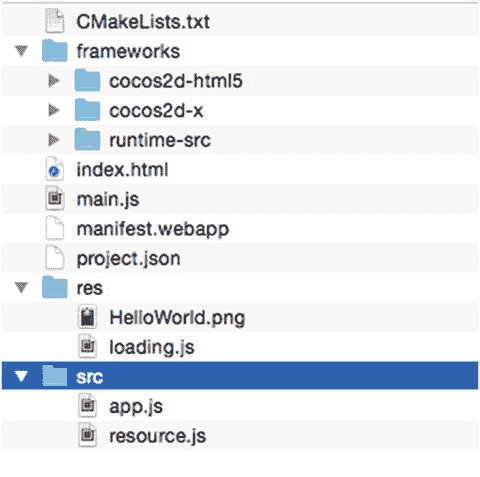
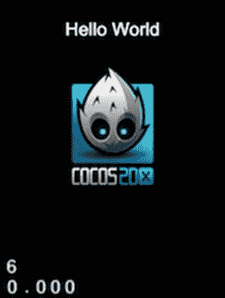
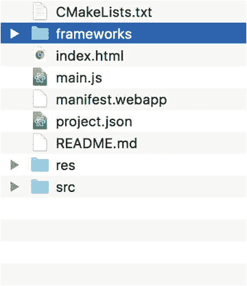

# 开始使用

电子补充材料 本章的在线版本 (doi:[10.​1007/​978-1-4842-2553-0_​1](http://dx.doi.org/10.1007/978-1-4842-2553-0_1)) 包含补充材料，仅供授权用户获取。

## 引言

早期，制作游戏十分困难，但近年来，大量 2D 和 3D 框架与工具不断发展，简化了游戏开发流程，使开发者能够快速制作出高质量的游戏。`Cocos` 是一款广泛应用于 2D 游戏开发的游戏引擎。多年来，`Cocos` 在开发者中奠定了坚实的基础。市场上许多热门游戏都是使用 `Cocos` 制作的。2010 年，基于 `Cocos2D` 的 C++ 移植版 `Cocos2d-x` 问世，使开发者能够制作跨平台的 2D 游戏。随后，基于 `Cocos2D` 的 JavaScript 移植版 `Cocos2d-js` 推出，使开发者能够制作基于浏览器的游戏，以及使用 `JSB` 的跨平台原生游戏。

`Cocos2D` 凭借其简洁性和丰富的功能，已成为 2D 游戏开发的公认标准。在接下来的章节中，我们将深入探讨 `Cocos2d-js` 框架及其功能。读完本书后，你将扎实掌握 `Cocos2D-js` 框架、最佳实践以及丰富的功能集，从而能够快速开发出精彩纷呈的游戏。

让我们开始吧！

## 环境搭建

### Python 安装

大多数情况下，你需要使用 `Cocos` 控制台来创建、运行、编译和部署项目。控制台依赖于 `Python`。因此，你首先需要安装 `Python`。你可以从 `Python` 官方网站下载：[`https://www.python.org/downloads/`](https://www.python.org/downloads/)。

如果你在 MacOS X 上开发，系统默认已预装 `Python`。

### Cocos 控制台设置

对于 `Cocos2d-js`，开发环境实际上是 `Cocos` 控制台的一部分。因此，你必须下载 `Cocos2d-x` 完整包；如果你只想针对 Web 进行开发，也可以选择 HTML5 Lite 版本。

#### 步骤

*   从 [`https://cocos2d-x.org/download`](https://cocos2d-x.org/download) 下载 `cocos2d-x` 完整包。

*   将 zip 文件解压到本地磁盘。

*   在 Mac 上打开终端，或在 Windows 上打开命令提示符，并导航到解压后的文件夹。

*   运行以下命令：

```
python setup.py
```

此命令将设置 `Cocos` 控制台，它会同时使用 Android 和 iOS 的环境设置，并更新环境变量。

## 创建你的第一个应用

在你喜欢的位置创建一个单独的文件夹。将你所有的 `Cocos2d-js` 项目都放在一个根文件夹中，这是一个良好的实践。

打开终端，导航到已创建的文件夹路径，然后执行以下命令：

*   `Cocos2d-js` 项目：

```
cocos new sampleproject -l js
```

*   仅包含 Web 引擎的 `Cocos2d-js` 项目：

```
cocos new sampleproject -l js --no-native
```

*   在指定目录中创建 `Cocos2d-js` 项目：

```
cocos new sampleproject -l js -d ./Projects
```

`sampleproject` 是你的项目名称，`-l js` 指定使用 JavaScript 语言。这将创建一个“Hello World”示例，你可以将其用作游戏的基础。但在此之前，你需要了解 `Cocos2d-js` 遵循的文件夹结构。

### 文件夹结构

当你创建新项目时，`Cocos` 控制台会创建如图 1-1 所示的文件夹结构。

*   `src` - 存放游戏所有 JavaScript 文件的文件夹

*   `res` - 存放游戏中引用的所有图片和其他资源的文件夹

*   `frameworks` - 存放实际 `Cocos2d-js` 引擎、用于原生部署的支持文件、`JSB` 等的文件夹。此外，还有配置文件 `project.json`（作为游戏运行时的主要元配置）和 `manifest.webapp`（包含与 Web 相关的配置信息）。



图 1-1. 项目文件夹结构

### `project.json` 的结构

此文件包含你的 `Cocos2d-js` 项目的元信息。让我们看看 JSON 结构。

*   `version` - 你的应用版本

*   `name` - 你的应用名称

*   `description` - 你的应用描述

*   `launch_path` - `Cocos2d-js` 的启动 HTML 文件；当将应用作为 Web 应用部署/调试时，`Cocos` 控制台会使用该文件

*   `icons` - 不同尺寸的应用图标；在原生部署时，`Cocos` 控制台会使用该字段

*   `developer` - 应用开发者的信息

*   `default_locale` - 应用的默认本地化设置；表示默认使用的语言

*   `orientation` - 支持的屏幕方向

*   `fullscreen` - 部署到原生平台时使用

```
{
  "version": "1.0",
  "name": "sampleproject1",
  "description": "sampleproject1",
  "launch_path": "/index.html",
  "icons": {
    "128": "/res/icon.png"
  },
  "developer": {
    "name": "Cocos2d-html5",
    "url": "http://cocos2d-x.org/"
  },
  "default_locale": "en",
  "installs_allowed_from": [
    "*"
  ],
  "orientation": "portrait-primary",
  "fullscreen": "true"
}
```

### 1.3.3 代码

如果你打开 `main.js`，你会看到以下代码。

```
1   cc.game.onStart = function(){
2       //如果引用了 loading.js，请将其移除
3       if(!cc.sys.isNative && document.getElementById("cocosLoading")) 4
5
6            document.body.removeChild(document.getElementById("cocosLoading"));
7
8       // 传入 true 以启用视网膜显示，默认禁用以提高性能
9       cc.view.enableRetina(false);
10       // 调整视口元数据
11       cc.view.adjustViewPort(true);
12       // 设置分辨率策略和设计分辨率尺寸
13       cc.view.setDesignResolutionSize(800, 450, cc.ResolutionPolicy.SHOW_ALL);
14       // 当浏览器尺寸改变时，游戏将被调整大小
15       cc.view.resizeWithBrowserSize(true);
16       //加载资源
17       cc.LoaderScene.preload(g_resources, function () {
18           cc.director.runScene(new HelloWorldScene());
19       }, this);
20   };
21   cc.game.run();
```

`Cocos2d-js` 引擎将首先执行 `onStart` 函数，该函数包含了启动游戏的代码。上述代码中涉及一些配置相关的内容，这些将在后续章节中进行解释。现在，我们将重点关注 `cc.LoaderScene` 部分。

```
1   cc.LoaderScene.preload(g_resources, function () {
2        cc.director.runScene(new HelloWorldScene());
3   }, this);
```

上述代码加载了“Hello World”场景。`cc.director` 是游戏唯一的控制器实例。这个导演的目的是指导游戏的执行，加载和卸载场景，并获取关于游戏执行环境的信息，例如屏幕尺寸等。在这段代码中，导演使用 `runScene` 函数来加载 `HelloWorldScene`，该场景在 `preload` 内部被加载。`preload` 将 `g_resources` 中指定的资源加载到 Cocos 缓存中，一旦资源加载完成，就会执行一个回调函数，该函数包含加载 `HelloWorldScene` 的代码。

让我们看看 `HelloWorldScene` 和 `HelloWorldLayer`。打开 `src` 文件夹中的 `app.js`。在 `app.js` 的底部，你会看到类似这样的代码：

```
1   var HelloWorldScene = cc.Scene.extend({
2       onEnter:function () {
3           this._super();
4           var layer = new HelloWorldLayer();
5           this.addChild(layer);
6       }
7   });
```

通过调用 `onEnter` 函数来告知场景运行，并且 `HelloWorldLayer` 作为子节点被注入到场景中。

为了简化问题，我们将修改 `HelloWorldLayer`。

```
1   var HelloWorldLayer = cc.Layer.extend({
2       sprite:null,
3       ctor:function () {
4           this._super();
5           var size = cc.winSize;
6           var helloLabel = new cc.LabelTTF("Hello World", "Arial", 38);
7           // 将标签定位在屏幕中央
8           helloLabel.x = size.width / 2;
9           helloLabel.y = size.height / 2 + 200;
10           // 将标签作为子节点添加到此层
11           this.addChild(helloLabel, 5);
12
13           // 添加“HelloWorld”启动画面
14           this.sprite = new cc.Sprite(res.HelloWorld_png);
15           this.sprite.attr({
16                x: size.width / 2,
17                y: size.height / 2
18           });
19           this.addChild(this.sprite, 0);
20           return true;
21       }
22   });
```

这一层有两个子节点：一个是 `cc.LabelTTF`，其文本内容为“Hello World”；另一个是 `HelloWorld_png` 精灵。在本书中，我们将使用竖屏分辨率。因此，在 `main.js` 中，你应该将以下这行代码：

```
1   //这是横屏
2   cc.view.setDesignResolutionSize(800, 450, cc.ResolutionPolicy.SHOW_ALL);
```

修改为：

```
1   //交换宽度和高度，使其变为竖屏
2   cc.view.setDesignResolutionSize(450, 800, cc.ResolutionPolicy.SHOW_ALL);
```

宽度和高度已被交换。

## 1.4 运行“Hello World”

为简单起见，在本书中，我们将在 Web 浏览器中运行所有代码。但是，你也可以选择将其作为原生应用部署到设备上。要运行此示例，请在终端中导航到项目路径，然后输入以下命令：

```
1   cocos run -p web
```

这将在浏览器中启动应用程序；然而，你也可以通过将 `-p param` 改为 `'android'` 或 `'ios'`，在 Android、iOS 或 Windows Phone 上启动该应用程序。你将看到类似图 1-2 所示的内容。



图 1-2. Hello World

## 1.5 本书示例

本书的所有示例代码都可以在 [https://github.com/nutcrackify/Rapid_Game_Development_Using_Cocos2d-js](https://github.com/nutcrackify/Rapid_Game_Development_Using_Cocos2d-js) 找到。

### 1.5.1 运行代码示例

有多种方法可以让代码示例运行起来。我们发现以下步骤可以轻松快速地启动示例代码。请在终端中运行以下命令。

**步骤**

*   创建一个新的 Cocos2d-js 项目：

在终端中导航到项目文件夹：

```
1   cocos new codeexamples -l js
```

*   初始化一个空的 `git` 仓库：

```
1   cd codeexamples
```

*   使用以下任一命令将远程仓库（代码示例仓库）添加到本地 `git` 仓库：



图 1-3. Hello World

*   删除当前文件夹中除 `frameworks/` 文件夹之外的所有文件和文件夹（参见图 1-3）。

```
1   git init
```

*   拉取仓库：

```
1   (如果你使用 ssh)
2   git remote add origin git@github.com:nutcrackify/Rapid_Game_Development_Using_Cocos2d-js.git
3
4   (如果你使用 https)
5   git remote add origin https://github.com/nutcrackify/Rapid_Game_Development_Using_Cocos2d-js.git
```

*   运行示例：

```
1   git pull origin master
```

```
1   cocos run -p web
```

## 1.6 原生部署

除了在 Web 上，你也可以将你的 Cocos2d-js 示例部署到原生平台。以下是用于原生部署的命令。

*   `[-h]` 是帮助。

*   `[-s SRC_DIR]` 表示你的 Cocos2d-js 项目的源文件夹。

*   `[-q]` 是静默模式。

*   `[-p PLATFORM]` 表示目标平台（例如，Android、iOS 等）。

*   `[-m MODE]` 表示部署模式（例如，release、debug）。

```
1   cocos deploy [-h] [-s SRC_DIR] [-q] [-p PLATFORM] [-m MODE]
```

### 1.6.1 Android 环境搭建

如果你已经有了 Android 环境，或者你不想为 Android 编译和部署，可以跳过此部分。

**步骤**

*   从 [http://www.oracle.com/technetwork/java/javase/downloads/index.html](http://www.oracle.com/technetwork/java/javase/downloads/index.html) 安装 JDK。

*   从 [https://developer.android.com/sdk/index.html](https://developer.android.com/sdk/index.html) 下载 Android Studio 或 SDK 及 NDK。

*   如果你不安装 Android Studio，请解压 SDK。

*   解压 NDK 并将其放在 SDK 的根目录中，确保 SDK 和 NDK 位于同一个根文件夹下。

*   从 [https://ant.apache.org/bindownload.cgi](https://ant.apache.org/bindownload.cgi) 安装 Apache ant。

在你的本地 Cocos2d-x 安装文件夹中运行以下命令，并提供 Android NDK 和 SDK 路径：

```
`python python.py`

要将你的项目部署到Android，请通过终端在项目文件夹中运行以下命令：

```
cocos deploy -p android -m release
```

### 1.6.2 iOS 环境搭建

从 OS X 应用商店安装 XCode。使用以下命令进行 iOS 部署：

```
cocos deploy -p ios -m release
```

在下一章中，我们将研究引擎架构，让我们继续前进。
```