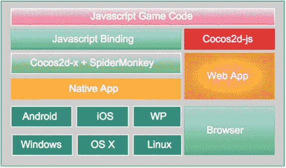
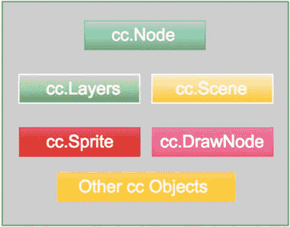

# 2. 架构概述

## 2.1 引擎架构

了解`Cocos2d-js`的架构将为您理解整个框架打下坚实的基础。本节不会涉及超出本书范围的详细架构，但我们将涵盖您需要了解的、以便继续学习的必要细节。`Cocos2d-js`是一个纯基于**JavaScript**的游戏框架，运行在浏览器栈上。您可以将其编译为**Web**应用并在任何浏览器上运行；然而，其**API**和对象的层级结构与`Cocos2d-x`相同。因此，借助`JSB`和`SpiderMonkey`，您的**JavaScript**游戏代码可以部署为实际利用`OpenGL/DirectX`核心渲染管线的原生应用。让我们看一下图 2-1 中的架构。

图 2-1. `Cocos2d-js` 栈

如您所见，如果您的应用是基于浏览器的，您的**JavaScript**游戏代码将利用`Cocos2d-js`的库，并可以像其他任何**Web**应用一样运行。当您使用`Cocos`控制台将其部署为原生应用时，您的**JavaScript**代码将映射到实际指向原生`Cocos2d-x`的**JavaScript**绑定。您的**JavaScript**代码将由`SpiderMonkey`转换为**C**代码。因此，实际上是`Cocos2d-x`在驱动您的**JavaScript**游戏。

### 2.2 JSB

如上所述，`JSB`包含`Cocos2d-x`的**JavaScript**和**C++ API**之间的映射，因此当您选择将游戏部署为原生应用时，您所有的**API**使用都会在`SpiderMonkey`的帮助下映射到实际的**C++ API**调用。请注意，只有有文档记录的`Cocos2d-js API`才能映射到原生**API**调用。如果您尝试调用任何`Cocos2d-js`内部未文档化的函数，应用在浏览器中会正常运行，但当您将其部署为原生应用时，您可能看不到相同的结果。如果您计划将游戏编译到任何移动平台，强烈建议您始终遵循有文档记录的**API**。

### 2.3 对象层级结构

`Cocos2d-js`基于面向对象的原则，因此所有涉及的实体都被视为类和对象。请参考图 2-2。

图 2-2. 对象层级结构

`Cocos2d-js`中的每个类，除了一些工具类外，都继承自`cc.Node`，从`Scene`和`Layer`到`Sprites`，所有这些类都是`Node`对象的实例。当您在`Cocos2d-js`中处理任何可见元素时，最顶层的根对象是`cc.Node`。因此，大多数情况下您都在处理一个`Node`对象。派生对象将根据其定义和需求具有自己的行为和重写方法。

### 2.4 部署选项

由于您使用的是纯**JavaScript**库，因此部署应用的方式比仅仅依赖`Cocos`控制台要多得多。

#### 2.4.1 部署为混合应用

此选项取决于您游戏的性能。如果您的游戏使用了繁重的绘制循环，则不建议使用此选项。

#### 2.4.2 使用 Titanium 部署

此选项将使您能够将应用部署为原生应用，但其可行性可能因您在游戏中的操作而异。

#### 2.4.3 Cocos 控制台

这是我们将应用部署到各种平台的首选方式，但您也可以使用其他`Cocos2d-x`服务，例如`SDKBOX`、`pluginX`等。

