# 3. 深入了解精灵

## 3.1 简介

精灵是任何`2D`游戏中最核心的部分。在开发`2D`游戏时，您会经常处理这个实体。在`Cocos2d-js`中，这个实体由一个名为`cc.Sprite`的类定义。在本节中，我们将详细探讨这个类，包括它的组织方式、使用方法、如何实现帧动画等。那么，让我们开始吧。

## 3.2 Sprite 类

在`Cocos2d-js`中，`cc.Sprite`类用于定义游戏中的精灵。该类可以使用图像文件名、初始旋转变换等进行初始化。之后，您可以根据游戏逻辑动态更新其`x,y`位置。让我们看一下图 3-1 中这个类的组织方式。

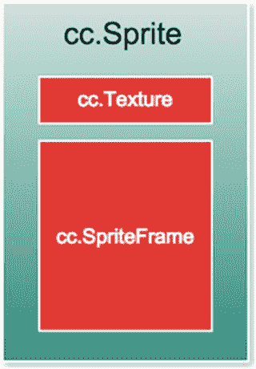

图 3-1. Sprite 类

当您观察一个精灵时，它有两个主要部分。一个是纹理，代表图像；另一个是精灵帧，代表纹理图像中当前显示精灵的`rect`（矩形区域）。纹理由`cc.Texture`表示，精灵帧由`cc.SpriteFrame`表示。让我们看几个示例。

## 3.3 单一图像精灵

在`src`文件夹中，创建一个名为`spriteimage.js`的文件，并复制粘贴以下代码：

```
1   var SpriteImageLayer = cc.Layer.extend({
2       sprite:null,
3       ctor:function () {
4            this._super();
6            var size = cc.winSize;
8            this.sprite = new cc.Sprite(res.Sprite_Image);
9            this.sprite.attr({
10                 x: size.width / 2,
11                 y: size.height / 2
12            });
13            this.addChild(this.sprite, 0);
14            return true;
15       }
16   });
```

在`project.json`中包含这个新文件，并在`app.js`中，将场景中现有的`layer`实例替换为`SpriteImageLayer`。

```
1   var HelloWorldScene = cc.Scene.extend({
2       onEnter:function () {
3           this._super();
4           //将当前层替换为 SpriteImageLayer。
5           var layer = new SpriteImageLayer();
6           this.addChild(layer);
7       }
8   });
```

在`resources.js`中，需要包含`Sprite_Image`属性；您可以使用自己选择的图像。

```
1   var res = {
2       .......
4       Sprite_Image:"res/sprite_image.png"
5   };
```

我将使用图 3-2 中看到的图像。


图 3-2. `sprite_image.png`

请记住这些运行单独层的步骤，因为我们将为每个示例创建单独的层，并且在后续示例中这些步骤将不再重复。

如您所见，精灵已经用一个单一图像初始化：

```
1   this.sprite = new cc.Sprite(res.Sprite_Image);
```

此构造函数将使用`res.Sprite_Image`创建一个`cc.Texture`实例，并且`cc.SpriteFrame`将默认初始化为`rect(0,0,spriteWidth,spriteHeight)`以显示完整的图像。因此，输出将如图 3-3 所示。


图 3-3. 带单一图像的精灵

### 3.3.1 FPS 显示

左下角的显示称为`FPS`显示，它有三个值：

*   绘制调用数
*   增量时间
*   帧率

您可以使用`project.json`中的`showFPS`标记来控制`FPS`显示的可见性。

#### 3.3.1.1 绘制调用

渲染发生在绘制调用中，场景中的每个节点都有一个关联的绘制调用。随着绘制调用数的增加，增量时间和帧率会下降，这与游戏的性能直接相关。

#### 3.3.1.2 增量时间

前一帧完成渲染所花费的时间。

#### 3.3.1.3 帧率

表示每秒渲染的帧数。

### 3.4 使用精灵表的精灵

为减少内存占用，应将所有资源打包到一张精灵表中，并在整个游戏过程中使用该精灵表。对于单个精灵而言，`cc.SpriteFrame`实例将定义需要显示在`cc.Sprite`实例显示帧中的精灵表部分。我将使用图 3-4 中所示的精灵表进行下一个示例。

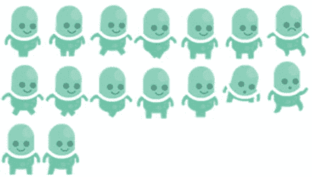

图 3-4. `sprite_sheet.png`

在`src`目录下，创建一个名为`spritesheet.js`的文件，并将以下代码复制进去：

```
1   var SpriteSheetLayer = cc.Layer.extend({
2       sprite:null,
3       ctor:function () {
5           this._super();
7           var size = cc.winSize;
9           this.sprite = new cc.Sprite(res.Sprite_Sheet,cc.rect(438,93,67,94));
10          this.sprite.attr({
11              x: size.width / 2,
12              y: size.height / 2
13          });
14          this.addChild(this.sprite, 0);
16          return true;
17      }
18  });
```

按照上一个示例的步骤，将`SpriteSheetLayer`包含到`HelloWorldScene`中。在`resource.js`文件中，创建一个`Sprite_Sheet`变量并指定精灵表的文件名。

如您所见，精灵使用精灵表作为纹理进行初始化，并通过`rect`设置需要显示的当前帧。参见图 3-5。

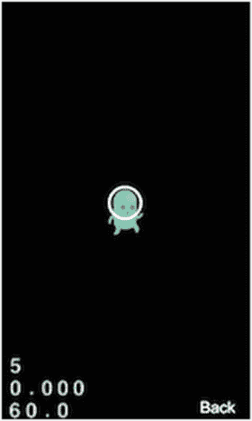

图 3-5. 使用精灵表的精灵

`rect`坐标对应精灵表中第一行的最后一张图像。

### 3.5 精灵帧动画

如前所述，`cc.SpriteFrame`负责在`cc.Sprite`中显示当前图像。这个精灵帧可以在任意时刻更改，这使我们能够创建基于帧的动画。让我们看一个示例。我将在此示例中使用同一张精灵表。

在`src`目录下，创建一个名为`spriteanimation.js`的文件，并将以下代码复制进去：

帧动画背后的思路是，我们将在特定的时间间隔内逐帧播放，使其看起来像一个动画序列。在上述代码中，`walk01` 到 `walk11` 表示精灵表中的各帧，使用 `rects` 定义。如果我们将这些帧组合并依次播放，就会看起来像一个行走动画。

`SpriteFrame` 实例使用该帧 `rect` 数组创建（参见图 3-6）：

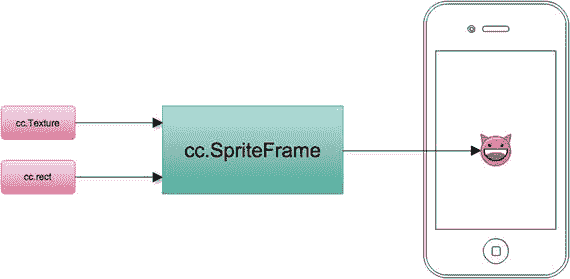

图 3-6. `SpriteFrame`

```javascript
var texture = cc.textureCache.addImage(res.Sprite_Sheet);
var animFrames=[];
for(var index in frameDatas)
{
    var spriteFrame = new cc.SpriteFrame(texture, frameDatas[index]);
    var animFrame = new cc.AnimationFrame();
    animFrame.initWithSpriteFrame(spriteFrame, 1, null);
    animFrames.push(animFrame);
}
```

在这个示例中，我们手动创建 `cc.SpriteFrame` 实例，因此需要一个精灵表的 `texture` 实例。于是我们将精灵表添加到纹理缓存中，该操作会返回 `texture` 实例，可用于创建所有精灵帧。

最后，用于执行动画的 `cc.Animation` 实例通过 `cc.AnimationFrame` 的图像列表创建，时间间隔设置为 0.08 秒。

输出结果将是一个流畅的行走动画。

在上述案例中，为了完整理解帧动画，我们手动创建了帧数据，但在实际开发中，精灵表往往是通过像 `TexturePack` 这样的工具从单个图像生成，同时还会创建关联的数据文件。在 `Cocos2d` 中，这是一个包含与精灵表相关的所有帧数据的 `PList` 文件。在下一个示例中，我们将看到如何使用 `PList` 创建帧动画。

### 3.6 使用 PList 数据的精灵帧动画

我们使用`TexturePack`从一个单独的图像创建了相同的精灵表，并生成了`PList`文件。参见图 3-7。

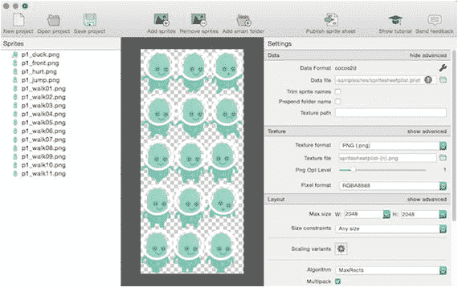

图 3-7. `TexturePack` 生成的精灵表

在生成`PList`时，请确保选择了`Cocos2d`作为数据格式。图 3-8 显示了生成的纹理。

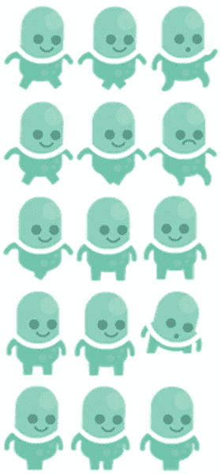

图 3-8. 来自`TexturePack`的精灵表

你可以在示例项目`res`文件夹中查看`PList`数据文件，该示例项目位于 [`https://github.com/nutcrackify/Rapid_-Game_Development_Using_Cocos2d-js`](https://github.com/nutcrackify/Rapid_-Game_Development_Using_Cocos2d-js)。

在`src`中，创建一个名为`plistanimation.js`的文件，并将以下代码复制到其中：

```javascript
var SpriteAnimationLayer = cc.Layer.extend({
    sprite:null,
    ctor:function () {
        //////////////////////////////
        // 1. super init first
        this._super();
        var size = cc.winSize;
        //FrameData
        var walk01 = cc.rect(0,0,72,97);
        var walk02 = cc.rect(73,0,72,97);
        var walk03 = cc.rect(146,0,72,97);
        var walk04 = cc.rect(0,98,72,97);
        var walk05 = cc.rect(73,98,72,97);
        var walk06 = cc.rect(146,98,72,97);
        var walk07 = cc.rect(219,0,72,97);
        var walk08 = cc.rect(292,0,72,97);
        var walk09 = cc.rect(219,98,72,97);
        var walk10 = cc.rect(365,0,72,97);
        var walk11 = cc.rect(292,98,72,97);
        var frameDatas=[walk01,walk02,walk03,walk04,walk05,
        walk06,walk07,walk08,walk09,walk10,walk11];
        var texture = cc.textureCache.addImage(res.Sprite_Sheet);

        //Create SpriteFrame and AnimationFrame with Frame Data
        var animFrames=[];
        for(var index in frameDatas)
        {
            var spriteFrame = new cc.SpriteFrame(texture, frameDatas[index]);
            var animFrame = new cc.AnimationFrame();
            animFrame.initWithSpriteFrame(spriteFrame, 1, null);
            animFrames.push(animFrame);
        }

        //Create an empty sprite
        this.sprite = new cc.Sprite();
        this.sprite.attr({
            x: size.width / 2,
            y: size.height / 2
        });
        this.addChild(this.sprite, 0);

        var animation = cc.Animation.create(animFrames, 0.08);
        var animate = cc.Animate.create(animation);

        //Animate the sprite frame on the empty sprite
        this.sprite.runAction(animate.repeatForever());

        return true;
    }
});
```

# 3.6 使用 PList 和精灵表创建动画

```javascript
var PListAnimationLayer = cc.Layer.extend({
    sprite:null,
    ctor:function () {

        this._super();

        var size = cc.winSize;

        cc.spriteFrameCache.addSpriteFrames(res.Sprite_Sheet1_P, res.Sprite_Sheet1);
        //使用帧数据创建 SpriteFrame 和 AnimationFrame
        var animFrames=[];
        for(var i=1;i<12;i++)
        {
             var str = "p1_walk" + (i < 10 ? ("0" + i) : i) + ".png";
             var spriteFrame=cc.spriteFrameCache.getSpriteFrame(str);
             animFrames.push(spriteFrame);
        }

        //创建一个空的精灵
        this.sprite = new cc.Sprite();
        this.sprite.attr({
             x: size.width / 2,
             y: size.height / 2
        });

        this.addChild(this.sprite, 0);

        var animation = new cc.Animation(animFrames, 0.08);
        this.sprite.runAction(cc.animate(animation).repeatForever());

        return true;
    }
});
```

在`resource.js`中，使用变量`Sprite_Sheet1_P`和`Sprite_Sheet1`包含`PList`和精灵表文件；两者都已添加到帧缓存中，如下所示：

```javascript
cc.spriteFrameCache.addSpriteFrames(res.Sprite_Sheet1_P, res.Sprite_Sheet1);
```

基于`PList`数据和精灵表，可以使用`getSpriteFrame`函数创建精灵帧，如下所示：

```javascript
var animFrames=[];
for(var i=1;i<12;i++)
{
    var str = "p1_walk" + (i < 10 ? ("0" + i) : i) + ".png";
    var spriteFrame=cc.spriteFrameCache.getSpriteFrame(str);
    animFrames.push(spriteFrame);
}
```

现在我们有了精灵帧列表，可以使用`cc.Animation`类来制作动画：

```javascript
var animation = new cc.Animation(animFrames, 0.08);
this.sprite.runAction(cc.animate(animation).repeatForever());
```

这与我们之前使用原始帧数据（不带`PList`）所做的行走动画是相同的。

### 3.7 带有精灵的 TextureCache

纹理缓存是精灵构建的重要组成部分，用于在内存中缓存纹理数据，以便再次引用相同纹理时，可以从缓存中加载。这可以提高游戏的整体性能和内存优化。参见图 3-9。

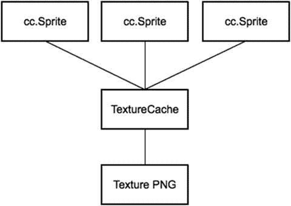

图 3-9. 纹理缓存精灵

每当你使用图像文件创建一个精灵时，该图像文件会在内部被加载到`TextureCache`中，并且会使用`TextureCache`中的数据创建一个`Texture2D`实例。在前面的代码示例中，你看到了我们如何将精灵表加载到纹理缓存中，并使用它来创建`SpriteFrame`实例。参见图 3-10。

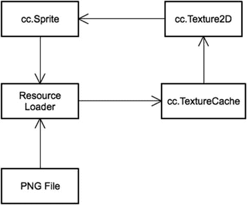

图 3-10. 使用`PNG`的精灵

上图表示使用单个`png`文件的精灵。一旦纹理从资源加载器返回，它就会被缓存到纹理缓存中，然后从缓存数据创建`Texture2D`实例，并被`cc.Sprite`使用。这是`cc.Sprite`的内部实现。

### 3.8 带有精灵的 SpriteFrameCache

与`TextureCache`类似，`SpriteFrameCache`用于缓存被`cc.Sprite`使用的`SpriteFrame`。如果你有一个精灵表，单个的`SpriteFrames`可以被缓存在`SpriteFrameCache`中，并在以后需要时使用。前面的代码示例和图 3-11 已经说明了这一点。

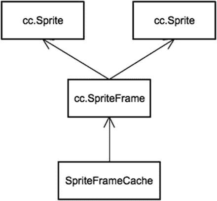

图 3-11. `SpriteFrameCache`共享`SpriteFrame`

### 3.9 精灵批处理

精灵批处理是一种技术，它通过单次绘制调用来合并多个精灵的渲染，前提是所涉及的精灵使用相同的纹理或纹理表。

#### 3.9.1 SpriteBatchNode

`cc.SpriteBatchNode` 是一种精灵类，用于将多个精灵合并到一次绘制调用中。让我们看一个例子。

首先，我们使用相同的精灵表（sprite sheet）和不同的 `SpriteFrame` 矩形创建四个独立的精灵：

```javascript
this.sprite1 = new cc.Sprite(res.Sprite_Sheet,cc.rect(438,93,67,94));
this.sprite1.attr({
    x: size.width / 2,
    y: size.height / 1.5
});

this.sprite2 = new cc.Sprite(res.Sprite_Sheet,cc.rect(73,0,72,97));
this.sprite2.attr({
    x: size.width / 2,
    y: size.height / 2
});

this.sprite3 = new cc.Sprite(res.Sprite_Sheet,cc.rect(219,0,72,97));
this.sprite3.attr({
    x: size.width / 2,
    y: size.height / 3
});

this.sprite4 = new cc.Sprite(res.Sprite_Sheet,cc.rect(365,0,72,97));
this.sprite4.attr({
    x: size.width / 2,
    y: size.height / 5
});
```

现在，我们使用相同的精灵表创建一个 `SpriteBatchNode` 实例：

```javascript
this.spritebatch=new cc.SpriteBatchNode(res.Sprite_Sheet);
```

让我们将精灵添加到 `SpriteBatchNode` 中：

```javascript
this.spritebatch.addChild(this.sprite1, 0);
this.spritebatch.addChild(this.sprite2, 0);
this.spritebatch.addChild(this.sprite3, 0);
this.spritebatch.addChild(this.sprite4, 0);
```

最后，将 `spritebatch` 添加到层（layer）中：

```javascript
this.addChild(this.spritebatch);
```

现在，完整的代码应该如下所示：

```
1   var SpriteBatchLayer = BaseSampleLayer.extend({
2       sprite:null,
3       ctor:function () {
4
5           this._super();
6
7           var size = cc.winSize;
8
9           this.sprite1 = new cc.Sprite(res.Sprite_Sheet,cc.rect(438,93,67,94));
10          this.sprite1.attr({
11              x: size.width / 2,
12              y: size.height / 1.5
13          });
14
15          this.sprite2 = new cc.Sprite(res.Sprite_Sheet,cc.rect(73,0,72,97));
16          this.sprite2.attr({
17              x: size.width / 2,
18              y: size.height / 2
19          });
20
21          this.sprite3 = new cc.Sprite(res.Sprite_Sheet,cc.rect(219,0,72,97));
22          this.sprite3.attr({
23              x: size.width / 2,
24              y: size.height / 3
25          });
26
27          this.sprite4 = new cc.Sprite(res.Sprite_Sheet,cc.rect(365,0,72,97));
28          this.sprite4.attr({
29              x: size.width / 2,
30              y: size.height / 5
31          });
32          this.spritebatch=new cc.SpriteBatchNode(res.Sprite_Sheet);
33
34          this.spritebatch.addChild(this.sprite1, 0);
35          this.spritebatch.addChild(this.sprite2, 0);
36          this.spritebatch.addChild(this.sprite3, 0);
37          this.spritebatch.addChild(this.sprite4, 0);
38
39          this.addChild(this.spritebatch);
40
41          return true;
42      }
43  });
```

请注意，归属于同一个 `SpriteBatchNode` 的所有精灵必须使用相同的 `texture` 实例；同时，`SpriteBatchNode` 必须包含对该相同纹理的引用。否则，Cocos2d-js 将无法渲染该 `SpriteBatchNode`。

最终输出效果将如图 3-12 所示。


图 3-12. `SpriteBatchNode` 渲染效果

然而，原生渲染器支持自动合批（auto batching），这意味着如果你要部署到原生平台，精灵合批功能会自动实现，无需使用 `SpriteBatchNode`。

## 3.10 分辨率策略

分辨率策略用于让你的游戏适应不同的屏幕分辨率和配置。Cocos2d-js 提供了一系列分辨率策略来实现游戏的适配。如果没有这些策略，你必须根据屏幕分辨率手动缩放游戏内容。

分辨率策略分为两种：预定义策略和自定义策略。预定义策略由 Cocos2d-js 提供，由容器策略和内容策略的不同组合构成；这些策略同样支持在原生部署中使用。使用自定义策略，你可以通过组合可用的容器和内容策略来定义自己的分辨率策略，但自定义策略仅在 Web 部署中支持。让我们来看一下。

### 3.10.1 术语

为了完全理解分辨率策略，你需要了解一些术语。你可能已经知道，你的游戏是托管在基于 Web 的 Cocos2d-js 游戏中的一个 `Canvas`（画布）中。见图 3-13。

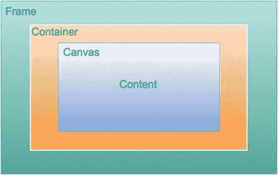

图 3-13. 分辨率策略中使用的术语

#### 3.10.1.1 框架 (Frame)

这表示 `Canvas` 外部的容器，如果你使用 Cocos 控制台生成的默认 `index.html`，它通常是一个 `body` 元素。

#### 3.10.1.2 容器 (Container)

Cocos2d-js 将你的 `Canvas` 包装在一个 `div` 元素中，然后这个包装后的内容又被添加到 `canvas` 的原始容器元素中。

#### 3.10.1.3 内容 (Content)

`canvas` 内部不属于 `dom` 的所有内容。

#### 3.10.1.4 视口 (Viewport)

`Viewport` 表示 `canvas` 的世界坐标系矩形；它是 `canvas` 的像素坐标。

#### 3.10.1.5 信箱模式 (Letter Boxing)

当容器的宽度与框架匹配但高度不匹配时，就会出现信箱模式（图 3-14）。如果宽高比与框架不匹配，就会发生这种情况，这也取决于你使用的分辨率策略。

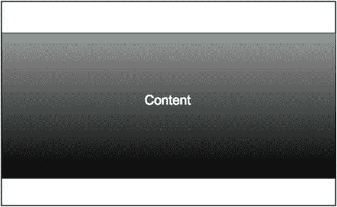

图 3-14. 信箱模式

#### 3.10.1.6 柱箱模式 (Pillar Boxing)

当容器的高度与框架的高度匹配但宽度不匹配时，就会出现柱箱模式（见图 3-15）。出现这种情况的原因与信箱模式相同。

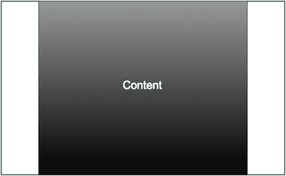

图 3-15. 柱箱模式

### 3.10.2 预定义分辨率策略

Cocos2d-js 提供了五种预定义策略，我们现在来讨论它们。

#### 3.10.2.1 `SHOW_ALL` (全部显示)

此策略会将容器缩放到容器边界内的最大尺寸；当前场景中的所有内容都将可见。

#### 3.10.2.2 `NO_BORDER` (无边框)

此策略会将容器缩放以填满框架，这样框架内将没有可见区域，同时保持所提供的宽度和高度比例。

#### 3.10.2.3 `EXACT_FIT` (精确适配)

此策略会将容器缩放以适配框架。请注意，所提供的宽度和高度比例将无法保持。

#### 3.10.2.4 `FIXED_WIDTH` (固定宽度)

此策略会将容器的宽度缩放到与框架宽度匹配，并将高度缩放到与宽高比匹配。如果宽高比不匹配，你可能会看到信箱模式。

#### 3.10.2.5 `FIXED_HEIGHT` (固定高度)

此策略会将容器的高度缩放到与框架高度匹配，并将宽度缩放到与宽高比匹配。如果宽高比不匹配，你可能会看到柱箱模式。

### 3.10.3 如何使用

在 `main.js` 文件中，有一个 `cc.game.onStart` 回调函数。你需要使用以下代码行来设置分辨率配置文件：

```
cc.view.setDesignResolutionSize(320, 480, cc.RESOLUTION_POLICY.SHOW_ALL);
```

前两个参数是宽度和高度，即你游戏的宽高比，第三个参数是分辨率策略。

### 3.10.4 自定义分辨率策略

如我们之前所见，预定义的策略是容器策略与内容策略的组合。例如，`SHOW_ALL` 策略就是 `PROPORTION_TO_FRAME` 和 `SHOW_ALL` 的组合，具体如下：

```
cc.RESOLUTION_POLICY.SHOW_ALL = new cc.ResolutionPolicy(cc.ContainerStrategy.PROPORTION_TO_FRAME, cc.ContentStrategy.SHOW_ALL);
```

这就是 `SHOW_ALL` 的内部实现。你可以通过组合预定义的容器策略和内容策略来定义自己的策略。

### 3.10.5 预定义容器策略

- `cc.ContainerStrategy.EQUAL_TO_FRAME`
- `cc.ContainerStrategy.PROPORTION_TO_FRAME`
- `cc.ContainerStrategy.ORIGINAL_CONTAINER`

### 3.10.6 预定义内容策略

- `cc.ContentStrategy.SHOW_ALL`
```

# 自定义容器与内容策略

- `cc.ContentStrategy.NO_BORDER`
- `cc.ContentStrategy.EXACT_FIT`
- `cc.ContentStrategy.FIXED_WIDTH`
- `cc.ContentStrategy.FIXED_HEIGHT`

你可以创建自己的容器和内容策略；只需使用子类 `cc.ContainerStrategy` 和 `cc.ContentStrategy` 并重写如下所示的方法即可。

### 3.10.7 自定义容器策略

```javascript
var CustomContainerStrategy = cc.ContainerStrategy.extend({
    preApply: function (view) {
        // 此函数在适配过程之前被调用，
        // 如果不需要，可以移除该函数
    },

    apply: function (view, designedResolution) {
        // 应用过程
    },

    postApply: function (view) {
        // 此函数在适配过程之后被调用，
        // 如果不需要，可以移除该函数
    }
});
```

### 3.10.8 自定义内容策略

```javascript
var CustomContentStrategy = cc.ContentStrategy.extend({
    preApply: function (view) {
        // 此函数在适配过程之前被调用，
        // 如果不需要，可以移除该函数
    },

    apply: function (view, designedResolution) {
        var containerW = cc.canvas.width, containerH = cc.canvas.height;

        // 计算内容大小、X 轴缩放和 Y 轴缩放的过程

        return this._buildResult(containerW, containerH, contentW, contentH, scaleX, scaleY);
    },

    postApply: function (view) {
        // 此函数在适配过程之后被调用，
        // 如果不需要，可以移除该函数
    }
});
```

必须在这两者中实现 `apply` 函数。你可以访问 frame、容器以及内容的宽度和高度。