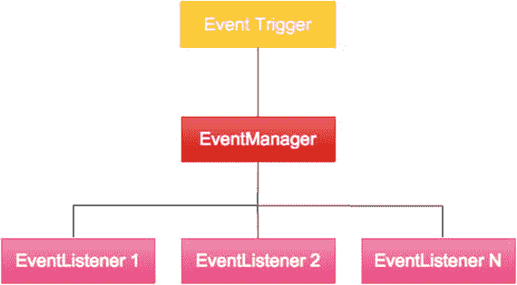

# 4. 处理输入和事件

## 4.1 引言

处理用户输入是任何游戏的重要组成部分。在 Cocos2d-js 中，用户输入（例如通过触摸、鼠标或键盘）以事件的形式提供。事件机制涉及三个主要部分（见图 4-1）。



图 4-1. Cocos2d-JS 中的事件机制

### 4.1.1 事件触发器

事件触发器是任何事件的源头。当发生触摸或任何其他输入时，Cocos2d-js 系统将触发一个事件作为响应。

### 4.1.2 事件管理器

当任何事件被触发时，事件管理器会收到通知。`EventManager` 是一个单例实例，是 Cocos2d-js 系统的一部分；它管理所有事件。

### 4.1.3 事件监听器

这是实际事件处理逻辑所在之处。事件管理器会将事件分派给所有事件监听器，并由事件监听器实例进行处理。

## 4.2 触摸事件

有两种可用的触摸事件：单点触摸（`cc.EventListener.TOUCH_ONE_BY_ONE`）和多点触摸（`cc.EventListener.TOUCH_ALL_AT_ONCE`）

### 4.2.1 单点触摸

在 `src` 文件夹中，创建一个名为 `touchevents.js` 的文件，并将以下代码复制进去：

```
var TouchEventsLayer = cc.Layer.extend({
    sprite:null,
    ctor:function () {
        this._super();

        var size = cc.winSize;

        this.sprite = new cc.Sprite(res.Sprite_Image);
        this.sprite.attr({
            x:size.width / 2,
            y:size.height / 2
        });
        this.addChild(this.sprite, 0);
        this.sprite.tag='TouchTarget';

        //创建事件监听器对象
        var listener = cc.EventListener.create({
            event: cc.EventListener.TOUCH_ONE_BY_ONE,
            swallowTouches: true,

            onTouchBegan: function (touch, event) {
                var target = event.getCurrentTarget();
                var locationInNode = target.convertToNodeSpace(touch.getLocation());
                var s = target.getContentSize();
                var rect = cc.rect(0, 0, s.width, s.height);

                //检查点击区域
                if (cc.rectContainsPoint(rect, locationInNode)) {
                    cc.log('触摸开始：在精灵内部');
                    //返回 true 以启动 OnTouchMove
                    return true;
                }
                cc.log('触摸开始：在精灵外部');
                return false;
            },
            onTouchMoved: function (touch, event) {
                var target = event.getCurrentTarget();
                target.setPosition(touch.getLocation());
            },
            onTouchEnded: function (touch, event) {
                cc.log('触摸结束');
            }
        });

        //将事件监听器添加到精灵
        cc.eventManager.addListener(listener, this.sprite);
        return true;
    }
});
```

在此示例中，精灵可以通过单点触摸进行拖动。事件监听器使用事件名称 `cc.EventListener.TOUCH_ONE_BY_ONE` 创建，并将 `swallowTouches` 设置为 `true`。当多个事件监听器为同一事件名称附加到同一目标时，第一个 `swallowTouches: true` 的监听器将吞噬该事件，并且该事件将不会传递给下一个监听器。

```
cc.eventManager.addListener(listener, this.sprite);
```

在这种情况下，即使精灵是目标，屏幕上的每一次点击都会触发触摸事件。为了确认触摸是否发生在精灵内部，编写了以下代码：

```
var target = event.getCurrentTarget();
var locationInNode = target.convertToNodeSpace(touch.getLocation());
var s = target.getContentSize();
var rect = cc.rect(0, 0, s.width, s.height);

//检查点击区域
if (cc.rectContainsPoint(rect, locationInNode)) {
    cc.log('触摸开始：在精灵内部');
    //返回 true 以启动 OnTouchMove
    return true;
}
```

在 `onTouchBegan` 中，检查了触摸是否发生在精灵内部的条件。如果触摸在精灵内部，则返回 `true`，以便触摸移动的手势将被定向到 `onTouchMoved` 函数；目标位置会根据触摸移动进行更改。


### 4.2.2 多点触控

多点触控事件监听器可以通过事件名称 `cc.EventListener.TOUCH_ALL_AT_ONCE` 创建。请参考以下代码片段：

```
1   var listener = cc.EventListener.create({
2       event: cc.EventListener.TOUCH_ALL_AT_ONCE,
3       swallowTouch: true,
4       onTouchesBegan: function (touches, event) {
5           .......
6       },
7       onTouchesMoved: function (touches, event) {
8           .......
9   },
10       onTouchesEnded: function (touches, event) {
11           .......
12       }
13   });
```

因此，多点触控的回调与单点触控不同。它包含 `onTouchesBegan`、`onTouchesMoved` 和 `onTouchesEnded` 函数。`touches` 对象将包含每次触摸的详细信息，并带有触摸 ID。通常情况下，多点触控可用于地图缩放、多指操作控制等场景。

### 4.3 鼠标事件

与触控事件类似，鼠标事件通过事件名称 `cc.EventListener.MOUSE` 来引用。在 `src` 文件夹中，创建一个名为 `mouseevents.js` 的文件，并将以下代码复制进去：

```
1   var MouseEventsLayer = cc.Layer.extend({
2       sprite:null,
3       ctor:function () {
4           this._super();
6           var size = cc.winSize;
8           this.sprite = new cc.Sprite(res.Sprite_Image);
9           this.sprite.attr({
10               x: size.width / 2,
11               y: size.height / 2
12           });
13           this.addChild(this.sprite, 0);
14           this.sprite.tag='TouchTarget';
16           //Creating Event Listener Object
17           var listener = cc.EventListener.create({
18               event: cc.EventListener.MOUSE,
19                   swallowTouches: true,
20                   ismousedown:false,
21               onMouseDown: function (event) {
22                   var target = event.getCurrentTarget();
23                   var locationInNode = target.convertToNodeSpace(event.getLocation());
24                   var s = target.getContentSize();
25                   var rect = cc.rect(0, 0, s.width, s.height);
28                               //Check the click area
29                   if (cc.rectContainsPoint(rect, locationInNode)) {
30                       cc.log('Mouse Down: Inside the sprite');
31                       this.ismousedown=true;
32                   }
33                   cc.log('Mouse Down: Outside the sprite');
34                   return false;
35               },
36               onMouseMove: function (event) {
37                   if(this.ismousedown)
38                   {
39                       var target = event.getCurrentTarget();
40                       target.setPosition(event.getLocation());
41                   }
42               },
43               onMouseUp: function (event) {
44                  cc.log('Mouse Up');
45                  this.ismousedown=false;
46               }
47           });
49           //Added Event Listener To Sprite
50           cc.eventManager.addListener(listener, this.sprite);
51           return true;
52       }
53   });
```

在这个例子中，精灵同样可以通过鼠标点击来拖动，但触控和鼠标事件处理有一个主要区别。在触控中，`onTouchBegan` 函数必须返回 `true`，才能处理 `onTouchMove`。而在鼠标事件中，`onMouseMove` 不依赖于 `onMouseDown` 的返回值。这两个事件可以同时处理。为了跟踪鼠标是否在精灵内部按下，我们引入了 `ismousedown` 标志。当鼠标按下事件发生在精灵内部时，位置将通过 `onMouseMove` 来改变。

### 4.4 键盘事件

在 `src` 文件夹中，创建一个名为 `keyboardevent.js` 的文件，并将以下代码复制进去：

```
1   var KeyboardEventsLayer = cc.Layer.extend({
2       sprite:null,
3       ctor:function () {
4           this._super();
6           var size = cc.winSize;
7           var KeyCode={
8               LEFT:37,
9               UP:38,
10               RIGHT:39,
11               DOWN:40
12           };
13           var MoveOffSet=20;
14           this.sprite = new cc.Sprite(res.Sprite_Image);
15           this.sprite.attr({
16               x: size.width / 2,
17               y: size.height / 2
18           });
19           this.addChild(this.sprite, 0);
20           this.sprite.tag='TouchTarget';
22           //Creating Event Listener Object
23           var listener = cc.EventListener.create({
24             event: cc.EventListener.KEYBOARD,
25                 swallowTouches: true,
26             onKeyPressed: function (keyCode,event) {
27                var target = event.getCurrentTarget();
28                var position=target.getPosition();
29                switch(keyCode)
30                {
31                   case KeyCode.LEFT:
32                   position.x-=MoveOffSet;
33                   break;
35                   case KeyCode.RIGHT:
36                   position.x+=MoveOffSet;
37                   break;
39                   case KeyCode.UP:
40                   position.y+=MoveOffSet;
41                   break;
43                   case KeyCode.DOWN:
44                   position.y-=MoveOffSet;
45                   break;
46                }
47                target.setPosition(position);
48           },
49           onKeyReleased: function (event) {
50              cc.log('Key released');
51           }
52        });
54        //Added Event Listener To Sprite
55        cc.eventManager.addListener(listener, this.sprite);
56        return true;
57       }
58   });
```

在上述代码中，同样的精灵拖动操作是通过上、下、左、右组合键来完成的。系统会检查 `onKeyPress` 函数中的键码，如果键码是任何一个箭头键，精灵的 x、y 坐标就会相应地移动。

### 4.5 加速度计事件

加速度计事件通过事件名称 `cc.EventListener.ACCELERATION` 来引用。加速度计输入需要通过输入管理器启用，如下所示：

```
1   cc.inputManager.setAccelerometerEnabled(true);
```

之后，您可以创建一个监听器，并通过 `eventManager` 将其附加到精灵上：

```
1   cc.eventManager.addListener({
2        event: cc.EventListener.ACCELERATION,
3        callback: function(acc, event){
4            // Processing logic here
5        }
6   }, sprite);
```

### 4.6 自定义事件

除了系统定义的事件之外，我们还可以创建自己的事件。请参见以下代码片段：

```
1   var listener = cc.EventListener.create({
2         event: cc.EventListener.CUSTOM,
3         eventName: "my_custom_event",
4         callback: function(event){
5             cc.log("Custom event 1 received, " + event.getUserData() + "times");
6         }
7   });
8   cc.eventManager.addListener(listener, 1);
```

这个自定义事件只有一个回调函数，该函数会在事件被触发后被调用：

```
1   var event = new cc.EventCustom("my_custom_event");
2   event.setUserData(counter.toString());
3   cc.eventManager.dispatchEvent(event);
```

事件管理器的 `dispatchEvent` 函数用于触发自定义事件。Cocos2d 引擎内部也使用此方法来触发用户输入事件。

