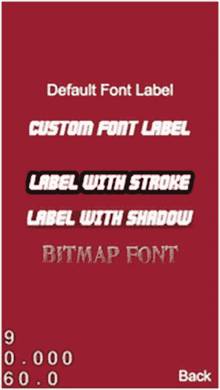
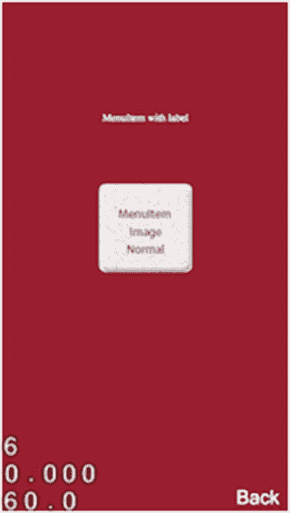
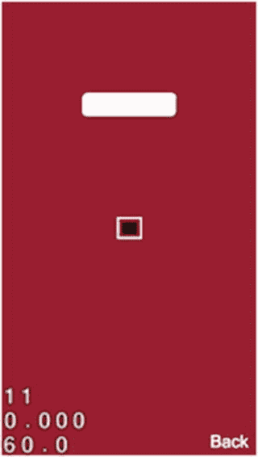

# 5. 添加图形用户界面

## 5.1 简介

图形用户界面是任何游戏的重要组成部分。它用于显示抬头显示、分数、所需的文本以及诸如播放和暂停之类的按钮。Cocos2d-js 拥有预定义的节点类型来表示这些图形用户界面元素。让我们逐一了解它们。

## 5.2 标签

如果您想在游戏中显示任何文本，可以使用 `Label` 对象。Cocos2d-js 提供了两种类型的标签。


### 5.2.1 使用 TrueType 字体标签

您可以定义使用自定义 TrueType 字体的标签。通常，这些字体的文件格式为 `.ttf`。在 Cocos2d-js 中，可以使用 `cc.LabelTTF` 类来创建此类标签。让我们看一下其语法：

*   `[string] text` - 表示您要显示的文本
*   `[string] fontName` - 表示已加载的 `.ttf` 字体名称
*   `[Number] fontSize` - 表示字体大小
*   `[cc.Size] dimensions` - 表示标签的宽度和高度；若未设置，则会自动计算
*   `hAlignment` - 表示标签内文本的水平对齐方式，可以是以下值之一：`{cc.TEXT_ALIGNMENT_LEFT | cc.TEXT_ALIGNMENT_CENTER | cc.TEXT_ALIGNMENT_RIGHT}`
*   `vAlignment` - 表示标签内文本的垂直对齐方式，可以是以下值之一：`{cc.VERTICAL_TEXT_ALIGNMENT_TOP|cc.VERTICAL_TEXT_ALIGNMENT_CENTER|cc.VERTICAL_TEXT_ALIGNMENT_BOTTOM}`

```
1   var label= new cc.LabelTTF(text, fontName, fontSize, dimensions, hAlignment, vAlignment);
```

所有这些值都可以使用相应的函数集进行动态更改。请参阅文档以获取有关这些函数的更多信息。您将在接下来的章节中看到实际示例。

### 5.2.2 使用位图字体标签

在位图字体中，每个字符都由一张图像表示。所有字符都应位于一个 png 文件中，而字体信息将存在于一个 `.fnt` 文件中。`cc.LabelBMFont` 类用于表示这种标签类型。让我们看一下其语法：

*   `[string] text` - 表示您要显示的文本
*   `[fntFile] fntFile` - 表示 `.fnt` 文件名
*   `[width] width` - 表示标签的宽度
*   `alignment` – 表示图像标签的水平对齐方式。可以是以下值之一：`{cc.TEXT_ALIGNMENT_LEFT|cc.TEXT_ALIGNMENT_CENTER|cc.TEXT_ALIGNMENT_RIGHT}`
*   `[cc.point] imageOffset` – 表示图像中心需要对齐的 x,y 偏移点

```
1   var label = new cc.LabelBMFont(text, fntFile, width, alignment, imageOffset)
```

### 5.2.3 示例

在 `src` 文件夹中，创建一个名为 `labeldemo.js` 的文件，并将以下代码复制其中：

```
1   var LabelDemoLayer = cc.Layer.extend({
2       sprite:null,
3       ctor:function () {
4           this._super();
5
6           var size = cc.winSize;
7
8           var colorLayer = new cc.LayerColor(cc.color(142,29,42));
9           this.addChild(colorLayer);
10
11           this.Label1 = new cc.LabelTTF('Default Font Label','', 32);
12           this.Label1.attr({
13               x: size.width / 2,
14               y: size.height / 1.3
15           });
16           this.addChild(this.Label1);
17
18           this.Label2 = new cc.LabelTTF('Custom Font Label','Abduction', 32);
19           this.Label2.attr({
20               x: size.width / 2,
21               y: size.height / 1.5
22           });
23           this.addChild(this.Label2);
24
25           this.Label3 = new cc.LabelTTF('Label With Stroke','Abduction', 32);
26           this.Label3.attr({
27               x: size.width / 2,
28               y: size.height / 1.9
29           });
30           this.Label3.enableStroke(cc.color(0,0,0),10);
31           this.addChild(this.Label3);
32
33           this.Label4 = new cc.LabelTTF('Label With Shadow','Abduction', 32);
34           this.Label4.attr({
35               x: size.width / 2,
36               y: size.height / 2.3
37           });
38           this.Label4.enableShadow(cc.color(0,0,0), 50, 50);
39           this.addChild(this.Label4);
40
41           this.Label5 = new cc.LabelBMFont("Bitmap Font", res.BM_Font);
42           this.Label5.attr({
43               x: size.width / 2,
44               y: size.height / 2.9
45           });
46           this.addChild(this.Label5);
47
48           return true;
49       }
50   });
```

像往常一样，执行步骤来运行这个层。让我们看看标签是如何使用的。首先，添加了 `cc.LayerColor` 作为子节点来设置背景颜色：

```
1   var colorLayer = new cc.LayerColor(cc.color(142,29,42));
2   this.addChild(colorLayer);
```

第一个标签使用文本 `'Default font name'` 创建，并将 `fontname` 指定为空字符串，以便标签回退到系统中的默认字体。

第二个标签使用加载的字体名称创建；在此示例中，我使用了 `Abduction.ttf`，它在 `resource.js` 中定义如下：

```
1   var res = {
2       .....
3       Custom_TTF:"res/Abduction.ttf",
4   .....
5   };
```

因此，在应用加载期间，该字体将与 `res` 对象中的其他资源一起加载到内存中：

```
1   this.Label2 = new cc.LabelTTF('Custom Font Label','Abduction', 32);
2   this.Label2.attr({
3      x: size.width / 2,
4      y: size.height / 1.5
5   });
6   this.addChild(this.Label2);
```

字体名称 `'Abduction'` 在第二个参数中指定。直接在标签中指定字体文件名将不起作用。

第三个标签使用相同的自定义字体 `'Abduction'`，不同之处在于它为标签启用了描边：

```
1   this.Label3.enableStroke(cc.color(0,0,0),10);
```

第一个参数是描边的颜色，第二个参数是描边大小。

第四个标签使用以下代码创建并启用了阴影：

```
1   this.Label4.enableShadow(cc.color(0,0,0), 50, 50);
```

这里，第一个参数是阴影的颜色，第二个参数是阴影相对于标签的偏移量，第三个参数是阴影大小。

最后，第五个标签使用位图字体创建：

```
1   this.Label5 = new cc.LabelBMFont("Bitmap Font", res.BM_Font);
2   this.Label5.attr({
3       x: size.width / 2,
4       y: size.height / 2.9
5   });
6   this.addChild(this.Label5);
```

与第二个标签类似，我在 `resource.js` 的第二个参数中直接指定了字体文件名 `BM_Font` 和 `BM_Font_Png`，如下所示：

```
1   var res = {
2       ....
3       BM_Font:"res/bitmapFontTest.fnt",
4       BM_Font_Png:"res/bitmapFontTest.png",
5       ....
6   };
```

如您所见，对于位图字体，相关的 `.png` 文件需要与 `.fnt` 文件一起加载。请参见图 5-1 中的标签示例。



图 5-1 Cocos2d-js 中的标签

## 5.3 菜单与菜单项

在 Cocos2d-js 中，有一个基于菜单的图形用户界面，由 `cc.Menu` 和 `cc.MenuItem` 定义，其中 `cc.MenuItem` 应是 `cc.Menu` 的子节点。`cc.MenuItem` 是一个抽象类，有三种可继承的菜单项类型。

### 5.3.1 MenuItemLabel（标签菜单项）

任何 `cc.Label` 实例都可以用于此菜单项类型。以下是其语法：

*   `[cc.Label] label` - `cc.Label` 的实例
*   `[string] selector` - 作为字符串的回调方法名称
*   `[object] target` - 拥有选择器函数的对象

```
1   var menuitemLabel = new cc.MenuItemLabel(label,selector,target);
```

### 5.3.2 MenuItemImage（图像菜单项）

图像可与该菜单项一起使用。以下是其语法：

*   `[string] normalImage` - 表示正常状态的图像文件路径
*   `[string] selectedImage` - 表示选中状态的图像文件路径
*   `[string] disabledImage` - 表示禁用状态的图像文件路径
*   `[string] selector` - 菜单项点击时的回调函数名称
*   `[object] target` - 拥有选择器回调函数的对象

```
1   var menuItem = new cc.MenuItemImage(normalImage, selectedImage, disabledImage, selector, target);
```

让我们来看一个示例。


### 5.3.3 示例

在 `src` 文件夹中，创建一个名为 `menuitem.js` 的文件，并将以下代码复制到其中：

```
1   var MenuDemoLayer = cc.Layer.extend({
2       sprite:null,
3       ctor:function () {
4           this._super();
6           var size = cc.winSize;
8           var colorLayer = new cc.LayerColor(cc.color(142,29,42));
9           this.addChild(colorLayer)
11           this.Menu=new cc.Menu();
12           this.Menu.attr({
13               x: 0,
14               y: 0
15           });
17           //带标签的菜单项
18           var label=new cc.LabelTTF('MenuItem with label',36);
19           this.MenuItem1 = new cc.MenuItemLabel(label,'onMenuClicked',this);
20           this.MenuItem1.attr({
21               x: size.width / 2,
22               y: size.height / 1.3
23           });
24           this.Menu.addChild(this.MenuItem1);
26           //带图片的菜单项
27           this.MenuItem2 = new cc.MenuItemImage(res.MenuItemImage_Normal,res.MenuI\
28   temImage_Selected,null,'onMenuClicked',this);
29           this.MenuItem2.attr({
30               x: size.width / 2,
31               y: size.height / 1.8
32           });
33           this.Menu.addChild(this.MenuItem2);
35           this.addChild(this.Menu);
36           return true;
37       },
38       onMenuClicked:function(){
40       }
41   });
```

首先，在最后一条语句中创建了一个 `cc.Menu` 实例并添加到该层中：

```
1   this.Menu=new cc.Menu();
2   ......
3   ......
4   this.addChild(this.Menu);
```

之后，创建所有菜单项实例，并将它们作为子节点添加到 `this.Menu` 中。第一个 `menuitem` 是使用 `cc.Label` 实例创建的，如下所示：

```
1   var label=new cc.LabelTTF('MenuItem with label',36);
2   this.MenuItem1 = new cc.MenuItemLabel(label,'onMenuClicked',this);
```

随后对其进行定位，并作为子节点添加到 `this.Menu`。第二个 `MenuItemImage` 是使用两张图片创建的：即正常状态和选中状态的图片。参考如下：

```
1   this.MenuItem2 = new cc.MenuItemImage(res.MenuItemImage_Normal,res.MenuItemImage\
2   _Selected,null,'onMenuClicked',this);
```

与之前的示例类似，本层中添加了 `LayerColor`，因此输出结果将如图 5-2 所示。



**图 5-2.** `MenuItem`

## 5.4 其他 GUI 元素

除了菜单和标签之外，扩展模块中还提供了其他 GUI 元素，例如复选框和按钮。为了使用扩展类，我们需要将扩展模块添加到项目中。在 `project.json` 文件的 `modules` 属性中，将 `'extension'` 添加到数组中：

```
1   "modules" : ["cocos2d","extensions"],
```

这些额外的用户界面元素位于父对象 `ccui` 之下。让我们来看一下。在 `src` 文件夹中，创建一个名为 `otheruidemo.js` 的文件，并将以下代码复制到其中：

```
1   var OtherUIDemoLayer = cc.Layer.extend({
2       sprite:null,
3       ctor:function () {
4           this._super();
6           var size = cc.winSize;
8           var colorLayer = new cc.LayerColor(cc.color(142,29,42));
9           this.addChild(colorLayer)
11           this.uiButton = new ccui.Button(res.ButtonImage,res.ButtonImage_Selected\
12   );
13           this.uiButton.attr({
14               x:size.width/2,
15               y:size.height/1.3
16           });
17           this.addChild(this.uiButton);
19           this.uiCheckBox = new ccui.CheckBox(res.CheckBox_Normal,res.CheckBox_Sel\
20           ected);
21           this.uiCheckBox.attr({
22               x:size.width/2,
23               y:size.height/2
24           });
25           this.addChild(this.uiCheckBox);
27           return true;
28       }
29   });
```

在这段代码中，使用正常和选中状态的图片创建了一个 `button` 实例：

```
1   this.uiButton = new ccui.Button(res.ButtonImage,res.ButtonImage_Selected);
```

同时，也使用了正常和选中状态的图片创建了一个 `checkBox` 实例：

```
1   this.uiCheckBox = new ccui.CheckBox(res.CheckBox_Normal,res.CheckBox_Selected);
```

如果运行上述层，输出结果将如图 5-3 所示。



**图 5-3.** 其他 GUI 元素

