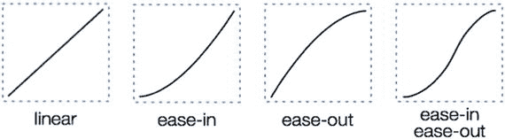

# 6. 动画乐趣

## 6.1 简介

动画对于任何优秀的游戏都至关重要，它能让你的游戏看起来很酷且具有视觉吸引力，并有助于你获取更多用户。一款具有视觉吸引力的游戏本身就是一种营销。花点时间看看 Google Play 和 App Store 中收入最高的游戏。顶级游戏使用清晰且细节丰富的动画来改善用户体验并吸引用户。深呼吸，我们将要探讨 Cocos2d-js 中动画系统的细节。让我们开始吧。

## 6.2 动作

动作是 Cocos2d-js 中用于动画化精灵的构造。动作随时间改变精灵的属性，从而使精灵按照我们想要的方式运动。有几种可用的动作类型，用于在精灵上为所有实时场景应用动画。让我们看一个简单的例子：

```
1   var action = cc.moveBy(2, cc.p(size.width - 40, size.height - 40));
2   this.sprite.runAction(action);
```

在这个例子中，`action` 对象是使用 `cc.moveBy` 函数创建的。任何动作都可以使用 `runAction` 方法在精灵上运行。这个方法实际上属于 `cc.Node`，因此除了精灵之外，我们还可以动画化任何以 `cc.Node` 为父节点或最终父节点（即层、场景等）的对象。基本上，创建动作有两种变体。

### 6.2.1 By 和 To 动作

前面的代码是 `By` 变体的一个例子。让我们看一下同一个例子的 `To` 变体：

```
1   var action = cc.moveTo(2, cc.p(size.width - 40, size.height - 40));
2   this.sprite.runAction(action);
```

`By` 和 `To` 动作之间的唯一区别是：`To` 会将目标属性值动画化为绝对值，而 `By` 会将目标属性值动画化为相对值（例如：如果你有一个精灵位于 (10,10) 位置，并且你使用 `moveBy` 动作以 (5,5) 的值对其进行动画化，动画结束后精灵的最终位置将是 (15,15)；如果是 `moveTo` 动作，最终位置将是 (5,5)）。

## 6.3 可用动作列表

以下是你可以应用于任何节点的可用动作列表。列出的组合包括 `By` 和 `To` 变体，你可以使用简单的精灵图片进行尝试。

### 6.3.1 移动

此动作用于动画化任何节点实例的 x,y 位置：

```
1   var action = cc.moveBy(2, cc.p(size.width - 40, size.height - 40));
2   var action = cc.moveTo(2, cc.p(size.width - 40, size.height - 40));
```

第一个参数是持续时间，第二个参数是目标点坐标。

### 6.3.2 跳跃

此动作用于以抛物线的方式动画化节点的 x,y 位置，使其看起来像是在跳跃：

```
1   var action = new cc.JumpBy(2, cc.p(300, 0), 50, 4);
2   var action = new cc.JumpBy(2, 300, 0, 50, 4);
```

与所有动作一样，第一个参数是持续时间。第二个参数是一个点或数字，表示目标值（可以是 x 或 (x,y)）。如果它是一个点，那么第三个参数被视为高度；如果它是一个数字，那么第三个参数被视为 y 值。接下来的两个参数分别表示高度和跳跃次数。因此在这种情况下，(x,y) 和高度分别代表抛物线的宽度和高度。


### 6.3.3 旋转

该动作用于通过随时间**旋转**属性来制作节点的旋转动画：

```
1   var action = new cc.RotateBy(2, 360);
2   var action = new cc.RotateTo(2, 360);
```

第一个参数是持续时间，第二个参数是 `angleX`，表示绕 X 轴旋转。第三个参数 `angleY` 是可选的，用于在少数情况下进行 Y 轴旋转。

### 6.3.4 缩放

该动作用于制作节点的缩放动画。它使用节点的 `scale` 函数在指定的持续时间内缩放节点：

```
1   var action = new cc.ScaleTo(2, 0.5, 2);
2   var action = new cc.ScaleBy(2, 0.5, 2);
```

第一个参数是持续时间，第二和第三个参数分别是 sx、sy，即 `scaleX` 和 `scaleY` 的值。

### 6.3.5 倾斜

该动作类似于缩放，但它使用 `skewX` 和 `skewY` 的值来制作倾斜动画：

```
1   var action = new cc.SkewTo(2, 37.2, -37.2);
2   var action = new cc.SkewBy(2, 37.2, -37.2);
```

参数与缩放动作相同。

### 6.3.6 色调

该动作用于制作节点 RGB 通道的动画。此动作仅有 `By` 版本：

```
1   var action = new cc.TintBy(2, -127, -255, -127);
```

第一个参数是持续时间，接下来的三个参数分别是 `deltaR`、`deltaB` 和 `deltaG` 的值。

### 6.3.7 贝塞尔曲线

该动作用于让目标对象沿着贝塞尔曲线移动：

```
1   var bezier = [cc.p(0, windowSize.height / 2), cc.p(300, -windowSize.height / 2),\
2   cc.p(300, 100)];
3   var bezierForward = new cc.BezierBy(3, bezier);
4   var bezierTo = new cc.BezierTo(3, bezier);
```

第一个参数是持续时间，第二个参数是一个数组，其中包含定义贝塞尔曲线的一系列点。

### 6.3.8 基数样条

这与贝塞尔曲线类似。目标对象将沿着基数样条曲线移动。通常，当你想模拟精灵在路径数据（即一系列连续点）上移动时，会使用此动作。示例如下：

```
1   var action = cc.cardinalSplineTo(3, array, 0);
2   var action = cc.cardinalSplineTo(3, array, 0);
```

参数与贝塞尔曲线相同；不过，它还有第三个参数，表示张力或两点之间的权重，并计算从一个点移动到另一个点的持续时间。

## 6.4 缓动

默认情况下，所有随时间线性改变节点属性的动作都称为线性插值。这样的动画看起来比较生硬。当你想要为动画添加更生动的效果时，就需要使用缓动函数。参见图 6-1。



图 6-1. 线性与缓动

如图所示，第一张图是线性的，这是所有动作默认使用的模式。另外三张图则展示了不同的缓动函数。在 Cocos2d-js 中，共有超过 26 种缓动类型。对于所有缓动函数，使用方法都是一样的。让我们看一个例子：

```
1   var easing=cc.easeBackIn();
2   //或者
3   var easing=new cc.EaseBackIn();
4   action.easing(easing);
```

非常简单！在这个例子中，我使用了 `EaseBackIn` 类来创建缓动对象，或者你也可以使用单例 `cc.easeBackIn` 对象来作用于你的动作。我更喜欢前一种方式。让我们看看 Cocos2d-js 中可用的缓动函数列表。记住：所有缓动函数的使用方式相同。

*   `cc.EaseBackIn`
*   `cc.EaseBackInOut`
*   `cc.EaseBackOut`
*   `cc.EaseBezierAction`
*   `cc.EaseBounce`
*   `cc.EaseBounceIn`
*   `cc.EaseBounceInOut`
*   `cc.EaseBounceOut`
*   `cc.EaseCircleActionIn`
*   `cc.EaseCircleActionInOut`
*   `cc.EaseCircleActionOut`
*   `cc.EaseCubicActionIn`
*   `cc.EaseCubicActionInOut`
*   `cc.EaseCubicActionOut`
*   `cc.EaseElastic`
*   `cc.EaseElasticIn`
*   `cc.EaseElasticInOut`
*   `cc.EaseElasticOut`
*   `cc.EaseExponentialIn`
*   `cc.EaseExponentialInOut`
*   `cc.EaseExponentialOut`
*   `cc.EaseQuadraticActionIn`
*   `cc.EaseQuadraticActionInOut`
*   `cc.EaseQuadraticActionOut`
*   `cc.EaseQuarticActionIn`
*   `cc.EaseQuarticActionInOut`
*   `cc.EaseQuarticActionOut`
*   `cc.EaseQuinticActionIn`
*   `cc.EaseQuinticActionInOut`
*   `cc.EaseQuinticActionOut`
*   `cc.EaseRateAction`
*   `cc.EaseIn`
*   `cc.EaseInOut`
*   `cc.EaseOut`
*   `cc.EaseSineIn`
*   `cc.EaseSineInOut`
*   `cc.EaseSineOut`

这个列表能满足你所有的缓动需求。所有这些缓动都派生自基类 `cc.ActionEase`。

## 6.5 序列

假设我有两个或更多的动作需要在一个节点上一个接一个地执行。`Sequence` 可以帮助我们实现这一点。让我们看一个例子：

```
1   var seq = new cc.Sequence([action1,action2]);
2   this.sprite.runAction(seq);
```

`cc.Sequence` 接受两种参数类型：一种是动作数组，另一种将在本节稍后讨论。它可以像其他任何动作一样，使用节点的 `runAction` 函数来运行。

### 6.5.1 反转序列

一旦创建了 `sequence` 对象，它就可以被反转并在任何节点上运行，如下所示：

```
1   this.sprite.runAction(seq.reverse());
```

`reverse` 函数会将 `sequence` 中的动作顺序反转，并返回一个新的 `sequence` 实例。

### 6.5.2 重复序列

一旦创建了 `sequence` 对象，我们可以将动作重复有限次数，也可以无限重复。示例如下：

```
1   //重复序列 5 次
2   this.sprite.runAction(seq.repeat(5));

4   //永远重复序列
5   this.sprite.runAction(seq.repeatForever());
```

`sequence` 的 `repeat` 和 `repeatForever` 函数正是用于此目的。

### 6.5.3 动作结束回调

可以在 `sequence` 对象中为每个动作附加一个 `结束回调` 函数。让我们看一个例子：

```
1   var seq=new cc.Sequence(action1,cc.callFunc(function(){/*action1 结束回调*/}\
2   ,this),
3   action2,cc.callFunc(function(){/*action2 结束回调*/}\
4   ,this));
```

如前所述，`Sequence` 接受两种参数类型。一种是动作数组，另一种是一系列的动作及其动作结束回调，就像刚刚看到的那样。

## 6.6 同步执行

在某些情况下，你需要在一个节点上同时执行两个或更多的动作。`cc.Spawn` 就是为此目的而设计的：

```
1   var spaw=new cc.Spawn([action1,action2]);
2   this.sprite.runAction(spaw);
```

如你所见，其语法与 `Sequence` 类似。它接受一个动作数组，这些动作将被同时执行。请谨慎同时执行多个动作，如果使用不当，可能会产生奇怪的效果。

## 6.7 停止一个动作

任何正在运行的动作都可以被停止。节点的 `stopAction` 函数正是用于此目的：

```
1   sprite.stopAction(action);
```

这会立即停止该动作，无论其状态如何。你可以将其用于用户交互或任何需要立即停止动作的动态触发器。

## 6.8 精灵帧动画

在第 3 章中，我们了解了如何使用精灵表进行精灵帧动画。那一章更侧重于精灵本身，而本节将从动画角度对此进行详细解释。精灵中的每一个图像部分都可以使用带有 `rect` 坐标的 `SpriteFrame` 进行分类。`cc.Animation` 类可用于在精灵上执行精灵帧动画序列。让我们看一个例子：

```
1   var animation = new cc.Animation(spriteFrames, 0.08);
2   this.sprite.runAction(cc.animate(animation).repeatForever()); //或者也可以使用 new cc.Animat\
3   ion(..) 模式。
```

第一个参数是 `cc.SpriteFrame` 实例的数组，第二个参数是延迟时间。与 `Action` 类一样，它也有 `repeat` 和 `repeatForever` 函数。


### 6.9 调度器与更新

在 Cocos2d-js 中，存在一个更新循环，即主运行循环；每个 `cc.Node` 都能够接收更新通知，但节点必须订阅该通知。这种订阅机制在实现时考虑了性能因素。

在 `cc.Node` 的构造函数中，需要调用以下方法：

```
this.scheduleUpdate();
```

完成此操作后，便可以在其中定义一个名为 `update` 的方法：

```
update:function(dt) {

}
```

现在，我们使用 `update` 来制作一个动画。首先，按照前面示例所述创建一个图层和演示场景，然后在场景中添加一个精灵：

```
this.sprite = new cc.Sprite(res.Sprite_Image);
this.sprite.attr({
    x: size.width / 2,
    y: size.height / 2
});
this.addChild(this.sprite, 0);
```

我们打算让这个精灵以乒乓运动的方式从左向右移动。为此，我们需要一个 `seed` 值：

```
this.seed=10;
```

接着，定义我们的 `update` 方法并让精灵动起来：

```
update:function(dt) {
  if(this.sprite.getPositionX()>cc.winSize.width){
    this.seed=-10;
  } else if(this.sprite.getPositionX()<0) {
    this.seed=10;
  }
  this.sprite.setPositionX(this.sprite.getPositionX()+this.seed);
}
```

至此，完整的代码应如下所示：

```
var SchedulersLayer = BaseSampleLayer.extend({
    sprite:null,
    ctor:function () {
        this._super();
        var size = cc.winSize;
        this.sprite = new cc.Sprite(res.Sprite_Image);
        this.sprite.attr({
            x: size.width / 2,
            y: size.height / 2
        });
        this.seed=10;
        this.addChild(this.sprite, 0);
        this.scheduleUpdate();
    },
    update:function(dt) {
      if(this.sprite.getPositionX()>cc.winSize.width){
        this.seed=-10;
      } else if(this.sprite.getPositionX()<0) {
        this.seed=10;
      }
      this.sprite.setPositionX(this.sprite.getPositionX()+this.seed);
    }
});
```

输出效果应为一个精灵左右来回重复移动。详见图 6-2。


图 6-2. 调度器与更新

