# 7. 为你的游戏添加物理效果

## 7.1 简介

在基于物理的游戏中，模拟真实世界的物理效果非常重要。如今市面上有多种物理引擎。对于 Cocos2d-js 来说，最流行的当属 Chipmunk 物理引擎。该引擎最初用 C 语言编写，后来被移植到各种平台。尽管你可以将其他游戏引擎与 Cocos2d-js 配合使用，但我们强烈推荐 Chipmunk 引擎。它是 Cocos2d-x 的原生物理引擎。

## 7.2 Chipmunk 概述

物理学的核心在于以正确的方式改变精灵的 x、y 坐标和旋转角度，使其看起来像物理模拟。你的游戏世界与物理空间之间有着明确的分离。详见图 7-1。

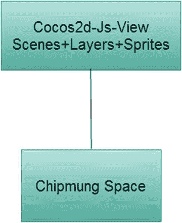

图 7-1. Cocos2d-js 与 Chipmunk 的关系

所有物理主体及其行为都在 Chipmunk 空间中定义，而来自 Cocos2d-js 图层的精灵则映射到这些主体。物理模拟将在 Chipmunk 空间内基于与对应精灵的关系映射进行。Chipmunk 会根据物理空间中的主体来更新这些精灵的 x、y 坐标和旋转角度。让我们在图 7-2 中了解基础知识。

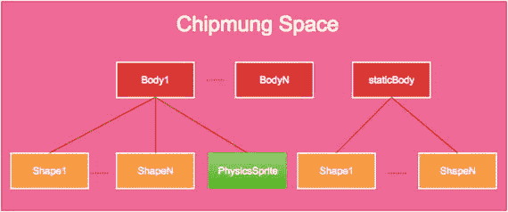

图 7-2. Chipmunk 概述

物理模拟在 Chipmunk 空间内部进行，物理主体在此被赋予物理属性；这些主体将拥有定义的形状，可以是盒子、圆形或多边形。每个 Chipmunk 空间都会有一个默认的 `staticBody` 作为其子对象，添加到该默认主体上的形状不会受物理属性影响，是静态物体，例如墙壁或障碍物等。所有主体都将与 `PhysicsSprite` 关联，`PhysicsSprite` 包含你的精灵图像，该精灵的位置和旋转将由与之关联的物理主体决定。在接下来的示例中，我们将创建一个 Chipmunk 空间，为四个边界添加墙壁，并向空间中添加两个主体（一个盒子和一个圆形）。然后，我们将观察模拟效果。

## 7.3 Chipmunk 空间

首先，你需要在你的 `project.json` 文件中包含 Chipmunk 模块：

```json
"modules" : ["cocos2d",....,"chipmunk"]
```

让我们看看如何创建这个空间：

```javascript
initPhysics:function() {
    //初始化空间
    this.space = new cp.Space();

    //设置重力
    this.space.gravity = cp.v(0, -800); //地球重力
    this.space.iterations = 30;
    this.space.sleepTimeThreshold = Infinity;
    this.space.collisionSlop = Infinity;
}
```

这个 `initPhysics` 函数将被放置在 `layer` 对象内部；也就是说，`initPhysics` 将是 `layer` 对象的属性之一。`cp.Space` 类用于创建空间，同时设置 `gravity`、`iterations`、`sleepTimeThreshold` 和 `collisionSlop` 为合适的值。

```javascript
update:function (dt) {
    this.space.step(dt);
},
```

物理模拟由 `step` 方法驱动，该方法在 `layer` 的 `update` 循环中持续被触发。

## 7.4 Chipmunk 主体

物理对象由主体定义；主体具有形状，并与精灵数据相关联。现在，让我们向已创建的 Chipmunk 空间添加一个圆形和一个盒子：

```javascript
addPhysicsCircle: function() {
    var width=50,height=50,mass=1;

    this.phBodyCircle = this.space.addBody(new cp.Body(mass, cp.momentForCircle(mass,0,width*0.5,cc.p(0,0))));
    this.phBodyCircle.setPos(cc.p(cc.winSize.width * 0.5, cc.winSize.height * 0.3));

    //#4
    var phShape = this.space.addShape(new cp.CircleShape(this.phBodyCircle, width, cc.p(0, 0)));
    phShape.setFriction(0);
    phShape.setElasticity(1);
    phShape.setCollisionType(0);
},

addPhysicsBox: function() {
    var width=50,height=50,mass=1;
    this.phBodyBox = this.space.addBody(new cp.Body(mass, cp.momentForBox(mass, width,height)));
    this.phBodyBox.setPos(cc.p(cc.winSize.width * 0.5, cc.winSize.height * 0.1));

    //#4
    var phShape = this.space.addShape(new cp.BoxShape(this.phBodyBox, width, height));
    phShape.setFriction(0);
    phShape.setElasticity(1);
    phShape.setCollisionType(1);
}
```

如你所见，圆形和盒子主体是通过 `cp.Body` 并传入 `mass` 和 `momentum` 对象创建的，并且使用 `cp.CircleShape` 和 `cp.BoxShape` 为每个主体定义了形状。这实际上在物理模拟中扮演着重要角色，基于碰撞的物理运动正是依赖于这些形状对象。

### 7.5 Chipmunk 静态刚体

Chipmunk 空间会包含一个单独的静态刚体。通常，这个 `staticBody` 用于定义物理边界和静态形状，例如墙壁。

## 创建边界

为了创建边界，Chipmunk 提供了 `cp.SegmentShape`，用于创建顶部、底部、左侧和右侧的墙壁，这些墙壁会被添加到空间的默认静态刚体上，这样重力和其它力就不会影响这个形状。

```javascript
addWallsAndGround: function() {
    var leftWall = new cp.SegmentShape(this.space.staticBody, new cp.v(0, 0), new cp.v(0, 1000000), WALLS_WIDTH);
    leftWall.setElasticity(WALLS_ELASTICITY);
    leftWall.setFriction(WALLS_FRICTION);
    this.space.addStaticShape(leftWall);

    var rightWall = new cp.SegmentShape(this.space.staticBody, new cp.v(cc.winSize.width, 1000000), new cp.v(cc.winSize.width, 0), WALLS_WIDTH);
    rightWall.setElasticity(WALLS_ELASTICITY);
    rightWall.setFriction(WALLS_FRICTION);
    this.space.addStaticShape(rightWall);

    var bottomWall = new cp.SegmentShape(this.space.staticBody, new cp.v(0, 0), new cp.v(cc.winSize.width, 0), WALLS_WIDTH);
    bottomWall.setElasticity(WALLS_ELASTICITY);
    bottomWall.setFriction(WALLS_FRICTION);
    this.space.addStaticShape(bottomWall);

    var upperWall = new cp.SegmentShape(this.space.staticBody, new cp.v(0, cc.winSize.height), new cp.v(cc.winSize.width, cc.winSize.height), WALLS_WIDTH);
    upperWall.setElasticity(WALLS_ELASTICITY);
    upperWall.setFriction(WALLS_FRICTION);
    this.space.addStaticShape(upperWall);
}
```

### 7.6 物理调试节点

一个物理刚体由包含多边形数据的形状组成。你必须将一个 `PhysicsSprite` 附加到刚体上，才能看到物理刚体的运动；如果没有这样做，你可以通过一个名为 `PhysicsDebugNode` 的对象，将其添加到层中，以便在没有精灵的情况下看到多边形。在前面的方形和圆形例子中，`PhysicsSprite` 没有被添加，因此我们将依赖 `PhysicsDebugNode`：

```javascript
setupDebugNode : function()
{
    this._debugNode = new cc.PhysicsDebugNode(this.space);
    this.addChild( this._debugNode );
}
```

现在，无需添加 `PhysicsSprite`，圆形和方形的多边形数据就会在屏幕上可见。

### 7.7 碰撞检测

Chipmunk 能够检测物理刚体之间的碰撞。每个物理刚体都必须用 `setCollisionType` 进行标记，这样它才能在碰撞检测中被识别：

```javascript
addCollisionCallBack:function(){
    // 0 和 1 是方形和圆形的标记
    this.space.addCollisionHandler(0, 1, function(){
        cc.log('方形和圆形发生碰撞！');
        return true;
    }, null, null, null);
}
```

如你所见，`addCollisionHandler` 函数使用了方形和圆形的标记 0 和 1，用于检测这两个物体之间的任何碰撞。

### 7.8 整合所有内容

最后，是时候将所有内容整合在一起了。在层的构造函数中，包含以下代码：

```javascript
this.initPhysics();
this.setupDebugNode();
this.addWallsAndGround();
this.addPhysicsCircle();
this.addPhysicsBox();
this.addCollisionCallBack();
this.scheduleUpdate();
```

除了 `scheduleUpdate` 之外的所有函数都已经定义好了。`scheduleUpdate` 函数是一个节点函数，它使节点能够包含其 update 方法，以便在绘制循环中触发。最后，你将看到类似以下内容的输出：

```javascript
var g_groundHeight = 57;
var g_runnerStartX = 80;
var WALLS_WIDTH = 5;
var WALLS_ELASTICITY = 1;
var WALLS_FRICTION = 1;

var ChipmungDemoLayer = BaseSampleLayer.extend({
    sprite:null,
    ctor:function () {
        this._super();
        this.initPhysics();
        this.setupDebugNode();
        this.addWallsAndGround();
        this.addPhysicsCircle();
        this.addPhysicsBox();
        this.addCollisionCallBack();
        this.scheduleUpdate();
        return true;
    },
    initPhysics:function() {
        //初始化空间
        this.space = new cp.Space();
        //设置重力
        this.space.gravity = cp.v(0, -800); //地球重力
        this.space.iterations = 30;
        this.space.sleepTimeThreshold = Infinity;
        this.space.collisionSlop = Infinity;
    },
    addCollisionCallBack:function(){
        // 0 和 1 是方形和圆形的标记
        this.space.addCollisionHandler(0, 1, function(){
           cc.log('方形和圆形发生碰撞！');
           return true;
        }, null, null, null);
    },
    update:function (dt) {
        this.space.step(dt);
    },
    addWallsAndGround: function() {
        var leftWall = new cp.SegmentShape(this.space.staticBody, new cp.v(0, 0), new cp.v(0, 1000000), WALLS_WIDTH);
        leftWall.setElasticity(WALLS_ELASTICITY);
        leftWall.setFriction(WALLS_FRICTION);
        this.space.addStaticShape(leftWall);

        var rightWall = new cp.SegmentShape(this.space.staticBody, new cp.v(cc.winSize.width, 1000000), new cp.v(cc.winSize.width, 0), WALLS_WIDTH);
        rightWall.setElasticity(WALLS_ELASTICITY);
        rightWall.setFriction(WALLS_FRICTION);
        this.space.addStaticShape(rightWall);

        var bottomWall = new cp.SegmentShape(this.space.staticBody, new cp.v(0, 0), new cp.v(cc.winSize.width, 0), WALLS_WIDTH);
        bottomWall.setElasticity(WALLS_ELASTICITY);
        bottomWall.setFriction(WALLS_FRICTION);
        this.space.addStaticShape(bottomWall);

        var upperWall = new cp.SegmentShape(this.space.staticBody, new cp.v(0, cc.winSize.height), new cp.v(cc.winSize.width, cc.winSize.height), WALLS_WIDTH);
        upperWall.setElasticity(WALLS_ELASTICITY);
        upperWall.setFriction(WALLS_FRICTION);
        this.space.addStaticShape(upperWall);
    },
    setupDebugNode : function() {
        this._debugNode = new cc.PhysicsDebugNode(this.space);
        this.addChild( this._debugNode );
    },
    addPhysicsCircle: function() {
        var width=50,height=50,mass=1;
        this.phBodyCircle = this.space.addBody(new cp.Body(mass, cp.momentForCircle(mass,0,width*0.5,cc.p(0,0))));
        this.phBodyCircle.setPos(cc.p(cc.winSize.width * 0.5, cc.winSize.height * 0.3));
        //#4
        var phShape = this.space.addShape(new cp.CircleShape(this.phBodyCircle, width, cc.p(0, 0)));
        phShape.setFriction(0);
        phShape.setElasticity(1);
        phShape.setCollisionType(0);
    },
    addPhysicsBox: function() {
        var width=50,height=50,mass=1;
        this.phBodyBox = this.space.addBody(new cp.Body(mass, cp.momentForBox(mass, width,height)));
        this.phBodyBox.setPos(cc.p(cc.winSize.width * 0.5, cc.winSize.height * 0.1));
        //#4
        var phShape = this.space.addShape(new cp.BoxShape(this.phBodyBox, width, height));
        phShape.setFriction(0);
        phShape.setElasticity(1);
        phShape.setCollisionType(1);
    }
});
```

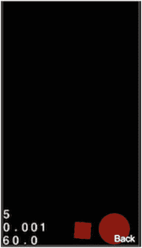

图 7-3. 物理演示

### 7.9 关节

关节（Joints）实质上就是将两个物理体通过锚点连接起来，或使其关联某种物理行为。在现实世界中，从手机到汽车，我们所接触的一切事物都是由不同部件通过关节和钉子连接而成的集合体。Chipmunk 物理体也是如此。Chipmunk 提供了多种不同类型的关节，如下所示：

- 销关节（Pin Joint）
- 滑动关节（Slide Joint）
- 枢轴关节（Pivot Joint）
- 槽型关节（Groove Joint）
- 阻尼弹簧（Damped Spring）
- 阻尼旋转弹簧（Damped Rotary Spring）
- 旋转限位关节（Rotary Limit Joint）
- 简易马达（Simple Motor）
- 齿轮关节（Gear Joint）
- 棘轮关节（Ratchet Joint）

我们将通过示例逐一介绍上述所有关节，但在开始之前，需要先了解一些在所有示例中都会用到的公共函数。让我们来看一下：

```
1   addBottomWall: function() {
2     var bottomWall = new cp.SegmentShape(this.space.staticBody, new cp.v(0, 0),
3     new cp.v(cc.winSize.width, 0), 5);
4     bottomWall.setElasticity(1);
5     bottomWall.setFriction(1);
6     this.space.addStaticShape(bottomWall);
7   }
```

该函数用于向 Chipmunk 空间添加底部墙壁，以防止物理体掉落到屏幕下方。该墙壁由 `SegmentShape` 构成，并被添加到 Chipmunk 空间的静态体上。

```
1   addPhysicsCircle: function(pos) {
2     var width=50,height=50,mass=1;
4     var phBodyCircle = this.space.addBody(new cp.Body(mass,
5     cp.momentForCircle(mass,0,width*0.5,cc.p(0,0))));
6     phBodyCircle.setPos(pos);
8     var phShape = this.space.addShape(new cp.CircleShape(phBodyCircle, width, \
9     cc.p(0, 0)));
10     phShape.setFriction(0);
11     phShape.setElasticity(1);
12     phShape.setCollisionType(0);
14     return phBodyCircle;
15  }
```

上述函数用于向空间添加一个圆形物理体，并返回该物理体，以便我们为其添加约束。

```
1   addPhysicsBox: function(pos) {
2     var width=50,height=50,mass=1;
3     var phBodyBox = this.space.addBody(new cp.Body(mass,
4     cp.momentForBox(mass, width,height)));
5     phBodyBox.setPos(pos);
7     var phShape = this.space.addShape(new cp.BoxShape(phBodyBox, width, height\
8   ));
9     phShape.setFriction(0);
10     phShape.setElasticity(1);
11     phShape.setCollisionType(1);
13     return phBodyBox;
14  }
```

该函数用于向空间添加一个盒子形状的物理体，并返回该物理体以用于施加约束。

```
1   this.space.addConstraint(constrainObj);
```

通过约束，我们在空间中的两个物理体之间建立物理关系。所有列出的约束都将使用此方法。我们假定你会为每个关节示例创建单独的层；不过，我们在每个关节示例的末尾都提供了包含该层的完整源代码。下面让我们来了解关节。

#### 7.9.1 销关节

销关节实质上就是将两个物理体通过各自的锚点连接起来。例如，考虑两个物理体 `bodyA` 和 `bodyB`，以及它们对应的锚点 `anchorA` 和 `anchorB`；这些锚点以物理体空间坐标给出。这些锚点之间的距离在关节创建时确定，并在整个空间模拟过程中保持不变。现实世界的例子是：想象一个由活塞驱动的轮子；轮子和活塞通过一根连杆连接，连杆驱动轮子。连杆的长度保持不变。

让我们来看一个示例。首先，进行初始设置：

```
1   this.initPhysics();
2   this.setupDebugNode();
3   this.addBottomWall();
```

在 Chipmunk 空间中，使用前面介绍的方法添加两个物理体：一个盒子和一个圆形：

```
1   var bodyA = this.addPhysicsCircle(cc.p(cc.winSize.width * 0.25,
2   cc.winSize.height * 0.3));
4   var bodyB = this.addPhysicsBox(cc.p(cc.winSize.width * 0.75,
5   cc.winSize.height * 0.3));
```

然后，用销关节连接 `bodyA` 和 `bodyB`，并将其添加到约束中：

```
1   var pinJoint = new cp.PinJoint(bodyA, bodyB, cc.p(50,0), cc.p(25,0));
2   this.space.addConstraint(pinJoint);
```

`PinJoint` 类的构造函数有四个参数：

- `bodyA` - 要连接的第一个物理体
- `bodyB` - 要连接的第二个物理体
- `anchorA` - `bodyA` 上的锚点
- `anchorB` - `bodyB` 上的锚点

完整的层源代码如下所示：

```
var PinJointLayer = BaseSampleLayer.extend({
    sprite:null,
    ctor:function () {
        this._super();
        this.initPhysics();
        this.setupDebugNode();
        this.addBottomWall();
        var bodyA = this.addPhysicsCircle(cc.p(cc.winSize.width * 0.25, cc.winSize.height * 0.3));
        var bodyB = this.addPhysicsBox(cc.p(cc.winSize.width * 0.75, cc.winSize.height * 0.3));
        var pinJoint = new cp.PinJoint(bodyA, bodyB, cc.p(50,0), cc.p(25,0));
        this.space.addConstraint(pinJoint);
        this.scheduleUpdate();
        return true;
    },
    initPhysics:function() {
        //初始化空间
        this.space = new cp.Space();
        //设置重力
        this.space.gravity = cp.v(0, -800); //地球重力
        this.space.iterations = 30;
        this.space.sleepTimeThreshold = Infinity;
        this.space.collisionSlop = Infinity;
    },
    update:function (dt) {
        this.space.step(dt);
    },
    addBottomWall: function() {
        var bottomWall = new cp.SegmentShape(this.space.staticBody,
            new cp.v(0, 0), new cp.v(cc.winSize.width, 0), 5);
        bottomWall.setElasticity(1);
        bottomWall.setFriction(1);
        this.space.addStaticShape(bottomWall);
    },
    setupDebugNode : function()
    {
        this._debugNode = new cc.PhysicsDebugNode(this.space);
        this.addChild( this._debugNode );
    },
    addPhysicsCircle: function(pos) {
        var width=50,height=50,mass=1;
        var phBodyCircle = this.space.addBody(new cp.Body(mass,
            cp.momentForCircle(mass,0,width*0.5,cc.p(0,0))));
        phBodyCircle.setPos(pos);
        var phShape = this.space.addShape(new cp.CircleShape(phBodyCircle, width, cc.p(0, 0)));
        phShape.setFriction(0);
        phShape.setElasticity(1);
        phShape.setCollisionType(0);
        return phBodyCircle;
    },
    addPhysicsBox: function(pos) {
        var width=50,height=50,mass=1;
        var phBodyBox = this.space.addBody(new cp.Body(mass, cp.momentForBox(mass, width,height)));
        phBodyBox.setPos(pos);
        var phShape = this.space.addShape(new cp.BoxShape(phBodyBox, width, height));
        phShape.setFriction(0);
        phShape.setElasticity(1);
        phShape.setCollisionType(1);
        return phBodyBox;
    }
});
```

你将看到如图 7-4 所示的输出结果。

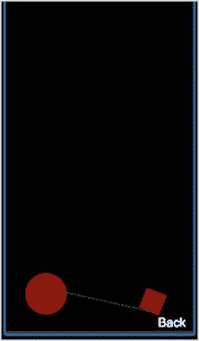

图 7-4. 销关节

#### 7.9.2 滑动关节

与销关节类似，两个物理体可以通过锚点以滑动关节连接。唯一的区别在于，根据物理模拟的结果，锚点之间的距离会在指定的最大和最小长度之间变化。也就是说，两个锚点之间的距离可以随时间变化，但不能低于所提及的最小长度，也不能超过所提及的最大长度。

让我们来看一个示例。首先，初始设置以初始化 Chipmunk 空间和底部墙体，并设置一个调试节点。在此示例中，我们将使用一个圆形以及 Chipmunk 的默认静态体（即背景墙）：

```
var bodyA = this.addPhysicsCircle(cc.p(cc.winSize.width * 0.5, 0));
var bodyB=this.space.staticBody;
```

然后，添加一个连接静态体和圆形的滑动关节：

```
var slideJoint = new cp.SlideJoint(bodyA, bodyB, cc.p(50,0),
        cc.p(cc.winSize.width/2,cc.winSize.height), 100, cc.winSize.width/2);

this.space.addConstraint(slideJoint);
```

除了销关节的参数外，我们还需要指定最小长度、最大长度以及最后两个参数。效果看起来会像一个挂在天花板上的球。以下是该层的完整源代码：

### 7.9.3 枢轴关节

在枢轴关节中，两个物理体通过一个单一的锚点连接。两个体相对于锚点的位置和角度将由体和锚点的初始定位决定。它更像两个销关节：一个位于 `bodyA` 的默认锚点和关节锚点之间，另一个位于 `bodyB` 的默认锚点和关节锚点之间。此约束将始终保持。

首先，对 Chipmunk 空间进行初始设置，然后添加圆形和盒子：

```javascript
var bodyA = this.addPhysicsCircle(cc.p(cc.winSize.width * 0.25,
    cc.winSize.height * 0.3));

var bodyB = this.addPhysicsBox(cc.p(cc.winSize.width * 0.75,
    cc.winSize.height * 0.3));
```

现在，让我们为这些体添加枢轴约束：

```javascript
var pivotJoint = new cp.PivotJoint(bodyA, bodyB, cc.p(cc.winSize.width * 0.5,
    cc.winSize.height * 0.5));

this.space.addConstraint(pivotJoint);
```

除了 `bodyA` 和 `bodyB` 之外，它还有一个锚点作为最后一个参数。完整代码应如下所示：

```javascript
var SlideJointLayer = BaseSampleLayer.extend({
    sprite:null,
    ctor:function () {
        this._super();
        this.initPhysics();
        this.setupDebugNode();
        this.addBottomWall();

        var bodyA = this.addPhysicsCircle(cc.p(cc.winSize.width * 0.5, 0));
        var bodyB=this.space.staticBody;

        var slideJoint = new cp.SlideJoint(bodyA, bodyB, cc.p(50,0),
            cc.p(cc.winSize.width/2,cc.winSize.height), 100, cc.winSize.width/2);

        this.space.addConstraint(slideJoint);

        this.scheduleUpdate();
        return true;
    },
    initPhysics:function() {
        //initiate space
        this.space = new cp.Space();
        //set up the Gravity
        this.space.gravity = cp.v(0, -800); //Earth gravity
        this.space.iterations = 30;
        this.space.sleepTimeThreshold = Infinity;
        this.space.collisionSlop = Infinity;
    },

    update:function (dt) {
        this.space.step(dt);
    },
    addBottomWall: function() {
        var bottomWall = new cp.SegmentShape(this.space.staticBody, new cp.v(0, 0), new cp.v(cc.winSize.width, 0), 5);
        bottomWall.setElasticity(1);
        bottomWall.setFriction(1);
        this.space.addStaticShape(bottomWall);
    },
    setupDebugNode : function()
    {
        this._debugNode = new cc.PhysicsDebugNode(this.space);
        this.addChild( this._debugNode );
    },
    addPhysicsCircle: function(pos) {
        var width=50,height=50,mass=1;

        var phBodyCircle = this.space.addBody(new cp.Body(mass, cp.momentForCircle(mass,0,width*0.5,cc.p(0,0))));
        phBodyCircle.setPos(pos);

        var phShape = this.space.addShape(new cp.CircleShape(phBodyCircle, width, cc.p(0, 0)));
        phShape.setFriction(0);
        phShape.setElasticity(1);
        phShape.setCollisionType(0);

        return phBodyCircle;
    }
});
```

您将看到如图 7-5 所示的输出。

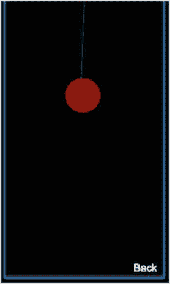

图 7-5. 滑动关节

```
var PivotJointLayer = BaseSampleLayer.extend({
    sprite:null,
    ctor:function () {
        this._super();
        this.initPhysics();
        this.setupDebugNode();
        this.addBottomWall();

        var bodyA = this.addPhysicsCircle(cc.p(cc.winSize.width * 0.25, cc.winSize.height * 0.3));
        var bodyB = this.addPhysicsBox(cc.p(cc.winSize.width * 0.75, cc.winSize.height * 0.3));

        var pivotJoint = new cp.PivotJoint(bodyA, bodyB, cc.p(cc.winSize.width * 0.5, cc.winSize.height * 0.5));
        this.space.addConstraint(pivotJoint);

        this.scheduleUpdate();
        return true;
    },
    initPhysics:function() {
        //initiate space
        this.space = new cp.Space();
        //set up the Gravity
        this.space.gravity = cp.v(0, -800); //Earth gravity
        this.space.iterations = 30;
        this.space.sleepTimeThreshold = Infinity;
        this.space.collisionSlop = Infinity;
    },

    update:function (dt) {
        this.space.step(dt);
    },
    addBottomWall: function() {
        var bottomWall = new cp.SegmentShape(this.space.staticBody, new cp.v(0, 0), new cp.v(cc.winSize.width, 0), 5);
        bottomWall.setElasticity(1);
        bottomWall.setFriction(1);
        this.space.addStaticShape(bottomWall);
    },
    setupDebugNode : function()
    {
        this._debugNode = new cc.PhysicsDebugNode(this.space);
        this.addChild( this._debugNode );
    },
    addPhysicsCircle: function(pos) {
        var width=50,height=50,mass=1;

        var phBodyCircle = this.space.addBody(new cp.Body(mass, cp.momentForCircle(mass,0,width*0.5,cc.p(0,0))));
        phBodyCircle.setPos(pos);

        var phShape = this.space.addShape(new cp.CircleShape(phBodyCircle, width, cc.p(0, 0)));
        phShape.setFriction(0);
        phShape.setElasticity(1);
        phShape.setCollisionType(0);

        return phBodyCircle;
    },

    addPhysicsBox: function(pos) {
        var width=50,height=50,mass=1;
        var phBodyBox = this.space.addBody(new cp.Body(mass, cp.momentForBox(mass, width,height)));
        phBodyBox.setPos(pos);

        var phShape = this.space.addShape(new cp.BoxShape(phBodyBox, width, height));
        phShape.setFriction(0);
        phShape.setElasticity(1);
        phShape.setCollisionType(1);

        return phBodyBox;
    }
});
```

输出将如图 7-6 所示。

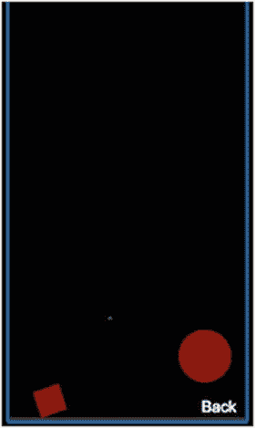

图 7-6. 枢轴关节

#### 7.9.4 沟槽关节

在沟槽关节中，世界坐标系下将存在两个沟槽点：`groove_a` 和 `groove_b`。同时还有 `bodyB`，它通过锚点连接到沟槽关节，并在 `groove_a` 与 `groove_b` 之间滑动。`groove_a` 和 `groove_b` 的位置会根据 `bodyA` 的位置和旋转而变化。

首先，进行芯片木偶的初始设置。为了更好地可视化，我们将添加一个圆，并在该圆与静态物体之间建立一个滑动关节：

```
var bodyA = this.addPhysicsCircle(cc.p(cc.winSize.width * 0.25, cc.winSize.height * 0.3));
var bodyB = this.addPhysicsBox(cc.p(cc.winSize.width * 0.75, cc.winSize.height * 0.3));
var bodyC=this.space.staticBody;

var slideJoint = new cp.SlideJoint(bodyA, bodyC, cc.p(-50,0),
cc.p(cc.winSize.width/2,cc.winSize.height), 100, cc.winSize.width/2);
this.space.addConstraint(slideJoint);
```

现在，我们将添加一个沟槽关节，并连接 `bodyA` 和 `bodyB`：

```
var x=cc.winSize.width/2;

var grooveJoint = new cp.GrooveJoint(bodyA, bodyB, cc.p(x,0),
cc.p(x,50), cc.p(25,0));

this.space.addConstraint(grooveJoint);
```

参数分别为 `bodyA`、`bodyB`、`groove_a`、`groove_b` 和 `anchor`。

以下是该层的完整源代码：

```
1   var GrooveJointLayer = BaseSampleLayer.extend({
2       sprite:null,
3       ctor:function () {
4           this._super();
5           this.initPhysics();
6           this.setupDebugNode();
7           this.addBottomWall();
8
9           var bodyA = this.addPhysicsCircle(cc.p(cc.winSize.width * 0.25, cc.winSize.height * 0.3));
10          var bodyB = this.addPhysicsBox(cc.p(cc.winSize.width * 0.75, cc.winSize.height * 0.3));
11          var bodyC=this.space.staticBody;
12
13          var slideJoint = new cp.SlideJoint(bodyA, bodyC, cc.p(-50,0),
14          cc.p(cc.winSize.width/2,cc.winSize.height), 100, cc.winSize.width/2);
15          this.space.addConstraint(slideJoint);
16
17          var x=cc.winSize.width/2;
18
19          var grooveJoint = new cp.GrooveJoint(bodyA, bodyB, cc.p(x,0), cc.p(x,50), cc.p(25,0));
20          this.space.addConstraint(grooveJoint);
21
22          this.scheduleUpdate();
23          return true;
24      },
25      initPhysics:function() {
26         //initiate space
27         this.space = new cp.Space();
28         //set up the Gravity
29         this.space.gravity = cp.v(0, -800); //Earth gravity
30         this.space.iterations = 30;
31         this.space.sleepTimeThreshold = Infinity;
32         this.space.collisionSlop = Infinity;
33      },
34
35      update:function (dt) {
36        this.space.step(dt);
37      },
38      addBottomWall: function() {
39        var bottomWall = new cp.SegmentShape(this.space.staticBody, new cp.v(0, 0), new cp.v(cc.winSize.width, 0), 5);
40        bottomWall.setElasticity(1);
41        bottomWall.setFriction(1);
42        this.space.addStaticShape(bottomWall);
43       },
44       setupDebugNode : function()
45       {
46         this._debugNode = new cc.PhysicsDebugNode(this.space);
47         this.addChild( this._debugNode );
48       },
49       addPhysicsCircle: function(pos) {
50         var width=50,height=50,mass=1;
51
52         var phBodyCircle = this.space.addBody(new cp.Body(mass, cp.momentForCircle(mass,0,width*0.5,cc.p(0,0))));
53         phBodyCircle.setPos(pos);
54
55         var phShape = this.space.addShape(new cp.CircleShape(phBodyCircle, width, cc.p(0, 0)));
56         phShape.setFriction(0);
57         phShape.setElasticity(1);
58         phShape.setCollisionType(0);
59
60         return phBodyCircle;
61       },
62
63       addPhysicsBox: function(pos) {
64         var width=50,height=50,mass=1;
65         var phBodyBox = this.space.addBody(new cp.Body(mass, cp.momentForBox(mass, width,height)));
66         phBodyBox.setPos(pos);
67
68         var phShape = this.space.addShape(new cp.BoxShape(phBodyBox, width, height));
69         phShape.setFriction(0);
70         phShape.setElasticity(1);
71         phShape.setCollisionType(1);
72
73         return phBodyBox;
73       }
74  });
```

您将看到如图 7-7 所示的输出结果。

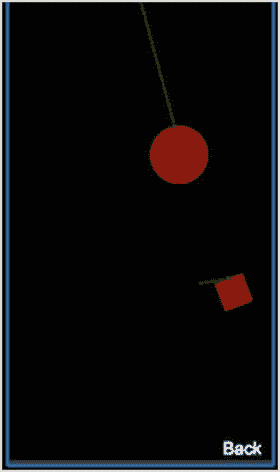

图 7-7. 沟槽关节

#### 7.9.5 阻尼弹簧

在阻尼弹簧中，`bodyA`和`bodyB`将连接到弹簧的两端，我们需要提供其他参数来定义弹簧的行为。

首先，初始化 `Chipmunk` 空间。与之前的示例类似，为了更直观地展示效果，我们将添加一个圆形，并为其建立到静态体的滑动关节。具体如下：

```
1   var bodyA = this.addPhysicsCircle(cc.p(cc.winSize.width * 0.25, cc.winSize.height * 0.3));
2   var bodyB = this.addPhysicsBox(cc.p(cc.winSize.width * 0.75, cc.winSize.height * 0.3));
3   var bodyC = this.space.staticBody;
4   
5   var slideJoint = new cp.SlideJoint(bodyA, bodyC, cc.p(-50,0),
6   cc.p(cc.winSize.width/2, cc.winSize.height), 100, cc.winSize.width/2);
7   this.space.addConstraint(slideJoint);
```

然后，在`bodyA`和`bodyB`之间添加一个阻尼弹簧：

```
1   var dampedSpring = new cp.DampedSpring(bodyA, bodyB, cc.p(50,0),
2   cc.p(25,0), 25, 5, 0.6);
3   
4   this.space.addConstraint(dampedSpring);
```

在`bodyA`和`bodyB`之后，共有五个参数：

*   `anchorA` - `bodyA`的锚点
*   `anchorB` - `bodyB`的锚点
*   `resLength` - 弹簧的基准长度
*   `stiffness` - 弹簧常数（参考杨氏模量）
*   `damping` - 表示阻尼的柔软程度

以下是该图层的完整源代码：

```
1   var DampedSpringLayer = BaseSampleLayer.extend({
2       sprite:null,
3       ctor:function () {
4           this._super();
5           this.initPhysics();
6           this.setupDebugNode();
7           this.addBottomWall();
8           
9           var bodyA = this.addPhysicsCircle(cc.p(cc.winSize.width * 0.25, cc.winSize.height * 0.3));
10          var bodyB = this.addPhysicsBox(cc.p(cc.winSize.width * 0.75, cc.winSize.height * 0.3));
11          var bodyC = this.space.staticBody;
12          
13          var slideJoint = new cp.SlideJoint(bodyA, bodyC, cc.p(-50,0),
14          cc.p(cc.winSize.width/2, cc.winSize.height), 100, cc.winSize.width/2);
15          this.space.addConstraint(slideJoint);
16          
17          var dampedSpring = new cp.DampedSpring(bodyA, bodyB, cc.p(50,0), cc.p(25,0), 25, 5, 0.6);
18          this.space.addConstraint(dampedSpring);
19          
20          this.scheduleUpdate();
21          return true;
22      },
23      initPhysics:function() {
24          //初始化空间
25          this.space = new cp.Space();
26          //设置重力
27          this.space.gravity = cp.v(0, -800); //地球重力
28          this.space.iterations = 30;
29          this.space.sleepTimeThreshold = Infinity;
30          this.space.collisionSlop = Infinity;
31      },
32      
33      update:function (dt) {
34          this.space.step(dt);
35      },
36      addBottomWall: function() {
37          var bottomWall = new cp.SegmentShape(this.space.staticBody, new cp.v(0, 0), new cp.v(cc.winSize.width, 0), 5);
38          bottomWall.setElasticity(1);
39          bottomWall.setFriction(1);
40          this.space.addStaticShape(bottomWall);
41      },
42      setupDebugNode : function() {
43          this._debugNode = new cc.PhysicsDebugNode(this.space);
44          this.addChild( this._debugNode );
45      },
46      addPhysicsCircle: function(pos) {
47          var width=50, height=50, mass=1;
48          
49          var phBodyCircle = this.space.addBody(new cp.Body(mass, cp.momentForCircle(mass, 0, width*0.5, cc.p(0,0))));
50          phBodyCircle.setPos(pos);
51          
52          var phShape = this.space.addShape(new cp.CircleShape(phBodyCircle, width, cc.p(0, 0)));
53          phShape.setFriction(0);
54          phShape.setElasticity(1);
55          phShape.setCollisionType(0);
56          
57          return phBodyCircle;
58      },
59      
60      addPhysicsBox: function(pos) {
61          var width=50, height=50, mass=1;
62          var phBodyBox = this.space.addBody(new cp.Body(mass, cp.momentForBox(mass, width, height)));
63          phBodyBox.setPos(pos);
64          
65          var phShape = this.space.addShape(new cp.BoxShape(phBodyBox, width, height));
66          phShape.setFriction(0);
67          phShape.setElasticity(1);
68          phShape.setCollisionType(1);
69          
70          return phBodyBox;
71      }
72   });
```

输出效果将如图 7-8 所示。

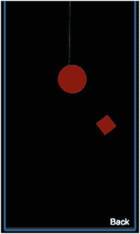

图 7-8. 阻尼弹簧

#### 7.9.6 阻尼旋转弹簧

这与阻尼弹簧类似，唯一的区别在于它以角度方式工作。它并非通过锚点连接两个刚体，而是通过一个相对角度将两个刚体连接起来，使它们保持在该角度；刚度和阻尼决定了刚体在任何时刻的位置。

与之前的示例类似，设置 `Chipmunk` 空间，添加一个圆形，并在圆形和静态刚体之间建立一个滑动关节，然后添加一个阻尼旋转弹簧：

```
1   var dampedRotarySpring = new cp.DampedRotarySpring(bodyA, bodyB, 0, 25, 0.6);
2   this.space.addConstraint(dampedRotarySpring);
```

此处，参数分别为 `bodyA`、`bodyB`、`restAngle`、`stiffness` 和 `damping`；参数说明请参考之前的示例。

以下是该层的完整源代码：

```
1   var DampedRotarySpringLayer = BaseSampleLayer.extend({
2      sprite:null,
3      ctor:function () {
4          this._super();
5          this.initPhysics();
6          this.setupDebugNode();
7          this.addBottomWall();
9          var bodyA = this.addPhysicsCircle(cc.p(cc.winSize.width * 0.25, cc.winSize.height * 0.3));
10          var bodyB = this.addPhysicsBox(cc.p(cc.winSize.width * 0.75, cc.winSize.height * 0.3));
11          var bodyC=this.space.staticBody;
15          var slideJoint = new cp.SlideJoint(bodyA, bodyC, cc.p(-50,0),
16          cc.p(cc.winSize.width/2,cc.winSize.height), 100, cc.winSize.width/2);
17          this.space.addConstraint(slideJoint);
19          var dampedRotarySpring = new cp.DampedRotarySpring(bodyA, bodyB, 0, 25, 0.6);
20          this.space.addConstraint(dampedRotarySpring);
23          this.scheduleUpdate();
24          return true;
25        },
26        initPhysics:function() {
27          //initiate space
28          this.space = new cp.Space();
29          //set up the Gravity
30          this.space.gravity = cp.v(0, -800); //Earth gravity
31          this.space.iterations = 30;
32          this.space.sleepTimeThreshold = Infinity;
33          this.space.collisionSlop = Infinity;
34       },
36       update:function (dt) {
37         this.space.step(dt);
38       },
39       addBottomWall: function() {
40         var bottomWall = new cp.SegmentShape(this.space.staticBody, new cp.v(0, 0), new cp.v(cc.winSize.width, 0), 5);
41         bottomWall.setElasticity(1);
42         bottomWall.setFriction(1);
43         this.space.addStaticShape(bottomWall);
44       },
45       setupDebugNode : function()
46       {
47         this._debugNode = new cc.PhysicsDebugNode(this.space);
48         this.addChild( this._debugNode );
49       },
50       addPhysicsCircle: function(pos) {
51         var width=50,height=50,mass=1;
54         var phBodyCircle = this.space.addBody(new cp.Body(mass, cp.momentForCircle(mass,0,width*0.5,cc.p(0,0))));
55         phBodyCircle.setPos(pos);
58         var phShape = this.space.addShape(new cp.CircleShape(phBodyCircle, width, cc.p(0, 0)));
59         phShape.setFriction(0);
60         phShape.setElasticity(1);
61         phShape.setCollisionType(0);
64         return phBodyCircle;
65       },
67       addPhysicsBox: function(pos) {
68         var width=50,height=50,mass=1;
69         var phBodyBox = this.space.addBody(new cp.Body(mass, cp.momentForBox(mass, width,height)));
70         phBodyBox.setPos(pos);
73         var phShape = this.space.addShape(new cp.BoxShape(phBodyBox, width, height));
74         phShape.setFriction(0);
75         phShape.setElasticity(1);
76         phShape.setCollisionType(1);
79         return phBodyBox;
80       }
81   });
```

输出结果应如图 7-9 所示。

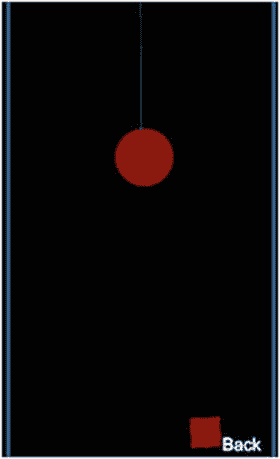

图 7-9. 阻尼旋转弹簧

#### 7.9.7 旋转限制关节

旋转限制关节通过提供最小和最大角度界限，来约束两个刚体的相对旋转。如果 `bodyA` 和 `bodyB` 通过一个具有最小和最大角度的旋转限制关节连接，那么这两个刚体的相对旋转角度将不会低于最小角度，也不会超过最大角度。

与之前的示例类似，初始化 Chipmunk 空间并添加一个圆形，然后通过一个滑动关节将其与静态刚体连接。现在，在 `bodyA` 和 `bodyB` 之间应用一个旋转限制：

```
1   var rotaryLimitJoint = new cp.RotaryLimitJoint(bodyA, bodyB, -Math.PI/2, Math.PI/2);
2   this.space.addConstraint(rotaryLimitJoint);
```

在 `bodyA` 和 `bodyB` 之后，提供了最小和最大角度，这样两个刚体的相对旋转将在这个范围内。

以下是该层的完整源代码：

## 7.9.8 简单电机

`SimpleMotor` 用于维持两个物体按设定的角速度进行相对旋转；也就是说，当涉及 `bodyA` 和 `bodyB` 时，`SimpleMotor` 会以设定的角速度维持这两个物体的相对旋转。

首先，设置 Chipmunk 空间并向其中添加两个盒子：

```
var bodyA = this.addPhysicsBox(cc.p(cc.winSize.width * 0.25,
           cc.winSize.height * 0.5));

var bodyB = this.addPhysicsBox(cc.p(cc.winSize.width * 0.75,
            cc.winSize.height * 0.5));
```

然后，通过枢轴关节将这两个物体固定在默认的静态物体上：

```
var staticBody=this.space.staticBody;

this.space.addConstraint(new cp.PivotJoint(bodyA, staticBody,
   cc.p(cc.winSize.width * 0.25, cc.winSize.height * 0.5)));

this.space.addConstraint(new cp.PivotJoint(bodyB, staticBody,
   cc.p(cc.winSize.width * 0.75, cc.winSize.height * 0.5)));
```

接着，对 `bodyA` 和 `bodyB` 应用 `SimpleMotor`：

```
var simpleMotor = new cp.SimpleMotor(bodyA, bodyB, Math.PI);
this.space.addConstraint(simpleMotor);
```

这里，两个物体的相对角速度被设置为 `Math.PI`。以下是该层的完整源代码：

```
var RotaryLimitJointLayer = BaseSampleLayer.extend({
   sprite:null,
   ctor:function () {
      this._super();
      this.initPhysics();
      this.setupDebugNode();
      this.addBottomWall();

      var bodyA = this.addPhysicsCircle(cc.p(cc.winSize.width * 0.25, cc.winSize.height * 0.3));
      var bodyB = this.addPhysicsBox(cc.p(cc.winSize.width * 0.75, cc.winSize.height * 0.3));
      var bodyC=this.space.staticBody;

      var rotaryLimitJoint = new cp.RotaryLimitJoint(bodyA, bodyB, -Math.PI/2, Math.PI/2);
      this.space.addConstraint(rotaryLimitJoint);

      var slideJoint = new cp.SlideJoint(bodyA, bodyC, cc.p(-50,0),
      cc.p(cc.winSize.width/2,cc.winSize.height), 100, cc.winSize.width/2);
      this.space.addConstraint(slideJoint);

      this.scheduleUpdate();
      return true;
   },
   initPhysics:function() {
     //initiate space
     this.space = new cp.Space();
     //set up the Gravity
     this.space.gravity = cp.v(0, -800); //Earth gravity
     this.space.iterations = 30;
     this.space.sleepTimeThreshold = Infinity;
     this.space.collisionSlop = Infinity;
  },

  update:function (dt) {
     this.space.step(dt);
  },
  addBottomWall: function() {
     var bottomWall = new cp.SegmentShape(this.space.staticBody, new cp.v(0, 0), new cp.v(cc.winSize.width, 0), 5);
     bottomWall.setElasticity(1);
     bottomWall.setFriction(1);
     this.space.addStaticShape(bottomWall);
  },
  setupDebugNode : function()
  {
     this._debugNode = new cc.PhysicsDebugNode(this.space);
     this.addChild( this._debugNode );
  },
  addPhysicsCircle: function(pos) {
     var width=50,height=50,mass=1;

     var phBodyCircle = this.space.addBody(new cp.Body(mass, cp.momentForCircle(mass,0,width*0.5,cc.p(0,0))));
     phBodyCircle.setPos(pos);

     var phShape = this.space.addShape(new cp.CircleShape(phBodyCircle, width, cc.p(0, 0)));
     phShape.setFriction(0);
     phShape.setElasticity(1);
     phShape.setCollisionType(0);

     return phBodyCircle;
  },

  addPhysicsBox: function(pos) {
     var width=50,height=50,mass=1;
     var phBodyBox = this.space.addBody(new cp.Body(mass, cp.momentForBox(mass, width,height)));
     phBodyBox.setPos(pos);

     var phShape = this.space.addShape(new cp.BoxShape(phBodyBox, width, height));
     phShape.setFriction(0);
     phShape.setElasticity(1);
     phShape.setCollisionType(1);

     return phBodyBox;
  }
});
```

输出结果与阻尼旋转弹簧相同；不过，你会注意到两个刚体在旋转上的差异。

```
var SimpleMotorLayer = BaseSampleLayer.extend({
    sprite:null,
    ctor:function () {
        this._super();
        this.initPhysics();
        this.setupDebugNode();
        this.addBottomWall();

        var bodyA = this.addPhysicsBox(cc.p(cc.winSize.width * 0.25, cc.winSize.height * 0.5));
        var bodyB = this.addPhysicsBox(cc.p(cc.winSize.width * 0.75, cc.winSize.height * 0.5));

        var staticBody=this.space.staticBody;

        this.space.addConstraint(new cp.PivotJoint(bodyA, staticBody,
        cc.p(cc.winSize.width * 0.25, cc.winSize.height * 0.5)));

        this.space.addConstraint(new cp.PivotJoint(bodyB, staticBody,
        cc.p(cc.winSize.width * 0.75, cc.winSize.height * 0.5)));

        var simpleMotor = new cp.SimpleMotor(bodyA, bodyB, Math.PI);
        this.space.addConstraint(simpleMotor);

        this.scheduleUpdate();
        return true;
    },
    initPhysics:function() {
        //initiate space
        this.space = new cp.Space();
        //set up the Gravity
        this.space.gravity = cp.v(0, -800); //Earth gravity
        this.space.iterations = 30;
        this.space.sleepTimeThreshold = Infinity;
        this.space.collisionSlop = Infinity;
    },
    update:function (dt) {
        this.space.step(dt);
    },
    addBottomWall: function() {
        var bottomWall = new cp.SegmentShape(this.space.staticBody, new cp.v(0, 0), new cp.v(cc.winSize.width, 0), 5);
        bottomWall.setElasticity(1);
        bottomWall.setFriction(1);
        this.space.addStaticShape(bottomWall);
    },
    setupDebugNode : function()
    {
        this._debugNode = new cc.PhysicsDebugNode(this.space);
        this.addChild( this._debugNode );
    },
    addPhysicsBox: function(pos) {
        var width=50,height=50,mass=1;
        var phBodyBox = this.space.addBody(new cp.Body(mass, cp.momentForBox(mass, width,height)));
        phBodyBox.setPos(pos);
        var phShape = this.space.addShape(new cp.BoxShape(phBodyBox, width, height));
        phShape.setFriction(0);
        phShape.setElasticity(1);
        phShape.setCollisionType(1);
        return phBodyBox;
    }
});
```

你会看到两个盒子以恒定速度旋转，如图 7-10 所示。

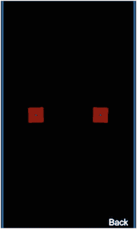

图 7-10. 简单电机

#### 7.9.9 齿轮关节

齿轮关节与 `SimpleMotor` 类似，但齿轮关节本身不会引入角速度。因为一个物体的角速度取决于另一个物体，所以速度取决于设定的比率。让我们看一个例子。

首先，像前面的例子一样，初始化 Chipmunk 空间并通过枢轴关节将两个盒子连接到静态物体上。此外，添加第三个物体，它将通过齿轮关节与 `bodyB` 绑定：

```
var bodyA = this.addPhysicsBox(cc.p(cc.winSize.width * 0.25,
            cc.winSize.height * 0.5));
var bodyB = this.addPhysicsBox(cc.p(cc.winSize.width * 0.75,
            cc.winSize.height * 0.5));
var bodyC = this.addPhysicsBox(cc.p(cc.winSize.width * 0.5,
            cc.winSize.height * 0.3));
var staticBody=this.space.staticBody;

this.space.addConstraint(new cp.PivotJoint(bodyA, staticBody,
   cc.p(cc.winSize.width * 0.25, cc.winSize.height * 0.5)));

this.space.addConstraint(new cp.PivotJoint(bodyB, staticBody,
   cc.p(cc.winSize.width * 0.75, cc.winSize.height * 0.5)));

this.space.addConstraint(new cp.PivotJoint(bodyC, staticBody,
   cc.p(cc.winSize.width * 0.5, cc.winSize.height * 0.3)));
```

然后，对 `bodyA` 和 `bodyB` 应用 `SimpleMotor` 以引入恒定角速度：

```
var gearJoint = new cp.GearJoint(bodyB, bodyC, 0, 2);
this.space.addConstraint(gearJoint);
```

接着，对 `bodyB` 和 `bodyC` 应用一个齿轮关节，使得 `bodyC` 的旋转依赖于 `bodyB` 的角速度：

```
var gearJoint = new cp.GearJoint(bodyB, bodyC, 0, 2);
this.space.addConstraint(gearJoint);
```

最后两个参数是：

*   `offset` - 两个物体的初始角度偏移量

*   `ratio` - 需要维持的速度比率；在此例中，`bodyC` 的角速度是 `bodyB` 的一半。

以下是该层的完整源代码：

```
# 7.9.9 齿轮关节

```javascript
var GearJointLayer = BaseSampleLayer.extend({
    sprite: null,
    ctor: function () {
        this._super();
        this.initPhysics();
        this.setupDebugNode();
        this.addBottomWall();

        var bodyA = this.addPhysicsBox(cc.p(cc.winSize.width * 0.25, cc.winSize.height * 0.5));
        var bodyB = this.addPhysicsBox(cc.p(cc.winSize.width * 0.75, cc.winSize.height * 0.5));
        var bodyC = this.addPhysicsBox(cc.p(cc.winSize.width * 0.5, cc.winSize.height * 0.3));
        var staticBody = this.space.staticBody;

        this.space.addConstraint(new cp.PivotJoint(bodyA, staticBody,
            cc.p(cc.winSize.width * 0.25, cc.winSize.height * 0.5)));

        this.space.addConstraint(new cp.PivotJoint(bodyB, staticBody,
            cc.p(cc.winSize.width * 0.75, cc.winSize.height * 0.5)));

        this.space.addConstraint(new cp.PivotJoint(bodyC, staticBody,
            cc.p(cc.winSize.width * 0.5, cc.winSize.height * 0.3)));

        var simpleMotor = new cp.SimpleMotor(bodyA, bodyB, Math.PI);
        this.space.addConstraint(simpleMotor);

        var gearJoint = new cp.GearJoint(bodyB, bodyC, 0, 2);
        this.space.addConstraint(gearJoint);

        this.scheduleUpdate();
        return true;
    },
    initPhysics: function() {
        //initiate space
        this.space = new cp.Space();
        //set up the Gravity
        this.space.gravity = cp.v(0, -800); //Earth gravity
        this.space.iterations = 30;
        this.space.sleepTimeThreshold = Infinity;
        this.space.collisionSlop = Infinity;
    },
    update: function (dt) {
        this.space.step(dt);
    },
    addBottomWall: function() {
        var bottomWall = new cp.SegmentShape(this.space.staticBody, new cp.v(0, 0), new cp.v(cc.winSize.width, 0), 5);
        bottomWall.setElasticity(1);
        bottomWall.setFriction(1);
        this.space.addStaticShape(bottomWall);
    },
    setupDebugNode: function() {
        this._debugNode = new cc.PhysicsDebugNode(this.space);
        this.addChild(this._debugNode);
    },
    addPhysicsBox: function(pos) {
        var width = 50, height = 50, mass = 1;
        var phBodyBox = this.space.addBody(new cp.Body(mass, cp.momentForBox(mass, width, height)));
        phBodyBox.setPos(pos);
        var phShape = this.space.addShape(new cp.BoxShape(phBodyBox, width, height));
        phShape.setFriction(0);
        phShape.setElasticity(1);
        phShape.setCollisionType(1);
        return phBodyBox;
    }
});
```

在输出结果中，你会看到方框 c 的旋转速度是方框 b 的一半。如图 7-11 所示。

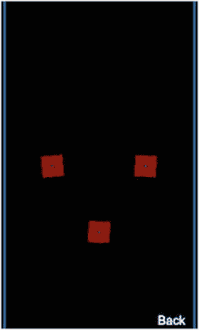

**图 7-11.** 齿轮关节

#### 7.9.10 棘轮关节

棘轮关节的工作原理类似于套筒扳手，它使物体按照指定的初始角度偏移进行角步进旋转，其中`phase`是角步长，即当前旋转步与下一步之间的距离。

语法如下：

```javascript
var ratchet = new cp.RatchetJoint(body1, body2, offset, phase);
```

参数说明：
*   `offset` - 指物体的初始角度旋转量
*   `phase` - 指步进之间的角度距离

# 8. 其他功能

## 8.1 绘制基本图形

要绘制基本图形，可使用`cc.drawNode`。该节点类型提供了`drawCircle`、`drawPoly`、`drawRect`、`drawSegment`等函数。来看一个示例：

```javascript
this.draw = new cc.DrawNode();
this.addChild(this.draw);

//drawCircle
this.draw.drawCircle(cc.p(cc.winSize.width / 2, cc.winSize.height / 2), 100, 0, 10, false, 6, cc.color(0, 255, 0, 255));
this.draw.drawCircle(cc.p(cc.winSize.width / 2, cc.winSize.height / 2), 50, cc.degreesToRadians(90), 50, true, 2, cc.color(0, 255, 255, 255));
```

这里，我们在同一个`DrawNode`上绘制了两个圆形。你可以在同一个绘制节点上绘制任意数量的图形。如果需要清除图形，必须使用`clear`函数：

```javascript
this.draw.clear();
```

还可以使用`drawCardinalSpline`方法绘制路径：

```javascript
this.draw.drawCardinalSpline(poinsArray, 1, 1, 10, cc.color(255, 255, 255));
```

第一个参数是定义路径数据的一组点坐标数组。第二、三、四个参数分别是`张力`、分段数、线宽和线条颜色。

完整代码如下：

```javascript
var DrawNodeDemoLayer = BaseSampleLayer.extend({
    sprite: null,
```

## DrawNode 示例

```javascript
ctor:function () {
    this._super();
    var size = cc.winSize;
    this.draw=new cc.DrawNode();
    this.addChild(this.draw);
    //drawCircle
    this.draw.drawCircle(cc.p(size.width / 2, size.height / 2), 100, 0, 10, false, 6, cc.color(0, 255, 0, 255));
    this.draw.drawCircle(cc.p(size.width / 2, size.height / 2), 50, cc.degreesToRadians(90), 50, true, 2, cc.color(0, 255, 255, 255));
    return true;
}
```

输出结果如图 8-1 所示。

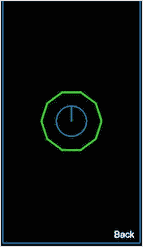

**图 8-1.** `DrawNode` 演示

## 8.2 添加音乐和音效

在 Cocos2d-js 中，可通过单例对象`cc.audioEngine`为游戏添加音乐和音效。音乐代表游戏中长时间运行的背景音，而音效代表快速播放的声音，如玩家跳跃、收集金币等。你需要谨慎选择使用的音频格式文件，因为某些浏览器不支持特定格式。在游戏启动时，你首先要做的就是在`app.js`的`onStart`方法中预加载音效文件：

```javascript
cc.audioEngine.preloadMusic(s_music_background);
cc.audioEngine.preloadEffect(s_music_jump);
```

然后，你可以按如下方式播放音乐和音效：

```javascript
cc.audioEngine.playMusic(s_music_background, true);
cc.audioEngine.playEffect(s_music_jump, true);
```

第二个参数表示是否循环播放声音。

你可以按如下方式暂停、恢复和停止音乐与音效：

```javascript
//暂停声音
cc.audioEngine.pauseMusic();
cc.audioEngine.pauseEffect();

//恢复声音
cc.audioEngine.resumeMusic();
cc.audioEngine.resumeEffect();

//倒带音乐
cc.audioEngine.rewindMusic();

//停止声音
cc.audioEngine.stopMusic();
cc.audioEngine.stopEffect();
```

对于音效，没有倒带选项，因为播放音乐和音效的结构是分开的，以提高系统效率。

## 8.3 使用自定义着色器

着色器负责渲染你的整个游戏。我们为运行游戏所做的一切最终都会通过着色器进行处理并渲染。着色器分为顶点着色器和片段着色器。顶点着色器处理节点的顶点数据，并将输出传递给片段着色器，片段着色器则对插值后的顶点数据进行像素颜色处理。Cocos2d-x 使用 GL 着色器进行渲染。GL 着色器是一个更为庞大的概念，详细讨论已超出本书范围。自定义着色器用于在游戏中创建炫酷的效果。我们将学习如何在精灵上使用自定义顶点和片段着色器。

在 Cocos2d-js 中，`cc.GLProgram`类代表特定节点的着色器实体。每个节点都有`setShaderProgram`和`getShaderProgram`函数来获取/设置该对象。

我们来看一个示例顶点和片段着色器：

```glsl
//gray.vsh
attribute vec4 a_position;
attribute vec2 a_texCoord;
attribute vec4 a_color;

varying vec4 v_fragmentColor;
varying vec2 v_texCoord;

void main()
{
    gl_Position = CC_MVPMatrix * a_position;
    v_fragmentColor = a_color;
    v_texCoord = a_texCoord;
}

//gray.fsh
varying vec4 v_fragmentColor;
varying vec2 v_texCoord;
uniform sampler2D CC_Texture0;

void main()
{
    vec4 v_orColor = v_fragmentColor * texture2D(CC_Texture0, v_texCoord);
    float gray = dot(v_orColor.rgb, vec3(0.299, 0.587, 0.114));
    gl_FragColor = vec4(gray, gray, gray, v_orColor.a);
}
```

要在你的精灵上使用这些着色器，你需要创建一个`GLProgram`实例，并用这两个着色器的路径进行初始化，同时还需要为顶点着色器初始化属性。操作如下：

```javascript
var shader = new cc.GLProgram();
shader.retain();
shader.initWithFilenames("res/gray.vsh", "res/gray.fsh");
shader.addAttribute(cc.ATTRIBUTE_NAME_POSITION, cc.VERTEX_ATTRIB_POSITION);
shader.addAttribute(cc.ATTRIBUTE_NAME_COLOR, cc.VERTEX_ATTRIB_COLOR);
shader.addAttribute(cc.ATTRIBUTE_NAME_TEX_COORD, cc.VERTEX_ATTRIB_TEX_COORDS);
shader.link();
shader.updateUniforms();
this.sprite.setShaderProgram(shader);
```

## 8.4 运动拖尾效果

在 Cocos2d-js 中，可以通过 `MotionStreak` 类来实现运动拖尾效果。运动拖尾效果是指当物体移动时，在其路径上留下痕迹，这些痕迹会随时间逐渐消失，如同留下脚印一般。

让我们来看一个示例。首先，创建一个空层并向其中添加一个精灵：

```javascript
this.sprite = new cc.Sprite(res.Sprite_Image);
this.sprite.attr({
    x: size.width / 2,
    y: 0
});
this.addChild(this.sprite, 2);
```

然后，创建一个动作和序列的组合，使精灵从底部移动到顶部：

```javascript
var action1 = cc.moveTo(5, cc.p(size.width / 2, size.height));
var action2= action1.reverse();
var seq1 = new cc.Sequence(action1,action2);
this.sprite.runAction(seq1.repeatForever());
```

接着，使用一个纹理来定义运动拖尾。它可以非常简单，比如一个旋转了 90 度的白色三角形：

```javascript
this.tail = new cc.MotionStreak(2, 3, 50, cc.color.WHITE, res.Tail);
this.tail.attr({
   x: size.width / 2,
   y: 0
});
this.addChild(this.tail,1);
```

`MotionStreak` 的构造函数包含以下参数：

*   `fade` - 拖尾的淡出时间
*   `minSeg` - 最小片段数
*   `stroke` - 拖尾的描边颜色
*   `texture` - 用于渲染拖尾的图像

层的完整源代码应如下所示：

## 8.5 访问本地存储

本地存储即平台（Web/Android/iOS）提供的持久存储功能，您可以在其中存储键值对，并在之后进行检索。Cocos2d-js 提供了一个 API 来访问平台的本地存储，您可以使用此 API 来存储游戏状态、用户最高分等内容。

`cc.sys.localStorage` 对象提供了对本地存储的访问。有两种方法来获取/设置值：

```javascript
//设置值到本地存储
localstorage.setItem(,);

//从本地存储获取值
var value = localstorage.getItem();
```

`setItem` 方法提供了一种使用键作为引用来设置本地存储值的方式。键是一个字符串，值可以是原始值或 JavaScript 对象。

让我们看一个简单的示例。创建一个新层，并像之前的示例一样，向该层添加一个标签：

```javascript
var size = cc.winSize;

this.Label = new cc.LabelTTF('','', 32);
this.Label.attr({
   x: size.width / 2,
   y: size.height / 2
});
this.addChild(this.Label);
```

然后，将一个字符串值存储到本地存储中，并使用 `var localstorage=cc.sys.localStorage` 将其检索出来：

```javascript
//在本地存储中存储一个键/值对
localstorage.setItem('key1','来自本地存储的文本');

//使用键检索值
var text=localStorage.getItem('key1');
```

完整的代码应如下所示：

```javascript
var LocalStorageLayer = BaseSampleLayer.extend({
    sprite:null,
    ctor:function () {
        this._super();
        var size = cc.winSize;
        this.Label = new cc.LabelTTF('','', 32);
        this.Label.attr({
            x: size.width / 2,
            y: size.height / 2
        });
        this.addChild(this.Label);
        var localstorage=cc.sys.localStorage;
        //在本地存储中存储一个键/值对
        localstorage.setItem('key1','来自本地存储的文本');
        var text=localStorage.getItem('key1');
        //使用存储在 localStorage 中的键检索值
        this.Label.setString(text);
        return true;
    }
});
```

您将看到如图 8-3 所示的输出。


图 8-3. 本地存储

## 8.6 调度一个时间间隔回调

在第 6 章“动画乐趣”中，我们了解了调度器和更新，其中每个 `cc.Node` 都可以订阅更新通知，即运行循环。类似地，我们可以创建一个在给定时间间隔内被调用的函数。`cc.Node` 中有一个名为 `schedule` 的函数可以为我们完成这项工作：

```javascript
this.schedule(,);
```

让我们看一个示例。首先，创建一个空层并向其中添加一个标签：

```javascript
var size = cc.winSize;
this.Label = new cc.LabelTTF('','', 32);
this.Label.attr({
   x: size.width / 2,
   y: size.height / 2
});
this.addChild(this.Label);
```

然后，在 `layer` 对象中有一个回调函数，并用文本更新 `Label`：

```javascript
onUpdate:function(){
  this.Label.setString((this.timer++)+' 秒');
}
```

接着，在 `ctor` 中初始化一个变量 `timer`，并使用 `schedule` 函数以 1 秒为时间间隔开始回调：

```javascript
this.timer=0;
this.schedule(this.onUpdate,1);
```

现在，完整的代码如下所示：

```javascript
var SchedulerLayer = BaseSampleLayer.extend({
    sprite:null,
    ctor:function () {
        this._super();
        var size = cc.winSize;
        this.Label = new cc.LabelTTF('','', 32);
        this.Label.attr({
            x: size.width / 2,
            y: size.height / 2
        });
        this.addChild(this.Label);
        this.timer=0;
        this.schedule(this.onUpdate,1);
        return true;
    },
    onUpdate:function(){
```

22           this.Label.setString((this.timer++)+' 秒');

23       }

24   });

```

您将看到如图 8-4 所示的输出。

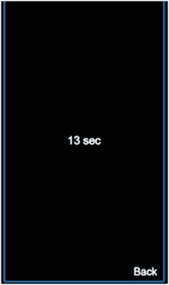

图 8-4. 调度一个函数

## 8.7 访问当前语言

Cocos2d-Js 也提供了一种在运行时访问当前区域设置的方法。`cc.sys` 中有一个属性，可以用来获取当前语言的字符串：

```
cc.sys.language
```

让我们来看一个简单示例。与前面的示例一样，先在一个空层上添加一个标签：

```
this.Label = new cc.LabelTTF('','', 32);
this.Label.attr({
    x: size.width / 2,
    y: size.height / 2
});
this.addChild(this.Label);
```

然后，访问语言信息：

```
var language=cc.sys.language;
```

接着，将其设置到你添加的标签上：

```
// 设置语言字符串
this.Label.setString('当前区域设置: '+language);
```

以下是完整代码：

```
var LanguageLayer = BaseSampleLayer.extend({
    sprite:null,
    ctor:function () {
        this._super();
        var size = cc.winSize;
        this.Label = new cc.LabelTTF('','', 32);
        this.Label.attr({
            x: size.width / 2,
            y: size.height / 2
        });
        this.addChild(this.Label);
        var language=cc.sys.language;
        // 设置语言字符串
        this.Label.setString('当前区域设置: '+language);
        return true;
    }
});
```

你将得到如图 8-5 所示的输出结果。

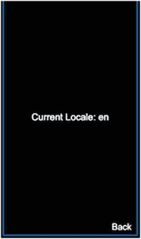

图 8-5. 访问区域设置

## 8.8 访问系统能力

正如你所知，你的 Cocos2d-js 游戏可以部署到不同的原生平台上，这些平台可能具有不同的能力。Cocos2d-js 提供了一种通过 `cc.sys` 检测当前环境能力的方法：

```
cc.sys.capabilities
```

如果你在浏览器中控制台输出此对象，将会得到类似如下的对象结构：

```
{
   accelerometer: true,
   canvas: true,
   keyboard: true,
   mouse: true,
   opengl: true,
}
```

例如，如果你想检测系统是否支持触摸，可以直接查询此对象的 `touch` 属性。同样地，也可以查询其他原生能力。

## 8.9 优化

对于任何类型的游戏而言，优化都是一个至关重要的部分。这并非游戏开发中的最后一个环节，实际上，你甚至在编码过程之前就必须提前规划。有一些技巧和窍门已被公认为最佳实践。

### 8.9.1 内存优化

*   游戏中的大部分内存将被纹理消耗，因此你必须更加关注所加载纹理的大小。最佳实践是仅在需要时才加载纹理。
*   尝试将游戏中所有纹理合并到一张精灵表或纹理图集中，这将节省大量内存。
*   此外，始终使用 NPOT 纹理而不是 POT 纹理也是一个好习惯。

### 8.9.2 性能优化

*   当涉及到性能或绘制调用的帧率时，**增量时间**扮演着重要的角色。
*   确保避免使用大量绘制调用。为游戏中的所有精灵使用单一纹理，这将启用精灵批处理。
*   另外，如果你的平台不支持自动批处理，请确保使用 `SpriteBatchNode` 将所有需要的精灵合并到单个绘制调用中进行渲染。
*   如果你编写自定义着色器，请确保顶点着色器和片段着色器没有密集的计算操作。
*   着色器中的复杂计算会限制 GPU 的性能，尤其是在片段函数中，因为片段函数会为屏幕上的每个像素执行一次。
*   尝试使用颜色深度为 RBGA4444 的 16 位纹理。

### 8.9.3 JavaScript 层面

*   确保代码没有内存泄漏。
*   当你在外部节点中引用内部节点时，确保在不需要时清除这些值。
*   仅使用有文档记录的 API，因为对内部变量和函数的使用和调整会导致行为不一致，未文档化的 API 在后续版本中可能会发生变更。

## 8.10 结论

到目前为止，我们已经从头了解了 Cocos2d-js 的功能特性。希望这能为你的游戏开发提供一个良好的开端。Cocos2d-x 是一个庞大的世界，单单一本书不足以详细解释它的全部功能。我们已尽可能覆盖了几乎所有功能特性和高级技巧。是时候由你来创建自己精彩绝伦的游戏了。

# 索引

A, B
加速计事件
动画动作
动作列表
贝塞尔曲线
基数样条
跳跃
移动
旋转
缩放
倾斜
着色
缓动
调度器与更新
序列
生成
精灵帧
停止
架构, Cocos2d-js
部署选项
JSB
对象层级
OpenGL/DirectX

C, D
Chipmunk
物体
空间
静态物体
Cocos2d-js 控制台设置
创建
文件夹结构
程序
project.json
当前语言字符串
绘制基本形状
执行间隔回调
原生部署
Python 安装
系统能力
自定义事件
自定义着色器

E, F
事件机制
监听器
管理器
触发

G, H, I
GUI 元素
标签
背景颜色
位图字体
创建
TrueType 字体
菜单与菜单项
创建
图片标签

J
关节
Chipmunk 空间
阻尼旋转弹簧
阻尼弹簧
齿轮关节
沟槽关节
枢轴关节
销关节
棘轮关节
旋转限制关节
简单马达
滑动关节

K
键盘事件

L
本地存储访问

M, N
运动轨迹效果
鼠标事件
音乐与音效

O
优化, Cocos2d-js
JavaScript
内存
性能

P, Q
基于物理的游戏
Chipmunk 概述
另见 Chipmunk
碰撞检测
关节
另见 关节
PhysicsDebugNode 程序
PhysicsDebugNode

R
分辨率策略
自定义
预定义
术语

S
精灵
批处理
类
帧动画
PList 数据
程序
矩形数组
分辨率策略
另见 分辨率策略
精灵表
单张图片
FPS 显示
SpriteImageLayer
SpriteFrameCache
TextureCache

T, U, V, W, X, Y, Z
触摸事件
多点触摸
单点触摸