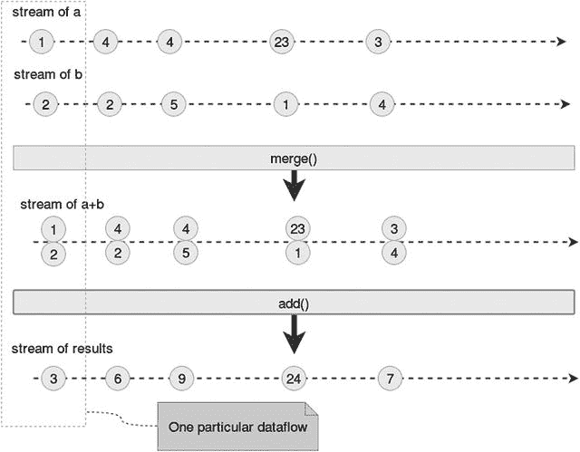
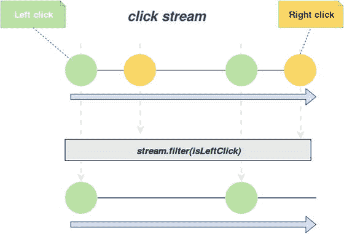
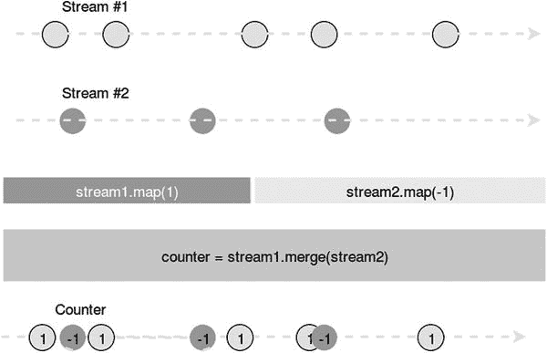
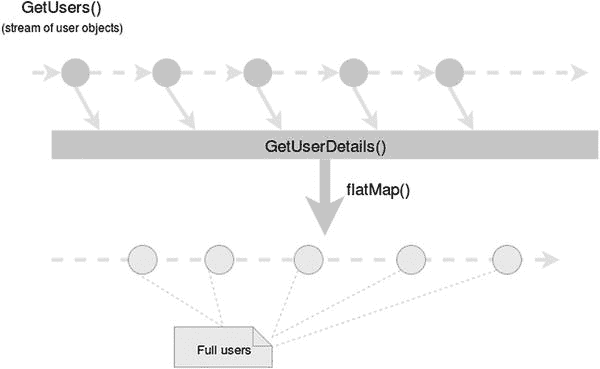

# 1. React 式编程入门

本书的电子补充材料可在本章的在线版本中获取（doi:[10.1007/978-1-4842-2152-5_1](http://dx.doi.org/10.1007/978-1-4842-2152-5_1)），该材料仅供授权用户使用。

React 式编程（RP）的概念属于那种“老派新概念”，往往会在一段时间内淡出潮流，然后在几年后，当无人注意时又重新浮出水面。这种现象使得新一代开发者，尤其是那些早期采用者，最初会将其视为需要掌握的革命性新事物。

但事实是，这一概念并非全新；实际上，你会发现它已经存在了 30 多年。

在本章中，我将介绍 RP 的概念，探讨其诞生背景与创始人，描述它试图解决的问题类型，以及存在的不同风格。到本章结束时，你将掌握开启 React 式编程之路所需的所有信息。

## 定义 React 式编程

要定义 RP，我需要的不仅仅是维基百科的定义，还需要讨论这个术语最初被提及的时间、它试图解决的问题类型，以及现有的不同 RP 风格。

### React 式编程的起源

RP 的概念自 1985 年起就已存在。它由 David Harel 和 Amir Pnueli 在当时的论文《论 React 式系统的开发》（可于[`www.wisdom.weizmann.ac.il/~harel/SCANNED.PAPERS/ReactiveSystems.pdf`](http://www.wisdom.weizmann.ac.il/%7Eharel/SCANNED.PAPERS/ReactiveSystems.pdf)获取）中提出。在文中，作者将 React 式系统描述为：

> React 式系统……会反复受到外部世界的提示，其作用是持续对外部输入做出响应。

尽管他们对 React 式系统的定义并不局限于软件项目，但本书将聚焦于此，因为这是我们感兴趣的领域。几年后，Gerard Berry 也做了类似的工作，他于 1989 年在论文《实时编程：专用语言还是通用语言》（可于[`https://hal.archives-ouvertes.fr/inria-00075494/document`](https://hal.archives-ouvertes.fr/inria-00075494/document)获取）中，在软件开发背景下扩展了 React 式系统的概念：

> 大致区分三种计算机程序是方便的。转换式程序从给定的输入集计算出结果；典型的例子是编译器或数值计算程序。交互式程序以自身速度与用户或其他程序进行交互；从用户角度看，分时系统是交互式的。React 式程序也与环境保持持续交互，但交互速度由环境决定，而非程序本身。交互式程序按自身节奏运行，主要处理通信；而 React 式程序仅在响应外部请求时工作，主要处理精确的中断处理。实时程序通常是 React 式程序。然而，也有一些 React 式程序通常不被视为实时程序，例如协议、系统驱动程序或人机界面处理器。所有 React 式程序都需要共同的编程风格。复杂的应用程序通常需要建立这三种程序之间的协作。例如，程序员使用涉及菜单、滚动条和其他 React 式设备的人机界面。该 React 式界面允许他告诉交互式操作系统启动转换式计算，如程序编译。

换句话说，RP 描述了一个从外部源接收输入，并以输入到达的速度持续处理这些输入的系统。

由此，我们还可以推断出实时项目与 RP 之间存在非常紧密的关系，因此在后续章节中，当我们开始构建自己的库时，将牢记这一点。

有趣的是，再补充一点历史背景，React 式系统是围绕数据流设计的，而数据流是另一个“老旧但优秀”的编程范式——这次是来自 20 世纪 60 年代。那么，让我们快速了解一下什么是数据流，以便更好地理解 React 式系统是如何构建的，好吗？

### 数据流入门

与 RP 一样，数据流编程（由 Jack Dennis 及其在麻省理工学院的研究生在 20 世纪 60 年代创建）是众多编程范式中的一种。在这种特定情况下，它的工作原理是将程序建模为操作之间数据流动的有向图。

在这种情况下，图的节点是对数据执行的操作，而执行这些操作所需的全部条件是它们的输入可用。因此，与更经典的编程范式（如顺序编程或过程式编程）相比，提出一个用于并行处理的架构相当简单，因为整个系统中唯一相关的信息就是可用数据（忘记状态维护，只需关注输入和输出数据）。

数据流程序甚至数据流架构在处理大量信息时非常容易扩展和增长，特别是与那些倾向于一次性完成所有工作而不将工作负载拆分到处理单元（图中的节点）上的传统程序相比。

简单来说，数据流语言是一种处理信息流（数据）并将其从一条指令发送到另一条指令的语言，它使用流控制语句（如 `if` 语句）来控制该流的实际流向。

以下是一些例子：

- Unix 管道 ([`https://en.wikipedia.org/wiki/Pipeline_(Unix`](https://en.wikipedia.org/wiki/Pipeline_(Unix)))

- LabVIEW ([`www.ni.com/labview/esa/`](http://www.ni.com/labview/esa/))

- Ptolemy II ([`http://ptolemy.berkeley.edu/ptolemyII/`](http://ptolemy.berkeley.edu/ptolemyII/))

- Shake ([`https://en.wikipedia.org/wiki/Shake_(software`](https://en.wikipedia.org/wiki/Shake_(software)))

- 以及更多……

> 注意
> 这仅仅是对数据流主题的简单介绍。如果你有兴趣了解更多相关内容，我建议你寻找一本更专业的书籍，例如 Matt Carkci 的《数据流与 React 式编程系统：实用指南》（你可以在亚马逊上搜索书名找到它）。

### 数据流与响应式编程的关系

如我们所见，数据流规定了信息可以在节点间流动，每个节点都是对传输数据执行的一项操作。这种流动是单向的，也就是说，一旦数据到达末端节点，流程就结束了。它可以随另一份数据重新开始，但这并非强制要求。

另一方面，响应式编程可以被看作数据流的增强版，原因如下：

-   借助 RP，我们获得了事件流的概念，这是一个连续的数据源，我们可以订阅它作为我们操作的源头。

-   既然我们有了流，我们也可以对这些流应用转换，本质上是从原始流创建新的流。

-   我们可以对它们应用的一种特定转换是合并多个流，这是一种强大的操作，允许我们同时处理多个流。

-   所以基本上，我们可以说，一个数据流例程就是一个通过某个事件流传入的特定信息片段所发生的情况。

为了完全说清楚这一点，请查看图 1-1，它展示了两个变量相加的简单案例如何被纳入一个带有两个连续数字流的响应式图中。



图 1-1。展示来自两个不同流的值相加的弹珠图

图 1-1 将每个流上的每个事件显示为一个圆圈，然后对两个流执行合并操作以创建一个新流，每个事件上有一对数字。最后，我们将两个数字相加，只返回一个数字给另一个流。水平线代表时间，你可以清楚地看到数据流图在其中的位置，基本上是垂直切入响应式图的所有层级。

**注意：** 这个特定例子假设两个流上的所有事件将在完全相同的时间被相加，从而简化了合并任务。

### RP 有什么用？

人们在尝试解释响应式系统如何工作时，给出的经典例子就是电子表格。当前的电子表格软件，如 Google Docs、Microsoft Excel 或 LibreOffice，都提供了创建依赖于某些单元格值的公式的能力，类似这样：

```
=sum(A1:A20)
```

这段代码非常容易理解，它将计算从单元格 `A1` 到 `A20`（含）所有值的数学总和。这个公式的妙处不在于其结果，而在于我们引用的是参与计算的实际单元格，而不仅仅是它们的值。这实际上意味着我们可以修改这些单元格的内容，最终结果也会相应更新。

现在让我们将这个概念外推，并将其应用到我们日常选择的编程语言中。我不打算关注我们目前使用的范式——这在当下并不重要。现在假设我们有一些 Node.js 代码。如果你能订阅某个特定变量的变化，比如像下面这样：

```
var myVariable = "initial value";
myVariable.onchange(function(new_vaule) {
  //... 做出相应处理
});
```

试想一下，如果你具备这种能力，而无需监控变量值的变化并手动执行注册的回调函数，你的代码会变得多么简单。

现在让我们把前面的例子再推进一步。我们将对特定变量的任何更改视为一个事件，并暂时考虑异步服务调用的任何响应都是接收变量（即保存异步响应的那个变量）的一个变化，这也会把该响应变成一个事件。我们可以注册到这些事件流，并在新数据可用时做出响应。

对于前端程序员来说，这个范式可能非常熟悉，因为他们在注册鼠标相关事件处理器时（仅举一例），通常会处理这种类型的机制。但这已经是 DOM 内置的功能；其美妙之处在于我们可以为任何类型的服务做到这一点。例如，对于 API 调用，我们可以注册一个或多个回调，并让它们在开始返回响应时就处理这些响应。

这同样适用于后端开发者，尽管 Node 开发者并不那么习惯于处理事件（他们有事件，只是在后端不那么常见而已），将每个数据库连接和每个文件读取事件都变成事件流的来源，无疑可以简化代码以及我们处理错误之类事情的方式。

但等等！还有更多！实际上还有一个。凭借上述特性，各地的响应式库都在对流上的事件应用转换，同时将这些事件视为不可变实体。这实际上意味着我们可以通过混合和链接这些转换来创建新的事件流。

让我们看一个基本示例。想想之前的前端评论。点击事件流可能是那里最常见的之一。现在，如果你只想捕获左键点击事件，但同时又要为代码的其他部分保留完整的点击事件列表，该怎么办？非常简单，如图 1-2 所示。



图 1-2。展示对鼠标点击执行过滤操作的示例弹珠图

该图展示了随着时间推移（水平线），新事件如何在流上出现，以及对初始流执行的操作（过滤）以便创建一个新流。

让我们看一个更复杂的例子。假设你有两个按钮，“加”和“减”，并且你希望代码在每次点击“加”按钮时给计数器加 1，每次点击“减”按钮时从同一计数器减 1。图 1-3 说明了这一点。



图 1-3。展示两个流之间合并操作的弹珠图

图 1-3 将实际事件转换为一个数字流（1 或 –1），然后我们将它们合并，创建一个新的流。这个新的“计数器”流返回的每个值将由一个函数处理，该函数只需将返回的值加到屏幕上显示的当前计数器上。简单，却强大。

所以，基本上，为了总结并以更简洁的方式回答最初的问题，RP 允许你（开发者）轻松处理异步事件流，并将它们转换为新的流。这是一个既可以应用于后端也可以应用于前端的范式。

## 响应式 vs. 观察者模式

到目前为止，根据我们所讨论的内容，你可能会认为响应式编程（RP）只是观察者模式的一种实现，使用它就能获得相同的结果。

事实并非如此。请先考虑一下，我目前并不是特别关注 JavaScript 或任何特定语言，所以首先，当某些语言甚至不支持面向对象编程（OOP）时，你无法真正用 OOP 的思维来思考（当然，你可以在没有 OOP 的情况下实现类似的功能，但这不在讨论范围内）。即使语言支持，它们在概念上相似，但并不相同。请查看表 1-1 快速了解。

**表 1-1.** 观察者模式与响应式编程范式的比较

| 观察者模式 | 响应式编程 |
| --- | --- |
| 旨在向已注册的观察者报告状态。 | 当某个变量的值发生变化时，所有依赖该变量的其他值都会随之更新。 |
| 作用于整个对象。 | 粒度级别可达到单个原始变量。 |
| 在被观察对象和观察者之间提供直接通信。换句话说，被观察对象的状态不加任何改变地传递。 | 可以对每个传输的事件应用转换，在传输过程中创建新的事件。 |

如果你想的话，可以将 RP 视为比简单的观察者实现更进一步，因为你不仅是在通知感兴趣的观察者，还会通过更新相关元素来自动地进行*响应*（明白我的意思了吗？）。

## 响应式编程的类型

RP 有几种方法。它们主要取决于你使用的编程语言，并且都能完成任务，因此选择哪种纯粹是个人偏好问题。

本节将介绍目前三种最常见的方法：函数式、面向对象式和声明式。

### 函数式响应式编程

除了面向对象式 RP（稍后讨论）之外，函数式 RP（FRP）可能是目前最常用的方法。这可能是因为我们已经讨论过的概念（尤其是如何执行流转换）可以映射到函数式方法上。

更具体地说，FRP 使用函数式编程的基本构建块（如 `map`、`reduce` 和 `filter`）来处理和转换由我们可能正在处理的异步源生成的事件流。

后续章节会更详细地介绍 FRP。这里我只快速看一个例子，展示这种方法带来的好处。考虑一个通用的微服务架构，包含两个特定的端点：

```
/users #将返回系统中的用户列表，但只包含最少的数据（仅 id 和全名）
/users/:id #将返回特定用户的详细信息，可能包括 id、全名、出生日期、地址和电话号码等。
```

当然，这种定义可能不是最聪明的 API 设计，但为了这个示例的目的，我们暂且接受。我想要的是用户列表，但包含每个用户的完整详细信息。

现在，传统的 Node.js 方法会是这样：

```
request('/users', function(users) {
async.map(users, function(user, done) {
request('/users/' + user.id, function(userData){
console.log("已获取用户数据: ",  user.id);
done(null, userData);
}, function(fullUsers) {
//将列表返回给客户端
});
}
});
```

上面的代码本身并没有什么问题，部分原因是我使用了 `async` 库（可在 [`http://caolan.github.io/async/`](http://caolan.github.io/async/) 获取）。如果没有它，遍历用户以请求其完整数据将意味着更多的代码行数，更糟的是，还会在逻辑中引入更多复杂性。这正是 FRP 如此强大的关键所在——开发者的重点应该放在解决手头的问题上（在本例中，是获取一个完整的用户对象列表），而不是如何解决所用技术带来的问题（在本例中，我们指的是请求的异步性）。

再说一次，上面的代码没有问题，但请查看图 1-4。



**图 1-4.** 当前示例采用 RP 方法的弹珠图

现在看看下面的代码：

```
GetUsers()
.map(function(u) {
return '/users/' + u.id;
})
.pipe(getUserDetails)
.flatMap();
```

> **注意：** 上面的代码并未引用任何 Node.js 的特定响应式库。其目的是向读者展示使用这种方法所带来的简化。

诚然，代码之所以简化，也是因为我们没有直接调用 `request` 函数，但它也更易于阅读和理解。即使我们想在流程中添加额外的步骤，回调函数的缩进级别也能保持整齐。

以下是上述代码逐步发生的事情：

1.  通过发起请求生成一个用户流，然后返回该用户流。

2.  我们对流应用一次转换，根据用户对象为每个用户的详细信息端点生成 URL。

3.  每个 URL 都被管道传输到 `getUserDetails` 函数，该函数将依次请求该 URL 的数据并返回信息。此操作可以异步完成，不会增加任何复杂性，但用户的顺序将会丢失。

4.  最后，我们展平生成的列表流，得到一个完整的用户对象流。为了本示例的目的，只需假设 `flatMap` 也会将生成的流转换为实际的列表，但这取决于你使用的 `flatMap` 实现。一旦我开始实现自定义的 FRP 库，我会对此进行更详细的介绍。

### 面向对象式响应式编程

OORP 指出，对象除了属性和方法之外，还具有*反应*（reactions），当它们依赖的数据发生变化时，这些反应会被重新求值。

让我们看看我之前提到的例子，两个按钮和一个计数器；在这个例子中，按钮是对象，它们可以对事件（如“点击”事件）做出反应。下面的代码使用了流行的前端库 jQuery 来提供基本的 OORP 功能：

```
// 根据两个按钮生成的事件流设置“counter”的值
function setCounter() {
var value = $("#add").data('values').length - $("#substract").data('values').length;
$("#counter").text(value);
}
$("#substract").click(function() {
var stream = $(this).data('values')
stream.push(1);
$(this).data('values', stream);
setCounter();
});
$("#add").click(function() {
var stream = $(this).data('values')
stream.push(1);
$(this).data('values', stream);
setCounter();
});
```

> **注意：** 上面的示例明显缺少导入库、设置初始状态等所需的所有样板代码。但这对于阐明 OORP 的要点来说并非必需。

## 示例代码分析

在示例代码中，你可以清楚地看到 `#counter` 元素的值直接依赖于添加到 `#add` 按钮和 `#substract` 按钮的数组中（代表流）的值。`setCounter` 函数负责确保这种关系。

我用于示例的语言是 JavaScript，因为它不是纯粹的响应式语言，所以我必须手动处理一些“魔法”。在这种情况下，依赖于流的最终值的更新必须手动完成。话虽如此，另一方面，当点击事件发生时，系统会自动执行反应的重新求值，而这完全是自动为我们完成的。

### 声明式响应式编程

声明式响应式编程（DRP）是相较于我们已讨论过的范式的另一种替代范式。毫不意外，它基于声明式编程范式，该范式主张开发者专注于声明程序**要做什么**，而不是**如何做**。

表 1-2 展示了一个 DRP 的示例。

**表 1-2.** 声明式代码与经典命令式代码的简要对比

| 声明式代码 | 命令式代码 |
| --- | --- |
| `var numbers = [1,2,3,4,5,6,7,8,9,0]; var odds = _.filter(numbers, (n) => { return n % 2 === 0; });` | `var numbers = [1,2,3,4,5,6,7,8,9,0]; var odds = []; numbers.forEach(function(n) { if(n % 2 === 0) { odds.push(n); } });` |
| 在 Prolog 中：`likes(mike, food)` `likes(mike, tv)` `likes(michelle, food)` `?- likes(michelle, tv)` `no.` | 我甚至不想去想它。 |

显然，声明式代码乍一看更容易理解：需要阅读的代码行数少得多，需要理解的逻辑也少得多。其他声明式语言的例子包括 Prolog、CSS（虽然它不是编程语言，但它仍然是声明式的），甚至 SQL。谈到 DRP，有人可能会认为前面的例子表明这是所有方法中最纯粹的响应式方法。

在声明式语言中，你只需要定义构成程序的逻辑规则，编译器就会处理剩下的事情。换句话说，你可以通过简单地声明变量和对象之间的依赖关系来指定它们如何相互依赖，系统会负责监视变化并通知相关方。

## 响应式编程 vs. 传统编程

至此，我已经介绍了 RP 的起源、主要类型以及它的优势，所以你应该对 RP 与经典编程范式（如命令式和面向对象编程）之间的主要区别有了相当清晰的认识。

尽管如此，表 1-3 还是列出了这些区别，以防你现在还不太清楚。

**表 1-3.** RP 与传统编程的对比

| 响应式编程 | 传统模型 |
| --- | --- |
| 代码的抽象级别高，允许你专注于核心业务规则。 | 抽象级别较低，因为你还必须处理技术的复杂性。 |
| 通常开发时间更短，因为你只专注于要解决的问题，这转化为更少的代码行数。 | 通常开发时间更长，因为你还需要绕过所选技术的限制，这反过来又需要更多的代码行数。 |
| 编写的代码描述的是*做什么*而不是*如何做*。这简化了代码，并使维护更加容易。 | 编写的代码描述的是*如何做*而不是*做什么*。这给代码增加了额外的复杂性。 |
| 依赖于其他值的值会自动更新，无需使用任何逻辑。在下面这行代码中，只要 `B` 或 `C` 发生变化，`A` 的值就会更新。`A := B + C` | 值之间不会动态地相互依赖。在下面这行代码中，除非开发者手动更新，否则 `A` 的值不会改变。`A = B + C` |

**提示**

将 RP 和非 RP 的区别想象成每天开车上班和先自己用零件组装好车再开去上班的区别。

# 总结

第一章涵盖了响应式编程的基本介绍。讨论了它如何起源、存在的不同类型以及它的优势。对比了响应式编程与非响应式编程，以便更好地理解其好处。

在下一章中，我们将继续介绍 RP 的基础知识，不过这次我将讨论开发者在开发响应式系统时需要如何思考。
