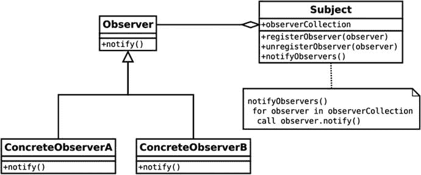
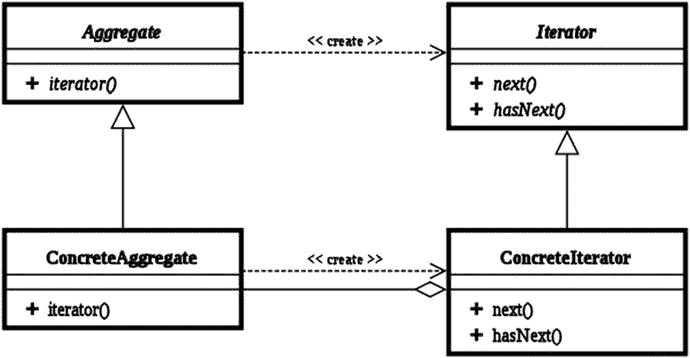

# 3. 函数式响应式编程

在前几章中，我尽量让代码示例独立于其他内容（尤其是响应式代码示例），因此我尚未提及任何特定的库，这也导致你无法直接复制粘贴其中某些代码并运行它们。

关于前几章，需要注意的一点是，大多数响应式示例都使用了函数式编程的概念（`map`、将函数作为变量传递等），因此本章的主题——函数式响应式编程——对你来说应该并不意外。

在本章中，你将开始更接近实际编写可运行代码的过程（太好了！），并通过探讨以下主题来实现这一目标：

-   JavaScript 中的函数式编程（FP）入门。我将在此概述函数式编程的相关要点，并尝试快速讲解，通过展示一些代码示例来帮助解释其内部工作原理以及它们如何帮助我们完成任务。
-   函数式程序员的主要工具。承接上一点，我将介绍每个函数式程序员都应学会并喜爱的三大工具：`map`、`reduce`和`filter`。
-   如何处理可观察的事件流。

## JavaScript 中的函数式编程入门

坦白说，JavaScript 中的函数式编程本身就是一个庞大的话题，我完全可以就此写一整本书。话虽如此，我仍会尝试在本章中对其做一个总结。本章将涵盖函数式编程最重要的部分，而将深奥的理论基本排除在外。如果在本章结束时，你仍想更深入地学习这个主题，请去找一本相关的书（比如 Joshua Backfield 的《Becoming Functional》或 Neal Ford 的《Functional Thinking》），它们绝对值得一读。

言归正传，让我们首先定义一些将在本章中使用的概念：纯函数、组合、柯里化和单子。

**记住**

以下解释将基于 JavaScript 的上下文进行。因此，如果你已经熟悉这些概念更通用的版本，请记住，我为了保持简单易懂，对解释范围做了限制。

### 纯函数

在函数式编程中，有一个纯函数的概念。考虑到你几乎整个开发生涯都在与函数（或方法）打交道（如果你没有，那我真不知道你在用什么奇怪的语言编程），定义这个概念可能会让你觉得奇怪。

那么，一个函数要满足什么条件才能被称为纯函数呢？一个纯函数必须符合以下两点：

-   执行时不能产生不可预见的副作用。换句话说，一个函数在每次被调用时，只要传入相同的参数，就必须返回完全相同的结果。
-   其内部逻辑只能依赖于它接收的参数。这意味着，即使函数执行没有副作用，它也不能依赖外部值来进行计算，因为这些值可能会改变，从而影响函数的结果，这反过来又违背了上一点。

表 3-1 展示了一个快速示例。

**表 3-1.** 纯函数与非纯函数示例

| 纯函数 | 非纯函数 |
| --- | --- |
| ```function pure(a, b, c, d) {  return a + b + c + d;}``` | ```var sum = 0;function impure(a,b,c,d) {  sum = a + b + c; // 修改了一个外部变量  return a + b + c + d;}``` |
| ```function pure(a, b) {  var mult = 2;  return (a+b) * mult;}``` | ```var mult = 2;function impure(a, b) {  return (a+b) * mult;}``` |

表 3-1 中的示例清楚地展示了第一行中非纯函数的不希望的副作用，以及第二行中不希望的外部依赖。在这两种情况下，非纯函数的执行都会产生不期望的结果。

纯函数的概念相当简单，但对于实现函数式编程至关重要，因此完全理解它非常重要。另外需要补充说明的是，即使这与函数式编程没有直接关系，在你的代码中使用纯函数也能减轻阅读或使用你代码的开发者的认知负担，因为理解函数内部逻辑所需的工作量会大大降低。这类函数的另一个好处是它们更容易测试，因为它们只依赖于输入值。


好的，作为高级文档工程师和翻译员，我将遵循您的注意事项和示例，将给定的英文文本翻译成中文。


### 组合

函数组合是函数式编程的另一大支柱，因为它与纯函数一起，为我们开发者提供了创建复杂结构的方法，这些结构能够保持函数式范式所施加的约束。

从数学的角度来看，函数组合看起来像这样：

```
compose(f(x), g(x)) = f(g(x))
```

现在，如果你把它翻译成 JavaScript，组合函数看起来像这样：

```
var add10 = function(a) { return a + 10; };
var double = function(b) { return b * 2; };
var addAndDouble = compose(add10, double); //add10(double(a));
addAndDouble(10); //returns 40;
```

这个例子展示了一个非常基础的组合，虽然它确实有助于解释这种操作的基本行为，但让我们看一个更复杂的例子，以便更好地理解它能为我们带来多大的用处。

为此，假设你正在开发一个待办事项列表应用程序，坦白说，这算是编程界的新版“Hello World”。在这个应用程序中，我们想要获取所有已完成任务的列表，所以使用纯 JavaScript，你可以写成这样：

```
var doneTasks = tasks.filter(function(t) { return t.done; });
```

你可以说这是一种函数式方法；毕竟你传入了一个纯函数作为过滤条件，而且它确实工作。但我们还可以做得更好：

```
var doneTasks = filter(where({done: true}));
```

不，我没有忘记 `tasks` 列表，在示例中，`doneTasks` 变量包含的是一个函数，而不是过滤后的实际任务列表，这个函数会在执行时过滤我们作为参数传入的任何任务列表。所以我们实现了可复用性（耶！）。我知道我刚刚提出了两个新函数，并且没有真正解释它们是如何工作的，但这是有原因的：我还没有讨论完你需要用来创建它们的工具。一旦你读完本章的这一部分，你应该就拥有了自己创建它们所需的全部知识。

话虽如此，这种新方法还有另一个好处：组合能力。假设你还想按用户对该列表进行分组。你可以使用一个给定的 `partition` 函数来分组任务，它的工作方式类似于 `compose`，但使用 `Array.prototype.reduce` 方法，它会创建一个由你想要的属性索引的元素字典。

```
var groupByUser = partition({prop: 'username'});
var groupedTasks = compose(groupByUser, doneTasks);
```

现在，使用两个简单的函数，你创建了第三个更复杂的函数，并且它仍然是纯函数。尽管 `compose` 函数很容易理解，但让我为你展示 `partition` 和 `compose` 两者的实现：

```
function partition(byProp, list) {
return list.reduce(function(dict, curr) {
var idxValue = dict[byProp.prop]; //使用我们传入作为参数的属性
if( !dict[idxValue] ) dict[idxValue] = []; //初始值
dict[idxValue].push(curr);
return dict;
},{});
}
function compose(fn1, fn2) {
return function() {
return fn1(fn2.call(fn2, arguments));
}
}
```

现在你看过之后，这个函数其实并不复杂；它需要做的就是理解 `reduce` 函数的工作原理，简单来说，它允许你遍历数组的值并对其应用一个函数，将所有值减少为一个。上面代码中另一个有趣的地方是，它接收两个参数，但在示例中我只传了一个参数，这是怎么回事？！

现在是开始讨论柯里化函数的最佳时机，那么，让我们开始吧！

### 柯里化函数

请暂时忽略你现在对印度菜的突然渴望（[`https://en.wikipedia.org/wiki/Curry`](https://en.wikipedia.org/wiki/Curry)），因为这和它无关（实际上，它和哈斯凯尔·柯里有关，一位帮助开发了这项技术的数学家）。函数柯里化（通常的称呼），是用少于其需要的参数来调用一个函数，而该函数不会以不可预测的结果运行，相反，它会返回一个预设了给定参数的新函数。

这有点绕口，让我们看一个非常简单的例子来理清思路：

```
//简单函数
function add(x, y) { return x+y; }
//现在我们柯里化它
var curriedAdd  = curry(add);
var add100 = curriedAdd(100);
//现在我们可以简单地...
console.log(add100(10)); //输出 110
```

现在，回到之前的 `partition` 例子，该函数接受两个参数，但我只使用了一个；我传入了想要分组的属性，但没有传入列表，所以我柯里化了这个函数，它相应地返回了一个只需要待分区项目列表的新函数。当然，这在 JavaScript 中不会自动发生；为了实现这一点，这里隐含了一个步骤，包括调用一个柯里化函数，就像我在 `add100` 示例中所做的那样。

但是，如果使用得当，函数柯里化可以成为一个很好的工具，帮助你获得更清晰的语法，更具声明性而非命令性。

让我们看一个经典的例子：从一个用户对象列表中，获取一个用户名列表；实现方法太多，但让我们尽量保持函数式风格，好吗？

```
var users = [ {id: 1, name: 'Richard Reed' } , { id: 2, name: 'John Stewart' } ];
users.map(function(u) {  return u.name; }); //返回 ['Richard Reed', 'John Stewart']
```

代码是有效的，但如果你追求声明式而非命令式，那行代码中的函数定义感觉不太对劲。那么，如果你像这样柯里化那个函数呢：

```
var get = curry(function(prop, o) { return o[prop]; });
```

前面的声明有点棘手。记住，`get` 实际上并不是你想要的函数；相反，你想要的是当用你想要提取属性的项目列表调用 `get` 时返回的那个函数。这样，你就可以将其与 `map`、`reduce`、`compose` 等结合使用。在这个特定情况下，我使用了 `map`，让我们看看现在会是什么样子：

```
users.map(get('name'));
```

这比之前清晰多了，不是吗？如果你柯里化 `map` 调用，甚至可以更进一步，就像这样：

```
var map = curry(function(list, fn) { return list.map(fn); });
//现在我们能做类似这样的事情：
var listOfNames = map(get('name'));
```

而最棒的是？这段代码完全没有引用用户列表。这意味着 `listOfNames` 变量引用了一个函数，你可以在任何地方复用它，甚至可以在需要时与另一个函数组合。

正如你所见，函数柯里化提供了一种比简单函数更高的灵活性；将其与组合结合起来，你就拥有了一个杀手组合。看看下面的代码，简直优美：

```
/*
执行顺序与参数的顺序相反，
所以你必须倒着读：
* 按 id 排序
* 然后获取项目的名称，并用逗号连接这些名称
*/
compose(
compose(join(', '), map(get('name'))),
sortBy(get('id'))
);
```

简单、干净，代码读起来几乎就像注释——忘掉命令式编程吧！

在我结束这个话题之前，让我们来揭开 `curry` 函数的神秘面纱，好吗？这里有一个适用于前面例子的简单实现：


```javascript
function curry() {
//We transform the arguments object into an array...
var arrArguments = [].slice.call(arguments);
var fn = arrArguments.splice(0, 1)[0];
var headArgs = arrArguments;
return function() { //the curried function
var newArgs = headArgs.concat([].slice.call(arguments));
return fn.apply(fn, newArgs);
};
}
//Example usage
function sum(a, b) {
return a + b;
}
var sum10 = curry(sum, 10);
console.log(sum10(1));
```

由于该函数旨在柯里化一个参数数量不限的函数，因此接收的参数列表保持为空，它直接操作`arguments`对象，该对象包含函数接收到的所有参数。它先从列表中取出第一个参数（即你要柯里化的函数），其余参数则是你预先设定的参数。

该函数还返回一个匿名函数，这个匿名函数将使用正确的参数列表来调用你的实际函数。如你所见，这是一个非常强大的函数，实现却非常简单。

## 函数式编程的工具

那么，利用组合、纯函数和柯里化能做些什么呢？我来告诉你，你可以创建每一个优秀的函数式程序员必须了解并钟爱的三大主要函数（没错，你可能会爱它们，也可能恨它们，因为即便在不自觉中你也会用到它们）。

这些函数是 `map`、`filter` 和 `reduce`。让我们更好地了解它们，尽管你可能已经使用过它们，因为它们都是 `Array` 对象的一部分。我将展示它们的工作原理以及你可以用它们做什么。

### 映射（Map）

我们先从最简单的开始。`map` 函数旨在将某个函数应用于列表中的每一个元素，然后根据执行结果创建一个新的列表。

我先举一个基本例子。假设你有一个整数列表，想要计算每个数的平方根，使用 `map` 很简单：

```javascript
var numbers = [1, 2, 3, 4, 5, 6];
var results = numbers.map(function(i) { return Math.sqrt(i); } );
console.log(results);
/* Resulting on
[ 1,
1.4142135623730951,
1.7320508075688772,
2,
2.23606797749979,
2.449489742783178 ]
*/
```

这很简单。甚至还可以进一步简化，方法 `Math.sqrt` 接收一个参数并返回一个值，这与你的匿名函数的签名类似，因此你可以直接写成：

```javascript
var numbers = [1, 2, 3, 4, 5, 6];
var results = numbers.map(Math.sqrt);
console.log(results);
```

两种情况下结果相同，但第二种写法更易理解，更具声明性。

这里有一个需要注意的地方：应用的函数必须是同步的，你不能像下面这样做：

```javascript
var filenames = ['file1.txt',  'file2.txt' ];
var content = filenames.map(fs.readFile);
```

这行不通，因为 `readFile` 方法不返回实际内容，如果你尝试运行前面的代码，最终会得到一个充满 `undefined` 项的数组。这再次说明，我所使用的方法不返回内容；实际上，它什么都不返回。不过别担心，有一种方法可以实现异步 `map` 并使用结果数组，只是略有不同。

就像编程世界中的一切事物一样，实现这一点并没有唯一正确的方法。我将展示异步 map 的两种变体：一种使用 ECMAScript 6 的 Promise（为什么不呢？），另一种使用经典的回调函数。你可以选择最喜欢的一种来使用。

```javascript
//Map using ECMAScript 6 Promises
function promiseMap (list, fn) {
var promises = list.map(function(i) {
var p = new Promise(function(resolve, reject) {
fn(i, function(err, result) {
if(err) return reject(err);
resolve(result);
})
});
return p;
});
return Promise.all(promises);
}
```

上述代码做了两件简单的事：首先，它创建了一个 Promise 列表，然后返回 `Promise.all` 返回的 Promise，当所有作为参数传入的 Promise 都 resolved 时，这个 Promise 就会 resolved。而"魔法"发生在 `map` 循环生成的 Promise 内部，它们执行异步函数 (`fn`)，并根据该函数的结果决定 Promise 是 resolved 还是 rejected，这反过来会影响全局 Promise 的结果。

**注意**

上述代码显然假设你已经知道什么是 `Promise` 以及如何使用它。如果你还不了解，建议你阅读相关资料 ([`https://developer.mozilla.org/zh-CN/docs/Web/JavaScript/Reference/Global_Objects/Promise`](https://developer.mozilla.org/zh-CN/docs/Web/JavaScript/Reference/Global_Objects/Promise))。

以下是如何在代码中使用基于 Promise 的新函数 `promiseMap`：

```javascript
//Sample code using promise based map function
var filenames = ['file1.txt', 'file2.txt'];
promiseMap(filenames, fs.readFile)
.then(function(content) {
console.log("------- 文件内容 ---------");
content.forEach(function(c) {
console.log(c.toString());
});
})
.catch(function(err) {
console.error("读取文件时出错：", err);
});
```

示例代码接收一个字符串列表（文件名），并将 `fs.readFile` 方法应用于每个字符串，即读取每个文件并将其内容放入一个新列表。一旦列表中的所有项目处理完毕，且所有文件都成功读取，最终回调函数就会被调用，它将收到一个包含主函数 (`fs.readFile`) 所有执行结果的数组。

另一种在 `map` 调用中处理异步函数的方法是使用回调函数，为此你可以使用我将展示的自定义实现，或者依赖第三方库，比如 Async.js ([`https://github.com/caolan/async`](https://github.com/caolan/async))。

```javascript
//Map using regular callbacks
function callbackMap (list, fn, done) {
var results = [];
var counter = 0;
list.forEach(function(i) {
fn(i, function(err, result) {
if(err) return done(err);
results.push(result);
counter++;
if( counter == list.length ) {
done(null, results);
}
});
});
}
```

这段代码比基于 Promise 的版本更直接；它只是遍历所有项目，应用异步函数，并跟踪已调用回调的次数。一旦达到正确数目（等于列表中的项目数），就调用 `done` 函数并发送结果列表。

以下是使用该函数的方法：

```javascript
//Sample code using callback based map function
var filenames = ['file1.txt', 'file2.txt'];
callbackMap(filenames, fs.readFile, function(err, content) {
if(err) {
console.error("读取文件时出错：", err);
} else {
console.log("------- 文件内容 ---------");
content.forEach(function(c) {
console.log(c.toString());
});
}
});
```

现在，无需使用 `then` 和 `catch` 设置两个回调函数，而是使用一个匿名函数同时接收错误和结果，这是一种经典的回调模式。


#### Filter

`filter`函数是函数式编程工具箱中另一个简单但强大的工具。其背后的理念很简单：遍历一个列表，对每一项应用一个布尔函数，如果函数返回`TRUE`，则将其添加到返回列表中；否则忽略它，从而过滤初始列表。

让我们看一个例子来完全理解这个函数背后的理念，该函数已是 Node.js 中`Array`对象的一部分：

```javascript
var list = [-4, -3, -2, 0, 2, 3, 4 ];
var positives = list.filter(function(nmbr) {  return nmbr > 0; });
console.log(positives); //this will of course print "[2, 3, 4]"
```

这里的基本理念是：过滤函数需要返回一个值，该值会被视为真值（可转换为布尔值`true`）或假值（可转换为布尔值`false`）。

处理异步函数来执行过滤与你之前看到的`map`非常相似，因此将其作为练习留给你来实现。

使用柯里化给`filter`的一个有趣用法是定义可复用的过滤器，你只需确保与之前的例子不同，第一个接收的参数是实际的过滤函数：

```javascript
/*
Custom implementation of a simple filter function
*/
function filter(filterFN, list) {
    var results = [];
    list.forEach(function(item) {
        if(filterFN(item)) {
            results.push(item);
        }
    });
    return results;
}
var onlyEvenNumbers = curry(filter, function(nmbr) { return nmbr % 2 == 0; });
var list1 = [1,2,3,4,5,6,7,8,9,0];
var list2 = [-1, -4, -6, 23, 10];
var list3 = ['string', 'word', 4, 2, Date()];
// now we can do
console.log(onlyEvenNumbers(list1)); //[ 2, 4, 6, 8, 0 ]
console.log(onlyEvenNumbers(list2)); //[ -4, -6, 10 ]
console.log(onlyEvenNumbers(list3)); //[ 4, 2 ]
```

可复用性，再次，耶！`filter` + `curry` 是如此强大的组合。

#### Reduce

最后但同样重要的是`reduce`。这无疑是三者中最复杂的，因为它的逻辑并不那么直观，尽管你即将看到，它只需要你多花点注意力在解释上，仅此而已。

这个函数将一个操作应用于一个从自定义初始值开始的累积值以及列表中的每一项；该操作的结果用于与下一项结合，依此类推，直到整个列表被归约为单个值。

这比我想象的要复杂一些，所以让我们用代码来解释，代码加上定义应该足以让你上手：

```javascript
var numbers = [1, 2, 3, 4, 5, 6, 7, 8, 9];
var sum = numbers.reduce(function add(x, y) { return x + y; }, 0);  //returns 45
```

足够简单，让我们一步步分析上述代码的执行过程：

```
result = add(0, 1) //this returns 1 obviously
result = add(result, 2); //this returns 3
result = add(result, 3); //this returns 6
result = add(result, 4); //this returns 10
result = add(result, 5); //this returns 15
result = add(result, 6); //this returns 21
result = add(result, 7); //this returns 28
result = add(result, 8); //this returns 36
result = add(result, 9); //this returns 45, and it's done!
```

注意你是如何从`0`开始的，那是你传递给`reduce`方法的第二个参数，即初始值。但是对列表中的所有数字求和只是一个简单的例子；你可能会发现自己需要执行其他更复杂的任务，`reduce`也能帮上忙！

```javascript
var words = [ 'Hello', ' ', 'world', '!' ];
var str = words.reduce(function(currentStr, word) {
    return currentStr += word;
}, '');
```

上述代码展示了`reduce`方法的另一个经典用法。巧合的是，我使用了相同的运算符（`+`），尽管不是数字加法，而是字符串拼接。是的，使用`join`方法有更简单的方式来实现上述功能，但这当然是为了提供一个能做什么的例子。

最后，让我们看另一个例子，一个扁平化函数；它将接收一个列表的列表，并将它们全部合并成一个单一的一维列表。

```javascript
var listOfLists = [ [1, 2, 3], [ 4, 5 ] , [6, 7, 8] ];
var flattened = listOfLists.reduce(function(newList, item) {
    return newList.concat(item);
}, []);
```

#### 综合运用

只是为了趣味性，让我们用一个使用了大部分我提到的函数式编程工具的例子来结束这个主题。它可能有助于让你更好地了解它们如何相互配合。

以下是你要做的：读取一个文本文件的内容，获取每个标准字符的 ASCII 码，最后将所有数字相加得到所有 ASCII 码的总和。为什么要这样做？你听说过这样的谣言吗：字符串”Bill Gates III”转化为 ASCII 然后相加会得到 666？嗯，这是一个相当古老的谣言，所以如果你没听说过也不用担心。你要做的是使用函数式编程来证明或揭穿这个谣言！

因为这是本章的内容，我也会加入一些响应式编程：不是将文件名硬编码到某个变量中，而是从用户那里获取输入，并使用该字符串作为文件名，将其添加到我们的一个`ObservableStream`中，并设置一个函数链，该链将：

*   使用输入作为文件名读取文件。
*   将结果字符串分割成字符数组。
*   过滤掉不需要的字符。
*   将每个字符映射到其 ASCII 码。
*   将它们加起来。
*   将结果数字打印到控制台。

代码如下：

```javascript
var fs = require("fs");
var functionalUtils = require("./func_utils");
var ObservableStream = require("./ostream");
/*
Utility functions
*/
var filterUnwantedCharacters = functionalUtils.curry(functionalUtils.filter, function(c) {
    return /[a-zA-Z0-9 ]/.test(c);
});
var mapToInt = functionalUtils.curry(functionalUtils.map, function(c) {  return c.charCodeAt(0); } );
var addUp = functionalUtils.curry(functionalUtils.reduce, function(x, y) { return x + y; });
var split = function(str) { return str.toString().split(""); };
//streams setup
var dataStream = new ObservableStream();
dataStream.data
    .then(fs.readFile)
    .then(split)
    .then(filterUnwantedCharacters)
    .then(mapToInt)
    .then(addUp)
    .then(console.log)
    .catch(function(error) { //Error handling!
        console.log("There was an error: ", error);
    })
var filenameStream = new ObservableStream();
var filename = "";
filenameStream.data
    .then(function(chr) {
        if(chr.charCodeAt(0) != 13) { //if we're not inputing an enter
            filename += chr;
        } else {
            dataStream.add(filename);
            filename = "";
        }
    });
var stdin = process.stdin ;
stdin.setRawMode(true);
stdin.resume();
stdin.on('data', function(input) {
    var character = input.toString();
    console.log(character);
    if(character.charCodeAt(0) === 27) process.exit(0); //exit with ESC
    filenameStream.add(character);
});
```

你会注意到我引用了两个实际上是自定义的库（`func_utils`和`ostream`），但代码并不在这里，我将在本书后面展示它们的代码；现在，只要知道我们使用的是我已经讨论过的函数就足够了。至于`ObservableStream`对象，暂时不用担心；我很快就会详细讲解它。

> **注意**
> 
> 顺便提一下，如果你尝试了本书附带的代码，并使用内容为“Bill Gates III”的文件，你可能会发现这个谣言大错特错。所以，真扫兴，但至少你揭穿了它，同时找到了一些乐趣！

代码实际上相当直接，但像往常一样，有几个有趣的地方，让我们来逐一讨论。


### 双流并用而非单流

我使用了两个流，其中一个用于从用户输入中收集文件名。这个流的事件链上只有一个函数。或许我可以用其他方式处理，比如自定义的 `concat` 函数，但为了简单起见，当前版本已经足够用了。

一旦这个自定义函数检测到我们按下了 `ENTER` 键，它就会将当前字符串添加到另一个流中，这个流负责处理所有事务并返回神奇的数字。

对于第二个流，我设置了一个稍长的事件链，旨在逐步处理文件内容并打印最终结果。它们完成了之前提到的所有操作，因此这里无需赘述。

### 将函数全面柯里化

为了让代码更易读，同时也为了与 Observable Streams 的事件链兼容，我对所有主要函数进行了柯里化。也就是说，过滤、归约和映射这些函数都被柯里化成了简化且定制化的版本。由于 `split` 函数只需要一个参数，所以没有对其进行柯里化。

### 可读性大幅提升

代码背后的逻辑非常简单：我只是想读取一个文件，将其内容转换为 ASCII 码，并计算出最终的数字。但我不妨挑战一下你，用传统的命令式逻辑来编写这段代码。抛开我一直在谈论的那些工具，在不使用它们的情况下编写代码。你会发现抽象层级降低了，而你自己则不得不去解决一些我甚至无需触及的其他问题。

这就是声明式编程的魅力所在，我们确实应该更深入地探讨它，那么开始讨论吧。

## 声明式编程

在代码中使用声明式方法的一个直接副作用（正如我无数次提及的那样）是：你可以在程序中编写声明式语句，而不是通常的命令式语句。

简而言之，使用你上面看到的那些工具，你可以编写描述“你想要完成什么”的代码，而不是像通常学的那样，去告诉编译器/解释器“如何完成”你认为最佳的操作，以达到你想要的结果。

尽管有些语言是纯粹声明式的，比如 `SQL`、`XSL` 和 `Prolog`，但由于 JavaScript 允许你编写函数式代码，你可以将 JS 视为一种部分描述性的编程语言。这只需要开发者有相应的意愿即可。

别误会，命令式编程和声明式编程一样，都是有效的代码编写方式。而且，你在入门时首先学到的是命令式编程，这完全合情合理；毕竟，早期的计算机，由于使用的是真空管和非常基础的指令集，开发者被迫以逐步的方式编写程序，精确地告诉计算机如何解决一切问题。

接下来，让我们看一个例子，了解一下从纯粹（或者说大部分是）命令式的实现转向更具声明式的实现后，代码的可读性能有多大的提升。

```
getRemoteData("www.remoteurl.com", function(err, data) {
if(err) {
return handleError(err);
}
parseData(data, function(err, items) {
if(err) {
return handleError(err);
}
var names = [];
for(var i = 0; i < items.length; i++) {
if(items[i].age > 18) {
names.push(items[i].name);
}
}
console.log(names.join(", "));
});
});
```

上面的代码是命令式代码的一个完美示例。你在做的事情如下：

- 在预期出错的地方手动检查错误。
- 创建一个局部变量，仅仅为了遍历数组中的每个元素。
- 创建一个额外的数组，仅仅为了临时存储提取出的对象名称。

代码能正常运行，问题不在于效率低下或可能有 bug。不，这里的主要问题在于：

- 你必须在脑海中解析这段代码。诚然，这个算法并不复杂，但认知负担依然存在——如果你想理解代码试图做什么，你就必须这样做。
- 扩展这段代码同样需要你阅读并理解你的改动对整个算法产生的影响。

现在，让我们用声明式的方式来思考。基本上，你需要思考“需要做什么”，而不是直接跳入“如何做”。你想要做的是：

- 从远程 URL 获取数据。
- 解析结果。
- 获取年龄超过 18 岁的对象的名称。
- 打印出逗号分隔的名称列表。

这就是你希望应用执行的步骤列表，但其中没有任何内容告诉你它具体应该如何执行。这没问题，你不需要知道，因为你已经拥有处理这些“底层”任务的工具了，例如遍历元素、获取对象属性、或串联步骤以避免担心回调，诸如此类的任务还有很多。

那么，让我们快速看一下如果用声明式方式编写，你的算法会是什么样：

```
getRemoteData("ww.remoteurl.com")
.then(parseData)        //获取响应对象并返回对象列表
.then(filter(over18))
.then(map(get('name'))) //获取每个对象的名称
.then(join(", "))       //获取字符串列表并返回一个字符串
.then(console.log)      //最终打印出字符串
.catch(handleError);    //仅用一行代码处理错误
```

这段代码结构非常类似 Promise，因此阅读起来非常容易。调用链上的步骤与我们之前描述的步骤几乎完全一致，所以你可以看到我们的代码有多么声明式。

我使用了一些你已见过的函数式工具，比如 `map` 和 `get`，还有一些新工具，比如 `join`（另一个柯里化函数，它重现了 `String` 对象的 `join` 方法），以及将某个函数的结果通过管道传递给另一个函数参数的能力。

在上述流程中添加一个步骤，比用命令式替代方案要容易得多，因为你无需处理任何现有代码。只需确保你添加的函数的输入和输出与调用链中对应位置的类型匹配即可。

## 每个 FRP 语言必须具备的特性

既然你已经掌握了 FP 的基础知识，并且快速了解了声明式编程，那么你已具备了开始讨论 FRP 所需的工具。

虽然 JavaScript 并非纯粹的函数式响应式编程语言，而其他语言如 `Haskell` 或 `Elm`（[`http://elm-lang.org`](http://elm-lang.org)）才是，但我将概述任何 FRP 语言必须具备的主要特性，然后将其与 JavaScript 进行对比，你将看到如何在你自己喜欢的语言中实现这样的特性。


### 可观察流

函数式响应式语言的主要特性应该是具备原生可观察事件流的能力。在第 1 章和第 2 章中，我讨论了这些流的重要性。它们基本上是迈向语言中“响应式”部分的基石。

这些结构在更新时，你的代码会做出响应，所以它们非常重要，请注意！那么，它们究竟是什么？它们应该是什么样的？解释的方式有很多，但最简单的理解方式是将其视为观察者模式和迭代器模式的组合。

一方面，观察者模式规定：
- 与该模式相关的对象有两种类型：Subject（被观察的对象）和 Observer（即对主题更新做出反应的对象）。
- 主题维护其观察者列表。
- 当主题的状态发生变化时，它会通知所有观察者。通常，会执行一个预先定义的方法（通常称为 `notify`）。

现在，让我们看图 3-1，以直观理解观察者模式的样子。



图 3-1. 观察者模式的 UML 图（来自维基百科观察者模式页面的公共领域图片）

图 3-1 展示了该模式的经典实现，包括前面提到的 `notify` 方法以及通知观察者的逻辑。这个模式很棒，但它缺少一个细节：当生产者向所有消费者逐个发送事件时，没有明确的方式告知它们事件已经发送完毕。稍后我会再提到这一点。

现在，与观察者模式相比，迭代器模式要简单得多。在这里，你只是试图将对集合进行遍历的算法与集合的实际实现解耦。主要优点是你可以针对不同类型的集合重用遍历算法。图 3-2 对该模式进行了直观解释。



图 3-2. 迭代器模式的 UML 图

图 3-2 展示了该模式的经典 UML 图。集合（继承自 Aggregate 类）可以创建一个迭代器，该迭代器将提供获取其中某个项以及询问是否还有下一个项的方法。这与刚才看到的观察者模式相比是一个巨大的优势，因为现在你有办法知道列表中是否还有更多项。

### 观察者 + 迭代器 = ？

那么，为什么我突然提起观察者和迭代器？可观察集合与这两种特定模式有何关系？

你刚才看到，观察者模式与你对可观察集合的期望非常相似，因为生产者实际上负责通知观察者，就像我一直描述的响应式编程的工作方式一样。

但你也看到，如果你还希望知道更新流的结束，这种模式是不够的。你如何判断被观察的对象何时完成发送更新？

这就是迭代器模式发挥作用的地方。有了它，你可以知道流何时结束，你甚至有一种非常干净（更重要的是标准）的方式从流中获取更新。

换句话说，可观察流是一个动态更新的集合，具有标准的接口供你对其进行迭代。

那么，让我们看看在像 Elm 这样的函数式响应式语言中，原生可观察流是什么样子的：

```
import Graphics.Element exposing (..)
import Mouse
main : Signal Element
main =
Signal.map show Mouse.position
```

Elm 的语法可能让你感到陌生，但鉴于代码的声明式特性以及代码片段中极少的代码行数，代码试图实现的想法应该相当明显。

这段代码（取自 Elm 网站示例 [`http://elm-lang.org/examples/mouse-position`](http://elm-lang.org/examples/mouse-position)）在屏幕上打印鼠标指针位置的坐标，并在每次移动鼠标时更新它。`Mouse.position` 属性实际上是一个可观察流，它被用作 `Signal.map` 方法的输入，该方法将 `show` 函数应用于流的每个新值。正如我所说，超级简单！

如果你想用我一直向你展示的声明式语法在 JavaScript 中实现同样的功能，你的 JavaScript 代码会是什么样？大概是这样的：

```
Mouse.getPosition()
.then(map(show));
```

那么，你如何在 JavaScript（更具体地说是使用 Node.js）中实现可观察流？以下是解决该问题的一个基本方法：

```
var EE = require("events");
var util = require("util");
function ObservableStream() {
this.values = [];
this.error_fn = null;
EE.call(this);
}
util.inherits(ObservableStream, EE);
ObservableStream.prototype.add = function(value) {
this.values.push(value);
this.emit('data', value);
};
ObservableStream.prototype.getValues = function(){
var self = this;
var stream = new Streamable();
self.on('data', function(v) {
stream.emit('trigger', v)
})
return stream;
};
```

前面的代码是开发者应关注的主要类（如果你愿意，可以说是公共类），它提供了进入库核心部分的入口点，即 `Streamable` 类（见下文）。这段代码的工作方式很简单：每当有新项添加到内部集合时，就会发出一个 `data` 事件（这就是我使用 `EventEmitter` 模块的原因）。正如你在 `getValues` 方法中看到的，`Streamable` 对象正在监听此事件，并且每次触发该事件时，`streamable` 本身会触发一个新的 `trigger` 事件，以启动转换链。


