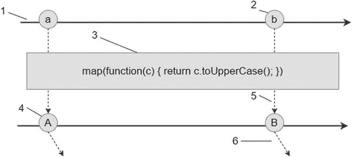
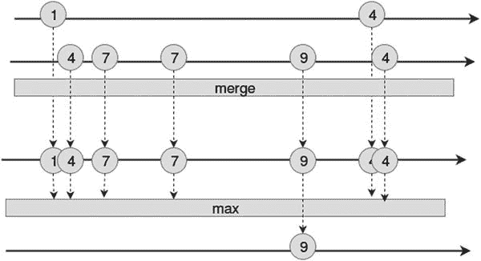
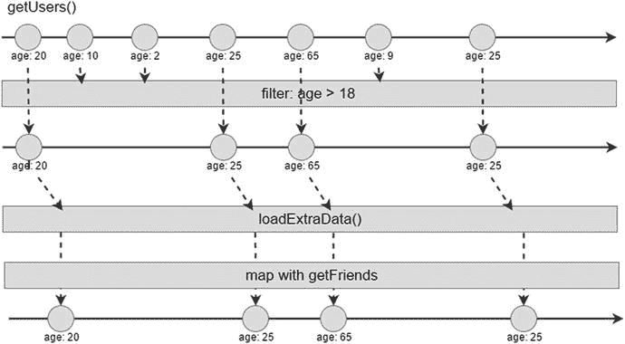
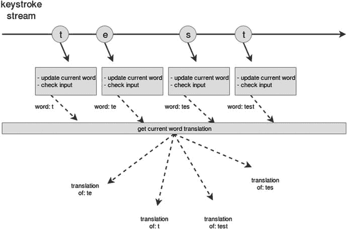
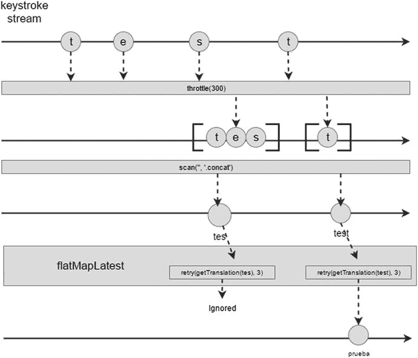

# 2. 成为响应式

既然我已经确立了什么是响应式编程（RP）以及为什么要使用它，那么下一个合乎逻辑的步骤就是开始调整你的思维方式以正确使用它。由于我们在此讨论的是一种新的范式，你不能仅仅用面向对象的思维方式或函数式思维来解决这个响应式问题，你需要开始以响应式的方式思考。

因此，在本章中我将正是做这件事：我将尝试向你展示如何以响应式的方式思考。为了实现这个目标，我将：

*   向你展示一些 Node.js 的问题解决技术及其不足之处。
*   用 RP 解决这些不足之处。

在本章结束时，你将知道如何进入响应式思维模式。

但请记住，本章提供的 RP 示例暂时不会涉及特定的库，它们将是看起来很像 JavaScript 的伪代码示例。等到你读到第 6 章时，你就可以选择一个特定的库并使用它来编写示例了。

## 首先，关于弹珠图

或者说，更多的是关于弹珠图。我在第 1 章中使用过它们，但没有真正解释过，但现在我要向你展示几个复杂度逐渐增加的弹珠图，我不妨先介绍一下弹珠图的基础知识，以及它如何帮助你更好地理解响应式数据流。

弹珠图是一种可视化表示响应式数据流的方式。这句话的基本意思是，借助弹珠图，你拥有一套工具，可以表示数据流在响应式数据流过程中经历的各种转换。

具体来说，我将向你展示我将在整本书中使用的一种弹珠图的小变体；基本思想是一样的，但我会添加一些额外的标准来更好地解释我想要展示的行为。所以闲话少说，让我们看看图 2-1，它展示了一个简单弹珠图的基本结构。



**图 2-1.** 弹珠图的基本结构

理解数据流以及对其执行了哪些操作并不难。以下是图中每个数字代表的含义：

1.  从左到右的水平线代表时间。
2.  水平线上的圆圈是流产生的事件。
3.  图中央的大方框表示在流上执行的操作。
4.  上述方框下方的弹珠，是将方框中的操作应用于流中每个事件的结果。
5.  垂直虚线表示一个弹珠的生命周期。
6.  最后，倾斜的虚线表示正在执行的外部服务调用。

图 2-1 所示的流非常简单，它只是将流中的每个字符转换为大写版本，但即使执行更复杂的操作也同样简单。假设你想合并两个数字流，然后从中找出最大值，你可以很容易地用图 2-2 中的图做到这一点。



**图 2-2.** 展示更复杂操作的弹珠图

我知道图 2-2 中有很多弹珠，但忽略它们，你会看到两个简单的步骤：合并和取最大值——仅此而已。这里唯一需要注意的相关事项是，`max` 函数只会在两个原始流都结束后发出一个值。既然这个问题已经解决了，我们继续进入本章的预期内容吧，好吗？

## 摆脱传统技术

在本节中，我将探讨标准 Node.js 开发者在日常工作中需要解决的几种常见“问题”，以及每个问题的标准解决方案。接着，我会分析这些解决方案，最终你会看到响应式方法是否会是一个更好的选择。

### 示例 #1 – 常见的回调地狱

这个问题没什么特别之处——我们都曾遇到过：当你需要按预设顺序（如果愿意，可以看作是按步骤）执行一系列函数时：

```
makeRequest("http://yourserver.com/path/request", function step1(req, resp) {
processData(resp, function step2(err, processedData) {
saveData(processedData, function step3(err, model) {
loadRelatedData(model, function step4(err, relData) {
model.rel = relData;
sendResponse(model);
});
});
});
});
```

**注意：** 上面的示例中故意省略了错误处理，因为它对回调地狱的要点没有任何帮助。

前面示例中的代码只展示了 4 层缩进，但如果你不断添加步骤，很容易就会增加到你觉得“太多”的程度。这并非不切实际。如果你使用 Node.js 的时间够长，就会见过这类代码；不管是你自己写的，还是同事写的，但它确实真实存在。

如果你想解决前面提到的问题，有几种选择。你可以使用 `async.js` 模块（可从 [`www.npmjs.com/package/async`](http://www.npmjs.com/package/async) 获取），如下所示：

```
async.waterfall([
function(callback) {
makeRequest("http://youserver.com/path/request", callback);
},
function step1(req, resp, callback) {
processData(resp, callback);
},
function step2(err, processedData, callback) {
saveData(processedData, callback);
},
function step3(err, model, callback) {
loadRelatedData(model, callback);
},
function step4(err, relData, callback) {
model.rel = relData;
callback(null, model);
}
], function(err, model) {
sendResponse(model);
});
```

生成的代码成功降低了缩进层级，但可惜的是，行数却增加了。这并没有让阅读和理解变得更容易，因为你必须在脑海中解析 `waterfall` 方法提供的不熟悉的结构。

使用 `Promise` 的方法会有所帮助，这得益于 `Promise` 提供的更简洁的语法，但需要手动处理 `Promise` 的复杂性（过程中的每一步都需要返回一个新的 `Promise` 对象，你还需要包装你的异步函数才能像 `Promise` 一样使用它们，等等），这会损害代码的可读性。

你需要一种解决方案，它采用类似 `Promise` 的方式，但能让开发者从这种机制中抽象出来；换句话说，你不应该考虑你正在使用的工具，而只考虑如何最好地使用它。你需要类似这样的东西：

```
makeRequest("http://yourserver.com/path/request")
.pipe(step1)
.pipe(step2)
.pipe(step3)
.pipe(step4)
```

是的，如果在其他地方创建函数，然后只传入它们的引用，上面的瀑布式代码也可以看起来很像这个示例。但这不仅仅是代码行数的问题，还关乎可读性和语义。新的示例中没有瀑布式结构，它只是让你将内容从一个函数流式传输到下一个；你不需要考虑 `Promise` 或者数据如何从一个步骤发送到下一个步骤。你只需知道这一切正在发生——这就是我所追求的，也是你应该努力的方向。

现在让我们记住这个基本示例，继续进入更复杂的问题，一切都会慢慢变得清晰。

### 示例 #2 – 嵌套的异步调用

第 1 章已经简要地提到了这一点，但让我们更详细地再回顾一次。

这个示例的基本场景是：你有一个外部服务请求（比如 HTTP 请求、Socket 调用、数据库查询等），它会返回多个结果，并且对于每个结果，你想执行一系列外部服务请求。基本上，这个示例与前一个类似，但这里不仅是依次执行一个请求，而是要并行执行一批异步调用。众所周知，在 Node.js 中，这意味着我们陷入了异步地狱：每个调用都需要在进入下一个任务之前完成，但每个任务都是异步执行的，所以它们都在排队。我们该如何处理呢？

```
getUsers(function(usrs) {
var fullUsrs = [];
var total = usrs.length;
if(total == 0) return;
usrs.forEach(function(usr) {
if(usr.age > 18) {
loadExtraData(usr, function(err, fullUsr) {
getFriends(fullUsr, function(err, friends) {
fullUsr.friends = friends;
fullUsrs.push(fullUsr)
displayUser(fullUsr);
})
})
}
})
})
```

看一下前面的代码；和通常一样，为了简化而省略了简单的函数。这里有三个执行某种外部服务查询的函数（`getUsers`、`loadExtraData` 和 `getFriends`），其中第一个是最简单的，因为它没有上下文——它只是查询一个服务并返回对象列表。然而，另外两个函数需要对每个对象调用一次，并且由于它们都是异步的，你还需要处理这一部分。此外，它只显示年龄大于 18 岁的用户信息，所以还有一个过滤操作；你需要记住这一点。

话虽如此，让我们尝试将前面代码中函数所做的所有内容映射到图 2-3 中，该图展示了如何使用 RP 解决这个示例。



**图 2-3.** 展示当前问题 RP 方法的大理石图

在图 2-3 中，你可以看到代码示例中的每个主要步骤，而无需在脑海中解析代码：

*   由 `getUsers` 函数返回的初始用户流
*   按年龄对这些项目进行过滤
*   对每个通过过滤的项目进行异步调用（来自 `loadExtraData` 函数调用）
*   `map` 步骤对每个项目进行了异步调用，并对该项目进行了修改。这是最后的转换步骤。

如果你回到编写函数式响应式代码的方式，你可能会写出类似下面的代码：

```
getUsers()
.filter(function(usr) { return usr.age > 18 })
.pipe(loadExtraData)
.map(getFriends(function(usr, friends) {
usr.friends = friends;
return usr;
}))
.pipe(displayUser)
```

这段代码就像图 2-3 一样，比我们通常考虑的抽象层级高了一级，因为它完全不关注边界情况、`forEach` 块或异步行为；相反，它关注的是手头的整体任务以及图中描述的四个步骤。

### 示例 #3 – 处理可节流的输入流

这并非像前两个示例那样可直接替换的简单模式；本示例处理的是输入流中事件发生速度过快、需要进行节流的情况。

为了使问题更具体并提供一个更好的示例，让我们为一个虚构的应用写下用例：

-   你希望应用允许用户输入一个单词或短语，并在用户仍在输入时，查找该字符串的翻译。
-   你希望该应用是一个命令行下的 Node.js 应用。
-   由于你需要调用外部服务来提供翻译，你还希望处理通信失败时的重试机制。

基于以上考虑，以下是使用传统命令式非响应式编程时代码的外观：

```
var stdin = process.stdin;
stdin.setRawMode(true);
stdin.resume();
var currentWord = '';
var retries = 0;
stdin.on('data', function(input) {
input = input.toString();
currentWord += input;
console.log(currentWord) //向用户显示输入内容
if(input.charCodeAt(0) === 27) process.exit(0); //按 ESC 退出
if(input.charCodeAt(0) === 13) { //按 ENTER 开始新的输入字符串
currentWord = "";
console.log(" ");
}
if(currentWord.length > 0) {
getTranslation(currentWord, retries, callback);
}
})
/**
处理翻译响应的回调函数
@err 是错误消息，如果没有错误则为 null
@trans 是翻译后的字符串
@attempt 是当前的尝试次数
@string 是您试图翻译的字符串
*/
function callback(err, trans, attempt, string) {
if(err) {
console.error(err, " - 重试次数: ", attempt);
if(attempt < 3) {
return getTranslation(string, attempt + 1, callback);
} else {
retries = 0;
return console.log("致命错误，重试无济于事: ", err)
}
}
console.log("'",trans,"'")
}
//下面的伪翻译服务
var __DICT__ = {
"hello": "Hola",
"yes": "Sí",
"no": "No",
"i": "Yo",
"i do not understand":"Yo no comprendo",
"who": "Quién",
"why": "Por qué",
"test": "prueba",
"who are you": "Quién eres"
};
function getTranslation(word, retry, cb) {
//通过休眠几秒来模拟服务调用
var high = 5
var low = 1;
var sleepTime = Math.random() * (high - low) + low;
word = word.toLowerCase();
setTimeout(function() {
var translation = null;
if( translation = __DICT__[word]) {
return cb(null, translation, retry, word);
} else {
return cb("未找到: " + word + " 的翻译", null, retry, word);
}
}, sleepTime * 1000)
}
```

**注意**

如你所见，我实际上是在伪造外部服务调用，但就本例而言，代码的简洁性有助于我们将注意力集中在关键点上。

仔细看这段代码，我立即想到有几个需要解决的问题：

-   由于应用不会等待按下 ENTER 键，你需要对每次按键作出反应，因此需要避免尝试翻译未完成的单词或短语。所以，你必须以某种方式处理这个问题。
-   由于持续的输入和外部服务调用的异步特性，你可能会遇到时序问题。如果系统在您输入过程中能够翻译部分短语，并且该响应在最终短语的翻译结果返回之后才到达，那么你最终可能会得到错误的结果。

现在，尽管上述代码在一定程度上确实能工作，但正如你已经看到的，一些怪异之处并未得到处理。这并不是说它无法修复，但要修复它需要付出比我愿意在本例中投入的更多的工作和代码，尤其是因为稍后我将提供一个解决方案，所需编写的代码更少。

那么，让我们看一下图 2-4，然后我将使用函数式响应式伪代码对其进行编码。



图 2-4. 展示翻译问题 RP 方法的弹珠图

在图 2-4 中，您可以看到我们之前提到的问题：

-   对翻译服务的持续请求
-   由于翻译服务可能的延迟导致的响应顺序错乱

如何解决这些问题？非常简单，使用函数式响应式方法，你可以将最初的按键流转换为更容易处理的形式，然后从那里继续转换流，直到得到可翻译的内容。让我们看代码：

```
readInput()
. throttle(300)
.scan('', '.concat')
.flatMapLatest(function(word) {
return retry(getTranslation(word), 3);
})
.pipe(printTranslation)
```

这段代码仍未使用任何库，因此保持通用性，我最终会涉及到这一点，别担心。尽管代码应该易于理解，但有些命名可能不够清晰，所以让我们快速过一下上面的六行：

1.  这一行非常清晰。它读取标准输入并创建一个按键流。
2.  第二行解决了之前的一个问题：通过节流源流中的事件生成，你实际上每 300 毫秒才响应一次事件突发，从而减少了最终发出的翻译请求数量。
3.  第三行将所有被节流的按键连接成一个单独的字符串，然后可以作为新的事件传递。
4.  第四行是最难理解的。`flatMap` 将创建一个并行流来处理作为参数传递的函数，而该函数将返回一个新的流。
5.  在上述函数内部，有`retry`调用，这应该是你所使用的任何库的一部分。如果调用失败，它将返回新的流，并处理 `getTranslation` 调用的重试。
6.  最后，最后一步将打印翻译结果。这一步非常清晰。

通过查看图 2-5 中的新图表，你可以看到算法变得多么简单。



图 2-5. 使用节流的新 RP 解决方案的弹珠图

快速浏览图表，可以非常直观地看到按键在整个先前提议的数据流中发生了什么。最终，显然假设节流步骤将输入分成两部分，你最终只向翻译服务发起了两次调用，而不是使用原始代码时可能会发生的四次调用，并且由于 `flatMapLatest` 函数，只有第二次翻译调用的结果被接受。

诚然，这里实现的功能本可以使用经典的命令式编程来完成，但与这种函数式响应式方法相比，额外的工作和多余的代码行数并不划算。

# 总结

本章涵盖了一些你可能感兴趣使用 RP 解决的最常见情况。你看到了它们如何被常规命令式编程处理，如果考虑到每个边缘情况，解决起来有多复杂，以及最后，如果使用 RP 方法，它们会变得多么简单。

第 3 章将进一步深入函数式响应式编程。我将介绍 Node.js 中函数式编程的基础知识，然后你将看到这如何应用于 RP（我已经展示了一些例子，但这一次，我将更详细地展开）。
