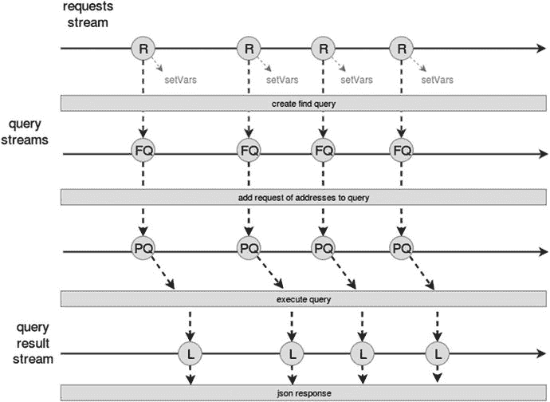
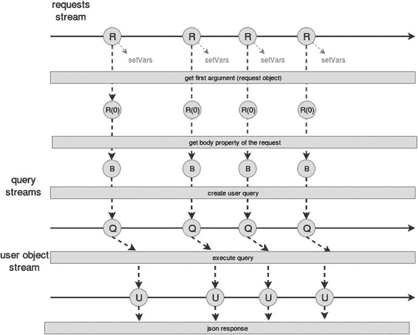
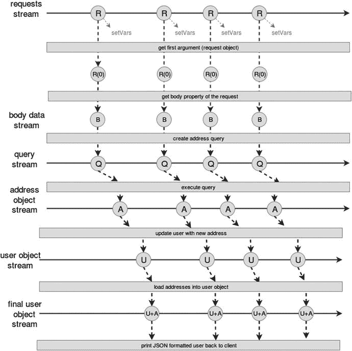
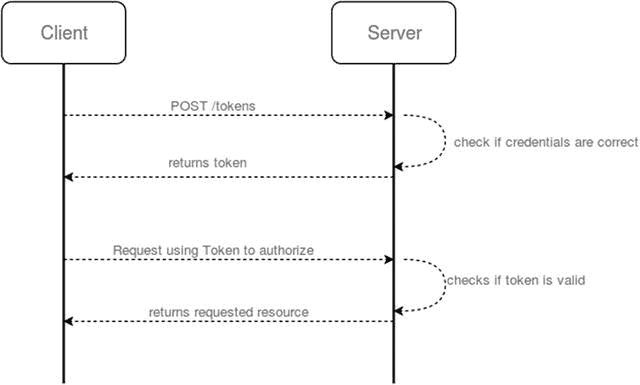
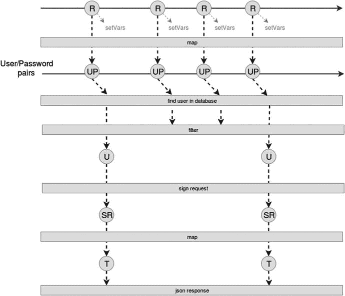

# 4. 后端响应式编程

现在你已经了解了相关背景知识，终于到了动手实践的时候了。在本章中，我将分析如何将函数式响应式编程（FRP）的优势应用到后端开发中。

为此，我将介绍一组后端程序员常见的用例，首先查看常规实现，然后采用 FRP 方式重新实现相同的用例。

由于我没有自己开发或从现有库中选取的 FRP 模块，我将假设已经有一个自定义的 FRP 模块可用。这将在两个方面帮助我：

- 为代码提供所需的支持。
- 帮助定义即将开发的 FRP 模块的 API。目前我假设它已经存在，并且所有需要的函数/方法都可用。

到本章结束时，你将拥有足够的理由开始在后端代码中使用响应式编程。为此，我将介绍两个非常常见的用例：

- **带 CRUD 端点的简单 API**：我将创建一个简单的 API，提供单个端点，包含所有 CRUD（创建、读取、更新和删除）功能。
- **登录**：将向之前开发的 API 添加一个用于获取认证令牌的端点。

那么，让我们直接开始吧。

## 带 CRUD 端点的 API

对于任何后端开发者来说，这可能是最常见的用例之一。过去你很可能遇到过至少一两个这样的功能，但我们将完整地查看 CRUD 函数集。

显然，有多种实现方式，每种方式都同样有效。为了本示例的目的，让我们定义一些约束条件。

### 模型

该 API 将处理两个模型，因此也会包含一些处理两者关系的逻辑。具体而言，这两个模型是 `User` 和 `Address`。每个用户将拥有一个地址集合，其结构如下：

- **用户**
  - `first_name: String`
  - `last_name: String`
  - `birth_date: Date`
  - `addresses: [ Address ]`

- **地址**
  - `street_name: String`
  - `house_number: Number`
  - `phone_number: String`

> **提示：** 像 `Id`、创建日期或任何其他必需的通用属性均未列入此列表，并假定由所使用的框架自动添加到模型中。

### API 接口

表 4-1 列出了该 API 将配合代码提供的端点。它们主要是提供 RESTful 接口所需的最低限度，用于操作模型所代表的资源。

**表 4-1.** *正在开发的 API 的端点列表*

| HTTP 方法 | URL | 描述 |
| --- | --- | --- |
| `GET` | `/users/` | 返回用户列表 |
| `GET` | `/users/:id` | 返回特定用户（由 URL 中的 `id` 参数指定）的信息 |
| `POST` | `/users` | 在数据库中创建新用户 |
| `POST` | `/users/:id/addresses` | 向指定用户的地址列表中添加一个地址 |
| `PUT` | `/users/:id` | 更新特定用户的信息（注意：这不会更新地址模型的信息） |
| `DELETE` | `/users/:id` | 从数据库中删除用户（及其关联的地址） |

### 标准实现

为了实现上述规范，我将使用一组标准模块。具体来说，`Express.JS`（可在 [`http://expressjs.com/`](http://expressjs.com/) 获取）将是首选的 Web 框架（因为坦率地说，它是 Node.js 领域 Web 框架的事实标准）。我还将使用 `Mongoose`（[`mongoosejs.com/`](http://mongoosejs.com/)）作为存储层的 ORM，存储层将基于 `MongoDB`（这仅仅是因为缺乏模式将简化此用例的开发）。

我将代码组织成三个文件：`models-crud-api.js` 将包含两个模式的定义，并导出所有已定义模式的字典；`routes-crud-api.js` 将包含 API 所有端点的定义，并导出用于定义它们的路由对象；最后，`main-crud-api.js` 将仅包含 API 的主代码。

让我们快速看一下代码的大致样子：

**routes-crud-api.js**

```javascript
var router = require("express").Router(),
models = require("./models-crud-api");
router.get('/', function(req, res, next) {
models.users.find({})
.populate('addresses')
.then(res.json.bind(res))//we make sure the 'this' is correct when the function is called
.catch(next) ;
});
router.get('/:id', function(req, res, next) {
models.users.findById(req.params.id)
.populate("addresses")
.then(function(usr) {
if(!usr) {
return res.status(404).json({
error: true,
msg: 'User not found'
});
}
return res.json(usr);
})
.catch(next);
});
router.post('/', function(req, res, next) {
models.users.create(req.body)
.then(function(usr) {
res.json(usr);
})
.catch(next);
});
router.post('/:id/addresses', function(req, res, next){
var addressPromise = models.addresses.create(req.body);
var userPromise = addressPromise.then(function(address) {
return models.users.findById(req.params.id)
});
Promise.all([addressPromise, userPromise], function([address, user]) {
user.addresses.push(address._id);
return user.save();
}).then(function(user) {
return res.json(user);
}).catch(next);
});
router.put('/:id', function(req, res, next) {
models.users
.findByIdAndUpdate(req.params.id, req.body, {new: true}) //{new: true} makes sure the updated document  is returned
.then(function(usr) {
res.json(usr);
})
.catch(next);
});
router.delete('/:id', function(req, res, next) {
models.users
.findByIdAndRemove(req.params.id)
.then(function() {
res.sendStatus(200);
})
.catch(next);
});
module.exports = router;
```

从上述代码可以看出，端点的核心逻辑并不复杂；基本上可以将每个端点映射到 `Mongoose` 提供的某个辅助方法，但 `/:id/addresses` 明显是个例外，它需要花一点心思才能理解（先是创建地址，然后更新用户以添加引用，整个过程都使用了 promise 链）。

**models-crud-api.js**

```javascript
var usersSchema = Schema({
first_name: {
type: String,
required: true
},
last_name: {
type: String,
required: true
},
birth_date: Date,
addresses: [
{
ref: 'Address',
type: Schema.Types.ObjectId
}]
});
```

> **提示：** 尽管普通的 JS 代码约定使用 `camelCase`，但模型中使用的字段却是 `snake_case`，因为这是 `MongoDB` 的默认标准。

```javascript
var usersModel = mongoose.model('User', usersSchema);
module.exports = {
users: usersModel,
addresses: addressModel
};
```

实体模式、模型定义以及最终模型字典的导出；其余都是常规代码，没有什么需要特别提及的。

`main-crud-api.js`

```javascript
var express = require("express"),
bodyParser = require("body-parser"),
mongoose = require("mongoose"),
userRouter = require("./routes-crud-api");
var app = express();
app.use(bodyParser.json());
app.use('/users', userRouter);
//Generic error handler
app.use(function(err, req, res, next) {
console.error("--- Error encountered ---");
console.error(err);
res.status(500).json({
msg: err,
error: true
});
});
mongoose.connect('mongodb://localhost/test-chapter4');
var db = mongoose.connection;
db.once('open', function() {
console.log("Database connection established...");
app.listen(3004, function() {
console.log("Server started ...");
});
});
```

本示例的最后一个（实际上是主）文件，以及其中需要提及的两个相关要点，如下所示。

1.  定义了通用错误处理程序；当执行 `catch` 语句时，将调用此函数。这很容易测试：只需尝试创建一个未填写 `last_name` 的用户，这将引发验证错误，从而触发 `catch` 子句，进而调用带有错误参数的 `next`，最终导致错误处理程序被调用。
2.  最后几行展示了如何仅在数据库连接建立之后（即 `open` 事件所代表的含义），在端口 `3004` 上启动 Web 服务器。这是一种非常标准且安全的初始化应用程序的方式，确保在启动 Web 服务器之前所有服务都已就绪。

### 函数式响应式实现

这种实现方式应该有所不同，但并非方方面面都不同。我并非试图将 Web 服务器或 ORM 完全重写为响应式；而只是尝试使用这种范式来实现业务逻辑。

在这个特定的例子中，这转化为重写与路由相关的代码，因为这里才是主要逻辑所在。为了做到这一点，我将端点转换为可观察集合，其中每个新请求都是一个被添加的新事件。基于此，我将对该事件应用一系列转换，使其在每个场景下都能按需生成结果。

#### 路由器文件

让我们先回顾一下之前的实现中的这个文件；那里编写了所有业务逻辑，同时也是 Express 完成路由匹配的地方。对于本次实现，我将从中移除业务逻辑，仅保留路由匹配，代码如下所示：

```javascript
var collections = require("./collections-rfrp  "),
router = require("express").Router(),
_ = require("lodash");

var mapping = {
'/': {
'get': collections.listUsersCollection,
'post': collections.newUsersCollection
},
'/:id': {
'get': collections.getUserDataColection,
'put': collections.updateUserCollection,
'delete': collections.deleteUsersCollection
},
'/:id/addresses': {
'post': collections.newAddressCollection
}
};
```

这段 JSON 将每个端点映射到不同的可观察集合，而以下代码负责将请求、响应以及每次请求接收到的 `next` 函数添加到对应的集合中。

```javascript
//we set up the urls
_.each(mapping, function (actions, url) {
_.each(actions, function(collection, method) {
routermethod { //this is the code that every route will actually execute
collection.add(arguments);  //we pass the arguments object because we want to have access to all three parameters in one
});
});
});
module.exports = router;
```

## 新的业务逻辑

从上述代码可以明显看出，每个端点的逻辑都被移到了独立的 `ObservableStream` 对象中，这样你就可以相应地转换这些流。让我们先将每个转换代码与原始实现中对应的代码进行逐一比较。

### 列出所有用户

这种情况下的常规代码非常简单。在此例中，你需要执行以下操作：

*   请求所有用户。
*   填充他们的地址。
*   将结果以 JSON 对象形式输出。

图 4-1 展示了如何使用弹珠图设计响应式版本。



图 4-1.

列出用户的响应式版本弹珠图

它从 HTTP 请求流转变为查询对象流，最终成为查询结果流（然后以 JSON 格式输出给 HTTP 客户端）。表 4-2 展示了图 4-1 中图示的实现。

表 4-2.

列出用户代码的逐行对比

| 响应式代码 | 常规实现 |
| --- | --- |
| `var list = new oStream();` | `router.get('/', function(req, res, next) {` |
|     `list.data` |     `models.users.find({})` |
|     `.setVars({'httpResponse': get(1),` |         `.populate('addresses')` |
|     `'next': get(2)})` |         `.then(res.json.bind(res))` |
|     `.then(find({}))` |         `.catch(next);` |
|     `.then(populate('addresses'))` | `});` |
|     `.then(execute)` |   |
|     `.done(toJSONResponse)` |   |
|     `.catch(callErrorHandler);` |   |

确实，我们的新版本代码比旧版本多了一些，但这有时是更高抽象级别带来的不可避免的副作用。仅凭这个例子可能很难看出我们方法的好处，所以我们继续往下看。

> **注意：** 你可能已经注意到，在上面的对比中，响应式代码没有显示与路由器相关的部分，而常规实现中则显示了。这是因为对于应用的响应式版本，我将路由和实际业务逻辑分开了，而在常规版本中，它们是合在一起的。

辅助函数将在本章后面进一步描述，所以如果你暂时不理解它们的工作原理，不必担心。你很快会明白的。

### 创建新用户

创建用户是另一个简单的操作，因为它完全依赖于 ORM 的方法。不过，我们还是来看看如何设计图 4-2 中的逻辑结构。



图 4-2.

描述创建新用户响应式逻辑的弹珠图

遗憾的是，由于你正在处理一个非响应式的 Web 框架，你必须手动处理请求的参数（这是流程的第一步）。之后，你只需获取请求体，创建并执行 `save` 查询，最后返回新用户的 JSON 表示。

现在来看表 4-3 以了解新代码。

表 4-3.

创建新用户所需代码的逐行对比

| 响应式代码 | 常规代码 |
| --- | --- |
| `newUsers.data`     `.setVars({'httpResponse': get(1), 'next': get(2)})`     `.then(get(0))`     `.then(get('body'))`     `.then(models.users.create.bind(models.users))`     `.done(toJSONResponse)`     `.catch(callErrorHandler);` | `router.post('/', function(req, res, next) {`     `models.users.create(req.body)`         `.then(function(usr) {`         `res.json(usr);`         `})`         `.catch(next);` `});` |

关于代码需要注意的一点是，由于你在第 4 个 `then` 调用中传递了 Mongoose 的 `create` 方法，你需要正确地将其绑定到模型。否则，该函数将在没有上下文的情况下执行并失败。

> **注意：** 我将跳过更新用户、删除用户和获取用户数据的方法，因为它们与前面的大致相同。这些方法将作为本书代码包的一部分提供。

### 添加新地址

我要回顾的最后一个方法是这个，因为它呈现了额外的复杂性。如果你还记得之前的代码，你需要先创建地址实体，然后以某种方式将其与用户关联。请参阅图 4-3 以了解响应式逻辑的样式。



图 4-3. 新地址端点响应式版本的弹珠图

如果你记得（如果不记得，请往回翻几页），原始代码结合了两个 Promise 来实现其目标。上图展示的是一个步骤更长的解决方案，但也更为直接。如果你仔细观察，这个解决方案相当简单明了。请参阅表 4-4 查看代码对比。

表 4-4. 为用户创建新地址所需代码的并排对比

| 响应式代码 | 常规代码 |
| --- | --- |
| `var newAddress = new oStream();` `newAddress.data`     `.setVars({'httpResponse': get(1), 'userId': function(args) { return args[0].params.id}})`     `.then(get(0))`     `.then(get('body'))`     `.then(models.addresses.create.bind(models.addresses))`     `.then(function(address, done) {`     `models.users.findByIdAndUpdate(this.customVars.userId, {$push: {'addresses': address.id}}, {new: true}, done);`     `})`     `.then(function(usr, done) {`     `models.users.populate(usr, {path: 'addresses'}, done);`     `})`     `.done(toJSONResponse)`     `.catch(callErrorHandler );` | `router.post('/:id/addresses', function(req, res, next){` `var addressPromise = models.addresses.create(req.body);` `var userPromise = addressPromise.then(function(address) {` `return models.users.findById(req.params.id)` `});` `Promise.all([addressPromise, userPromise], function([address, user]) {` `user.addresses.push(address._id);` `return user.save();` `}).then(function(user) {` `return res.json(user);` `}).catch(next);` `});` |

这个例子也显示了响应式方法代码行数更多，但如果你看看常规实现，一旦业务逻辑的复杂性增加，就需要额外的工具，要么是 Promise（增加了理解其工作原理的复杂性），要么是老式的回调逻辑，并伴有额外的缩进层级。无论哪种方式，响应式方法都保持了对事务的控制，只有一个缩进层级，可能步骤稍多一些；但如果你将逻辑进行外推和规模化扩展，响应式方法就会显得越来越出色。

## 辅助函数

前面提到的响应式示例引用了一些我尚未展示的辅助函数。我将在这里列出它们的代码，只是为了说明它们大部分都是一行代码。

```
var find = function(where, done) {

return function() {

return models.users.find(where, done);

}

};

var populate = function(what) {

return function(query) {

return query.populate(what);

};

};
```

var `execute` = function(query, done) {
    return query.exec(done);
};

var `findById` = function(id) {
    return models.users.findById(id);
};

var `findByIdAndUpdate` = function(params, done) {
    return models.users.findByIdAndUpdate(params[0], params[1], {new: true}, done);
};

var `findByIdAndDelete` = function(id, done) {
    return models.users.findByIdAndRemove(id, done);
};

var `toJSONResponse` = function(data) {
    return this.customVars.httpResponse.json(data);
};

var `callErrorHandler` = function(err) {
    return this.customVars.next(err);
};

这里值得注意的有趣之处在于，其中一些函数是如何从其 `this` 对象中提取属性的，尽管该对象从未在任何地方声明。这是因为传递给 `then` 方法的所有函数的上下文，都会被其关联的 `Stream` 的属性所扩展。这意味着如果一个函数没有设置上下文，那么它将是 `Stream` 的上下文，这使得访问诸如 `customVars` 之类的属性变得容易，该属性包含了由 `setVars` 声明的额外变量。

## 结论

通过查看之前的代码（或本书提供的完整打包代码），你可以看到使用可观察流来处理 HTTP 传入流量是完全可行的。不仅如此，它还有助于控制代码的复杂性。

中间件等功能也是可行的。我将在下一个示例中探讨这个问题。

# 登录服务

能够登录到你的应用程序是另一个你可能以前就实现过的功能——事实上，如果你从事应用程序开发已经有一段时间，你已经多次实现过。我将探讨一个特定的例子，即使用 JSON Web Token 对 RESTful API 进行身份验证。

通过这种方式，你将能够扩展前面的例子，添加身份验证端点，并最终通过为你为每个集合设置的转换链设置中间件来保护某些端点。

## 什么是 JSON Web Token？

以防你好奇，让我快速回顾一下什么是 JSON Web Token（JWT）以及它将如何帮助你实现目标。

JWT ([`http://jwt.io`](http://jwt.io)) 是一个开放标准（你可以在 [`https://tools.ietf.org/html/rfc7519`](https://tools.ietf.org/html/rfc7519) 找到其 RFC），它定义了一种在双方之间安全传输信息的方式。这是通过对传输的数据（在这种情况下，是从客户端发送到服务器的请求）进行数字签名来实现的。数据可以使用 HMAC 算法使用密钥短语进行签名，或者使用 RSA 使用私钥/公钥对进行签名。

无论哪种方式，它都允许开发者针对 RESTful 服务验证其请求，因为它不需要他们维护被认证实体的任何状态。为了证实请求的真实性，使用先前在客户端和服务器之间约定的合约对签名令牌进行解码和验证。如果验证成功，则请求有效。

令牌本身是通过三个简单的步骤计算出来的：

-   设置一个 JSON 头部，其中包含令牌类型（此例中为 JWT）和用于签名令牌的算法，如下例所示。然后将数据编码为 base 64。

    ```
    {
        "alg": "HS256",
        "typ": "JWT"
    }
    ```

-   使用与请求相关的信息创建有效载荷，这通常是与用户相关的信息（因为这是所有请求中的常量部分）。然后使用 base 64 编码此 JSON。

    ```
    {
        "name": "John Doe",
        "isAdmin": true
    }
    ```

-   最后，通过连接此示例中的两个 base 64 字符串，并使用第一步中定义的算法对其进行签名来创建令牌。生成的令牌看起来像这样：

    ```
    eyJhbGciOiJIUzI1NiIsInR5cCI6IkpXVCJ9 .eyJuYW1lIjoiUFdEIiwiaWF0IjoxNDY0NDQxMTc4LCJleHAiOjE0NjQ1Mjc1Nzh9.oc194WsEKcRe29FuUKS9XdvKpX72nt0NuN5FAUVicW4
    ```

以下是你如何使用 JWT 令牌为你的 API 提供安全性：

-   用户向端点发出未经身份验证的请求，发送其凭据，以便针对系统进行身份验证。
-   API 检查凭据，如果有效，则生成一个 JWT 令牌并返回给用户。
-   然后，用户将在任何后续请求中使用该令牌进行身份验证，而无需重新发送凭据。
-   如果系统能够验证令牌的真实性，则执行请求，否则返回错误响应。

图 4-4 展示了在处理 JWT 时客户端和服务器之间的流程。



图 4-4. 认证过程中的客户端-服务器交互

### 回到代码

让我们回归正轨吧，好吗？现在你已经理解了基于 JWT 的身份验证是如何工作的，接下来看看如何使用 `ExpressJS` 在后端通过传统编程方式来实现它。为了生成和验证令牌，你将使用一个名为 `jsonwebtoken` 的 NPM 模块（可在 [`https://www.npmjs.com/package/jsonwebtoken`](https://www.npmjs.com/package/jsonwebtoken) 获取），它提供了所有必需的功能。

在本实现中，我将扩展上一个示例中的代码。我只需要两个方法：一个用于处理新的令牌端点，另一个用于处理每个请求的令牌验证。对于第二个代码块，我将使用一个中间件，因为这是更合理的方式。

```
var router = require("express").Router();
var jwt = require("jsonwebtoken");
var models = require("./models-crud-api");
var SECRET = 'this is a secret phrase';

//Handle the new endpoint
router.post('/tokens', function(req, res, next) {
    models.users.findOne({
        username: req.body.username,
        password: req.body.password
    })
    .then(function(usr) {
        if(!usr) {
            return next({error: true, msg: 'User not valid'});
        }
        var token = jwt.sign({
            name: usr.first_name,
            birth_date: usr.birth_date
        }, SECRET, {"expiresIn": "1 day"});
        res.json({
            token: token
        });
    })
    .catch(next);
});
```

> **注意：** 上述代码以一种非常不安全且低级的方式处理用户身份验证；它只是为了提供一个关于如何进行的示例，但强烈建议你使用适当的身份验证技术（例如对密码加盐）。另外，请记住，要使此代码运行，需要将 `username` 和 `password` 属性添加到用户模型中。

```
function checkToken(req, res, next) {
    var token = req.query.token || req.headers.token;
    //we make sure the url required for requesting a token is not protected
    if(req.url.indexOf("/tokens") !== -1) return next();
    if(!token) {
        return next('No token provided');
    }
    jwt.verify(token, SECRET, function(err, decoded) {
        if(err) {
            return next(err);
        }
        next();
    });
}

module.exports = {
    router: router,
    checkToken: checkToken
};
```

在上述代码中，端点函数负责对用户凭证进行简单的验证；如果有效，则签署要返回的令牌。然后，`checkToken` 中间件负责保护各个端点，但 `/tokens` 端点除外，因为你在实际从系统获取令牌之前，确实无法发送令牌，对吧？

### 响应式方法

对于这段代码的响应式版本，我将为新端点创建逻辑，这自然会是一组对流进行的转换，我还会向你展示如何将令牌检查作为转换的一部分来实现，而不是使用中间件（在这种情况下，因为我保持了主代码的完整性，所以我可以这样做）。

```javascript
newTokens.data
    .setVars({'httpResponse': get(1)})
    .then(get(0))
    .then(map(function(req) {
        return { username: req.body.username, password: req.body.password };
    }))
    .then(models.users.findOne.bind(models.users))
    .then(filterWithMessage({code: 404, msg: 'Invalid credentials'}, isNotEmpty))
    .then(function(usr) {
        return jwt.sign({
            name: usr.first_name,
            birth_date: usr.birth_date
        }, SECRET , {"expiresIn": "1 day "});
    })
    .then(map(function(t) { return { token: t }; }))
    .done(toJSONResponse)
    .catch(callErrorHandler);
```

那么，转换步骤如下：

1. 映射以从请求中获取登录数据。
2. 然后根据这些信息查找用户。
3. 过滤掉那些在上一步中没有返回用户的请求。
4. 然后使用一个将于一天后过期的令牌来签署请求。
5. 将返回对象转换为一个仅包含令牌信息的更简单的 json。
6. 将响应打印回客户端。

就像我之前所做的那样，我将查看图 4-5 中的弹珠图。



**图 4-5.** 响应式身份验证逻辑的弹珠图

图 4-5 不仅展示了理想路径（所有凭证都有效，且在一系列转换中没有错误），还展示了一些请求将如何被过滤掉，原因是它们没有正确的用户凭证。用于过滤这些请求的函数，实际上是通过一个简单的 `filter` 调用，并添加了一些额外的逻辑来实现的：

```javascript
var filterWithMessage = function(opts, fn) {
    var self = this;
    return function(data) {
        var fnFilter = filter(fn );
        if(fnFilter(data) !== null) {
            return data;
        } else {
            return self
                .customVars
                .httpResponse
                .status(opts.code)
                .json({error: true, msg: opts.msg});
        }
    };
}
```

多亏了我使用的这个小框架（它会修改我在转换链中设置的函数的上下文），我可以像你在之前的 `else` 块中看到的那样，直接从这个函数内部将响应发送回客户端。

最后，检查收到的令牌（如果收到了）的实际真实性，可以像我在常规方法中那样做，只需使用一个 `Express` 中间件，但我也可以将该逻辑作为几个 `filter` 步骤添加到常规链中，这将使你能够独立于所使用的 Web 框架，并且不依赖于该框架是否具备中间件能力。

话虽如此，以下是需要添加的代码：

```javascript
list.data
    .setVars({'httpResponse': get(1), 'next': get(2)})
    .then(get(0))
    .then(filter(function(req) {
        var token = req.query.token || (req.body && req.body.token);
        return !!token;
    }))
    .then(filter(function(req, done ) {
        var token = req.query.token || (req.body && req.body.token);
        jwt.verify(token, SECRET, done);
    }))
    .then(find({}))
    .then(populate('addresses'))
    .then(execute)
    .done(toJSONResponse)
    .catch(callErrorHandler);
```

以下是 `filter` 函数的代码，如你所见，它提供了两种执行方式，具体取决于接收到的参数数量。

```javascript
function filter(filterFn) {
    var fn = null;
    if(filterFn.length == 1) {
        fn = function(val) {
            if(filterFn(val)) {
                return val;
            }
            return null;
        };
    } else {
        fn = function(val, done) {
            filterFn(val, function(err) {
                if(err) {
                    return done(err);
                }
                return done();
            });
        };
    }
    fn.__type = 'filter';
    return fn;
}
```

响应式示例中加粗的代码是我添加的内容，你可以看到我只是简单地添加了传统方法中中间件里的两个检查：是否提供了令牌，以及令牌是否有效。这里需要注意的是，即使请求可能被过滤掉了，它也需要向客户端提供一个响应，这样请求才能被关闭，并且用户才能理解哪里出了问题。为此，`filter` 函数实际上会调用你通过 `done` 方法设置的函数，这假定它是你希望在每次转换中执行的最后一个函数。

如果这听起来不太好，还有第二种方法，使用我之前做过的类似伪造的 `filter`：

```javascript
list.data
    .setVars({'httpResponse': get(1), 'next': get(2)})
    .then(get(0))
    .then(filterWithMessage({code: 401, msg: 'no token provided'}, function(req) {
        var token = req.query.token || (req.body && req.body.token);
        return !!token;
    }))
    .then(filterWithMessage({code: 401, msg: 'unauthorized request'}, function(req, done) {
        var token = req.query.token || (req.body && req.body.token);
        jwt.verify(token, SECRET, done);
    }))
    .then(find({}))
    .then(populate('addresses'))
    .then(execute)
    .done(toJSONResponse)
    .catch(callErrorHandler);
```

# 总结

这是又一个清晰的示例，展示了代码的声明式特性如何简化其背后的逻辑——特别是对于外部读者，即那些并非作者但需要理解代码的人。中间件的代码虽然简单，但它通过移除`IFs`并将其逻辑转化为两个简单的`filter`语句，使代码更具可读性。仔细想想，当前的方法让你无需真正实现一个中间件，就能创建一个过滤中间件。这难道不棒吗？

端点逻辑也同样如此——它本身已经足够简单，但经过代码处理后，阅读和理解起来比以前容易得多。

## 本章小结

本章的核心目标是提供实践证据，证明你可以在应用后端使用函数式响应式编程，并且这样做可以改善代码的某些方面，例如可读性和可维护性。

希望所提供的示例能够阐明这一点，并且你会对这些概念在自己代码中的应用产生兴趣。话虽如此，我仍需在后续章节中讲解实际框架的代码。

至于下一章，我将介绍使用 Node.js 构建 FRP 框架的一些优势。
