# 4. 后端响应式编程

现在你已经了解了相关背景知识，终于到了动手实践的时候了。在本章中，我将分析如何将函数式响应式编程（FRP）的优势应用到后端开发中。

为此，我将介绍一组后端程序员常见的用例，首先查看常规实现，然后采用 FRP 方式重新实现相同的用例。

由于我没有自己开发或从现有库中选取的 FRP 模块，我将假设已经有一个自定义的 FRP 模块可用。这将在两个方面帮助我：

- 为代码提供所需的支持。
- 帮助定义即将开发的 FRP 模块的 API。目前我假设它已经存在，并且所有需要的函数/方法都可用。

到本章结束时，你将拥有足够的理由开始在后端代码中使用响应式编程。为此，我将介绍两个非常常见的用例：

- **带 CRUD 端点的简单 API**：我将创建一个简单的 API，提供单个端点，包含所有 CRUD（创建、读取、更新和删除）功能。
- **登录**：将向之前开发的 API 添加一个用于获取认证令牌的端点。

那么，让我们直接开始吧。

## 带 CRUD 端点的 API

对于任何后端开发者来说，这可能是最常见的用例之一。过去你很可能遇到过至少一两个这样的功能，但我们将完整地查看 CRUD 函数集。

显然，有多种实现方式，每种方式都同样有效。为了本示例的目的，让我们定义一些约束条件。

### 模型

该 API 将处理两个模型，因此也会包含一些处理两者关系的逻辑。具体而言，这两个模型是 `User` 和 `Address`。每个用户将拥有一个地址集合，其结构如下：

- **用户**
  - `first_name: String`
  - `last_name: String`
  - `birth_date: Date`
  - `addresses: [ Address ]`

- **地址**
  - `street_name: String`
  - `house_number: Number`
  - `phone_number: String`

> **提示：** 像 `Id`、创建日期或任何其他必需的通用属性均未列入此列表，并假定由所使用的框架自动添加到模型中。

### API 接口

表 4-1 列出了该 API 将配合代码提供的端点。它们主要是提供 RESTful 接口所需的最低限度，用于操作模型所代表的资源。

**表 4-1.** *正在开发的 API 的端点列表*

| HTTP 方法 | URL | 描述 |
| --- | --- | --- |
| `GET` | `/users/` | 返回用户列表 |
| `GET` | `/users/:id` | 返回特定用户（由 URL 中的 `id` 参数指定）的信息 |
| `POST` | `/users` | 在数据库中创建新用户 |
| `POST` | `/users/:id/addresses` | 向指定用户的地址列表中添加一个地址 |
| `PUT` | `/users/:id` | 更新特定用户的信息（注意：这不会更新地址模型的信息） |
| `DELETE` | `/users/:id` | 从数据库中删除用户（及其关联的地址） |

### 标准实现

为了实现上述规范，我将使用一组标准模块。具体来说，`Express.JS`（可在 [`http://expressjs.com/`](http://expressjs.com/) 获取）将是首选的 Web 框架（因为坦率地说，它是 Node.js 领域 Web 框架的事实标准）。我还将使用 `Mongoose`（[`mongoosejs.com/`](http://mongoosejs.com/)）作为存储层的 ORM，存储层将基于 `MongoDB`（这仅仅是因为缺乏模式将简化此用例的开发）。

我将代码组织成三个文件：`models-crud-api.js` 将包含两个模式的定义，并导出所有已定义模式的字典；`routes-crud-api.js` 将包含 API 所有端点的定义，并导出用于定义它们的路由对象；最后，`main-crud-api.js` 将仅包含 API 的主代码。

让我们快速看一下代码的大致样子：

**routes-crud-api.js**

```javascript
var router = require("express").Router(),
models = require("./models-crud-api");
router.get('/', function(req, res, next) {
models.users.find({})
.populate('addresses')
.then(res.json.bind(res))//we make sure the 'this' is correct when the function is called
.catch(next) ;
});
router.get('/:id', function(req, res, next) {
models.users.findById(req.params.id)
.populate("addresses")
.then(function(usr) {
if(!usr) {
return res.status(404).json({
error: true,
msg: 'User not found'
});
}
return res.json(usr);
})
.catch(next);
});
router.post('/', function(req, res, next) {
models.users.create(req.body)
.then(function(usr) {
res.json(usr);
})
.catch(next);
});
router.post('/:id/addresses', function(req, res, next){
var addressPromise = models.addresses.create(req.body);
var userPromise = addressPromise.then(function(address) {
return models.users.findById(req.params.id)
});
Promise.all([addressPromise, userPromise], function([address, user]) {
user.addresses.push(address._id);
return user.save();
}).then(function(user) {
return res.json(user);
}).catch(next);
});
router.put('/:id', function(req, res, next) {
models.users
.findByIdAndUpdate(req.params.id, req.body, {new: true}) //{new: true} makes sure the updated document  is returned
.then(function(usr) {
res.json(usr);
})
.catch(next);
});
router.delete('/:id', function(req, res, next) {
models.users
.findByIdAndRemove(req.params.id)
.then(function() {
res.sendStatus(200);
})
.catch(next);
});
module.exports = router;
```

从上述代码可以看出，端点的核心逻辑并不复杂；基本上可以将每个端点映射到 `Mongoose` 提供的某个辅助方法，但 `/:id/addresses` 明显是个例外，它需要花一点心思才能理解（先是创建地址，然后更新用户以添加引用，整个过程都使用了 promise 链）。

**models-crud-api.js**

```javascript
var usersSchema = Schema({
first_name: {
type: String,
required: true
},
last_name: {
type: String,
required: true
},
birth_date: Date,
addresses: [
{
ref: 'Address',
type: Schema.Types.ObjectId
}]
});
```

> **提示：** 尽管普通的 JS 代码约定使用 `camelCase`，但模型中使用的字段却是 `snake_case`，因为这是 `MongoDB` 的默认标准。

```javascript
var usersModel = mongoose.model('User', usersSchema);
module.exports = {
users: usersModel,
addresses: addressModel
};
```

实体模式、模型定义以及最终模型字典的导出；其余都是常规代码，没有什么需要特别提及的。

`main-crud-api.js`

```javascript
var express = require("express"),
bodyParser = require("body-parser"),
mongoose = require("mongoose"),
userRouter = require("./routes-crud-api");
var app = express();
app.use(bodyParser.json());
app.use('/users', userRouter);
//Generic error handler
app.use(function(err, req, res, next) {
console.error("--- Error encountered ---");
console.error(err);
res.status(500).json({
msg: err,
error: true
});
});
mongoose.connect('mongodb://localhost/test-chapter4');
var db = mongoose.connection;
db.once('open', function() {
console.log("Database connection established...");
app.listen(3004, function() {
console.log("Server started ...");
});
});
```

本示例的最后一个（实际上是主）文件，以及其中需要提及的两个相关要点，如下所示。

1.  定义了通用错误处理程序；当执行 `catch` 语句时，将调用此函数。这很容易测试：只需尝试创建一个未填写 `last_name` 的用户，这将引发验证错误，从而触发 `catch` 子句，进而调用带有错误参数的 `next`，最终导致错误处理程序被调用。
2.  最后几行展示了如何仅在数据库连接建立之后（即 `open` 事件所代表的含义），在端口 `3004` 上启动 Web 服务器。这是一种非常标准且安全的初始化应用程序的方式，确保在启动 Web 服务器之前所有服务都已就绪。

### 函数式响应式实现

这种实现方式应该有所不同，但并非方方面面都不同。我并非试图将 Web 服务器或 ORM 完全重写为响应式；而只是尝试使用这种范式来实现业务逻辑。

在这个特定的例子中，这转化为重写与路由相关的代码，因为这里才是主要逻辑所在。为了做到这一点，我将端点转换为可观察集合，其中每个新请求都是一个被添加的新事件。基于此，我将对该事件应用一系列转换，使其在每个场景下都能按需生成结果。

#### 路由器文件

让我们先回顾一下之前的实现中的这个文件；那里编写了所有业务逻辑，同时也是 Express 完成路由匹配的地方。对于本次实现，我将从中移除业务逻辑，仅保留路由匹配，代码如下所示：

```javascript
var collections = require("./collections-rfrp  "),
router = require("express").Router(),
_ = require("lodash");

var mapping = {
'/': {
'get': collections.listUsersCollection,
'post': collections.newUsersCollection
},
'/:id': {
'get': collections.getUserDataColection,
'put': collections.updateUserCollection,
'delete': collections.deleteUsersCollection
},
'/:id/addresses': {
'post': collections.newAddressCollection
}
};
```

这段 JSON 将每个端点映射到不同的可观察集合，而以下代码负责将请求、响应以及每次请求接收到的 `next` 函数添加到对应的集合中。

```javascript
//we set up the urls
_.each(mapping, function (actions, url) {
_.each(actions, function(collection, method) {
routermethod { //this is the code that every route will actually execute
collection.add(arguments);  //we pass the arguments object because we want to have access to all three parameters in one
});
});
});
module.exports = router;
```

## 新的业务逻辑

从上述代码可以明显看出，每个端点的逻辑都被移到了独立的 `ObservableStream` 对象中，这样你就可以相应地转换这些流。让我们先将每个转换代码与原始实现中对应的代码进行逐一比较。

### 列出所有用户

这种情况下的常规代码非常简单。在此例中，你需要执行以下操作：

*   请求所有用户。
*   填充他们的地址。
*   将结果以 JSON 对象形式输出。

图 4-1 展示了如何使用弹珠图设计响应式版本。

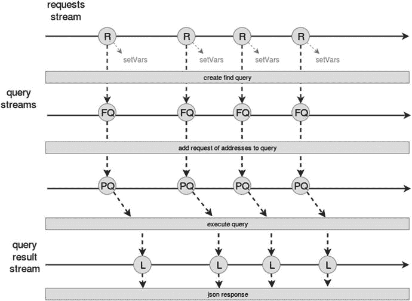

图 4-1.

列出用户的响应式版本弹珠图

它从 HTTP 请求流转变为查询对象流，最终成为查询结果流（然后以 JSON 格式输出给 HTTP 客户端）。表 4-2 展示了图 4-1 中图示的实现。

表 4-2.

列出用户代码的逐行对比

| 响应式代码 | 常规实现 |
| --- | --- |
| `var list = new oStream();` | `router.get('/', function(req, res, next) {` |
|     `list.data` |     `models.users.find({})` |
|     `.setVars({'httpResponse': get(1),` |         `.populate('addresses')` |
|     `'next': get(2)})` |         `.then(res.json.bind(res))` |
|     `.then(find({}))` |         `.catch(next);` |
|     `.then(populate('addresses'))` | `});` |
|     `.then(execute)` |   |
|     `.done(toJSONResponse)` |   |
|     `.catch(callErrorHandler);` |   |

确实，我们的新版本代码比旧版本多了一些，但这有时是更高抽象级别带来的不可避免的副作用。仅凭这个例子可能很难看出我们方法的好处，所以我们继续往下看。

> **注意：** 你可能已经注意到，在上面的对比中，响应式代码没有显示与路由器相关的部分，而常规实现中则显示了。这是因为对于应用的响应式版本，我将路由和实际业务逻辑分开了，而在常规版本中，它们是合在一起的。

辅助函数将在本章后面进一步描述，所以如果你暂时不理解它们的工作原理，不必担心。你很快会明白的。

### 创建新用户

创建用户是另一个简单的操作，因为它完全依赖于 ORM 的方法。不过，我们还是来看看如何设计图 4-2 中的逻辑结构。

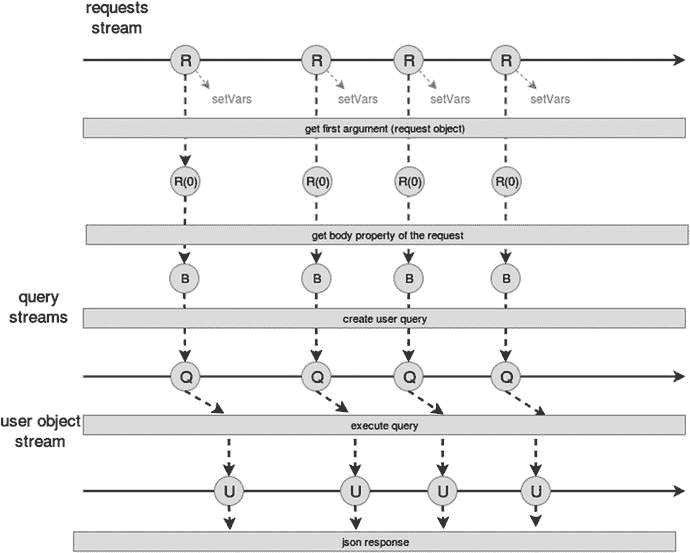

图 4-2.

描述创建新用户响应式逻辑的弹珠图

遗憾的是，由于你正在处理一个非响应式的 Web 框架，你必须手动处理请求的参数（这是流程的第一步）。之后，你只需获取请求体，创建并执行 `save` 查询，最后返回新用户的 JSON 表示。

现在来看表 4-3 以了解新代码。

表 4-3.

创建新用户所需代码的逐行对比

| 响应式代码 | 常规代码 |
| --- | --- |
| `newUsers.data`     `.setVars({'httpResponse': get(1), 'next': get(2)})`     `.then(get(0))`     `.then(get('body'))`     `.then(models.users.create.bind(models.users))`     `.done(toJSONResponse)`     `.catch(callErrorHandler);` | `router.post('/', function(req, res, next) {`     `models.users.create(req.body)`         `.then(function(usr) {`         `res.json(usr);`         `})`         `.catch(next);` `});` |

关于代码需要注意的一点是，由于你在第 4 个 `then` 调用中传递了 Mongoose 的 `create` 方法，你需要正确地将其绑定到模型。否则，该函数将在没有上下文的情况下执行并失败。

> **注意：** 我将跳过更新用户、删除用户和获取用户数据的方法，因为它们与前面的大致相同。这些方法将作为本书代码包的一部分提供。

### 添加新地址

我要回顾的最后一个方法是这个，因为它呈现了额外的复杂性。如果你还记得之前的代码，你需要先创建地址实体，然后以某种方式将其与用户关联。请参阅图 4-3 以了解响应式逻辑的样式。

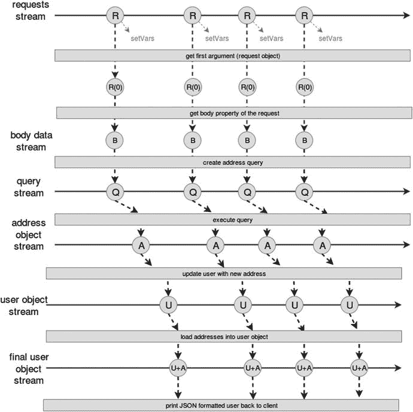

图 4-3. 新地址端点响应式版本的弹珠图

如果你记得（如果不记得，请往回翻几页），原始代码结合了两个 Promise 来实现其目标。上图展示的是一个步骤更长的解决方案，但也更为直接。如果你仔细观察，这个解决方案相当简单明了。请参阅表 4-4 查看代码对比。

表 4-4. 为用户创建新地址所需代码的并排对比

| 响应式代码 | 常规代码 |
| --- | --- |
| `var newAddress = new oStream();` `newAddress.data`     `.setVars({'httpResponse': get(1), 'userId': function(args) { return args[0].params.id}})`     `.then(get(0))`     `.then(get('body'))`     `.then(models.addresses.create.bind(models.addresses))`     `.then(function(address, done) {`     `models.users.findByIdAndUpdate(this.customVars.userId, {$push: {'addresses': address.id}}, {new: true}, done);`     `})`     `.then(function(usr, done) {`     `models.users.populate(usr, {path: 'addresses'}, done);`     `})`     `.done(toJSONResponse)`     `.catch(callErrorHandler );` | `router.post('/:id/addresses', function(req, res, next){` `var addressPromise = models.addresses.create(req.body);` `var userPromise = addressPromise.then(function(address) {` `return models.users.findById(req.params.id)` `});` `Promise.all([addressPromise, userPromise], function([address, user]) {` `user.addresses.push(address._id);` `return user.save();` `}).then(function(user) {` `return res.json(user);` `}).catch(next);` `});` |

这个例子也显示了响应式方法代码行数更多，但如果你看看常规实现，一旦业务逻辑的复杂性增加，就需要额外的工具，要么是 Promise（增加了理解其工作原理的复杂性），要么是老式的回调逻辑，并伴有额外的缩进层级。无论哪种方式，响应式方法都保持了对事务的控制，只有一个缩进层级，可能步骤稍多一些；但如果你将逻辑进行外推和规模化扩展，响应式方法就会显得越来越出色。

## 辅助函数

前面提到的响应式示例引用了一些我尚未展示的辅助函数。我将在这里列出它们的代码，只是为了说明它们大部分都是一行代码。

```
var find = function(where, done) {

return function() {

return models.users.find(where, done);

}

};

var populate = function(what) {

return function(query) {

return query.populate(what);

};

};
```

var `execute` = function(query, done) {
    return query.exec(done);
};

var `findById` = function(id) {
    return models.users.findById(id);
};

var `findByIdAndUpdate` = function(params, done) {
    return models.users.findByIdAndUpdate(params[0], params[1], {new: true}, done);
};

var `findByIdAndDelete` = function(id, done) {
    return models.users.findByIdAndRemove(id, done);
};

var `toJSONResponse` = function(data) {
    return this.customVars.httpResponse.json(data);
};

var `callErrorHandler` = function(err) {
    return this.customVars.next(err);
};

这里值得注意的有趣之处在于，其中一些函数是如何从其 `this` 对象中提取属性的，尽管该对象从未在任何地方声明。这是因为传递给 `then` 方法的所有函数的上下文，都会被其关联的 `Stream` 的属性所扩展。这意味着如果一个函数没有设置上下文，那么它将是 `Stream` 的上下文，这使得访问诸如 `customVars` 之类的属性变得容易，该属性包含了由 `setVars` 声明的额外变量。

## 结论

通过查看之前的代码（或本书提供的完整打包代码），你可以看到使用可观察流来处理 HTTP 传入流量是完全可行的。不仅如此，它还有助于控制代码的复杂性。

中间件等功能也是可行的。我将在下一个示例中探讨这个问题。

# 登录服务

能够登录到你的应用程序是另一个你可能以前就实现过的功能——事实上，如果你从事应用程序开发已经有一段时间，你已经多次实现过。我将探讨一个特定的例子，即使用 JSON Web Token 对 RESTful API 进行身份验证。

通过这种方式，你将能够扩展前面的例子，添加身份验证端点，并最终通过为你为每个集合设置的转换链设置中间件来保护某些端点。

## 什么是 JSON Web Token？

以防你好奇，让我快速回顾一下什么是 JSON Web Token（JWT）以及它将如何帮助你实现目标。

JWT ([`http://jwt.io`](http://jwt.io)) 是一个开放标准（你可以在 [`https://tools.ietf.org/html/rfc7519`](https://tools.ietf.org/html/rfc7519) 找到其 RFC），它定义了一种在双方之间安全传输信息的方式。这是通过对传输的数据（在这种情况下，是从客户端发送到服务器的请求）进行数字签名来实现的。数据可以使用 HMAC 算法使用密钥短语进行签名，或者使用 RSA 使用私钥/公钥对进行签名。

无论哪种方式，它都允许开发者针对 RESTful 服务验证其请求，因为它不需要他们维护被认证实体的任何状态。为了证实请求的真实性，使用先前在客户端和服务器之间约定的合约对签名令牌进行解码和验证。如果验证成功，则请求有效。

令牌本身是通过三个简单的步骤计算出来的：

-   设置一个 JSON 头部，其中包含令牌类型（此例中为 JWT）和用于签名令牌的算法，如下例所示。然后将数据编码为 base 64。

    ```
    {
        "alg": "HS256",
        "typ": "JWT"
    }
    ```

-   使用与请求相关的信息创建有效载荷，这通常是与用户相关的信息（因为这是所有请求中的常量部分）。然后使用 base 64 编码此 JSON。

    ```
    {
        "name": "John Doe",
        "isAdmin": true
    }
    ```

-   最后，通过连接此示例中的两个 base 64 字符串，并使用第一步中定义的算法对其进行签名来创建令牌。生成的令牌看起来像这样：

    ```
    eyJhbGciOiJIUzI1NiIsInR5cCI6IkpXVCJ9 .eyJuYW1lIjoiUFdEIiwiaWF0IjoxNDY0NDQxMTc4LCJleHAiOjE0NjQ1Mjc1Nzh9.oc194WsEKcRe29FuUKS9XdvKpX72nt0NuN5FAUVicW4
    ```

以下是你如何使用 JWT 令牌为你的 API 提供安全性：

-   用户向端点发出未经身份验证的请求，发送其凭据，以便针对系统进行身份验证。
-   API 检查凭据，如果有效，则生成一个 JWT 令牌并返回给用户。
-   然后，用户将在任何后续请求中使用该令牌进行身份验证，而无需重新发送凭据。
-   如果系统能够验证令牌的真实性，则执行请求，否则返回错误响应。

图 4-4 展示了在处理 JWT 时客户端和服务器之间的流程。

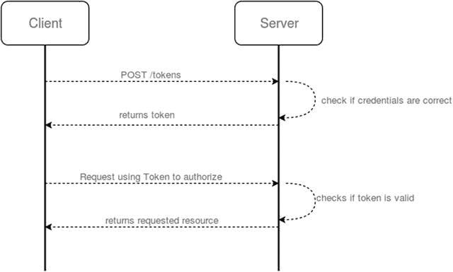

图 4-4. 认证过程中的客户端-服务器交互

### 回到代码

让我们回归正轨吧，好吗？现在你已经理解了基于 JWT 的身份验证是如何工作的，接下来看看如何使用 `ExpressJS` 在后端通过传统编程方式来实现它。为了生成和验证令牌，你将使用一个名为 `jsonwebtoken` 的 NPM 模块（可在 [`https://www.npmjs.com/package/jsonwebtoken`](https://www.npmjs.com/package/jsonwebtoken) 获取），它提供了所有必需的功能。

在本实现中，我将扩展上一个示例中的代码。我只需要两个方法：一个用于处理新的令牌端点，另一个用于处理每个请求的令牌验证。对于第二个代码块，我将使用一个中间件，因为这是更合理的方式。

```
var router = require("express").Router();
var jwt = require("jsonwebtoken");
var models = require("./models-crud-api");
var SECRET = 'this is a secret phrase';

//Handle the new endpoint
router.post('/tokens', function(req, res, next) {
    models.users.findOne({
        username: req.body.username,
        password: req.body.password
    })
    .then(function(usr) {
        if(!usr) {
            return next({error: true, msg: 'User not valid'});
        }
        var token = jwt.sign({
            name: usr.first_name,
            birth_date: usr.birth_date
        }, SECRET, {"expiresIn": "1 day"});
        res.json({
            token: token
        });
    })
    .catch(next);
});
```

> **注意：** 上述代码以一种非常不安全且低级的方式处理用户身份验证；它只是为了提供一个关于如何进行的示例，但强烈建议你使用适当的身份验证技术（例如对密码加盐）。另外，请记住，要使此代码运行，需要将 `username` 和 `password` 属性添加到用户模型中。

```
function checkToken(req, res, next) {
    var token = req.query.token || req.headers.token;
    //we make sure the url required for requesting a token is not protected
    if(req.url.indexOf("/tokens") !== -1) return next();
    if(!token) {
        return next('No token provided');
    }
    jwt.verify(token, SECRET, function(err, decoded) {
        if(err) {
            return next(err);
        }
        next();
    });
}

module.exports = {
    router: router,
    checkToken: checkToken
};
```

在上述代码中，端点函数负责对用户凭证进行简单的验证；如果有效，则签署要返回的令牌。然后，`checkToken` 中间件负责保护各个端点，但 `/tokens` 端点除外，因为你在实际从系统获取令牌之前，确实无法发送令牌，对吧？

### 响应式方法

对于这段代码的响应式版本，我将为新端点创建逻辑，这自然会是一组对流进行的转换，我还会向你展示如何将令牌检查作为转换的一部分来实现，而不是使用中间件（在这种情况下，因为我保持了主代码的完整性，所以我可以这样做）。

```javascript
newTokens.data
    .setVars({'httpResponse': get(1)})
    .then(get(0))
    .then(map(function(req) {
        return { username: req.body.username, password: req.body.password };
    }))
    .then(models.users.findOne.bind(models.users))
    .then(filterWithMessage({code: 404, msg: 'Invalid credentials'}, isNotEmpty))
    .then(function(usr) {
        return jwt.sign({
            name: usr.first_name,
            birth_date: usr.birth_date
        }, SECRET , {"expiresIn": "1 day "});
    })
    .then(map(function(t) { return { token: t }; }))
    .done(toJSONResponse)
    .catch(callErrorHandler);
```

那么，转换步骤如下：

1. 映射以从请求中获取登录数据。
2. 然后根据这些信息查找用户。
3. 过滤掉那些在上一步中没有返回用户的请求。
4. 然后使用一个将于一天后过期的令牌来签署请求。
5. 将返回对象转换为一个仅包含令牌信息的更简单的 json。
6. 将响应打印回客户端。

就像我之前所做的那样，我将查看图 4-5 中的弹珠图。

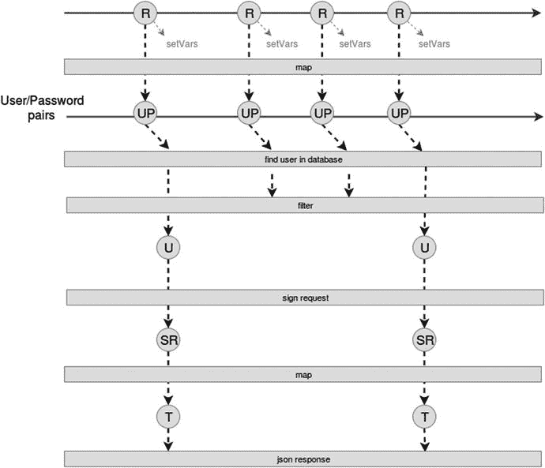

**图 4-5.** 响应式身份验证逻辑的弹珠图

图 4-5 不仅展示了理想路径（所有凭证都有效，且在一系列转换中没有错误），还展示了一些请求将如何被过滤掉，原因是它们没有正确的用户凭证。用于过滤这些请求的函数，实际上是通过一个简单的 `filter` 调用，并添加了一些额外的逻辑来实现的：

```javascript
var filterWithMessage = function(opts, fn) {
    var self = this;
    return function(data) {
        var fnFilter = filter(fn );
        if(fnFilter(data) !== null) {
            return data;
        } else {
            return self
                .customVars
                .httpResponse
                .status(opts.code)
                .json({error: true, msg: opts.msg});
        }
    };
}
```

多亏了我使用的这个小框架（它会修改我在转换链中设置的函数的上下文），我可以像你在之前的 `else` 块中看到的那样，直接从这个函数内部将响应发送回客户端。

最后，检查收到的令牌（如果收到了）的实际真实性，可以像我在常规方法中那样做，只需使用一个 `Express` 中间件，但我也可以将该逻辑作为几个 `filter` 步骤添加到常规链中，这将使你能够独立于所使用的 Web 框架，并且不依赖于该框架是否具备中间件能力。

话虽如此，以下是需要添加的代码：

```javascript
list.data
    .setVars({'httpResponse': get(1), 'next': get(2)})
    .then(get(0))
    .then(filter(function(req) {
        var token = req.query.token || (req.body && req.body.token);
        return !!token;
    }))
    .then(filter(function(req, done ) {
        var token = req.query.token || (req.body && req.body.token);
        jwt.verify(token, SECRET, done);
    }))
    .then(find({}))
    .then(populate('addresses'))
    .then(execute)
    .done(toJSONResponse)
    .catch(callErrorHandler);
```

以下是 `filter` 函数的代码，如你所见，它提供了两种执行方式，具体取决于接收到的参数数量。

```javascript
function filter(filterFn) {
    var fn = null;
    if(filterFn.length == 1) {
        fn = function(val) {
            if(filterFn(val)) {
                return val;
            }
            return null;
        };
    } else {
        fn = function(val, done) {
            filterFn(val, function(err) {
                if(err) {
                    return done(err);
                }
                return done();
            });
        };
    }
    fn.__type = 'filter';
    return fn;
}
```

响应式示例中加粗的代码是我添加的内容，你可以看到我只是简单地添加了传统方法中中间件里的两个检查：是否提供了令牌，以及令牌是否有效。这里需要注意的是，即使请求可能被过滤掉了，它也需要向客户端提供一个响应，这样请求才能被关闭，并且用户才能理解哪里出了问题。为此，`filter` 函数实际上会调用你通过 `done` 方法设置的函数，这假定它是你希望在每次转换中执行的最后一个函数。

如果这听起来不太好，还有第二种方法，使用我之前做过的类似伪造的 `filter`：

```javascript
list.data
    .setVars({'httpResponse': get(1), 'next': get(2)})
    .then(get(0))
    .then(filterWithMessage({code: 401, msg: 'no token provided'}, function(req) {
        var token = req.query.token || (req.body && req.body.token);
        return !!token;
    }))
    .then(filterWithMessage({code: 401, msg: 'unauthorized request'}, function(req, done) {
        var token = req.query.token || (req.body && req.body.token);
        jwt.verify(token, SECRET, done);
    }))
    .then(find({}))
    .then(populate('addresses'))
    .then(execute)
    .done(toJSONResponse)
    .catch(callErrorHandler);
```

# 总结

这是又一个清晰的示例，展示了代码的声明式特性如何简化其背后的逻辑——特别是对于外部读者，即那些并非作者但需要理解代码的人。中间件的代码虽然简单，但它通过移除`IFs`并将其逻辑转化为两个简单的`filter`语句，使代码更具可读性。仔细想想，当前的方法让你无需真正实现一个中间件，就能创建一个过滤中间件。这难道不棒吗？

端点逻辑也同样如此——它本身已经足够简单，但经过代码处理后，阅读和理解起来比以前容易得多。

## 本章小结

本章的核心目标是提供实践证据，证明你可以在应用后端使用函数式响应式编程，并且这样做可以改善代码的某些方面，例如可读性和可维护性。

希望所提供的示例能够阐明这一点，并且你会对这些概念在自己代码中的应用产生兴趣。话虽如此，我仍需在后续章节中讲解实际框架的代码。

至于下一章，我将介绍使用 Node.js 构建 FRP 框架的一些优势。

# 5. 进入 Node.js

虽然你已经从实践角度看到了如何在后端应用响应式概念，但我还没有真正讨论为什么使用 Node.js 是一个如此好的选择。

在第四章（参见 4）中你已经看了大量代码，而在本章中，我将重点探讨 Node 的理论方面。这意味着我会深入审视诸如`EventEmitters`和`Streams`之类的内容，你将了解异步编程是如何工作的，以及为什么 Node.js 在这方面如此出色。最后，我还会涉及之前章节已经部分介绍过的异步事件流。

在本章结束时，你应该能更好地理解 Node 提供的工具，这些工具将帮助你创建我一直承诺的响应式框架。其中一些工具只会被提及，而另一些将在未来章节中使用。

## 事件发射器与事件流

在本节的这一部分，我将介绍一个有助于你实现目标的工具。`EventEmitter`模块自 Node.js 早期版本起就作为原生模块存在，它允许你使用一个与浏览器端（这里指的是 UI 事件）没有本质区别的事件系统来传播消息。

我还将介绍 Node 中的 Streams（流）。与`EventEmitters`类似，流也是 Node.js 的原生模块，它使用了`EventEmitters`中的一些概念，并在此基础上增加了更多神奇的特性，从而提供了一个非常熟悉且有趣的接口来处理数据流。

### 事件发射器

关于事件发射器的一个有趣事实是，你可能已经无意中使用过它们。Node 的一些核心功能会扩展该模块，并提供自定义事件供你监听。例如，`process`对象允许你对诸如`uncaughtException`之类的事件做出响应；而由`http`模块的`createServer`方法返回的服务器，则允许你监听名为`request`的特殊事件，诸如此类。

那么，事件发射器到底是什么？简单来说，这个模块允许你发射事件，但更重要的是，它为开发者提供了一套 API，用于监听、响应甚至发射自定义事件。

以下是关于`EventEmitter`的一些可能有用的特性：

*   你可以为一个事件设置任意数量的监听器。
*   当事件被触发时，所有监听器会按照它们被设置的顺序依次被调用。
*   你可以将监听器设置为每次事件被触发时都执行，或仅在第一次触发时执行。
*   基于上一点，有两种方式向事件添加监听器：要么将其追加到列表末尾（使用`on`或`once`方法），要么将其添加到列表开头（使用`prependOnceListener`或`prependListener`方法）。
*   监听器函数无需特定的签名即可生效。触发事件时传递给事件的任何参数都会自动传递给该函数，且顺序保持不变。
*   有一个特殊的 '`error`' 事件，当它被触发且没有任何监听器时，会导致 Node 应用程序关闭。
*   换句话说，通过`EventEmitters`，你可以使用事件来控制逻辑流，就像在前端开发中，你可以将逻辑设置为在页面加载完成后初始化，或者像在点击链接时设置 AJAX 请求一样。
*   特别地，当你有一个异步进程需要在处理过程中多次向客户端回传数据时，这种机制非常有用。

例如，假设有一个函数需要在完成之前发起三个不同的异步请求，并且在处理过程中，它还需要在完成每个内部请求后报告进度。借助`EventEmitters`，你可以轻松实现这一点：通过发射一个客户端可以订阅的自定义`progress`事件。让我们来看一个快速示例：

```javascript
var EventEmitter  = require("events"),
    request = require("request"),
    async = require("async");

function myAsyncEmitter() {}

myAsyncEmitter.prototype = new EventEmitter();

myAsyncEmitter.prototype.process = function() {
    var self = this;
    var doneRequests = 0;
    var urls = [
        "http://www.google.com",
        "http://www.youtube.com",
        "http://www.facebook.com"
    ];

    async.map(urls, function(url, done) {
        request.get(url, function(err, data) {
            doneRequests++;
            self.emit('progress', (doneRequests / urls.length) * 100);
            done(err, data.body);
        });
    }, function(err, results) {
        self.emit('done', results);
    });
};

var AE = new myAsyncEmitter() ;

AE.on('progress', function(percentage) {
    console.log("Percentage done: ", percentage, "%");
});

AE.once('done', function(data) {
    console.log("Process over, this is the data: ", data);
});

AE.process();
```

> **注意**  
> 为了简化代码，我使用了`Async.js`和`Request.js`（可从 [`https://github.com/request/request`](https://github.com/request/request) 获取）库来提供辅助函数，帮助你处理异步调用和实际的请求。测试`EventEmitter`本身并不需要它们；这只是为了将重点集中在有趣的部分——也就是本例中的事件发射器。

上面的代码是我之前提到的概念的一个基本示例：我的自定义发射器继承了 Node 的`Event`模块以获取所需逻辑，然后通过为`progress`和`done`这两个事件设置监听器来使用它。由于我知道`done`事件只会被调用一次，所以我使用`once`方法设置了监听器，当然，也可以使用`on`方法；在这种情况下，两者没有任何区别（这仅仅是为了提高代码可读性而采取的一种措施）。

## 流

与事件发射器类似，流是 Node.js 提供的原生构造，常常被开发者忽略或误解。而且就像 `EventEmitters` 一样，你可能已经使用过不止一个流，甚至自己都没注意到。

因此在本节中，我想深入讲解这个模块，并展示它如何与之前看到的 `EventEmitters` 以及本书的总体目标相关联。希望你能发现我迄今所讲内容与这部分之间的相似之处。

Node.js 的这个模块提供了四种类型的流：

-   `可读流`：提供从指定源读取数据的 API。
-   `可写流`：允许你将连续的数据块写入指定目标。
-   `双工流`：可读流和可写流的结合，允许你向指定源写入数据和从中读取数据。
-   `转换流`：一种特殊的双工流，允许你在读取和写入数据时对数据进行转换。

每种流还有两种模式：一种是 `对象模式`，允许你读取和写入任何 JavaScript 类型（`null` 除外）；另一种是默认模式，流中传输的任何内容都是 `String` 或 `Buffer`。如果我没算错的话，我们总共有八种不同的流可供选择，因此我将更深入地探讨每一种流，展示它们提供的 API，以及你需要如何实现每种类型的流。

### 可读流

可读流允许你将指定的数据源封装到一个标准 API 中，让你能够通过手动轮询源或被动响应数据到达的方式来消费所提供的信息。

开发者几乎每天都会遇到几种非常常见的可读流，例如：

-   客户端的 HTTP 响应对象（指任何连接到你的 API 的应用程序）
-   服务端的 HTTP 请求对象
-   TCP 套接字
-   子进程的 `stdin` 和 `stderr`
-   等等。

所有不同类型的流都提供一组方法或事件，我们可以用它们来读取或写入数据。对于可读流，每当有新的数据块（或根据是否处于对象模式，有新的对象可用）时，它会触发 `data` 事件，或者你可以将读取器的输出通过管道连接到可写流。后者让你无法控制具体过程，你只需将一个流的输出连接到另一个流的输入，系统就会为你处理其余的事情。

下面是一个管道连接的简单示例。以下代码将连接三个不同的流：

```javascript
var fs = require("fs"),
    zlib = require("zlib");

var r = fs.createReadStream('file.txt');
var z = zlib.createGzip();
var w = fs.createWriteStream('file.txt.gz');

r.pipe(z).pipe(w);
```

上面的代码创建了三个不同的流，并在最后一行通过管道将它们连接起来。最终结果是将指定文件压缩并保存到磁盘。

为了显示不使用管道连接时的等效代码，下面是你可能需要采用的方法：

```javascript
var fs = require("fs"),
    zlib = require("zlib");

var r2 = fs.createReadStream('file.txt');
var z2 = zlib.createGzip();
var w2 = fs.createWriteStream('file.txt.gz');

w2.on('open', function() {
  r2.on('data', function(chunk) {
    console.log("data chunk: ", chunk);
    z2.write(chunk);
  });
  z2.on('data', function(data) {
    console.log("-- gzip chunk --");
    w2.write(data);
  });
  r2.on('end', function() {
    z2.end();
  });
  z2.on('end', function () {
    w2.end();
  });
});
```

很明显，这段代码更长一些，需要手动处理的事情也更多，但有时这是必要的，即使只是为了像上面的代码一样添加一些调试信息。

这段代码展示了一个在处理可读流时非常有用的特定事件：`data` 事件。每当有新的数据块可供你的代码消费时，此事件就会被触发。

可读流也可以触发 `readable` 事件，该事件在有数据可读时发生。在这种情况下，消费者必须调用流的 `read` 方法才能获取下一段数据。当你需要对流的行为进行额外控制时，这会非常有用——特别是，前一个事件只会在收到新数据时通知你，而 `readable` 事件则允许你在数据可用但实际接收之前决定如何处理（根据你的逻辑，你可以选择读取或忽略它）。

可读流还有其他有用但更简单的事件，例如 `end` 事件，用于通知没有更多数据可读；`close` 事件，在不再有事件可触发时触发；以及我已经介绍过的 `error` 事件。

### 可写流

对于可写流来说，它们的工作方式与可读流正好相反：它们将数据的目标封装到一个易于使用的容器中。就像任何其他流一样，你可以将其他流通过管道连接到它，也可以手动写入。

一些常见的可写流包括：

-   `fs` 写入流
-   `zlib` 流（就像你上面看到的那样）
-   加密流

使用这些流非常简单。你需要了解的主要方法是：`write` 用于实际发送数据，`end` 用于关闭流。我在前面的代码示例中已经展示了它们的工作原理，所以这里不再赘述。

由于所有流也都是 `EventEmitters`，它们会触发一些特定事件。对于可写流，你应特别注意：

-   `drain`：当 `stream.write` 调用返回 `false` 后触发此事件。一旦此事件被触发，就可以恢复写入。当写入目标不堪重负，需要一些时间才能发送下一个数据块时，你的流可能会触发此事件。
-   `error`：这个事件在所有 `EventEmitters` 中都很常见，因此，无论何时创建流，请务必为此事件设置一个处理程序；否则，如果此错误未被处理，整个应用程序将会崩溃。

### 双工流和转换流

这两种类型的流实际上基于前面两种流。双工流是一个（显而易见地）同时实现了可读和可写接口的流（例如一个 TCP 套接字）。

然后是转换流，它是一种双工流，但不同之处在于它允许你在输入变为输出之前对其进行更改。换句话说，例如，你可以创建一个接收 JavaScript 对象并将 JSON 字符串写入某个存储系统的转换流。

除了显而易见的区别之外，双工流和转换流的主要区别在于，对于双工流，读取和写入事件是并行处理的，也就是相互独立的。写入操作/事件并不依赖于预期先发生的读取事件，因此，如果你正在处理异步进程（在 Node.js 中你很可能会这样），请务必考虑这一点。下面我将展示一个具体案例。

## 编写自定义流

前面的代码展示了如何使用预置的可读流和可写流，但并未演示如何实现自定义流——原因很简单，一旦你理解了流的概念，就会想抓住一切机会使用它们！（至少我是这样的！）

我在此提供一个非常简单的示例，展示如何创建符合各类流描述的对象。

以下代码将在 HTTP 服务器上建立一个端点，通过一组流来接收数据。它将完成以下操作：

- 获取请求体并将其转换为 JavaScript 对象
- 为对象添加一个属性
- 将对象保存到数据库
- 将对象转换回字符串
- 将字符串返回给客户端

```javascript
var inherits = require("util").inherits;
var streams = require("stream");
var Transform = streams.Transform;

//Turns the request's body into an object
function GetBody() {
  Transform.call(this, {objectMode: true});
}
inherits(GetBody, Transform);

GetBody.prototype._transform = function(obj, encoding, callback) {
  var str = obj.toString();
  callback(null, JSON.parse(str));
};
```

# Node.js 中的异步编程

```javascript
//Adds the timestamp value
function AddTimeStamp() {
  Transform.call(this, {objectMode: true});
}
inherits(AddTimeStamp, Transform);
AddTimeStamp.prototype._transform = function(obj, encoding, callback) {
  obj.timestamp = Date.now();
  callback(null, obj);
};

//Turns the object into a string
function ToJSONEncoder() {
  Transform.call(this, {objectMode: true});
}
inherits(ToJSONEncoder, Transform);
ToJSONEncoder.prototype._transform = function(obj, encoding, callback) {
  callback(null, JSON.stringify(obj));
};

//Saves the object into the database
function SaveUserToDB() {
  Transform.call(this, {objectMode: true});
}
inherits(SaveUserToDB, Transform);
SaveUserToDB.prototype._transform = function(obj, encoding, callback) {
  var self = this;
  UserModel.create(obj, function(err, obj) {
    if(err) {
      return callback(err);
    }
    self.push(obj);
    callback();
  });
};

var addTimeStamp = new AddTimeStamp();
var save = new SaveUserToDB();
var getBody = new GetBody();
var toJSON = new ToJSONEncoder();

function handleNewUsers(req, res, next) {
  req
    .pipe(getBody)
    .pipe(addTimeStamp)
    .pipe(save)
    .pipe(toJSON)
    .pipe(res);
}
```

如你所见，通过创建一组`Transform`流，并利用 Node 中`Request`对象默认是`ReadableStream`、`Response`对象默认是`WritableStream`的特性，即可实现上述所有功能。

如果你想测试这段代码，还需要先设置好前置代码，以下是前置代码（当然，你需要安装 MongoDB、mongoose 和 express 等依赖）：

```javascript
var mongoose = require("mongoose");
var express = require("express");

// --- db
var Schema = mongoose.Schema;
var UserSchema = Schema({
  full_name: String,
  birthdate: Date,
  username: String,
  password: String,
  timestamp: Number
});
var UserModel = mongoose.model("User", UserSchema);
mongoose.connect('mongodb://localhost/test-streams');

//--- http server
var app = express();
app.post('/users', handleNewUsers);
app.listen(3000, function() {
  console.log("Ready to roll!");
});
```

这段代码仅负责设置 HTTP 服务器、MongoDB 连接以及定义模型模式。

**注意**

在编写类似上述使用`Request`对象流特性的代码时，请避免使用 Express 的`body-parser`中间件模块（可在[`https://www.npmjs.com/package/body-parser`](https://www.npmjs.com/package/body-parser)获取），因为它会影响功能，导致代码无法正常运行。

最后，我想提醒你注意`SaveUserToDB`这个流——我最初以为它是一个`Duplex`流。它本应将对象写入数据库，然后在后续的`Read`调用中返回数据。但根据前文对`Duplex`和`Transform`流的描述，由于`Read`和`Write`事件并未关联，会导致`Write`操作未完成时`Read`事件就已触发，导致此时无数据可返回。而将流改为`Transform`流可以解决这个问题。

`Duplex`流适用的典型场景是某种客户端/服务器连接处理器——这种流允许同时从服务器向客户端写入消息，并在客户端应用中读取服务器接收的消息。

总而言之，当尝试实现自定义流时，表 5-1 将帮助你理解需要实现哪些方法以及何时实现。

**表 5-1.** 快速指南：何时实现何种流

| 操作类型 | 流类型 | 需实现的方法 |
| --- | --- | --- |
| 仅读取 | Readable | `_read` |
| 仅写入 | Writable | `_write` |
| 读取和写入 | Duplex | `_read`, `_write` |
| 修改写入数据 | Transform | `_transform` |

到目前为止，我几乎在所有地方都谈到了使用异步函数，但并没有真正解释它到底是什么。那么，我们来聊聊这个话题，好吗？

异步（Async）编程可能是 Node.js 最好，同时也是最令人困惑的特性之一。

简单来说，异步编程意味着，对于你执行的每一个异步函数，它不会在程序流程继续之前返回结果。相反，你需要提供一个回调函数，这个函数会在异步代码执行完毕后被调用。

图 5-1 展示了一个常规的、非异步的执行流程。

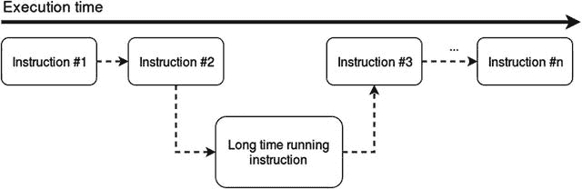

图 5-1. 同步流程的简单示例

图 5-1 展示了一组以同步方式运行的指令。很明显，为了执行 `指令 #4`，它需要等待耗时指令完成，然后等待 `指令 #3` 结束。但是，如果 `指令 #4` 和 `指令 #3` 实际上并不相关呢？如果你并不在意 `指令 #3` 和 `指令 #4` 彼此之间执行的先后顺序呢？

那么，你可以将耗时指令改为异步方式执行，并将 `指令 #3` 作为它的回调函数，这样你就能更早地执行 `指令 #4` 了。

图 5-2 展示了这种做法的样子。

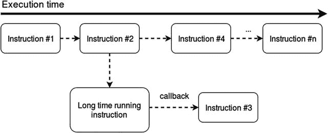

图 5-2. 异步流程的示例

`指令 #4` 在 `指令 #2` 启动异步耗时指令之后立即执行，而不是等待它完成。

当然，这只是异步编程潜在好处的一个非常简单的例子。而且，并非总是可能采用这种方法。你可以对 I/O 密集型函数这样做，因为 Node.js 就是这样处理 I/O 的（别担心，我稍后会讨论这一点），但是 CPU 密集型函数，比如繁重的数值计算，实际上无法以这种方式工作，它们会像同步函数一样阻塞流程，所以在规划代码时请务必考虑到这一点。

最后，和数字世界中的大多数事物一样，没有什么是无需代价的，额外的好处也带来一个糟糕的权衡：调试异步代码可能非常让人头疼。

开发者习惯于按照编写代码的顺序方式来思考代码，因此调试非顺序执行的代码对新手来说可能很困难。

例如，让我们看看同一段代码的同步和异步编写方式：

同步版本：

```javascript
var fs = require("fs");
console.log("即将读取文件... ");
var content = fs.readFileSync("/路径/到/文件");
console.log("文件内容: ", content);
```

异步版本（含一个常见错误）：

```javascript
var fs = require("fs");
console.log("即将读取文件...");
var content = "";
fs.readFile("/路径/到/文件", function(err, data) {
  content = data;
});
console.log("文件内容: ", content);
```

如果你还没猜到，第二段代码会输出：

```
文件内容:
```

其原因与前文中的流程图直接相关。图 5-3 展示了有问题的异步版本发生了什么。

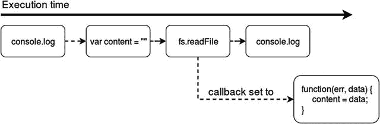

图 5-3. 一个典型的异步编程错误

通过图 5-3 可以很清楚地看到为什么文件内容没有被写入，因为回调函数是在最后一行 `console.log` 之后才执行的。这是新手开发者常犯的错误，不仅限于 Node.js，更具体来说，在前端 AJAX 调用中也经常出现。他们的代码设置方式导致他们试图在异步调用实际结束之前使用其返回的内容。

因此，为了完成这个示例，让我们看看代码应该如何编写才能正常工作：

```javascript
var fs = require("fs");

console.log("即将读取文件...");

var content = "";

fs.readFile("/路径/到/文件", function(err, data) {

content = data;

console.log("文件内容: ", content);

});
```

很简单，只需将最后的 `console.log` 行移到回调函数中，这样就能确保 `content` 变量被正确设置了。

## 异步进阶

异步编程不仅仅是确保你正确设置了回调函数，它还允许一些有趣的流程控制模式，这些模式可用于提高应用程序的效率。

让我们看看两种不同且非常有用的异步编程流程控制模式：并行流程和串行流程。

## 并行流程

并行流程的核心思想是：程序可以并行运行一组不相关的任务，但只有在所有任务都执行完毕后，才会调用提供的回调函数（以收集它们的集体输出结果）。

基本上，这就是我要表达的意思：

```javascript
// functionX 符号是对各个独立函数的引用
parallel([function1, function2, function3, function4], function(data) {
/// 等它们全部完成后，对合并后的输出进行处理
})
```

为了知道每个函数何时执行完毕，它们需要用操作结果来执行一个回调函数。回调将是它们收到的唯一参数，所以让我们看看这个 `parallel` 函数：

```javascript
function parallel(funcs, callback) {
var results = [],
callsToCallback = 0;

funcs.forEach(function(fn) { // 遍历所有函数
fn(done);
});

function done(data) { // 函数执行完毕时会调用这个函数，并将结果传递到这里
results.push(data);
if(++callsToCallback == funcs.length) {
callback(results);
}
}
}
```

**注意：** 由于在 `parallel` 执行期间调用的函数具有异步特性，最终回调中结果的顺序无法保证。某些在开始时执行的异步函数，可能比后面执行的函数返回结果所需的时间更长。需要额外的代码来确保最终结果列表是有序的。

前面的实现是我试图演示的一个非常简单的版本，但它完成了任务：它以类似并行的方式运行一组函数（你会看到，由于 Node.js 运行在单线程中，真正的并行是不可能的，所以这是我们能达到的最接近的结果）。

这种控制流在处理对外部服务的调用时特别有用。

让我们看一个实际示例：假设你的程序需要执行多个操作，这些操作虽然彼此不相关，但都需要在用户看到结果之前完成。例如，从数据库加载书籍列表，查询外部服务获取本周新书的消息，并将请求记录到文件中。如果你按顺序执行所有这些任务，等待一个完成后再运行下一个，那么用户很可能会遇到响应延迟，因为执行所需的总时间将是所有单个时间的总和。

但如果可以并行执行所有这些任务，那么总时间实际上就等于执行最慢的那个任务所用的时间。

让我们看看这两种情况：

**串行方式（耗时更长）**

```javascript
//请求处理代码...
//假设 "db" 已经初始化，并提供了数据库接口
db.query("books", {limit:1000, page: 1}, function(books) {
services.bookNews.getThisWeeksNews(function(news) {
services.logging.logRequest(request, function() { //没有返回值，但我们需要调用它，以便知道日志记录完成
response.render({listOfBooks: books, bookNews: news})
})
})
})
```

**并行方式（耗时更少）**

```javascript
//请求处理代码...
parallel([
function(callback) { db.query("books", {limit: 1000, page: 1}, callback) }),
function(callback) { services.bookNews.getThisWeeksNews(callback) }),
function(callback) { services.logRequest(request, callback) })
], function(data) {
var books = findData('books', data)
var news = findData('news', data)
response.render({listOfBooks: books, bookNews: news})
})
```

前面的代码展示了每种方法的外观。`findData` 函数简单地查找 `data` 数组，并根据项目结构返回所需的对象（第一个参数）。在这个 `parallel` 的实现中，它之所以必要，是因为（正如我之前提到的）你无法确定函数完成并返回结果的顺序。

除了代码将获得明显的速度提升之外，它也更易于阅读，并且更容易向并行流程中添加新任务：只需在数组中添加一个新项即可。

## 串行流程

串行流程提供了一种简单的方法来指定需要按特定顺序执行的函数列表。这种解决方案不像之前那样提供速度提升，但它确实提供了编写此类代码并保持其整洁的能力，从而远离通常所说的“回调地狱”。

让我们看看我们想要实现的目标：

```javascript
serial([
function1, function2, function3
], function(data) {
//对合并后的结果进行处理
});
```

而不是像这样：

```javascript
function1(function(data1) {
function2(function(data2) {
function3(function(data3) {
//对所有输出进行处理
}
}
}
```

你可以看到，如果函数数量持续增长，第二段代码会变得难以管理。因此，串行方法将帮助你保持代码的组织性和可读性。

让我们看看 `serial` 函数的一个可能实现：

```javascript
function serial(functions, done) {
var fn = functions.shift(); // 从列表中取出第一个函数
var results = [];

fn(next);

function next(result) {
results.push(result); // 保存结果，以便在不再有函数需要执行时传递给最终回调。
var nextFn = functions.shift();
if (nextFn) nextFn(next);
else done(results);
}
}
```

这些函数还有更多变体，例如使用错误参数自动处理错误，或者在并行流程中限制并发函数的数量。

总而言之，异步编程是 Node.js 开发者生活中不可或缺的一部分。所有操作都利用了 Node 的异步 I/O（我稍后将讨论这一点），因此理解它的工作原理以及如何利用它的强大功能，无疑会对你设计响应式库有所帮助。

有关一个功能完备且经过测试、专注于异步编程的库，请查看 `ASYNC.JS`（可在 [`github.com/caolan/async`](https://github.com/caolan/async) 获取）。

# 异步 I/O

异步编程的一个特定案例涉及 Node.js 提供的这个非常有趣的特性：异步 I/O。

此特性与 Node.js 的内部架构高度相关。正如我之前所说，Node 不提供多线程；它实际上在单个线程内运行，该线程内部运行着一个事件循环（见图 5-4）。

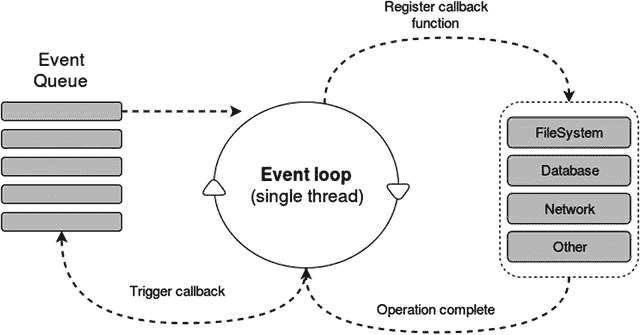

**图 5-4.** 展示事件循环如何工作以提供异步 I/O 的示意图

简而言之，Node.js 的设计理念是：I/O 操作是每个操作的实际瓶颈，而不是处理能力。因此，`node` 进程接收到的每个请求都将在事件循环内工作，直到发现一个 I/O 操作。当这种情况发生时，回调将被注册到一个单独的队列中，而主程序的流程将继续。一旦 I/O 操作完成，回调将被触发，其内部的代码将被执行。

# 异步事件流

标题也可以是“异步事件的流”。无论如何，本章这一节的目标是将我目前讨论的所有内容串联起来。

在第 3 章中，我展示了一些处理这类情况的基础代码，它们确实能工作。但由于 Node 已经提供了原生流，因此有必要概述所有选项，这样在后续章节中，你可以从这些不同的选项中汲取灵感，创建出优秀的库。

为了演示，我将使用一个名为 `event-stream` 的外部模块（可在 [`https://www.npmjs.com/package/event-stream`](https://www.npmjs.com/package/event-stream) 获取）。但别担心，它的一切基础都是 Node 的内置流，因此其原理依然适用。

该库本质上提供了一套辅助方法，让你能够操作和处理流，而这些流又可以轻松地处理异步任务。如果你还记得前几页的内容，`SaveUserToDB` 流无法被设置为 `Duplex` 流，相反，由于对数据库的异步调用，我不得不使用 `Transform` 流。

借助 `event-stream` 模块，修复这个问题不仅简单，而且实际上有几种方法可以实现。让我们先看看该库提供的所有辅助方法。

## `through`

该方法是对之前问题的解决方案。它创建了一个 `Duplex` 流，我们可以控制其中的数据流，从而让你将异步过程转化为同步过程。它接受两个可选参数：一个 `write` 函数和一个 `end` 函数。你会注意到没有 `read` 方法，这是因为它是一种特殊的 `Duplex`，具有预定义的 `read` 方法。它会重新发射你在 `write` 方法中通过 `data` 事件发射的任何内容。

让我演示一下。以下是 `SaveUserToDB` 流的重写方式：

```javascript
var es = require("event-stream");

var save = es.through(function write(data) {
    var self = this;
    this.pause();
    //You need to pause the stream, to make sure the saving operation is done
    UserModel.create(data, function(err, obj) {
        if(err) {
            return self.emit('error', err);
        }
        self.resume();
        //you can then resume the stream and emit the new object
        self.emit('data', obj);
    });
}, function end() {
    this.emit('end');
});
```

## `map`

该方法接受两个参数：实际数据和必须在函数末尾调用的回调函数。

我在前一章已经介绍了 `map` 函数的作用，因此在这种情况下，只需理解这个特定的 `map` 是一个自定义的 `through` 函数，它会重新发射你作为接收回调函数第二个参数传递的任何内容。了解这一点后，你可以再次重新实现 `SaveUserToDB` 流，如下所示：

```javascript
var es = require("event-stream");

var save = es.map(function(data, callback) {
    var self = this;
    UserModel.create(data, function(err, obj) {
        if(err) {
            //the first argument of the callback is the error returned
            return callback(err);
        }
        callback(null, obj);
    });
});
```

## `split`

该方法的工作方式与 `String#split` 方法类似，但其默认值是换行符，而不是空字符串。它不是分割单个字符串，而是将一个流分解并重新组装，以便结果分割的每个部分都是一个数据块。

一个简单的例子是，如果你想处理文本文件中的每个单词，可以这样做：

```javascript
var es = require("event-stream");
var fs = require("fs");

fs.createReadStream('myfile.txt')
    .pipe(es.split(' '))
    .pipe(es.map(function(word, cb) {
        cb(null, word.toUpperCase());
    }));
```

显然，你不需要仅仅为了将文档分割成单词而这样做，但这仍然可以作为示例。

## `join`

这个方法有点令人困惑，因为名称暗示它是 `split` 的反向操作，可以撤销你对它所做的任何操作。

该方法在每个发出的数据块后添加一个分隔符（它接受的唯一属性）。因此，实际上，对于每一块数据，它会发射两个新块：分隔符和实际数据。所以你可以这样做：

```javascript
var es = require("event-stream");
var fs = require("fs");

var writer = fs.createWriteStream('./output-join.txt');

fs.createReadStream('./event-stream-join.js')
    .pipe(es.split(" "))
    .pipe(es.map(function(str, done) {
        done(null, str.toUpperCase());
    }))
    .pipe(es.join("\n"))
    .pipe(writer);
```

实际上，上面的代码将文本文件分割成单词，将每个单词转换为大写，然后将每个单词保存到文件中，但末尾带有一个换行符。

**提示**

如果在 `join` 方法中传入一个 `String` 而不是函数，那么该函数将在流结束时被调用，它接收的唯一参数将是所有连接成单个 `String` 的数据块列表。

## `merge`

该方法负责合并多个流。这意味着它将合并每个传入流的结果数据，一旦所有流都发出了 `end` 事件，它就会结束。

一个简单的例子如下：

```javascript
var es = require("event-stream");
var fs = require("fs");

es.merge([
    fs.createReadStream('input1.txt'),
    fs.createReadStream('input2.txt')
]).pipe(fs.createWriteStream('output.log'));
```

注意，合并的流之间不保证顺序，因此保存的数据不会先包含一个文件的内容，然后再包含第二个文件的内容。两个文件的内容可能交织在一起（取决于每个文件内容的长度）。

## `readable`

正如方法名称所示，它创建一个 `Readable` 流，该流与一个异步函数配合作为数据源。换句话说，接收的函数（接受的唯一参数）接受两个参数：一个计数器和一个回调。该函数必须始终调用回调以推进数据流，并且只能调用一次；后续调用将无效。

然而，它可以在一次调用中使用 `data` 事件发射多个数据块。以下是你的 `read` 函数的基本结构：

```javascript
var es = require("event-stream");

es.readable(function(count, callback) {
```

if(hasEnded) { //for some reason the stream is no longer reading

this.emit('end');

}

//... your code here

this.emit('data', chunk); //you can do this as many times as you need to.

callback();

});

```

**注意**

在前面的代码示例中，变量`hasEnded`仅仅是某种指示流已结束的逻辑条件的占位符。你需要将其替换为对业务逻辑有意义的任何内容。

该模块还提供了其他方法，如`duplex`、`child`、`wait`、`parse`等，但主要方法就是上面这些。如果你想了解更多，可以查看该模块 npm 页面上的完整文档（可在[`https://www.npmjs.com/package/event-stream`](https://www.npmjs.com/package/event-stream)获取）。

## 结论

正如你所见，该模块提供的辅助方法与第 3 章中描述的方法非常相似，但同时也有所不同，因为它们是创建新的流，而不是修改流经某个流的数据。

这个模块和之前讨论的可观察流（Observable Streams）将用于创建本书响应式库的最终版本。

## 总结

希望本章能让你对 Node.js 中一个常被误解且常被遗忘的特性有所了解。

内置流将成为在后端处理响应式代码的绝佳工具，正如你在前几章中所见。所以现在你知道了如何使用它们，就可以开始自己动手实践了！

下一章将涵盖目前专门处理 JavaScript（尤其是 Node.js）中响应式编程的主要库。

**脚注**  
\[1\] （当然，这只是一个粗略的近似，因为要得到精确的数字，还需要考虑并行函数所增加的时间。）

# 6. 领域概览

到目前为止，我在本书中介绍了什么是响应式编程（RP）、它在后端的巨大价值，以及 Node.js 为何与其如此契合。我甚至进一步展示了一些实现响应式后端的代码方案。

在本章中，在深入探讨如何创建本书的响应式库之前，我想先回顾一下目前已有的库。有些库并非专为 Node.js 设计，而有些则是。但重要的是，它们全都是 JavaScript，尽管它们无法完全按原样在后端使用，但你仍可能从中学到东西。

到本章结束时，你应该已掌握所有必要知识，可以开始动手编写即将介绍的响应式库的代码了。

## 针对 JavaScript 的响应式扩展：RxJS

也被称为针对 JavaScript 的响应式扩展（请查阅 [`http://reactivex.io/`](http://reactivex.io/)），`RxJS` 在撰写本文时已发布至 4.0 版本，是目前最流行的响应式库之一。

该项目由微软积极开发，但背后也有一个庞大的开源社区协助改进该库。若你对此感兴趣，他们提供了一个 Wiki 页面（可在 [`https://github.com/Reactive-Extensions/RxJS/wiki/Contributions`](https://github.com/Reactive-Extensions/RxJS/wiki/Contributions) 找到）。但请注意，根据目前情况来看，他们似乎是唯一有权决定哪些功能适合“产品”、哪些不适合的群体，因此欢迎提交错误修复和文档改进；然而，新功能在考虑之前必须经过讨论。这可能是因为 Rx 是一套基于相同原则的多语言库集合，为其中一个库添加新功能就意味着要为其他所有库也添加同样的功能。

由如此大型的组织支持还有一个好处，那就是这个库拥有海量的文档资源。我指的不只是在线教程，还有许多相关的书籍和工作坊。你可以从他们的 GitHub 页面（[`https://github.com/Reactive-Extensions/RxJS#resources`](https://github.com/Reactive-Extensions/RxJS#resources)）获取完整的资源列表。

## 许可证

该库采用 Apache 许可证 2.0 版（[`http://www.apache.org/licenses/LICENSE-2.0`](http://www.apache.org/licenses/LICENSE-2.0)）进行分发。这基本上意味着你可以将其用于商业产品而无需担心，也可以修改和分发它，但如果你这样做，你必须附上你所做的更改列表以及许可证的副本。总而言之，只要遵守一些基本规则，你几乎可以自由地用它做任何你想做的事。

## 兼容性

`RxJS` 兼容所有主流浏览器，甚至包括一些相当古老的版本——具体来说，是 Internet Explorer 6+、Firefox 1.0+ 和 Chrome 4+。希望你没有真正使用这些过时的浏览器版本，但以防万一。

令人惊讶的是，该库也与 Node.js 兼容，支持 0.4 及以上版本，因此我将展示的代码示例将直接在 Node 中进行测试（呜呼！）。

## 代码示例

关于这些示例，由于它实际上与 Node 兼容，我将使用 Node 来运行它们。第一个代码示例非常基础，帮助你入门。

**注意**  
要在 Node 中使用 `RxJS`，你需要使用经典的 `npm install` 命令安装 `rx` 包和 `node-rx` 绑定：`$ npm install rx` 和 `$ npm install node-rx`。

```javascript
var rx = require("rx");

var rxnode = require("rx-node") ;

var subscription = rxnode.fromReadableStream(process.stdin);

subscription.filter(function(line) {

var matches = line.toString().match(/[a]{1}/g);

return matches !== null && matches.length > 5;

})

.subscribe(function (x) {

console.log(x.toString());

});
```

如你所见，Node.js 绑定与 Node 的流兼容（如果你想知道更多相关信息，请查看第 5 章）。在这个例子中，我只是简单地使用了 `stdin` 流，在设置了一个简单的过滤函数之后，我就可以订阅它了。换句话说，这段代码允许你输入一个句子，一旦你按下回车键（这会触发 `stdin` 流的 `data` 事件），它就会统计句子中字母 A 的数量。如果数量大于 5，它会再次打印该行；否则什么也不做。

代码可能很简单，但足以让你入门。基本上你总是遵循相同的模式：

* 找到一个要使用的流。
* 为流的数据配置一组转换/操作。
* 最后，订阅该流，并将一个最终要使用的函数传递给它，该函数将接收通过 `data` 事件发送的数据块的最终版本。

**提示**  
如果你使用的是带有自定义事件的自定义流，你可以在实际流之后，将 `end` 事件名称和 `data` 事件名称（按此顺序）传递给 `fromStream` 方法。

我们再来看一个例子。这是对第 5 章中一个例子的重写，该脚本会将文件作为流读取，并将其拆分为单词，将这些单词全部转换成大写字母，然后每个单词单独打印在一行上。

```javascript
var rx = require("rx");

var noderx = require("rx-node");

var fs = require("fs");

var stream = noderx.fromStream(fs.createReadStream('./test-rxjs2.js'));

stream

.flatMap(function(s){ return s.toString().split(" ")  })

.map(function(str) {

return str.toUpperCase();

})

.subscribe(function(b) {

console.log(b.toString());

});
```

因为 `RxJs` 没有像 `event-stream` 模块（还记得 `split` 方法吗？）提供的那些辅助方法，为了拆分行并使单词成为流中新的数据块，我使用了 `flatMap` 方法。这个方法会获取其函数返回的值（可能是一个 Observable 或可以变成 Observable 的东西，在这个例子中是一个数组），将其展平，并返回一个发出这些新数据项的流。

# Bacon.js

`Bacon.js` 是一个用于在 JavaScript 中实现函数式响应式编程的优秀小型库。在撰写本文时，其版本为 `0.7.84`。尽管这个版本号可能会让你产生误解（毕竟它还没到 1.0 版本），但它已经存在超过 3 年，并且相当流行。根据 NPM 的统计数据，它每月被下载超过 14,000 次，并且在 Github (`https://github.com/baconjs/bacon.js`) 上拥有超过 5,000 颗星。

虽然没有明确指出该库的主要作者是谁，但经过一番挖掘，似乎是 `Juha Paananen` 先生。你可以在 Github (`https://github.com/orgs/baconjs/people`) 上找到活跃贡献者列表。其文档似乎相当全面；他们列出了相当多的资源，比如教程，甚至还有一个视频示例 (`https://github.com/baconjs/bacon.js/wiki/Documentation`)。

最后，如果你觉得需要提问，他们有一个活跃的 Google Group (`https://groups.google.com/forum/?fromgroups#!forum/baconjs`) 和 Gitter (`https://gitter.im/baconjs/bacon.js`) 上的一个活跃聊天室可供使用。

## 许可证

对于 `Bacon.js` 来说，其许可证是现有最宽松的许可证之一：MIT 许可证。它基本上规定，只要你恰当地添加版权声明和许可证副本，你就可以对它做几乎任何事情。

## 兼容性

根据作者的说法，该库不会真正扰乱语言中现有对象的原型，除两个特定情况外：

- 在浏览器环境中，它会将 `Bacon` 对象添加到 `window` 实例中。
- 如果定义了 `jQuery`，它会将 `asEventStream` 方法添加到其中。

考虑到这一点，该库应该与你项目中使用的其他任何库都相当兼容。

至于浏览器和 Node 的版本兼容性，它已经在所有现代版本的主流浏览器上测试过（如 Bacon 的 readme 文件所述），并且因为不使用任何依赖于浏览器的功能，所以它与所有这些浏览器都能协同工作。对于 Node 也是如此，因为它不依赖任何实际的浏览器功能，这个库是纯 JavaScript 的，这也使其与 Node 兼容。

## 代码示例

对于 `Bacon.js`，你不需要额外的带有 `Node.js` 绑定的库，因为正如我之前提到的，这个库是 100% 与环境无关的 JavaScript。话虽如此，这里有一个简单的例子展示了从自定义事件创建新流是多么容易：

```javascript
var bacon = require("baconjs");
var fs = require("fs");
process.stdin.resume();
process.stdin.setEncoding('utf8');
var util = require('util');

function readFilenames(sink) {
    process.stdin.on('data', function (text) {
        sink(text.trim());
    });
}

//从自定义函数创建一个新的 EventStream
var filenames = bacon.fromBinder(readFilenames);

filenames.onValue(function(name) { //接入流以了解发生了什么
    console.log("-- 新文件名: ", name, " --");
})

var names = filenames.scan([], function(acc, name) { //每次获取 2 个文件名
    return acc.length === 2 ? [name] : acc.concat(name);
});

var groupfilenames = names.filter(function(acc) { //一旦有 2 个，就继续；否则，在此停止
    return acc.length === 2;
})
.flatMap(bacon.fromArray); //将新数组转换为流

groupfilenames.onValue(function(fnames) {
    console.log('[', fnames, ']');
});

groupfilenames.flatMap(function(name) {
    return bacon.fromNodeCallback(fs.readFile, name);
})
.onValue(function(content) {
    //打印出文件的内容
    console.log(content.toString());
});
```

提示

在你的 `Node.js` 项目中安装 `Bacon.js` 非常简单。你只需要执行以下命令：`$ npm install baconjs`

前面的代码让用户输入两个文件名，然后将这些名称转换为这些文件的实际内容。这一切都是通过一系列转换实现的：

- 使用 `fromBinder` 方法创建一个流，这样每次用户按下 ENTER 键时，就会发出一个新的数据块（一个新的文件名）。
- 然后使用 `scan` 方法，我将数据块分组，每两个一组。
- 通过过滤掉少于两个元素的组，我实质上阻止了数据在流中的流动，直到每个组都有两个文件名。
- 第一个 `flatMap` 方法与 `fromArray` 的结果结合使用，会将每个数组转换为一个新的流，该流会发出文件名，当然，这个新流的事件数量是有限的（只有两个！）。
- 最后，第二个 `flatMap` 方法会将 `fs.readFile` 方法的异步回调转换为一个流，使你能够在该流中读取每个文件的内容。

为了让你看到每一步的含义，我添加了到 `onValue` 方法的中间调用。图 6-1 展示了脚本的输出，并向你展示每个流如何受到应用于其上的转换的影响。

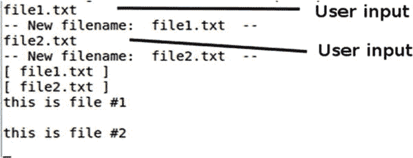

图 6-1. 执行前面代码的输出

图 6-1 展示了执行脚本的输出。你可以看到用户输入文件名的地方，以及中间和之后发生的情况。

在离开这个库之前，让我们再看一个例子。下面的代码展示了获取一个单一的共同数据源，将其分割成多个流，然后将它们合并在一起是多么容易。

```javascript
var fs = require("fs");
var bacon = require("baconjs");
var freadStream = fs.createReadStream("file3.txt");

function readFile(sink) {
    freadStream.on('data', function(chunk) {
        sink(chunk);
    });
}

var fstream = bacon.fromBinder(readFile);

var charStream = fstream.map(function(chunk) {
    return chunk.toString().split("");
}).flatMap(bacon.fromArray);

var onlyNumbers = charStream.filter(function(v) {
    return !isNaN(+v);
});

var onlyChars = charStream.filter(function(v) {
    return isNaN(+v);
});

var all = onlyNumbers.merge(onlyChars);

onlyNumbers
    .onValue(function(n) {
        console.log("#", n);
    });

onlyChars
    .onValue(function(c) {
        console.log("'", c, "'");
    });

all
    .scan([], function(acc, c) {
        return acc.concat(c);
    })
    .onValue(function(a) {
        console.log("-", a, "-");
    });
```

代码非常简单，但此例中重要的在于其背后的潜力。你可以单独转换每个流，然后将它们合并回来。在前面的代码中，合并实际上是在一个数组中完成的，因此结果将是一个不断增长的值的数组。图 6-2 展示了执行输出。

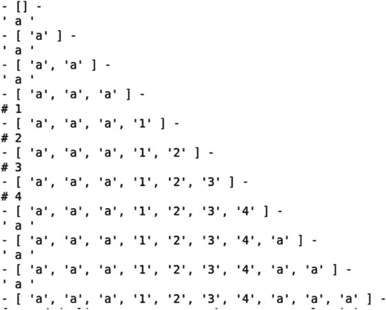

图 6-2. 执行前面代码的输出

# Highland.js

该库（[`http://highlandjs.org`](http://highlandjs.org)）是一个更通用的工具模块，由 Caolan McMahon（[`https://twitter.com/caolan`](https://twitter.com/caolan)）创建，在某些方面与 UnderscoreJS（[`http://underscorejs.org/`](http://underscorejs.org/)）和 AsyncJS（[`http://caolan.github.io/async/`](http://caolan.github.io/async/)，同样由他创建）类似，但建立在类似 Node 的流（streams）之上，这使其能够轻松处理同步和异步代码。

该库宣传的主要特性之一是所谓的“背压”（back pressure），它对于无法暂停的流非常有用。通常，当消费流的客户端无法处理更多数据时，它会暂停流，直到准备就绪。当源流无法暂停时，Highland 会为你缓冲数据，直到你准备好恢复常规操作。

就文档而言，Highland 可能是这里讨论的库中最薄弱的。虽然其官网有一个非常全面的帮助部分，但他们并未列出教程、视频甚至书籍等外部资源，而是需要你自行浏览互联网寻找。唯一的问题是你永远不知道这些资源是否是最新的。

## 许可证

与 RxJS 一样，HighlandJS 的许可证是 Apache 2.0，因此你可以自由地使用该库，只需添加你所做的更改列表（如有），并附上许可证副本即可。

## 兼容性

没有具体说明该库是否像之前那些库一样兼容旧版浏览器；仅说明它能在浏览器中运行，并且其安装中包含一个 `browserify` 就绪的库版本。它也兼容 Node.js，这才是对你我真正重要的（同样，没有提到具体的 Node 版本，但假设它能在现代 Node 版本上运行）。

## 代码示例

Highland.js 宣传的主要特性之一是，你可以让同一版本的代码同时适用于同步和异步数据源，从而简化开发。

在下面的示例中，我将演示这一点；首先，我将使用一个简单的数组作为流构造函数的源，然后将其切换为磁盘上的文件，你将看到其余代码保持不变：

```javascript
var HL = require("highland");

var source = ['value1', 'value2', 'value3'];

HL(source).map(function(v) {

console.log("Calls++");

return v.toUpperCase();

});
```

提示

要安装 HighlandJS，只需使用 `npm` 命令：`$ npm install highland`

现在，如果你继续执行上述代码，有趣的事情会发生：什么也不会发生。你看，前面的例子演示了 Highland.js 宣传的另一特性，即流的惰性求值。该库不会立即开始从流中拉取数据；而是让你定义对流施加转换的意图，然后你可以告诉它开始消费该流。

有几个方法可以做到这一点。实际上，它们是：`each`、`done`、`apply`、`toArray`、`pipe` 和 `resume`。

以下是相同的代码，但添加了额外的方法调用，告诉 HighlandJS 实际开始消费流：

```javascript
var HL = require("highland");

var source = ['value1', 'value2', 'value3'];

HL(source).map(function(v) {

console.log("Calls++");

return v.toUpperCase();

}).toArray(function(arr) {

console.log(arr);

});
```

上述代码的输出如下：

```
Calls++

Calls++

Calls++

[ 'VALUE1', 'VALUE2', 'VALUE3' ]
```

如你所见，这次由于添加了 `toArray` 调用，源流被正确地消费了。

现在让我们看看如果我想要使用文件而非简单数组作为源会发生什么。

```javascript
var HL = require("highland");

var fs = require("fs");

function getData(fname) {

return function(push, next) {

fs.readFile(fname, function(err, data) {

if(err) push(err);

else {

var lines = data.toString().split("\n");

lines.forEach(function(l) {

push(null, l);

});

push(null, HL.nil);//HL.nil 表示流的结束

next();

}

});

};

}

HL(getData('./file4.txt')).map(function(v) {

console.log("Calls++");

return v.toUpperCase();

}).toArray(function(arr) {

console.log(arr);

});
```

如你所见，流的消费调用保持不变，但流的源现在是异步读取的文件。

错误处理也非常简单；如果文件路径错误，前面的代码会失败，但使用 `errors` 方法，你可以从流中提取错误并创建一个新流，然后执行错误处理函数，如下所示：

```javascript
HL(getData('./file42.txt')).map(function(v) {

console.log("Calls++");

return v.toUpperCase();

})

.errors(function(err, push) {

if(err.code == 'ENOENT') { //如果文件未找到，简单地返回空字符串，以便代码不受影响

push(null, '');

} else {

push(err);

}

})

.toArray(function(arr) {

console.log(arr);

});
```

继续文件读取的主题，让我们看另一个示例，类似于我之前用 Bacon.js 展示的。这次，我将有一个文件名数组，代码将获取这些文件名，读取每个文件，并返回其内容：

```javascript
var HL = require("highland");

var fs = require("fs");

var readFile = HL.wrapCallback(fs.readFile);

var filenames = HL(['file1.txt', 'file2.txt', 'file3.txt']);

filenames

.map(readFile)

.parallel(10) // 一次最多读取 10 个文件

.each(function(x) {

console.log("---");

console.log(x.toString());

console.log("---");

});
```

现在，对于上述代码，需要注意的是，直到 `parallel` 方法调用之前，流还没有被消费，这意味着你仍然可以在 `each` 方法调用之前添加更多转换，但 `each` 方法开始消费流，从而一次拉取一个值，之后再添加新的转换是不可能的。实际上，在 `each` 之后唯一可以调用的方法是 `done`。

## 关于背压的一点说明

这个术语之前被提到过几次，并且附带了简短的解释，但事实上，背压对于基于流的流程来说是一个相当相关的术语，因为你的库是否为其实现策略将影响所支持的用例。

具体来说，背压是库应对快速生产者（fast producer）的能力，即当由于某种原因，消费者处理数据块的速度比流本身生成数据块的速度慢时。

基本上有两种方式处理这种情况：要么接受数据丢失，只处理你能处理的部分；要么不能承受数据丢失，因此以某种方式缓冲数据。每种方法都有不同的策略，如下所述。

### 接受数据丢失

以下是当接受数据丢失时，可用于处理频繁数据生产者的三种不同策略。

#### 反抖动流（Debouncing）

此技术基于原始流创建一个新流，但仅当原始流在给定的时间跨度内没有发出事件时，新流才会发出数据。基本上，反抖动操作会过滤掉源流中紧接着另一个事件发出的事件。

#### 采样流（Sampling）

这种方法非常直接：在给定的时间跨度内，它会发出源流最新发出的事件作为新事件。当然，两个采样事件之间发出的任何事件都会被忽略。

#### 暂停流

此方法仅需将源流暂停指定时长，随后恢复运行。暂停期间源流发出的所有数据都将被丢弃。

### 当数据不容丢失时

以下三种策略针对数据极其宝贵、无法容忍因生产者过载而丢失数据的场景。

#### 缓冲

若有必要，可通过多种方式缓冲原始流的事件：例如，可设置最大事件缓冲数量，待缓冲满后一次性推送至下游；亦可设定缓冲时间，时间结束后强制将缓冲数据全部推送至下游。

#### 缓冲暂停

与前述暂停技术类似，但不会丢弃暂停期间源流发出的数据，而是将其缓冲起来。恢复运行后，缓冲事件将逐一触发，使代码仿佛从未发生过中断。

#### 可控流

最后，此技术将流天然的推送机制（即生产者向消费者推送事件）转变为拉取机制：消费者可在指定时间间隔内按需拉取事件，从而从消费者视角完全掌控数据流。

## 总结

我本可继续为所有审查的库添加更多代码示例，但本章的核心目标是展示当前 Node.js 函数式响应式编程（FRP）库领域的主流实现方式。

同时，本章也为后续章节奠定基础——在第 7 章中，我将开始填充本书开发的 FRP 库的代码。

### 表 6-1. 本章讨论的三个库的优缺点对比

| 库/模块 | 优点 | 缺点 |
| --- | --- | --- |
| RxJS | • 文档极为完善<br>• 兼容性极佳<br>• API 成熟度高，辅助方法丰富<br>• 与其他 Rx* 产品共享 API，便于技术迁移<br>• 被 Netflix、Microsoft、GitHub 等大公司采用<br>• 支持背压 | • 非专为 Node.js 设计，需额外安装模块<br>• 因背后大型团队限制，新功能扩展自由度较低<br>• 设计思路偏向 C# 或 Java，API 存在对象嵌套（如 `RX.Obsevable.case`） |
| Bacon.js | • API 优秀且辅助方法丰富<br>• API 更简洁，专为 JavaScript 设计<br>• 原生支持 Node.js<br>• 官网提供丰富的示例与教程 | • 不支持背压 |
| Highland.js | • 支持背压<br>• 占用空间小<br>• 专为 Node.js 设计<br>• 基于 Node 流实现 | • 可用的文档较少<br>• 可用的辅助方法较少 |

**注意** 本章涉及的三个库都非常优秀，使用它们几乎不存在明显缺陷。但为了便于对比，我会将相对不理想的特性列为“缺点”。

### 小结

现在，你应当已充分理解每个函数式响应式库应具备的关键特性，同时也接触到该领域其他开发者的大量参考成果。

接下来要做的是，受本书已覆盖内容的启发，向你展示一种类似的实现方法——这应能让你直观理解此类库的内部运作机制；理想情况下，通过这种方式，你还能进一步领悟响应式编程的核心原理。

那么，让我们进入下一章，共同为 Node.js 编写一个全新的 FRP 库吧。

# 7. 编写你自己的 FRP 库

你终于来到了将一切（或者说几乎所有内容）付诸实践的章节。在本章中，我将综合考虑之前讨论的所有内容：函数式编程、响应式编程、Node.js（显而易见！）以及现有库提供的示例，并以此为基础编写一个全新的 Node FRP 库的第一个版本。

本章的目的并非超越之前介绍的那些已发布模块，而是从内部视角展示创建类似库的过程。换言之，理解事物的运作方式将帮助你掌握相关概念——即使本章提供的实现与已审查的库并不完全相同（确实不同），你仍能观察到解决实现相关问题的可行方案。

到本章结束时，你将清楚了解如何实现一个函数式响应式库，以及如何将其发布到 Node 的 `npm` 公共注册表。

首先，让我们讨论我将编写的库的类型。如前所述，这个库显然会借鉴上一章讨论的三个库（即：RxJS、Bacon.js 和 Highland.js）。

由于实现过程可能需要数月之久，更不用说实际代码审查了，因此这个新库将仅包含执行常见响应式操作所需的最基本功能，例如：转换队列、流合并、以及防抖等简单时间函数。

即便如此，它也应提供足够的基础框架，供你在此基础上进行试验和扩展，以创建符合特定需求的个性化版本。

接下来我将描述该库的内部架构——我巧妙地将其命名为 R-CheeseJS（是不是很妙？）。你将看到我实际上遵循了一种极其简单且易于扩展的架构，同样是为了便于你根据需要轻松添加更多功能。你可以随书获取 R-Cheese 的代码，或从 GitHub（地址：[`https://github.com/deleteman/r-cheese`](https://github.com/deleteman/r-cheese)）下载。

R-Cheese 的代码分为两个文件：一个用于主库（其中仅包含少量公共方法），另一个用于工具函数（这将是主要亮点，包含你最常用的功能）。

## 大奶酪

主库（你始终需要使用的那个）被设计为基于 Node.js 流（stream）运行，这简化了事情，因为我无需模拟流的运作方式（例如基于时间的事件、数据传输等），Node 本身已经为我完成了这些工作。因此，这个库所做的是提供一个更简洁的接口来与 Node 流交互，同时也提供了简单的方法来转换流经其中的数据。

从用户角度来看，你需要关注的主要方法有：

*   `fromStream`：此方法会从一个常规的 Node.js 流创建一个奶酪流（该流上的每一个 `data` 事件都会写入内部的奶酪流）。
*   `fromArray`：同样，此方法会从一个普通的 Array 对象创建一个新的奶酪流。数组项将每 100 毫秒（默认值）或按照作为第二个可选参数提供的延迟时间间隔被发出。
*   `fromFn`：`fromXXX`系列方法中的最后一个。此方法会根据一个函数的返回值来创建一个新的奶酪流。其工作原理与前一个类似，但让你对发出什么内容以及何时发出有更多控制。此方法接收一个可选的第二个参数来设置发出值的延迟，与上述类似（但默认值为 0 毫秒，因为你也可以在函数内部定义时间。作为发射器传入的函数将接收一个单一函数作为参数，每当需要发出一个新值时，都必须调用该参数函数）。
*   `merge`：此方法会将当前的内部流与作为参数传入的任何其他流合并。结果数据块的顺序仅由不同 `data` 事件的时间决定。
*   `then`：此方法仅作为语法糖，允许你对流经管道的数据块进行链式转换。每次调用仅接收一个函数。
*   `onError`：与上述方法类似，但它设置了一条特殊的转换链，仅当某个转换发出错误时（无论是通过抛出异常还是向其回调传递错误参数）才会执行。
*   `each`：最后，这应该是每个转换链上调用的最后一个方法。它启动流的执行直到调用此方法为止，并接收一个最终函数，该函数将在转换链结束时以最终的返回值被调用。

现在我们来看几个上述方法的示例，然后我会向你展示它们的代码。第一个示例展示了如何使用 `fromStream` 方法与现有的 Node.js 流进行交互：

```javascript
var Cheese  = require("./cheese").Cheese;
var fs = require("fs");
var ch = new Cheese();
var chStream = ch.fromStream(fs.createReadStream('./test-cheese1.js'));
chStream
.each(function(content) {
    console.log(content.toString());
});
```

如你所见，上面的例子非常简单，但它展示了 `fromStream` 方法以及 `each` 方法的强制用法——没有 `each` 方法，文件读取将永远不会开始。你可以通过在调用 `each` 之前使用 `then` 方法轻松添加一些转换，如下所示：

```javascript
// 重写前一个例子的最后几行
```

# 默认行为与错误处理

默认情况下，你可以向 `then` 方法传递任何函数，它会检查该函数是接收一个参数（假定为同步函数）还是两个参数（假定为异步函数），并相应地执行。

现在让我们来看最后一个例子，分别展示有无错误处理的情况：

```javascript
var Cheese = require("r-cheese").Cheese;
var fs = require("fs");
var flatMap = require("r-cheese").Utils.flatMap;

var ch = new Cheese();
var filenames = ['./test-cheese1.js', './test-cheese23.js'];

ch.fromArray(filenames)
    .then(flatMap(function(name) {
        return fs.createReadStream(name.toString());
    }))
    .each(function(content) {
        console.log(content.toString());
    });
```

暂时忽略 `flatMap` 函数的使用（我稍后会介绍），上述代码简单地获取了一个文件路径列表，并将其转换为每个元素的实际文件内容。它最终还会输出这些内容。现在，如果其中一个文件路径包含拼写错误，你最终会在屏幕上看到一个未处理的异常，因为 `fs.createReadStream` 这行代码会产生一个 `error` 事件，而你没有处理该事件的逻辑。事实上，由于 Node.js 处理错误事件的方式，并且因为你没有监听它，你的脚本将会被终止（我之前在某一章中提到过，还记得吗？）

你可以轻松地通过使用 `onError` 方法来添加错误处理来解决这个问题，如下所示：

```javascript
ch.fromArray(filenames)
    .then(flatMap(function(name) {
        return fs.createReadStream(name.toString())
    }))
    .onError(function(e) {
        console.trace(e);
    })
    .each(function(cnt) {
        console.log(cnt.toString());
    });
```

这样，你就安全地处理了错误事件，你的脚本不会被提前终止，并且你可以完全控制如何处理该错误。

**注意**
产生错误的数据块将不会被后续的任何转换处理，但后续的数据块将照常通过整个链（前提是它们本身也不产生错误）。

# 库的内部实现

现在，让我们来看看主库的代码，好吗？

```javascript
var Streams = require("stream");
var inherits = require("util").inherits;
var Transform = Streams.Transform;

function OutputStream() {
    Transform.call(this);
}
inherits(OutputStream, Transform);

OutputStream.prototype._transform = function(chunk, encoding, callback) {
    callback(null, chunk);
}

var DEFAULT_ARRAY_DELAY = 100; //毫秒
var DEFAULT_FN_DELAY = 0; //毫秒
```

前面的几行代码仅仅是定义了我们的内部流，以及一些下面会用到的默认值。

```javascript
function Cheese(stream, transformations) {
    this._stream = stream || null;
    this._stream_ended = false;
    this._outputStream = new OutputStream();
    if(this._stream !== null) {
        this.fromStream(stream)
    }
    this._transformations = transformations || [];
    this._error_transformations = [];
    this._source_name = null;
    this._source_interval = null;
    this._source_interval_delay = null;
    this._source_interval_origin = null;
}

Cheese.prototype.fromStream = function(stream) {
    var self = this;
    this._stream = stream;
    this._source_name = 'stream';
    this._stream.on('data', function(d) {
        self._writeToOutput(d);
    });
    return this;
};

Cheese.prototype.fromFn = function(fn, delay) {
    if(typeof delay == 'undefined') {
        delay = DEFAULT_FN_DELAY;
    }
    this._source_name = 'fn';
    this._source_interval_delay = delay;
    this._source_interval_origin = fn;
    return this;
};

Cheese.prototype.fromArray = function(arr, delay) {
    if(typeof delay == 'undefined') {
        delay = DEFAULT_ARRAY_DELAY;
    }
    this._source_name = 'array';
    this._source_interval_delay = delay;
    this._source_interval_origin = arr;
    return this;
};
```

前面的三个方法设置了事件收集的方式，取决于数据源（数组、函数或流）。请注意，这些方法仅在正确的变量上设置正确的值，只有当调用 `each` 方法时，实际的（定时器）间隔才会启动（见下文）。

```javascript
Cheese.prototype._writeToOutput = function(val) {
    if(!this._stream_ended) {
        if(val !== null) {
            val = val.toString();
        }
        this._outputStream.write(val);
    }
}
```

之前的方法将所有写入操作集中到内部流上，请记住，整个库的基本职责是处理数据流并对其进行转换，最终写入到内部流中，而此方法正是负责这最后一步的。

## 转换执行机制

一旦库开始从设定的数据源拉取数据，每个数据块都会经过通过 `then` 方法设定的转换链。以下方法负责执行这些转换，将其应用于数据，并将结果传递给链中的下一个方法。它们是同一概念的不同变体，具体取决于正在执行的辅助转换函数的类型，需要不同的参数（甚至行为）。有一个名为 `_execute_normal` 的默认方法，用于处理简单函数（即自定义转换函数，而非库提供的函数）。如果你正在扩展此库并添加新的转换，可以依赖 `_execute_normal` 方法，或在此处添加新的特定处理器。以下按不特定顺序列出这些方法：

```javascript
Cheese.prototype._execute_filter = function(idx, value, handler, transforms) {
    var self = this;
    transforms[idx](value, function(err, resp) {
        if(!err && !!resp === true) {
            if(transforms.length > idx + 1) {
                self._execute(++idx, value, handler, transforms);
            } else {
                handler(value);
            }
        }
    });
};

Cheese.prototype._execute_normal = function(idx, value, handler, transforms) {
    var self = this;
    if(transforms.length == 0) {
        return handler(value);
    }
    var fn = transforms[idx];
    if(fn.length == 2) {
        //检查函数接收的参数数量
        fn(value, function(err, resp) {
            if(err) {
                // ... (错误处理逻辑)
            }
        });
    }
};
```

上述函数允许执行同步或异步的自定义转换，并妥善处理其错误。为清晰起见，如果自定义转换只接收一个参数（你可以通过查询函数的`length`属性获知），我假设此函数是同步的，因为它只接收要转换的值；但如果它接收两个参数，那么我假设第二个参数是回调函数，并且它是一个异步函数（定义超过两个参数的自定义转换没有意义，因为库无法知道要传递什么给额外的参数）。

错误处理通过以下方式进行：对于同步函数，捕获异常；对于异步版本，检查回调中的错误，然后将错误传递给错误转换链。

```javascript
return self._execute(0, err, handler, self._error_transformations);

}

if(transforms.length > idx + 1) {

self._execute(++idx, resp, handler, transforms);

} else {

handler(resp);

}

});

} else {

try {

var resp = fn(value);

if(transforms.length > idx + 1) {

self._execute(++idx, resp, handler, transforms);

} else {

if(handler) {

handler(resp);

}

}

} catch (err ) {

self._execute(0, err, handler, self._error_transformations);

}

}

};
```

`reduce`辅助函数（我将在本章后面展示）的工作原理是，将同一转换应用于流中的所有值，直到流结束，然后发出最终值。为了知道流何时结束，该函数需要实际的流对象，这就是上述方法将其作为第一个参数传递给函数的原因。

`split`函数是一个非常简单的同步函数，因此以下方法通过调用链中的下一步来执行它。

```javascript
Cheese.prototype._execute_reduce = function(idx, value, handler, transforms) {

var self = this;

transformsidx {

if(transforms.length > idx + 1) {

self._execute(++idx, resp, handler, transforms);

} else {

handler(resp);

}

});

};
```

```javascript
Cheese.prototype._execute_split = function(idx, value, handler, transforms) {

var self = this;

var parts = transformsidx;

if(transforms.length > idx + 1) {

self._execute(++idx, parts, handler, transforms);

} else {

handler(parts);

}

};

Cheese.prototype._execute_flatmap = function(idx, value, handler, transforms) {

var self = this;

transformsidx {

if(err) {

return self._execute(0, err, handler, self._error_transformations);

}

if(transforms.length > idx + 1) {

self._execute(++idx, resp, handler, transforms);

} else {

handler(resp);

}

});

};
```

`flatMap`转换从其接收的函数的结果创建一个新流，因此为了在新流上保持相同的错误链，我将其传递给`flatMap`函数，稍后你将看到，该函数会获取错误处理链并将其添加到新流中。这样，如果在执行`flatMap`之后出现问题，错误仍能得到正确处理。

对于 take 相关的辅助函数（`take`、`takeUntil` 和 `takeWhile`），我需要一种从辅助函数内部发出内部流结束信号的方法，这就解释了我需要访问流对象的原因，也就是为什么我在以下方法中将其作为参数传递。

```javascript
Cheese.prototype._execute_take_transform = function(idx, value, handler, transforms) {

var self = this;

transformsidx {

if(err) {

return self._execute(0, err, handler, self._error_transformations);

}

if(transforms.length > idx + 1) {

self._execute(++idx, resp, handler, transforms);

} else {

handler(resp);

}

});

};

Cheese.prototype._execute_debounce_throttle = function(idx, value, handler, transforms) {

var self = this;

transformsidx {

if(transforms.length > idx + 1) {

self._execute(++idx, value, handler, transforms);

} else {

handler(value);

}

});

};
```

最后，这一批方法中的最后一个负责执行`debounce`和`throttle`辅助函数。这些函数非常特殊，因为它们需要处理修改事件的时间，本质上是修改原始数据源。这就是为什么我将`this`对象作为第一个参数传递；通过访问整个`Cheese`对象，辅助函数可以覆盖数据发射的方式（稍后向您展示该代码时，您将看到更多细节）。

```javascript
Cheese.prototype._execute = function(idx, value, handler, transforms) {

var fnType = transforms[idx]  ? transforms[idx].__fn_type : null;

var execs = {

'filter': this._execute_filter.bind(this),

'reduce': this._execute_reduce.bind(this),

'split': this._execute_split.bind(this),

'take': this._execute_take_transform.bind(this), //负责处理所有 3 种类型的 take

'debounce': this._execute_debounce_throttle.bind(this),

'throttle': this._execute_debounce_throttle.bind(this),

'flatMap': this._execute_flatmap.bind(this)

};

if(execs[fnType]) {

execsfnType;

} else {

this._execute_normal(idx, value, handler, transforms);

}

};
```

上述方法负责选择正确的辅助方法，以执行转换链当前位置的辅助函数。基本上，库提供的每个辅助函数（您很快就会看到）都有一个`__fn_type`属性，该属性标识了辅助函数的类型（例如，`map`函数对应"`map`"，所有不同的`take`函数对应"`take`"等）。因此，`_execute`方法可以使用该属性来选择要使用的正确辅助方法，或者默认使用能够处理通用转换函数的方法。

以下方法通过订阅`data`事件并将每个数据块写入内部流（即所有数据写入的公共流），来处理将新流合并到当前流中的操作。

```javascript
Cheese.prototype.merge = function(newStream) {
var self = this;
newStream.on('data', function(d) {
self._writeToOutput(d);
});
return this;
}
Cheese.prototype.each = function(handler) {
var self = this;
var index = 0;
//我们需要在此处创建一个新的转换列表，以便当触发'data'事件时，只有当前的转换列表
//会被该处理器执行
var transforms = this._transformations.map(function(t) {
if(t.newInstance) {
return t.newInstance();
}
return t;
});
//启动转换链
this._outputStream.on('data', function(d) {
self._execute(index, d, handler, transforms);
});
this._outputStream.on('finish', function() {
self._endSource();
});
if(this._source_name == 'fn' && !this._source_interval) {
self._source_interval = setInterval(function() {
self._source_interval_origin(function(value) {
if(value === null) {
return self._endSource();
}
self._writeToOutput(value);
})
}, self._source_interval_delay);
}
if(this._source_name == 'array' && !this._source_interval) {
this._source_interval = setInterval(function() {
if(self._source_interval_origin.length > 0) {
self._writeToOutput(self._source_interval_origin.shift());
} else {
self._endSource();
}
}, this._source_interval_delay);
}
};
```

从开发者的角度来看，前一个方法承担了一个简单的职责，但如你所见，它在内部处理了好几项任务：

- 它会创建调用时点转换列表的一份副本。这样你就可以在流的不同位置调用它，以便在数据转换过程中做出部分响应（在上一章讨论 Bacon.js 库时，我展示过类似的例子）。

- 它还负责启动转换链。在此之前你一直在设置转换，但直到该方法被调用时，数据才会在链中流动。

- 它确保在流结束时调用`_endSource`方法（若你将函数作为数据源，这一点尤其有用）。

- 最后，它为从非流数据源（如函数和数组）拉取数据创建所需的定时器。

另外，请注意为数组源设置的定时器会在没有更多待发射元素时调用`_endSource`，而为函数源设置的定时器则不会。这意味着函数必须写入一个`null`值来通知数据已全部发送完毕。

下面这三个方法简短易懂，但为了完整性，我快速过一遍：

- `_endSource`：该方法根据数据源类型以适当方式结束数据源。对于基于定时器的数据源，它会清除定时器；对于流，它会结束流。若后续添加更多类型的数据源，则需扩展此方法。

- `then`：简单的方法，将转换添加到列表中并返回对象自身，以保持链式调用。

- `onError`：该方法设置错误处理链并向其中添加函数。如果数据源是流，它还会订阅`error`事件，从而确保应用不会被 Node.js 意外终止。

```javascript
Cheese.prototype._endSource = function() {
this._stream_ended = true;
switch(this._source_name) {
case 'stream':
this._stream.end();
break;
case 'array':
case 'fn':
this._outputStream.end();
clearInterval(this._source_interval);
break;
}
};
Cheese.prototype.then = function(fn) {
this._transformations.push(fn);
return this;
};
Cheese.prototype.onError = function(fn) {
var self = this;
//如果是 fromStream 的情况，首次设置错误处理器时，确保
//正确处理 error 事件
if(this._error_transformations.length == 0 && this._source_name == 'stream') {
this._stream.on('error', function(err) {
self._execute(0, err, null, self._error_transformations);
});
}
this._error_transformations.push(fn);
return this;
};
module.exports = Cheese;
```

至此，主库的分析结束。接下来让我展示辅助函数的代码，这些内容读起来也颇有启发。

## Little Cheese 小芝士

R-Cheese 的第一个版本总共提供了九个转换函数，并将它们作为独立函数导出，以简化添加新函数的任务：只需将新函数添加到`utils.js`文件并导出即可。

尽管导出的转换函数彼此差异很大，但定义它们的函数结构始终相同，它们基本遵循以下模板：

```javascript
function transformation([params]) {
var _fn = function([params]) {
//你的代码写在这里
};
_fn.__fn_type = '[函数类型标识符]';
_fn.newInstance = function() {
//你的代码写在这里
};
return _fn;
}
```

每个转换函数实际上都是执行实际工作的函数的包装器。由于 JavaScript 中的函数也是对象，我可以为它们添加一些属性，主要是`__fn_type`（一个标识转换类型的字符串，正如你之前所见，主库代码中的`_execute`方法会用到它）和`newInstance`方法（它基本上应该返回转换的一个新实例，你可以在主库的`each`方法中找到它的用法）。

现在让我逐一介绍内置于代码中的每个转换函数。其中一些在前几章已经讨论过，另一些可能对你来说是新的，希望通过解释和代码，你能轻松理解它们。

### Map、Filter 和 Reduce

这三个是最常见的转换，我在前几章也已经介绍过，所以没什么特别需要补充的了。因此，我直接展示它们的实现：

```
function map(fn) {
var _fn = function(value, done){
fn(value, done); //此版本的 map 函数是异步的，因此需要回调函数
};
_fn.__fn_type = 'map';
_fn.newInstance = function() {
return map(fn);
};
return _fn;
}
function filter(fn) {
var _fn = function(value, done) {
fn(value, done);
};
_fn.__fn_type = 'filter';
_fn.newInstance = function() {
return filter(fn);
};
return _fn;
}
function reduce(init, fn) {
var accu = init;
var listenerSet = false;
var _fn = function(stream, value, done) {
accu = fn(accu , value);
if(!listenerSet) {
stream.on('end', function() {
done(accu );
});
listenerSet = true;
}
};
_fn.__fn_type = 'reduce';
_fn.newInstance = function() {
return reduce(init, fn);
};
return _fn;
}
```

如你所见，所有三个函数都遵循我之前展示的模板。第一个`map`函数其实没太大玄机，它是这些函数中最简单的一个，本质上只是语法糖，因为它所做的就是执行作为参数传入的函数。由于主库中的`_execute_normal`方法，执行`map`或直接将匿名函数传递给`then`方法效果相同。

`filter`函数也非常简单，事实上它的代码几乎与`map`完全一样，唯一的区别是函数类型标识符不同，这反过来告诉主库如何解释该函数的输出以及如何处理它。

最后，`reduce`函数（在其他库中也被称为`scan`）会按照传入函数指定的方式累积数据块，并在流结束时发射累积结果。正如你所见，这就是该函数需要将流作为参数传入的原因——它需要订阅内部流的`end`事件。