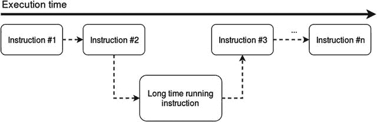
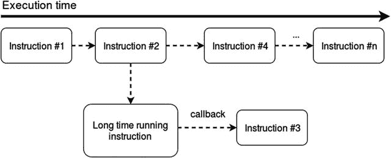
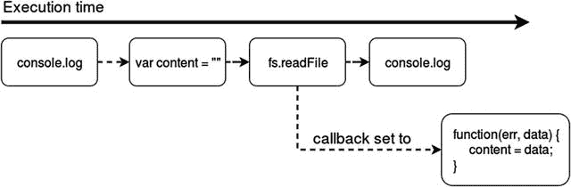
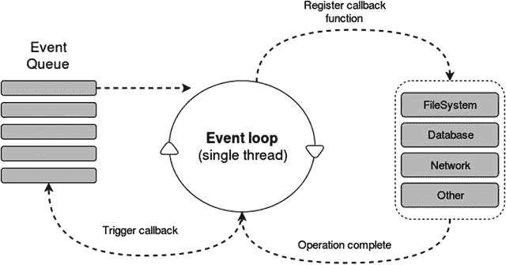

# 5. 进入 Node.js

虽然你已经从实践角度看到了如何在后端应用响应式概念，但我还没有真正讨论为什么使用 Node.js 是一个如此好的选择。

在第四章（参见 4）中你已经看了大量代码，而在本章中，我将重点探讨 Node 的理论方面。这意味着我会深入审视诸如`EventEmitters`和`Streams`之类的内容，你将了解异步编程是如何工作的，以及为什么 Node.js 在这方面如此出色。最后，我还会涉及之前章节已经部分介绍过的异步事件流。

在本章结束时，你应该能更好地理解 Node 提供的工具，这些工具将帮助你创建我一直承诺的响应式框架。其中一些工具只会被提及，而另一些将在未来章节中使用。

## 事件发射器与事件流

在本节的这一部分，我将介绍一个有助于你实现目标的工具。`EventEmitter`模块自 Node.js 早期版本起就作为原生模块存在，它允许你使用一个与浏览器端（这里指的是 UI 事件）没有本质区别的事件系统来传播消息。

我还将介绍 Node 中的 Streams（流）。与`EventEmitters`类似，流也是 Node.js 的原生模块，它使用了`EventEmitters`中的一些概念，并在此基础上增加了更多神奇的特性，从而提供了一个非常熟悉且有趣的接口来处理数据流。

### 事件发射器

关于事件发射器的一个有趣事实是，你可能已经无意中使用过它们。Node 的一些核心功能会扩展该模块，并提供自定义事件供你监听。例如，`process`对象允许你对诸如`uncaughtException`之类的事件做出响应；而由`http`模块的`createServer`方法返回的服务器，则允许你监听名为`request`的特殊事件，诸如此类。

那么，事件发射器到底是什么？简单来说，这个模块允许你发射事件，但更重要的是，它为开发者提供了一套 API，用于监听、响应甚至发射自定义事件。

以下是关于`EventEmitter`的一些可能有用的特性：

*   你可以为一个事件设置任意数量的监听器。
*   当事件被触发时，所有监听器会按照它们被设置的顺序依次被调用。
*   你可以将监听器设置为每次事件被触发时都执行，或仅在第一次触发时执行。
*   基于上一点，有两种方式向事件添加监听器：要么将其追加到列表末尾（使用`on`或`once`方法），要么将其添加到列表开头（使用`prependOnceListener`或`prependListener`方法）。
*   监听器函数无需特定的签名即可生效。触发事件时传递给事件的任何参数都会自动传递给该函数，且顺序保持不变。
*   有一个特殊的 '`error`' 事件，当它被触发且没有任何监听器时，会导致 Node 应用程序关闭。
*   换句话说，通过`EventEmitters`，你可以使用事件来控制逻辑流，就像在前端开发中，你可以将逻辑设置为在页面加载完成后初始化，或者像在点击链接时设置 AJAX 请求一样。
*   特别地，当你有一个异步进程需要在处理过程中多次向客户端回传数据时，这种机制非常有用。

例如，假设有一个函数需要在完成之前发起三个不同的异步请求，并且在处理过程中，它还需要在完成每个内部请求后报告进度。借助`EventEmitters`，你可以轻松实现这一点：通过发射一个客户端可以订阅的自定义`progress`事件。让我们来看一个快速示例：

```javascript
var EventEmitter  = require("events"),
    request = require("request"),
    async = require("async");

function myAsyncEmitter() {}

myAsyncEmitter.prototype = new EventEmitter();

myAsyncEmitter.prototype.process = function() {
    var self = this;
    var doneRequests = 0;
    var urls = [
        "http://www.google.com",
        "http://www.youtube.com",
        "http://www.facebook.com"
    ];

    async.map(urls, function(url, done) {
        request.get(url, function(err, data) {
            doneRequests++;
            self.emit('progress', (doneRequests / urls.length) * 100);
            done(err, data.body);
        });
    }, function(err, results) {
        self.emit('done', results);
    });
};

var AE = new myAsyncEmitter() ;

AE.on('progress', function(percentage) {
    console.log("Percentage done: ", percentage, "%");
});

AE.once('done', function(data) {
    console.log("Process over, this is the data: ", data);
});

AE.process();
```

> **注意**  
> 为了简化代码，我使用了`Async.js`和`Request.js`（可从 [`https://github.com/request/request`](https://github.com/request/request) 获取）库来提供辅助函数，帮助你处理异步调用和实际的请求。测试`EventEmitter`本身并不需要它们；这只是为了将重点集中在有趣的部分——也就是本例中的事件发射器。

上面的代码是我之前提到的概念的一个基本示例：我的自定义发射器继承了 Node 的`Event`模块以获取所需逻辑，然后通过为`progress`和`done`这两个事件设置监听器来使用它。由于我知道`done`事件只会被调用一次，所以我使用`once`方法设置了监听器，当然，也可以使用`on`方法；在这种情况下，两者没有任何区别（这仅仅是为了提高代码可读性而采取的一种措施）。

## 流

与事件发射器类似，流是 Node.js 提供的原生构造，常常被开发者忽略或误解。而且就像 `EventEmitters` 一样，你可能已经使用过不止一个流，甚至自己都没注意到。

因此在本节中，我想深入讲解这个模块，并展示它如何与之前看到的 `EventEmitters` 以及本书的总体目标相关联。希望你能发现我迄今所讲内容与这部分之间的相似之处。

Node.js 的这个模块提供了四种类型的流：

-   `可读流`：提供从指定源读取数据的 API。
-   `可写流`：允许你将连续的数据块写入指定目标。
-   `双工流`：可读流和可写流的结合，允许你向指定源写入数据和从中读取数据。
-   `转换流`：一种特殊的双工流，允许你在读取和写入数据时对数据进行转换。

每种流还有两种模式：一种是 `对象模式`，允许你读取和写入任何 JavaScript 类型（`null` 除外）；另一种是默认模式，流中传输的任何内容都是 `String` 或 `Buffer`。如果我没算错的话，我们总共有八种不同的流可供选择，因此我将更深入地探讨每一种流，展示它们提供的 API，以及你需要如何实现每种类型的流。

### 可读流

可读流允许你将指定的数据源封装到一个标准 API 中，让你能够通过手动轮询源或被动响应数据到达的方式来消费所提供的信息。

开发者几乎每天都会遇到几种非常常见的可读流，例如：

-   客户端的 HTTP 响应对象（指任何连接到你的 API 的应用程序）
-   服务端的 HTTP 请求对象
-   TCP 套接字
-   子进程的 `stdin` 和 `stderr`
-   等等。

所有不同类型的流都提供一组方法或事件，我们可以用它们来读取或写入数据。对于可读流，每当有新的数据块（或根据是否处于对象模式，有新的对象可用）时，它会触发 `data` 事件，或者你可以将读取器的输出通过管道连接到可写流。后者让你无法控制具体过程，你只需将一个流的输出连接到另一个流的输入，系统就会为你处理其余的事情。

下面是一个管道连接的简单示例。以下代码将连接三个不同的流：

```javascript
var fs = require("fs"),
    zlib = require("zlib");

var r = fs.createReadStream('file.txt');
var z = zlib.createGzip();
var w = fs.createWriteStream('file.txt.gz');

r.pipe(z).pipe(w);
```

上面的代码创建了三个不同的流，并在最后一行通过管道将它们连接起来。最终结果是将指定文件压缩并保存到磁盘。

为了显示不使用管道连接时的等效代码，下面是你可能需要采用的方法：

```javascript
var fs = require("fs"),
    zlib = require("zlib");

var r2 = fs.createReadStream('file.txt');
var z2 = zlib.createGzip();
var w2 = fs.createWriteStream('file.txt.gz');

w2.on('open', function() {
  r2.on('data', function(chunk) {
    console.log("data chunk: ", chunk);
    z2.write(chunk);
  });
  z2.on('data', function(data) {
    console.log("-- gzip chunk --");
    w2.write(data);
  });
  r2.on('end', function() {
    z2.end();
  });
  z2.on('end', function () {
    w2.end();
  });
});
```

很明显，这段代码更长一些，需要手动处理的事情也更多，但有时这是必要的，即使只是为了像上面的代码一样添加一些调试信息。

这段代码展示了一个在处理可读流时非常有用的特定事件：`data` 事件。每当有新的数据块可供你的代码消费时，此事件就会被触发。

可读流也可以触发 `readable` 事件，该事件在有数据可读时发生。在这种情况下，消费者必须调用流的 `read` 方法才能获取下一段数据。当你需要对流的行为进行额外控制时，这会非常有用——特别是，前一个事件只会在收到新数据时通知你，而 `readable` 事件则允许你在数据可用但实际接收之前决定如何处理（根据你的逻辑，你可以选择读取或忽略它）。

可读流还有其他有用但更简单的事件，例如 `end` 事件，用于通知没有更多数据可读；`close` 事件，在不再有事件可触发时触发；以及我已经介绍过的 `error` 事件。

### 可写流

对于可写流来说，它们的工作方式与可读流正好相反：它们将数据的目标封装到一个易于使用的容器中。就像任何其他流一样，你可以将其他流通过管道连接到它，也可以手动写入。

一些常见的可写流包括：

-   `fs` 写入流
-   `zlib` 流（就像你上面看到的那样）
-   加密流

使用这些流非常简单。你需要了解的主要方法是：`write` 用于实际发送数据，`end` 用于关闭流。我在前面的代码示例中已经展示了它们的工作原理，所以这里不再赘述。

由于所有流也都是 `EventEmitters`，它们会触发一些特定事件。对于可写流，你应特别注意：

-   `drain`：当 `stream.write` 调用返回 `false` 后触发此事件。一旦此事件被触发，就可以恢复写入。当写入目标不堪重负，需要一些时间才能发送下一个数据块时，你的流可能会触发此事件。
-   `error`：这个事件在所有 `EventEmitters` 中都很常见，因此，无论何时创建流，请务必为此事件设置一个处理程序；否则，如果此错误未被处理，整个应用程序将会崩溃。

### 双工流和转换流

这两种类型的流实际上基于前面两种流。双工流是一个（显而易见地）同时实现了可读和可写接口的流（例如一个 TCP 套接字）。

然后是转换流，它是一种双工流，但不同之处在于它允许你在输入变为输出之前对其进行更改。换句话说，例如，你可以创建一个接收 JavaScript 对象并将 JSON 字符串写入某个存储系统的转换流。

除了显而易见的区别之外，双工流和转换流的主要区别在于，对于双工流，读取和写入事件是并行处理的，也就是相互独立的。写入操作/事件并不依赖于预期先发生的读取事件，因此，如果你正在处理异步进程（在 Node.js 中你很可能会这样），请务必考虑这一点。下面我将展示一个具体案例。

## 编写自定义流

前面的代码展示了如何使用预置的可读流和可写流，但并未演示如何实现自定义流——原因很简单，一旦你理解了流的概念，就会想抓住一切机会使用它们！（至少我是这样的！）

我在此提供一个非常简单的示例，展示如何创建符合各类流描述的对象。

以下代码将在 HTTP 服务器上建立一个端点，通过一组流来接收数据。它将完成以下操作：

- 获取请求体并将其转换为 JavaScript 对象
- 为对象添加一个属性
- 将对象保存到数据库
- 将对象转换回字符串
- 将字符串返回给客户端

```javascript
var inherits = require("util").inherits;
var streams = require("stream");
var Transform = streams.Transform;

//Turns the request's body into an object
function GetBody() {
  Transform.call(this, {objectMode: true});
}
inherits(GetBody, Transform);

GetBody.prototype._transform = function(obj, encoding, callback) {
  var str = obj.toString();
  callback(null, JSON.parse(str));
};
```

# Node.js 中的异步编程

```javascript
//Adds the timestamp value
function AddTimeStamp() {
  Transform.call(this, {objectMode: true});
}
inherits(AddTimeStamp, Transform);
AddTimeStamp.prototype._transform = function(obj, encoding, callback) {
  obj.timestamp = Date.now();
  callback(null, obj);
};

//Turns the object into a string
function ToJSONEncoder() {
  Transform.call(this, {objectMode: true});
}
inherits(ToJSONEncoder, Transform);
ToJSONEncoder.prototype._transform = function(obj, encoding, callback) {
  callback(null, JSON.stringify(obj));
};

//Saves the object into the database
function SaveUserToDB() {
  Transform.call(this, {objectMode: true});
}
inherits(SaveUserToDB, Transform);
SaveUserToDB.prototype._transform = function(obj, encoding, callback) {
  var self = this;
  UserModel.create(obj, function(err, obj) {
    if(err) {
      return callback(err);
    }
    self.push(obj);
    callback();
  });
};

var addTimeStamp = new AddTimeStamp();
var save = new SaveUserToDB();
var getBody = new GetBody();
var toJSON = new ToJSONEncoder();

function handleNewUsers(req, res, next) {
  req
    .pipe(getBody)
    .pipe(addTimeStamp)
    .pipe(save)
    .pipe(toJSON)
    .pipe(res);
}
```

如你所见，通过创建一组`Transform`流，并利用 Node 中`Request`对象默认是`ReadableStream`、`Response`对象默认是`WritableStream`的特性，即可实现上述所有功能。

如果你想测试这段代码，还需要先设置好前置代码，以下是前置代码（当然，你需要安装 MongoDB、mongoose 和 express 等依赖）：

```javascript
var mongoose = require("mongoose");
var express = require("express");

// --- db
var Schema = mongoose.Schema;
var UserSchema = Schema({
  full_name: String,
  birthdate: Date,
  username: String,
  password: String,
  timestamp: Number
});
var UserModel = mongoose.model("User", UserSchema);
mongoose.connect('mongodb://localhost/test-streams');

//--- http server
var app = express();
app.post('/users', handleNewUsers);
app.listen(3000, function() {
  console.log("Ready to roll!");
});
```

这段代码仅负责设置 HTTP 服务器、MongoDB 连接以及定义模型模式。

**注意**

在编写类似上述使用`Request`对象流特性的代码时，请避免使用 Express 的`body-parser`中间件模块（可在[`https://www.npmjs.com/package/body-parser`](https://www.npmjs.com/package/body-parser)获取），因为它会影响功能，导致代码无法正常运行。

最后，我想提醒你注意`SaveUserToDB`这个流——我最初以为它是一个`Duplex`流。它本应将对象写入数据库，然后在后续的`Read`调用中返回数据。但根据前文对`Duplex`和`Transform`流的描述，由于`Read`和`Write`事件并未关联，会导致`Write`操作未完成时`Read`事件就已触发，导致此时无数据可返回。而将流改为`Transform`流可以解决这个问题。

`Duplex`流适用的典型场景是某种客户端/服务器连接处理器——这种流允许同时从服务器向客户端写入消息，并在客户端应用中读取服务器接收的消息。

总而言之，当尝试实现自定义流时，表 5-1 将帮助你理解需要实现哪些方法以及何时实现。

**表 5-1.** 快速指南：何时实现何种流

| 操作类型 | 流类型 | 需实现的方法 |
| --- | --- | --- |
| 仅读取 | Readable | `_read` |
| 仅写入 | Writable | `_write` |
| 读取和写入 | Duplex | `_read`, `_write` |
| 修改写入数据 | Transform | `_transform` |

到目前为止，我几乎在所有地方都谈到了使用异步函数，但并没有真正解释它到底是什么。那么，我们来聊聊这个话题，好吗？

异步（Async）编程可能是 Node.js 最好，同时也是最令人困惑的特性之一。

简单来说，异步编程意味着，对于你执行的每一个异步函数，它不会在程序流程继续之前返回结果。相反，你需要提供一个回调函数，这个函数会在异步代码执行完毕后被调用。

图 5-1 展示了一个常规的、非异步的执行流程。



图 5-1. 同步流程的简单示例

图 5-1 展示了一组以同步方式运行的指令。很明显，为了执行 `指令 #4`，它需要等待耗时指令完成，然后等待 `指令 #3` 结束。但是，如果 `指令 #4` 和 `指令 #3` 实际上并不相关呢？如果你并不在意 `指令 #3` 和 `指令 #4` 彼此之间执行的先后顺序呢？

那么，你可以将耗时指令改为异步方式执行，并将 `指令 #3` 作为它的回调函数，这样你就能更早地执行 `指令 #4` 了。

图 5-2 展示了这种做法的样子。



图 5-2. 异步流程的示例

`指令 #4` 在 `指令 #2` 启动异步耗时指令之后立即执行，而不是等待它完成。

当然，这只是异步编程潜在好处的一个非常简单的例子。而且，并非总是可能采用这种方法。你可以对 I/O 密集型函数这样做，因为 Node.js 就是这样处理 I/O 的（别担心，我稍后会讨论这一点），但是 CPU 密集型函数，比如繁重的数值计算，实际上无法以这种方式工作，它们会像同步函数一样阻塞流程，所以在规划代码时请务必考虑到这一点。

最后，和数字世界中的大多数事物一样，没有什么是无需代价的，额外的好处也带来一个糟糕的权衡：调试异步代码可能非常让人头疼。

开发者习惯于按照编写代码的顺序方式来思考代码，因此调试非顺序执行的代码对新手来说可能很困难。

例如，让我们看看同一段代码的同步和异步编写方式：

同步版本：

```javascript
var fs = require("fs");
console.log("即将读取文件... ");
var content = fs.readFileSync("/路径/到/文件");
console.log("文件内容: ", content);
```

异步版本（含一个常见错误）：

```javascript
var fs = require("fs");
console.log("即将读取文件...");
var content = "";
fs.readFile("/路径/到/文件", function(err, data) {
  content = data;
});
console.log("文件内容: ", content);
```

如果你还没猜到，第二段代码会输出：

```
文件内容:
```

其原因与前文中的流程图直接相关。图 5-3 展示了有问题的异步版本发生了什么。



图 5-3. 一个典型的异步编程错误

通过图 5-3 可以很清楚地看到为什么文件内容没有被写入，因为回调函数是在最后一行 `console.log` 之后才执行的。这是新手开发者常犯的错误，不仅限于 Node.js，更具体来说，在前端 AJAX 调用中也经常出现。他们的代码设置方式导致他们试图在异步调用实际结束之前使用其返回的内容。

因此，为了完成这个示例，让我们看看代码应该如何编写才能正常工作：

```javascript
var fs = require("fs");

console.log("即将读取文件...");

var content = "";

fs.readFile("/路径/到/文件", function(err, data) {

content = data;

console.log("文件内容: ", content);

});
```

很简单，只需将最后的 `console.log` 行移到回调函数中，这样就能确保 `content` 变量被正确设置了。

## 异步进阶

异步编程不仅仅是确保你正确设置了回调函数，它还允许一些有趣的流程控制模式，这些模式可用于提高应用程序的效率。

让我们看看两种不同且非常有用的异步编程流程控制模式：并行流程和串行流程。

## 并行流程

并行流程的核心思想是：程序可以并行运行一组不相关的任务，但只有在所有任务都执行完毕后，才会调用提供的回调函数（以收集它们的集体输出结果）。

基本上，这就是我要表达的意思：

```javascript
// functionX 符号是对各个独立函数的引用
parallel([function1, function2, function3, function4], function(data) {
/// 等它们全部完成后，对合并后的输出进行处理
})
```

为了知道每个函数何时执行完毕，它们需要用操作结果来执行一个回调函数。回调将是它们收到的唯一参数，所以让我们看看这个 `parallel` 函数：

```javascript
function parallel(funcs, callback) {
var results = [],
callsToCallback = 0;

funcs.forEach(function(fn) { // 遍历所有函数
fn(done);
});

function done(data) { // 函数执行完毕时会调用这个函数，并将结果传递到这里
results.push(data);
if(++callsToCallback == funcs.length) {
callback(results);
}
}
}
```

**注意：** 由于在 `parallel` 执行期间调用的函数具有异步特性，最终回调中结果的顺序无法保证。某些在开始时执行的异步函数，可能比后面执行的函数返回结果所需的时间更长。需要额外的代码来确保最终结果列表是有序的。

前面的实现是我试图演示的一个非常简单的版本，但它完成了任务：它以类似并行的方式运行一组函数（你会看到，由于 Node.js 运行在单线程中，真正的并行是不可能的，所以这是我们能达到的最接近的结果）。

这种控制流在处理对外部服务的调用时特别有用。

让我们看一个实际示例：假设你的程序需要执行多个操作，这些操作虽然彼此不相关，但都需要在用户看到结果之前完成。例如，从数据库加载书籍列表，查询外部服务获取本周新书的消息，并将请求记录到文件中。如果你按顺序执行所有这些任务，等待一个完成后再运行下一个，那么用户很可能会遇到响应延迟，因为执行所需的总时间将是所有单个时间的总和。

但如果可以并行执行所有这些任务，那么总时间实际上就等于执行最慢的那个任务所用的时间。

让我们看看这两种情况：

**串行方式（耗时更长）**

```javascript
//请求处理代码...
//假设 "db" 已经初始化，并提供了数据库接口
db.query("books", {limit:1000, page: 1}, function(books) {
services.bookNews.getThisWeeksNews(function(news) {
services.logging.logRequest(request, function() { //没有返回值，但我们需要调用它，以便知道日志记录完成
response.render({listOfBooks: books, bookNews: news})
})
})
})
```

**并行方式（耗时更少）**

```javascript
//请求处理代码...
parallel([
function(callback) { db.query("books", {limit: 1000, page: 1}, callback) }),
function(callback) { services.bookNews.getThisWeeksNews(callback) }),
function(callback) { services.logRequest(request, callback) })
], function(data) {
var books = findData('books', data)
var news = findData('news', data)
response.render({listOfBooks: books, bookNews: news})
})
```

前面的代码展示了每种方法的外观。`findData` 函数简单地查找 `data` 数组，并根据项目结构返回所需的对象（第一个参数）。在这个 `parallel` 的实现中，它之所以必要，是因为（正如我之前提到的）你无法确定函数完成并返回结果的顺序。

除了代码将获得明显的速度提升之外，它也更易于阅读，并且更容易向并行流程中添加新任务：只需在数组中添加一个新项即可。

## 串行流程

串行流程提供了一种简单的方法来指定需要按特定顺序执行的函数列表。这种解决方案不像之前那样提供速度提升，但它确实提供了编写此类代码并保持其整洁的能力，从而远离通常所说的“回调地狱”。

让我们看看我们想要实现的目标：

```javascript
serial([
function1, function2, function3
], function(data) {
//对合并后的结果进行处理
});
```

而不是像这样：

```javascript
function1(function(data1) {
function2(function(data2) {
function3(function(data3) {
//对所有输出进行处理
}
}
}
```

你可以看到，如果函数数量持续增长，第二段代码会变得难以管理。因此，串行方法将帮助你保持代码的组织性和可读性。

让我们看看 `serial` 函数的一个可能实现：

```javascript
function serial(functions, done) {
var fn = functions.shift(); // 从列表中取出第一个函数
var results = [];

fn(next);

function next(result) {
results.push(result); // 保存结果，以便在不再有函数需要执行时传递给最终回调。
var nextFn = functions.shift();
if (nextFn) nextFn(next);
else done(results);
}
}
```

这些函数还有更多变体，例如使用错误参数自动处理错误，或者在并行流程中限制并发函数的数量。

总而言之，异步编程是 Node.js 开发者生活中不可或缺的一部分。所有操作都利用了 Node 的异步 I/O（我稍后将讨论这一点），因此理解它的工作原理以及如何利用它的强大功能，无疑会对你设计响应式库有所帮助。

有关一个功能完备且经过测试、专注于异步编程的库，请查看 `ASYNC.JS`（可在 [`github.com/caolan/async`](https://github.com/caolan/async) 获取）。

# 异步 I/O

异步编程的一个特定案例涉及 Node.js 提供的这个非常有趣的特性：异步 I/O。

此特性与 Node.js 的内部架构高度相关。正如我之前所说，Node 不提供多线程；它实际上在单个线程内运行，该线程内部运行着一个事件循环（见图 5-4）。



**图 5-4.** 展示事件循环如何工作以提供异步 I/O 的示意图

简而言之，Node.js 的设计理念是：I/O 操作是每个操作的实际瓶颈，而不是处理能力。因此，`node` 进程接收到的每个请求都将在事件循环内工作，直到发现一个 I/O 操作。当这种情况发生时，回调将被注册到一个单独的队列中，而主程序的流程将继续。一旦 I/O 操作完成，回调将被触发，其内部的代码将被执行。

# 异步事件流

标题也可以是“异步事件的流”。无论如何，本章这一节的目标是将我目前讨论的所有内容串联起来。

在第 3 章中，我展示了一些处理这类情况的基础代码，它们确实能工作。但由于 Node 已经提供了原生流，因此有必要概述所有选项，这样在后续章节中，你可以从这些不同的选项中汲取灵感，创建出优秀的库。

为了演示，我将使用一个名为 `event-stream` 的外部模块（可在 [`https://www.npmjs.com/package/event-stream`](https://www.npmjs.com/package/event-stream) 获取）。但别担心，它的一切基础都是 Node 的内置流，因此其原理依然适用。

该库本质上提供了一套辅助方法，让你能够操作和处理流，而这些流又可以轻松地处理异步任务。如果你还记得前几页的内容，`SaveUserToDB` 流无法被设置为 `Duplex` 流，相反，由于对数据库的异步调用，我不得不使用 `Transform` 流。

借助 `event-stream` 模块，修复这个问题不仅简单，而且实际上有几种方法可以实现。让我们先看看该库提供的所有辅助方法。

## `through`

该方法是对之前问题的解决方案。它创建了一个 `Duplex` 流，我们可以控制其中的数据流，从而让你将异步过程转化为同步过程。它接受两个可选参数：一个 `write` 函数和一个 `end` 函数。你会注意到没有 `read` 方法，这是因为它是一种特殊的 `Duplex`，具有预定义的 `read` 方法。它会重新发射你在 `write` 方法中通过 `data` 事件发射的任何内容。

让我演示一下。以下是 `SaveUserToDB` 流的重写方式：

```javascript
var es = require("event-stream");

var save = es.through(function write(data) {
    var self = this;
    this.pause();
    //You need to pause the stream, to make sure the saving operation is done
    UserModel.create(data, function(err, obj) {
        if(err) {
            return self.emit('error', err);
        }
        self.resume();
        //you can then resume the stream and emit the new object
        self.emit('data', obj);
    });
}, function end() {
    this.emit('end');
});
```

## `map`

该方法接受两个参数：实际数据和必须在函数末尾调用的回调函数。

我在前一章已经介绍了 `map` 函数的作用，因此在这种情况下，只需理解这个特定的 `map` 是一个自定义的 `through` 函数，它会重新发射你作为接收回调函数第二个参数传递的任何内容。了解这一点后，你可以再次重新实现 `SaveUserToDB` 流，如下所示：

```javascript
var es = require("event-stream");

var save = es.map(function(data, callback) {
    var self = this;
    UserModel.create(data, function(err, obj) {
        if(err) {
            //the first argument of the callback is the error returned
            return callback(err);
        }
        callback(null, obj);
    });
});
```

## `split`

该方法的工作方式与 `String#split` 方法类似，但其默认值是换行符，而不是空字符串。它不是分割单个字符串，而是将一个流分解并重新组装，以便结果分割的每个部分都是一个数据块。

一个简单的例子是，如果你想处理文本文件中的每个单词，可以这样做：

```javascript
var es = require("event-stream");
var fs = require("fs");

fs.createReadStream('myfile.txt')
    .pipe(es.split(' '))
    .pipe(es.map(function(word, cb) {
        cb(null, word.toUpperCase());
    }));
```

显然，你不需要仅仅为了将文档分割成单词而这样做，但这仍然可以作为示例。

## `join`

这个方法有点令人困惑，因为名称暗示它是 `split` 的反向操作，可以撤销你对它所做的任何操作。

该方法在每个发出的数据块后添加一个分隔符（它接受的唯一属性）。因此，实际上，对于每一块数据，它会发射两个新块：分隔符和实际数据。所以你可以这样做：

```javascript
var es = require("event-stream");
var fs = require("fs");

var writer = fs.createWriteStream('./output-join.txt');

fs.createReadStream('./event-stream-join.js')
    .pipe(es.split(" "))
    .pipe(es.map(function(str, done) {
        done(null, str.toUpperCase());
    }))
    .pipe(es.join("\n"))
    .pipe(writer);
```

实际上，上面的代码将文本文件分割成单词，将每个单词转换为大写，然后将每个单词保存到文件中，但末尾带有一个换行符。

**提示**

如果在 `join` 方法中传入一个 `String` 而不是函数，那么该函数将在流结束时被调用，它接收的唯一参数将是所有连接成单个 `String` 的数据块列表。

## `merge`

该方法负责合并多个流。这意味着它将合并每个传入流的结果数据，一旦所有流都发出了 `end` 事件，它就会结束。

一个简单的例子如下：

```javascript
var es = require("event-stream");
var fs = require("fs");

es.merge([
    fs.createReadStream('input1.txt'),
    fs.createReadStream('input2.txt')
]).pipe(fs.createWriteStream('output.log'));
```

注意，合并的流之间不保证顺序，因此保存的数据不会先包含一个文件的内容，然后再包含第二个文件的内容。两个文件的内容可能交织在一起（取决于每个文件内容的长度）。

## `readable`

正如方法名称所示，它创建一个 `Readable` 流，该流与一个异步函数配合作为数据源。换句话说，接收的函数（接受的唯一参数）接受两个参数：一个计数器和一个回调。该函数必须始终调用回调以推进数据流，并且只能调用一次；后续调用将无效。

然而，它可以在一次调用中使用 `data` 事件发射多个数据块。以下是你的 `read` 函数的基本结构：

```javascript
var es = require("event-stream");

es.readable(function(count, callback) {
```

if(hasEnded) { //for some reason the stream is no longer reading

this.emit('end');

}

//... your code here

this.emit('data', chunk); //you can do this as many times as you need to.

callback();

});

```

**注意**

在前面的代码示例中，变量`hasEnded`仅仅是某种指示流已结束的逻辑条件的占位符。你需要将其替换为对业务逻辑有意义的任何内容。

该模块还提供了其他方法，如`duplex`、`child`、`wait`、`parse`等，但主要方法就是上面这些。如果你想了解更多，可以查看该模块 npm 页面上的完整文档（可在[`https://www.npmjs.com/package/event-stream`](https://www.npmjs.com/package/event-stream)获取）。

## 结论

正如你所见，该模块提供的辅助方法与第 3 章中描述的方法非常相似，但同时也有所不同，因为它们是创建新的流，而不是修改流经某个流的数据。

这个模块和之前讨论的可观察流（Observable Streams）将用于创建本书响应式库的最终版本。

## 总结

希望本章能让你对 Node.js 中一个常被误解且常被遗忘的特性有所了解。

内置流将成为在后端处理响应式代码的绝佳工具，正如你在前几章中所见。所以现在你知道了如何使用它们，就可以开始自己动手实践了！

下一章将涵盖目前专门处理 JavaScript（尤其是 Node.js）中响应式编程的主要库。

**脚注**  
\[1\] （当然，这只是一个粗略的近似，因为要得到精确的数字，还需要考虑并行函数所增加的时间。）
