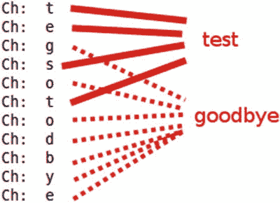
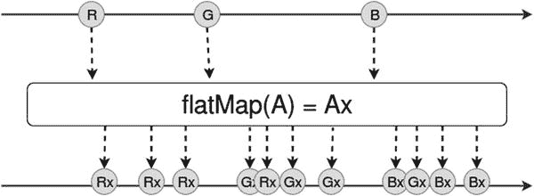
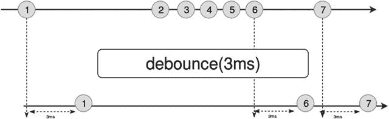
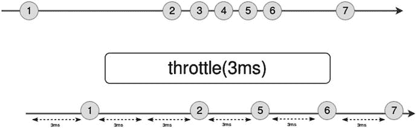
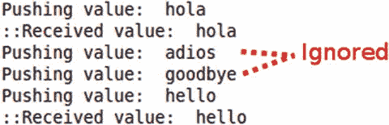
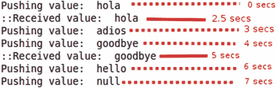

# 拆分数据块

这个函数相当直接，没什么好说的。它只是对数据执行 `map` 然后在其中进行字符串 `split` 的一种快捷方式。默认情况下，它会根据单个字符组成的数组来拆分字符串，除非你向它传递一个分隔符字符串。

此函数的结果是一个值数组，恰好可以通过 `flatMap` 转换成一个新的数据流。

以下是此转换函数的代码：

```
function split(separator) {
var _fn = function(value) {
return value.toString().split(separator || "");
}
_fn.__fn_type = 'split';
_fn.newInstance = function() {
return _fn;
}
return _fn;
}
```

现在，让我们看看这个关于 `split` 和 `flatMap` 一起使用的示例：

```
var cheese = require("./cheese").Cheese;
var flatMap = require("./cheese").Utils.flatMap;
var split = require("./cheese").Utils.split;
var ch = new cheese();
var words = ["test", "goodbye"];
ch.fromArray(words)
.then(split())
.then(flatMap(function(arr) {
return arr
}))
.onError(function(e) {
console.trace(e)
})
.each(function(cnt) {
console.log("Ch: ", cnt.toString());
});
```

上面代码的输出可能并非你想象的那样。请查看图 7-2 的截图：



**图 7-2.** 上述代码的混合输出

因为 `flatMap` 函数实际上创建了两个不同的数据流（分别来自 `split` 返回的每个数组），所以最终会得到两个并行工作的源数据流，就好像它们被合并成了一个。这就是某些字母混合在一起，而不是一个接一个单词出现的原因。

## FlatMap 与错综复杂的情节

这是本代码中提供的三种最复杂的转换中的第一种，后两种处理时间问题，但这里的情况并非如此。

我一直在本章的几个示例中使用这种转换，但没有深入细节，所以你可能已经猜到了这个函数的作用，或者你可能像我第一次读到它时一样感到困惑，所以让我尽可能简单地解释一下。

`flatMap` 函数能够从它接收到的函数的返回值中创建一个新的流。这个返回值应该是库知道如何用作流数据源的东西，即：

-   另一个流（查看 `flatMap` 返回执行 `fs.createReadStream` 的结果流的示例）。

-   一个数组（查看之前展示的示例）。

-   一个函数，当然，该函数必须符合 `fromFn` 所期望的必需行为。

如果使用得当，这种转换为你的流提供了极大的灵活性。查看图 7-3 了解其工作原理。



**图 7-3.** 一个弹珠图，展示了 `flatMap` 如何转换流的简化版本

图 7-3 以图形方式阐述了我上面解释的内容：对于传递给 `flatMap` 的函数返回的每个可观察元素，该转换如何返回一个新流，以及这些结果流如何实际上并行工作并混合它们的值（就像之前的 `split` 示例一样）。

此转换的代码如下所示（此函数还允许开发者使用同步和异步函数作为 `flatMap` 的参数）：

```
function flatMap(fn) {
var _fn;
var observable;
var newStream = null;
function setEachEvent(stream, observable, error_transforms, done) {
if(Array.isArray(observable)) {
stream.fromArray(observable)
} else if(typeof observable === 'function') {
stream.fromFn(observable);
} else if(observable instanceof _streams) {
stream.fromStream(observable);
}
error_transforms.forEach(function(et) {
stream.onError(et);
})
//对于 newStream 发出的每个项
//将其插入原始流中
//**放在正确的位置**
stream.each(function(v) {
done(null, v);
});
}
if(fn.length == 1) {
_fn = function(value, error_transforms, done) {
newStream = new Cheese();
try {
observable = fn(value);
} catch (e) {
return done(e);
}
setEachEvent(newStream, observable, error_transforms, done);
};
} else {
_fn = function(value, error_transforms, done) {
newStream = new Cheese();
fn(value, function(err, observable) {
if(err) {
return done(err);
}
setEachEvent(newStream, observable, error_transforms, done);
});
};
}
_fn.__fn_type = 'flatMap';
_fn.newInstance = function() {
return flatMap(fn);
}
return _fn;
}
```

从字面上看，这个转换是从传入函数的结果输出中创建一个新的流。`done` 回调是连接回原始转换链的纽带，`_fn` 函数也接收错误转换链，以确保新流知晓它（这样，如果新流上发生错误，相同的错误转换链将以对开发者透明的方式应用）。

## 处理时间

最后两个转换处理流中事件的时间安排，因为有时开发者需要的不是处理接收到的每一个数据块，实际上，其中一些事件可能是重复的，特别是如果它们是用户生成的事件（在后端不适用，但前端的点击事件在这里是一个非常常见的例子）。

这就是为什么提供了两个转换来处理这种情况（尽管存在更多转换，如果需要也可以轻松添加）：`debounce` 和 `throttle`。尽管乍一看它们似乎在执行相同的操作，但它们的行为并不完全相同，如果在应该使用另一个时使用了这一个，结果可能是不可预测的。

让我们先从 `debounce` 开始，其背后的思想是，给定一个事件流，你想要移除那些由于某种原因时间间隔太近的事件，因此你可以设置一个延迟时间，并告诉转换使用该延迟对事件进行 `debounce`。让我们先看图 7-4，然后我会进一步解释：



**图 7-4.** `debounce` 函数的弹珠图

所以，再次，给定一个事件流，基于一个时间延迟对其进行去抖，意味着仅在过去 [延迟] 时间段内没有再收到其他事件时，才发出最后收到的事件。在图 7-4 的示意图中，输入被去抖了 3 毫秒，这意味着在一个值被接收后，如果在那 3 毫秒内没有收到其他值，它将被发出，否则将被忽略。这就是为什么值 2、3、4 和 5 被忽略，而 6 被发出的原因。

现在，另一方面，节流一个流是相似的，但又有所不同。它的意思是，每次延迟时间到了就会发出一个事件，如果中间发生了多个事件，只有最后一个事件会被发出，其余的被忽略。图 7-5 显示了节流的示意图：



**图 7-5.** `throttle` 转换的弹珠图

使用相同的源流和相同的时间延迟，你可以看到结果与前一个有何不同，在这种情况下，值 2 和 5 也被发出，因为它们是在 3 毫秒间隔内收到的最后一个值。

以下是两个代码示例，展示了如何在你的代码中使用 `throttle` 和 `debounce`（这些是虚构的示例，没有实际应用，但你会在后续章节中了解到，别担心）：

```
var cheese = require("r-cheese").Cheese;
var ch = new cheese();
var debounce = require("r-cheese").Utils.debounce;
var source = [
//v 是要发出的值，d 是发出它之前等待的延迟。
{v: "hola", d: 10},
{v: "adios", d: 1},
{v: "goodbye", d: 1},
{v: "hello", d: 5}];
var lastTimestamp = 0;
var index = 0;
ch.fromFn(function(push) {
if(Date.now() - lastTimestamp > source[index].d) {
console.log("Pushing value: ", source[index].v)
push(source[index].v)
lastTimestamp = Date.now();
index++;
}
if(index == source.length) {
push(null);
}
}).then(debounce(5)).each(function(n) {
console.log("::Received value: ", n.toString());
});
```

上面 `debounce` 函数的示例将在不同时间点发出一系列值，去抖设置为 5 毫秒，输出如图 7-6 所示：



`图 7-6.` `debounce` 示例的输出

至于 `throttle` 函数，示例如下：

```javascript
var cheese = require("r-cheese").Cheese;
var ch = new cheese();
var throttle = require("r-cheese").Utils.throttle;
var source = [
{v: "hola", d: 1},
{v: "adios", d: 3000},
{v: "goodbye", d: 1000},
{v: "hello", d: 2000},
{v: null, d: 1000}];
var lastTimestamp = 0;
var index = 0;
ch.fromFn(function(push) {
if(Date.now() - lastTimestamp > source[index].d) {
console.log("Pushing value: ", source[index].v)
push(source[index].v)
lastTimestamp = Date.now();
index++;
}
}).then(throttle(2500)).each(function(n) {
console.log("::Received value: ", n.toString());
});
```

上述示例与防抖示例的机制相同，只是这次时间间隔更长，以便正确演示节流的效果。在该示例中，我以 2.5 秒为间隔对数据进行节流，因此，如图 7-7 所示输出结果：



图 7-7。

节流示例的输出

数据写入流的时间点用虚线标记，如您所见，节流间隔的时间点用实线标记，并且如预期所示，只有两个值最终通过，其余值均被忽略。

现在您已经了解了它们两者的使用方法，让我展示它们的实现：

```
function debounce(delay) {
var lastTimestamp = null;
var debounced = false;
var listeners = [];
var _fn = function(cheese, value, index, handler, transforms, done) {
var now = null;
if(debounced) {
return done(cheese._outputStream);
}
/*
移除输出流上的所有活跃监听器
*/
listeners = cheese._outputStream.listeners('data');
listeners.map(function(fn) {
cheese._outputStream.removeListener('data', fn);
});
/*
覆盖输出流上'data'事件的主监听器。
这样我们就可以控制何时真正开始转换以及何时忽略数据
*/
cheese._outputStream.on('data', function(v) {
now = Date.now();
if(!lastTimestamp) {
lastTimestamp = Date.now();
}
if(now - lastTimestamp > delay) {
cheese._execute(index, v, handler, transforms);
}
lastTimestamp = now;
});
debounced = true;
return done(cheese._outputStream);
};
_fn.__fn_type = 'debounce';
_fn.newInstance = function() {
return debounce(delay);
};
return _fn;
}
function throttle(delay) {
var throttled = false;
var listeners = [];
var bufferedValue = null;
var interval = null;
var _fn = function(cheese, value, index, handler, transforms, done) {
if(throttled) {
return done(cheese._outputStream);
}
listeners = cheese._outputStream.listeners('data');
listeners.forEach(function(fn) {
cheese._outputStream.removeListener('data', fn);
});
bufferedValue = value;
//缓冲流发出的最后一个值，直到合适的时机将其传递
cheese._outputStream.on('data', function(v) {
bufferedValue = v;
});
if(!interval) { //当第一个事件到达时启动间隔
interval =  setInterval(function() {
if(bufferedValue !== null) {
cheese._execute(index, bufferedValue, handler, transforms);
bufferedValue = null;
}
}, delay);
}
//确保在完成时清除活跃的间隔
cheese._outputStream.on('finish', function() {
clearInterval(interval);
})
throttled = true;
};
_fn.__fn_type = 'throttle';
_fn.newInstance = function() {
return throttle(delay);
};
return _fn;
}
```

尽管行为相似，但它们的实现却大相径庭，正如您所见，`debounce` 需要非常关注时间点，而 `throttle` 则只是设置一个间隔并缓冲接收到的最后一个值，直到间隔触发。其余的逻辑不言自明，在您看过 marble 图和示例之后，我几乎无需再多做解释。