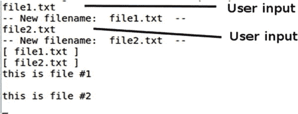
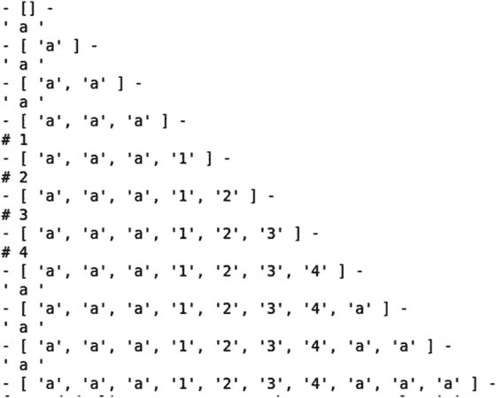

# 6. 领域概览

到目前为止，我在本书中介绍了什么是响应式编程（RP）、它在后端的巨大价值，以及 Node.js 为何与其如此契合。我甚至进一步展示了一些实现响应式后端的代码方案。

在本章中，在深入探讨如何创建本书的响应式库之前，我想先回顾一下目前已有的库。有些库并非专为 Node.js 设计，而有些则是。但重要的是，它们全都是 JavaScript，尽管它们无法完全按原样在后端使用，但你仍可能从中学到东西。

到本章结束时，你应该已掌握所有必要知识，可以开始动手编写即将介绍的响应式库的代码了。

## 针对 JavaScript 的响应式扩展：RxJS

也被称为针对 JavaScript 的响应式扩展（请查阅 [`http://reactivex.io/`](http://reactivex.io/)），`RxJS` 在撰写本文时已发布至 4.0 版本，是目前最流行的响应式库之一。

该项目由微软积极开发，但背后也有一个庞大的开源社区协助改进该库。若你对此感兴趣，他们提供了一个 Wiki 页面（可在 [`https://github.com/Reactive-Extensions/RxJS/wiki/Contributions`](https://github.com/Reactive-Extensions/RxJS/wiki/Contributions) 找到）。但请注意，根据目前情况来看，他们似乎是唯一有权决定哪些功能适合“产品”、哪些不适合的群体，因此欢迎提交错误修复和文档改进；然而，新功能在考虑之前必须经过讨论。这可能是因为 Rx 是一套基于相同原则的多语言库集合，为其中一个库添加新功能就意味着要为其他所有库也添加同样的功能。

由如此大型的组织支持还有一个好处，那就是这个库拥有海量的文档资源。我指的不只是在线教程，还有许多相关的书籍和工作坊。你可以从他们的 GitHub 页面（[`https://github.com/Reactive-Extensions/RxJS#resources`](https://github.com/Reactive-Extensions/RxJS#resources)）获取完整的资源列表。

## 许可证

该库采用 Apache 许可证 2.0 版（[`http://www.apache.org/licenses/LICENSE-2.0`](http://www.apache.org/licenses/LICENSE-2.0)）进行分发。这基本上意味着你可以将其用于商业产品而无需担心，也可以修改和分发它，但如果你这样做，你必须附上你所做的更改列表以及许可证的副本。总而言之，只要遵守一些基本规则，你几乎可以自由地用它做任何你想做的事。

## 兼容性

`RxJS` 兼容所有主流浏览器，甚至包括一些相当古老的版本——具体来说，是 Internet Explorer 6+、Firefox 1.0+ 和 Chrome 4+。希望你没有真正使用这些过时的浏览器版本，但以防万一。

令人惊讶的是，该库也与 Node.js 兼容，支持 0.4 及以上版本，因此我将展示的代码示例将直接在 Node 中进行测试（呜呼！）。

## 代码示例

关于这些示例，由于它实际上与 Node 兼容，我将使用 Node 来运行它们。第一个代码示例非常基础，帮助你入门。

**注意**  
要在 Node 中使用 `RxJS`，你需要使用经典的 `npm install` 命令安装 `rx` 包和 `node-rx` 绑定：`$ npm install rx` 和 `$ npm install node-rx`。

```javascript
var rx = require("rx");

var rxnode = require("rx-node") ;

var subscription = rxnode.fromReadableStream(process.stdin);

subscription.filter(function(line) {

var matches = line.toString().match(/[a]{1}/g);

return matches !== null && matches.length > 5;

})

.subscribe(function (x) {

console.log(x.toString());

});
```

如你所见，Node.js 绑定与 Node 的流兼容（如果你想知道更多相关信息，请查看第 5 章）。在这个例子中，我只是简单地使用了 `stdin` 流，在设置了一个简单的过滤函数之后，我就可以订阅它了。换句话说，这段代码允许你输入一个句子，一旦你按下回车键（这会触发 `stdin` 流的 `data` 事件），它就会统计句子中字母 A 的数量。如果数量大于 5，它会再次打印该行；否则什么也不做。

代码可能很简单，但足以让你入门。基本上你总是遵循相同的模式：

* 找到一个要使用的流。
* 为流的数据配置一组转换/操作。
* 最后，订阅该流，并将一个最终要使用的函数传递给它，该函数将接收通过 `data` 事件发送的数据块的最终版本。

**提示**  
如果你使用的是带有自定义事件的自定义流，你可以在实际流之后，将 `end` 事件名称和 `data` 事件名称（按此顺序）传递给 `fromStream` 方法。

我们再来看一个例子。这是对第 5 章中一个例子的重写，该脚本会将文件作为流读取，并将其拆分为单词，将这些单词全部转换成大写字母，然后每个单词单独打印在一行上。

```javascript
var rx = require("rx");

var noderx = require("rx-node");

var fs = require("fs");

var stream = noderx.fromStream(fs.createReadStream('./test-rxjs2.js'));

stream

.flatMap(function(s){ return s.toString().split(" ")  })

.map(function(str) {

return str.toUpperCase();

})

.subscribe(function(b) {

console.log(b.toString());

});
```

因为 `RxJs` 没有像 `event-stream` 模块（还记得 `split` 方法吗？）提供的那些辅助方法，为了拆分行并使单词成为流中新的数据块，我使用了 `flatMap` 方法。这个方法会获取其函数返回的值（可能是一个 Observable 或可以变成 Observable 的东西，在这个例子中是一个数组），将其展平，并返回一个发出这些新数据项的流。

# Bacon.js

`Bacon.js` 是一个用于在 JavaScript 中实现函数式响应式编程的优秀小型库。在撰写本文时，其版本为 `0.7.84`。尽管这个版本号可能会让你产生误解（毕竟它还没到 1.0 版本），但它已经存在超过 3 年，并且相当流行。根据 NPM 的统计数据，它每月被下载超过 14,000 次，并且在 Github (`https://github.com/baconjs/bacon.js`) 上拥有超过 5,000 颗星。

虽然没有明确指出该库的主要作者是谁，但经过一番挖掘，似乎是 `Juha Paananen` 先生。你可以在 Github (`https://github.com/orgs/baconjs/people`) 上找到活跃贡献者列表。其文档似乎相当全面；他们列出了相当多的资源，比如教程，甚至还有一个视频示例 (`https://github.com/baconjs/bacon.js/wiki/Documentation`)。

最后，如果你觉得需要提问，他们有一个活跃的 Google Group (`https://groups.google.com/forum/?fromgroups#!forum/baconjs`) 和 Gitter (`https://gitter.im/baconjs/bacon.js`) 上的一个活跃聊天室可供使用。

## 许可证

对于 `Bacon.js` 来说，其许可证是现有最宽松的许可证之一：MIT 许可证。它基本上规定，只要你恰当地添加版权声明和许可证副本，你就可以对它做几乎任何事情。

## 兼容性

根据作者的说法，该库不会真正扰乱语言中现有对象的原型，除两个特定情况外：

- 在浏览器环境中，它会将 `Bacon` 对象添加到 `window` 实例中。
- 如果定义了 `jQuery`，它会将 `asEventStream` 方法添加到其中。

考虑到这一点，该库应该与你项目中使用的其他任何库都相当兼容。

至于浏览器和 Node 的版本兼容性，它已经在所有现代版本的主流浏览器上测试过（如 Bacon 的 readme 文件所述），并且因为不使用任何依赖于浏览器的功能，所以它与所有这些浏览器都能协同工作。对于 Node 也是如此，因为它不依赖任何实际的浏览器功能，这个库是纯 JavaScript 的，这也使其与 Node 兼容。

## 代码示例

对于 `Bacon.js`，你不需要额外的带有 `Node.js` 绑定的库，因为正如我之前提到的，这个库是 100% 与环境无关的 JavaScript。话虽如此，这里有一个简单的例子展示了从自定义事件创建新流是多么容易：

```javascript
var bacon = require("baconjs");
var fs = require("fs");
process.stdin.resume();
process.stdin.setEncoding('utf8');
var util = require('util');

function readFilenames(sink) {
    process.stdin.on('data', function (text) {
        sink(text.trim());
    });
}

//从自定义函数创建一个新的 EventStream
var filenames = bacon.fromBinder(readFilenames);

filenames.onValue(function(name) { //接入流以了解发生了什么
    console.log("-- 新文件名: ", name, " --");
})

var names = filenames.scan([], function(acc, name) { //每次获取 2 个文件名
    return acc.length === 2 ? [name] : acc.concat(name);
});

var groupfilenames = names.filter(function(acc) { //一旦有 2 个，就继续；否则，在此停止
    return acc.length === 2;
})
.flatMap(bacon.fromArray); //将新数组转换为流

groupfilenames.onValue(function(fnames) {
    console.log('[', fnames, ']');
});

groupfilenames.flatMap(function(name) {
    return bacon.fromNodeCallback(fs.readFile, name);
})
.onValue(function(content) {
    //打印出文件的内容
    console.log(content.toString());
});
```

提示

在你的 `Node.js` 项目中安装 `Bacon.js` 非常简单。你只需要执行以下命令：`$ npm install baconjs`

前面的代码让用户输入两个文件名，然后将这些名称转换为这些文件的实际内容。这一切都是通过一系列转换实现的：

- 使用 `fromBinder` 方法创建一个流，这样每次用户按下 ENTER 键时，就会发出一个新的数据块（一个新的文件名）。
- 然后使用 `scan` 方法，我将数据块分组，每两个一组。
- 通过过滤掉少于两个元素的组，我实质上阻止了数据在流中的流动，直到每个组都有两个文件名。
- 第一个 `flatMap` 方法与 `fromArray` 的结果结合使用，会将每个数组转换为一个新的流，该流会发出文件名，当然，这个新流的事件数量是有限的（只有两个！）。
- 最后，第二个 `flatMap` 方法会将 `fs.readFile` 方法的异步回调转换为一个流，使你能够在该流中读取每个文件的内容。

为了让你看到每一步的含义，我添加了到 `onValue` 方法的中间调用。图 6-1 展示了脚本的输出，并向你展示每个流如何受到应用于其上的转换的影响。



图 6-1. 执行前面代码的输出

图 6-1 展示了执行脚本的输出。你可以看到用户输入文件名的地方，以及中间和之后发生的情况。

在离开这个库之前，让我们再看一个例子。下面的代码展示了获取一个单一的共同数据源，将其分割成多个流，然后将它们合并在一起是多么容易。

```javascript
var fs = require("fs");
var bacon = require("baconjs");
var freadStream = fs.createReadStream("file3.txt");

function readFile(sink) {
    freadStream.on('data', function(chunk) {
        sink(chunk);
    });
}

var fstream = bacon.fromBinder(readFile);

var charStream = fstream.map(function(chunk) {
    return chunk.toString().split("");
}).flatMap(bacon.fromArray);

var onlyNumbers = charStream.filter(function(v) {
    return !isNaN(+v);
});

var onlyChars = charStream.filter(function(v) {
    return isNaN(+v);
});

var all = onlyNumbers.merge(onlyChars);

onlyNumbers
    .onValue(function(n) {
        console.log("#", n);
    });

onlyChars
    .onValue(function(c) {
        console.log("'", c, "'");
    });

all
    .scan([], function(acc, c) {
        return acc.concat(c);
    })
    .onValue(function(a) {
        console.log("-", a, "-");
    });
```

代码非常简单，但此例中重要的在于其背后的潜力。你可以单独转换每个流，然后将它们合并回来。在前面的代码中，合并实际上是在一个数组中完成的，因此结果将是一个不断增长的值的数组。图 6-2 展示了执行输出。



图 6-2. 执行前面代码的输出

# Highland.js

该库（[`http://highlandjs.org`](http://highlandjs.org)）是一个更通用的工具模块，由 Caolan McMahon（[`https://twitter.com/caolan`](https://twitter.com/caolan)）创建，在某些方面与 UnderscoreJS（[`http://underscorejs.org/`](http://underscorejs.org/)）和 AsyncJS（[`http://caolan.github.io/async/`](http://caolan.github.io/async/)，同样由他创建）类似，但建立在类似 Node 的流（streams）之上，这使其能够轻松处理同步和异步代码。

该库宣传的主要特性之一是所谓的“背压”（back pressure），它对于无法暂停的流非常有用。通常，当消费流的客户端无法处理更多数据时，它会暂停流，直到准备就绪。当源流无法暂停时，Highland 会为你缓冲数据，直到你准备好恢复常规操作。

就文档而言，Highland 可能是这里讨论的库中最薄弱的。虽然其官网有一个非常全面的帮助部分，但他们并未列出教程、视频甚至书籍等外部资源，而是需要你自行浏览互联网寻找。唯一的问题是你永远不知道这些资源是否是最新的。

## 许可证

与 RxJS 一样，HighlandJS 的许可证是 Apache 2.0，因此你可以自由地使用该库，只需添加你所做的更改列表（如有），并附上许可证副本即可。

## 兼容性

没有具体说明该库是否像之前那些库一样兼容旧版浏览器；仅说明它能在浏览器中运行，并且其安装中包含一个 `browserify` 就绪的库版本。它也兼容 Node.js，这才是对你我真正重要的（同样，没有提到具体的 Node 版本，但假设它能在现代 Node 版本上运行）。

## 代码示例

Highland.js 宣传的主要特性之一是，你可以让同一版本的代码同时适用于同步和异步数据源，从而简化开发。

在下面的示例中，我将演示这一点；首先，我将使用一个简单的数组作为流构造函数的源，然后将其切换为磁盘上的文件，你将看到其余代码保持不变：

```javascript
var HL = require("highland");

var source = ['value1', 'value2', 'value3'];

HL(source).map(function(v) {

console.log("Calls++");

return v.toUpperCase();

});
```

提示

要安装 HighlandJS，只需使用 `npm` 命令：`$ npm install highland`

现在，如果你继续执行上述代码，有趣的事情会发生：什么也不会发生。你看，前面的例子演示了 Highland.js 宣传的另一特性，即流的惰性求值。该库不会立即开始从流中拉取数据；而是让你定义对流施加转换的意图，然后你可以告诉它开始消费该流。

有几个方法可以做到这一点。实际上，它们是：`each`、`done`、`apply`、`toArray`、`pipe` 和 `resume`。

以下是相同的代码，但添加了额外的方法调用，告诉 HighlandJS 实际开始消费流：

```javascript
var HL = require("highland");

var source = ['value1', 'value2', 'value3'];

HL(source).map(function(v) {

console.log("Calls++");

return v.toUpperCase();

}).toArray(function(arr) {

console.log(arr);

});
```

上述代码的输出如下：

```
Calls++

Calls++

Calls++

[ 'VALUE1', 'VALUE2', 'VALUE3' ]
```

如你所见，这次由于添加了 `toArray` 调用，源流被正确地消费了。

现在让我们看看如果我想要使用文件而非简单数组作为源会发生什么。

```javascript
var HL = require("highland");

var fs = require("fs");

function getData(fname) {

return function(push, next) {

fs.readFile(fname, function(err, data) {

if(err) push(err);

else {

var lines = data.toString().split("\n");

lines.forEach(function(l) {

push(null, l);

});

push(null, HL.nil);//HL.nil 表示流的结束

next();

}

});

};

}

HL(getData('./file4.txt')).map(function(v) {

console.log("Calls++");

return v.toUpperCase();

}).toArray(function(arr) {

console.log(arr);

});
```

如你所见，流的消费调用保持不变，但流的源现在是异步读取的文件。

错误处理也非常简单；如果文件路径错误，前面的代码会失败，但使用 `errors` 方法，你可以从流中提取错误并创建一个新流，然后执行错误处理函数，如下所示：

```javascript
HL(getData('./file42.txt')).map(function(v) {

console.log("Calls++");

return v.toUpperCase();

})

.errors(function(err, push) {

if(err.code == 'ENOENT') { //如果文件未找到，简单地返回空字符串，以便代码不受影响

push(null, '');

} else {

push(err);

}

})

.toArray(function(arr) {

console.log(arr);

});
```

继续文件读取的主题，让我们看另一个示例，类似于我之前用 Bacon.js 展示的。这次，我将有一个文件名数组，代码将获取这些文件名，读取每个文件，并返回其内容：

```javascript
var HL = require("highland");

var fs = require("fs");

var readFile = HL.wrapCallback(fs.readFile);

var filenames = HL(['file1.txt', 'file2.txt', 'file3.txt']);

filenames

.map(readFile)

.parallel(10) // 一次最多读取 10 个文件

.each(function(x) {

console.log("---");

console.log(x.toString());

console.log("---");

});
```

现在，对于上述代码，需要注意的是，直到 `parallel` 方法调用之前，流还没有被消费，这意味着你仍然可以在 `each` 方法调用之前添加更多转换，但 `each` 方法开始消费流，从而一次拉取一个值，之后再添加新的转换是不可能的。实际上，在 `each` 之后唯一可以调用的方法是 `done`。

## 关于背压的一点说明

这个术语之前被提到过几次，并且附带了简短的解释，但事实上，背压对于基于流的流程来说是一个相当相关的术语，因为你的库是否为其实现策略将影响所支持的用例。

具体来说，背压是库应对快速生产者（fast producer）的能力，即当由于某种原因，消费者处理数据块的速度比流本身生成数据块的速度慢时。

基本上有两种方式处理这种情况：要么接受数据丢失，只处理你能处理的部分；要么不能承受数据丢失，因此以某种方式缓冲数据。每种方法都有不同的策略，如下所述。

### 接受数据丢失

以下是当接受数据丢失时，可用于处理频繁数据生产者的三种不同策略。

#### 反抖动流（Debouncing）

此技术基于原始流创建一个新流，但仅当原始流在给定的时间跨度内没有发出事件时，新流才会发出数据。基本上，反抖动操作会过滤掉源流中紧接着另一个事件发出的事件。

#### 采样流（Sampling）

这种方法非常直接：在给定的时间跨度内，它会发出源流最新发出的事件作为新事件。当然，两个采样事件之间发出的任何事件都会被忽略。

#### 暂停流

此方法仅需将源流暂停指定时长，随后恢复运行。暂停期间源流发出的所有数据都将被丢弃。

### 当数据不容丢失时

以下三种策略针对数据极其宝贵、无法容忍因生产者过载而丢失数据的场景。

#### 缓冲

若有必要，可通过多种方式缓冲原始流的事件：例如，可设置最大事件缓冲数量，待缓冲满后一次性推送至下游；亦可设定缓冲时间，时间结束后强制将缓冲数据全部推送至下游。

#### 缓冲暂停

与前述暂停技术类似，但不会丢弃暂停期间源流发出的数据，而是将其缓冲起来。恢复运行后，缓冲事件将逐一触发，使代码仿佛从未发生过中断。

#### 可控流

最后，此技术将流天然的推送机制（即生产者向消费者推送事件）转变为拉取机制：消费者可在指定时间间隔内按需拉取事件，从而从消费者视角完全掌控数据流。

## 总结

我本可继续为所有审查的库添加更多代码示例，但本章的核心目标是展示当前 Node.js 函数式响应式编程（FRP）库领域的主流实现方式。

同时，本章也为后续章节奠定基础——在第 7 章中，我将开始填充本书开发的 FRP 库的代码。

### 表 6-1. 本章讨论的三个库的优缺点对比

| 库/模块 | 优点 | 缺点 |
| --- | --- | --- |
| RxJS | • 文档极为完善<br>• 兼容性极佳<br>• API 成熟度高，辅助方法丰富<br>• 与其他 Rx* 产品共享 API，便于技术迁移<br>• 被 Netflix、Microsoft、GitHub 等大公司采用<br>• 支持背压 | • 非专为 Node.js 设计，需额外安装模块<br>• 因背后大型团队限制，新功能扩展自由度较低<br>• 设计思路偏向 C# 或 Java，API 存在对象嵌套（如 `RX.Obsevable.case`） |
| Bacon.js | • API 优秀且辅助方法丰富<br>• API 更简洁，专为 JavaScript 设计<br>• 原生支持 Node.js<br>• 官网提供丰富的示例与教程 | • 不支持背压 |
| Highland.js | • 支持背压<br>• 占用空间小<br>• 专为 Node.js 设计<br>• 基于 Node 流实现 | • 可用的文档较少<br>• 可用的辅助方法较少 |

**注意** 本章涉及的三个库都非常优秀，使用它们几乎不存在明显缺陷。但为了便于对比，我会将相对不理想的特性列为“缺点”。

### 小结

现在，你应当已充分理解每个函数式响应式库应具备的关键特性，同时也接触到该领域其他开发者的大量参考成果。

接下来要做的是，受本书已覆盖内容的启发，向你展示一种类似的实现方法——这应能让你直观理解此类库的内部运作机制；理想情况下，通过这种方式，你还能进一步领悟响应式编程的核心原理。

那么，让我们进入下一章，共同为 Node.js 编写一个全新的 FRP 库吧。
