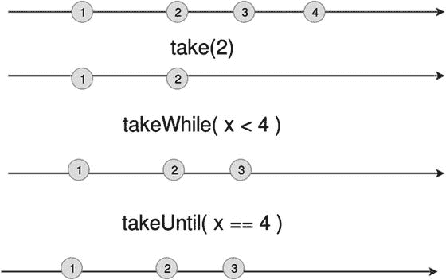
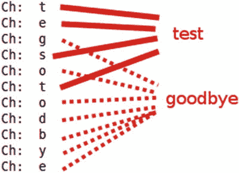
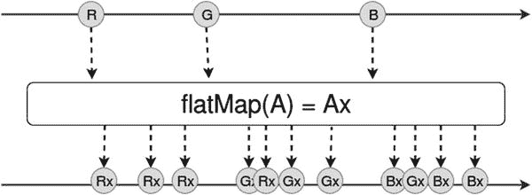
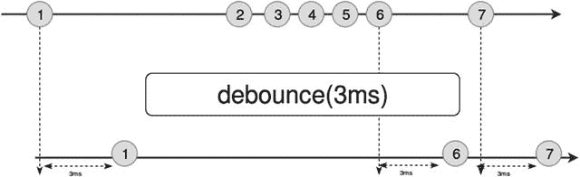
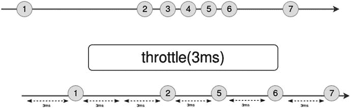
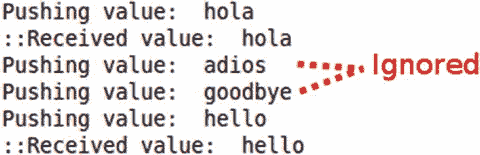
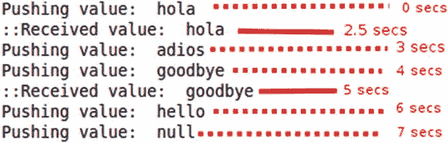

# 7. 编写你自己的 FRP 库

你终于来到了将一切（或者说几乎所有内容）付诸实践的章节。在本章中，我将综合考虑之前讨论的所有内容：函数式编程、响应式编程、Node.js（显而易见！）以及现有库提供的示例，并以此为基础编写一个全新的 Node FRP 库的第一个版本。

本章的目的并非超越之前介绍的那些已发布模块，而是从内部视角展示创建类似库的过程。换言之，理解事物的运作方式将帮助你掌握相关概念——即使本章提供的实现与已审查的库并不完全相同（确实不同），你仍能观察到解决实现相关问题的可行方案。

到本章结束时，你将清楚了解如何实现一个函数式响应式库，以及如何将其发布到 Node 的 `npm` 公共注册表。

首先，让我们讨论我将编写的库的类型。如前所述，这个库显然会借鉴上一章讨论的三个库（即：RxJS、Bacon.js 和 Highland.js）。

由于实现过程可能需要数月之久，更不用说实际代码审查了，因此这个新库将仅包含执行常见响应式操作所需的最基本功能，例如：转换队列、流合并、以及防抖等简单时间函数。

即便如此，它也应提供足够的基础框架，供你在此基础上进行试验和扩展，以创建符合特定需求的个性化版本。

接下来我将描述该库的内部架构——我巧妙地将其命名为 R-CheeseJS（是不是很妙？）。你将看到我实际上遵循了一种极其简单且易于扩展的架构，同样是为了便于你根据需要轻松添加更多功能。你可以随书获取 R-Cheese 的代码，或从 GitHub（地址：[`https://github.com/deleteman/r-cheese`](https://github.com/deleteman/r-cheese)）下载。

R-Cheese 的代码分为两个文件：一个用于主库（其中仅包含少量公共方法），另一个用于工具函数（这将是主要亮点，包含你最常用的功能）。

## 大奶酪

主库（你始终需要使用的那个）被设计为基于 Node.js 流（stream）运行，这简化了事情，因为我无需模拟流的运作方式（例如基于时间的事件、数据传输等），Node 本身已经为我完成了这些工作。因此，这个库所做的是提供一个更简洁的接口来与 Node 流交互，同时也提供了简单的方法来转换流经其中的数据。

从用户角度来看，你需要关注的主要方法有：

*   `fromStream`：此方法会从一个常规的 Node.js 流创建一个奶酪流（该流上的每一个 `data` 事件都会写入内部的奶酪流）。
*   `fromArray`：同样，此方法会从一个普通的 Array 对象创建一个新的奶酪流。数组项将每 100 毫秒（默认值）或按照作为第二个可选参数提供的延迟时间间隔被发出。
*   `fromFn`：`fromXXX`系列方法中的最后一个。此方法会根据一个函数的返回值来创建一个新的奶酪流。其工作原理与前一个类似，但让你对发出什么内容以及何时发出有更多控制。此方法接收一个可选的第二个参数来设置发出值的延迟，与上述类似（但默认值为 0 毫秒，因为你也可以在函数内部定义时间。作为发射器传入的函数将接收一个单一函数作为参数，每当需要发出一个新值时，都必须调用该参数函数）。
*   `merge`：此方法会将当前的内部流与作为参数传入的任何其他流合并。结果数据块的顺序仅由不同 `data` 事件的时间决定。
*   `then`：此方法仅作为语法糖，允许你对流经管道的数据块进行链式转换。每次调用仅接收一个函数。
*   `onError`：与上述方法类似，但它设置了一条特殊的转换链，仅当某个转换发出错误时（无论是通过抛出异常还是向其回调传递错误参数）才会执行。
*   `each`：最后，这应该是每个转换链上调用的最后一个方法。它启动流的执行直到调用此方法为止，并接收一个最终函数，该函数将在转换链结束时以最终的返回值被调用。

现在我们来看几个上述方法的示例，然后我会向你展示它们的代码。第一个示例展示了如何使用 `fromStream` 方法与现有的 Node.js 流进行交互：

```javascript
var Cheese  = require("./cheese").Cheese;
var fs = require("fs");
var ch = new Cheese();
var chStream = ch.fromStream(fs.createReadStream('./test-cheese1.js'));
chStream
.each(function(content) {
    console.log(content.toString());
});
```

如你所见，上面的例子非常简单，但它展示了 `fromStream` 方法以及 `each` 方法的强制用法——没有 `each` 方法，文件读取将永远不会开始。你可以通过在调用 `each` 之前使用 `then` 方法轻松添加一些转换，如下所示：

```javascript
// 重写前一个例子的最后几行
```

# 默认行为与错误处理

默认情况下，你可以向 `then` 方法传递任何函数，它会检查该函数是接收一个参数（假定为同步函数）还是两个参数（假定为异步函数），并相应地执行。

现在让我们来看最后一个例子，分别展示有无错误处理的情况：

```javascript
var Cheese = require("r-cheese").Cheese;
var fs = require("fs");
var flatMap = require("r-cheese").Utils.flatMap;

var ch = new Cheese();
var filenames = ['./test-cheese1.js', './test-cheese23.js'];

ch.fromArray(filenames)
    .then(flatMap(function(name) {
        return fs.createReadStream(name.toString());
    }))
    .each(function(content) {
        console.log(content.toString());
    });
```

暂时忽略 `flatMap` 函数的使用（我稍后会介绍），上述代码简单地获取了一个文件路径列表，并将其转换为每个元素的实际文件内容。它最终还会输出这些内容。现在，如果其中一个文件路径包含拼写错误，你最终会在屏幕上看到一个未处理的异常，因为 `fs.createReadStream` 这行代码会产生一个 `error` 事件，而你没有处理该事件的逻辑。事实上，由于 Node.js 处理错误事件的方式，并且因为你没有监听它，你的脚本将会被终止（我之前在某一章中提到过，还记得吗？）

你可以轻松地通过使用 `onError` 方法来添加错误处理来解决这个问题，如下所示：

```javascript
ch.fromArray(filenames)
    .then(flatMap(function(name) {
        return fs.createReadStream(name.toString())
    }))
    .onError(function(e) {
        console.trace(e);
    })
    .each(function(cnt) {
        console.log(cnt.toString());
    });
```

这样，你就安全地处理了错误事件，你的脚本不会被提前终止，并且你可以完全控制如何处理该错误。

**注意**
产生错误的数据块将不会被后续的任何转换处理，但后续的数据块将照常通过整个链（前提是它们本身也不产生错误）。

# 库的内部实现

现在，让我们来看看主库的代码，好吗？

```javascript
var Streams = require("stream");
var inherits = require("util").inherits;
var Transform = Streams.Transform;

function OutputStream() {
    Transform.call(this);
}
inherits(OutputStream, Transform);

OutputStream.prototype._transform = function(chunk, encoding, callback) {
    callback(null, chunk);
}

var DEFAULT_ARRAY_DELAY = 100; //毫秒
var DEFAULT_FN_DELAY = 0; //毫秒
```

前面的几行代码仅仅是定义了我们的内部流，以及一些下面会用到的默认值。

```javascript
function Cheese(stream, transformations) {
    this._stream = stream || null;
    this._stream_ended = false;
    this._outputStream = new OutputStream();
    if(this._stream !== null) {
        this.fromStream(stream)
    }
    this._transformations = transformations || [];
    this._error_transformations = [];
    this._source_name = null;
    this._source_interval = null;
    this._source_interval_delay = null;
    this._source_interval_origin = null;
}

Cheese.prototype.fromStream = function(stream) {
    var self = this;
    this._stream = stream;
    this._source_name = 'stream';
    this._stream.on('data', function(d) {
        self._writeToOutput(d);
    });
    return this;
};

Cheese.prototype.fromFn = function(fn, delay) {
    if(typeof delay == 'undefined') {
        delay = DEFAULT_FN_DELAY;
    }
    this._source_name = 'fn';
    this._source_interval_delay = delay;
    this._source_interval_origin = fn;
    return this;
};

Cheese.prototype.fromArray = function(arr, delay) {
    if(typeof delay == 'undefined') {
        delay = DEFAULT_ARRAY_DELAY;
    }
    this._source_name = 'array';
    this._source_interval_delay = delay;
    this._source_interval_origin = arr;
    return this;
};
```

前面的三个方法设置了事件收集的方式，取决于数据源（数组、函数或流）。请注意，这些方法仅在正确的变量上设置正确的值，只有当调用 `each` 方法时，实际的（定时器）间隔才会启动（见下文）。

```javascript
Cheese.prototype._writeToOutput = function(val) {
    if(!this._stream_ended) {
        if(val !== null) {
            val = val.toString();
        }
        this._outputStream.write(val);
    }
}
```

之前的方法将所有写入操作集中到内部流上，请记住，整个库的基本职责是处理数据流并对其进行转换，最终写入到内部流中，而此方法正是负责这最后一步的。

## 转换执行机制

一旦库开始从设定的数据源拉取数据，每个数据块都会经过通过 `then` 方法设定的转换链。以下方法负责执行这些转换，将其应用于数据，并将结果传递给链中的下一个方法。它们是同一概念的不同变体，具体取决于正在执行的辅助转换函数的类型，需要不同的参数（甚至行为）。有一个名为 `_execute_normal` 的默认方法，用于处理简单函数（即自定义转换函数，而非库提供的函数）。如果你正在扩展此库并添加新的转换，可以依赖 `_execute_normal` 方法，或在此处添加新的特定处理器。以下按不特定顺序列出这些方法：

```javascript
Cheese.prototype._execute_filter = function(idx, value, handler, transforms) {
    var self = this;
    transforms[idx](value, function(err, resp) {
        if(!err && !!resp === true) {
            if(transforms.length > idx + 1) {
                self._execute(++idx, value, handler, transforms);
            } else {
                handler(value);
            }
        }
    });
};

Cheese.prototype._execute_normal = function(idx, value, handler, transforms) {
    var self = this;
    if(transforms.length == 0) {
        return handler(value);
    }
    var fn = transforms[idx];
    if(fn.length == 2) {
        //检查函数接收的参数数量
        fn(value, function(err, resp) {
            if(err) {
                // ... (错误处理逻辑)
            }
        });
    }
};
```

上述函数允许执行同步或异步的自定义转换，并妥善处理其错误。为清晰起见，如果自定义转换只接收一个参数（你可以通过查询函数的`length`属性获知），我假设此函数是同步的，因为它只接收要转换的值；但如果它接收两个参数，那么我假设第二个参数是回调函数，并且它是一个异步函数（定义超过两个参数的自定义转换没有意义，因为库无法知道要传递什么给额外的参数）。

错误处理通过以下方式进行：对于同步函数，捕获异常；对于异步版本，检查回调中的错误，然后将错误传递给错误转换链。

```javascript
return self._execute(0, err, handler, self._error_transformations);

}

if(transforms.length > idx + 1) {

self._execute(++idx, resp, handler, transforms);

} else {

handler(resp);

}

});

} else {

try {

var resp = fn(value);

if(transforms.length > idx + 1) {

self._execute(++idx, resp, handler, transforms);

} else {

if(handler) {

handler(resp);

}

}

} catch (err ) {

self._execute(0, err, handler, self._error_transformations);

}

}

};
```

`reduce`辅助函数（我将在本章后面展示）的工作原理是，将同一转换应用于流中的所有值，直到流结束，然后发出最终值。为了知道流何时结束，该函数需要实际的流对象，这就是上述方法将其作为第一个参数传递给函数的原因。

`split`函数是一个非常简单的同步函数，因此以下方法通过调用链中的下一步来执行它。

```javascript
Cheese.prototype._execute_reduce = function(idx, value, handler, transforms) {

var self = this;

transformsidx {

if(transforms.length > idx + 1) {

self._execute(++idx, resp, handler, transforms);

} else {

handler(resp);

}

});

};
```

```javascript
Cheese.prototype._execute_split = function(idx, value, handler, transforms) {

var self = this;

var parts = transformsidx;

if(transforms.length > idx + 1) {

self._execute(++idx, parts, handler, transforms);

} else {

handler(parts);

}

};

Cheese.prototype._execute_flatmap = function(idx, value, handler, transforms) {

var self = this;

transformsidx {

if(err) {

return self._execute(0, err, handler, self._error_transformations);

}

if(transforms.length > idx + 1) {

self._execute(++idx, resp, handler, transforms);

} else {

handler(resp);

}

});

};
```

`flatMap`转换从其接收的函数的结果创建一个新流，因此为了在新流上保持相同的错误链，我将其传递给`flatMap`函数，稍后你将看到，该函数会获取错误处理链并将其添加到新流中。这样，如果在执行`flatMap`之后出现问题，错误仍能得到正确处理。

对于 take 相关的辅助函数（`take`、`takeUntil` 和 `takeWhile`），我需要一种从辅助函数内部发出内部流结束信号的方法，这就解释了我需要访问流对象的原因，也就是为什么我在以下方法中将其作为参数传递。

```javascript
Cheese.prototype._execute_take_transform = function(idx, value, handler, transforms) {

var self = this;

transformsidx {

if(err) {

return self._execute(0, err, handler, self._error_transformations);

}

if(transforms.length > idx + 1) {

self._execute(++idx, resp, handler, transforms);

} else {

handler(resp);

}

});

};

Cheese.prototype._execute_debounce_throttle = function(idx, value, handler, transforms) {

var self = this;

transformsidx {

if(transforms.length > idx + 1) {

self._execute(++idx, value, handler, transforms);

} else {

handler(value);

}

});

};
```

最后，这一批方法中的最后一个负责执行`debounce`和`throttle`辅助函数。这些函数非常特殊，因为它们需要处理修改事件的时间，本质上是修改原始数据源。这就是为什么我将`this`对象作为第一个参数传递；通过访问整个`Cheese`对象，辅助函数可以覆盖数据发射的方式（稍后向您展示该代码时，您将看到更多细节）。

```javascript
Cheese.prototype._execute = function(idx, value, handler, transforms) {

var fnType = transforms[idx]  ? transforms[idx].__fn_type : null;

var execs = {

'filter': this._execute_filter.bind(this),

'reduce': this._execute_reduce.bind(this),

'split': this._execute_split.bind(this),

'take': this._execute_take_transform.bind(this), //负责处理所有 3 种类型的 take

'debounce': this._execute_debounce_throttle.bind(this),

'throttle': this._execute_debounce_throttle.bind(this),

'flatMap': this._execute_flatmap.bind(this)

};

if(execs[fnType]) {

execsfnType;

} else {

this._execute_normal(idx, value, handler, transforms);

}

};
```

上述方法负责选择正确的辅助方法，以执行转换链当前位置的辅助函数。基本上，库提供的每个辅助函数（您很快就会看到）都有一个`__fn_type`属性，该属性标识了辅助函数的类型（例如，`map`函数对应"`map`"，所有不同的`take`函数对应"`take`"等）。因此，`_execute`方法可以使用该属性来选择要使用的正确辅助方法，或者默认使用能够处理通用转换函数的方法。

以下方法通过订阅`data`事件并将每个数据块写入内部流（即所有数据写入的公共流），来处理将新流合并到当前流中的操作。

```javascript
Cheese.prototype.merge = function(newStream) {
var self = this;
newStream.on('data', function(d) {
self._writeToOutput(d);
});
return this;
}
Cheese.prototype.each = function(handler) {
var self = this;
var index = 0;
//我们需要在此处创建一个新的转换列表，以便当触发'data'事件时，只有当前的转换列表
//会被该处理器执行
var transforms = this._transformations.map(function(t) {
if(t.newInstance) {
return t.newInstance();
}
return t;
});
//启动转换链
this._outputStream.on('data', function(d) {
self._execute(index, d, handler, transforms);
});
this._outputStream.on('finish', function() {
self._endSource();
});
if(this._source_name == 'fn' && !this._source_interval) {
self._source_interval = setInterval(function() {
self._source_interval_origin(function(value) {
if(value === null) {
return self._endSource();
}
self._writeToOutput(value);
})
}, self._source_interval_delay);
}
if(this._source_name == 'array' && !this._source_interval) {
this._source_interval = setInterval(function() {
if(self._source_interval_origin.length > 0) {
self._writeToOutput(self._source_interval_origin.shift());
} else {
self._endSource();
}
}, this._source_interval_delay);
}
};
```

从开发者的角度来看，前一个方法承担了一个简单的职责，但如你所见，它在内部处理了好几项任务：

- 它会创建调用时点转换列表的一份副本。这样你就可以在流的不同位置调用它，以便在数据转换过程中做出部分响应（在上一章讨论 Bacon.js 库时，我展示过类似的例子）。

- 它还负责启动转换链。在此之前你一直在设置转换，但直到该方法被调用时，数据才会在链中流动。

- 它确保在流结束时调用`_endSource`方法（若你将函数作为数据源，这一点尤其有用）。

- 最后，它为从非流数据源（如函数和数组）拉取数据创建所需的定时器。

另外，请注意为数组源设置的定时器会在没有更多待发射元素时调用`_endSource`，而为函数源设置的定时器则不会。这意味着函数必须写入一个`null`值来通知数据已全部发送完毕。

下面这三个方法简短易懂，但为了完整性，我快速过一遍：

- `_endSource`：该方法根据数据源类型以适当方式结束数据源。对于基于定时器的数据源，它会清除定时器；对于流，它会结束流。若后续添加更多类型的数据源，则需扩展此方法。

- `then`：简单的方法，将转换添加到列表中并返回对象自身，以保持链式调用。

- `onError`：该方法设置错误处理链并向其中添加函数。如果数据源是流，它还会订阅`error`事件，从而确保应用不会被 Node.js 意外终止。

```javascript
Cheese.prototype._endSource = function() {
this._stream_ended = true;
switch(this._source_name) {
case 'stream':
this._stream.end();
break;
case 'array':
case 'fn':
this._outputStream.end();
clearInterval(this._source_interval);
break;
}
};
Cheese.prototype.then = function(fn) {
this._transformations.push(fn);
return this;
};
Cheese.prototype.onError = function(fn) {
var self = this;
//如果是 fromStream 的情况，首次设置错误处理器时，确保
//正确处理 error 事件
if(this._error_transformations.length == 0 && this._source_name == 'stream') {
this._stream.on('error', function(err) {
self._execute(0, err, null, self._error_transformations);
});
}
this._error_transformations.push(fn);
return this;
};
module.exports = Cheese;
```

至此，主库的分析结束。接下来让我展示辅助函数的代码，这些内容读起来也颇有启发。

## Little Cheese 小芝士

R-Cheese 的第一个版本总共提供了九个转换函数，并将它们作为独立函数导出，以简化添加新函数的任务：只需将新函数添加到`utils.js`文件并导出即可。

尽管导出的转换函数彼此差异很大，但定义它们的函数结构始终相同，它们基本遵循以下模板：

```javascript
function transformation([params]) {
var _fn = function([params]) {
//你的代码写在这里
};
_fn.__fn_type = '[函数类型标识符]';
_fn.newInstance = function() {
//你的代码写在这里
};
return _fn;
}
```

每个转换函数实际上都是执行实际工作的函数的包装器。由于 JavaScript 中的函数也是对象，我可以为它们添加一些属性，主要是`__fn_type`（一个标识转换类型的字符串，正如你之前所见，主库代码中的`_execute`方法会用到它）和`newInstance`方法（它基本上应该返回转换的一个新实例，你可以在主库的`each`方法中找到它的用法）。

现在让我逐一介绍内置于代码中的每个转换函数。其中一些在前几章已经讨论过，另一些可能对你来说是新的，希望通过解释和代码，你能轻松理解它们。

### Map、Filter 和 Reduce

这三个是最常见的转换，我在前几章也已经介绍过，所以没什么特别需要补充的了。因此，我直接展示它们的实现：

```
function map(fn) {
var _fn = function(value, done){
fn(value, done); //此版本的 map 函数是异步的，因此需要回调函数
};
_fn.__fn_type = 'map';
_fn.newInstance = function() {
return map(fn);
};
return _fn;
}
function filter(fn) {
var _fn = function(value, done) {
fn(value, done);
};
_fn.__fn_type = 'filter';
_fn.newInstance = function() {
return filter(fn);
};
return _fn;
}
function reduce(init, fn) {
var accu = init;
var listenerSet = false;
var _fn = function(stream, value, done) {
accu = fn(accu , value);
if(!listenerSet) {
stream.on('end', function() {
done(accu );
});
listenerSet = true;
}
};
_fn.__fn_type = 'reduce';
_fn.newInstance = function() {
return reduce(init, fn);
};
return _fn;
}
```

如你所见，所有三个函数都遵循我之前展示的模板。第一个`map`函数其实没太大玄机，它是这些函数中最简单的一个，本质上只是语法糖，因为它所做的就是执行作为参数传入的函数。由于主库中的`_execute_normal`方法，执行`map`或直接将匿名函数传递给`then`方法效果相同。

`filter`函数也非常简单，事实上它的代码几乎与`map`完全一样，唯一的区别是函数类型标识符不同，这反过来告诉主库如何解释该函数的输出以及如何处理它。

最后，`reduce`函数（在其他库中也被称为`scan`）会按照传入函数指定的方式累积数据块，并在流结束时发射累积结果。正如你所见，这就是该函数需要将流作为参数传入的原因——它需要订阅内部流的`end`事件。

# 不断取用

此处提供了 `take` 函数的三种变体。第一种是简单的 `take` 函数，它会从数据流中接受固定数量的数据块，然后终止数据流。第二种是 `takeUntil` 函数，它会从数据源中接受数据块，直到作为参数传入的函数所定义的条件满足为止（基本上，当该函数返回 `true` 时）。最后是 `takeWhile`，它与 `takeUntil` 非常相似，但条件正好相反：只要条件满足，它就会接受数据块，此后，数据将无法通过此节点。

首先，让我们看看它们的代码：

```javascript
function take(number) {
var counter = 0;
var max = number;
var _fn = function(stream, value, done) {
counter++;
if(counter == max) {
stream.end();
}
return done(null, value);
};
_fn.__fn_type = 'take';
_fn.newInstance = function() {
return take(number);
};
return _fn;
}
function takeUntil(condition) {
var _fn = function(stream, value, done) {
if(condition.length === 1) {
if(condition(value)) {
return stream.end();
}
return done(null, value);
} else {
condition(value, function(err, resp) {
if(!!resp === true) {
return stream.end();
}
return done(err, value);
});
}
};
_fn.__fn_type = 'take';
_fn.newInstance = function() {
return takeUntil(condition);
};
return _fn;
}
function takeWhile(condition) {
var _fn = function(stream, value, done) {
if(condition.length === 1) {
if(!condition(value)) {
return stream.end();
}
return done(null, value);
} else {
condition(value, function(err, resp) {
if(!!resp === false) {
return stream.end();
}
return done(err, value);
});
}
};
_fn.__fn_type = 'take';
_fn.newInstance = function() {
return takeWhile(condition);
};
return _fn;
}
```

它们的代码彼此非常相似，甚至共享同一个函数类型标识符，因为主库可以用相同的方式处理这三种函数。最后，`takeUntil` 和 `takeWhile` 都接受异步和同步函数作为决定何时停止的条件。图 7-1 给出了这三种变体行为方式的示例。



**图 7-1.** 大理石图展示了三种 `take` 方法之间的差异

让我们快速查看一下这些方法的代码示例：

```javascript
var cheese = require("./cheese").Cheese;
var _ = require("lodash");
var take = require("./cheese").Utils.take;
var takeUntil = require("./cheese").Utils.takeUntil;
var takeWhile = require("./cheese").Utils.takeWhile;
var ch = new cheese();
var ch1 = new cheese();
var ch2 = new cheese();
ch.fromArray(_.range(100)).then(take(10)).each(function(v) {
console.log("Ch: ", v.toString());
});
ch1.fromArray(_.range(100)).then(takeWhile(function(v) {
// the value needs to be coerced into an integer, because all data that flows through the stream is casted into a String .
return +v  10;
}))
.each(function(v) {
console.log("Ch2: ", v.toString());
})
```

正如你可能已经猜到的那样，这三种变体都做着同样的事情：只取数据流的前 10 个元素，然后关闭它。

# 拆分数据块

这个函数相当直接，没什么好说的。它只是对数据执行 `map` 然后在其中进行字符串 `split` 的一种快捷方式。默认情况下，它会根据单个字符组成的数组来拆分字符串，除非你向它传递一个分隔符字符串。

此函数的结果是一个值数组，恰好可以通过 `flatMap` 转换成一个新的数据流。

以下是此转换函数的代码：

```
function split(separator) {
var _fn = function(value) {
return value.toString().split(separator || "");
}
_fn.__fn_type = 'split';
_fn.newInstance = function() {
return _fn;
}
return _fn;
}
```

现在，让我们看看这个关于 `split` 和 `flatMap` 一起使用的示例：

```
var cheese = require("./cheese").Cheese;
var flatMap = require("./cheese").Utils.flatMap;
var split = require("./cheese").Utils.split;
var ch = new cheese();
var words = ["test", "goodbye"];
ch.fromArray(words)
.then(split())
.then(flatMap(function(arr) {
return arr
}))
.onError(function(e) {
console.trace(e)
})
.each(function(cnt) {
console.log("Ch: ", cnt.toString());
});
```

上面代码的输出可能并非你想象的那样。请查看图 7-2 的截图：



**图 7-2.** 上述代码的混合输出

因为 `flatMap` 函数实际上创建了两个不同的数据流（分别来自 `split` 返回的每个数组），所以最终会得到两个并行工作的源数据流，就好像它们被合并成了一个。这就是某些字母混合在一起，而不是一个接一个单词出现的原因。

## FlatMap 与错综复杂的情节

这是本代码中提供的三种最复杂的转换中的第一种，后两种处理时间问题，但这里的情况并非如此。

我一直在本章的几个示例中使用这种转换，但没有深入细节，所以你可能已经猜到了这个函数的作用，或者你可能像我第一次读到它时一样感到困惑，所以让我尽可能简单地解释一下。

`flatMap` 函数能够从它接收到的函数的返回值中创建一个新的流。这个返回值应该是库知道如何用作流数据源的东西，即：

-   另一个流（查看 `flatMap` 返回执行 `fs.createReadStream` 的结果流的示例）。

-   一个数组（查看之前展示的示例）。

-   一个函数，当然，该函数必须符合 `fromFn` 所期望的必需行为。

如果使用得当，这种转换为你的流提供了极大的灵活性。查看图 7-3 了解其工作原理。



**图 7-3.** 一个弹珠图，展示了 `flatMap` 如何转换流的简化版本

图 7-3 以图形方式阐述了我上面解释的内容：对于传递给 `flatMap` 的函数返回的每个可观察元素，该转换如何返回一个新流，以及这些结果流如何实际上并行工作并混合它们的值（就像之前的 `split` 示例一样）。

此转换的代码如下所示（此函数还允许开发者使用同步和异步函数作为 `flatMap` 的参数）：

```
function flatMap(fn) {
var _fn;
var observable;
var newStream = null;
function setEachEvent(stream, observable, error_transforms, done) {
if(Array.isArray(observable)) {
stream.fromArray(observable)
} else if(typeof observable === 'function') {
stream.fromFn(observable);
} else if(observable instanceof _streams) {
stream.fromStream(observable);
}
error_transforms.forEach(function(et) {
stream.onError(et);
})
//对于 newStream 发出的每个项
//将其插入原始流中
//**放在正确的位置**
stream.each(function(v) {
done(null, v);
});
}
if(fn.length == 1) {
_fn = function(value, error_transforms, done) {
newStream = new Cheese();
try {
observable = fn(value);
} catch (e) {
return done(e);
}
setEachEvent(newStream, observable, error_transforms, done);
};
} else {
_fn = function(value, error_transforms, done) {
newStream = new Cheese();
fn(value, function(err, observable) {
if(err) {
return done(err);
}
setEachEvent(newStream, observable, error_transforms, done);
});
};
}
_fn.__fn_type = 'flatMap';
_fn.newInstance = function() {
return flatMap(fn);
}
return _fn;
}
```

从字面上看，这个转换是从传入函数的结果输出中创建一个新的流。`done` 回调是连接回原始转换链的纽带，`_fn` 函数也接收错误转换链，以确保新流知晓它（这样，如果新流上发生错误，相同的错误转换链将以对开发者透明的方式应用）。

## 处理时间

最后两个转换处理流中事件的时间安排，因为有时开发者需要的不是处理接收到的每一个数据块，实际上，其中一些事件可能是重复的，特别是如果它们是用户生成的事件（在后端不适用，但前端的点击事件在这里是一个非常常见的例子）。

这就是为什么提供了两个转换来处理这种情况（尽管存在更多转换，如果需要也可以轻松添加）：`debounce` 和 `throttle`。尽管乍一看它们似乎在执行相同的操作，但它们的行为并不完全相同，如果在应该使用另一个时使用了这一个，结果可能是不可预测的。

让我们先从 `debounce` 开始，其背后的思想是，给定一个事件流，你想要移除那些由于某种原因时间间隔太近的事件，因此你可以设置一个延迟时间，并告诉转换使用该延迟对事件进行 `debounce`。让我们先看图 7-4，然后我会进一步解释：



**图 7-4.** `debounce` 函数的弹珠图

所以，再次，给定一个事件流，基于一个时间延迟对其进行去抖，意味着仅在过去 [延迟] 时间段内没有再收到其他事件时，才发出最后收到的事件。在图 7-4 的示意图中，输入被去抖了 3 毫秒，这意味着在一个值被接收后，如果在那 3 毫秒内没有收到其他值，它将被发出，否则将被忽略。这就是为什么值 2、3、4 和 5 被忽略，而 6 被发出的原因。

现在，另一方面，节流一个流是相似的，但又有所不同。它的意思是，每次延迟时间到了就会发出一个事件，如果中间发生了多个事件，只有最后一个事件会被发出，其余的被忽略。图 7-5 显示了节流的示意图：



**图 7-5.** `throttle` 转换的弹珠图

使用相同的源流和相同的时间延迟，你可以看到结果与前一个有何不同，在这种情况下，值 2 和 5 也被发出，因为它们是在 3 毫秒间隔内收到的最后一个值。

以下是两个代码示例，展示了如何在你的代码中使用 `throttle` 和 `debounce`（这些是虚构的示例，没有实际应用，但你会在后续章节中了解到，别担心）：

```
var cheese = require("r-cheese").Cheese;
var ch = new cheese();
var debounce = require("r-cheese").Utils.debounce;
var source = [
//v 是要发出的值，d 是发出它之前等待的延迟。
{v: "hola", d: 10},
{v: "adios", d: 1},
{v: "goodbye", d: 1},
{v: "hello", d: 5}];
var lastTimestamp = 0;
var index = 0;
ch.fromFn(function(push) {
if(Date.now() - lastTimestamp > source[index].d) {
console.log("Pushing value: ", source[index].v)
push(source[index].v)
lastTimestamp = Date.now();
index++;
}
if(index == source.length) {
push(null);
}
}).then(debounce(5)).each(function(n) {
console.log("::Received value: ", n.toString());
});
```

上面 `debounce` 函数的示例将在不同时间点发出一系列值，去抖设置为 5 毫秒，输出如图 7-6 所示：



`图 7-6.` `debounce` 示例的输出

至于 `throttle` 函数，示例如下：

```javascript
var cheese = require("r-cheese").Cheese;
var ch = new cheese();
var throttle = require("r-cheese").Utils.throttle;
var source = [
{v: "hola", d: 1},
{v: "adios", d: 3000},
{v: "goodbye", d: 1000},
{v: "hello", d: 2000},
{v: null, d: 1000}];
var lastTimestamp = 0;
var index = 0;
ch.fromFn(function(push) {
if(Date.now() - lastTimestamp > source[index].d) {
console.log("Pushing value: ", source[index].v)
push(source[index].v)
lastTimestamp = Date.now();
index++;
}
}).then(throttle(2500)).each(function(n) {
console.log("::Received value: ", n.toString());
});
```

上述示例与防抖示例的机制相同，只是这次时间间隔更长，以便正确演示节流的效果。在该示例中，我以 2.5 秒为间隔对数据进行节流，因此，如图 7-7 所示输出结果：



图 7-7。

节流示例的输出

数据写入流的时间点用虚线标记，如您所见，节流间隔的时间点用实线标记，并且如预期所示，只有两个值最终通过，其余值均被忽略。

现在您已经了解了它们两者的使用方法，让我展示它们的实现：

```
function debounce(delay) {
var lastTimestamp = null;
var debounced = false;
var listeners = [];
var _fn = function(cheese, value, index, handler, transforms, done) {
var now = null;
if(debounced) {
return done(cheese._outputStream);
}
/*
移除输出流上的所有活跃监听器
*/
listeners = cheese._outputStream.listeners('data');
listeners.map(function(fn) {
cheese._outputStream.removeListener('data', fn);
});
/*
覆盖输出流上'data'事件的主监听器。
这样我们就可以控制何时真正开始转换以及何时忽略数据
*/
cheese._outputStream.on('data', function(v) {
now = Date.now();
if(!lastTimestamp) {
lastTimestamp = Date.now();
}
if(now - lastTimestamp > delay) {
cheese._execute(index, v, handler, transforms);
}
lastTimestamp = now;
});
debounced = true;
return done(cheese._outputStream);
};
_fn.__fn_type = 'debounce';
_fn.newInstance = function() {
return debounce(delay);
};
return _fn;
}
function throttle(delay) {
var throttled = false;
var listeners = [];
var bufferedValue = null;
var interval = null;
var _fn = function(cheese, value, index, handler, transforms, done) {
if(throttled) {
return done(cheese._outputStream);
}
listeners = cheese._outputStream.listeners('data');
listeners.forEach(function(fn) {
cheese._outputStream.removeListener('data', fn);
});
bufferedValue = value;
//缓冲流发出的最后一个值，直到合适的时机将其传递
cheese._outputStream.on('data', function(v) {
bufferedValue = v;
});
if(!interval) { //当第一个事件到达时启动间隔
interval =  setInterval(function() {
if(bufferedValue !== null) {
cheese._execute(index, bufferedValue, handler, transforms);
bufferedValue = null;
}
}, delay);
}
//确保在完成时清除活跃的间隔
cheese._outputStream.on('finish', function() {
clearInterval(interval);
})
throttled = true;
};
_fn.__fn_type = 'throttle';
_fn.newInstance = function() {
return throttle(delay);
};
return _fn;
}
```

尽管行为相似，但它们的实现却大相径庭，正如您所见，`debounce` 需要非常关注时间点，而 `throttle` 则只是设置一个间隔并缓冲接收到的最后一个值，直到间隔触发。其余的逻辑不言自明，在您看过 marble 图和示例之后，我几乎无需再多做解释。

# 警告

Node.js 中创建的间隔在时间精度上并非超级精确，当您设置一个间隔每 X 毫秒执行一个函数时，它实际上至少每 X 毫秒执行一次。这意味着 Node.js 会尽力遵守设定的时间，但唯一确定的是函数不会提前执行。当您的间隔时间足够长时，不会出现问题，但如果您处理的是非常短的时间限制（如 10 毫秒或更少），则可能会遇到时间问题。

# 总结

希望本章能让您获得最后的洞见，以充分理解并在 Node.js 中采用函数式响应式编程。

本章描述的库是您创建自己的 FRP 库的框架，您可以根据需要添加额外的转换。这些转换大多会是现有转换的变体，或许还有一些新的，但您应该拥有实现这一切所需的一切。

现在您已经拥有了这个库，在下一章中，我将分析一些后端 FRP 的示例，包括他人完成的示例，以及一个使用 R-CheeseJS 解决的具体案例。
