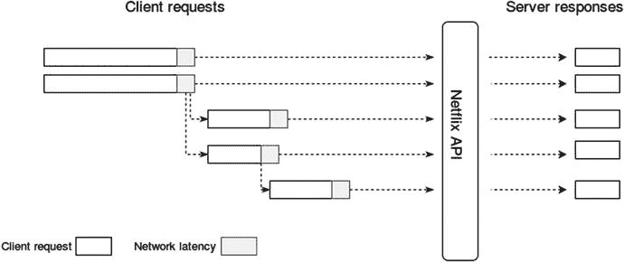
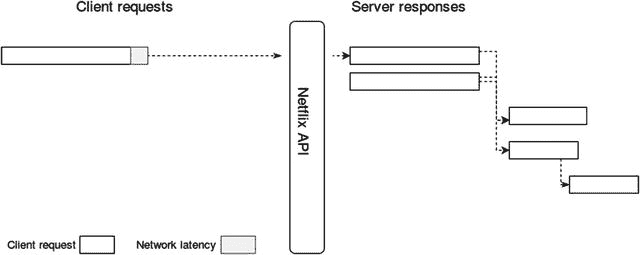
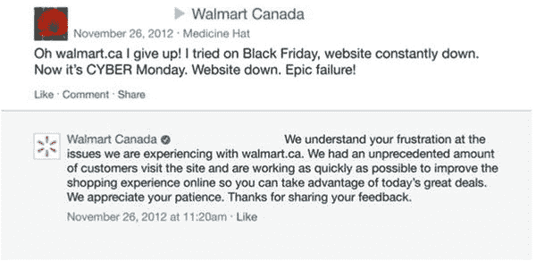
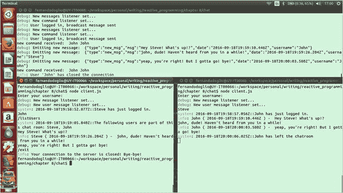

# 8. 实践概览

迄今为止，本书已向您介绍了关于函数式响应式编程（FRP）的所有理论。您还拥有一个可运行的 FRP 库实现可供实践，因此您可能会想：还有什么呢？

本章中，我将介绍一些现实世界公司采用响应式方式的示例，并尝试分析他们的原因和结果。请注意，尽管这些公司未必专门为此目的使用 `Node.js`，但响应式范式仍然适用，您可以将相关情况推广到实际场景中。

最后，因为我知道您想要更多代码，我将通过创建一个可用的应用程序（考虑到您将从本书阅读代码的限制，并且我不想让您感到厌烦）来展示更多代码，该应用程序基于 `R-Cheese` 库运行。

## Netflix 的案例

Netflix 可能是目前全球最热门的公司之一，哪怕仅仅是因为其品牌在有互联网的地方几乎家喻户晓。但并非所有人都经常想到的是，Netflix 同样也是一家优秀的 IT 公司！

由于其流媒体业务所带来的技术挑战，Netflix 不断被迫突破其使用的技术边界。多年来，他们一直是企业级 `Node.js` 的主要倡导者之一。而最近，他们又在前端和后端都推行函数式响应式方法。由于他们慷慨地在技术博客（`techblog.netflix.com`）上分享了经验，我现在可以对此进行介绍。

### 他们的动机

Netflix 后端最初的架构基于一系列 RESTful API，这些 API 提供了一个通用平台，供其多个客户端应用程序依赖。这是它的优点，但缺点在于，由于它是通用的且旨在服务差异巨大的客户端，每个服务只会返回客户端功能所需数据的一部分。

随着用户数量增长，这种机制最终失控，因为每个客户端加载单个页面需要发起太多请求，而每个请求都会在网络延迟中增加额外耗时（这不仅影响页面加载时间，也影响内部服务通信）。最终，他们决定采用不同的方案。图 8-1 直观展示了该问题。



图 8-1. 原 Netflix 架构机制示意图

图 8-1 展示了经典 RESTful API 架构的基本思路。该图表示单个客户端为某个功能发起的请求。渲染单个页面可能需要多条信息，因此会发起多个请求，这反过来又为每个请求增加了网络延迟。你可以看到这种情况如何失控。

取而代之的是，他们决定转变思路，将创建所需数据集所需的逻辑迁移到后端，从而将客户端的任务简化为单个请求（并消除了因网络延迟造成的几乎所有额外时间）。图 8-2 展示了这一变化如何影响其后端。



图 8-2. 客户端请求更少的新架构

现在，所有关于信息收集及如何整合信息的重要逻辑都已移回 API 的代码中，将图 8-1 中的五个请求减少为一个，本质上将整个过程的网络延迟成本降低到单个请求的水平。

作为此变更的一部分，并且为了真正实现性能提升，他们还决定采用并发编程，同时将线程安全和并行执行实现中固有的复杂逻辑从客户端开发体验中剥离。基本上，他们需要为在其 API 上进行开发的工程师提供一种方法，使其能够获得并发编程的全部能力，而无需处理通常伴随而来的繁琐事务。就在那时，他们采用了响应式编程。

### 并发性的需求

后端并发执行对于实现他们寻求的性能提升至关重要，因为否则单个“大型”客户端请求就无法真正与同一客户端使用旧 API 机制发起的多个“小型”请求竞争，原因很简单：得益于 Web 服务器提供的并发性，这些小请求会并行执行。

考虑到这一点，Netflix 的精英们评估了所有选项（考虑到他们只使用 Java）。回调和 Future 都不够好；这两种技术都承诺，如果逻辑过于复杂，会很快变得难以控制。

但是，当他们评估响应式编程模型时，他们意识到这将提供他们所需的并发性，并为开发者提供一个易于使用和易于理解的模型，而正如我之前所说，这反过来将有助于缩短开发周期。正如你可能猜到的，缩短上市时间对大多数人来说是一个巨大的优势。

仔细想想，响应式模型基于推送而非拉取，简化了从外部服务并发获取数据的任务，尤其是在微服务架构中（这将是理想情况）。开发者无需担心线程或类似结构，因为平台会处理这些；同时从多个来源获取数据只需订阅它们并等待它们推送数据回来。

为实现这一目标，Netflix 的开发者将微软创建的 `RxJS` 库（我在第 6 章中介绍过）移植到 `JVM` 上，创建了 `RxJava` (`https://github.com/ReactiveX/RxJava`)。它可以与运行在 `JVM` 上的多种语言协同工作，如 `Scala`、`Groovy` 和 `Clojure`。

### 成果

Netflix 在其技术博客中报告称，得益于这些变更以及在后端采用响应式编程，他们的开发者能够成功利用并发编程，而无需应对其常见的典型问题。

### 沃尔玛案例

这个案例具体涉及沃尔玛加拿大分公司，它是沃尔玛的子公司，也是该国最大的零售商之一。在这个特定案例中，早在 2012 年，由于互联网的持续增长以及每天连接网络的新设备，他们的架构开始力不从心，流量峰值开始影响他们，导致用户无法访问其在线商店（参见下方图 8-3 中的示例），并造成销售损失。像黑色星期五 (`https://en.wikipedia.org/wiki/Black_Friday_%5Bshopping`) 和网络星期一 (`https://en.wikipedia.org/wiki/Cyber_Monday`) 这样的日子不再是机遇，反而变成了问题（参见下方图 8-4 中关于 2012 年高峰期流量的图表），因此他们必须采取行动。


图 8-4. 高峰期流量增长图表



图 8-3. 关于 2012 年沃尔玛在线能力状态的推文截图

当时，他们的系统基于 Oracle ATG，这需要一个专门的开发团队，并且上市时间太长。其扩展能力也非常有限。总而言之，他们需要改变视角，并且为了能够良好地扩展，他们需要一个全新的事件驱动架构。

### 拟议解决方案

为实现这一目标，他们需要做出 180 度的大转弯，于是开始研究各种方案，最终胜出的是`Scala`（`www.scala-lang.org/`）、`Akka`（`akka.io/`）和`Play`（`www.playframework.com/`）的组合。这套技术栈运行在`JVM`上，因此为公司提供了良好的迁移计划，使他们能够在迁移过程中逐步引导开发者熟悉该技术栈，而不是一次全部切换，从而避免了相应麻烦。

Web 框架（`Play`）使他们能够根据需求轻松地上下扩展 Web 服务器。它还能帮助他们充分利用多核架构，处理比旧技术栈庞大得多的并发用户量。使用`Play`的团队开发速度比遗留系统团队快两到三倍。

借助`Scala`和`Akka`，他们能够创建基于微服务的、消息驱动的响应式后端架构。

采用响应式架构的优势之一是简化了编程任务；缩短的上市时间使他们能够像`Netflix`那样更快地推出功能。

事实证明，响应式方法非常适合微服务架构，因为你可以将响应式编程的优势转化为架构特性，即最终具备以下特点：

*   `responsive`：意味着系统会在可能的情况下及时做出响应。

*   `resilient`：系统无论发生什么情况都能保持响应。组件之间相互隔离，在出现故障时提供故障隔离。

*   `message-driven`：整个系统依赖组件之间的异步消息传递。这使得组件也能将故障作为消息传递。

*   `elastic`：系统能够根据不同的工作负载保持响应。

### 成果

在以上变更上线后的 4 周内，`Walmart.ca`报告了以下成果：

*   转化率提升了 20%

*   移动端订单增长了 98%

*   客户页面加载时间减少了 36%

*   最重要的是，在`黑色星期五`等流量高峰日期间，没有出现任何停机

## 再谈一个案例

作为最后一个研究案例，我们不打算看另一个成功案例，而是自己动手构建一个小型概念验证，如何？当然，我会使用`R-CheeseJS`，向你展示一个纯粹的`Node.js`应用程序。它应该能结合上一章的代码，为你提供关于编程响应式系统的更多实践见解。

我打算构建的这个小`PoC`是一个聊天应用。它规模很小，但功能应该足够完善，让它变得有趣。

它将有一个服务器来集中处理所有通信，以及一个可以根据需要多次运行的客户端应用。客户端和服务器将通过套接字通信（我将使用`socket.io`来处理相关代码，可在`www.npmjs.com/package/socket.io`找到），而客户端之间的通信将通过服务器进行。

# 聊天应用实现

聊天应用非常适合采用响应式方法，因为有很多机会可以对不同事件做出响应，例如接收消息、用户登录和退出，甚至客户端向服务器发送的自定义命令。在这个特定示例中，应用将会：

*   允许任何客户端连接到服务器并与其他用户交谈。
*   每次新登录操作都会通知所有已连接的客户端。
*   每个客户端都能发送消息，这些消息将广播给所有其他客户端。
*   每个客户端都可以发送命令来列出所有已登录用户，从而获取所有参与者的列表。
*   每个客户端都可以发送退出命令，从而有效结束与聊天服务器的连接。
*   每当客户端断开连接时，所有其他客户端都会收到该事件的通知。
*   如果聊天服务器关闭，所有客户端都会优雅地处理该事件。

本示例使用的模块列表非常精简。我尽量保持这种状态，以展示该方法以及语言本身的能力：

*   `express.js`（[`www.npmjs.com/package/express`](https://www.npmjs.com/package/express)）仅用于启动服务器，不做他用。
*   `socket.io`用于创建聊天服务器并处理所有与套接字相关的任务。
*   `socket.io-client`（[`www.npmjs.com/package/socket.io-client`](https://www.npmjs.com/package/socket.io-client)）提供了创建`socket.io`命令行客户端的能力，而无需 Web 浏览器（此应用 100%基于命令行）。
*   最后，`winston`（[`www.npmjs.com/package/winston`](https://www.npmjs.com/package/winston)）用于简化控制台上的日志记录和消息格式化。

**注意**

列表中未列出的另一个依赖项是上一章中介绍的库：`rCheese`。

图 8-5 展示了使用聊天服务器（屏幕上半部分）与两个客户端（屏幕下半部分）交互的输出截图。现在让我们看看代码，了解如何在`Node.js`中使用`rCheese`实现这一功能。



**图 8-5.** 两个客户端与聊天服务器交互的截图

## 服务器端

根据先前的功能列表，聊天服务器可以使用四个流：一个处理登录行为，另一个处理接收到的新消息，第三个处理客户端接收到的命令。此外还增加了一个最终流来处理退出命令。由于这需要几个步骤，现在我们来看一下代码：

> **注意**：正如你即将看到的，当通过 Cheese 流传输对象时，这些对象需要被序列化和反序列化。这是因为该模块使用的内部流并未设置为对象模式，因此所有内容都必须是字符串。

服务器的入口点如下：

```javascript
var app = require('express')();
var http = require('http').Server(app);
var io = require('socket.io')(http);
var rCheese = require("../cheese");
var logger = require("./logger");
var Cheese = rCheese.Cheese;
var map     = rCheese.Utils.map,
filter  = rCheese.Utils.filter;
io.on('connection', function(socket){
socket.on('login', function(data) {
var username = data.username;
_USERS[username] = setupStreams(username, socket);
});
});
```

> **注意**：虽然我将使用 Winston 来处理所有日志需求，但我会创建一个自定义日志记录器来处理颜色和不同的日志级别，因此所有这些代码都将放在 `logger.js` 文件中。

接下来是 `setupStreams` 函数，正如你可能已经猜到的，它会为每个登录聊天服务器的新用户设置三个主要流。这是整个应用中最大的函数，仅仅是因为所有三个流的流程都在这里定义：

```javascript
function setupStreams(usrname, socket) {
var msgs = new Cheese();
var logins = new Cheese();
var commands = new Cheese();
var msgsListener = false;
var cmdListener = false;
//== 新消息流
// 它简单地广播所有发送的消息，只要它们具备所需的属性
msgs.fromFn(function(push) {
if(!msgsListener) {
msgsListener = true;
logger.debug("新消息监听器已设置...");
socket.on('new_msg', function(msg) {
if(msg.username == usrname) {
push(JSON.stringify(msg)); // 序列化对象
}
});
}
})
.then(filter(function(m, done) {
var mObj = JSON.parse(m.toString());
done(null, mObj.msg != '' && mObj.msg != null && mObj.date != null && mObj.username != null);
}))
.each(function(obj) {
// 反序列化对象
logger.debug("正在发送新消息: ", obj.toString());
socket.broadcast.emit('new_msg', JSON.parse(obj.toString()));
});
//== 命令流
commands.fromFn(function(push) {
if(!cmdListener) {
cmdListener = true;
logger.debug("新命令监听器已设置...");
socket.on('new_cmd', function(cmd) {
console.log("收到新命令: ", cmd.username, usrname);
if(cmd.username == usrname) {
push(JSON.stringify(cmd));
}
})
}
})
.then(executeCommand)
.then(filter(function(v, done) {
done(null, v != null);
}))
.onError(function(err) { // 格式化错误消息以便发送回客户端
return JSON.stringify({msg: err.message, date: new Date()});
})
.each(sendBackResponse(socket));
//== 登录流
logins.fromArray([usrname])
.then(map(function(username, done) { // 将用户名转换为发送给所有人的消息
var newObj = JSON.stringify ({msg: [username, '刚刚登录了。'].join(' '), date: new Date()});
done(null, newObj);
}))
.each(function(obj) {
logger.info("用户已登录，广播消息已发送");
socket.broadcast.emit('system_msg', JSON.parse(obj.toString()));
});
return {
socket: socket,
msgs: msgs,
logins: logins,
commands: commands
};
}
```

正如你所见，前三个流都在这里：`logins`、`commands` 和 `msgs`。对于 `commands` 和 `msgs`，我使用了相同的技术将数据推入其中，并为 socket 的相应事件设置了一个监听器。这些监听器需要通过逻辑检查以确保只设置一次，因为（你可能记得也可能不记得）传递给 `fromFn` 的函数每隔几毫秒就会被查询一次。

创建的第一个流用于处理来自客户端的新消息，它的职责仅仅是接收事件并将其广播给所有客户端。但由于这很简单，我还增加了一个前置验证步骤，过滤掉那些缺少必要字段的消息。

命令流也非常简单：获取命令对象，执行它，如果命令返回一个对象，则将其发送回客户端；否则，直接将其过滤掉。下面是两个命令的代码。其中一个会返回需要发送回客户端的响应，另一个则不会。这个流还会处理错误，特别是“未知命令”错误，这是一个很容易触发的错误。

最后，登录流被创建来处理客户端的登录消息——正是这个消息触发了该函数的调用。因此，我没有使用 socket 监听器，而是使用了 `fromArray` 方法，传入一个仅包含一项的数组，即登录事件中接收到的数据。这个流会处理该事件，然后终止。有人可能会争论在这种情况下使用流的好处，但尽管对于单个事件来说不需要响应式代码，但这里的代码和逻辑清晰且易于理解，所以我认为这样做是值得的。

现在让我展示服务器代码中最后相关的一部分：命令的实现。

```javascript
function executeCommand(cmd) {
  var cmdObj = JSON.parse(cmd.toString());
  var commands = {
    listUsers: listUsersCommand,
    exit: closeConnection
  };
  if(!commands[cmdObj.cmd]) {
    throw new Error("错误：未知命令");
  } else {
    var result = commands[cmdObj.cmd](cmd);
    return (result !== null) ? JSON.stringify(result) : null;
  }
}
```

上述函数负责触发所有命令的执行，实际上非常简单。如你所见，只支持两个命令，否则会抛出一个错误（该错误会被 `rCheese` 模块捕获）。

## EXIT 命令的实现

`EXIT` 命令是这两个命令中第一个也是最复杂的一个。其背后的逻辑可以分为几个步骤：

- 通知所有用户有人离开了聊天室。
- 结束客户端与服务器之间的连接。
- 从内存中的已连接用户列表中移除该用户。
- 最后，在服务器控制台上打印一条日志消息。

现在，根据我之前向你展示的关于声明式编程的内容，我将这四个步骤转化成了一个流——再次强调，这是一个只包含单一事件的流。

```javascript
// EXIT 命令主函数
function closeConnection(cmd) {
  var exitStream = new Cheese();
  exitStream
    .fromArray([JSON.stringify(cmd)])
    .then(notifyUsers)
    .then(disconnect)
    .then(removeUser)
    .each(function(obj) {
      obj = JSON.parse(obj.toString());
      logger.info("用户 '" + obj.username + "' 已关闭连接");
    });
  return null;
}

// 通知所有用户有人离开了聊天室
function notifyUsers(cmd) {
  var cmdObj = JSON.parse(cmd.toString());
  var socket = _USERS[cmdObj.username].socket;
  if(!socket) throw new Error("找不到用户套接字: ", cmdObj.username);
  socket.broadcast.emit('system_msg', {
    msg: [cmdObj.username, '已离开聊天室'].join(" "),
    date: new Date()
  });
  return cmd;
}

// 关闭想要离开的客户端与服务器之间的连接
function disconnect(cmd) {
  var cmdObj = JSON.parse(cmd.toString());
  var socket = _USERS[cmdObj.username].socket;
  if(!socket) throw new Error("找不到用户套接字: ", cmdObj.username);
  socket.disconnect();
  return cmd;
}

// 从已连接用户列表中移除该用户并释放其内存
function removeUser(cmd) {
  var cmdObj = JSON.parse(cmd.toString());
  delete _USERS[cmdObj.username];
  return cmd;
}
```

这里的辅助函数规模都很小，无论是在代码行数还是逻辑复杂度上。它们各自专注于做好一件事，不涉及其他，因此整体而言，认知负荷（借用前一章提到的一个术语）相当低。只需阅读步骤列表，就能为每一步找到一个对应的函数。你可以调整它们的顺序或添加新的函数。这就像改变主流的流程一样简单，其他什么也不用做。

最后，另一个支持的命令，即已连接用户列表，非常容易理解，因为它归结为一个非常简单的函数。这个命令与前一个命令的主要区别不在于复杂度，而在于其结果。退出命令做了很多事情，但它不会向客户端发送任何内容。而这个命令，它所做的一切就是向客户端发送数据。如果你回头看一下命令流的代码，你会发现过滤器步骤会让这个命令通过，并最终通过套接字连接发送回去。

```javascript
///=== 列出用户命令辅助函数
function listUsersCommand(cmd) {
  return {
    msg: ["当前聊天室中的用户有:", Object.keys(_USERS).join(", ")].join(" "),
    date: new Date()
  };
}
```

## 客户端

本示例中的客户端应用程序也将非常简单。它允许用户登录聊天室、发送消息和命令，同时也能接收来自服务器的消息（如果你愿意，也可以称之为系统消息），其中包含错误通知、命令响应等——基本上就是任何非来自其他客户端的消息。

为了实现上述功能，这次我使用了三个流。一个流负责处理用户输入，这些输入将转换为发送到服务器的消息和命令。另一个流用于处理系统消息，还有一个流用于处理其他用户发送的消息。

输入流很有意思，因为在 Node.js 中，标准输入被表示为一个流，因此你可以从中创建一个 `Cheese` 流，这极大地简化了从用户收集输入的过程（这原本可能有些复杂）。代码如下：

`client.js`

```javascript
var rChees  = require("../cheese");
var Cheese  = rChees.Cheese;
var Utils   = rChees.Utils;
var logger  = require("./logger");
var map     = Utils.map,
    reduce  = Utils.reduce,
    takeUntil = Utils.takeUntil,
    take    = Utils.take

var socket = require('socket.io-client')('http://localhost:3000');
var _USERNAME = null;

process.stdin.resume();
process.stdin.setEncoding('utf8');

var userLoggedIn = false;

var input = new Cheese(); //从 stdin 获取用户输入

console.log("请输入您的用户名: ");

socket.on('connect', function(){
  input
    .fromStream(process.stdin)
    .then(trim)
    .then(map(toObject))
    .onError(function(err) {
      console.trace("错误:" , err)
    })
    .each(send);
});
```

基本上，在连接到聊天服务器之后，会立即开始监听 `stdin` 事件，幸运的是，当按下 ENTER 键时会触发这些事件。因此，这个流接收到的每个数据块都是用户输入的一行内容。之后，你会修剪它，将其转换为聊天服务器能够识别的对象格式，然后发送出去。`toObject` 函数也是一个有趣的函数，因为它负责发送正确的数据。这可能是一条简单的消息、一个命令，甚至是通过网络发送的登录操作的输入。

## 辅助函数

```javascript
///辅助函数
function printMessage(type) {
  if(!type) type = 'info';
  return function(str) {
    loggertype);
  }
}

function send(str) {
  var msgObj = MsgParser(JSON.parse(str.toString()), socket)
  msgObj.send();
}

function toObject(str, done) {
  str = str.toString();
  var obj = null;
  if(_USERNAME) {
    obj = createMsgObj(str, _USERNAME)
  } else {
    obj = createLoginObj(str);
  }
  done(null, JSON.stringify(obj));
}

function newCommand(str, username) {
  var parts = str.split(" ");
  return {
    type: 'new_cmd',
    cmd: parts[0].replace("/", ""),
    args: parts.slice(1),
    username: username,
    date: new Date()
  };
}

function createMsgObj(inputStr, username) {
  if(inputStr.charAt(0) == '/') {
    return newCommand(inputStr, username);
  } else {
    return {
      type: 'new_msg',
      msg: inputStr,
      date: new Date(),
      username: username
    };
  }
}

function createLoginObj(newUserName) {
  _USERNAME = newUserName;
  return {
    type: 'login',
    username: newUserName,
    date: new Date()
  };
}

/*
为 JSON 对象添加一个方法，使其知道如何通过套接字连接发送自身
*/
function MsgParser(msgObj, socket) {
  msgObj.send = function() {
    socket.emit(msgObj.type, msgObj);
  };
  return msgObj;
}

function trim(str) {
  return str.toString().trim();
}
```

同样，一组专注于特定任务的小函数使得在需要时修改和扩展变得非常容易。

## 消息流处理

另外两个流（系统消息流和用户消息流）非常相似。它们的区别在于数据格式化的方式和打印输出的方式。请看：

```javascript
var newMsgListener = false;
var newUserMsgListener = false;

var rcvdSystemMsgs = new Cheese(); //用于捕获系统通知的流
var userMsgs = new Cheese(); //用于捕获其他用户消息的流

rcvdSystemMsgs
  .fromFn(newSystemMessage)
  .then(map(function(msg, done) {
    msg = JSON.parse(msg.toString());
    done(null, [msg.date, msg.msg].join('::'));
  }))
  .each(printMessage('system'));

userMsgs
  .fromFn(newUserMessage)
  .then(map(function(msg, done) {
    msg = JSON.parse(msg.toString());
    done(null, [msg.username, "(", msg.date, ") - ", msg.msg].join(' '));
  }))
  .each(printMessage());

function newSystemMessage(push) {
  if(!newMsgListener) {
    logger.debug("已设置新消息监听器...")
    socket.on('system_msg', function(sm) {
      push(JSON.stringify(sm));
    });
    newMsgListener = true;
  }
}

function newUserMessage(push) {
  if(!newUserMsgListener) {
    logger.debug("已设置新用户消息监听器...")
    socket.on('new_msg', function(sm) {
      push(JSON.stringify(sm));
    });
    newUserMsgListener = true;
  }
}
```

正如你在前面的代码中所看到的，并没有什么特别之处。使用监听器函数将事件送入每个流，就像在服务器代码中一样，每个流只负责格式化数据并以正确的方式输出。仅此而已！

## 断开连接处理

为了处理断开连接的事件，使用了以下代码。它只是打印一条消息并关闭应用程序：

```javascript
socket.on('disconnect', function(){
  logger.info("您与服务器的连接已关闭！再见！");
  process.exit(0);
});
```

# 总结

好了，你已经快读完这本书了，只剩下最后一章！通过这一章，你不仅了解到基于套接字的响应式代码是可行的，而且看起来很不错，还了解到大公司正在从传统编程范式转向响应式编程范式。这让他们能够缩短开发时间，从而加快产品上市速度，并且为他们提供了创建易于维护、可扩展系统所需的工具。

在下一章也是最后一章中，我将介绍如何构建系统响应式架构的基础知识，同时还会分享一些在扩展 Node.js 应用时会派上用场的技巧。
