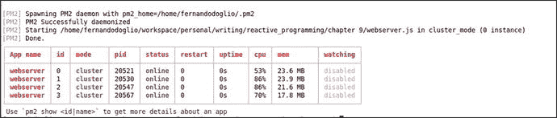
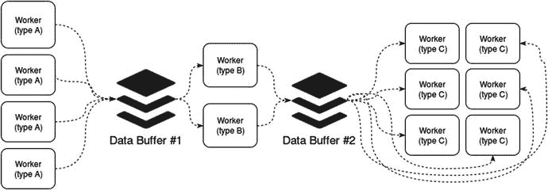
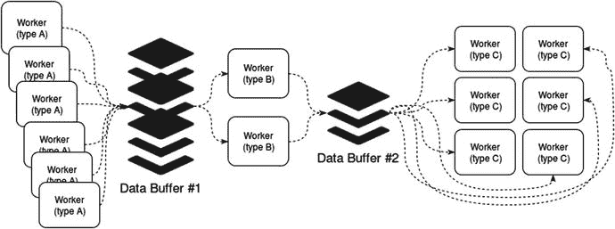

# 9. 扩展你的响应式编程系统

恭喜！你读到了本书的最后一章！到目前为止，你已经掌握了在 Node.js 应用中添加函数式响应逻辑所需的所有必要信息，但事实上，我目前展示的所有示例都经过了简化，以便在书中呈现，让你在阅读代码时不至于感到枯燥。实际的应用——那些已经投入生产、可供最终用户访问的应用——还需要考虑其他因素。在某些情况下，当预期用户数量不断增长时，应用需要能够进行扩展以应对日益增长的需求。

扩展 Node.js 应用实际上相当简单，特别是如果你提前做好规划，并合理构建系统架构的话。在本章中，我将介绍扩展 Node.js 应用（特别是用 Node.js 编写的响应式系统）的一些基础知识。那么，请继续阅读，享受本书的最后一章吧！

## 扩展 Node.js

Node.js 的单线程架构有时会让人们误以为它无法在单台服务器内进行扩展。但事实上，这种单线程模型反而简化了在单台服务器内进行扩展的任务，让我们来看看这是为什么吧？

> **注**
> 扩展到多台服务器也同样简单，但这并不依赖于线程模型，而是取决于你所做的架构决策。我稍后会谈到这些。

### 在服务器内进行扩展

扩展的第一阶段发生在服务器内部。默认情况下，如果你的单线程应用是正常运行的（即没有借助任何外部程序，仅使用默认的 Node 解释器），那么无论你的处理器有多强大、有多少个核心，你都只使用了其中一个。

我知道这很令人震惊！但默认情况下，你并没有充分利用你那强大的处理器。不过别担心！有两种看似不同的方法可以解决这个问题，具体取决于你所处理的应用类型。我之所以说“看似”，是因为这两种方法的核心都是同一个东西：进程。

基本上，为了在多核处理器计算机上进行扩展，你需要多个进程。就是这样。如果你正在处理一个计算密集型应用，你可能会希望将计算任务分发给不同的工作进程，这些工作进程本质上是并行工作的，并通过某种协议相互通信（别担心，我将在本章后面进一步讨论这一点）。

另一方面，如果你有一个基本的 Web 服务应用，并且希望确保这些服务能够充分利用整个处理器的性能，那么你可以使用 Node.js 自带的 `cluster`（[`https://nodejs.org/api/cluster.html`](https://nodejs.org/api/cluster.html) ）模块。这个模块可以让你轻松创建应用的多个副本并行运行，每个副本运行在不同的 CPU 核心上。以下是实现这一功能所需的全部代码：

```
var cluster = require('cluster');
var http = require('http');
var numCPUs = require('os').cpus().length;
if (cluster.isMaster) {
// Fork workers.
for (var i = 0; i < numCPUs; i++) {
cluster.fork();
}
cluster.on('exit', function (worker, code, signal) {
console.log("Worker",worker.process.pid, "died");
});
} else {
http.createServer(function(req, res){
res.writeHead(200);
res.end('hello world\n');
process.exit(0);
}).listen(8000, function() {
console.log("Server Ready!")
});
}
```

如果你执行这段代码，当所有服务器启动并运行后，你会看到与 CPU 核心数量相同的“Server Ready!”消息副本。如果你访问本地主机的 8000 端口，你会在控制台中看到，每次你点击刷新按钮时，一些工作进程就会终止。

> **注**
> 尽管上述代码确保只生成与 CPU 核心数相同数量的进程，但你可以根据需要更改这个数字。不过，如果设置得过高，当然就会开始出现负面的性能表现。

除了简单之外，上述代码的一个主要启示是：由于工作进程可以共享 TCP 连接，你只需编写一个服务器代码，无需特别考虑你将要运行的多个实例，然后简单地启动新的工作进程即可。你可以使用上述代码将你已有的 API 转换为多进程应用，而且一切仍然可以正常工作！

所有工作进程都由主进程（它们的父进程）管理，主进程负责在所有工作进程之间分配工作负载。在所有操作系统（Windows 除外）中，默认的分配方式是轮询分发负载。在 Windows 系统中，负载平衡则由操作系统本身负责。

### 使用外部工具满足您的集群需求

我之前展示的方案确实可行，您可以尝试并查看结果，但如果将其用于实际系统，您可能会开始注意到需要手动处理一些问题，例如：

-   重启已停止的工作进程。如果由于某些原因，您的工作进程开始崩溃，集群模块不会自动为您重启它们，您必须自行处理这些特殊情况。

-   弹性伸缩。这一点尤其有趣，特别是当您在按需付费的服务器（如亚马逊云）上运行时。如何根据您的需求优化工作进程数量？

-   监控问题呢？默认模块不会为您提供开箱即用的检查工作进程状态的功能，但这在生产环境中可能是您需要的。

因此，为了满足上述需求及更多场景，您可以使用外部工具来简化集群管理过程。具体来说，我将简要介绍一个名为 PM2 的工具（`http://pm2.keymetrics.io/`）。

首先，PM2 的主要好处是，您无需向现有应用程序添加任何代码，即可使其在同一个进程的多个副本下运行。是的，之前的示例已经表明确实只需要很少的代码，即便如此，PM2 的附加功能也值得您投入时间。那么，安装它只需执行：

```
$ npm install pm2 -g
```

要并行启动四个应用实例，只需使用以下命令：

```
$ pm2 start app.js -i 4
```

**提示**
如果您希望 PM2 启动与 CPU 核心数相同的工作进程，只需将 `4` 替换为 `0`。

图 9-1 显示了启动一个简单的 Web 服务器脚本后，使用 `0` 实例时 PM2 的输出。在我的案例中，我的处理器有 4 个核心，所以列出了 4 个进程。表中的列名不言自明，“监控”列指示当文件发生更改时进程是否会重启，要启用此功能，您需要传入 `--watch` 标志。



**图 9-1.** 启动后的 PM2

现在，除了清晰的进程列表，您可以放心，如果其中一个进程被终止，PM2 会负责重启它，因此意外崩溃不会持续存在。

您还可以使用 `restart` 命令手动重启整个集群：

```
$ pm2 restart all
```

更有趣的是，您可以使用 `scale` 命令动态扩展或缩减集群。传入一个数字会将集群扩展（或缩减）到具有该数量进程；在数字前加上 `+` 号，则会增加相应数量的进程：

```
$ pm2 scale webserver +3 # 向集群添加 3 个进程
$ pm2 scale webserver 1 # 将集群缩减到只有 1 个进程
```

最后，还有一个非常实用的功能，可以帮助您在生产环境中更新代码。您看，PM2 允许您在不造成任何停机的情况下更新代码。它通过逐个重启进程来实现：等待一个进程完全启动后，再重启下一个，这样集群就会逐步自我更新。为此，您可以使用 `reload` 命令或 `gracefulReload` 命令，后者不会强制终止集群进程，而是发送一个关闭信号，允许进程优雅地退出。

```
$ pm2 reload webservice # 强制终止进程
$ pm2 gracefulReload webservice # 向它们发送关闭信号
```

您可以通过以下代码块捕获该信号，并执行任何所需操作：

```
process.on('message', function(msg) {
  if (msg === 'shutdown') {
    close_all_connections();
    delete_cache();
    server.close();
    process.exit(0);
  }
});
```

如您所见，PM2 可以成为您……生产工具箱中一个非常趁手的工具，它功能强大，实用特性丰富，而且超级易用。但话说回来，它并非解决集群问题的银弹（顺便说一句，从来就没有这种东西），您最终会遇到一些传统集群无法解决的问题，那该怎么办呢？让我们继续探索！

### 不用集群实现多进程处理怎么样？

那么，当 `cluster` 模块不够用时该怎么办？当解决方案不那么简单时呢？就像我之前提到的，多进程处理仍然是答案，别搞错了。如果您想充分利用您的处理器，就需要将逻辑拆分为多个可以并行运行的 Node.js 进程，这能确保您使用所有核心。

基本上，您需要采用微服务方法，将逻辑拆分为可以并行工作的更小部分。换句话说，您的业务逻辑越支持任务并行化，您就越能充分利用该架构。

这种方法的好处是，如果您的服务器开始出现不足，您可以轻松地迁移到多服务器架构，因为代码结构基本保持不变，您只需要处理服务器间的通信（处理防火墙等网络问题，启用正确的端口等）。

您大概能想象得到，对于这种特定场景，没有万能的方法。您只需要找到一种方法，将您的逻辑映射到一组并行进程中（从现在起我们称它们为工作进程，因为无论如何它们都在做这件事），如果您能让每个工作进程拥有多个副本，那就更好了。通常，对于这类设置，关键部分不是如何生成新的工作进程，而是如何处理它们之间的通信，因为您很可能会希望它们在不同类型的工作进程之间发送数据，并最终将数据（最终输出）保存到您可以使用的地方。这就是我们要讨论 Node.js 中 IPC（进程间通信）最佳方案的话题了。

# 高性能领域中的进程间通信

在选择 `Node.js` 中合适的进程间通信（IPC）方式时，选项繁多，几乎让人眼花缭乱。但好在，在本章中，我讨论的是高度可扩展和高性能的架构，因此高效的 IPC 选项范围大大缩小。你看，市面上大多数 IPC 模块都处理直接的进程间通信，有些甚至假设这些进程始终共享同一台服务器。正如我之前所说，实际情况并非总是如此。事实上，如果你真正处理的是一个可扩展的解决方案，你应该将此作为基本假设：你需要多台服务器来处理不同的工作进程。

那么，如果直接的进程间通信行不通，我们还有哪些选择？根据我的经验，使用一个可扩展的解决方案作为数据缓冲区，来在同类工作进程的不同实例之间分配负载，才是正确的做法。原因是：

1.  它允许进程以自己选择的速度在彼此之间传输数据（你可以选择限制其速度，也可以根据可用的工作进程数量全速运行）。

2.  缓冲区解决方案本身可以扩展，从而无需你为此操心。只需配置好缓冲区的扩展策略，然后坐看其自动运行（大致如此，但你应该明白我的意思，你无需担心数据分片、可用性等问题）。

图 9-2 展示了我刚才所描述内容的一个通用示例。图中描述了三种不同类型的工作进程，其类型表明了它们的主要任务。因此，每个任务都可以被并行化，这在图中也通过同一类型工作进程的多个实例来表示。不同类型之间的通信，正如我提到的，使用某种外部解决方案作为数据缓冲区来进行。因此，将来如果你正确测量了系统性能，就能检测出哪些部分压力过大并进行相应调整。假设客户端请求过多，让你不堪重负，你只需扩展“类型 A”的工作进程；系统的其余部分将继续尽可能快地处理数据——当然，除非你的“类型 A”工作进程为“数据缓冲区 #1”生成了过多的数据。在这种情况下，你可以扩展该缓冲区，其余处理过程则保持不变。看出规律了吗？从架构角度来看，扩展变得异常简单，你只需要增加更多的实例。最后，如果你的服务器因实例数量过多而不堪重负，你同样可以简单地添加更多服务器，并将工作进程分布在整个集群中。



图 9-2. 使用数据缓冲区进行多工作进程通信的基本示例

图 9-3 展示了当你扩展了“类型 A”工作进程和“数据缓冲区 #1”后，示例架构的样子。正如我所说，系统的其余部分不受影响。



图 9-3. 前一架构的扩展版本

让我们来看看数据缓冲区技术的一些选择。市面上有很多功能大同小异的方案，因此我们可以将它们分为两类：基于推送的缓冲区和基于拉取的缓冲区。

## 基于推送的缓冲区

换句话说，就是一旦新数据可用，就立即将其推送给你的工作进程的缓冲区。对于此类缓冲区，消息队列是一个很好的选择。默认情况下，大多数队列都是这样工作的。在这种模型中，有三个基本角色：

*   **发布者**：负责将数据发送到队列中，然后就不再关注后续。

*   **订阅者**：向队列注册对特定类型消息的兴趣，然后等待这些消息。

*   **队列本身**：接收来自发布者的消息，并将其转发给第一个可用的订阅者。

这种方法的好处是：

*   发布者只需要知道如何将数据发送到队列，然后就可以放手不管。这简化了处理此过程的开发人员的工作，因为他们无需担心重试、消费者缺失、消息存储等问题。

*   消费者也能从这种方法的更简单的逻辑中受益，因为他们只需要在队列上注册，然后等待队列将消息推送给他们即可。

*   最后，队列本身承担了大部分压力。它需要处理消息的入队和出队，需要处理可扩展性、消息的临时存储（以防失败）以及成为一个功能完善、可扩展队列所需的许多其他方面。话虽如此，其妙处在于这一切都有现成的解决方案——除非你自己编写消息队列，否则你很可能会使用常见的队列之一，例如 Apache Kafka ([`http://kafka.apache.org/`](http://kafka.apache.org/))、RabbitMQ ([`https://www.rabbitmq.com`](https://www.rabbitmq.com))、Redis 的发布/订阅 ([`http://redis.io/`](http://redis.io/)) 等。

根据你的特定需求，你可能会选择其中一种。例如，如果你处理的是巨大的传入流量（比如每秒 10 万次请求），你可能会选择 Kafka；如果你有复杂的消息路由逻辑，你可能会考虑使用 RabbitMQ。所以你看，尽管所有这些方案方法相同（我刚刚列举了三种），但它们并非完全相同，因此，花时间了解一下市面上主要的选项可能是明智之举。

为了说明与这些队列交互有多么简单，下面是一个使用 RabbitMQ 的发布者和消费者（订阅者）的简单示例。此示例使用了 `amqp` 模块 ([`https://www.npmjs.com/package/amqp`](https://www.npmjs.com/package/amqp))：

```
// == 消费者代码 ==
var amqp = require('amqp');
var connection = amqp.createConnection({ host: 'localhost' });
// 添加此代码以便更好地调试
connection.on('error', function(e) {
console.log("来自 amqp 的错误: ", e);
});
// 等待连接建立完成
connection.on('ready', function () {
console.log("正在监听消息...");
connection.queue('my-queue', function (q) {
// 捕获所有消息
q.bind('#');
// 接收消息
q.subscribe(function (message) {
// 将消息打印到标准输出
console.log(message.data.toString());
});
});
});
//== 发布者代码 ==
var amqp = require('amqp');
var connection = amqp.createConnection({ host: 'localhost' });
// 添加此代码以便更好地调试
connection.on('error', function(e) {
console.log("来自 amqp 的错误: ", e);
});
// 等待连接建立完成
connection.on('ready', function () {
// 使用默认的 'amq.topic' 交换机
connection.publish('my-queue', '测试消息');
console.log("消息已发送!");
});
```

代码并不复杂。你可以将上述代码分成两个文件，先执行消费者，使其订阅 RabbitMQ，然后执行发布者。发布者会向队列发送一条消息，这条消息将由消费者接收并打印出来。

# 基于拉取的缓冲区

既然推送策略有这么多好处，为什么我们还要反其道而行之呢？首先，如果你的消费者数量太多（具体多少算“太多”取决于你当前使用的队列），中间件（即实际的队列）用于通知它们有新消息的处理过程所花费的时间可能会过长。

此外，这种模型还存在一个问题：当订阅者的消费速率低于发布者的生产速率时，缓冲区可能会耗尽内存或存储，从而引发可能导致整个系统瘫痪的问题（可以想象成拒绝服务攻击）。

如果你不给队列分配“寻找能够处理新消息的消费者”这一职责，而是让消费者按固定时间间隔查询队列并拉取消息，那么上述问题就迎刃而解了。这时，你使用的队列解决方案将同时承受来自消费者和发布者的访问，这意味着流量会增大，因此在扩容时必须考虑到这一点。

拉取模式还给消费者增加了另一层复杂性，因为它们不仅需要查询队列，还必须处理多个消费者同时尝试获取同一条消息时引发的竞态条件。你只希望其中一个消费者实际处理该消息，而其他消费者则转向下一条。

从队列中取出消息、将其标记为已读，或采用任何其他确保只有单个消费者获取消息的技术，都必须是原子性的，也就是说，它必须在一个指令内完成。

尽管与队列解决方案交互的模型不同，但市面上的实际产品差别并不大。大多数消息队列都支持基于拉取的操作，因此 `Kafka`、`RabbitMQ` 等仍然是可选的方案。例如，`Redis` 的 `Pub/Sub` 就不支持直接工作，但你可以通过使用`列表`作为主队列，并为消息设置`锁键`来轻松解决，以便在将消息取出队列前将其标记为已读。

## 那么，究竟是拉还是推？

你可能已经猜到，这个问题没有简单的答案。你选择的模型类型完全取决于你的具体用例。希望上述两种描述能给你足够的信息来做出选择，但为了便于回顾：

在以下情况下，你通常会选择基于推送的缓冲区：

-   你需要保持逻辑简单。

-   你不需要大量消费者并行工作。

-   你希望在消息到达时立即做出响应。

另一方面，在以下情况下，你更倾向于采用基于拉取的方法：

-   你的系统面临极高的流量。

-   你希望控制消费消息的速率。

-   你希望批量处理消息，而不是一条一条地处理。

# 创建响应式系统

在这九章中，我介绍了响应式编程的含义，给出了示例，甚至创建了一个让你可以自行实践响应式编程的库。但是，在架构决策方面，如果你想创建响应式系统，有一系列需要考虑的因素。

在本章的最后一节，我将讨论这些因素。响应式系统旨在更加灵活、松耦合且易于扩展（我们之前已经在章节中讨论过一些）。本质上，这些系统更易于开发、具有更高的容错性，并且能够优雅地响应错误。为了实现这一目标，你的系统需要满足以下标准：

## 响应式系统

响应式系统需要具有响应性，这意味着它们需要始终及时地向用户提供反馈。一致的响应时间是这些系统的要求，这将带来更好的用户体验和错误处理。

为了实现这一点，正如你将看到的，系统必须满足下面列出的要求。因为它需要具有韧性以始终保持响应性，需要具有弹性以始终及时地向最终用户提供反馈，并且需要由消息驱动来实现这一目标。因为正如你现在可能知道的，弹性扩展主要源于基于微服务的架构，而为了在这些服务之间进行通信，你将需要某种消息系统。

## 错误韧性

响应式系统应该对所有错误都具有韧性。这并不意味着你的系统是 100%无错误的，而是意味着它能够优雅地处理意外错误，而不是失控地崩溃。这反过来有助于确保满足前一个要求，因为任何不具备韧性的系统最终都会在某个时刻变得无响应。

构建一个具有韧性、能够处理各种错误和崩溃的架构并非易事，实际上，需要考虑多个方面，例如：

-   **复制**，用于确保数据和服务的冗余。数据存储是这方面的一个很好的例子，它们通常提供集群模式，这不仅提供了数据冗余，还为每个活动的主服务器添加了备份服务器，通过避免架构中的单点故障来确保服务始终可用。

-   **包含与隔离**，确保一个组件的故障独立于系统的其余部分，防止简单的错误或未处理的异常引发灾难性的连锁反应——一个系统崩溃导致另一个系统崩溃，最终整个架构无响应。

-   **以及委派**，确保所有组件可以在彼此之间委派职责（例如错误处理、日志记录等）。

## 弹性扩展

系统的弹性通常指其通过增加或减少资源使用来处理不同负载量的能力。在本章的第一节中，已经讨论了该主题，并给出了如何设计能够根据需要扩展或缩减且仍保持功能的架构的示例。

根据你的基础设施，用于测量和处理弹性的工具可能有所不同。通常，像亚马逊和微软 Azure 这样的云提供商为你提供了自动执行这些流程的工具，但总会有一些工具可以用来手动执行这些任务。

简而言之，这个要求的要点是：响应式系统应该能够对当前的工作负载做出反应，并相应地调整其可用资源以提供经济高效的性能。这意味着，在不需要资源时进行缩减以节省资源，同时只在需要时进行扩展，以便将这些资源的成本控制在一定预设范围内。

## 消息驱动

最后，响应式系统应使其组件使用异步消息进行通信，这为实现我列出的大多数需求提供了可能。这甚至允许将错误视为可以从一个组件发送到另一个组件的消息。

正如我之前所说，这一要求是所有其他要求的基石。这种机制为所有服务之间的相互通信提供了必要的基础，这反过来又提供了在不影响进程之间对话能力的情况下不断扩展进程数量的能力，进而意味着你的系统能够在足够短的时间内生成响应并将其发送回最终用户。

总而言之，正如你所见，“响应式系统”这个名称听起来比实际要复杂得多。事实上，这些要求列表只是一系列优秀的设计决策，它们将帮助你的架构提供良好的用户体验，并对用户的输入以及环境的变化做出响应。

# 总结

通过 Node.js 扩展你的应用，并审视一些有趣且能助你构建更优系统的架构决策，是本书最后一块反应式拼图。你已经阅读并理解了它，现在是时候去实践，并将你（希望是）学到的知识应用到代码中了。

只需记住几个要点：

-   响应式编程与函数式编程是绝佳搭档。
-   在 Node.js 中，响应式编程几乎都与流有关，所以不要畏惧它们，拥抱它们，你会爱上这种感觉！
-   如果你还没准备好，请接受 Node.js 的异步思维，这能为你省去很多麻烦。
-   最后，请记住要恰当地将你的系统设计成可并行化和可扩展的组件。

最后，感谢你陪伴我读完这本书，我真诚地希望你发现它既有用又有趣，并且至少有一件你能从中带走的东西。如果真是这样，那么我的工作就算完成了。
