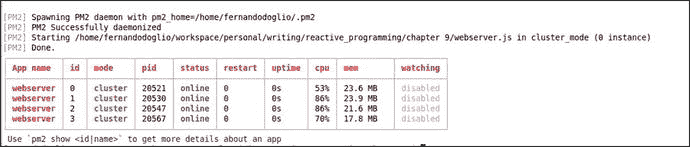

# 9. 扩展你的响应式编程系统

恭喜！你读到了本书的最后一章！到目前为止，你已经掌握了在 Node.js 应用中添加函数式响应逻辑所需的所有必要信息，但事实上，我目前展示的所有示例都经过了简化，以便在书中呈现，让你在阅读代码时不至于感到枯燥。实际的应用——那些已经投入生产、可供最终用户访问的应用——还需要考虑其他因素。在某些情况下，当预期用户数量不断增长时，应用需要能够进行扩展以应对日益增长的需求。

扩展 Node.js 应用实际上相当简单，特别是如果你提前做好规划，并合理构建系统架构的话。在本章中，我将介绍扩展 Node.js 应用（特别是用 Node.js 编写的响应式系统）的一些基础知识。那么，请继续阅读，享受本书的最后一章吧！

## 扩展 Node.js

Node.js 的单线程架构有时会让人们误以为它无法在单台服务器内进行扩展。但事实上，这种单线程模型反而简化了在单台服务器内进行扩展的任务，让我们来看看这是为什么吧？

> **注**
> 扩展到多台服务器也同样简单，但这并不依赖于线程模型，而是取决于你所做的架构决策。我稍后会谈到这些。

### 在服务器内进行扩展

扩展的第一阶段发生在服务器内部。默认情况下，如果你的单线程应用是正常运行的（即没有借助任何外部程序，仅使用默认的 Node 解释器），那么无论你的处理器有多强大、有多少个核心，你都只使用了其中一个。

我知道这很令人震惊！但默认情况下，你并没有充分利用你那强大的处理器。不过别担心！有两种看似不同的方法可以解决这个问题，具体取决于你所处理的应用类型。我之所以说“看似”，是因为这两种方法的核心都是同一个东西：进程。

基本上，为了在多核处理器计算机上进行扩展，你需要多个进程。就是这样。如果你正在处理一个计算密集型应用，你可能会希望将计算任务分发给不同的工作进程，这些工作进程本质上是并行工作的，并通过某种协议相互通信（别担心，我将在本章后面进一步讨论这一点）。

另一方面，如果你有一个基本的 Web 服务应用，并且希望确保这些服务能够充分利用整个处理器的性能，那么你可以使用 Node.js 自带的 `cluster`（[`https://nodejs.org/api/cluster.html`](https://nodejs.org/api/cluster.html) ）模块。这个模块可以让你轻松创建应用的多个副本并行运行，每个副本运行在不同的 CPU 核心上。以下是实现这一功能所需的全部代码：

```
var cluster = require('cluster');
var http = require('http');
var numCPUs = require('os').cpus().length;
if (cluster.isMaster) {
// Fork workers.
for (var i = 0; i < numCPUs; i++) {
cluster.fork();
}
cluster.on('exit', function (worker, code, signal) {
console.log("Worker",worker.process.pid, "died");
});
} else {
http.createServer(function(req, res){
res.writeHead(200);
res.end('hello world\n');
process.exit(0);
}).listen(8000, function() {
console.log("Server Ready!")
});
}
```

如果你执行这段代码，当所有服务器启动并运行后，你会看到与 CPU 核心数量相同的“Server Ready!”消息副本。如果你访问本地主机的 8000 端口，你会在控制台中看到，每次你点击刷新按钮时，一些工作进程就会终止。

> **注**
> 尽管上述代码确保只生成与 CPU 核心数相同数量的进程，但你可以根据需要更改这个数字。不过，如果设置得过高，当然就会开始出现负面的性能表现。

除了简单之外，上述代码的一个主要启示是：由于工作进程可以共享 TCP 连接，你只需编写一个服务器代码，无需特别考虑你将要运行的多个实例，然后简单地启动新的工作进程即可。你可以使用上述代码将你已有的 API 转换为多进程应用，而且一切仍然可以正常工作！

所有工作进程都由主进程（它们的父进程）管理，主进程负责在所有工作进程之间分配工作负载。在所有操作系统（Windows 除外）中，默认的分配方式是轮询分发负载。在 Windows 系统中，负载平衡则由操作系统本身负责。

### 使用外部工具满足您的集群需求

我之前展示的方案确实可行，您可以尝试并查看结果，但如果将其用于实际系统，您可能会开始注意到需要手动处理一些问题，例如：

-   重启已停止的工作进程。如果由于某些原因，您的工作进程开始崩溃，集群模块不会自动为您重启它们，您必须自行处理这些特殊情况。

-   弹性伸缩。这一点尤其有趣，特别是当您在按需付费的服务器（如亚马逊云）上运行时。如何根据您的需求优化工作进程数量？

-   监控问题呢？默认模块不会为您提供开箱即用的检查工作进程状态的功能，但这在生产环境中可能是您需要的。

因此，为了满足上述需求及更多场景，您可以使用外部工具来简化集群管理过程。具体来说，我将简要介绍一个名为 PM2 的工具（`http://pm2.keymetrics.io/`）。

首先，PM2 的主要好处是，您无需向现有应用程序添加任何代码，即可使其在同一个进程的多个副本下运行。是的，之前的示例已经表明确实只需要很少的代码，即便如此，PM2 的附加功能也值得您投入时间。那么，安装它只需执行：

```
$ npm install pm2 -g
```

要并行启动四个应用实例，只需使用以下命令：

```
$ pm2 start app.js -i 4
```

**提示**
如果您希望 PM2 启动与 CPU 核心数相同的工作进程，只需将 `4` 替换为 `0`。

图 9-1 显示了启动一个简单的 Web 服务器脚本后，使用 `0` 实例时 PM2 的输出。在我的案例中，我的处理器有 4 个核心，所以列出了 4 个进程。表中的列名不言自明，“监控”列指示当文件发生更改时进程是否会重启，要启用此功能，您需要传入 `--watch` 标志。



**图 9-1.** 启动后的 PM2

现在，除了清晰的进程列表，您可以放心，如果其中一个进程被终止，PM2 会负责重启它，因此意外崩溃不会持续存在。

您还可以使用 `restart` 命令手动重启整个集群：

```
$ pm2 restart all
```

更有趣的是，您可以使用 `scale` 命令动态扩展或缩减集群。传入一个数字会将集群扩展（或缩减）到具有该数量进程；在数字前加上 `+` 号，则会增加相应数量的进程：

```
$ pm2 scale webserver +3 # 向集群添加 3 个进程
$ pm2 scale webserver 1 # 将集群缩减到只有 1 个进程
```

最后，还有一个非常实用的功能，可以帮助您在生产环境中更新代码。您看，PM2 允许您在不造成任何停机的情况下更新代码。它通过逐个重启进程来实现：等待一个进程完全启动后，再重启下一个，这样集群就会逐步自我更新。为此，您可以使用 `reload` 命令或 `gracefulReload` 命令，后者不会强制终止集群进程，而是发送一个关闭信号，允许进程优雅地退出。

```
$ pm2 reload webservice # 强制终止进程
$ pm2 gracefulReload webservice # 向它们发送关闭信号
```

您可以通过以下代码块捕获该信号，并执行任何所需操作：

```
process.on('message', function(msg) {
  if (msg === 'shutdown') {
    close_all_connections();
    delete_cache();
    server.close();
    process.exit(0);
  }
});
```

如您所见，PM2 可以成为您……生产工具箱中一个非常趁手的工具，它功能强大，实用特性丰富，而且超级易用。但话说回来，它并非解决集群问题的银弹（顺便说一句，从来就没有这种东西），您最终会遇到一些传统集群无法解决的问题，那该怎么办呢？让我们继续探索！

### 不用集群实现多进程处理怎么样？

那么，当 `cluster` 模块不够用时该怎么办？当解决方案不那么简单时呢？就像我之前提到的，多进程处理仍然是答案，别搞错了。如果您想充分利用您的处理器，就需要将逻辑拆分为多个可以并行运行的 Node.js 进程，这能确保您使用所有核心。

基本上，您需要采用微服务方法，将逻辑拆分为可以并行工作的更小部分。换句话说，您的业务逻辑越支持任务并行化，您就越能充分利用该架构。

这种方法的好处是，如果您的服务器开始出现不足，您可以轻松地迁移到多服务器架构，因为代码结构基本保持不变，您只需要处理服务器间的通信（处理防火墙等网络问题，启用正确的端口等）。

您大概能想象得到，对于这种特定场景，没有万能的方法。您只需要找到一种方法，将您的逻辑映射到一组并行进程中（从现在起我们称它们为工作进程，因为无论如何它们都在做这件事），如果您能让每个工作进程拥有多个副本，那就更好了。通常，对于这类设置，关键部分不是如何生成新的工作进程，而是如何处理它们之间的通信，因为您很可能会希望它们在不同类型的工作进程之间发送数据，并最终将数据（最终输出）保存到您可以使用的地方。这就是我们要讨论 Node.js 中 IPC（进程间通信）最佳方案的话题了。