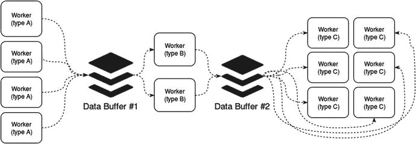
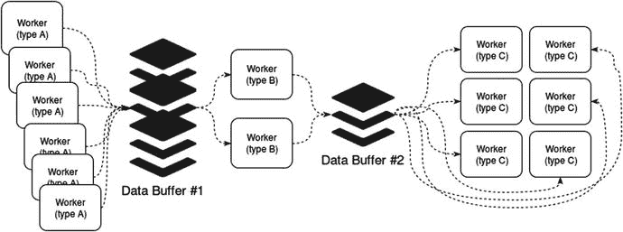

# 高性能领域中的进程间通信

在选择 `Node.js` 中合适的进程间通信（IPC）方式时，选项繁多，几乎让人眼花缭乱。但好在，在本章中，我讨论的是高度可扩展和高性能的架构，因此高效的 IPC 选项范围大大缩小。你看，市面上大多数 IPC 模块都处理直接的进程间通信，有些甚至假设这些进程始终共享同一台服务器。正如我之前所说，实际情况并非总是如此。事实上，如果你真正处理的是一个可扩展的解决方案，你应该将此作为基本假设：你需要多台服务器来处理不同的工作进程。

那么，如果直接的进程间通信行不通，我们还有哪些选择？根据我的经验，使用一个可扩展的解决方案作为数据缓冲区，来在同类工作进程的不同实例之间分配负载，才是正确的做法。原因是：

1.  它允许进程以自己选择的速度在彼此之间传输数据（你可以选择限制其速度，也可以根据可用的工作进程数量全速运行）。
2.  缓冲区解决方案本身可以扩展，从而无需你为此操心。只需配置好缓冲区的扩展策略，然后坐看其自动运行（大致如此，但你应该明白我的意思，你无需担心数据分片、可用性等问题）。

图 9-2 展示了我刚才所描述内容的一个通用示例。图中描述了三种不同类型的工作进程，其类型表明了它们的主要任务。因此，每个任务都可以被并行化，这在图中也通过同一类型工作进程的多个实例来表示。不同类型之间的通信，正如我提到的，使用某种外部解决方案作为数据缓冲区来进行。因此，将来如果你正确测量了系统性能，就能检测出哪些部分压力过大并进行相应调整。假设客户端请求过多，让你不堪重负，你只需扩展“类型 A”的工作进程；系统的其余部分将继续尽可能快地处理数据——当然，除非你的“类型 A”工作进程为“数据缓冲区 #1”生成了过多的数据。在这种情况下，你可以扩展该缓冲区，其余处理过程则保持不变。看出规律了吗？从架构角度来看，扩展变得异常简单，你只需要增加更多的实例。最后，如果你的服务器因实例数量过多而不堪重负，你同样可以简单地添加更多服务器，并将工作进程分布在整个集群中。



图 9-2. 使用数据缓冲区进行多工作进程通信的基本示例

图 9-3 展示了当你扩展了“类型 A”工作进程和“数据缓冲区 #1”后，示例架构的样子。正如我所说，系统的其余部分不受影响。



图 9-3. 前一架构的扩展版本

让我们来看看数据缓冲区技术的一些选择。市面上有很多功能大同小异的方案，因此我们可以将它们分为两类：基于推送的缓冲区和基于拉取的缓冲区。

## 基于推送的缓冲区

换句话说，就是一旦新数据可用，就立即将其推送给你的工作进程的缓冲区。对于此类缓冲区，消息队列是一个很好的选择。默认情况下，大多数队列都是这样工作的。在这种模型中，有三个基本角色：

*   **发布者**：负责将数据发送到队列中，然后就不再关注后续。
*   **订阅者**：向队列注册对特定类型消息的兴趣，然后等待这些消息。
*   **队列本身**：接收来自发布者的消息，并将其转发给第一个可用的订阅者。

这种方法的好处是：

*   发布者只需要知道如何将数据发送到队列，然后就可以放手不管。这简化了处理此过程的开发人员的工作，因为他们无需担心重试、消费者缺失、消息存储等问题。
*   消费者也能从这种方法的更简单的逻辑中受益，因为他们只需要在队列上注册，然后等待队列将消息推送给他们即可。
*   最后，队列本身承担了大部分压力。它需要处理消息的入队和出队，需要处理可扩展性、消息的临时存储（以防失败）以及成为一个功能完善、可扩展队列所需的许多其他方面。话虽如此，其妙处在于这一切都有现成的解决方案——除非你自己编写消息队列，否则你很可能会使用常见的队列之一，例如 Apache Kafka ([`http://kafka.apache.org/`](http://kafka.apache.org/))、RabbitMQ ([`https://www.rabbitmq.com`](https://www.rabbitmq.com))、Redis 的发布/订阅 ([`http://redis.io/`](http://redis.io/)) 等。

根据你的特定需求，你可能会选择其中一种。例如，如果你处理的是巨大的传入流量（比如每秒 10 万次请求），你可能会选择 Kafka；如果你有复杂的消息路由逻辑，你可能会考虑使用 RabbitMQ。所以你看，尽管所有这些方案方法相同（我刚刚列举了三种），但它们并非完全相同，因此，花时间了解一下市面上主要的选项可能是明智之举。

为了说明与这些队列交互有多么简单，下面是一个使用 RabbitMQ 的发布者和消费者（订阅者）的简单示例。此示例使用了 `amqp` 模块 ([`https://www.npmjs.com/package/amqp`](https://www.npmjs.com/package/amqp))：

```
// == 消费者代码 ==
var amqp = require('amqp');
var connection = amqp.createConnection({ host: 'localhost' });
// 添加此代码以便更好地调试
connection.on('error', function(e) {
console.log("来自 amqp 的错误: ", e);
});
// 等待连接建立完成
connection.on('ready', function () {
console.log("正在监听消息...");
connection.queue('my-queue', function (q) {
// 捕获所有消息
q.bind('#');
// 接收消息
q.subscribe(function (message) {
// 将消息打印到标准输出
console.log(message.data.toString());
});
});
});
//== 发布者代码 ==
var amqp = require('amqp');
var connection = amqp.createConnection({ host: 'localhost' });
// 添加此代码以便更好地调试
connection.on('error', function(e) {
console.log("来自 amqp 的错误: ", e);
});
// 等待连接建立完成
connection.on('ready', function () {
// 使用默认的 'amq.topic' 交换机
connection.publish('my-queue', '测试消息');
console.log("消息已发送!");
});
```

代码并不复杂。你可以将上述代码分成两个文件，先执行消费者，使其订阅 RabbitMQ，然后执行发布者。发布者会向队列发送一条消息，这条消息将由消费者接收并打印出来。


