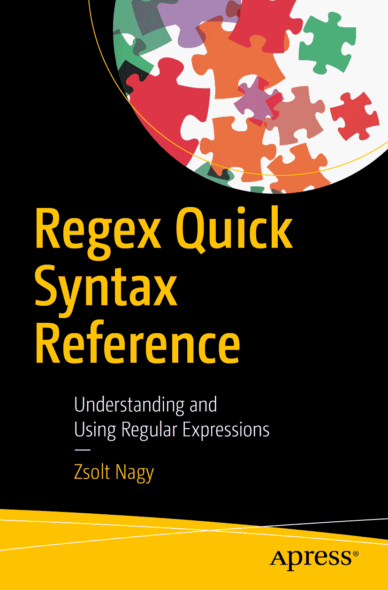

ISBN 978-1-4842-3875-2（纸质书） e-ISBN 978-1-4842-3876-9（电子书） [`doi.org/10.1007/978-1-4842-3876-9`](https://doi.org/10.1007/978-1-4842-3876-9) 美国国会图书馆控制号：2018953563 © 2018 Zsolt Nagy 版权所有。本书所有权利均由出版社保留，无论是全部还是部分内容，均涉及翻译、重印、插图再使用、引用、广播、微缩胶片复制或任何其他物理形式复制，以及传输或信息存储与检索、电子改编、计算机软件，或现在已知或将来开发的类似或不同的方法。本书可能包含商标名称、徽标和图像。对于出现的商标名称、徽标或图像，我们不使用商标符号，而仅以编辑方式使用这些名称、徽标和图像，以惠及商标所有者，且无意侵犯商标权。本出版物中使用的商号、商标、服务标记和类似术语，即使未明确标识为商标，也不应被视为对它们是否受所有权保护的意见表达。尽管本书中的建议和信息在出版时被认为是真实准确的，但作者、编辑和出版商均不对可能存在的任何错误或遗漏承担法律责任。出版商对本书所载内容不作任何明示或暗示的保证。本书在全球图书贸易中的发行由 Springer Science+Business Media New York 负责，地址：233 Spring Street, 6th Floor, New York, NY 10013。电话：1-800-SPRINGER，传真：(201) 348-4505，电子邮件：orders-ny@springer-sbm.com，或访问网址：www.springeronline.com。Apress Media, LLC 是加利福尼亚州的一家有限责任公司，其唯一成员（所有者）是 Springer Science + Business Media Finance Inc (SSBM Finance Inc)。SSBM Finance Inc 是特拉华州的一家公司。
