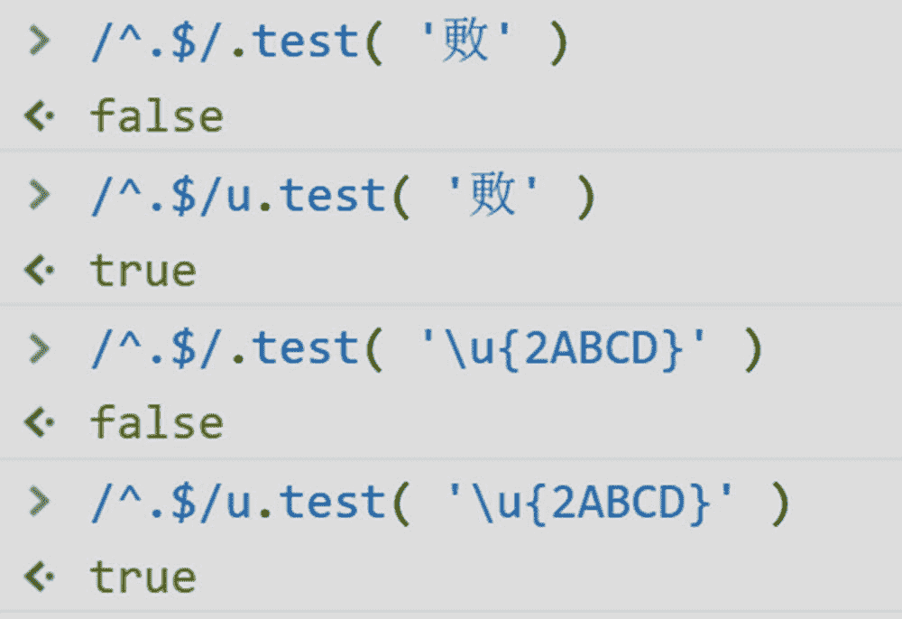

# 3. 执行正则表达式

正则表达式可以在不同的编程语言和文本编辑器中使用。由于在不同环境中测试代码很重要，本章将介绍如何在自己的环境中构造和执行正则表达式。

不必担心记住所有语言的细节。本章目标是探索和尝试正则表达式。你无需给自己施加压力去记忆我尚未详细解释的语言元素。一旦你接触到某个你可能还不理解功能的详细解释，回忆本章所读内容将加深你对这种语言结构的熟悉程度。

首先，你将深入学习 JavaScript 中的正则表达式，以便在浏览器中试验正则表达式。然后你将有机会使用一些网站在许多其他编程语言中执行正则表达式。

再次重申，本章的心态是“无压力，开心玩。”

## JavaScript 中的正则表达式

使用 JavaScript 正则表达式进行实验很容易，因为 JavaScript 在所有浏览器中都可访问。

我将使用 Chrome 开发者工具来执行正则表达式。每行开头的 `>` 符号表示输入。返回值和控制台日志会在输入行之后打印。由于我们在控制台中实验，我将使用全局变量。显然，在源代码中，建议使用 `let` 和 `const`。

构造正则表达式有两种方式。在字面量形式中，正则模式可以写在两个斜杠（`/`）之间，并可在末尾添加一些全局修饰符。在对象形式中，你可以使用 `RegExp` 构造函数来创建正则表达式。这两种形式是等效的。

```
> new RegExp( 'xy+' )
/xy+/
```

`xy+` 模式匹配包含一个 `x` 字符后跟至少一个 `y` 字符的字符串。

JavaScript 正则表达式是对象。

```
> typeof /xy+/
"object"
```

构造函数允许在运行时编译表达式。例如，你可以使用可视化编辑器构建正则模式，根据可视化编辑器组装字符串，然后在运行时将其作为参数传递给 `RegExp` 构造函数。

### RegExp 方法

JavaScript 中正则表达式有许多用例。通过检查正则表达式的公共接口（它描述了可在 `RegExp` 对象上执行的方法），可以识别这些用例。

- `exec` 执行搜索，返回匹配信息。
- `test` 执行搜索，返回一个布尔值指示是否找到匹配。
- `toString` 将正则表达式转换为字符串。

```
> /xy+/.exec( 'yyxyy' );
{0: "xyy", index: 2, input: "yyxyy", length: 1}
> /xy+/.test( 'yyxyy' );
true
> /xy+/.toString()
"/xy+/"
```

注意，`exec` 返回的是*最长*匹配 `xyy`，而不是最短匹配 `xy`。这是因为 `y+` 结构像一个循环，会匹配尽可能多的 `y` 字符。换句话说，`y+` 结构是贪婪的。你将在第 5 章了解 `+` 元字符的行为。

请注意，在前面的 `test` 示例中，从查找匹配的角度来看，`xy+` 搜索表达式等同于使用 `xy`。这是因为定位*一个* `y` 字符意味着你也能定位*至少一个*。因此，在 `test` 方法中，`/xy+/` 和 `/xy/` 的行为相同。在其他方法中，`y+` 会找到最长的 `y` 字符序列。

### 接受正则表达式的字符串方法

某些字符串方法接受正则表达式作为参数。

- `match` 在字符串中执行搜索，返回下一个匹配的信息。这类似于 `RegExp` 对象的 `exec` 方法，只是交换了对象和参数的位置。
- `search` 在字符串中执行搜索，返回下一个匹配的索引。如果字符串中找不到该正则模式，则返回的索引为 `-1`。
- `replace` 在字符串中执行搜索并替换第一个匹配。
- `split` 根据指定的正则模式将字符串分割成子字符串。

以下是一些示例：

```
> s = 'xyyzxyzz';
> s.match( /xy+/ );
{ 0: "xyy", index: 0, input: "xyyzxyzz", length: 1 }
> s.search( /xy+/ )；

> s.replace( /xy+/, 'U' )
"Uzxyzz"
> s
"xyyzxyzz"
> s.split( /xy+/ )
["", "z", "zz"]
```

请注意，`replace` 不会修改原始字符串；它只返回一个经过替换的新字符串。

字符串的 `split` 方法具有多态性，它既接受字符串也接受正则表达式。在后一种情况下，字符串会根据可能的最长匹配进行分割。

### 正则表达式修饰符

`RegExp` 构造函数的第二个参数是应用于正则表达式的标志列表。这些标志被称为*修饰符*。例如，对于不区分大小写的搜索，可以应用 `i` 标志。

```
> x = new RegExp( 'x' )
/x/
> xX = new RegExp( 'x', 'i' )
/x/i
> x.test( 'XY' )
false
> xX.test( 'XY' )
true
```

表 3-1 描述了 JavaScript 中可用的修饰符。

**表 3-1 JavaScript 修饰符**

| 修饰符 | 描述 |
| --- | --- |
| `i` | 不区分大小写匹配。大写和小写无关紧要。 |
| `g` | 全局匹配。你尝试查找所有匹配，而不是仅返回第一个匹配。正则表达式的内部状态会存储最后一个匹配的位置，并从上次匹配结束的位置继续匹配。 |
| `m` | 多行匹配。它将 `^` 和 `$` 字符视为匹配测试字符串每一行的开头和结尾。换行符由 `\n` 或 `\r` 确定。 |
| `u` | Unicode 搜索。正则模式被视为 Unicode 序列。 |
| `y` | 粘性搜索。 |
| `s` | 单行匹配。`.` 字符也会匹配换行符，例如 `\r` 和 `\n`。在 ES2018 及更新版本中可用。 |

单行匹配是 ES2018 中添加到 JavaScript 正则引擎的一种结构。本章将不涉及这个标志。让我们为其余标志执行几个示例。

### 全局匹配

让我们构建一个全局匹配的示例。我们将找到所有 `x` 字符的序列。

```
> regex = /x+/g;
> str = 'yxxxyxyxx';
> regex.exec( str )
{0: 'xxx', index: 1, input: 'yxxxyxyxx' }
> regex.lastIndex

> regex.exec( str )
{ 0: "x", index: 5, input: "yxxxyxyxx" }
> regex.exec( str )
{ 0: "xx", index: 7, input: "yxxxyxyxx" }
> regex.exec( str )
null
> str.match( /x+/ )
{0: 'xxx', index: 1, input: 'yxxxyxyxx' }
> str.match( /x+/g )
["xxx", "x", "xx"]
```

在 `exec` 示例中，可以看到三个匹配项被逐一返回。在第三个匹配之后，返回 `null`。全局正则表达式的 `lastIndex` 属性存储了需要恢复执行的位置。

你已经了解到，使用字符串匹配时，返回值类似于第一次执行 `regex.exec`。然而，当使用全局正则参数时，返回值是一个按顺序包含*所有*匹配项的数组。

# 多行匹配

让我们来执行一个多行匹配的示例。正则表达式

```
> xRow = /^x+$/m
```

定义了一个可能包含多行的字符串，其中每一行只能包含小写字母 `x`，并且每行必须至少包含一个 `x` 字符。`^` 字符表示每一行必须以指定的正则表达式序列开头。`$` 字符表示每一行必须以指定的正则表达式序列结尾。

`match` 函数显示字符串的第一行符合所有指定条件。

```
'xx\nxXx\nxxxx'.match( xRow )
["xx", index: 0, input: "xxxXxxxxx"]
```

如果你想要获取所有匹配结果，需要在正则表达式中添加全局标志。以下表达式匹配了字符串的第一行和第三行，而忽略了第二行：

```
'xx\nxXx\nxxxx'.match( /^x+$/mg )
["xx", "xxxx"]
```

如果没有使用标志位，换行符会被视为空白字符。由于空白字符不等于 `x`，因此该字符串不匹配该正则表达式。

```
'xx\nxXx\nxxxx'.match( /^x+$/ )
null
```

如你所见，如果没有多行标志，`^` 和 `$` 字符表示整个字符串只能包含由模式 `x+` 指定的字符。

# ES6 Unicode 正则表达式

在 ES6 中，你可以指定要匹配的 Unicode 字符。一个 Unicode 字符会被视为一个字符，无论该字符占用多少个字节。

```
> 'x'.codePointAt( 0 ).toString( 16 )
"78"
```

字符 `x` 的十六进制代码是 `78`。在 JavaScript 中对应的 Unicode 字符是 `\u{78}`。然而，包含此 Unicode 字符的正则表达式却无法匹配该字符本身。

```
> /\u{78}/.test( 'x' )
false
```

这就是为什么你需要 `u` 标志。

```
> /\u{78}/u.test( 'x' )
true
```

Unicode 字符的另一个问题是它们所占的字节数可能不同。例如，`'\u{2ABCD}'` 是一个无法用 4 个字节表示的 Unicode 字符。

让我们构建一个正则表达式，检查相应字符串是否恰好包含一个字符。你可以使用任意字符符号 `.` 来实现。你可以指定字符串以此字符开头，以此字符结尾，并且中间没有其他内容：`/^.$/`。

让我们测试在什么条件下字符串 `'\u{2ABCD}'` 能匹配这个正则表达式：`/^.$/`。由于本书无法处理较长的 Unicode 字符，我将同时提供截图（见图 3-1）和代码。代码中的 Unicode 字符将显示为一个矩形。



图 3-1 JavaScript 正则表达式的 Unicode 标志

```
> /^.$/.test( '▯' )
false
> /^.$/u.test( '▯' )
true
> /^.$/.test( '\u{2ABCD}' )
false
> /^.$/u.test( '\u{2ABCD}' )
true
```

我们可以得出结论，旧版 JavaScript 正则引擎将 `'\u{2ABCD}'` 解释为两个字符的序列。然而，使用 `u` 标志后，这个长的 Unicode 字符会被识别为单个字符。

# 粘性匹配

在匹配之后，`y` 标志会将正则表达式的 `lastIndex` 属性设置为上一次匹配序列之后的第一个字符。如果正则表达式上一次执行没有匹配到任何结果，`lastIndex` 会被设置为 `0`。

这会对正则表达式的内部状态产生改变。务必注意这个副作用！当 `y` 标志开启时，正则表达式开头会自动添加一个 `^`。这意味着在 `lastIndex` 位置上的字符必须与正则表达式的起始位置匹配。

示例如下：

```
> regExp = /ab+/y
/ab+/y
> 'ababbabbb'.match( regExp )
{ 0:"ab", index: 0, input: "ababbabbb" }
> regExp.lastIndex

> 'ababbabbb'.match( regExp )
{ 0: "abb", index: 2, input: "ababbabbb" }
> regExp.lastIndex

> 'ababbabbb'.match( regExp )
{ 0:"abbb", index: 5, input: "ababbabbb" }
> regExp.lastIndex

> 'ababbabbb'.match( regExp )
null
> regExp.lastIndex

> 'ababbabbb'.match( regExp )
{ 0: "ab", index: 0, input: "ababbabbb" }
> regExp.lastIndex

// ...
```

# 总结

JavaScript 中的正则表达式有一些值得尝试的独特特性。其中一些特性是 JavaScript 正则表达式虚拟机所独有的。其他特性则与其他语言通用。

这里我没有过多关注正则表达式模式的确切语法，因为你将在后续阶段学习具体的规则。一些字符，比如 `+`（至少一次）元字符，用于预先展示大多数语言中正则表达式的功能。

你已经了解到正则表达式在 JavaScript 中是对象，并且它们也被集成到一些 `String` 方法中。

`RegExp` 的公共接口允许测试字符串、查找第一个匹配项、查找所有匹配项、替换子字符串，甚至分割字符串。

为了实现这些用例中的一部分，你可以使用一些修饰符，例如全局 `g` 修饰符、粘性 `y` 修饰符或多行 `m` 修饰符。

还有两个修饰符使得字符串处理更加便捷：`i` 使得字符串不区分大小写，而 `u` 则使 JavaScript 正则表达式虚拟机能够正确处理 Unicode 字符。

# 其他基于 PCRE 的正则表达式环境

JavaScript 正则表达式以及大多数编程语言的正则表达式执行环境都基于 PCRE 方言。我们现在将探讨如何在一些最流行的语言中执行正则表达式。

鉴于大多数语言执行正则表达式不如 JavaScript 那样简单，我们将使用一些工具，使得在浏览器中执行和测试正则表达式成为可能。

当你需要一种快速生成匹配正则表达式的代码的解决方案时，可以前往 `regex101.com` 的代码生成器。^(²)

### PHP

PHP 提供了用于处理正则表达式的全局函数。这些函数以以下前缀开头：

- `preg_` 匹配 Perl PCRE 语法
- `ereg_` 基于 ERE 方言
- `mb_ereg` 同样基于 ERE 方言，且能处理 Unicode 字符

我们在这里只讨论 PCRE 语法。

在 PHP 中，有些修饰符与 JavaScript 相同，而另一些则不同。

- `i` 表示不区分大小写，与 JavaScript 中相同。
- `m` 表示多行模式，与 JavaScript 中相同。
- `u` 表示 Unicode 匹配，与 JavaScript 中相同。
- `s` 使 `.` 字符匹配包括换行符在内的所有字符，与 ES2018 中相同。
- `x` 开启自由间距模式以提高可读性。自由间距模式会忽略正则表达式字符之间的空白字符。

请参考 PHP 手册的 PCRE 部分（^(³)）以获取所有 PCRE 正则函数的文档。

你可以使用许多在线沙盒工具（例如 `writephponline.com`^(⁴) 或 Joodle PHP 在线编辑器^(⁵)）在线执行 PHP 代码。

你可以使用 `preg_match` 从字符串中返回第一个匹配项。

```
preg_match('/xy+/', 'xyxyyxyyy', $matches, PREG_OFFSET_CAPTURE);
print_r($matches);
```

结果如下所示：

```
Array ( [0] => Array ( [0] => xy [1] => 0 ) )
```

这是一个包含一个元素的数组，该元素描述了匹配结果。匹配描述符本身也是一个数组，其中索引 0 包含匹配到的序列，索引 1 包含匹配结果中第一个字符的位置。

`preg_match_all` 返回所有匹配项，因此它类似于 JavaScript 中的 `g` 标志。请记住，PHP 没有 `g` 修饰符，因此全局匹配功能是通过 PCRE 正则表达式封装器的公共接口来实现的。

```
preg_match_all('/xy+/', 'xyxyyxyyy', $matches, PREG_OFFSET_CAPTURE);
print_r($matches);
```

结果包含所有匹配项。

```
Array (
[0] => Array (
[0] => Array ( [0] => xy   [1] => 0 )
[1] => Array ( [0] => xyy  [1] => 2 )
[2] => Array ( [0] => xyyy [1] => 5 )
)
)
```

尽管 `preg_` 函数充当 Perl 5 风格正则表达式的封装器，但在 Perl 语法上仍有一些细微差异。更多详情请查阅 `php.net` 上关于 PCRE 模式差异的文档^(⁶)。

### Python

现在我们将使用 `python.org` 的交互式 shell^(⁷) 开始熟悉 Python 中的正则表达式。`re` 这一 Python 模块为你提供了对 PCRE 风格正则表达式的支持。你可以通过 `import re` 导入此模块。

```
>>> import re
```

`re` 模块的 `compile` 方法会根据提供给它的模式字符串编译一个正则表达式。使用你已有的 PCRE 知识，你已经可以编写许多模式字符串了。

```
>>> regex = re.compile(r"xy+")
```

注意字符串前面的 `r`。在 Python 中，这表示一个原始字符串。虽然在之前的例子中可以省略这个 `r`，但在一般情况下，使用原始字符串可以省去大量转义字符的工作。

已编译正则表达式的 `search` 方法会在其字符串参数中搜索匹配项。

```
>>> regex.search( "QxyxyyQ" )
```

你可以通过一些方法获取关于结果的更多信息。

```
>>> result = regex.search( "QxyyxyQ" )
>>> result.group(), result.start(), result.end(), result.span()
('xyy', 1, 4, (1, 4))
```

`group` 方法以其最长形式返回第一个匹配项。可以使用 `start`、`end` 和 `span` 方法获取匹配项的第一个字符和匹配项之后的第一个字符。

已编译正则表达式的 `match` 方法容易引起误解，因为它是从字符串的*起始位置*开始寻找匹配。

```
>>> regex.match( "QxyxyyQ" )
None
>>> regex.match( "xyxyyQ" )

```

从技术上讲，`match` 是多余的，因为你可以使用 `^` 字符来匹配字符串的开头。

```
>>> re.compile( "^xy+" ).search( "xyxyyQ" )

```

我解释了 `match` 方法，目的是让你避免将其与 `search` 混淆。

并不一定非要编译正则表达式，因为 `match` 和 `search` 方法也可以通过 `re` 模块作为函数直接调用，这些函数接受一个正则表达式字符串和一个普通字符串作为参数。

```
>>> re.search( '^xy+', 'xyyyyxyQ' )

```

还可以枚举与搜索表达式匹配的所有结果。`findall` 和 `finditer` 方法可以实现这个功能。

```
>>> re.findall( 'xy+', 'QxyxyyQxyyyQ' )
['xy', 'xyy', 'xyyy']
>>> iterator = re.finditer( 'xy+', 'QxyxyyQxyyyQ' )
>>> for matchNum, match in enumerate(iterator):
...     print ( match.group(), match.span() )
...
xy (1, 3)
xyy (3, 6)
xyyy (7, 11)
```

在第一个例子中，我们将所有匹配项枚举到了一个数组中。在第二个例子中，我们创建了一个迭代器并开始遍历它，逐一打印结果。

现在你已经掌握了足够的知识来理解 `regex101.com`^(⁸) 生成的示例代码。

```
import re
regex = r"ab+"
test_str = "ababb"
matches = re.finditer(regex, test_str)
for matchNum, match in enumerate(matches):
matchNum = matchNum + 1
print ("Match {matchNum} was found at {start}-{end}: {match}"
.format(
matchNum = matchNum,
start = match.start(),
end = match.end(),
match = match.group()
)
)
for groupNum in range(0, len(match.groups())):
groupNum = groupNum + 1
print ("Group {groupNum} found at {start}-{end}: {group}"
.format(
groupNum = groupNum,
start = match.start(groupNum),
end = match.end(groupNum),
group = match.group(groupNum)
)
)
```

请注意，我对代码中的长行进行了格式化。由于本书的宽度有限，这一改动是合理的，而且编写过长的代码行也不是一个好习惯。

这段代码会输出以下内容：

```
Match 1 was found at 0-2: ab
Match 2 was found at 2-5: abb
```

在这个例子中，关于分组的内部循环没有执行。你在后面学习使用捕获组提取子字符串时，还会回到这段代码上。

更多信息请参考 Python 的正则表达式文档^(⁹)。

### Perl 5

Perl 5 文档^(¹⁰) 为你提供了如何编写正则表达式的信息。在本节中，你将学习如何执行一个简单的正则表达式并输出关于匹配结果的一些信息。

你可以在在线 Perl 编译器中执行这些代码片段，例如 `rextester.com`^(¹¹) 上的那个。可以使用 `=~` 运算符来执行一个简单的匹配。

```
if ( "ababb" =~ /ab+/ ) {
print "Match";
}
```

当匹配成功时，`"ababb" =~ /ab+/` 的值为 `1`，否则为 `0`。你还可以获取匹配到的字符串以及匹配项之前和之后的字符串。

```
if ( "ababb" =~ /ab+/ ) {
print "Match: ", $`, "|-->|", $&, "||ab|<--|abb
```

Perl 提供了 `g` 全局修饰符来获取所有匹配项。

```
while ( "ababb" =~ /ab+/g ) {
print "Match: ", $`, "|-->|", $&, "||ab||abb|<--|
```

好的，作为一名高级文档工程师和翻译员，我将严格遵循给定的注意事项和示例格式，为您提供高质量的翻译。

## Java

现在您将看到如何编写一个简单的 Java 类来执行一些正则表达式匹配。

如果您不想在本地机器上安装 Java 开发环境，可以使用 `tio.run`^((12)) 或 `compilejava.net`^((13)) 来运行 Java 代码。

我们先来看看源代码：

- `java.util.regex` 包含了一个 `Matcher` 和一个 `Pattern` 工具类。`Pattern` 编译正则表达式，而 `Matcher` 则创建一个对象来将模式与字符串进行匹配。

- 您可以使用 `Matcher` 对象的 `find` 方法对其进行迭代，以定位下一个目标。

- 可以通过 `Matcher` 对象访问匹配的详细信息。`group()`、`start()` 和 `end()` 这些 getter 函数分别返回匹配到的字符串、匹配的起始索引以及匹配后第一个字符的索引。

```
import java.util.regex.Matcher;
import java.util.regex.Pattern;
public class Main {
public static void main( String args[] ) {
final String regex = "xy+";
final String string = "QxyxyyQxyyyQ";
final Pattern pattern = Pattern.compile(regex);
final Matcher matcher = pattern.matcher(string);
while (matcher.find()) {
System.out.println(
"Full match: " + matcher.group() + "(" +
matcher.start() + "," + matcher.end() + ")"
);
}
}
}
```

执行结果如下：

```
Full match: xy(1,3)
Full match: xyy(3,6)
Full match: xyyy(7,11)
```

## R

在 R 语言中，使用正则表达式相当直接。

您可以使用 `grep` 函数根据正则表达式匹配来过滤字符串列表。`value = TRUE` 表示您对过滤后的字符串值本身感兴趣。`FALSE` 表示您对返回值的索引感兴趣。

```
grep("ab+", strings, value = TRUE)
grep("^ab+", strings, value = TRUE)
grep("ab+", strings, value = FALSE)
grep("^ab+", strings, value = FALSE)
```

让我们创建几个字符串。

```
(strings <- c("XabbbbX", "abb", "aaa", "a", "Abbb", "XabX"))
```

返回的值如下：

```
[1] "XabbbbX" "abb" "XabX"
[1] "abb"
[1] 1 2 6
[1] 2
```

`regexpr` 函数提供更多关于匹配的信息，如下所示：

```
regexpr("ab+", strings)
[1] 2 1 -1 -1 -1 2
attr(,"match.length")
[1] 5 3 -1 -1 -1 2
```

第一行包含每个字符串中第一个匹配字符的索引。

您也可以使用 `regmatches` 来显示匹配到的子字符串。首先，您需要将匹配结果保存到一个常量中，然后将此常量作为 `regmatches` 函数的第二个参数。

```
matches <- regexpr("ab+", strings)
regmatches( strings, matches )
```

返回值如下：

```
[1] "abbbb" "abb" "ab"
```

如需更多信息，请查阅 R 语言手册。^((14))

## C#

`regex101.com`^((15)) 生成的 C# 代码可以顺利执行，并展示了在 C# 中使用正则表达式是多么简单。

`System.Text.RegularExpressions` 提供了对正则表达式的支持。

与 Java 类似，您需要创建一个类和一个静态的 `Main` 函数作为应用程序的入口点。

在 `Main` 函数中，您需要定义一个模式和一个字符串。Regex101 分别在变量 `pattern` 和 `input` 中定义了这些。`Regex.Matches` 会逐一枚举所有匹配项。每个匹配项存储在一个 `Match` 类型的对象中。`Match` 对象具有 `Value` 和 `Index` 字段。

```
using System;
using System.Text.RegularExpressions;
public class Example
{
public static void Main()
{
string pattern = @"ab+";
string input = @"ababb";
foreach (Match m in Regex.Matches(input, pattern))
{
Console.WriteLine("'{0}' found at index {1}.", m.Value, m.Index);
}
}
}
```

例如，在 `dotnetfiddle.net`^((16)) 中执行此代码后，控制台将输出以下文本：

```
'xy' found at index 0.
'xyy' found at index 2.
```

## Ruby

让我们在在线 Ruby 控制台（如 `repl.it`^((17))）中测试 Ruby 正则表达式的基础知识。

```
> /ab+/ =~ 'XabbabX'
=> 1
```

使用 `=~` 运算符进行正则表达式匹配。正则表达式匹配的返回值是匹配的第一个字符的索引。当没有匹配时，返回 `nil`。

```
> /ab+/ =~ 'XX'
=> nil
```

您也可以使用正则表达式的 `match` 方法。匹配的返回值是一个包含第一个匹配项的 `MatchData` 对象。

```
> /ab+/.match( 'XabbabX' )
=> #<MatchData "abb">
```

您可以通过查询 `$&` 来获取匹配到的字符串。

```
> $&
=> "abb"
```

让我们再次执行匹配，并访问关于匹配结果的更多数据。

```
> result = /ab+/.match( 'XabbabX' )
=> #<MatchData "abb">
> result[0]
=> "abb"
> result.pre_match
=> "X"
> result.post_match
=> "abX"
```

如果您对包含所有匹配项的数组感兴趣，可以使用字符串的 `scan` 方法。

```
> 'XabbabX'.scan( /ab+/ )
=> ["abb", "ab"]
```

与 C# 代码类似，`regex101.com`^((18)) 生成的 Ruby 代码同样易于解读。

- `re` 包含正则表达式，`str` 是您尝试匹配的字符串。

- 通过使用 `str.scan` 方法，您会得到一个数组。您可以遍历该数组并打印所有匹配项。

```
re = /xy+/
str = 'xyxxyyy'
# Print the match result
str.scan(re) do |match|
puts match.to_s
end
```

如果您有兴趣了解更多关于 Ruby 正则表达式的知识，请查阅 Ruby 正则表达式文档^((19))。

## Golang

使用 Go Playground^((20)) 来执行 Golang 代码。

让我们使用 `regex101.com`^((21)) 生成一些正则表达式测试代码。

```
package main
import (
"regexp"
"fmt"
)
func main() {
var re = regexp.MustCompile(`ab+`)
var str = `ababb`
for i, match := range re.FindAllString(str, -1) {
fmt.Println(match, "found at index", i)
}
}
```

在代码中，我们创建了正则表达式 `ab+` 和字符串 `ababb`。

正则表达式方法 `FindAllStrings` 查找所有匹配正则表达式的子字符串。然后，我们可以打印出匹配的子字符串及其索引。

我们可以使用一些其他的 Golang 特性来进行正则表达式匹配。

```go
package main
import (
"regexp"
"fmt"
)
func main() {
var re = regexp.MustCompile(`ab+`)
var str = `ababb`
// re.MatchString returns a boolean indicating if there is a match
fmt.Println( re.MatchString(str) )
// re.FindString returns a string containing the first match
fmt.Println( re.FindString(str) )
// re.FindAllString collects all matches in an array
// Important: FindAllString is written in singular
fmt.Println( re.FindAllString(str, -1) )
}
```

Golang Regexp 文档^((22)) 包含更多关于 `regexp` 包的信息。

# C++

最后一个例子是 C++。首先，为了简单起见，你需要一个在线 C++ 编译器。你可以使用 `onlinegdb.com`^(²³) 或者 `cpp.sh`^(²⁴)。

来看一个简单的正则匹配：

```cpp
#include 
#include 
using namespace std;
int main()
{
regex r( "ab+" );
cout << regex_search( "XabbabX", r );
return 0;
}
```

我们可以使用 `regex r( regexString )` 来定义一个正则表达式。然后可以在 `regex_search` 函数中使用变量 `r`，该函数接受一个字符串和一个正则表达式作为参数。`regex_search` 的返回值是：如果找到匹配项则为 `1`，否则为 `0`。

如果你有兴趣逐个获取所有匹配项，则需要使用 `sregex_iterator`。这个迭代器基于一个字符串和一个正则表达式进行定义，并且它会逐个输出匹配项。

```cpp
#include 
#include 
using namespace std;
int main()
{
regex r( "ab+" );
string str = "XabbabX";
sregex_iterator iter(str.begin(), str.end(), r),
iter_end;
smatch nextMatch;
for ( ;iter != iter_end; ++iter ) {
cout << (*iter).str() << "\n";
}
return 0;
}
```

在任一时刻，`iter` 都指向一个正则匹配项。`*iter` 提供 `iter` 指定位置的内容。你可以通过 `str()` 获取方法来获取匹配到的标记本身。

如你所见，解读正则表达式需要相当多的 C++ 知识。如果你不懂 C++，你仍然可以使用这些代码片段来执行正则表达式。如果你懂 C++，这段代码对你来说就是小菜一碟。

## 总结

尽管本章只是浅尝辄止，但你可以看到，在大多数编程语言中，执行正则表达式是很容易的。虽然具体的规范有所不同，但它们在本质上是相似的。我强烈建议你多动手实践，这样你就能体会如何在你自己的编程语言之外的其他语言中执行正则表达式。

脚注 1 2 3 4 5 6 7 8 9 10 11 12 13 14 15 16 17 18 19 20 21 22 23
