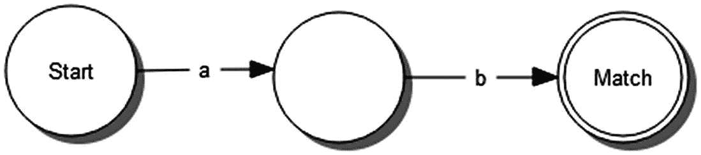
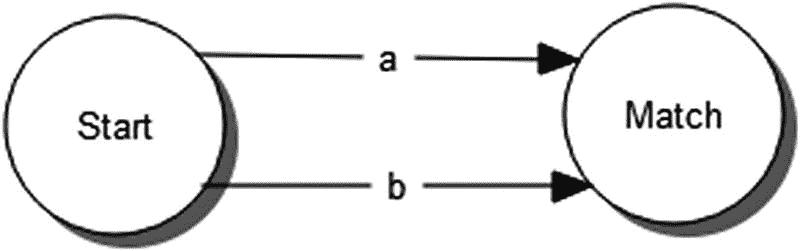
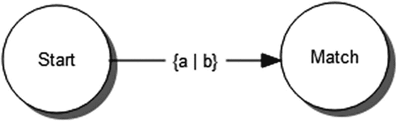
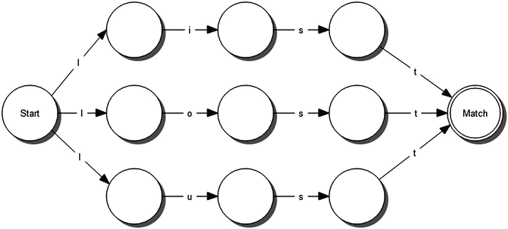
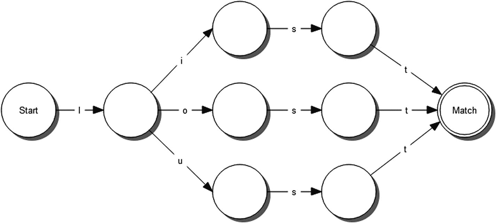
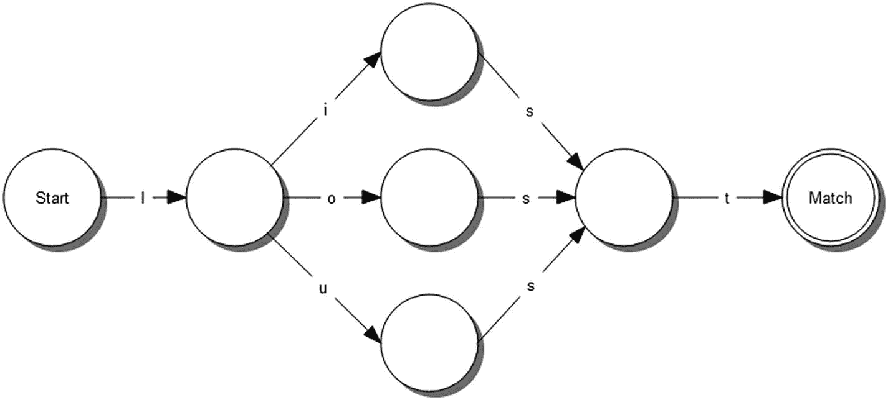

# 使用有限状态机可视化正则表达式执行

正则表达式会被转换成在虚拟机中执行的代码。这个虚拟机运行在宿主语言或编辑器的虚拟机上。

抽象模型有助于理解正则表达式是如何执行的。尽管这些模型常常忽略了正则引擎实现的优化技术，但它们仍然能为你提供关于正则表达式工作原理的宝贵信息。

## 正则表达式是有限状态机

可视化正则表达式最简单的方法就是使用有限状态机^(²⁵)。有限状态机（FSM）是一个有向无环图^(²⁶)，并且具有一个专门的初始状态和一个专门的结束状态。正则表达式的 FSM 表示如下：

-   边（箭头）代表我们从输入流中读取的字符。

-   节点代表正则表达式的内部状态。

例如，正则表达式 `/ab/` 可以用图 4-1 所示的有限状态机来表示。



**图 4-1** `/ab/`

`/ab/` 首先匹配字符 `a`，然后匹配字符 `b`。假设我们正在读取文本 `aabc`，并且想要判断这个字符串是否匹配正则表达式 `/ab/`。

我们在起始节点上放置一个令牌。

1.  读取第一个字符 `a` 之后，我们将令牌沿着标有 `a` 的箭头移动。令牌现在处于中间状态。

2.  读取第二个 `a` 之后，没有从中间状态出发的箭头；因此，我们回到起始状态。在这个状态下，我们再次尝试读取 `a`。由于从起始状态出发有一条 `a` 箭头，我们再次移动到中间状态。

3.  读取字符 `b` 之后，我们将令牌从中间状态移动到匹配状态。由于我们已到达匹配状态，因此该字符串*匹配*该正则表达式。

请注意，匹配是在没有读取序列中最后一个字符的情况下确定的。

正则表达式中的每个字符都是按顺序执行的一条指令。这些指令就是匹配任务。我们的目标是以任何可能的方式到达匹配节点。从确定匹配的角度来看，我们到达匹配状态的次数并不重要，只要至少到达一次即可。

## 回溯

在某些情况下，我们会卡在有限状态自动机的中间节点。为了避免卡住，我们可以通过使用*回溯*来继续执行。当你无法到达匹配节点，并且无法从某个节点移动到任何地方时，就会发生回溯。

*当我们在有限状态自动机中回溯时，我们会沿着边向后移动，直到到达一个具有我们尚未尝试过的向前方向的边节点。* 如果你曾经读过一本“战斗幻想”游戏书（例如，探索死亡陷阱地牢的那本），你可能会记得你是如何从迷宫的一条路径回溯到另一条路径的。正则表达式中的情况也是如此。

当你向前移动时，你会标记你走过的边。当你向后移动时，你只会尝试那些你之前没有标记过的边。

在沿着边向后移动时，我们也会将指向输入字符串下一个字符的插入符号向后移动，从而*取消读取*该边上的字符。

回溯的一种特殊形式是我们回到起始节点的情况。在这种情况下，我们还有另一种方法可用：将输入字符串中的一个字符向前移动，并尝试开始一个新的匹配。

例如，当用正则表达式 `/aa/` 匹配字符串 `"abaa"` 时，我们首先读取字符 `a`。然后我们回溯，因为在第一个字符之后我们无法向前移动。回溯之后，我们将插入符号向前移动，留下字符串 `"baa"` 与 `/aa/` 匹配。由于无法将字符 `b` 与 `a` 匹配，我们再次向前移动插入符号。现在我们有了字符串 `"aa"` 与 `/aa/` 进行匹配。这个匹配显然会成功，无需进一步回溯。

为了更深入地理解回溯，让我们探索一下确定性和非确定性正则表达式建模之间的区别。

# 确定性与非确定性正则表达式建模

在大多数正则表达式方言中，`|`（管道符）表示`或`操作。在 EMACS 和 VIM 中，需要对管道符进行转义，得到 `\|` 操作符。在 BRE 中，不支持`或`操作。在所有其他方言中，`或`操作符就是普通的管道符。本章我们将采用后一种表示法。

`/a|b/` 是一个正则表达式，它匹配字符 `a` 或字符 `b`。此正则表达式的有限状态机表示如图 4-2 所示。


图 4-2 `/a|b/`

在实践中，正则表达式的实现可能会通过使用位掩码来表示一组可能的匹配，从而简化此自动机，如图 4-3 所示。


图 4-3 `/a|b/`

位掩码表示简化了图形，尤其是在复杂情况下。

让我们考虑一些更复杂的情况，在这些情况下，简化并不明显。

这是一个表达式，如图 4-4 所示：`/list|lost|lust/`。

最直观的自动机构造方式如下：我们针对`或`操作符的每个操作数进行分支，并尝试按顺序匹配字符。


图 4-4 `/list|lost|lust/`

在执行过程中，我们必须尝试每个分支。当一个分支失败时，我们进行回溯。例如，在序列 `lossless` 中，我们尝试以下步骤：
*   由于第一个字符是 `l`，我们尝试在所有三个分支中匹配它。
    *   在第一个分支上，我们检查第二个字符，它是 `o`。由于无法在此分支中前进，我们进行回溯。
*   在第二个分支上，第二个和第三个字符 `o` 和 `s` 都与后续箭头上的字符匹配。但是，第四个字符应该是 `t` 而不是 `s`，所以我们进行回溯。
*   在第三个分支上，我们检查第二个字符，它仍然是 `o`。因为我们需要 `u` 才能前进，所以我们进行回溯。
*   第二个、第三个和第四个字符与从*起始*节点出发的任何箭头都不匹配。
*   第五个字符又是 `l`。我们尝试在所有三个分支中匹配它。
    *   在第一个分支上，`e != i`，所以我们回溯。
    *   在第二个分支上，`e != o`，所以我们回溯。
    *   在第三个分支上，`e != u`，所以我们回溯。
*   其余字符（`e`、`s` 和 `s`）与从起始节点出发的任何边都不匹配。
*   由于没有更多字符需要读取，并且我们尚未到达*匹配*状态，因此返回失败。

每次当我们从同一个节点可以向多个方向移动时，我们就采取了一次非确定性操作。前面的自动机是一个*非确定性有限自动机*（`NFA^(²⁷)`）。

许多正则表达式解释器使用这种非确定性形式，而不考虑任何编译时优化。一些正则表达式解释器会多走一步，将非确定性边转换为确定性边。

首先，注意每个分支都以 `l` 开头。我们可以简单地只使用一条边来代替三条边，并推迟非确定性的出现，如图 4-5 所示。


图 4-5 `/l(ist|ost|ust)/`

其次，注意每个分支都以 `st` 结尾。我们可以使用一条边和一个状态来代替三个冗余的边和状态，如图 4-6 所示。


图 4-6 `l`，`I` 或 `o` 或 `u`，`s`，`t`

作为最后一步，我们应用一个位掩码来代替这三条边，其中字母通过`或`操作连接，如图 4-7 所示。


图 4-7 `l`，`{i, o, u}` 字符集，`s`，`t`

现在，我们将这个位掩码表示为 `{i|o|u}`。请这样理解：“从字符 `i`、`o`、`u` 中选择一个。”你将在本章后面了解这种语言结构。

更重要的是，结果图现在是一个 `DFA`，^(²⁸) 即确定性有限自动机。

非确定性形式更容易从正则表达式构建。如果输入长度为 `N`，则构建树需要 `O(N)` 步。作为交换，我们在执行时付出代价，因为最坏情况下的执行时间是 `O(2^N)`。

构建确定性自动机所需的步骤数量级为 `O(2^N)`。作为交换，执行成本是线性的。

在实践中，只要我们的正则表达式不是可重用的，我们倾向于满足于较慢的最坏情况执行时间。这是因为正则表达式可以非常快速地成功匹配。一旦找到匹配，执行就结束了。

因此，即使大多数正则表达式引擎都使用优化，非确定性形式通常也是有益的。

最后，注意我们最初的表达式是 `/list|lost|lust/`。如果我们从最终优化后的自动机反向工程出一个正则表达式，我们会得到 `/l(i|o|u)st/`。这种形式是纯确定性的。因此，我们可以得出结论，如果我们的正则表达式解释器倾向于以非确定性的方式执行正则表达式匹配，那么通过编写优化的正则表达式，我们可以节省宝贵的运行时间。即使解释器为我们进行了必要的优化，通过以优化形式编写正则表达式，我们仍然可以节省自动机构建时间。

这种好处通常是微不足道的，所以每当我在优化和可理解性之间做选择时，我倾向于可理解性。

如果你想了解更多关于优化技术的信息，请参考 `swtch.com`。^(²⁹)

# 基本的正则表达式简化

你已经看到，对于同一个正则表达式，非确定性自动机构建算法会产生两个完全不同的自动机。在上一节中，
*   `/list|lost|lust/` 产生了一个非确定性有限状态自动机。
*   `/l(i|o|u)st/` 产生了一个确定性自动机。

你已经知道第二种形式更高效。通常，除非出于语义原因需要提高正则表达式的可读性，否则我更喜欢第二种形式。

当匹配一个分支意味着另一个分支也被匹配时，同样的情况也适用。例如，在 `/lesson|less/` 或 `/less|lesson/` 中，匹配 `lesson` 意味着我们必须已经匹配了 `less`。

这是因为 `lesson` 以 `less` 开头。因此，我们可以将正则表达式简化为 `/less/`。

例如，当在 `lessom`（很可能是由于拼写错误而写出的无意义单词）上执行 `/lesson|less/` 时，我们首先尝试匹配 `lesson`，然后回溯，最终得出结论 `less` 被接受。虽然在小正则表达式中这没什么大不了的，但想象一个膨胀的正则表达式，如下所示：

```
/less(a|b|c|de(f|g)|o(a|b|c|...))|less/
```

在检查 `lessom` 时，我们可能会在第一个分支上浪费大量宝贵的执行时间，而这是毫无理由的。

我们可能在第一个分支上成功，例如，通过检查输入 `lessdeg`。然而，`lessdeg` 也能匹配 `less`，这意味着我们做了不必要的工作。正则表达式并非设计用于找到最短的匹配。它们被设计为返回执行序列中的第一个匹配。

# 成功的匹配比失败的匹配更廉价

你在前几节中已经看到，正则表达式成功匹配的速度往往比返回失败要快。这是因为失败意味着我们必须尝试所有可能的执行路径。

由于成功比失败更廉价，在设计正则表达式时，请始终为成功制定条件。失败往往会消耗更多资源。

# 自动生成正则表达式 FSM

将正则表达式可视化有助于你理解其工作原理以及如何进行简化。在你将正则表达式的执行模型牢记于心之前，可以随身携带一个笔记本，为你遇到的每个正则表达式构建一个有限状态机。如果你想节省时间，也可以使用一些在线服务。

## 在线工具

[`http://ivanzuzak.info/noam/webapps/fsm_simulator/`](http://ivanzuzak.info/noam/webapps/fsm_simulator/) 模拟了正则表达式匹配给定字符串的执行过程。它不仅为你创建自动机，还会逐字符展示匹配算法的执行过程。遗憾的是，这个自动机的语言受到限制，因为我们只能拼接字符串、使用*或*运算符，以及使用 Kleene（`*`）运算符来表示任意次数的重复。我们也可以使用括号进行分组。使用加号代替竖线有点不方便，因为在这个特殊方言中，加号表示可选执行，而不是“至少一次”的重复修饰符。虽然存在这种语义上的困难，但该软件会向你展示三种不同类型的简化自动机，可用于匹配字符串。本书中的结构已经非常接近 *eNFA* 结构。

[`http://ivanzuzak.info/noam/webapps/regex_simplifier/`](http://ivanzuzak.info/noam/webapps/regex_simplifier/) 向你展示了如何简化正则表达式。例如，包含单词 *list*、*lost* 和 *lust* 的表达式可以按如下方式简化：

```
输入: list+lost+lust
R1   list+lost+lust
规则 (ab+ac) => a(b+c)
R2   l(ist+ost)+lust
规则 (ab+ac) => a(b+c)
R3   l((ist+ost)+ust)
规则 (ab+cb) => (a+c)b
R4   l(((is+os)t)+ust)
规则 (a) => a
R5   l((is+os)t+ust)
规则 (ab+cb) => (a+c)b
R6   l(((is+os)+us)t)
规则 (ab+cb) => (a+c)b
R7   l((((i+o)s)+us)t)
规则 (a) => a
R8   l(((i+o)s+us)t)
规则 (ab+cb) => (a+c)b
R9   l((((i+o)+u)s)t)
规则 ab(cd) => abcd
R10  l(((i+o)+u)s)t
规则 ab(cd) => abcd
R11  l((i+o)+u)st
规则 (a+(b+c)) => a+b+c
R12  l(i+o+u)st
```

[`https://regexper.com/`](https://regexper.com/) 可以根据 JavaScript 正则表达式构建执行图。例如，在线查看一个复杂 JavaScript 正则表达式的表示。如果你研究这张图，就可以轻松反向推断出每个元字符的含义。如果这个正则表达式让你感到畏惧，别担心，因为我们大家阅读像这样的表达式时都会遇到困难。

这种图形化表示与有限状态自动机关系不大，因为在 regexper 的图中，边不消耗字符。在这张图中，节点消耗字符，而边可以以非确定性的方式被选中。还要注意，边可能有条件，例如 *1..3 次* 或 *1+ 次*。这些边的 FSM 表示可能完全不同。这是为了便于理解而做的简化。

[`https://www.debuggex.com/`](https://www.debuggex.com/) 使用与 regexper 相同的格式，其界面可以帮助你可视化正则表达式如何逐字符匹配字符串。你可以使用 JavaScript、Python 和通用的 PCRE 语法。

[`https://regexr.com/`](https://regexr.com/) 为你提供 JavaScript 以及通用 PCRE 语法的文字说明和速查表。

[`https://regex101.com/`](https://regex101.com/) 是另一个用于测试正则表达式是否匹配字符串的便捷工具。PCRE (PHP)、JavaScript、Python 和 GoLang 都可用。该工具还可以为 C#、Java、Ruby、Rust 和 Perl 5 生成代码。

[`http://qfsm.sourceforge.net/download.html`](http://qfsm.sourceforge.net/download.html) 是我最喜欢的有限状态机设计工具。你可以方便地可视化和模拟有限状态机。

# 总结

在本章中，你学习了使用有限状态机可视化简单正则表达式执行的基础知识。我们得出结论，状态机的执行可以是确定性的，也可以是非确定性的，这取决于正则表达式被简化的方式。

确定性执行可以使用确定性有限自动机进行可视化。构建这个自动机的代价较高，但在执行时间上，判断正则表达式是否匹配字符串的代价较低。

非确定性执行可以使用非确定性有限自动机进行可视化。构建这个自动机的代价较低，但在执行时间上，判断正则表达式是否匹配字符串的代价较高。

由于在运行时，成功总是比失败更廉价，我们倾向于使用非确定性执行，以避免在优化上浪费过多时间。

在本章结束时，我们讨论了一些优化正则表达式的简单思路，以及一些用于可视化、测试、简化或调试正则表达式的工具。

到目前为止，你仅使用了正则表达式的一个有限子集。在下一章中，你将用重复修饰符来扩展这个子集。

脚注
