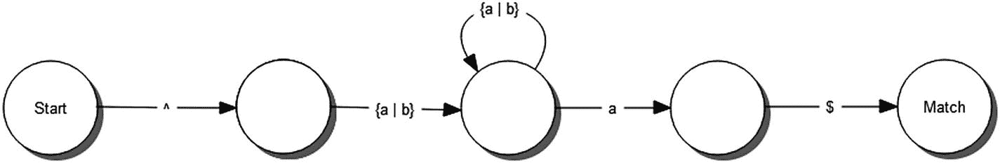
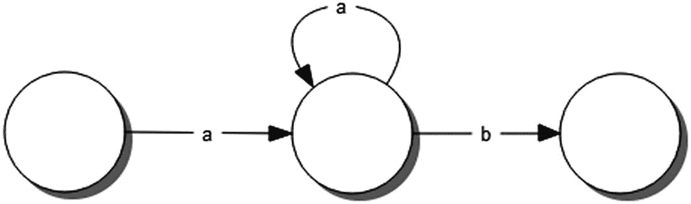
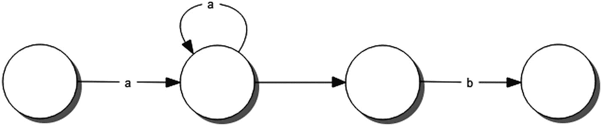
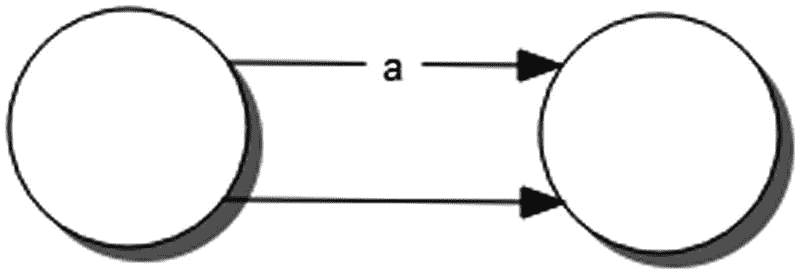
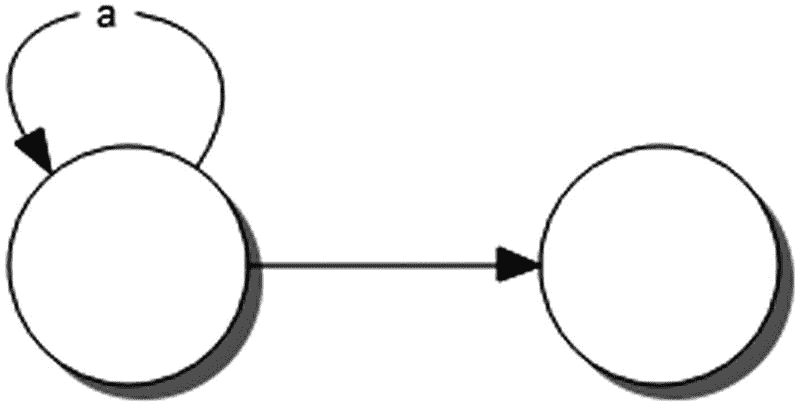
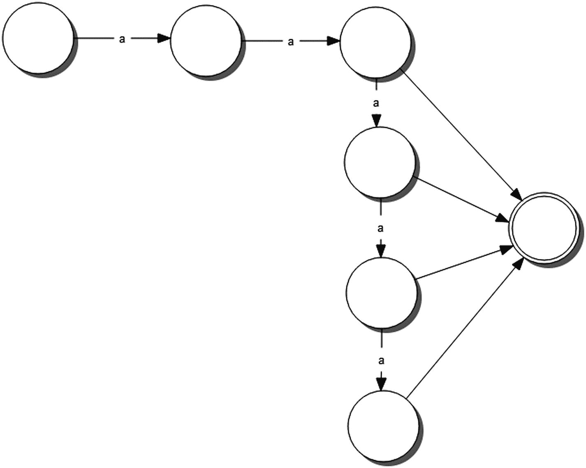
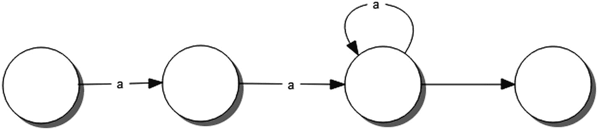
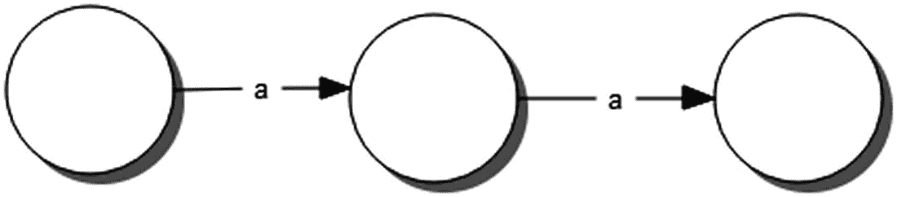

# 5. 重复修饰符

在第 1 章中，我解释过正则表达式是命令式的。命令式语言带有控制结构。在使用编程语言开发软件时，我们使用以下控制结构：

*   `分支`：在大多数编程语言中，我们使用 `if` 语句和 `switch` 语句。在正则表达式中，我们使用元语法字符 `|` 或字符集来实现分支。`|` 结构大致对应于 `if-else` 结构，而字符集大致对应于 `switch` 语句。字符集的一个例子是 `[ab]`。可以将其理解为 `a|b`。换句话说，选择 `a` 或 `b`。

*   `循环`：在大多数编程语言中，我们使用诸如 `for` 循环或 `while` 循环这样的结构。`重复修饰符` 类似于正则表达式中的循环结构。

表 5-1 描述了可供使用的重复修饰符。

`表 5-1 重复修饰符`

| 重复修饰符 (PCRE) | 描述 |
| --- | --- |
| `+` | 至少匹配一次 |
| `?` | 最多匹配一次 |
| `*` | 匹配任意次数 |
| `{min,max}` | 至少匹配 `min` 次，最多匹配 `max` 次 |
| `{n}` | 精确匹配 `n` 次 |

表 5-1 仅展示了 PCRE 语法。在其他方言中存在一些差异。我们将在每个重复修饰符的描述中处理这些差异。

# 回溯

在执行匹配时，我们可以匹配一个字符、一个字符集或一个字符序列。以下是一些示例：
- `ab+` 匹配一个 `a`，然后至少一个 `b`。匹配的字符串有 `ab`、`abb`、`abbb`，以此类推。
- `[ab]+` 匹配任意数量的 `a` 或 `b` 字符，顺序不限，前提是匹配的序列至少有一个字符长。匹配的字符串有 `a`、`b`、`aa`、`ab`、`ba`、`bb`、`aaa`、`aab`，以此类推。
- `(ab)+` 匹配至少一个 `ab` 序列。匹配的字符串有 `ab`、`abab`、`ababab`，以此类推。

在大多数编程语言中，我们使用循环进行迭代。我们通常会按固定次数执行循环，并在执行过程中向前推进。这正是正则表达式与其他语言的不同之处。正则表达式的重复修饰符可能会“解循环”。这种解循环的过程被称为回溯。

只要正则表达式存在一定程度的不确定性，就可能发生回溯。不确定性是由替代执行和重复修饰符引起的。很容易看出，选择和迭代在本质上是相似的。例如，重复修饰符 `a+` 只不过是一个无限序列。

```
a|aa|aaa|aaaa|aaaaa|...
```

例如，在 JavaScript 中，假设我们要将字符串 `aa` 与正则表达式 `/^[ab]+a$/` 进行匹配。

```
> /^[ab]+a$/.test( 'aa' )
true
```

此匹配返回 `true`，但其执行过程却很有趣，如图 5-1 所示。



图 5-1 不确定性有限状态机中的回溯

请注意，`^` 和 `$` 状态转换不会从字符串中读取任何字符，但它们会固定字符串解析的起始位置。固定的起始锚点和结束锚点守护着匹配状态，因此必须解析整个字符串。

假设你有一个令牌，你可以在自动机的各个状态之间移动它，以匹配之前的正则表达式。

从 `start` 状态开始，`^` 锚点允许我们在字符串的开头通过，到达第一个中间状态。然后我们消费一个 `a` 字符，移动到中间状态。假设我们使用标签为 `{a|b}` 的循环来消费第二个 `a` 字符并停留在同一状态。在消费第二个 `a` 字符后，我们的字符串结束，并且我们没有处于 `match` 状态。

因此，我们必须回溯，将 `[ab]+` 重复修饰符解循环一次。然后我们通过另一条箭头消费第二个 `a` 字符，将我们移动到自动机的最后一个中间状态。由于离开此状态的唯一箭头是 `$`，我们必须检查是否已到达字符串的末尾。是的，我们已经到达，因此我们成功到达了 `match` 状态。

让我们更深入地研究每个重复修饰符。

## 至少匹配一次

在 BRE 中，我们必须使用 `*` 来表示 `+` 重复修饰符。`a+` 变成 `aa*`。换句话说，匹配一个 `a` 字符并且至少再匹配零个 `a` 字符，等同于至少匹配一个 `a` 字符。

在 EMACS 和 VIM 中，你必须转义 `+` 运算符。`a+` 变成 `a\+`。在所有其他方言中，我们使用以下方式：
- `a+` 表示至少匹配一次 `a` 字符
- `[ab]+` 表示至少匹配一次 `a` 或 `b` 字符
- `(ab)+` 表示至少匹配一次 `ab` 序列

属于 `a+` 的有限状态机如图 5-2 所示。


图 5-2 `/a+/`

我们首先匹配一个 `a` 字符，然后匹配任意数量的 `a` 字符。下一个循环可能是一个空转换，或者我们可以通过匹配下一个字符来简化自动机。

例如，我们可以为正则表达式 `/a+b/` 构建两个不同的自动机，如图 5-3 和图 5-4 所示。



图 5-4 不带空箭头的 `/a+b/`



图 5-3 带空箭头的 `/a+b/`

这两个自动机是等价的，前提是我们可以在不读取任何字符的情况下，沿着空箭头自由前进。

让我们在表 5-2 中总结不同方言的至少一次循环。

表 5-2 至少一次循环

| 方言 | 至少一次循环的标记法 |
| --- | --- |
| BRE | 无；使用 `aa*` |
| ERE、PCRE、Perl 6 | `a+` |
| EMACS、VIM | `a\+` |

## 至多匹配一次：可选匹配

BRE 不支持可选匹配。在 EMACS 和 VIM 中，可选匹配必须转义。在其他方言中，可选匹配的写法与至少一次元字符相同：
- `a?` 表示至多匹配一次 `a` 字符
- `[ab]?` 表示至多匹配一次 `a` 或 `b` 字符
- `(ab)?` 表示至多匹配一次 `ab` 序列

可选匹配之所以称为可选匹配，是因为我们可以匹配它一次，或者根本不匹配。

属于可选匹配 `a?` 的有限状态机如图 5-5 所示。



图 5-5 `/a?/`

请注意空箭头。当选择底部路径时，不会从我们尝试匹配的字符串中消耗任何字符。

## 匹配任意次数

此运算符在所有方言中均可使用，无需转义。表达式 `a*` 在所有方言中看起来相同，匹配任意长度的 `a` 字符序列，包括空字符串。其匹配的有限状态机形式很简单，如图 5-6 所示。



图 5-6 `/a*/`

括号和方括号的使用方式与 `+` 和 `?` 运算符相同。
- `a*` 表示匹配任意数量的 `a` 字符。
- `[ab]*` 表示匹配任意次数的 `a` 或 `b` 字符。
- `(ab)*` 表示匹配任意次数的 `ab` 序列。

别忘了在 EMACS 和 VIM 中使用 `\(` 和 `\)` 对括号进行转义。

# 固定范围匹配

假设我们想匹配至少出现两次、至多出现五次的字符 `a`。不同的正则方言对此有不同的实现方式，如表 5-3 所示。

表 5-3：匹配字符 `a` 至少两次，至多五次

| 方言 | 表示法 |
| --- | --- |
| `BRE`, `EMACS` | `/a\{2,5\}/` |
| `VIM` | `/a\{2,5}/` |
| `ERE`, `PCRE` | `/a{2,5}/` |
| `Perl 6` | `/ a ** 2..5 /` |

在大多数编程语言中，我们使用 `PCRE` 方言：`/a{2,5}/`。请根据你自己的使用场景来关注。

有限状态机的形式看起来比较冗长，因为我们需要展开每一种可能。匹配二到五次意味着我们必须为匹配两次、三次、四次和五次分别构建一条路径，如图 5-7 所示。



图 5-7：`/a{2,5}/`

在实践中，大多数正则引擎将这个重复修饰符表示为 `*`（星号）。星号被解释为*任意次数*的匹配，并使用内部计数器来满足所需条件。

请注意，可以省略范围的最大值。要匹配至少两个 `a` 字符，你必须使用表 5-4 中所示的表示法。

表 5-4：匹配至少两个 `a` 字符

| 方言 | 表示法 |
| --- | --- |
| `BRE`, `EMACS` | `/a\{2,\}/` |
| `VIM` | `/a\{2,}/` |
| `ERE`, `PCRE` | `/a{2,}/` |
| `Perl 6` | `/ a ** 2..* /` |

注意，除了 `Perl 6` 之外，所有方言中最大值都被简单地省略了，而在 `Perl 6` 中，`*` 表示任意值。

`/a{2,}/` 的有限状态机形式比属于有界重复修饰符的 FSM 要简单得多。事实上，这个机器等价于表达式 `/aaa*/` 的 FSM，如图 5-8 所示。



图 5-8：`/a{2,}/`

理论上，上限是无界的。在实践中，这个上限取决于正则虚拟机的实现。上限限制可能是一个像 `256` 这样的低数值。在其他语言中，这个值是 `32767`，这比 2 字节无符号整数的最大值小一。在使用具有较大上限的正则表达式时要小心。

另外请注意，在某些语言（如 `Python`）中，实际最大限制是无穷大，但如果这个限制太大，你可能会很容易遇到溢出错误。

## 精确循环 `n` 次

让我们看看所有方言中表达式 `/aa/` 的简写形式，如表 5-5 所示。

表 5-5：`/aa/` 的简写形式

| 方言 | 表示法 |
| --- | --- |
| `BRE`, `EMACS` | `/a\{2\}/` |
| `VIM` | `/a\{2}/` |
| `ERE`, `PCRE` | `/a{2}/` |
| `Perl 6` | `/ a ** 2 /` |

这意味着我们精确地循环两次字符 `a`。当有一个复杂的表达式而不是 `a`，或者重复次数远大于 `2` 时，这个简写形式实际上比原版 `/aa/` 更简洁。

属于这个循环的有限状态机非常简单，如图 5-9 所示。



图 5-9：`/aa/`

如你所见，该状态机匹配了 `/aa/` 的 FSM。

## 贪婪重复修饰符

你已经在表 5-1 中看到了贪婪重复修饰符的元字符。

所有这类重复修饰符默认都是*贪婪*的。这意味着重复修饰符会从匹配字符串中消耗尽可能多的字符，然后逐字符回溯。

举一个极端的例子，假设我们使用正则表达式 `/^.*list$/` 来匹配字符串 `'The lost list'`。

由于 `*` 重复修饰符是贪婪的，`.*` 首先会消耗整个字符串，然后发现我们处于字符串末尾，并且还需要匹配字符 `l`。匹配失败时，我们进行回溯。

重复修饰符以贪婪的方式消耗字符，并尽可能少地回溯。因此，我们只回溯一个字符。回溯后，`.*` 匹配 `The lost lis`，下一个要消耗的字符是 `t`。由于 `t` 不等于 `l`，我们再次回溯。

现在 `.*` 变成 `The lost li`，我们尝试将 `s` 与 `l` 匹配。这行不通，所以继续回溯。

现在 `.*` 变成 `The lost l`，我们尝试将 `i` 与 `l` 匹配。这行不通，所以继续回溯。

现在 `.*` 变成 `The lost` ，我们尝试将 `l` 与 `l` 匹配。这次匹配成功，所以我们继续用正则表达式模式的剩余部分匹配字符串的剩余部分。由于我们成功匹配了整个字符串并到达了末尾，我们成功退出正则匹配。

在这个例子中，我们只回溯了四次。但想象一下，如果我们有数兆字节的文本，一个 `.*` 结构可能会在评估正则表达式剩余部分之前读取整个文件。因此，使用 `.*` 之类的结构要格外小心。几乎总有一种更优的方式来描述一个模式。

引入回溯是因为我们的状态机是非确定性的。在 `/^.*list$/` 中，每一步，只要我们处于 `.*` 循环中并且即将遇到一个 `l` 字符，我们就必须决定是匹配一个 `.` 字符还是匹配一个 `l`。正是这种非确定性导致了回溯。

对抗回溯的一种方法是使非确定性状态机变得确定。这可能需要对输入的大小执行指数级别的步骤。只有极少数正则虚拟机会这样做，因为这种努力通常得不偿失。

另一种解决方案是使用按照不同策略进行匹配和回溯的循环。

# 懒惰重复修饰符

你已经看到贪婪有时会导致性能不佳。但你尚未了解的是贪婪与正确性之间的关系。贪婪有时会导致错误的结果。

例如，假设你想在 JavaScript 中创建一个全局正则表达式，用于匹配西班牙语文本中的*所有*问句。在西班牙语中，问句的语法如下：

```
¿?
```

假设文本中没有换行符，那么使用以下正则表达式来匹配一个句子是合理的：

```
let regex = /¿.+\?/g
```

让我们在几个问句上测试这个正则表达式。

```
let text = '¿Tienes animals en casa? ¿Dónde está la biblioteca?';
> text.match( regex );
["¿Tienes animals en casa? ¿Dónde está la biblioteca?"]
```

哎呀，好像哪里不对劲。两个问句被作为一个结果返回了。为什么呢？

这是因为我们的 `.+` 重复修饰符是贪婪的！`.+` 并不关心后面会出现 `\?` 字符。我们把问号当成了一个任意字符。

正因如此，大多数方言中的重复修饰符都提供了*懒惰*版本。

懒惰重复修饰符会匹配*最少*的、绝对必要的字符，即尽可能少地执行重复修饰符主体中的内容。当表达式匹配失败而需要回溯时，我们不再是移除字符，而是添加字符。

懒惰重复修饰符的语法如下：在 EMACS、PCRE 和 Perl 6 中，我们只需在重复修饰符后面加上一个问号（`?`）。

* `a*?` 匹配零个或多个 `a` 字符，并尝试尽可能少地匹配 `a` 字符。
* `a+?` 匹配一个或多个 `a` 字符，并尝试尽可能少地匹配 `a` 字符。
* `a??` 匹配零个或一个 `a` 字符，首先尝试不匹配 `a` 字符。
* `a{1,2}?` 尝试匹配一次或两次 `a` 字符，首先尝试匹配一次。在 Perl 6 中，等效的语法是 `a **? 1..2`。

让我们来看看 JavaScript 的例子：

```
let regex = /¿.+?\?/g
let text = '¿Tienes animals en casa? ¿Dónde está la biblioteca?';
text.match( regex );
```

返回值正确地匹配了两个句子。

```
(2) ["¿Tienes animals en casa?", "¿Dónde está la biblioteca?"]
```

请注意，无论你是想使用贪婪还是懒惰的重复修饰符，限制搜索空间都是有意义的。我们可以将重复修饰符后面的第一个字符，排除在重复序列内部可能出现的第一个字符之外。这意味着我们最好将 `\?` 字符从任意的 `.` 字符类中排除掉。我们可以通过定义 `[^\?]` 字符集来实现排除。可以将其理解为“除了问号之外的任意字符”。

```
regex = /¿[^\?]+\?/g;
> text.match( regex )
(2) ["¿Tienes animals en casa?", "¿Dónde está la biblioteca?"]
```

### 提示

始终尝试让重复修饰符主体内部序列的第一个字符与重复修饰符之后的第一个字符互斥，以避免非确定性分支和回溯。

现在，我们得到了两个独立的句子，作为全局正则表达式的两个单独匹配。为了进一步练习懒惰重复修饰符，让我们用 `/^.*?list$/` 来匹配文本 `The lost list`。

* `.*` 匹配了 `The`，然后我们尝试在 `lost list` 上匹配 `list$`。我们确实从字符串中消耗了 `l`，但紧接着字母 `o` 与模式中的 `i` 不匹配，因此我们回溯。
* `.*` 匹配了 `The lost`。现在我们尝试用 `list` 来匹配 `list$` 模式。匹配成功。不再需要回溯。

在这个例子中，结果是一样的，但回溯操作的次数更少。

你可能会问，什么时候值得使用懒惰重复修饰符，什么时候值得使用贪婪重复修饰符？答案并不显而易见。

* 你可能出于正确性考虑而选择使用其中一种。例如，西班牙语问句的例子。每当需要匹配一个有开始标志和结束标志、且表达式可能不会嵌套的模式时，使用最小化循环是正确的。
* 当正确性无关紧要时，你有时可以凭直觉判断使用哪种模式。请记住，匹配成功总是比匹配失败更省时；因此，值得为更快的匹配进行优化。

## 占有重复修饰符

占有重复修饰符的执行方式与贪婪重复修饰符相同，但有一个例外：一旦占有结构回溯，它就会失败。占有重复修饰符不是仅仅回溯一次迭代，而是完全放弃，撤销所有迭代。我们要么贪婪地匹配尽可能多的占有循环迭代，要么完全不匹配任何迭代。

占有重复修饰符在 PCRE 和 Perl 6 中可用。

在大多数 PCRE 语言中，我们在相应的贪婪重复修饰符符号后添加一个 `+` 来表示其为占有模式，从而产生 `a*+`、`a++`、`a?+`、`a{1,2}+` 这样的循环。

在 Perl 6 中，我们在重复修饰符后添加一个 `:`：`a*:`、`a+:`、`a?:`、`a **: 1..2`。

有些语言（如 JavaScript）没有占有重复修饰符。但仍然可以使用我们尚未了解的结构来模拟它们。写下这个表达式：`(?=(a+))\1`。一旦你了解了什么是正向先行断言以及捕获组是如何工作的，你可以验证表达式 `(?=(a+))\1` 等价于 `a++`，前提是该表达式前面没有其他左括号。不过，这种等价并不是完全严格的，因为引入了一个捕获组来构造占有重复修饰符。这个引入的捕获组可能会使其后面的其他捕获组的编号发生偏移。

*我鼓励你在 regex101.com 上尝试使用占有重复修饰符。* ^(³⁶) *如果你使用属于 PHP (PCRE) 语法的正则调试器，你可以看到逐步执行的匹配过程。*

例如，表达式 `/a++b/` 匹配任何包含序列 `ab` 的字符串。模式 `a++` 匹配 `a` 字符，然后匹配 `b`。

表达式 `/a++a/` 永远不会匹配任何字符串。这是因为 `a++` 是占有模式，它会在尝试匹配另一个 `a` 字符之前消耗掉所有 `a` 字符。由于永远找不到这个 `a` 字符，正则引擎会完全回溯并失败。与 `/a+a/` 不同，在 `/a++a/` 中我们不能只回溯一个字符。因此，没有任何字符串能匹配正则表达式 `/a++a/`。

根据经验法则，我们可以得出结论：我们试图在占有重复修饰符中匹配的序列的第一个字符，永远不能出现在该重复修饰符本身之后。否则，我们将永远无法得到匹配结果。

# 总结

大多数编程语言都实现了*顺序*、*选择*和*迭代*结构。虽然顺序和选择在正则表达式中显而易见，但迭代的方式却多种多样。你已经学会了迭代模式的五种基本方法。`+` 符号表示匹配一个字符或序列至少一次。`?` 符号表示最多匹配一次，而 `*` 符号表示匹配任意次数。我们还可以通过指定允许出现次数的**最小值**和**最大值**来制定基数限制。此外，我们还能将序列重复恰好指定的次数。

你还使用了 `[ab]` 这种记法来选择 `a` 字符*或* `b` 字符。我将在下一章通过引入*字符集*来扩展这一概念。

通用重复修饰符是**贪婪**的：它们会尝试匹配尽可能多的字符。*回溯*幅度是最小的；每次回溯尝试中，你只会从匹配到的字符串中移除一个字符。

你可以在重复修饰符的末尾添加一个 `?` 来获得**懒惰**重复修饰符，它会进行最小匹配，并在每次回溯后逐个增加匹配的字符数。

你可以在重复修饰符的末尾添加一个 `+` 来获得**占有**重复修饰符，它会进行最大匹配，并在任何回溯尝试中直接失败。

脚注 1
