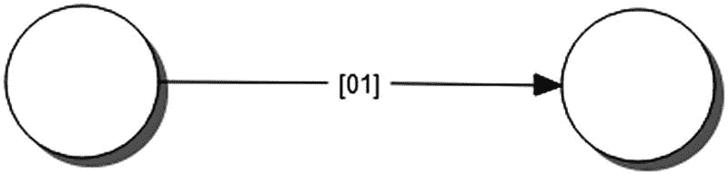

# 6. 字符集与字符类

前一章介绍了有限状态机，以使正则表达式更易于理解。在本章中，你将学习创建更复杂有限状态机所需的工具，以便使用正则表达式执行高级模式匹配任务。

我们将基于第 2 章的内容进行构建，假设你已经知道如何处理字面字符、连接、`或`运算符、点号字符、用括号进行的分组操作、锚定的开始和结束以及修饰符。

## 字符集

字符集匹配包含集合中任意字符的字符串。

在 Perl 6 中，字符集被列举在 `<[` 和 `]>` 之间。

在所有其他方言中，包括所有其他编程语言和文本编辑器，我们使用方括号：`[` 和 `]`。

包含至少一个二进制数字的字符串的字符集如下：

- 在 Perl 6 中：`/<[01]>/`
- 在所有其他方言中：`/[01]/`

表达式 `[01]` 匹配一个 `0` 或一个 `1` 字符。

由于我已经介绍了`或`运算符，很容易得出结论，上述字符集等价于以下内容：

- 在 EMACS 和 VIM 中：`/0\|1/`
- 在 ERE、Perl 6 和 PCRE（包括所有编程语言）中：`/0|1/`

正则表达式引擎倾向于使用位掩码构建集合的内部表示。因此，检查字符集通常与匹配单个字符一样高效。

在有限状态机表示中，连接两个状态的边只有一条，如图 6-1 所示。



图 6-1

`/[01]/`

我使用了 `[01]` 字符集记法来表示位掩码。

## 字符集范围

假设你的下一个任务是表示一个八进制数字和一个十六进制数字。在 PCRE 中，利用你已经掌握的知识，你可以使用以下语法：

- 对于八进制数字：`/[01234567]/`
- 对于十六进制数字：`/[0123456789abcdefABCDEF]/`

在大多数方言中，正则表达式允许你使用 `-` 字符来定义范围。只有 Perl 6 不同，你必须使用 `..` 字符。^(³⁷)

因此，八进制数字变成如下形式：

- 在 Perl 6 中：`/<[0..7]>/`
- 在所有其他方言中：`/[0-7]/`

范围 `0-7` 等价于 `01234567`。

乍一看，编写十六进制数字的任务似乎稍微复杂一些。编写 `/[0-9]|[a-f]|[A-F]/` 是完全有效的，但语法看起来过于复杂。

回顾范围与其枚举的等价关系，我们可以得出以下结论：

- `0123456789` 等价于 `0-9`。
- `abcdef` 等价于 `a-f`。
- `ABCDEF` 等价于 `A-F`。

因此，`0123456789abcdefABCDEF` 等价于 `0-9a-fA-F`。所以，十六进制数字变成如下形式：

- 在 Perl 6 中：`/<[0..9a..fA..F]>/`
- 在所有其他方言中：`/[0-9a-fA-F]/`

## 字符集的排除

你已经看到，在大多数正则表达式解释器中，字符集是由位掩码表示的。现在你将了解如何反转这些位。

在 Perl 6 中，在左括号前放置一个 `-` 会反转字符集。这个减号元字符也可以用在字符集类前面。更多关于字符类的细节，请参见下一节。

在所有其他方言中，反转字符是 `^` 运算符，它被放置在括号内、字符枚举、范围或类的前面。

例如，不是十六进制数字的字符定义如下：

- 在 Perl 6 中：`/<-[0..9a..fA..F]>/`
- 在所有其他方言中：`/[⁰-9a-fA-F]/`

# 字符集类

好消息是，正则表达式方言允许我们指定字符集类，例如数字、空白字符或字母数字字符。坏消息是每种方言的实现方式各不相同。

例如，PHP 文档列举了 PHP 中可用的字符类。

这简化了源自字符集范围的十六进制字符示例，使其变为 `/[[:xdigit:]]/`。请注意双层方括号。外层方括号表示我们定义了一个字符集。内层方括号属于命名字符类语法。

一条经验法则是：始终使用命名字符类，而不是范围和枚举，因为命名类能使表达式在未来更易于阅读和维护。

## 练习 1

编写 PHP 代码，将字符串 `'Aa5h'` 与字符集类表达式 `/[[:xdigit:]]/` 进行匹配。使用 `https://regex101.com` 生成的输出来确定结果。你可以通过服务 `www.writephponline.com/` 在线运行代码。

**解法：**

```
$re = '/[[:xdigit:]]/';
$str = 'Aa5h';
preg_match_all($re, $str, $matches, PREG_SET_ORDER, 0);
// 打印整个匹配结果
var_dump($matches);
```

执行后，我们得到以下响应：

```
array(3) {
[0]=> array(1) { [0]=> string(1) "A" }
[1]=> array(1) { [0]=> string(1) "a" }
[2]=> array(1) { [0]=> string(1) "5" }
}
```

这意味着正则表达式成功匹配了大写和小写的字母数字，以及数字。由于 `h` 不是十六进制数字，因此没有返回匹配结果。

## 练习 2

编写一个 Perl 6 的正则表达式，检查字符串是否包含十六进制字符，其中字母数字只能是大写形式。查阅 Perl 6 文档，研究如何在 Perl 6 中编写正则表达式，并使用服务 `tio.run` 执行代码。

**解法：**

根据文档，代码如下所示：

```
if 'XXaAXX' ~~ m// {
say "匹配到的字符：" ~ $/;
say "匹配前的字符串：" ~ $/.prematch;
say "匹配后的字符串：" ~ $/.postmatch;
say "匹配开始索引：" ~ $/.from;
say "匹配结束索引：" ~ $/.to;
}
```

我们将使用测试字符串 `'xxaAXX'`，并期望我们的正则表达式只匹配索引 3 处的大写 `A` 字符，而不匹配索引 2 处的小写 `a` 字符。

正则表达式 `/<+xdigit -lower>/` 定义了一个字符集，包含所有十六进制字符并排除小写字母。我本可以使用缩写 `:Ll` 来表示 `lower` 类。这样正则表达式会变为 `/\+xdigit -:Ll/`。

条件的语法与文档中的等价，只是消息更加详细。使用 `tio.run` 执行代码后，我们得到以下输出：

```
匹配到的字符：A
匹配前的字符串：XXa
匹配后的字符串：XX
匹配开始索引：3
匹配结束索引：4
```

每种编程语言都有其字符类的文档。我们在 Perl 6 的例子中看到，某些语言有冗余的表示法，具体来说，一种是更具语义性的（`lower`），另一种是更简短的（`Ll`）。

在 JavaScript 中，字符类是转义序列。有关更多详细信息，请参阅 `developer.mozilla.org` 上的文档。

## 练习 3

在 JavaScript 中表述 Perl 6 正则表达式 `/<+xdigit -lower>/`。

**解法：**

JavaScript 没有十六进制数字类。因此，我们将简单地使用十进制数字类 `\d` 和范围 `A-F`。

得到的正则表达式是 `/[\dA-F]/`。

请始终查阅文档以了解准确的类名，因为它们在每种语言中都不同。一些经验法则仍然适用，例如：

*   `\d` 表示一个数字（`[0-9]`）。
*   `\D` 表示一个非数字字符（`[⁰-9]`）。
*   `\s` 表示空白字符（在 EMACS 中为 `\s-`；`[\t\r\n\f]`）。
*   `\S` 表示一个非空白字符（在 EMACS 中为 `\S-`；`[ ^\t\r\n\f]`）。
*   `\w` 表示通常用于标识符的字符（`[0-9a-zA-Z_]`）。
*   `\W` 表示一个非标识符字符。

# 连接高级语言结构

我们已经介绍了一些连接正则表达式字符的基本用例。例如，表达式 `/re/` 意味着我们必须依次匹配字符 `r` 和字符 `e`。

连接适用于任何正则子表达式。因此，表达式

```
/\d.[^a-z][^a-z]/
```

在 PCRE 中是有效的。它匹配四个字符：一个数字、一个任意字符和两个非小写字母的字符。

特殊字符需要特别注意。假设我们想要搜索表达式 `[(1+2)*3]²`。如果我们在 JavaScript Chrome 开发者工具中，将字符串 `'[(1+2)*3]²'` 与正则表达式 `/[(1+2)*3]²/` 进行匹配，注定会失败。

```
> '[(1+2)*3]²'.match( /[(1+2)*3]²/ )
null
```

原因是我们必须转义所有特殊字符。

```
'[(1+2)*3]²'.match( /\[\(1\+2\)\*3\]\²/ )
["[(1+2)*3]²", index: 0, input: "[(1+2)*3]²"]
```

如果我错了请纠正我，但转义似乎毫无可读性。某些语言如 Perl 和 PHP 提供了特殊字符 `\Q` 和 `\E`，用于写入未转义的任意字符。凡写在 `\Q` 和 `\E` 之间的内容，都将按顺序逐个字符进行匹配。

例如，PHP 实现如下所示：

```
$re = '/\Q[(1+2)*3]²\E/';
$str = '[(1+2)*3]²';
preg_match_all($re, $str, $matches, PREG_SET_ORDER, 0);
// 打印整个匹配结果
var_dump($matches);
```

输出如下：

```
array(1) { [0]=> array(1) { [0]=> string(11) "[(1+2)*3]²" } }
```

由于 JavaScript 中没有此功能，我们有以下选项：

*   使用扩展库，例如 `xregexp`。

*   使用能自动完成繁琐工作的转义函数。

以下是一个示例（你可以在网上找到）：

```
RegExp.escape = function(text) {
return text.replace(/[-[\]{}()*+?.,\\^$|#\s]/g, "\\$&");
}
```

# 总结

在本章中，你学习了使用正则表达式语法中一些更高级的元素。

* 字符集

* 字符集范围

* 字符集排除

* 字符集类

我以一些使用你已经了解的语言结构连接正则子字符串的示例结束了本章。
