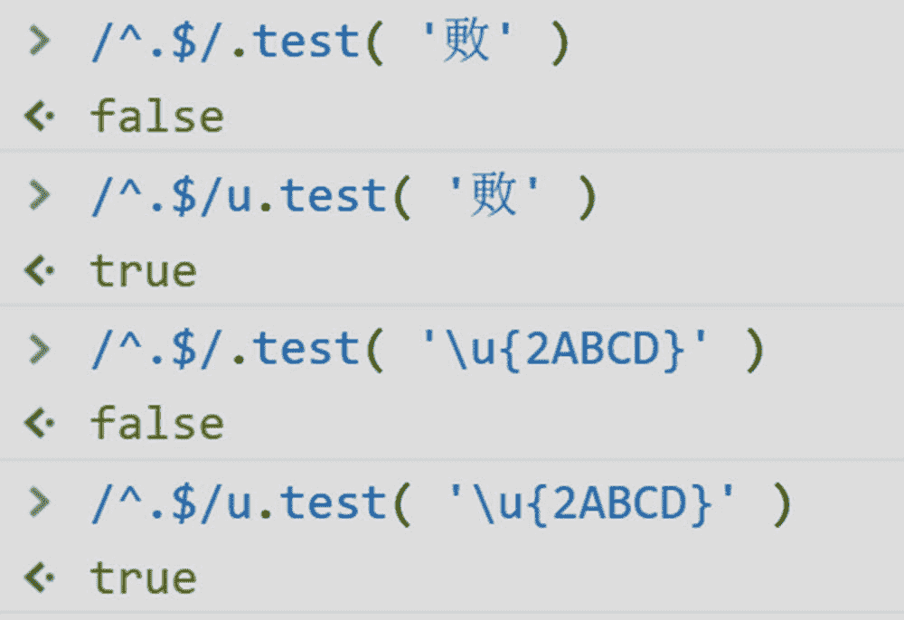

# ES6 Unicode 正则表达式

在 ES6 中，你可以指定要匹配的 Unicode 字符。一个 Unicode 字符会被视为一个字符，无论该字符占用多少个字节。

```
> 'x'.codePointAt( 0 ).toString( 16 )
"78"
```

字符 `x` 的十六进制代码是 `78`。在 JavaScript 中对应的 Unicode 字符是 `\u{78}`。然而，包含此 Unicode 字符的正则表达式却无法匹配该字符本身。

```
> /\u{78}/.test( 'x' )
false
```

这就是为什么你需要 `u` 标志。

```
> /\u{78}/u.test( 'x' )
true
```

Unicode 字符的另一个问题是它们所占的字节数可能不同。例如，`'\u{2ABCD}'` 是一个无法用 4 个字节表示的 Unicode 字符。

让我们构建一个正则表达式，检查相应字符串是否恰好包含一个字符。你可以使用任意字符符号 `.` 来实现。你可以指定字符串以此字符开头，以此字符结尾，并且中间没有其他内容：`/^.$/`。

让我们测试在什么条件下字符串 `'\u{2ABCD}'` 能匹配这个正则表达式：`/^.$/`。由于本书无法处理较长的 Unicode 字符，我将同时提供截图（见图 3-1）和代码。代码中的 Unicode 字符将显示为一个矩形。



图 3-1 JavaScript 正则表达式的 Unicode 标志

```
> /^.$/.test( '▯' )
false
> /^.$/u.test( '▯' )
true
> /^.$/.test( '\u{2ABCD}' )
false
> /^.$/u.test( '\u{2ABCD}' )
true
```

我们可以得出结论，旧版 JavaScript 正则引擎将 `'\u{2ABCD}'` 解释为两个字符的序列。然而，使用 `u` 标志后，这个长的 Unicode 字符会被识别为单个字符。

