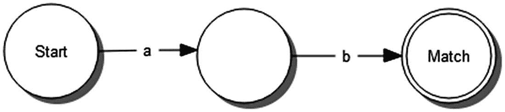

# 使用有限状态机可视化正则表达式执行

正则表达式会被转换成在虚拟机中执行的代码。这个虚拟机运行在宿主语言或编辑器的虚拟机上。

抽象模型有助于理解正则表达式是如何执行的。尽管这些模型常常忽略了正则引擎实现的优化技术，但它们仍然能为你提供关于正则表达式工作原理的宝贵信息。

## 正则表达式是有限状态机

可视化正则表达式最简单的方法就是使用有限状态机^(²⁵)。有限状态机（FSM）是一个有向无环图^(²⁶)，并且具有一个专门的初始状态和一个专门的结束状态。正则表达式的 FSM 表示如下：

-   边（箭头）代表我们从输入流中读取的字符。
-   节点代表正则表达式的内部状态。

例如，正则表达式 `/ab/` 可以用图 4-1 所示的有限状态机来表示。

**图 4-1** `/ab/`

`/ab/` 首先匹配字符 `a`，然后匹配字符 `b`。假设我们正在读取文本 `aabc`，并且想要判断这个字符串是否匹配正则表达式 `/ab/`。

我们在起始节点上放置一个令牌。

1.  读取第一个字符 `a` 之后，我们将令牌沿着标有 `a` 的箭头移动。令牌现在处于中间状态。
2.  读取第二个 `a` 之后，没有从中间状态出发的箭头；因此，我们回到起始状态。在这个状态下，我们再次尝试读取 `a`。由于从起始状态出发有一条 `a` 箭头，我们再次移动到中间状态。
3.  读取字符 `b` 之后，我们将令牌从中间状态移动到匹配状态。由于我们已到达匹配状态，因此该字符串*匹配*该正则表达式。

请注意，匹配是在没有读取序列中最后一个字符的情况下确定的。

正则表达式中的每个字符都是按顺序执行的一条指令。这些指令就是匹配任务。我们的目标是以任何可能的方式到达匹配节点。从确定匹配的角度来看，我们到达匹配状态的次数并不重要，只要至少到达一次即可。

## 回溯

在某些情况下，我们会卡在有限状态自动机的中间节点。为了避免卡住，我们可以通过使用*回溯*来继续执行。当你无法到达匹配节点，并且无法从某个节点移动到任何地方时，就会发生回溯。

*当我们在有限状态自动机中回溯时，我们会沿着边向后移动，直到到达一个具有我们尚未尝试过的向前方向的边节点。* 如果你曾经读过一本“战斗幻想”游戏书（例如，探索死亡陷阱地牢的那本），你可能会记得你是如何从迷宫的一条路径回溯到另一条路径的。正则表达式中的情况也是如此。

当你向前移动时，你会标记你走过的边。当你向后移动时，你只会尝试那些你之前没有标记过的边。

在沿着边向后移动时，我们也会将指向输入字符串下一个字符的插入符号向后移动，从而*取消读取*该边上的字符。

回溯的一种特殊形式是我们回到起始节点的情况。在这种情况下，我们还有另一种方法可用：将输入字符串中的一个字符向前移动，并尝试开始一个新的匹配。

例如，当用正则表达式 `/aa/` 匹配字符串 `"abaa"` 时，我们首先读取字符 `a`。然后我们回溯，因为在第一个字符之后我们无法向前移动。回溯之后，我们将插入符号向前移动，留下字符串 `"baa"` 与 `/aa/` 匹配。由于无法将字符 `b` 与 `a` 匹配，我们再次向前移动插入符号。现在我们有了字符串 `"aa"` 与 `/aa/` 进行匹配。这个匹配显然会成功，无需进一步回溯。

为了更深入地理解回溯，让我们探索一下确定性和非确定性正则表达式建模之间的区别。

