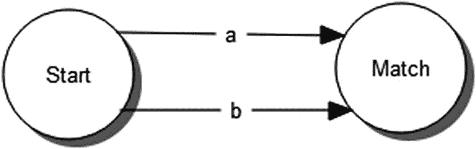
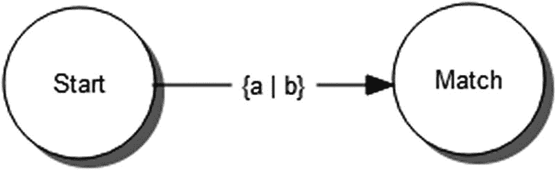
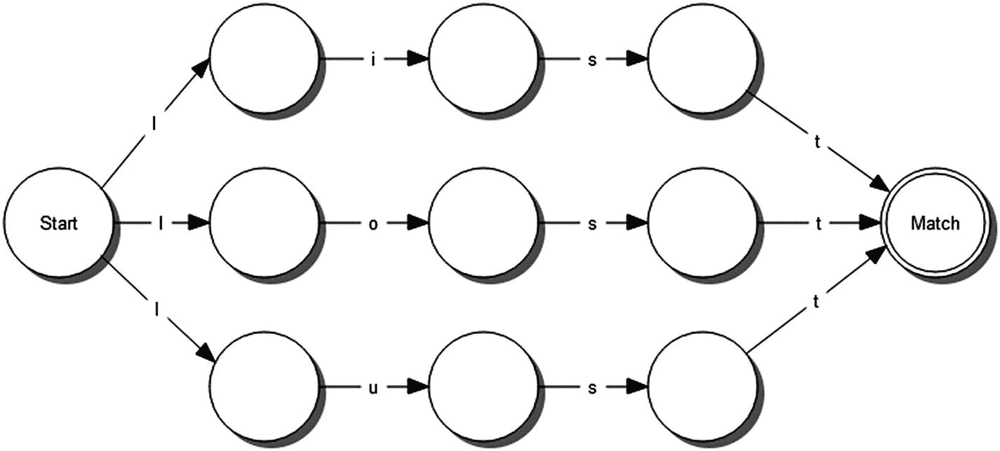
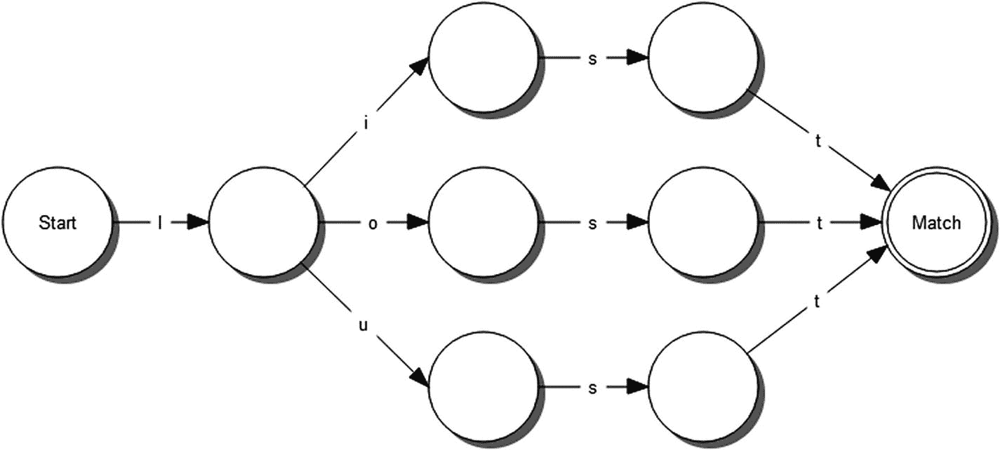
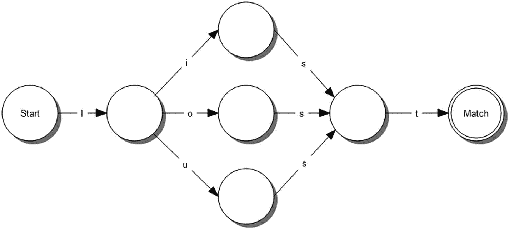
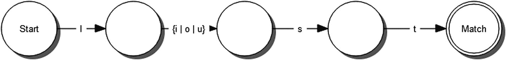

# 确定性与非确定性正则表达式建模

在大多数正则表达式方言中，`|`（管道符）表示`或`操作。在 EMACS 和 VIM 中，需要对管道符进行转义，得到 `\|` 操作符。在 BRE 中，不支持`或`操作。在所有其他方言中，`或`操作符就是普通的管道符。本章我们将采用后一种表示法。

`/a|b/` 是一个正则表达式，它匹配字符 `a` 或字符 `b`。此正则表达式的有限状态机表示如图 4-2 所示。

图 4-2 `/a|b/`

在实践中，正则表达式的实现可能会通过使用位掩码来表示一组可能的匹配，从而简化此自动机，如图 4-3 所示。

图 4-3 `/a|b/`

位掩码表示简化了图形，尤其是在复杂情况下。

让我们考虑一些更复杂的情况，在这些情况下，简化并不明显。

这是一个表达式，如图 4-4 所示：`/list|lost|lust/`。

最直观的自动机构造方式如下：我们针对`或`操作符的每个操作数进行分支，并尝试按顺序匹配字符。

图 4-4 `/list|lost|lust/`

在执行过程中，我们必须尝试每个分支。当一个分支失败时，我们进行回溯。例如，在序列 `lossless` 中，我们尝试以下步骤：
*   由于第一个字符是 `l`，我们尝试在所有三个分支中匹配它。
    *   在第一个分支上，我们检查第二个字符，它是 `o`。由于无法在此分支中前进，我们进行回溯。
*   在第二个分支上，第二个和第三个字符 `o` 和 `s` 都与后续箭头上的字符匹配。但是，第四个字符应该是 `t` 而不是 `s`，所以我们进行回溯。
*   在第三个分支上，我们检查第二个字符，它仍然是 `o`。因为我们需要 `u` 才能前进，所以我们进行回溯。
*   第二个、第三个和第四个字符与从*起始*节点出发的任何箭头都不匹配。
*   第五个字符又是 `l`。我们尝试在所有三个分支中匹配它。
    *   在第一个分支上，`e != i`，所以我们回溯。
    *   在第二个分支上，`e != o`，所以我们回溯。
    *   在第三个分支上，`e != u`，所以我们回溯。
*   其余字符（`e`、`s` 和 `s`）与从起始节点出发的任何边都不匹配。
*   由于没有更多字符需要读取，并且我们尚未到达*匹配*状态，因此返回失败。

每次当我们从同一个节点可以向多个方向移动时，我们就采取了一次非确定性操作。前面的自动机是一个*非确定性有限自动机*（`NFA^(²⁷)`）。

许多正则表达式解释器使用这种非确定性形式，而不考虑任何编译时优化。一些正则表达式解释器会多走一步，将非确定性边转换为确定性边。

首先，注意每个分支都以 `l` 开头。我们可以简单地只使用一条边来代替三条边，并推迟非确定性的出现，如图 4-5 所示。

图 4-5 `/l(ist|ost|ust)/`

其次，注意每个分支都以 `st` 结尾。我们可以使用一条边和一个状态来代替三个冗余的边和状态，如图 4-6 所示。

图 4-6 `l`，`I` 或 `o` 或 `u`，`s`，`t`

作为最后一步，我们应用一个位掩码来代替这三条边，其中字母通过`或`操作连接，如图 4-7 所示。

图 4-7 `l`，`{i, o, u}` 字符集，`s`，`t`

现在，我们将这个位掩码表示为 `{i|o|u}`。请这样理解：“从字符 `i`、`o`、`u` 中选择一个。”你将在本章后面了解这种语言结构。

更重要的是，结果图现在是一个 `DFA`，^(²⁸) 即确定性有限自动机。

非确定性形式更容易从正则表达式构建。如果输入长度为 `N`，则构建树需要 `O(N)` 步。作为交换，我们在执行时付出代价，因为最坏情况下的执行时间是 `O(2^N)`。

构建确定性自动机所需的步骤数量级为 `O(2^N)`。作为交换，执行成本是线性的。

在实践中，只要我们的正则表达式不是可重用的，我们倾向于满足于较慢的最坏情况执行时间。这是因为正则表达式可以非常快速地成功匹配。一旦找到匹配，执行就结束了。

因此，即使大多数正则表达式引擎都使用优化，非确定性形式通常也是有益的。

最后，注意我们最初的表达式是 `/list|lost|lust/`。如果我们从最终优化后的自动机反向工程出一个正则表达式，我们会得到 `/l(i|o|u)st/`。这种形式是纯确定性的。因此，我们可以得出结论，如果我们的正则表达式解释器倾向于以非确定性的方式执行正则表达式匹配，那么通过编写优化的正则表达式，我们可以节省宝贵的运行时间。即使解释器为我们进行了必要的优化，通过以优化形式编写正则表达式，我们仍然可以节省自动机构建时间。

这种好处通常是微不足道的，所以每当我在优化和可理解性之间做选择时，我倾向于可理解性。

如果你想了解更多关于优化技术的信息，请参考 `swtch.com`。^(²⁹)