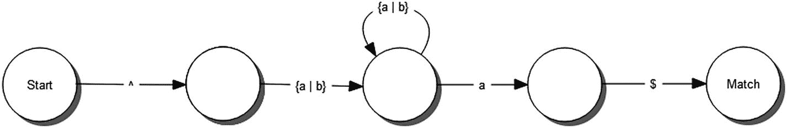
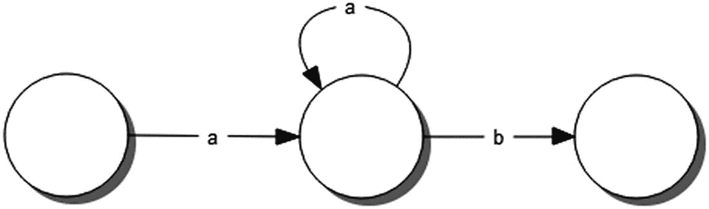
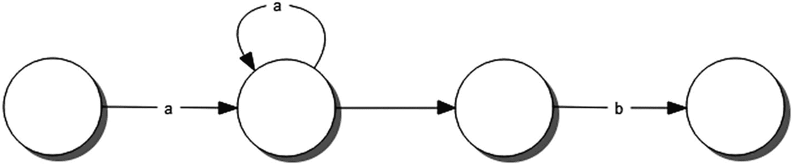
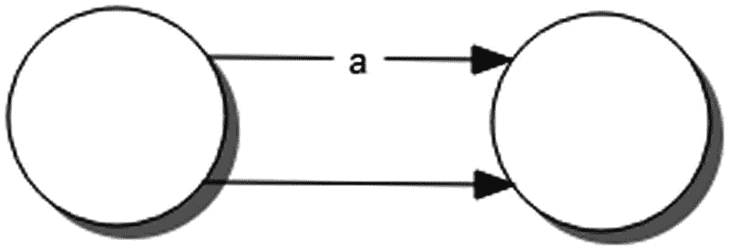
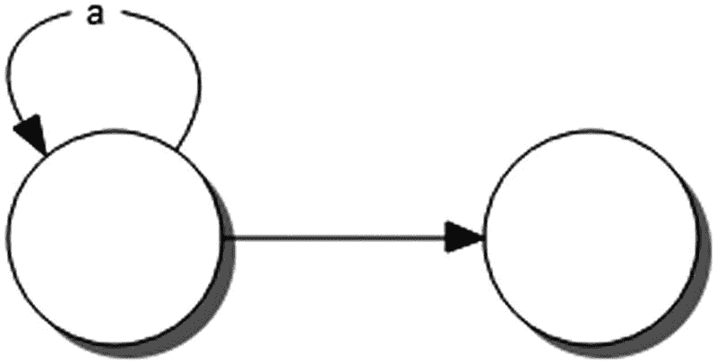

# 回溯

在执行匹配时，我们可以匹配一个字符、一个字符集或一个字符序列。以下是一些示例：

- `ab+` 匹配一个 `a`，然后至少一个 `b`。匹配的字符串有 `ab`、`abb`、`abbb`，以此类推。
- `[ab]+` 匹配任意数量的 `a` 或 `b` 字符，顺序不限，前提是匹配的序列至少有一个字符长。匹配的字符串有 `a`、`b`、`aa`、`ab`、`ba`、`bb`、`aaa`、`aab`，以此类推。
- `(ab)+` 匹配至少一个 `ab` 序列。匹配的字符串有 `ab`、`abab`、`ababab`，以此类推。

在大多数编程语言中，我们使用循环进行迭代。我们通常会按固定次数执行循环，并在执行过程中向前推进。这正是正则表达式与其他语言的不同之处。正则表达式的重复修饰符可能会“解循环”。这种解循环的过程被称为*回溯*。

只要正则表达式存在一定程度的不确定性，就可能发生回溯。不确定性是由替代执行和重复修饰符引起的。很容易看出，选择和迭代在本质上是相似的。例如，重复修饰符 `a+` 只不过是一个无限序列。

```
a|aa|aaa|aaaa|aaaaa|...
```

例如，在 JavaScript 中，假设我们要将字符串 `aa` 与正则表达式 `/^[ab]+a$/` 进行匹配。

```
> /^[ab]+a$/.test( 'aa' )
true
```

此匹配返回 `true`，但其执行过程却很有趣，如图 5-1 所示。



图 5-1

不确定性有限状态机中的回溯

请注意，`^` 和 `$` 状态转换不会从字符串中读取任何字符，但它们会固定字符串解析的起始位置。固定的起始锚点和结束锚点守护着匹配状态，因此必须解析整个字符串。

假设你有一个令牌，你可以在自动机的各个状态之间移动它，以匹配之前的正则表达式。

从 `start` 状态开始，`^` 锚点允许我们在字符串的开头通过，到达第一个中间状态。然后我们消费一个 `a` 字符，移动到中间状态。假设我们使用标签为 `{a|b}` 的循环来消费第二个 `a` 字符并停留在同一状态。在消费第二个 `a` 字符后，我们的字符串结束，并且我们没有处于 `match` 状态。

因此，我们必须回溯，将 `[ab]+` 重复修饰符解循环一次。然后我们通过另一条箭头消费第二个 `a` 字符，将我们移动到自动机的最后一个中间状态。由于离开此状态的唯一箭头是 `$`，我们必须检查是否已到达字符串的末尾。是的，我们已经到达，因此我们成功到达了 `match` 状态。

让我们更深入地研究每个重复修饰符。

## 至少匹配一次

在 BRE 中，我们必须使用 `*` 来表示 `+` 重复修饰符。`a+` 变成 `aa*`。换句话说，匹配一个 `a` 字符并且至少再匹配零个 `a` 字符，等同于至少匹配一个 `a` 字符。

在 EMACS 和 VIM 中，你必须转义 `+` 运算符。`a+` 变成 `a\+`。在所有其他方言中，我们使用以下方式：

- `a+` 表示至少匹配一次 `a` 字符
- `[ab]+` 表示至少匹配一次 `a` 或 `b` 字符
- `(ab)+` 表示至少匹配一次 `ab` 序列

属于 `a+` 的有限状态机如图 5-2 所示。


图 5-2

`/a+/`

我们首先匹配一个 `a` 字符，然后匹配任意数量的 `a` 字符。下一个循环可能是一个空转换，或者我们可以通过匹配下一个字符来简化自动机。

例如，我们可以为正则表达式 `/a+b/` 构建两个不同的自动机，如图 5-3 和图 5-4 所示。



图 5-4

不带空箭头的 `/a+b/`



图 5-3

带空箭头的 `/a+b/`

这两个自动机是等价的，前提是我们可以在不读取任何字符的情况下，沿着空箭头自由前进。

让我们在表 5-2 中总结不同方言的*至少一次*循环。

表 5-2

至少一次循环

| 方言 | 至少一次循环的标记法 |
| --- | --- |
| BRE | 无；使用 `aa*` |
| ERE、PCRE、Perl 6 | `a+` |
| EMACS、VIM | `a\+` |

## 至多匹配一次：可选匹配

BRE 不支持可选匹配。在 EMACS 和 VIM 中，可选匹配必须转义。在其他方言中，可选匹配的写法与*至少一次*元字符相同：

- `a?` 表示至多匹配一次 `a` 字符
- `[ab]?` 表示至多匹配一次 `a` 或 `b` 字符
- `(ab)?` 表示至多匹配一次 `ab` 序列

可选匹配之所以称为可选匹配，是因为我们可以匹配它一次，或者根本不匹配。

属于可选匹配 `a?` 的有限状态机如图 5-5 所示。



图 5-5

`/a?/`

请注意空箭头。当选择底部路径时，不会从我们尝试匹配的字符串中消耗任何字符。

## 匹配任意次数

此运算符在所有方言中均可使用，无需转义。表达式 `a*` 在所有方言中看起来相同，匹配任意长度的 `a` 字符序列，包括空字符串。其匹配的有限状态机形式很简单，如图 5-6 所示。



图 5-6

`/a*/`

括号和方括号的使用方式与 `+` 和 `?` 运算符相同。

- `a*` 表示匹配任意数量的 `a` 字符。
- `[ab]*` 表示匹配任意次数的 `a` 或 `b` 字符。
- `(ab)*` 表示匹配任意次数的 `ab` 序列。

别忘了在 EMACS 和 VIM 中使用 `\(` 和 `\)` 对括号进行转义。


