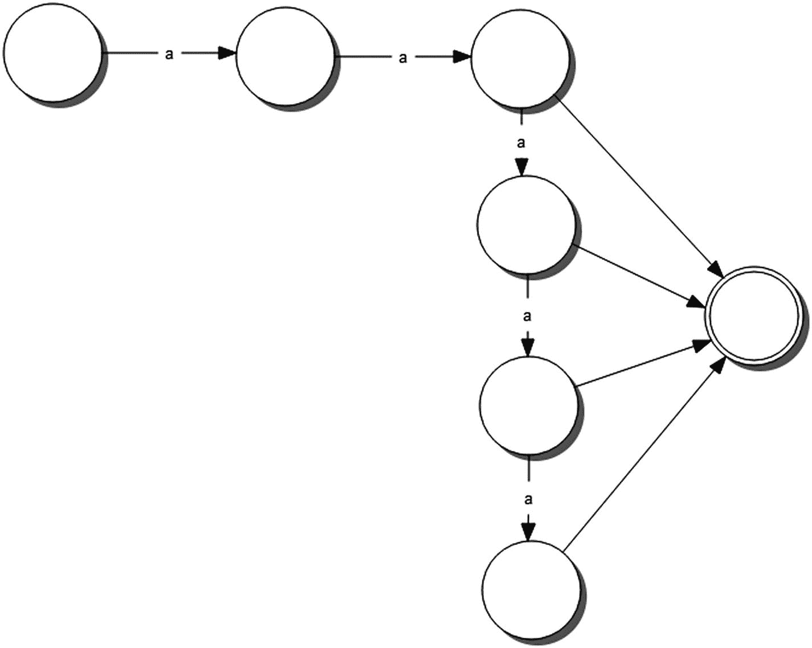
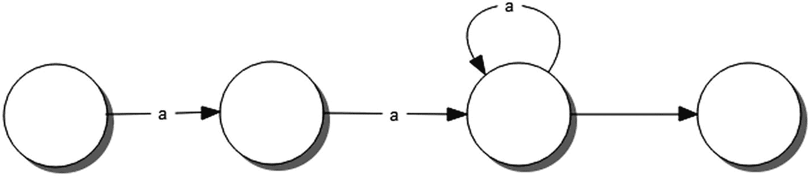
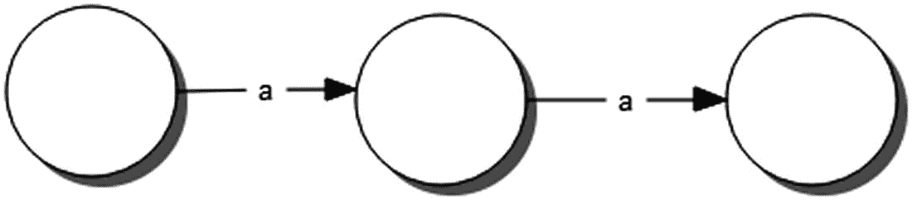

# 固定范围匹配

假设我们想匹配至少出现两次、至多出现五次的字符 `a`。不同的正则方言对此有不同的实现方式，如表 5-3 所示。

表 5-3：匹配字符 `a` 至少两次，至多五次

| 方言 | 表示法 |
| --- | --- |
| `BRE`, `EMACS` | `/a\{2,5\}/` |
| `VIM` | `/a\{2,5}/` |
| `ERE`, `PCRE` | `/a{2,5}/` |
| `Perl 6` | `/ a ** 2..5 /` |

在大多数编程语言中，我们使用 `PCRE` 方言：`/a{2,5}/`。请根据你自己的使用场景来关注。

有限状态机的形式看起来比较冗长，因为我们需要展开每一种可能。匹配二到五次意味着我们必须为匹配两次、三次、四次和五次分别构建一条路径，如图 5-7 所示。

图 5-7：`/a{2,5}/`

在实践中，大多数正则引擎将这个重复修饰符表示为 `*`（星号）。星号被解释为*任意次数*的匹配，并使用内部计数器来满足所需条件。

请注意，可以省略范围的最大值。要匹配至少两个 `a` 字符，你必须使用表 5-4 中所示的表示法。

表 5-4：匹配至少两个 `a` 字符

| 方言 | 表示法 |
| --- | --- |
| `BRE`, `EMACS` | `/a\{2,\}/` |
| `VIM` | `/a\{2,}/` |
| `ERE`, `PCRE` | `/a{2,}/` |
| `Perl 6` | `/ a ** 2..* /` |

注意，除了 `Perl 6` 之外，所有方言中最大值都被简单地省略了，而在 `Perl 6` 中，`*` 表示任意值。

`/a{2,}/` 的有限状态机形式比属于有界重复修饰符的 FSM 要简单得多。事实上，这个机器等价于表达式 `/aaa*/` 的 FSM，如图 5-8 所示。

图 5-8：`/a{2,}/`

理论上，上限是无界的。在实践中，这个上限取决于正则虚拟机的实现。上限限制可能是一个像 `256` 这样的低数值。在其他语言中，这个值是 `32767`，这比 2 字节无符号整数的最大值小一。在使用具有较大上限的正则表达式时要小心。

另外请注意，在某些语言（如 `Python`）中，实际最大限制是无穷大，但如果这个限制太大，你可能会很容易遇到溢出错误。

## 精确循环 `n` 次

让我们看看所有方言中表达式 `/aa/` 的简写形式，如表 5-5 所示。

表 5-5：`/aa/` 的简写形式

| 方言 | 表示法 |
| --- | --- |
| `BRE`, `EMACS` | `/a\{2\}/` |
| `VIM` | `/a\{2}/` |
| `ERE`, `PCRE` | `/a{2}/` |
| `Perl 6` | `/ a ** 2 /` |

这意味着我们精确地循环两次字符 `a`。当有一个复杂的表达式而不是 `a`，或者重复次数远大于 `2` 时，这个简写形式实际上比原版 `/aa/` 更简洁。

属于这个循环的有限状态机非常简单，如图 5-9 所示。

图 5-9：`/aa/`

如你所见，该状态机匹配了 `/aa/` 的 FSM。

## 贪婪重复修饰符

你已经在表 5-1 中看到了贪婪重复修饰符的元字符。

所有这类重复修饰符默认都是*贪婪*的。这意味着重复修饰符会从匹配字符串中消耗尽可能多的字符，然后逐字符回溯。

举一个极端的例子，假设我们使用正则表达式 `/^.*list$/` 来匹配字符串 `'The lost list'`。

由于 `*` 重复修饰符是贪婪的，`.*` 首先会消耗整个字符串，然后发现我们处于字符串末尾，并且还需要匹配字符 `l`。匹配失败时，我们进行回溯。

重复修饰符以贪婪的方式消耗字符，并尽可能少地回溯。因此，我们只回溯一个字符。回溯后，`.*` 匹配 `The lost lis`，下一个要消耗的字符是 `t`。由于 `t` 不等于 `l`，我们再次回溯。

现在 `.*` 变成 `The lost li`，我们尝试将 `s` 与 `l` 匹配。这行不通，所以继续回溯。

现在 `.*` 变成 `The lost l`，我们尝试将 `i` 与 `l` 匹配。这行不通，所以继续回溯。

现在 `.*` 变成 `The lost` ，我们尝试将 `l` 与 `l` 匹配。这次匹配成功，所以我们继续用正则表达式模式的剩余部分匹配字符串的剩余部分。由于我们成功匹配了整个字符串并到达了末尾，我们成功退出正则匹配。

在这个例子中，我们只回溯了四次。但想象一下，如果我们有数兆字节的文本，一个 `.*` 结构可能会在评估正则表达式剩余部分之前读取整个文件。因此，使用 `.*` 之类的结构要格外小心。几乎总有一种更优的方式来描述一个模式。

引入回溯是因为我们的状态机是非确定性的。在 `/^.*list$/` 中，每一步，只要我们处于 `.*` 循环中并且即将遇到一个 `l` 字符，我们就必须决定是匹配一个 `.` 字符还是匹配一个 `l`。正是这种非确定性导致了回溯。

对抗回溯的一种方法是使非确定性状态机变得确定。这可能需要对输入的大小执行指数级别的步骤。只有极少数正则虚拟机会这样做，因为这种努力通常得不偿失。

另一种解决方案是使用按照不同策略进行匹配和回溯的循环。