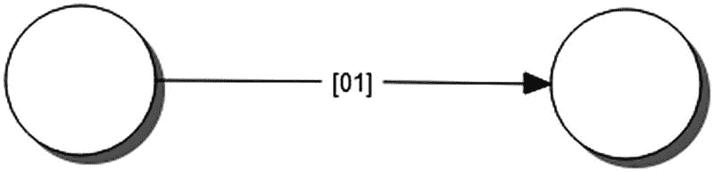

# 6. 字符集与字符类

前一章介绍了有限状态机，以使正则表达式更易于理解。在本章中，你将学习创建更复杂有限状态机所需的工具，以便使用正则表达式执行高级模式匹配任务。

我们将基于第 2 章的内容进行构建，假设你已经知道如何处理字面字符、连接、*或*运算符、点号字符、用括号进行的分组操作、锚定的开始和结束以及修饰符。

## 字符集

字符集匹配包含集合中任意字符的字符串。

在 Perl 6 中，字符集被列举在 `<[` 和 `]>` 之间。

在所有其他方言中，包括所有其他编程语言和文本编辑器，我们使用方括号：`[` 和 `]`。

包含至少一个二进制数字的字符串的字符集如下：

-   在 Perl 6 中：`/<[01]>/`
-   在所有其他方言中：`/[01]/`

表达式 `[01]` 匹配一个 `0` *或* 一个 `1` 字符。

由于我已经介绍了*或*运算符，很容易得出结论，上述字符集等价于以下内容：

-   在 EMACS 和 VIM 中：`/0\|1/`
-   在 ERE、Perl 6 和 PCRE（包括所有编程语言）中：`/0|1/`

正则表达式引擎倾向于使用位掩码构建集合的内部表示。因此，检查字符集通常与匹配单个字符一样高效。

在有限状态机表示中，连接两个状态的边只有一条，如图 6-1 所示。

图 6-1

`/[01]/`

我使用了 `[01]` 字符集记法来表示位掩码。

## 字符集范围

假设你的下一个任务是表示一个八进制数字和一个十六进制数字。在 PCRE 中，利用你已经掌握的知识，你可以使用以下语法：

-   对于八进制数字：`/[01234567]/`
-   对于十六进制数字：`/[0123456789abcdefABCDEF]/`

在大多数方言中，正则表达式允许你使用 `-` 字符来定义范围。只有 Perl 6 不同，你必须使用 `..` 字符。^(³⁷)

因此，八进制数字变成如下形式：

-   在 Perl 6 中：`/<[0..7]>/`
-   在所有其他方言中：`/[0-7]/`

范围 `0-7` 等价于 `01234567`。

乍一看，编写十六进制数字的任务似乎稍微复杂一些。编写 `/[0-9]|[a-f]|[A-F]/` 是完全有效的，但语法看起来过于复杂。

回顾范围与其枚举的等价关系，我们可以得出以下结论：

-   `0123456789` 等价于 `0-9`。
-   `abcdef` 等价于 `a-f`。
-   `ABCDEF` 等价于 `A-F`。

因此，`0123456789abcdefABCDEF` 等价于 `0-9a-fA-F`。所以，十六进制数字变成如下形式：

-   在 Perl 6 中：`/<[0..9a..fA..F]>/`
-   在所有其他方言中：`/[0-9a-fA-F]/`

## 字符集的排除

你已经看到，在大多数正则表达式解释器中，字符集是由位掩码表示的。现在你将了解如何反转这些位。

在 Perl 6 中，在左括号前放置一个 `-` 会反转字符集。这个减号元字符也可以用在字符集类前面。更多关于字符类的细节，请参见下一节。

在所有其他方言中，反转字符是 `^` 运算符，它被放置在括号内、字符枚举、范围或类的前面。

例如，不是十六进制数字的字符定义如下：

-   在 Perl 6 中：`/<-[0..9a..fA..F]>/`
-   在所有其他方言中：`/[⁰-9a-fA-F]/`

