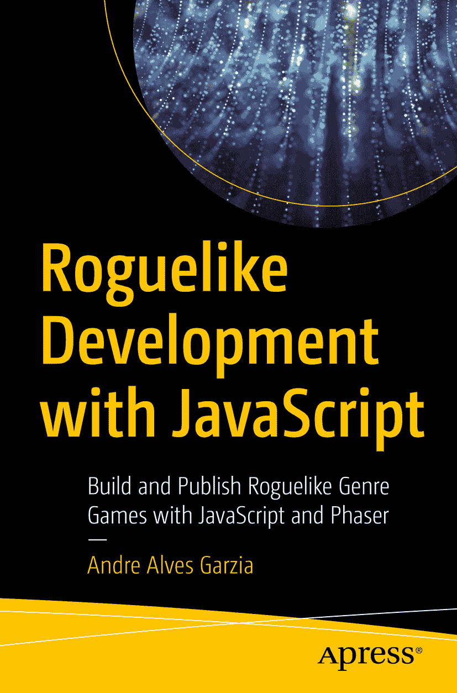

ISBN 978-1-4842-6058-6  
e-ISBN 978-1-4842-6059-3  
[`doi.org/10.1007/978-1-4842-6059-3`](https://doi.org/10.1007/978-1-4842-6059-3)

© 安德烈·阿尔维斯·加尔齐亚 2020

标准 Apress 商标名称、标识和图像可能出现在本书中。我们没有在每次出现商标名称、标识或图像时使用商标符号，而是仅在编辑风格中使用这些名称、标识和图像，以利于商标所有者，且无意侵犯商标权。本书中使用的商品名称、商标、服务标记和类似术语，即使未被标识为商标，也不应被视为对其是否受专有权利保护的表达意见。

出版商、作者和编辑可以放心地认为本书中的建议和信息在出版时是真实准确的。出版商、作者或编辑不对其中包含的材料或可能存在的任何错误或遗漏提供明示或暗示的保证。出版商对于已出版地图中的管辖权主张和机构归属保持中立。

本书通过 Springer Science+Business Media 纽约分公司在全球图书贸易中分销，地址：233 Spring Street, 6th Floor, New York, NY 10013。电话：1-800-SPRINGER，传真：(201) 348-4505，电子邮件：`orders-ny@springer-sbm.com`，或访问`www.springeronline.com`。Apress Media, LLC 是一家加利福尼亚有限责任公司，其唯一成员（所有者）是 Springer Science + Business Media Finance Inc (SSBM Finance Inc)。SSBM Finance Inc 是一家特拉华州公司。

*致莉莉、克莱奥和阿尔法法，整夜打字让你们无法入睡。*

