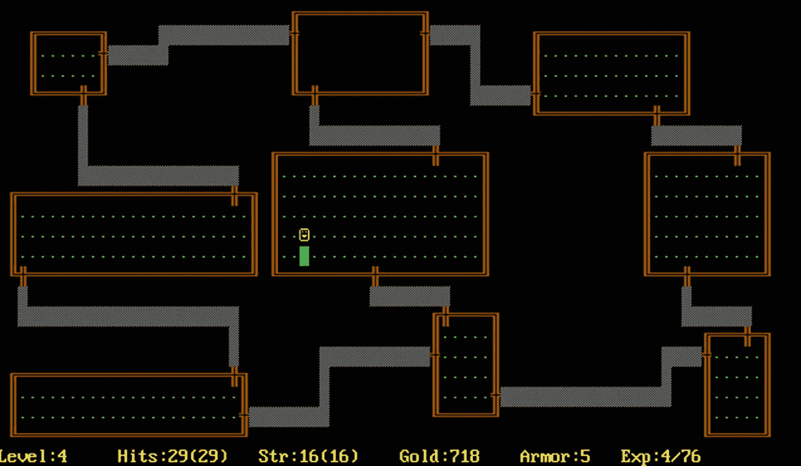

# 1. 开始之前

## 什么是 Roguelike 游戏？

亲爱的读者，欢迎踏上游戏开发之旅的起点；我们将共同历经多个章节，打造一款休闲 Roguelike 游戏。但在深入探讨之前，我们有必要花些时间来定义和梳理：什么是 Roguelike 游戏、它们源自何处，以及本书将采用何种定义来界定这一类型。

大多数人一致认同，这一切都始于 1980 年代初期诞生的一款名为 `Rogue` 的游戏。这款游戏融合了 1970 年代早期作品的影响，例如基于文字的冒险游戏 `Colossal Cave Adventure`（它利用互动小说呈现场景的文字描述并收集玩家对动作的文本输入），以及类似 `Dungeons & Dragons` 的桌上角色扮演游戏玩法——玩家在充满怪物和宝藏的地牢中探索。`Rogue` 的创新之处在于，它通过使用 ASCII 字符在屏幕上绘制游戏世界（如图 1-1 所示）来实现空间化呈现，而非使用自然语言描述；同时，它利用随机生成算法产生迷宫和地牢，实现了无限的可重玩性。每一局 `Rogue` 游戏都是独一无二的体验；你可以反复游玩。

图 1-1 在 IBM PC 上运行的 Rogue 游戏画面示例^(⁹)

从那时起，数百款 Roguelike 游戏相继问世。Roguelike 是 1980 年代少数至今仍流行、且不断有新鲜作品和创新的游戏类型之一。长寿游戏类型的问题在于，它们会积累大量内容，以至于很难被明确定义。Roguelike 社区至今仍在为判定某款游戏是否属于 Roguelike 而争论不休。请注意，许多如今被视为该类型标志性特征的元素在早期并不存在，而且那些早期开发者并不关心自己的游戏算不算 Roguelike；他们只想做出好游戏。随着时间的推移，这些游戏中的许多逐渐趋同于一套共同特征，这些特征最终成为了该类型的基石。

### 柏林诠释

2008 年，参加国际 Roguelike 开发大会的人们提出了后来被称为`柏林诠释`^(¹⁰) 的定义，试图界定什么是 Roguelike。他们选定了一批经典游戏，并从这些游戏共有的特征中提炼出“什么是 Roguelike”的定义。这批经典游戏包括 `Rogue`、`NetHack`、`Angband` 和 `ADOM`。根据这些特征，他们进一步将其划分为`高价值因子`和`低价值因子`，如表 1-1 和 1-2 所示。一款游戏无需具备所有因子才能被称为 Roguelike，但这份列表有助于我们理解当时该社区的价值观。

表 1-2 根据柏林诠释，Roguelike 的低价值因子

| 因子 | 解释 |
| --- | --- |
| 单人角色 | 游戏聚焦于玩家在整个游戏过程中控制单一角色。 |
| 敌我相似 | 适用于玩家的机制和特性同样适用于敌人。 |
| 战术挑战 | 掌握战术对于通关至关重要。由于程序化生成，你无法单纯靠记忆取胜。 |
| ASCII 显示 | Roguelike 惯常使用 ASCII 字符构建界面。 |
| 地牢 | 多数 Roguelike 游戏以地牢为基础，包含多层、迷宫和房间。 |
| 数值 | 用于表示角色特性和属性的数值会被明确显示。 |

表 1-1 根据柏林诠释，Roguelike 的高价值因子

| 因子 | 解释 |
| --- | --- |
| 随机生成 | 世界是随机生成的，因此每局游戏都独一无二。 |
| 永久死亡 | 游戏中死亡将导致游戏从头开始。 |
| 回合制 | 游戏在用户输入后做出反应。玩家可以等待并规划行动，无需担心身后发生变故。 |
| 网格化 | 游戏以网格形式呈现；玩家和所有其他游戏实体（例如敌人）都放置在该网格上。 |
| 无模式化 | 游戏中所有可能的动作都在同一屏幕内完成。无需切换到不同的游戏模式。 |
| 复杂性 | 游戏足够复杂且灵活，允许玩家在游戏过程中针对挑战采用多种解决方案。 |
| 资源管理 | 游戏内资源有限，管理资源是乐趣的一部分。 |
| 砍杀 | 击杀大量敌人是游戏的一部分。 |
| 探索与发现 | 游戏要求玩家探索不同关卡，发现神秘物品、实体及其相互作用。 |

即使在选定的经典游戏中，这些因子也并非总是同时存在。例如，`Angband` 和 `ADOM` 都具有不同的游戏模式。

对于`柏林诠释`，存在着诸多批评。许多人认为该定义已过时，不能代表 Roguelike 的当前状态。^(¹¹) 我在本书中引入它，是为了帮助我们思考这些因子，以及哪些因子对我们有价值。将游戏归类到一个不断演变的类型中是相当困难的，而且我认为我们不应花费过多时间纠结于，我们将在本书中共同构建的小游戏是否足够“Roguelike”，以至于配得上这个称号。

### 什么是 Roguelite？

在进一步深入分类的泥潭时，我们还需要了解另一个标签，即使只是为了之后将其否定：`Roguelite`。传统的 Roguelike 游戏奖励玩家投入时间和研究。要在 `NetHack` 这样的游戏中登顶，你需要投入大量时间学习战术和特性，并准备好反复游玩。而像 `Dwarf Fortress` 这样一款出色的游戏——按照许多过时的分类方案几乎算不上 Roguelike，但依我拙见，它确实是一款杰出的 Roguelike——若没有其维基页面和相关社区文章，几乎无法有效游玩。

你可能已经猜到，有一整个休闲玩家群体以往并未被传统 Roguelike 游戏所满足。随着智能手机和其他小型移动计算设备的兴起，休闲游戏出现了爆发式增长。人们希望在通勤途中玩游戏。如今最常发布的游戏是那些能轻松上手、无需大量投入就能享受乐趣的“即拿即玩”游戏。`Roguelite` 正是对这类需求的回应。这类游戏易于上手，无需学习复杂机制。它们往往倾向于全图形化界面，可执行的操作也少于更传统的 Roguelike，因而非常受欢迎。

所有这些分类的问题在于界限的划定。你给一款 `Roguelite` 添加什么额外特征，才会让它越界变成 Roguelike？做出这种区分是否值得？这些都是社区仍在激烈争论的修辞性问题。这种更简化的 Roguelike 也曾被称为 `Roguelike-like`、`Roguelike-ish` 等标签。这其实并不重要。重要的是，有些人希望能够在 Roguelike 游戏中区分出那些更简单、面向休闲玩家的作品。

## 本书对 Roguelike 游戏的定义

在本书中，我们将 Roguelike 游戏定义为具备以下特征的类别：

*   采用程序化生成技术创建基于格子的世界
*   具备永久死亡机制
*   采用回合制战斗系统
*   包含多个可供玩家探索的关卡

## 为什么要开发 Roguelike 游戏？

游戏开发本身就充满乐趣，它不仅教会你应对常见编程挑战的众多技巧与方法，这些技能在游戏之外的领域同样适用。Roguelike 游戏尤其能吸引热爱计算机科学的人，因为它让你专注于算法、数据结构及其交互。对于喜欢叙事和世界观构建的人来说，它同样是个绝妙的媒介——Roguelike 游戏的生命力正源于机制、主题与玩法的总和。本质上，Roguelike 游戏能为你的左右脑提供丰富且引人入胜的实践平台：你的分析思维有大量内容可供思考与实验，而你的创造思维则有更多素材需要雕琢并赋予生命。

Roguelike 游戏是少数几个独立开发者或小团队不逊于大型工作室的游戏类型之一。你的 Roguelike 作品能在业界留下印记，并受到玩家和其他开发者的喜爱。Roguelike 社区非常友好且充满参与乐趣，大家乐于分享知识、共同成长。

许多 3A 大作都在运用 Roguelike 开发所推崇的技术（如程序化生成）来提升游戏可玩性并减少内容创作时间。近年来的独立游戏畅销作不仅将程序化生成用于关卡设计，还拓展到了剧情和敌人设计。永久死亡机制为这些游戏增添了难度层次，吸引了小众但忠实的硬核玩家群体。我可以预见一种趋势：Roguelike 开发的核心理念不仅会被主流游戏吸收，更会成为它们品质的亮点。

我相信 Roguelike 游戏能帮你掌握的技术技能不仅可直接用于游戏开发行业，在其他开发领域同样大有裨益。当你不断优化代码以匹配世界观构建（反之亦然）时，你的创造力也会提升。叙事是一项重要技能，它将使你终身受益。以上列举的理由能帮你向亲友解释为什么投入时间开发 Roguelike 游戏，并证明这项付出的价值，但最根本的原因是你**想要**开发 Roguelike。这是一项有趣的活动，而你有一个想法——某个值得探索的机制、主题或约束的微光。你的脑海中藏着一个小型地牢，你的创意深藏其中，你希望邀请更多人进入。是的，你可以用关于职业和知识的理性论证来证明学习 Roguelike 开发的价值，但最有力的理由是情感层面的：你这么做，是因为你热爱它。

## 为什么要使用 Web 技术？

即使你开发的是一款出色的游戏，也很难说服别人真正安装它。每周都有成千上万款游戏涌入主流应用市场，想要脱颖而出极为困难。工作室需要投入巨额营销费用才能说服玩家尝试他们的游戏。用户尝试你游戏的门槛越低，他们真正去尝试的可能性就越高。

# Web 游戏开发与 Phaser 框架

Web 技术让我们能够发布无需安装即可在多种设备上畅玩的游戏。基于 Web 的游戏理论上可以在智能手机、平板电脑、笔记本电脑、台式机等设备上运行。你既可以将这些网页游戏发布到主流游戏市场，也可以选择在网络上自主分发。这是以最小阻力实现最广覆盖的方式——用户只需打开网页即可开始游戏。

使用 Web 技术的另一个重要方面是：它能缩短向用户推送新版本的间隔。如果你通过持续更新测试版并收集测试者反馈来公开开发游戏，这点尤为重要。你无需重新发布安装包并等待测试者更新——只需更新一个在线网页，所有测试者就能获取并测试最新版本。这种快速迭代不仅对玩家有利，对你同样有益：任何节省时间与麻烦的事情，都能让你解放精力专注于真正重要的东西——你的游戏本身。

本书将主要聚焦于`JavaScript`，仅少量涉及`HTML`和`CSS`。`JavaScript`是一种极易上手的语言，对初学者非常友好，同时也能被资深开发者运用得游刃有余。新手能轻松用它做出可用的成果，而不会遇到过多挑战。并非所有语言都能让开发者从入门阶段就开始制作拿得出手的作品，同时又不妨碍未来开发顶尖游戏。通过 Roguelike 游戏开发提升`JavaScript`技能，是开发者高效升级的绝佳途径。

虽然其他语言比`JavaScript`运行更快、资源控制更强，且如果你想进入游戏行业也值得学习，但请千万不要认为投入时间学习`JS`是不值得的。正如 Brendan Eich 所说：“永远押注`JS`！”——如今的`JavaScript`引擎已是功能强大的虚拟机，能让你的 Roguelike 设计发挥到极致。在本书中，你永远不会遇到语言或运行时成为制约的情况。`JS`始终是我们的资产，绝不会成为 Roguelike 开发之旅的局限。

## 为什么选择 Phaser？

市面上有许多优秀的网页游戏开发框架。撰写本书时，我选择使用 Phaser，因为它可能是 JavaScript 领域最流行的游戏开发框架。如果从原生 JavaScript 开始，我们将被迫重新实现许多底层游戏编程模式。因此，我们将使用一个不限定游戏类型的通用游戏开发框架。游戏中的 Roguelike 部分将由我们自己实现，但我们将站在巨人的肩膀上，充分利用该框架中针对通用游戏编程特性所付出的辛勤努力。

`Phaser` 易于学习，并经过数千款游戏和数百万玩家的实战检验。它是一个在业界广泛使用的成熟框架，学习它有助于你更接近专业领域人士所使用的工具。无论是业余爱好者还是专业人士，都在使用这个框架。网上有大量学习资料供你深入研究，它同时也是 Apress 另一本专注于多人游戏开发的书籍所使用的框架，因此将这两本书结合起来，你或许最终能开发出一款多人 Roguelike 游戏，对吧？

`Phaser` 让开发适配不同设备屏幕尺寸的游戏变得更加容易。这一点对于扩大我们游戏的受众范围至关重要，因为无论是使用智能手机等小型设备，还是笔记本电脑等较大型设备的用户，都能畅玩我们的 Roguelike 游戏。

`Phaser` 游戏的一般生命周期和工作流程，与其他基于 Web 或原生的框架类似。如果你将来决定使用其他框架，在这里学到的许多概念将具有可移植性。

值得注意的是，`Phaser` 是一个通用的游戏开发框架；它不会强制或限制你开发特定类型或风格的游戏。它在这一点上非常灵活，你可以将它用于未来的其他项目。话虽如此，我们本可以使用专为 Roguelike 开发设计的库，这些库通过提供现成的、经过测试的功能（这些功能对大多数 Roguelike 游戏来说既常见又重要）来节省大量工作。我决定不使用这些库，原因有二。

第一个也是最重要的原因是，我认为学习 `Phaser` 对任何从事网页游戏开发的人都至关重要。这使得本书不仅对 Roguelike 开发者有用，也便于那些已经熟悉 `Phaser` 并希望学习更多 Roguelike 知识的读者入门。

第二个原因是，通过迫使我们自己重新实现某些功能，我们最终能够比简单使用现成包更深入、更有意义地理解它们。这样做的一个积极副作用是，我们会对那些不辞辛劳创建现成 Roguelike 库的开发者更加心怀敬意。如果你将来尝试使用这些库，你将能更好地理解它们的内部机制。

对我来说，使用 `Phaser` 的另一个重要方面是，它让我们只需一套最基本的工具就能开始开发。我们不需要复杂的样板代码和工具链才能起步。市面上还有其他使用复杂工具的引擎，是的，你也可以将你的 `Phaser` 环境配置得极其复杂，但我认为对于这本书来说，那会分散太多注意力。我希望专注于用 `Phaser` 构建一个 Roguelike 游戏；我们只会添加完成这项任务所需的最基本工具。在这本书中，我将极度聚焦于简洁性，但 `Phaser` 同样能服务于你未来更复杂的项目。

## 我们要构建什么

本书的项目是一个基于 Web 的小型 Roguelite 游戏。我们只构建足够让它被识别为 Roguelike 的功能，而不会让这本书变成一本上千页的“圣经”。这个项目是 Roguelike 开发的初始阶段；如果你喜欢，可以在此基础上深入探索。

关于本书内容组织方式的一个决定，可能颇具争议，因此最好在开始之前就解释清楚。大多数 Roguelike 教程都从程序化生成和地牢开始讲起。而我打算将程序化生成放在本书靠后的章节。当我们讲到那部分时，我们已经知道如何绘制地牢、在其中填满怪物和宝藏，以及游戏玩法是如何运作的。这将使我们能够进行程序化生成的实验，并感知它如何影响游戏玩法，因为静态的游戏部分已经完成。如果游戏的那些部分已经在运行，那么就更容易看出不同的地牢，或者更强大、更普遍且行为更智能的怪物如何改变游戏体验。因此，即使我个人认为程序化生成是 Roguelike 游戏的主要基石，我也只会在本书的后半部分触及这个话题。

首先，我们将了解 `Phaser` 库，并使用它来绘制一个地牢。然后，我们将添加一个玩家角色并编写游戏循环。一旦这部分工作完成，我们将添加怪物、宝藏和多个关卡。当所有这些部分都到位后，我们将深入探讨程序化生成。

我希望你和我一样对开始编码感到兴奋；在下一章中，我们将学习 `Phaser` 的基础知识，并动手打造我们的第一个地牢。