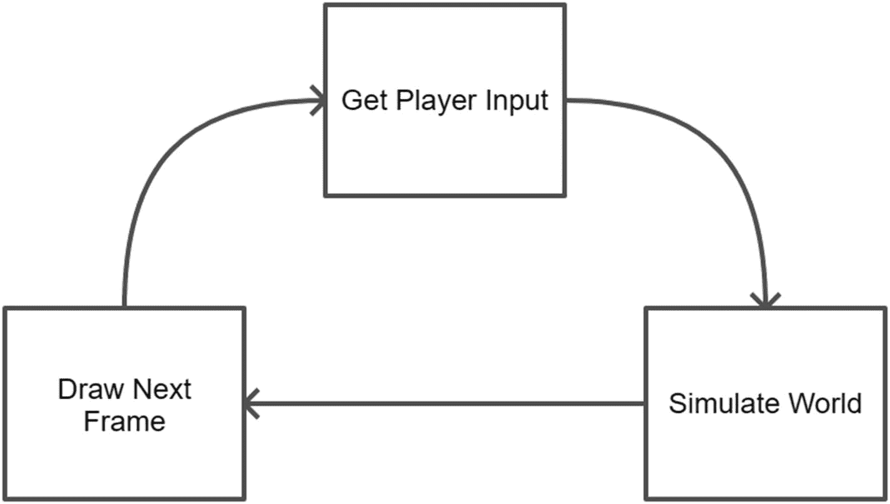
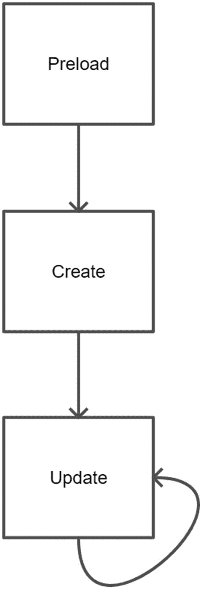
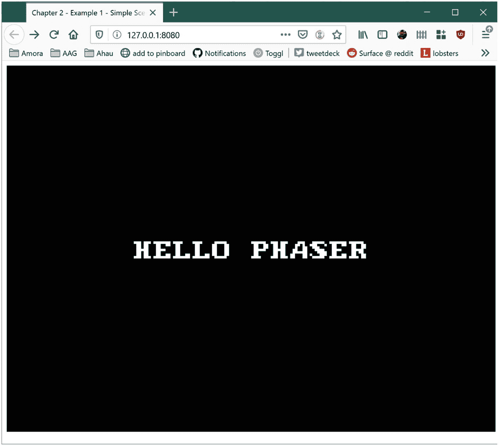

# 2. Phaser 简介

这将是一个入门章节，侧重于游戏开发概念以及如何使用 `Phaser`，而不是真正开始构建 Roguelike 游戏。在开始编写代码并学习如何使用 `Phaser` 构建游戏之前，我们将先逐步了解相关概念和术语。学习了这些概念之后，开发本书的项目将变得容易得多。

在本章中，我们将涵盖以下内容：

*   设置工具：让我们的计算机为开发做好准备
*   游戏开发概念：开发游戏所需的通用术语和理论
*   `Phaser` 状态：如何将这些概念应用到 `Phaser` 中

所有后续章节都将建立在本章构建的基础之上，但我们到底要在本书中构建什么呢？

## 介绍《`微缩地牢`》

本书的项目是一个我们称之为《`微缩地牢`》的小型 Roguelite 游戏。这个游戏被设计得很简单，作为你未来探索 Roguelike 游戏的一个 *易于扩展的项目*。你心中需要明确的一个重要方面是，我们希望创建一个简单的原型 Roguelike 游戏。我们不以创新的机制或玩法为目标；这些会在你个人游戏开发的旅程中逐渐涌现。《`微缩地牢`》更像是一个让我们练习构建 Roguelike 游戏的练习项目。

我们的游戏将是一款奇幻题材的地牢探险游戏，玩家将穿越多个程序化生成的关卡，与怪物战斗并获取物品，直到在地牢最深处找到一件魔法物品。我们将慢慢地构建这个游戏。一开始，我们完全不使用任何程序化生成，然后在后期逐步添加并进行实验。

游戏将具备的主要 Roguelike 特征是：

*   程序化生成的内容
*   永久死亡
*   回合制行动

那么，带着这些想法，让我们开始设置计算机吧。

## 环境设置

对于《`微缩地牢`》，我们将使用一个非常简单的设置。这是有意为之，这样我们就可以专注于游戏本身，而不是被 JS 开发者们面对的无尽工具选择所困扰。

我们设置环境的主要目标是让它不碍事，并且在我们构建游戏的过程中保持透明。

### 安装 Web 服务器

你需要安装 `Node.js`^(¹³) 才能使用本书所需的 Web 服务器。我们将使用长期支持版本，你可以从 [`Node.js` 官网](https://nodejs.org) 找到安装方法。`Phaser` 并不强制要求 `Node.js`，本书示例也不会直接使用它。你只需要安装一个小型 Web 服务器来运行示例程序即可。

大多数基于 Web 的游戏项目都会使用 `Node.js` 来构建和转译游戏。转译技术能让开发者使用 *最新的* JavaScript 特性，同时仍能部署到市面上大多数浏览器。`Node.js` 通常用于将最终交付版本打包成更小的文件，以便更高效地部署。本书不会涉及这些内容，因为执行这些任务所选择的工具不仅取决于每位开发者的喜好，还取决于每个项目的具体需求。

通过将 `Node.js` 仅作为 Web 服务器使用，并按照我们编写的方式在浏览器中部署和执行 JavaScript 代码，将更容易调试和操作我们的源代码。这种方法的另一个优点是，你无需为了配合我可能任意选择的开发栈而学习新工具。本书中的示例代码简单易懂，便于实验。我希望通过只使用编辑器、浏览器和 Web 服务器这三种工具，能减少你在修改代码和尝试新内容时遇到的阻碍。希望这种简洁性能激发你动手实践的热情。

你可以通过打开终端并执行以下命令来验证 `Node.js` 是否安装正确：

```
$ node -v
```

该命令应返回已安装的 `Node.js` 版本号。确认 `Node.js` 安装成功后，请检查 `NPM`（`Node.js` 包管理器）是否也已安装：

```
$ npm -v
```

现在你可以安装 Web 服务器了。我选择了一个非常简单的具有自动重载功能的服务器，这意味着当你打开示例文件后，如果修改了任何文件并保存，页面会自动重新加载。使用以下命令安装：

```
$ npm i -g live-server
```

这将全局安装 `live-server` 命令。

### 选择代码编辑器

任何常用的编程编辑器都足以完成我们将要构建的项目。如果你已有自己喜欢的编程编辑器，继续使用即可。如果没有偏好的选择，我推荐使用 `Visual Studio Code`^(¹⁴) 或 `Atom`^(¹⁵)。这两款编辑器对 JavaScript 工作流都有出色的支持。

### 获取源代码

安装好 `Node.js` 和选定的编辑器后，你需要获取 `Nano Dungeon` 的源代码。本书的源代码可通过图书产品页面在 GitHub 上获取，地址为 [`www.apress.com/ISBN`](http://www.apress.com/ISBN)。

本书每章都有一个顶层文件夹，每个章节文件夹中又包含多个示例子文件夹，对应各章使用的不同示例。每个示例都是独立的，不需要用到其文件夹外部的文件。

### 运行示例

在终端中，进入你要运行的示例所在的文件夹。每章有一个顶层文件夹，每个章节文件夹内包含多个子文件夹，存放该章使用的各类示例。

执行 `live-server` 命令；服务器将启动并打开一个网页，显示运行中的示例程序。

## 游戏运行原理

在深入探讨 `Phaser` 和编码之前，我们最好先了解一些常见的游戏开发概念。其中最重要的是 `游戏循环`。大多数游戏都将游戏玩法流程绑定到游戏循环上，理解其工作原理有助于你规划并开发各类游戏。

游戏循环是游戏跳动的心脏，赋予游戏生命并驱动其动画。在大多数游戏中，这颗心脏随着每一帧画面绘制到屏幕而跳动。因此，如果你的游戏以每秒 60 帧运行，那么游戏循环也每秒运行 60 次。

在游戏循环的每一次跳动中，它都需要执行相同的任务：判断玩家试图做什么，模拟这些动作的结果，最后将结果绘制到屏幕上。基本上，我们可以将游戏循环总结为三个阶段：获取玩家输入、模拟世界、绘制结果，如图 2-1 所示。



图 2-1 游戏循环

例如，在（简化版的）《吃豆人》游戏中，游戏循环会从街机摇杆获取用户输入，判断玩家试图移动的方向，然后计算玩家的新位置。接着，它会计算每个幽灵的移动方向并确定它们的新位置。最后，它会在玩家和幽灵移动后绘制它们。这个过程每帧重复，营造出连续动作和运动的错觉。

（简化版的）《俄罗斯方块》游戏循环也很容易推断：确定玩家试图移动下落方块的方向，计算方块的新位置，并使该方块与其他方块碰撞，如果形成完整行则消除相应部分。检查累积的方块堆是否已到达顶部，如果是，则游戏结束。

在动作游戏中，游戏循环通常尽可能频繁地运行，并倾向于匹配 *每秒帧数* 的值。在回合制游戏中，过去常见的是游戏循环会阻塞等待玩家输入，仅运行一次交互后再次阻塞，等待后续输入。如今，即使是回合制游戏，其游戏循环也以与帧率相同的频率运行，并在此基础上模拟回合制机制。这简化了动画和其他游戏部分的实现，通常是使用现成的、不区分游戏类型的库（如 `Phaser`）的结果，因为 `Phaser` 的核心功能并未提供专门的回合制游戏特性。

在 `Nano Dungeon` 中，我们将尽可能频繁地运行游戏循环，但仅在玩家有输入时才触发世界变化。这样，当玩家思考下一步行动时，游戏世界的其他部分不会运行。

现在是时候了解这个概念如何应用于基于 `Phaser` 的游戏了。

## Phaser 简介

我们将在 `Nano Dungeon` 中使用 `Phaser 3`^(¹⁶)。网上有大量关于 `Phaser` 的资料，但在搜索时很容易找到 `Phaser 2` 而非 `3` 的内容。请注意，尽管两个库都称为 `Phaser`，但 `Phaser 2` 和 `3` 的 API 并不相同。你无法在我们的项目中使用 `Phaser 2` 的代码。

`Phaser` 是一个非常灵活的框架，你可以用它构建简单的玩具或功能完整的复杂游戏。这意味着我们在本书中不会用到 `Phaser` 的许多功能，因为它们不适用于我们这个简单的游戏。`Phaser` 的文档^(¹⁷) 非常详尽；如果你想更深入了解本书中展示的任何 API，不妨查阅一下。

开始编码前需要理解的第一个概念是 `Phaser` 的 `场景`。

### Phaser 场景

Phaser 游戏由场景构成。每个场景都包含自己的游戏循环，有些简单的游戏甚至只需一个场景即可组成。你可以将场景理解成游戏所经历的不同状态。典型的街机游戏可能包含：一个用于标题画面的场景、一个用于选项画面的场景、一个用于游戏玩法的场景，以及两个用于游戏结束的场景（一个表示获胜，另一个表示失败）。当玩家进行游戏时，游戏会自然地根据需求在这些场景之间流转。我们的大多数示例都只包含单个场景。

让我们一起来创建一个最简单的场景，并逐行解读代码。本示例的代码位于 `chapter-2/example-1-simple-scene/` 文件夹中。

### 一个简单的场景

本节的示例包含一个 HTML 文件、一个 JS 文件，以及一些用于加载位图字体的辅助资源。所用的 HTML 文件非常简单，其唯一功能就是加载 JS 文件。

`chapter-2/example-1/index.html`

```
Chapter 2 - Example 1 - Simple Scene
```

本示例的重点在于 JS 文件，它将把 Phaser 场景插入 HTML 中包含的 `div#game` 元素中。下面我将展示 JS 源码并随后进行解释。

`chapter-2/example-1/game.js`

```
const scene = {
preload: function () {
this.load.bitmapFont("arcade", "font/arcade.png",  "font/arcade.xml");
},
create: function (){
this.add.bitmapText(400, 300, "arcade", "Hello Phaser").setOrigin(0.5);
}
}
const config = {
type: Phaser.AUTO,
width: 800,
height: 600,
backgroundColor: "#000",
parent: "game",
pixelArt: true,
scene: scene,
physics: {
default: "arcade",
arcade: {
gravity: { y: 0 }
}
}
};
const game = new Phaser.Game(config);
```

## 游戏配置对象

要在 Phaser 中启动游戏，必须有一个配置对象来描述用于初始化库的参数。这些参数在示例的 `config` 对象中定义。有些属性不言自明，例如 `width`、`height` 和 `backgroundColor`，很容易理解。其他一些则需要进一步解释。

`type` 属性告诉 Phaser 使用哪种渲染器。有两种可能的渲染器：基于 Canvas 的渲染器或基于 WebGL 的渲染器。WebGL 效果更好，但并非所有浏览器和设备组合都支持。使用 `Phaser.AUTO` 可以让 Phaser 为其运行的设备选择最佳选项。

`parent` 属性用于指向应容纳游戏的 HTML 元素。在我们的示例中，我们将其指向任何 `id` 为 `game` 的元素，在我们的 HTML 中它是一个 `<div>`。

通常，Phaser 会对绘制到屏幕上的图形使用一些平滑和抗锯齿处理；我们通过将 `pixelArt` 属性设置为 `true` 来禁用这些功能，这将使我们的 roguelike 游戏感觉更复古、更漂亮。

`physics` 属性稍微复杂一些。Phaser 捆绑了不同的物理引擎，能够模拟事物在现实世界中的行为方式。这些引擎在复杂性和功能上各不相同，因此你可以选择最适合游戏需求的选项。它们并非用于科学模拟的那种引擎；它们提供的是功能集合和力学机制，帮助你以重力、快速子弹、碰撞等方式实现游戏世界的物理系统。这对于使用移动和射击实体的街机游戏尤其有用。在本示例中我们并未使用该属性，但最好还是加以解释，因为我们必须将其添加到游戏配置对象中。该属性在示例中的作用是选择 `arcade` 引擎（这是 Phaser 绑定的最简单的物理引擎），并将 `y` 轴的重力设置为零，因为我们制作的是俯视图游戏，不希望物体像掉入世界底部那样向南坠落。

游戏配置中的最后一个选项指向要加载的 `scene`（场景），这将是下一节的主题。

## 场景对象

与本书后续示例中使用的场景对象相比，这个示例中的场景对象非常简单；尽管如此，它却是一个让我们开始深入了解该类对象的好机会，因为场景对象将是贯穿全书使用最频繁的 Phaser 概念。

一个 Phaser 场景既可以使用对象构建，也可以使用类构建；在本示例中，我们使用对象。场景的生命周期会经历不同的状态，开发者可以自由选择只实现对其场景有意义的状态。这些状态是以同步流程调用的 JavaScript 函数，因此每个回调函数只有在前一个函数执行完毕后才会被调用，如图 2-2 所示。



**图 2-2** 场景生命周期

Phaser 首先调用 `preload` 函数，这让你有机会预加载所需的任何外部资源。在我们的示例中，我们正在加载一种位图字体。这种字体使用一张图片和一个 XML 文件，因此我们在代码中同时传入它们：

```
this.load.bitmapFont("arcade", "font/arcade.png", "font/arcade.xml");
```

Phaser 中有一个加载器插件，通常通过 `this.load.*` 与之交互；在本例中，我们使用加载器加载 `bitmapFonts`，并将字体命名为 `arcade`。这个名称将在后续的生命周期回调中使用。

在 `preload` 之后，Phaser 会调用 `create`；这个回调函数用于首次设置你的场景以进行显示。本例的代码只是将一段文本添加到屏幕中央。

```
this.add.bitmapText(400, 300, "arcade", "Hello Phaser").setOrigin(0.5);
```

与加载器插件类似，还有另一个场景插件，即 `GameObjectFactory`。这个花哨的名字让它听起来比实际更难理解。它的作用是方便地向场景添加游戏对象；你通常通过 `this.add.*` 与之交互。在我们的示例中，我们使用 `arcade` 字体在 400x300 坐标处添加一个 `bitmapText`，用来写入 *Hello Phaser*。在进入代码的最后一部分之前，我们应该详细讨论的一个重要概念是坐标系，以及在 `create` 代码末尾的 `.setOrigin(0.5)` 的作用。

Phaser 主要是一个 2D 游戏引擎，我们使用一个二维坐标系来绘制东西。坐标从 0x0 开始，即画布的左上角，并向下和向右增长。这可能会让那些数学好的读者觉得违反直觉，但大多数计算机图形引擎都是这样工作的。

当我们使用 `this.add.*` 将游戏对象添加到屏幕时，传入的坐标锚定在游戏对象的左上角。这意味着，如果我们传入的是屏幕中心的坐标，那么添加的游戏对象其左上角将位于该坐标处，而它的主体则在这个坐标点的下方和右方。

想要居中放置某物，最佳方法是改变这些坐标在特定游戏对象上的锚定方式，即修改其原点。你可以使用游戏对象的 `setOrigin` 方法重新定位被视为原点的坐标。你可以通过阅读其文档来了解更多关于该例程的信息；这里我们向它传入一个参数 `0.5`，这会导致该游戏对象在 `x` 轴和 `y` 轴上的原点都重新定位到中点。总之，`setOrigin(0.5)` 会使对象的原点坐标从左上角变为对象的中心，从而更容易将其放置在我们想要的位置。

代码的最后一行初始化游戏对象并加载示例：

```
const game = new Phaser.Game(config);
```

要查看示例，你需要使用 Web 服务器加载 HTML。如果你按照本章开头概述的步骤操作并安装了 `live-server`，则可以使用终端进入 `chapter-2/example-1-simple-scene/` 文件夹并执行 `live-server`。服务器将启动，浏览器将打开。你应该能看到示例像这样运行：

*第 2 章，示例 1：在网页浏览器中运行*



这个示例并未包含图 2-2 中展示的所有生命周期方法；它只包含了前两个回调：`preload` 和 `create`；其中没有 `update`，这意味着该场景是一个静态场景，创建后便不再变化。

与其在这个示例中添加更多代码，不如让我们切换到本章的第二个示例。请在你喜欢的编辑器中打开 `chapter-2/example-2-scene-with-update/` 文件夹的内容。这个新示例的内容与前一个相同，但我们更改了场景的代码；更具体地说，我们将更改 `create` 的代码并添加 `update` 的代码。让我们从 `create` 的新代码开始：

```
create: function () {
this.helloText = this.add.bitmapText(400, 300, "arcade", "Hello Phaser").setOrigin(0.5);
}
```

这段代码的变化在于，我们不再只是将 `bitmapText` 添加到屏幕中央，而是将该操作的结果赋值给 `this.helloText` 属性。由于 `create` 和 `update` 将属于同一个对象，我们可以使用 `this.*` 在生命周期函数之间传递游戏对象。

如图 2-2 所示，`update` 函数会一遍又一遍地调用自身，它是游戏循环跳动的心脏。我们这个示例的目标是让“Hello Phaser”文本向右移动，消失后再从左侧重新出现，就像你在电影中看到的那些滚动字幕屏幕一样。

```
update: function() {
this.helloText.x += 10;
if (this.helloText.x > 1000) {
this.helloText.x = -200;
}
}
```

我们可以通过这个 `this.helloText` 引用来访问在 `create` 中添加到场景的 `bitmapText`。游戏对象有很多有用的方法和属性，随着本书的深入我们会逐步解释，但对于这个示例，我们只关心对象的 `x` 坐标。在每个 `update` 周期中，我们将对象在 `x` 轴上的位置增加 10 个像素。如果我们不采取其他措施，文本将向右消失，一去不返。为了避免这种情况并实现滚动字幕效果，我们设置了一个 `if` 子句，检查文本是否在屏幕外（记住画布只有 800 像素宽，所以如果文本的 `x` 位置是 1000，则文本已超出画布右侧），并使用负的 `x` 坐标将其重新定位到屏幕左侧。

使用该文件夹上的 `live-server` Web 服务器加载该演示，将启动示例，你将能够看到滚动字幕效果。

这个示例包含我们将用于大部分 `Nano Dungeon` 游戏实现的生命周期方法。尽管如此，如果我们根据图 2-1 中概述的流程来思考，你会注意到我们只做了那里显示的三个步骤中的两个：我们正在*模拟世界*，然后*绘制下一帧*；这个示例及之前的示例中都没有用户输入。在本章结束之前，我们需要添加用户输入，这样我们才能拥有一个完整的交互式游戏循环。

在你的编辑器中打开 `chapter-2/example-3-interactive-gameloop/`。同样，`create` 和 `update` 都有变化。

在 `create` 中，我们向对象添加了一个属性，以便能够从 `update` 函数中检查光标键的状态。我们的目标是允许用户使用光标键移动文本。为此，我们将使用键盘插件中的 `createCursorKeys()` 函数，这是一个便捷的函数，它会返回一个反映计算机键盘上四个方向键状态的对象：

```
create: function () {
this.helloText = this.add.bitmapText(400, 300, "arcade", "Hello Phaser").setOrigin(0.5);
this.cursors = this.input.keyboard.createCursorKeys();
}
```

在 `update` 中，我们将按顺序检查每个光标键，并根据按下的键改变文本的位置：

```
update: function () {
if (this.cursors.left.isDown) {
this.helloText.x -= 10;
}
if (this.cursors.right.isDown) {
this.helloText.x += 10;
}
if (this.cursors.up.isDown) {
this.helloText.y -= 10;
}
if (this.cursors.down.isDown) {
this.helloText.y += 10;
}
}
```

对于按下的每个键，我们从文本的位置上增加或减去 10 个像素，使其向按下的方向移动。启动该演示，你将能够使用计算机键盘上的方向键控制文本的位置。

## 练习

你能将纸带采样与交互式游戏循环结合起来，使得当玩家将文本移出屏幕时，它会从另一侧重新出现吗？

### 本章小结

本章涵盖了大量内容。在继续前进之前，你需要确保已掌握以下关键要点：

- 游戏循环的概念，以及它如何成为游戏跳动的心脏

- Phaser 场景的生命周期，包括 `preload()`、`create()` 和 `update()`

在下一章中，我们将开始编写一款 Roguelike 游戏。到本章结束时，屏幕上将不再只是一个简单的“Phaser 你好”，而是会有一个地下城和一个玩家角色。

脚注 1 2 3 4 5 6 7